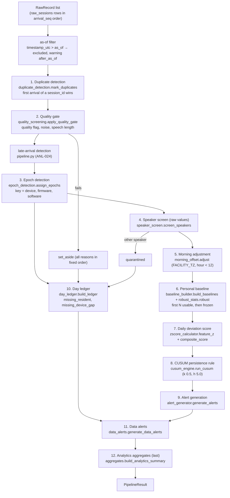
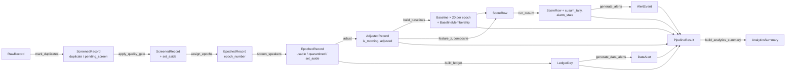
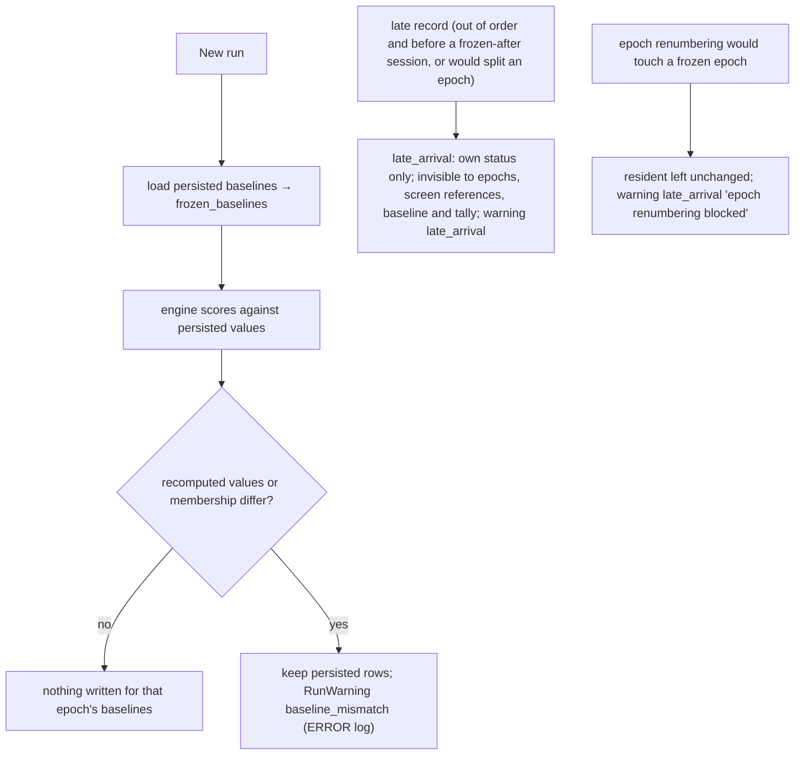
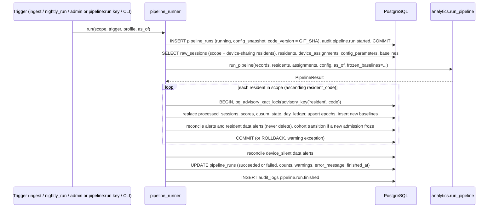

# EchoWell Analytics Architecture

Document: docs/design/Analytics_Architecture.md · Block 3 checkpoint 1, its own PR: GitHub PR #3 (Implement_Feature_Batches.md Phase 7, TRD 25 Phase 2) · Feature: FEAT-001 · Date: 21 October 2026 · Version 0.2 · Revised: 23 October 2026 (review round 1), 26 October 2026 (wireframe v0.2)

## 1. Purpose and sources

This document describes the pure analytics engine `analytics/` and the backend service that persists its output. It is the design input for Phase 6 (FEAT-040..FEAT-056) and for the R01–R10 validation of Phase 7 (FEAT-057..FEAT-061). Algorithms, parameters and expected values are owned by TRD 07 (ANL), TRD 08 (BSC), TRD 09 (CUS) and TRD 10 (ING); the answer key is SRC-03 and the reference implementation SRC-04. This document fixes no formula and no parameter of its own.

| Topic | Source |
|---|---|
| Module list, signatures, data contracts, orchestrator | TRD 07 §4.1–§4.5 (ANL-001..ANL-019) |
| Determinism, rebuild, late arrivals | TRD 07 §4.6 (ANL-020..ANL-027), TRD 01 ARC-040..ARC-046 |
| Configuration profiles | TRD 07 §4.7 (ANL-028..ANL-032), TRD 20 §4.11 |
| Persistence service and triggers | TRD 07 §4.8, §4.9 (ANL-033..ANL-046), TRD 06 §4.4 |
| Robust statistics, epochs, speaker screen, morning adjustment, baseline, scoring | TRD 08 (BSC-001..BSC-043) |
| CUSUM, alerts, data alerts, alarm timing | TRD 09 (CUS-001..CUS-049) |
| Duplicates, quality gate, day ledger | TRD 10 (ING-034..ING-052) |
| Pitfalls that break the answer key | TRD 25 §4.8 (AGT-040..AGT-062) |

## 2. Architectural rules

| Rule | Design | Source |
|---|---|---|
| Single entry point | `analytics.pipeline.run_pipeline` is the only function every trigger uses; the backend caller is `backend/services/pipeline_runner.py` only | ARC-040, ANL-006, API-006 |
| Purity | no import of `backend`, `sqlalchemy`, `psycopg`, `fastapi`, `httpx`, `requests`, `os.environ` readers; no file, network, clock or random access; inputs never mutated; current time arrives as `as_of` | ARC-041, ANL-002, ANL-003, AGT-021 |
| Determinism | equal arguments give field-by-field equal `PipelineResult` (bitwise-equal float64, identical ordering) | ARC-042, ANL-020 |
| Numeric precision | float64 throughout; `numpy.median` (mean of the two middle values for an even count); no rounding of stored values | ARC-046, ANL-022, AGT-041, AGT-054 |
| Fully keyed sorting | records by `(timestamp_utc, arrival_seq)` per resident; residents by `resident_code`; outputs by `(resident_code, epoch_number, timestamp_utc, arrival_seq)` | ANL-021, ARC-074 |
| Parameters from config only | every threshold, offset and floor comes from `analytics.config.PipelineConfig` loaded from `config_parameters`; no hard-coded constant in a stage function | ARC-053, AGT-020 |
| Runtime dependencies | Python standard library and numpy 2.x only; pandas and openpyxl in tests only | ANL-005 |
| No ML, no LLM | deterministic robust statistics and CUSUM only | AGT-004, AGT-005, ARC-104 |
| Answer key never read | no module reads `EchoWell_pipeline_test_v0_1.xlsx` or `evaluation_ground_truth` | AGT-007, AGT-057, ANL-064 |
| Only two exceptions | `ContractError`, `ConfigError` (subclasses of `AnalyticsError`); data findings are `RunWarning` values | ANL-051, ANL-052 |
| No logging in the engine | the runner logs; the engine returns warnings | ANL-053, ANL-054 |

## 3. Modules

Exactly these modules (ANL-004, TRD 07 §8); the existing empty files are filled, the others created. Each has a unit test file `tests/unit/analytics/test_<module>.py` (ANL-008, TST-011).

| Module | Status in repository | Responsibility | Public functions (binding signatures, TRD 07 §4.2) | Spec owner | Feature |
|---|---|---|---|---|---|
| `__init__.py` | create | exports `run_pipeline`, `PipelineConfig`, `PRODUCTION`, `TEST_V0_1`, all contracts; `ENGINE_VERSION = "0.1.0"` | — | ANL-009 | FEAT-040 |
| `config.py` | create | `PipelineConfig`, `OperationalConfig`, `FeatureSpec`, profiles, all data contracts, `FEATURE_KEYS`, `COMPOSITE_KEYS`, `COMPOSITE_SIGNS` | `PipelineConfig.from_mapping(values)`, `snapshot()`, `config_hash()`; constants `PRODUCTION`, `TEST_V0_1`, `FEATURES` | TRD 07, DME-002 | FEAT-040 |
| `robust_stats.py` | create | median, MAD, scaled spread with floor | `robust(values, floor, mad_scale) -> RobustStats` | TRD 08 | FEAT-040 |
| `duplicate_detection.py` | skeleton | arrival-order duplicate marking | `mark_duplicates(records) -> list[ScreenedRecord]` | TRD 10 | FEAT-041 |
| `quality_screening.py` | skeleton | quality gate with all reasons | `apply_quality_gate(rows, config) -> list[ScreenedRecord]` | TRD 10 | FEAT-041 |
| `epoch_detection.py` | skeleton | epoch numbering per resident | `assign_epochs(rows, late=()) -> list[EpochedRecord]` | TRD 08 | FEAT-042 |
| `speaker_screen.py` | create | possible-other-speaker quarantine | `screen_speakers(rows, config) -> list[EpochedRecord]` | TRD 08 | FEAT-044 |
| `morning_offset.py` | skeleton | local time, morning flag, adjusted values | `adjust(rows, config) -> list[AdjustedRecord]` | TRD 08 | FEAT-043 |
| `baseline_builder.py` | skeleton | membership, per-feature and composite baseline, freeze | `build_baselines(rows, config) -> tuple[list[Baseline], dict[EpochKey, BaselineMembership]]` | TRD 08 | FEAT-045 |
| `zscore_calculator.py` | skeleton | per-feature z | `feature_z(row, baselines, config) -> dict[str, float]` | TRD 08 | FEAT-046 |
| `composite_score.py` | skeleton | signed composite raw and composite z | `composite_raw(z, config) -> float`; `composite_z(raw, composite_baseline) -> float` | TRD 08 | FEAT-046 |
| `cusum_engine.py` | skeleton | tally and alarm state per scored session | `run_cusum(rows, config) -> list[ScoreRow]` | TRD 09 | FEAT-047 |
| `alert_generator.py` | skeleton | alarm events, epoch-end facts, Leaning most | `generate_alerts(scores, epochs, config) -> list[AlertEvent]`; `leaning_most(scores, alert, config) -> tuple[str, ...]` | TRD 09 | FEAT-048 |
| `day_ledger.py` | create | resident-day ledger and missing-day classes | `build_ledger(rows, residents, assignments, config, as_of) -> list[LedgerDay]` | TRD 10 | FEAT-049 |
| `data_alerts.py` | create | four data-quality rules | `generate_data_alerts(sessions, ledger, epochs, residents, assignments, config, as_of) -> list[DataAlert]` | TRD 09 §4.9 | FEAT-050 |
| `aggregates.py` | create | Study team page aggregates over the 30-day window | `build_analytics_summary(sessions, ledger, epochs, alerts, data_alerts, residents, config, as_of) -> AnalyticsSummary` | TRD 07 §4.13 | FEAT-051 |
| `pipeline.py` | create | orchestration, late-arrival detection, as-of filter, result assembly | `run_pipeline(...)` (§5) | TRD 07 §4.5 | FEAT-052 |

The file-based engine command line lives outside the package as `scripts/run_engine.py` (ANL-007), so every module under `analytics/` stays free of file I/O. The future modules `analytics/facility_norms.py` (OQ-08, ANL-057) and an EWMA output (OQ-18, ANL-056) are not part of v0.1.

## 4. Stage order (pipeline stages)



| SRC-02 stage | Stage (ANL-006) | Module | Output status or table |
|---|---|---|---|
| 1 Ingest and validate | 1 Duplicate detection (+ schema check in the backend, TRD 10) | `duplicate_detection.py` (and `backend/services/ingestion.py`, `validation.py`) | 422 rejection; `duplicate` |
| 2 Quality gate | 2 Quality gate | `quality_screening.py` | `set_aside` with reasons; else `pending_screen` (memory only, DME-006) |
| 3 Context adjustment (device epochs) | 3 Epoch detection | `epoch_detection.py` | `epochs` |
| Set-aside log (wrong speaker) | 4 Speaker screen | `speaker_screen.py` | `quarantined` or `usable` |
| 3 Context adjustment (morning offset) | 5 Morning adjustment | `morning_offset.py` | `adjusted_features`, `is_morning` |
| 4 Personal baseline | 6 Personal baseline | `baseline_builder.py`, `robust_stats.py` | `baselines` |
| 5 Daily deviation score | 7 Scoring | `zscore_calculator.py`, `composite_score.py` | `scores` |
| 6 Persistence rule | 8 CUSUM | `cusum_engine.py` | `scores.cusum_tally`, `cusum_state` |
| Flag for clinician review | 9 Alert generation | `alert_generator.py` | `alerts` |
| Missing days | 10 Day ledger | `day_ledger.py` | `day_ledger` |
| Data-quality flags (Study team "Data problems to follow up", SRC-21; open `baseline_stalled`/`high_set_aside` also set the API attention flag) | 11 Data alerts | `data_alerts.py` | `data_alerts` |
| Study-team analytics (Study team page, SRC-21) | 12 Analytics aggregates | `aggregates.py` | `GET /api/v1/analytics` (computed, not stored) |

SRC-02's final box mentions an EWMA trend against a baseline band; it is deferred (OQ-18, CUS-036) and no EWMA is computed or displayed in the MVP.

## 5. Orchestrator contract

Binding signature (TRD 07 §4.5, TRD 01 §8), copied verbatim:

```python
def run_pipeline(
    records: Sequence[RawRecord],          # all raw_sessions rows in scope, any order
    residents: Sequence[ResidentInfo],     # residents in scope
    assignments: Sequence[DeviceAssignment],  # ALL assignments of the facility (sharing needs other residents)
    config: PipelineConfig,
    as_of: datetime,                       # timezone-aware; production: request/run start time; tests: fixed value
    *,
    frozen_baselines: Mapping[EpochKey, tuple[Baseline, ...]] | None = None,  # persisted baselines (20 rows per epoch)
) -> PipelineResult: ...
```

Normative algorithm (ANL-014):

```
1  validate inputs (types, tz-aware as_of, unique arrival_seq, 19 feature keys)      -> ContractError on failure
2  recs := records sorted by arrival_seq
3  excluded := {r in recs : r.timestamp_utc > as_of}; recs := recs minus excluded      (warning per record: "after_as_of")
4  screened := apply_quality_gate(mark_duplicates(recs), config)                       TRD 10
5  late := detect_late_arrivals(screened, config)                                       TRD 07 section 4.6
6  epoched := screen_speakers(assign_epochs(screened, late), config)                    TRD 08
7  adjusted := adjust(epoched, config)                                                  TRD 08
8  baselines, membership := build_baselines(adjusted, config)                           TRD 08
9  for each formed (resident, epoch): for each usable, non-late session after the frozen-after
   session in timestamp order: ScoreRow(feature_z, composite_raw, composite_z)          TRD 08
10 scores := run_cusum(score rows grouped per (resident, epoch), config)                 TRD 09
11 epochs := EpochSummary per (resident, epoch)
12 alerts := generate_alerts(scores, epochs)                                            TRD 09
13 ledger := build_ledger(epoched, residents, assignments, config, as_of)               TRD 10
14 data_alerts := generate_data_alerts(adjusted, ledger, epochs, residents, assignments, config, as_of)   TRD 09
15 analytics := build_analytics_summary(adjusted, ledger, epochs, alerts, data_alerts, residents, config, as_of)
16 return PipelineResult(... counts, warnings sorted by (code, resident_code, session_id))
```

## 6. Data contracts

All contracts are `@dataclass(frozen=True, slots=True)` in `analytics/config.py` (ANL-010); stages pass contract objects, never dicts or DataFrames (ANL-011); feature mappings always hold the 19 canonical keys in contract order (ANL-013).



| Contract | Key fields | Persisted as |
|---|---|---|
| `RawRecord` | raw_session_id, arrival_seq, received_at, session_id, resident_code, device_code, timestamp_utc, quality fields, versions, phrase_id, 19 features | `raw_sessions` (input only, built from typed columns, ANL-035) |
| `ScreenedRecord`, `EpochedRecord`, `AdjustedRecord` | status, reasons, reason_text, epoch_number, screen_detail, late_arrival, local_date, is_morning, adjusted, baseline_ordinal, in_baseline | `processed_sessions` (one row per raw row, ANL-012) |
| `EpochSummary` | epoch key, versions, started_at, ended_at, usable_count, baseline_formed, frozen_after_session_id, scored_count, watching_since, current_tally, alarm_on, first_alarm_session_id | `epochs`, `cusum_state` |
| `Baseline` | resident, epoch, device, feature_key (19 + composite), n_sessions, first and frozen-after session ids, median, mad, robust_spread, floor_applied, frozen_at | `baselines` |
| `ScoreRow` | session_id, epoch_number, local_date, is_morning, z (7 unsigned), composite_raw, composite_z, cusum_tally, alarm_state, scored_ordinal | `scores` |
| `AlertEvent` | resident, epoch, first-crossing session_id, triggered_at, local_date, cusum_value, epoch_ended, epoch_ended_at, leaning_most | `alerts` |
| `LedgerDay` | resident, local_date, status, device_code, reason | `day_ledger` |
| `DataAlert` | kind, resident_code or device_code, title, detail, days | `data_alerts` |
| `AnalyticsSummary` | period, kpis, daily_series, funnel, by_resident | not stored; mapped to `AnalyticsResponse` by `analytics_summary.py` |
| `RunWarning` | code, resident_code, session_id, detail | `pipeline_runs.warnings` |
| `PipelineResult` | run_config, config_hash, engine_version, as_of, sessions, epochs, baselines, scores, alerts, ledger, data_alerts, analytics, warnings, counts | `pipeline_runs` row and all derived tables |

## 7. Stage rules (summary; normative text in the owning TRDs)

| Stage | Rule | Source | Pitfall guard |
|---|---|---|---|
| Duplicates | key = exact `session_id`; process in `arrival_seq` order; first arrival kept; later copies `duplicate` with reason "session_id already received", even when the late copy is out of time order; duplicates are not gated, screened, ledgered as check-ins or counted | ING-034..ING-037 | AGT-043, AGT-053 |
| Quality gate | set aside when `audio_quality_flag` ≠ "ok", `mic_noise_level_dbfs` > −40.0, or `speech_duration_s` < 1.0; all reasons in the fixed order "quality flag poor", "noise above limit", "speech too short", joined "; " | ING-040, ING-041 | AGT-049 |
| Epochs | per resident over non-duplicate, non-late records (set-aside included) in time order; a change of device, firmware or extraction software starts a new epoch; duplicates have no epoch | BSC-006..BSC-010 | AGT-045 |
| Speaker screen | reference = first up to N usable sessions of the epoch preceding the record (first-N, not rolling), raw values, runs only with ≥ 5 references; quarantine if and only if F0 \|z\| ≥ 4.0 and at least 2 composite features have \|z\| ≥ 3.0; reason text with F0 z to 2 decimals; spread 0 → z 0 | BSC-011..BSC-019 | AGT-044, AGT-042 |
| Morning adjustment | local time with `zoneinfo` in `facility_tz` (never a fixed offset); morning = local hour < 12; adjusted = raw − configured offset for morning records | BSC-020..BSC-024 | AGT-040, AGT-050 |
| Baseline | first N usable non-late sessions of the epoch (N = 30 production, 16 test_v0_1), then frozen; median, MAD, spread = max(MAD × 1.4826, floor) with floor 0.5 for `number_of_pauses`, 0.1 for composite, 0 otherwise; `floor_applied` strict | BSC-001..BSC-005, BSC-025..BSC-034 | AGT-041, AGT-042, AGT-051 |
| Scoring | every usable non-late session after the freeze is scored once; unsigned z per feature; `composite_raw` = mean of sign × z over 7 features (signs loudness −1, phrase duration +1, speech rate −1, articulation rate −1, pauses +1, pause fraction +1, voiced fraction −1); `composite_z` against the composite baseline | BSC-032..BSC-039 | AGT-055, AGT-054 |
| CUSUM | S = max(0, S + composite_z − k), S₀ = 0 per epoch; only scored sessions update the tally; alarm at S ≥ h: "rings" at the first crossing, "on" afterwards even below h; no reset except a new epoch | CUS-001..CUS-010 | AGT-047, AGT-048, AGT-058 |
| Alerts | one `AlertEvent` per resident-epoch with a "rings" session; epoch-end facts when a later epoch exists; Leaning most = up to 3 composite features with the highest mean signed z (> 0) since the alarm | CUS-011..CUS-015, CUS-041 | AGT-056 |
| Day ledger | one row per resident per local day from `enrolled_on` to the as-of local date (or withdrawal); `checked_in` when ≥ 1 non-duplicate record (any status); otherwise `missing_device_gap` when every resident on the shared device has no record that day, else `missing_resident`; never imputed or backfilled | ING-044..ING-052, DB-023 | AGT-046 |
| Data alerts | baseline_stalled, possible_other_speaker, high_set_aside (suppressed when baseline_stalled is listed), device_silent; thresholds are operational keys | CUS-043..CUS-046, ANL-059 | — |
| Aggregates | 30-day window not before enrolment; received = non-duplicate records; expected = Σ enrolled days; `pct(n, d) = (200·n + d) // (2·d)` | ANL-061..ANL-063 | — |

## 8. Configuration profiles

| Field (`PipelineConfig`) | production | test_v0_1 | Kind |
|---|---|---|---|
| profile | "production" | "test_v0_1" | algorithm |
| facility_tz | America/Chicago | America/Chicago | algorithm |
| noise_limit_dbfs | −40.0 | −40.0 | algorithm |
| min_speech_s | 1.0 | 1.0 | algorithm |
| baseline_n | 30 | 16 | algorithm |
| screen_min_n / screen_f0_z / screen_other_z / screen_other_count | 5 / 4.0 / 3.0 / 2 | 5 / 4.0 / 3.0 / 2 | algorithm |
| mad_scale / pause_floor / composite_floor | 1.4826 / 0.5 / 0.1 | 1.4826 / 0.5 / 0.1 | algorithm |
| cusum_k / cusum_h | 0.5 / 5.0 | 0.5 / 5.0 | algorithm |
| morning_cutoff_hour | 12 | 12 | algorithm |
| morning_offsets | contract §6 column (19 keys, 13 zeros) | same | algorithm |
| shared_device_min_residents | 2 | 2 | algorithm |
| features | 19 `FeatureSpec` | same | algorithm (code constant, ANL-058) |
| operational: data_alert_set_aside_fraction, data_alert_device_silent_days, data_alert_baseline_stalled_enabled, alert_snooze_hours, review_explanations | 0.20, 2, true, 24, 5 codes | same | operational (excluded from `config_hash`) |

- Profile chosen by `PIPELINE_PROFILE`; rows loaded from `config_parameters` by `backend/services/config_service.py`; a missing key falls back to the built-in constant with warning `config_default_used`; an empty or invalid profile ends the run `failed` with `pipeline_config_invalid` (ANL-031, ENV-021).
- `config_hash()` = SHA-256 of the canonical JSON of the algorithm keys only; the stored snapshot holds all 23 keys plus `config_hash` and `as_of` (ANL-030, DB-020).
- `test_v0_1` is refused when `APP_ENV=production` (D-01, AGT-015).

## 9. Frozen baselines, late arrivals and human data on rebuild



| Rule | Design | Source |
|---|---|---|
| Frozen baselines are inputs | persisted baselines are passed back as `frozen_baselines` and never recomputed except by `backend.cli rebuild` after an algorithm-key change | ARC-043, ANL-037, DB-016, D-56 |
| Late arrivals | classified by ANL-024 from `raw_sessions` content and `arrival_seq` only, so a rebuild reproduces the same frozen baselines; status `usable` with `in_baseline = false` and reason "late arrival (not used for baseline or scores)" | ANL-024..ANL-026, BSC-040, BSC-041, D-57 |
| Natural-key upserts | processed_sessions by `raw_session_id`; epochs by `(resident_id, epoch_number)`; baselines by `(epoch_id, feature_key)`; scores by `processed_session_id`; day_ledger by `(resident_id, local_date)`; alerts by `(epoch_id, session_id)`; data alerts by `(kind, resident_id, device_id)` | ARC-045, DB-015, DB-018, DB-036 |
| Human data preserved | `staff_notes`, `alert_reviews`, review-flagged data alerts and alert `status`, `acknowledged_by`, `acknowledged_at`, `snoozed_until`, `snoozed_by` survive every rebuild | ARC-044, AGT-056, AC-ARC-11 |
| Reviews never reset | a review, a data-problem outcome, a note or a snooze never changes `cusum_tally` or `alarm_state` and never closes the alert; only a new epoch ("epoch ended") or a rebuild that no longer produces the crossing ("superseded by rebuild") closes it | AGT-058, CUS-008, D-03, D-35, OQ-05 |
| Idempotency | two full rebuilds with unchanged inputs give identical derived tables (except ids, timestamps, run ids) | ARC-071, DB-019, ANL-023 |

## 10. Persistence service (`backend/services/pipeline_runner.py`)



Sources: ANL-033..ANL-042, DB-013..DB-018, DB-021, DB-025, API-063, API-064.

## 11. Data alerts and analytics aggregates on the test data

Expected values for SRC-05 with profile `test_v0_1`, as-of 2026-10-30 15:00 America/Chicago (CUS-044, ANL-062, TRD 07 §4.13):

| Output | Expected |
|---|---|
| Data alerts (in order) | R08 baseline_stalled "R08 · baseline stuck at 13 of 16" / "baseline stuck at 13 of 16. 12 missed and 5 set aside in 30 days."; R05 possible_other_speaker "2 check-ins held back as possible other voice (Oct 8, Oct 22)."; R03 high_set_aside "7 of 29 received check-ins set aside (noise, quality flag, too short)."; D02 device_silent "silent all day Oct 12. Affected R02 and R03." (v0.2 details, titles unchanged; TRD 09 §4.9, D-114) |
| KPIs | received 281 of 300 (94%); used 267 of 300 (89%); baselines 9 of 10 (R08 forming, R07 restarted once); alarms 2 (R09, R10) |
| Funnel | 300 → 281 (19 missed, 2 duplicates) → 269 (12 set aside: quality flag 5, noise 5, too short 3, 1 with two reasons) → 267 (2 held back as possible other voice) |
| By resident | R08 43%, R03 73%, R02 80%, R05 93%, the others 100% |
| Status totals | usable 267, set_aside 12, quarantined 2, duplicate 2, missing_resident 17, missing_device_gap 2 |
| Run counts | arrivals 283, scored 98, alerts_opened 2, residents 10, baselines 180 rows |
| Alerts | R09 first crossing R09-20261021-01 (tally 5.431965); R10 first crossing R10-20261024-01 |

`kpis.alarms_raised.not_reviewed` is computed by the backend at response time from persisted alert status, because reviews are human state the engine never receives (ANL-065). The alarm timing table is assembled after the run only by `backend/services/analytics_summary.py` from `evaluation_ground_truth` through `DATABASE_READONLY_URL`, in profile `test_v0_1` only (CUS-047, ANL-064).

## 12. Warning codes

`after_as_of`, `late_arrival`, `zero_spread`, `baseline_mismatch`, `config_default_used`, `config_mismatch`, `no_device_assignment`, `alert_first_crossing_changed`, `device_assignment_mismatch`; added by the runner: `exception`, `run_abandoned`; run-failing: `config_changed_requires_rebuild`, `pipeline_config_invalid` (ANL-052, ANL-032, ANL-031, API-055, API-068).

## 13. Performance

| Budget | Value | Source |
|---|---|---|
| Engine on SRC-05 including stages 11–12 | ≤ 5 s on `ubuntu-24.04` (CI marker `budget`) | ANL-047, CIC-036, D-40 |
| Full rebuild DS-08 (100 residents, 10,800 records) | ≤ 120 s end to end | ANL-048 |
| Single-record ingest with resident-scoped run | ≤ 1,000 ms p95 | ANL-049 |
| Complexity | no stage worse than O(n log n) per resident except late-arrival detection | ANL-050 |

## 14. Extension points (not built in v0.1)

| Extension | Design hook | Source |
|---|---|---|
| Morning offset estimation | separate pure `morning_offset.estimate_offsets`, applied through `set-config` and `rebuild` | ANL-055, OQ-09, FEAT-094 |
| Facility reference ranges | separate pure module `analytics/facility_norms.py`, called after a full run | ANL-057, OQ-08, FEAT-095 |
| EWMA trend | new `ScoreRow` field after `run_cusum`, never altering tally or alarm; not implemented, no chart | ANL-056, OQ-18, FEAT-096 |
| Alarm-limit calibration | `scripts/run_engine.py` grid on DS-04; production profile values only | CUS-030..CUS-035, OQ-13, OQ-27, FEAT-093 |
| Speaker verification input | new `schema_version`, new typed column | OQ-14, FEAT-097 |

## 15. Open questions affecting analytics

| ID | Interim decision used by the design |
|---|---|
| OQ-05 | No tally or alarm reset on review. |
| OQ-08 | No facility norm; admissions comparison returns `range_not_available`. |
| OQ-09 | Configured morning offsets in both profiles. |
| OQ-10 | Frozen baseline unchanged; `late_arrival` warning. |
| OQ-13 | Production `cusum_k`, `cusum_h` uncalibrated (0.5, 5.0). |
| OQ-18 | No EWMA. |
| OQ-24 | Provisional data-alert thresholds. |
| OQ-31 | The engine's data-alert rules are unchanged; only the read side decides that open `baseline_stalled` and `high_set_aside` alerts mean "Needs attention". |

## Revision History

| Version | Date | Change | Author |
|---|---|---|---|
| 0.2 | 26 Oct 2026 | Wireframe v0.2 (SRC-21; TRD 24 D-108 to D-114): SRC-18/19 references replaced by the Study team page; §11 data-alert details use the v0.2 texts and the funnel the "held back" wording; OQ-31 | — |
