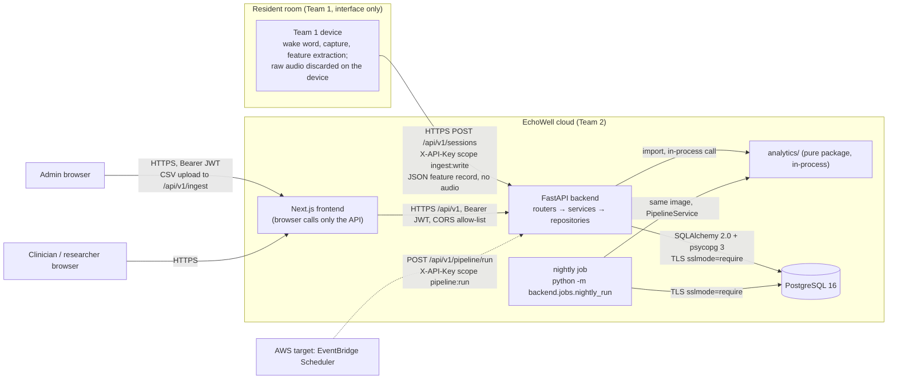
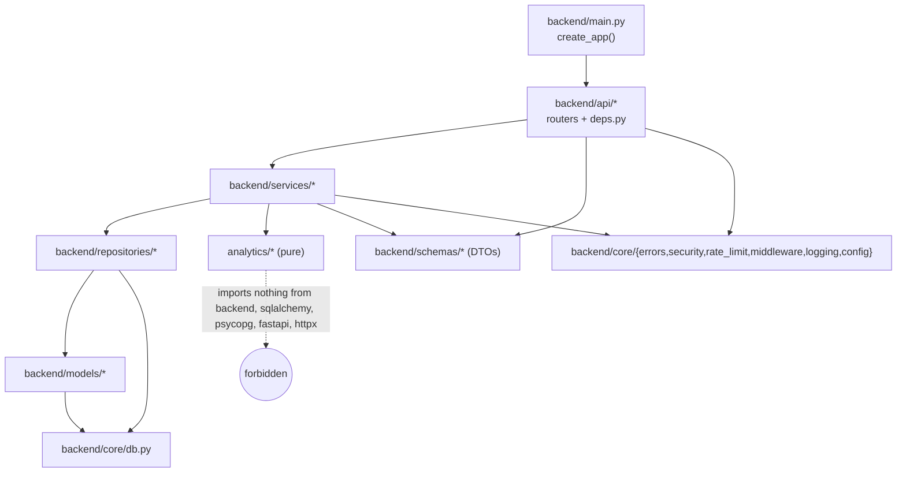
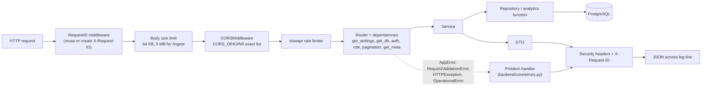
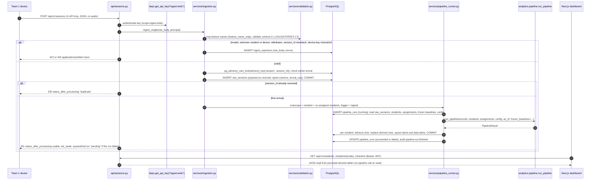

# EchoWell Backend Architecture

Document: docs/design/Backend_Architecture.md · Block 3 checkpoint 1, its own PR: GitHub PR #3 (Implement_Feature_Batches.md Phase 7, TRD 25 Phase 2) · Feature: FEAT-001 · Date: 21 October 2026 · Version 0.2 · Revised: 23 October 2026 (review round 1), 26 October 2026 (wireframe v0.2)

## 1. Purpose and sources

This document describes the FastAPI backend that the Phase 3 (skeleton, FEAT-002, FEAT-003), Phase 4 (database layer, FEAT-008..FEAT-017) and Phase 5 (backend API, FEAT-018..FEAT-039) agents build, and the persistence service that Phase 6 fills (FEAT-053..FEAT-056). It elaborates TRD 01 (ARC), TRD 05 (API), TRD 10 (ING), TRD 12 (SEC), TRD 17 (LOG) and TRD 21 (ENV) without changing them.

| Topic | Source |
|---|---|
| System boundary, containers, layering | TRD 01 §4.1, §4.2, §4.6 (ARC-001..ARC-019, ARC-050..ARC-057) |
| Application structure, DI, endpoints, errors | TRD 05 §4.1–§4.12 (API-001..API-137) |
| Endpoint contracts | TRD 19 (E-01..E-32) and docs/design/OpenAPI_Spec.md |
| Ingest and validation | TRD 10 (ING-001..ING-059) |
| Security | TRD 12 (SEC role matrix §4.6, audit vocabulary §4.12) |
| Logging | TRD 17 (LOG) |
| Configuration | TRD 21 (ENV) |

## 2. System context and trust boundaries



| Boundary rule | Design consequence | Source |
|---|---|---|
| The only Team 1 → Team 2 interface is the ingest API | `POST /api/v1/sessions` (E-05) and `POST /api/v1/ingest` (E-06); no EchoWell component runs on the device | ARC-001, ARC-002 |
| No audio anywhere | no endpoint, column, file store or message type accepts or returns audio; `extra="forbid"` rejects unknown fields such as `audio_base64`; media types other than JSON and CSV multipart are refused with 415 | ARC-003, AGT-006, ING-012, AC-API-07 |
| Authentication methods | devices: `X-API-Key` scope `ingest:write`; scheduler: scope `pipeline:run`; users: JWT bearer | ARC-004, API-012..API-015, D-47 |
| Transport security | HTTPS TLS 1.2+ on every external hop, terminated by the platform; database connection `sslmode=require` (or `verify-full`) outside local and test | ARC-005, ARC-006, ARC-057, API-059, D-88 |
| Encryption at rest | provider-managed on Neon/Railway; RDS with KMS on AWS | ARC-007, D-27 |
| Synthetic data only on the interim stack | no real resident data is ingested on Netlify/Railway/Neon; go-live only on AWS | ARC-008, AGT-014, D-28 |
| No LLM, no ML on the critical path | deterministic robust statistics plus CUSUM only | ARC-104, AGT-004, AGT-005 |

## 3. Processes

| Process | Entry point | Connection strings | Responsibility | Source |
|---|---|---|---|---|
| Web service | image default `sh -c "uvicorn backend.main:app --host 0.0.0.0 --port ${PORT:-8000} --proxy-headers --forwarded-allow-ips='*'"` (DEP-022); Railway start command `uvicorn backend.main:app --host 0.0.0.0 --port $PORT --proxy-headers --forwarded-allow-ips="*"` (DEP-040); the image default carries the same flags, so the client IP is the left-most `X-Forwarded-For` address behind the hosting edge (API-001, API-103; Q-10 resolved in PR #3 review); the local Compose command omits them | `DATABASE_URL`; `DATABASE_READONLY_URL` only in `analytics_summary.py` | REST API, ingest, synchronous and background pipeline runs | API-001, API-103, DEP-022, DEP-040, ARC-015 |
| Pre-deploy migration | `alembic upgrade head` (repository root) | `DATABASE_MIGRATION_URL` | schema changes before traffic | ARC-082, DEP-040, D-58 |
| Nightly job | `python -m backend.jobs.nightly_run` (Railway Cron Job service `nightly`, `0 7,8 * * *` UTC) | `DATABASE_URL` | runs only in facility-local hour `NIGHTLY_RUN_HOUR_LOCAL` once per night; scope `all`, trigger `nightly` | ARC-061, API-060..API-062, DEP-046, DEP-047, AGT-059 |
| Operator CLI | `python -m backend.cli <command>` | `DATABASE_URL`, or `DATABASE_MIGRATION_URL` for the closed list | users, API keys, master data, seed, set-config, rebuild, export-openapi | TRD 15 §4.8, ARC-067 |
| Ground-truth loader | `python database/seeds/load_evaluation_ground_truth.py <csv_path>` | `DATABASE_MIGRATION_URL` | fills `evaluation_ground_truth` in profile test_v0_1 only | ARC-034, D-38 |

No in-process scheduler, no Celery, Redis or message queue; FastAPI `BackgroundTasks` runs batch-triggered pipeline runs (ARC-091, TRD 01 §8, AGT-059). One web replica (DEP-042), so in-memory rate-limit storage is sufficient (TRD 05 §5).

## 4. Package layout

```
backend/
  main.py                 create_app(): settings guards, middleware, exception handlers, routers under /api/v1
  cli.py                  operator CLI (TRD 15 §4.8)
  jobs/nightly_run.py     nightly entry point
  api/                    routers (thin): health, auth, config, sessions, ingest, residents, scores,
                          alarms, devices, analytics, pipeline, admissions, users; deps.py
  schemas/                Pydantic v2 DTOs, names = TRD 19 component names
  services/               orchestration and rules, no fastapi import
  repositories/           SQLAlchemy 2.0 queries, one module per aggregate (names: Database_ERD.md §5)
  models/                 ORM models (TRD 23 §4.6), enums in __init__.py
  core/                   config.py, db.py, security.py, errors.py, logging.py, middleware.py, rate_limit.py
  alembic/                env.py, script.py.mako, versions/
```

Existing skeleton files are kept and filled in: `backend/api/{alarms,analytics,health,residents,sessions}.py`, `backend/models/{alarm,baseline,resident,score,session}.py`, `backend/services/{baseline,cusum,ingestion,morning_adjustment,scoring,speaker_screen,validation}.py` (ARC-050, API-008, AGT-010, D-24). The stage-named services (`baseline.py`, `cusum.py`, `morning_adjustment.py`, `scoring.py`, `speaker_screen.py`) are thin read adapters over persisted results and contain no statistical logic (ARC-052, TRD 07 §8).

Router files (Q-7 resolved in PR #3 review): TRD 05 §4.1 is the source of truth for router organisation: `/data-alerts` is served by `alarms.py`, `/residents/{code}/notes` by `residents.py` and `/facility/reference-ranges` by `admissions.py`; TRD 01 §4.6 now lists the same routers.

## 5. Layering and dependency direction



| Rule | Check | Source |
|---|---|---|
| Routers contain no SQL and no business rules; each handler calls one service function and returns a DTO | import-linter contract in `backend-lint` | API-003, ARC-051 |
| Services never import `fastapi`; they raise `AppError` subclasses | import-linter | API-004 |
| Repositories are the only modules building SQLAlchemy queries; they never call services. One sanctioned exception: `analytics_summary.py` reads the test-only table `evaluation_ground_truth` through its own read-only engine (DATABASE_READONLY_URL) | import-linter (with that one module allowed) | API-005, API-136, ARC-051 |
| Only `analytics.pipeline.run_pipeline`, `analytics.aggregates.build_analytics_summary` and `analytics.alert_generator.leaning_most` are called from services | inspection | API-006, D-79 |
| `analytics/` imports nothing from `backend/` and does no I/O, clock or randomness | `tests/unit/backend/test_import_boundary.py`, AC-ARC-01 | ARC-041, ANL-002, AGT-021 |
| Synchronous SQLAlchemy with `postgresql+psycopg://`; handlers are `def` (thread pool) except health and middleware | inspection | API-007, ENV-014 |

## 6. Request lifecycle and dependencies



| Dependency (`backend/api/deps.py`) | Behaviour | Source |
|---|---|---|
| `get_settings()` | cached `Settings` (pydantic-settings) | API-010, ENV-001 |
| `get_db()` | one `Session` per request; commit on success, rollback on exception, always close | API-011 |
| `get_current_user()` | decode JWT, load user by `sub`, reject inactive with 401 `TOKEN_INVALID` | API-012 |
| `require_roles(*roles)` | role read from the database row; 403 `FORBIDDEN` otherwise | API-013, SEC-040 |
| `get_api_key(scope)` | SHA-256 of `X-API-Key`, active row with scope; 401 `API_KEY_INVALID` / 403 `FORBIDDEN` | API-014, PGS-035 |
| `get_ingest_principal()` | API key or admin JWT → `Principal(actor_type, actor_id, device_id)` | API-015 |
| `get_pagination()` | `limit` 1..500, `offset` ≥ 0; else 422 `INVALID_QUERY_PARAMETER` | API-016 |
| `get_meta()` | `meta` block from `facilities.name`, FACILITY_TZ, DATA_SOURCE_LABEL, latest succeeded run `as_of`, profile `baseline_n`, `cusum_h` | API-057, API-069 |

Every dependency is overridable through `app.dependency_overrides` for tests (API-017). Engines come from the single factory in `backend/core/db.py` (`pool_size=5`, `max_overflow=5`, `pool_pre_ping=True`, `pool_recycle=300`, `prepare_threshold=None`) (API-125); the readonly engine uses `pool_size=1` (API-136).

## 7. Request flow of one check-in



Sources: ARC-020..ARC-025, API-030..API-047, ING-001..ING-004, ING-034, ING-038, DB-021, DB-022.

## 8. Endpoint → router → service map

Full table with roles, tables and features: docs/design/OpenAPI_Spec.md §5. Summary (E-IDs of TRD 19 §4.3):

| Router file | Endpoints | Service module(s) |
|---|---|---|
| `health.py` | E-01 | `health_service.py` (`get_health`: database probe through `backend/core/db.py`, TRD 05 §4.12) |
| `auth.py` | E-02, E-03, E-04 | `auth_service.py` |
| `config.py` | E-32 | `config_service.py` |
| `sessions.py` | E-05 | `ingestion.py`, `pipeline_runner.py` |
| `ingest.py` | E-06, E-07 | `ingestion.py`, `pipeline_runner.py` |
| `residents.py` | E-08, E-09, E-10, E-11, E-15, E-16 | `resident_service.py`, `checkin_service.py`, `feature_service.py`, `note_service.py` |
| `scores.py` | E-12 | `scoring.py`, `export_service.py` |
| `alarms.py` | E-13, E-14, E-28, E-29, E-30 | `alert_service.py`, `review_service.py`, `data_alert_service.py` |
| `devices.py` | E-17 | `device_service.py` |
| `analytics.py` | E-18, E-19 | `analytics_summary.py`, `analytics_service.py`, `export_service.py` |
| `pipeline.py` | E-20, E-21, E-31 | `pipeline_runner.py` |
| `admissions.py` | E-22, E-23, E-24 | `admission_service.py` |
| `users.py` | E-25, E-26, E-27 | `user_service.py` |

## 9. Service catalogue

| Service module | Responsibility | Repositories | Analytics calls | Endpoints / callers | Features |
|---|---|---|---|---|---|
| `ingestion.py` (skeleton) | feature-name mapping, single and batch ingest, duplicate check under the session lock, rejection storage, batch counts, audit `ingest.batch.received` for batches | raw_session, ingest, resident, device, audit | none | E-05, E-06, E-07; `cli seed` | FEAT-023, FEAT-025, FEAT-026 |
| `validation.py` (skeleton) | `VALIDATORS = {"0.1": ...}` schema-version registry; reject rules collected per field | config | none | `ingestion.py` | FEAT-023 |
| `pipeline_runner.py` | the only caller of `run_pipeline`; run row, config snapshot, as-of resolution, per-resident transactions with advisory locks, natural-key upserts, warnings, audit `pipeline.run.started`/`finished`; interim executor records `failed` "pipeline not available until Phase 6" until FEAT-053 lands | pipeline_run, raw_session, resident, device, baseline, epoch, processed_session, day_ledger, score, alert, data_alert, config, audit | `analytics.pipeline.run_pipeline` | E-05, E-06, E-20, E-21, E-31; nightly job; CLI `run-pipeline`, `rebuild`, `seed` | FEAT-024, FEAT-053, FEAT-054 |
| `health_service.py` | `get_health()`: `SELECT 1` within 2 s, `Health` with `status`, `database`, `version` (`GIT_SHA`), `time`; 503 shape on failure; no audit row | none (engine probe through `backend/core/db.py`) | none | E-01 | FEAT-003 |
| `config_service.py` | load profile rows into `PipelineConfig` (defaults with `config_default_used`); `UiConfig` | config, facility | `analytics.config.PipelineConfig.from_mapping` | E-32; `pipeline_runner.py`; `get_meta()` | FEAT-030, FEAT-040 |
| `resident_service.py` | resident list rows, display-status `summary` counts (`changed`, `needs_attention`, `learning`, `usual`), sorts (`alarm` per TRD 24 D-109; natural sort), attention flag, `alarm_reviewed`, `restart_cause` and the detail `window` (API-138), detail with explanation facts | resident, device, read_models, alert, score, data_alert | none | E-08, E-09 | FEAT-027, FEAT-028 |
| `checkin_service.py` | check-in events with same-date order, restart cause and the derived `checkins_started` event (API-077, D-113) | read_models, processed_session, day_ledger, epoch, baseline, alert, score | none | E-10 | FEAT-028 |
| `feature_service.py` | 7 scored series with label, unit, sign, baseline, points; 12 stored-only keys | processed_session, raw_session, baseline, score | none (feature metadata from `analytics.config.FEATURES`) | E-11 | FEAT-028 |
| `scoring.py` (skeleton) | scores list with `cusum_k` and `baseline_periods` | score, baseline, epoch | none | E-12 | FEAT-034 |
| `export_service.py` | CSV streaming for scores and baselines, row limit, audit `export.csv` | score, baseline, audit | none | E-12, E-19 (`Accept: text/csv`) | FEAT-034 |
| `alert_service.py` | alert list (open days, current tally, review count, leaning most), snooze | alert, score, audit | `analytics.alert_generator.leaning_most` | E-13, E-29 | FEAT-030, FEAT-031 |
| `review_service.py` | create review, status acknowledged, data-problem data alert, audit `alert.reviewed`; list reviews | alert, data_alert, user, config, audit | none | E-14, E-28 | FEAT-031 |
| `data_alert_service.py` | data-alert list ordered by kind then code (Study team "Data problems to follow up"; v0.2 `detail` strings are written by the pipeline and the review service, TRD 09 §4.9) | data_alert, resident, device | none | E-30; CLI `resolve-data-alert` | FEAT-032 |
| `note_service.py` | append-only notes with supersede rule, audit `note.created` | staff_note, alert, user, audit | none | E-15, E-16 | FEAT-033 |
| `device_service.py` | device items (Study team Devices, chart Device section), silent days, device-gap days, in-use dates, `uploaded_on_as_of_date` (API-086, D-114) | device, read_models | none | E-17 | FEAT-029 |
| `analytics_service.py` | baselines export rows (Exp_baselines shape, composite last) | baseline, epoch, device, resident | none | E-19 | FEAT-034 |
| `analytics_summary.py` | `AnalyticsResponse`: aggregates, status counts, outcomes, latest run, `alarm_timing` (test_v0_1, readonly engine) or `review_outcomes` (production) | processed_session, day_ledger, epoch, alert, pipeline_run; own readonly engine for evaluation_ground_truth | `analytics.aggregates.build_analytics_summary` | E-18 | FEAT-035, FEAT-051 |
| `admission_service.py` | experimental admissions list, comparison, reference ranges (empty in v0.1) | resident, processed_session, reference_range, baseline | none | E-22, E-23, E-24 | FEAT-036 |
| `auth_service.py` | login (constant-time failure, lockout), logout, me; audit auth actions | user, audit | none | E-02, E-03, E-04 | FEAT-020 |
| `user_service.py` | list, create, update users; last-admin and self-change guards; audit | user, audit | none | E-25, E-26, E-27; CLI `create-user` | FEAT-037 |
| `audit_service.py` | `record(session, action, entity_type, entity_id, details)` inside the caller's transaction | audit | none | every audited path | FEAT-015 |
| `baseline.py`, `cusum.py`, `morning_adjustment.py`, `speaker_screen.py` (skeletons) | thin read adapters over persisted baselines, tallies, morning flags and screen details; no algorithm | baseline, score, processed_session | none | used by the read services above | FEAT-028, FEAT-034 |

Naming (Q-3 resolved in PR #3 review): the service modules are `auth_service.py` and `audit_service.py`, as in TRD 05 §4.1 and TRD 12 §8; FEAT-015, FEAT-020 and the roadmap use the same names.

## 10. Pipeline triggering, concurrency and transactions

| Trigger | `pipeline_runs.trigger` | Scope | Mode | Caller | Source |
|---|---|---|---|---|---|
| Single-record ingest | ingest | resident + residents sharing the device that day | synchronous in the request | E-05 | ARC-022, API-045, ANL-043 |
| Batch or CSV ingest | ingest | residents with a first arrival + co-assigned residents | `BackgroundTasks` after 202 | E-06 | ARC-023, API-053, ANL-044 |
| Nightly (interim) | nightly | all active residents | separate Railway cron service | `python -m backend.jobs.nightly_run` | ARC-061, DEP-046, DEP-047 |
| Nightly (AWS target) | nightly | all | background task, once per facility-local night | EventBridge → E-20 with `pipeline:run` key | D-47, D-70, DEP-116 |
| Manual | manual | `{scope, profile, as_of?}` | background task | E-20 (admin JWT); CLI `run-pipeline`, `rebuild`, `seed` | ARC-066, ARC-070 |
| Test | test | all | synchronous | validation suite | ANL-046 |

- One transaction per resident; failure rolls back only that resident and the run ends `failed` with the resident named in `error_message` (ARC-064, DB-013, ANL-041).
- Transaction-scoped advisory locks only: `advisory_key('resident', code)` per resident in ascending code order; `advisory_key('session', session_id)` at ingest; no session-level or global lock (Neon pooled endpoint) (ARC-063, DB-021, API-064).
- A run still `running` after 30 minutes is marked `failed` with warning `run_abandoned` before a new run proceeds (API-068).
- Each run stores the full config snapshot (23 keys, `config_hash`, `as_of`) and `code_version` = `GIT_SHA` (ARC-060, ARC-073, DB-020).
- An algorithm-key change takes effect only through `python -m backend.cli rebuild --profile <P> --confirm REBUILD` as `echowell_migrator`; other runs fail with `config_changed_requires_rebuild` until then (ANL-032, D-56).

## 11. Security controls

| Control | Design | Source |
|---|---|---|
| Passwords | argon2id hashes (`$argon2id$` prefix enforced in the schema) | PGS-034, TRD 12 §4.3 |
| JWT | HS256 with `JWT_SECRET` (≥ 32 bytes), lifetime `JWT_EXPIRES_MINUTES`; no refresh tokens; logout audited, token not revoked | API-020, API-025, ENV-013 |
| API keys | SHA-256 hash stored; scopes `ingest:write`, `pipeline:run`; optional device binding; created and revoked only by CLI | API-014, API-040, PGS-035, ARC-067, FR-226 |
| Roles | exactly `admin`, `clinician`, `researcher`; matrix of TRD 12 §4.6 enforced server-side | SEC-040..SEC-045, AGT-062 |
| Rate limits | login 5/minute per IP (60/minute only on the E2E stack); ingest 600/minute per key or admin; others 300/minute per user | API-102, ENV-054, D-74 |
| CORS | exact origins from `CORS_ORIGINS`; `CORS_ORIGIN_REGEX` for staging deploy previews only, refused in production | API-101, ENV-012 |
| Headers | `X-Content-Type-Options`, `X-Frame-Options: DENY`, `Referrer-Policy: no-referrer`, `Cache-Control: no-store`, HSTS in staging and production | API-106, DEP-045 |
| Body size | 64 KB (5 MB for E-06) | API-104 |
| Database least privilege | app role cannot UPDATE or DELETE append-only tables and cannot read `evaluation_ground_truth` | PGS-021, PGS-040, AGT-060 |
| Answer key isolation | no module in `backend/` or `analytics/` reads the workbook; only `analytics_summary.py` reads `evaluation_ground_truth`, through the readonly engine | AGT-007, AGT-057, ARC-033, ARC-034 |

## 12. Errors, logging and audit

- All non-2xx responses are Problem documents built in `backend/core/errors.py`; 500 never leaks traces, SQL or paths; `OperationalError` → 503 with `Retry-After: 30` (API-095..API-098).
- One JSON access-log line per request with `request_id`, method, route template, status, `duration_ms`, actor; never request bodies, feature values, credentials or tokens (API-107, ARC-095, API-056, ANL-054).
- The pipeline runner logs `pipeline_run_started` and exactly one of `pipeline_run_succeeded` or `pipeline_run_failed`, plus one `pipeline_warning` per warning (ANL-053, D-80).
- Audit actions are exactly the TRD 12 §4.12 vocabulary, written by `audit_service.record` in the same transaction as the change (DB-011, PGS-044).

## 13. Configuration and startup guards

| Guard | Behaviour | Source |
|---|---|---|
| Production with test profile | `create_app()` and the nightly job exit non-zero when `APP_ENV=production` and `PIPELINE_PROFILE=test_v0_1` | ARC-056, API-058, ENV-010, AGT-015 |
| Fixed as-of in production | refused when `APP_ENV=production` and `PIPELINE_AS_OF` is set | ENV-012, AGT-015 |
| TLS to the database | refused in staging and production when any database URL lacks `sslmode=require` or `verify-full` | ARC-057, API-059, ENV-011, PGS-027 |
| Facility name | rejected when `FACILITY_NAME` contains "Edge4Care" (case-insensitive) | ENV-015, AGT-019 |
| Profile rows | startup verifies that `config_parameters` holds the active profile | ENV-021 |
| `.env` loading | only when `APP_ENV` is `local` or `test` | ENV-006 |

Environment variables are exactly those of TRD 21 §4.2–§4.5 (for example `APP_ENV`, `DATABASE_URL`, `DATABASE_MIGRATION_URL`, `DATABASE_READONLY_URL`, `JWT_SECRET`, `JWT_EXPIRES_MINUTES`, `CORS_ORIGINS`, `CORS_ORIGIN_REGEX`, `FACILITY_NAME`, `FACILITY_TZ`, `PIPELINE_PROFILE`, `PIPELINE_AS_OF`, `NIGHTLY_RUN_HOUR_LOCAL`, `LOG_LEVEL`, `LOG_FORMAT`, `SENTRY_DSN`, `RATE_LIMIT_LOGIN`, `RATE_LIMIT_INGEST`, `GIT_SHA`, `DATA_SOURCE_LABEL`, `PORT`, `SEED_*`). Algorithm, data-alert and review parameters are `config_parameters` keys, not environment variables (ENV-020).

## 14. Operator CLI

`python -m backend.cli` commands (TRD 15 §4.8): `bootstrap`, `create-user`, `create-api-key`, `revoke-api-key`, `import-master-data`, `withdraw-resident`, `seed test_v0_1 [--master-only] [--reset]`, `set-config`, `run-pipeline`, `rebuild`, `export-openapi`, `reset-test-db`, `purge-resident`, `resolve-data-alert`. Residents, devices, device assignments and API keys have no HTTP endpoints in the MVP (ARC-067, UX-218). Seeding exits with code 2 in production (DEP-070, DB-059).

## 15. Performance budgets

| Budget | Value | Source |
|---|---|---|
| `GET /health` p95 | ≤ 200 ms | API-120 |
| Read endpoints p95 (100 residents, DS-08) | ≤ 500 ms | API-121 |
| `POST /sessions` with synchronous run p95 | ≤ 1,000 ms | API-122, ANL-049 |
| `POST /ingest` SRC-05 | 202 within 2 s; run `succeeded` within 30 s | API-123 |
| Full rebuild | ≤ 30 s on SRC-05; ≤ 120 s on DS-08 | API-124, ANL-048 |

## 16. Open questions affecting the backend

| ID | Interim behaviour |
|---|---|
| OQ-03 | Feature-name mapping (`feature_name_map`) absorbs renamed columns. |
| OQ-05 | Reviews and snoozes never reset the tally or close the alarm. |
| OQ-06 | No push, SMS or e-mail; dashboard only. |
| OQ-07 | Interim stack until AWS approval; code portable to App Runner and RDS. |
| OQ-10 | Late arrivals produce `late_arrival` warnings; frozen baselines unchanged. |
| OQ-11 | Withdrawal refuses ingest (422 `RESIDENT_WITHDRAWN`); data kept. |
| OQ-24, OQ-25, OQ-26 | Data-alert thresholds, explanation list and reviewer roles are configuration or interim decisions. |

## Revision History

| Version | Date | Change | Author |
|---|---|---|---|
| 0.2 | 26 Oct 2026 | Wireframe v0.2 (SRC-21; TRD 24 D-108 to D-114): §9 service catalogue — `resident_service` summary counts, D-109 default order, attention flag and `alarm_reviewed` (reads `data_alerts`); `checkin_service` `checkins_started`; `device_service` `uploaded_on_as_of_date`; `data_alert_service` consumer is the Study team page | — |
