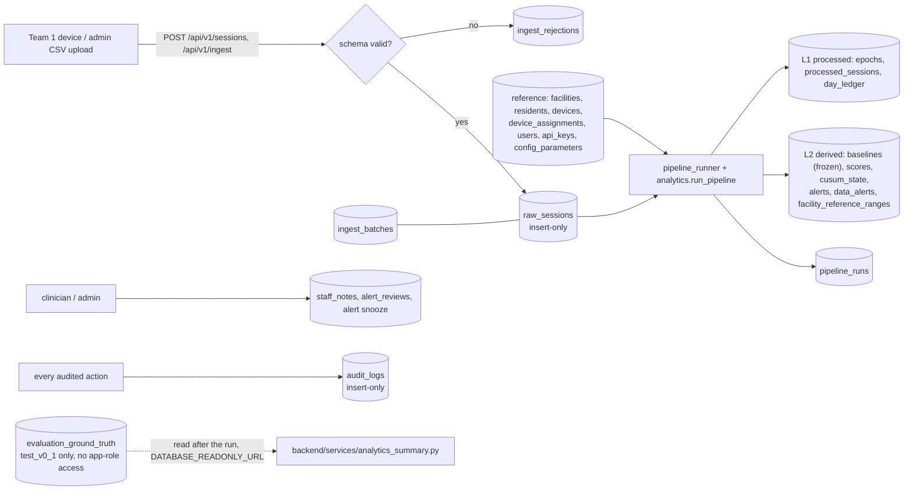
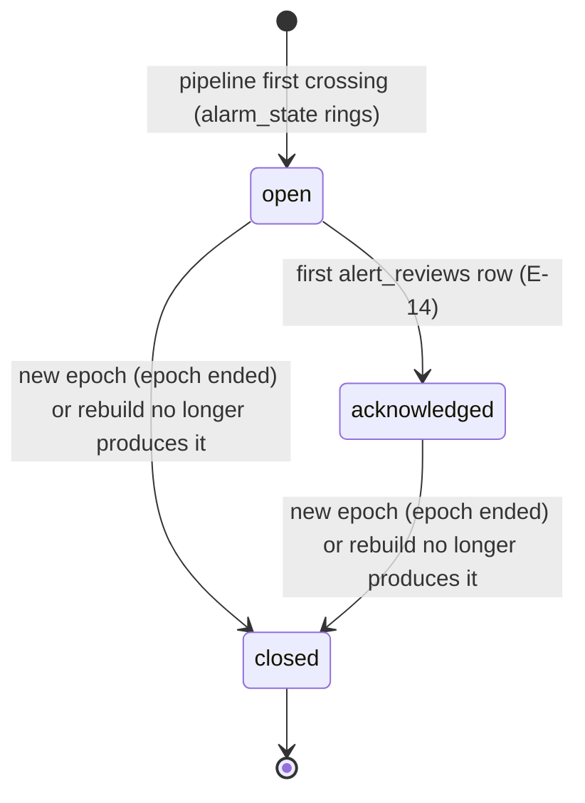
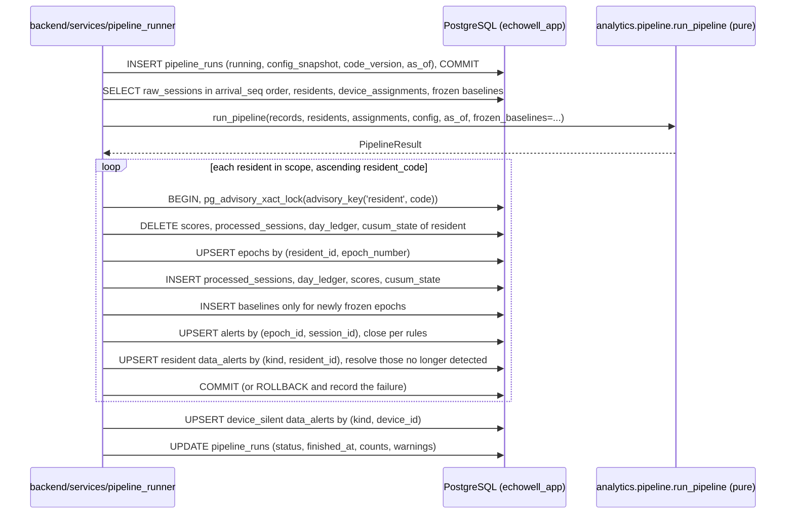

# EchoWell Database ERD and Data Ownership

Document: docs/design/Database_ERD.md · Checkpoint 1 of PR #3 (Implement_Feature_Batches.md Phase 7, TRD 25 Phase 2) · Feature: FEAT-001 · Date: 21 October 2026

## 1. Purpose and sources

This document shows the 24 tables of TRD 20 §4.6 (PGS-006) as one entity-relationship model and names, for each table, the module that writes it and the API repositories, services and analytics stages that read it. It is the design input for the database phase (Phase 4: FEAT-008..FEAT-017) and the persistence half of the analytics phase (FEAT-053). DDL, constraints and grants are authoritative in TRD 20; entity semantics in TRD 23; layering, rebuild and indexing rules in TRD 06. Nothing here changes a column, constraint or grant.

| Topic | Source |
|---|---|
| DDL, enums, triggers, grants, indexes | TRD 20 §4.2–§4.9 (PGS-001..PGS-044) |
| Layers, immutability, rebuild, natural keys | TRD 06 §4.1, §4.3, §4.4 (DB-001..DB-025, DB-036) |
| Entity semantics, state machines, derived values, model files | TRD 23 §4.2–§4.6 (DME-001..DME-025) |
| Storage and processing flow | TRD 01 §4.4, §4.5 (ARC-030..ARC-035, ARC-040..ARC-046) |
| Roles and connection strings | TRD 20 §4.3, TRD 01 ARC-015, ARC-019, TRD 25 AGT-060 |

## 2. Layers

| Layer | Tables | Writer | Mutability | Rebuildable | Source |
|---|---|---|---|---|---|
| L0 raw | raw_sessions | ingestion service | INSERT only (trigger + grants) | source of truth | DB-001, DB-004, ARC-030 |
| Intake log | ingest_batches, ingest_rejections | ingestion service | rejections INSERT only; batch counts updated once | no | DB-005, API-041 |
| Reference | facilities, residents, devices, device_assignments, users, api_keys, config_parameters | CLI, user endpoints, pipeline (cohort transition only) | INSERT, UPDATE; no DELETE by the app | no | DB-025, ARC-067, DME-008 |
| L1 processed | epochs, processed_sessions, day_ledger | pipeline_runner | replaced per resident per run (epochs upserted) | yes | DB-014, DB-015 |
| L2 derived | scores, cusum_state, facility_reference_ranges | pipeline_runner | replaced per resident | yes | DB-006, DB-014 |
| L2 frozen | baselines | pipeline_runner | INSERT only; deleted only by `backend.cli rebuild` as `echowell_migrator` | reproduced, never overwritten | DB-016, ANL-032, D-56 |
| L2 + human state | alerts, data_alerts | pipeline_runner plus review, snooze and CLI paths | natural-key upsert; never deleted | identity yes, human fields preserved | DB-018, DB-036, ARC-044 |
| Human | staff_notes, alert_reviews | note and review services | INSERT only (grants) | no | DB-010, PGS-042 |
| Run log, audit | pipeline_runs, audit_logs | pipeline_runner; audit service | run status updated once; audit INSERT only | no | ARC-060, ARC-103 |
| Evaluation | evaluation_ground_truth | `database/seeds/load_evaluation_ground_truth.py` (migrator) | loaded only in profile test_v0_1 | not applicable | DB-007, ARC-034, AGT-057 |

## 3. Entity-relationship diagram (all 24 tables of TRD 20 §4.6)

Columns shown: primary keys, foreign keys, unique and natural keys and the columns the design depends on. Every foreign key is `ON DELETE RESTRICT` except `scores.processed_session_id` (`ON DELETE CASCADE`) (PGS-010, DB-033). Types use underscores where PostgreSQL has a space (`double_precision`) and `_arr` for arrays.

```mermaid
erDiagram
  facilities {
    uuid id PK
    text name UK
    text timezone
  }
  users {
    uuid id PK
    text email UK
    text display_name
    text password_hash
    user_role role
    boolean active
    timestamptz last_login_at
  }
  residents {
    uuid id PK
    uuid facility_id FK
    text resident_code UK
    text sex
    resident_cohort cohort
    date enrolled_on
    date admitted_on
    date withdrawn_on
    resident_status status
  }
  devices {
    uuid id PK
    uuid facility_id FK
    text device_code UK
    text room_label
    text firmware_version_last
    boolean active
  }
  device_assignments {
    uuid id PK
    uuid resident_id FK
    uuid device_id FK
    date valid_from
    date valid_to
  }
  api_keys {
    uuid id PK
    text name
    text key_hash UK
    text_arr scopes
    uuid device_id FK
    boolean active
    timestamptz last_used_at
  }
  ingest_batches {
    uuid id PK
    ingest_source source
    text filename
    integer accepted_count
    integer rejected_count
    integer duplicate_count
    uuid uploaded_by FK
    uuid api_key_id FK
  }
  ingest_rejections {
    uuid id PK
    uuid ingest_batch_id FK
    uuid api_key_id FK
    integer row_number
    jsonb raw_body
    jsonb errors
  }
  raw_sessions {
    uuid id PK
    bigserial arrival_seq UK
    uuid ingest_batch_id FK
    uuid api_key_id FK
    jsonb payload
    uuid resident_id FK
    uuid device_id FK
    text session_id
    text resident_code
    text device_code
    timestamptz timestamp_utc
    double_precision mic_noise_level_dbfs
    text audio_quality_flag
    text extraction_software_version
    text device_firmware_version
    double_precision loudness_dbfs
  }
  pipeline_runs {
    uuid id PK
    pipeline_trigger trigger
    jsonb scope
    text config_profile
    jsonb config_snapshot
    text code_version
    timestamptz as_of
    pipeline_run_status status
    jsonb counts
    jsonb warnings
  }
  epochs {
    uuid id PK
    uuid resident_id FK "UK with epoch_number"
    integer epoch_number
    uuid device_id FK
    text device_firmware_version
    text extraction_software_version
    timestamptz started_at
    timestamptz ended_at
    uuid pipeline_run_id FK
  }
  processed_sessions {
    uuid id PK
    uuid raw_session_id FK "UK natural key"
    text session_id
    uuid resident_id FK
    uuid epoch_id FK
    session_status status
    text_arr reasons
    date local_date
    boolean is_morning
    integer baseline_ordinal
    boolean in_baseline
    boolean late_arrival
    jsonb adjusted_features
    uuid pipeline_run_id FK
  }
  day_ledger {
    uuid id PK
    uuid resident_id FK "UK with local_date"
    date local_date
    day_status status
    uuid device_id FK
    text reason
    uuid pipeline_run_id FK
  }
  baselines {
    uuid id PK
    uuid resident_id FK
    uuid epoch_id FK "UK with feature_key"
    text feature_key
    integer n_sessions
    text first_session_id
    text frozen_after_session_id
    double_precision median
    double_precision mad
    double_precision robust_spread
    boolean floor_applied
    uuid pipeline_run_id FK
  }
  scores {
    uuid id PK
    uuid processed_session_id FK "UK, ON DELETE CASCADE"
    uuid resident_id FK
    uuid epoch_id FK
    date local_date
    jsonb z
    double_precision composite_raw
    double_precision composite_z
    double_precision cusum_tally
    alarm_state alarm_state
    uuid pipeline_run_id FK
  }
  cusum_state {
    uuid epoch_id PK, FK
    uuid resident_id FK
    double_precision current_tally
    text last_scored_session_id
    boolean alarm_on
    uuid pipeline_run_id FK
  }
  alerts {
    uuid id PK
    uuid resident_id FK
    uuid epoch_id FK "UK with session_id"
    text session_id
    timestamptz triggered_at
    date local_date
    double_precision cusum_value
    alert_status status
    text closed_reason
    uuid acknowledged_by FK
    timestamptz snoozed_until
    uuid snoozed_by FK
    uuid pipeline_run_id FK
  }
  alert_reviews {
    uuid id PK
    uuid alert_id FK
    uuid reviewer_user_id FK
    text_arr explanations
    review_outcome outcome
    text note
  }
  data_alerts {
    uuid id PK
    data_alert_kind kind
    uuid resident_id FK
    uuid device_id FK
    uuid alert_review_id FK "UK"
    text title
    text detail
    data_alert_status status
    timestamptz first_detected_at
    timestamptz last_detected_at
    uuid pipeline_run_id FK
  }
  staff_notes {
    uuid id PK
    uuid resident_id FK
    uuid alert_id FK
    uuid author_user_id FK
    note_type note_type
    text body
    uuid supersedes_id FK "UK"
  }
  facility_reference_ranges {
    uuid id PK
    uuid facility_id FK
    text feature_key
    text sex
    double_precision low
    double_precision high
    text method
    integer n_residents
    uuid pipeline_run_id FK
  }
  config_parameters {
    text profile PK
    text key PK
    jsonb value
    uuid updated_by FK
  }
  audit_logs {
    bigserial id PK
    timestamptz occurred_at
    actor_type actor_type
    text actor_id
    text action
    text entity_type
    text entity_id
    jsonb details
    text request_id
  }
  evaluation_ground_truth {
    uuid id PK
    text resident_code UK
    text planted_change
    date true_onset_date
    text source_file
  }

  facilities ||--o{ residents : "facility_id"
  facilities ||--o{ devices : "facility_id"
  facilities ||--o{ facility_reference_ranges : "facility_id"
  residents ||--o{ device_assignments : "resident_id"
  devices ||--o{ device_assignments : "device_id"
  devices |o--o{ api_keys : "device_id"
  users |o--o{ ingest_batches : "uploaded_by"
  api_keys |o--o{ ingest_batches : "api_key_id"
  ingest_batches |o--o{ ingest_rejections : "ingest_batch_id"
  api_keys |o--o{ ingest_rejections : "api_key_id"
  ingest_batches |o--o{ raw_sessions : "ingest_batch_id"
  api_keys |o--o{ raw_sessions : "api_key_id"
  residents ||--o{ raw_sessions : "resident_id"
  devices ||--o{ raw_sessions : "device_id"
  residents ||--o{ epochs : "resident_id"
  devices ||--o{ epochs : "device_id"
  pipeline_runs ||--o{ epochs : "pipeline_run_id"
  raw_sessions ||--o| processed_sessions : "raw_session_id"
  residents ||--o{ processed_sessions : "resident_id"
  epochs |o--o{ processed_sessions : "epoch_id"
  pipeline_runs ||--o{ processed_sessions : "pipeline_run_id"
  residents ||--o{ day_ledger : "resident_id"
  devices |o--o{ day_ledger : "device_id"
  pipeline_runs ||--o{ day_ledger : "pipeline_run_id"
  residents ||--o{ baselines : "resident_id"
  epochs ||--o{ baselines : "epoch_id"
  pipeline_runs ||--o{ baselines : "pipeline_run_id"
  processed_sessions ||--o| scores : "processed_session_id"
  residents ||--o{ scores : "resident_id"
  epochs ||--o{ scores : "epoch_id"
  pipeline_runs ||--o{ scores : "pipeline_run_id"
  epochs ||--o| cusum_state : "epoch_id"
  residents ||--o{ cusum_state : "resident_id"
  pipeline_runs ||--o{ cusum_state : "pipeline_run_id"
  residents ||--o{ alerts : "resident_id"
  epochs ||--o{ alerts : "epoch_id"
  users |o--o{ alerts : "acknowledged_by, snoozed_by"
  pipeline_runs ||--o{ alerts : "pipeline_run_id"
  alerts ||--o{ alert_reviews : "alert_id"
  users ||--o{ alert_reviews : "reviewer_user_id"
  residents |o--o{ data_alerts : "resident_id"
  devices |o--o{ data_alerts : "device_id"
  alert_reviews |o--o| data_alerts : "alert_review_id"
  pipeline_runs |o--o{ data_alerts : "pipeline_run_id"
  residents ||--o{ staff_notes : "resident_id"
  alerts |o--o{ staff_notes : "alert_id"
  users ||--o{ staff_notes : "author_user_id"
  staff_notes |o--o| staff_notes : "supersedes_id"
  pipeline_runs ||--o{ facility_reference_ranges : "pipeline_run_id"
  users |o--o{ config_parameters : "updated_by"
```

`audit_logs` and `evaluation_ground_truth` have no foreign keys: audit rows identify entities by `entity_type`/`entity_id` text (TRD 20 §4.6.23), and the ground-truth table is keyed by `resident_code` text so that it never joins into pipeline tables (ARC-034).

## 4. Table ownership: writer and readers

"Writer" is the only code path that inserts or updates the table (ARC-032). "Readers" are the service modules (through `backend/repositories/`) and analytics stages that consume it. Every table maps to at least one API endpoint or analytics module (TRD 25 Phase 2 definition of done).

| # | Table (TRD 20) | Writer (module) | Readers: API services (endpoints) | Readers: analytics modules (stage) | Model file : class (TRD 23 §4.6) | Features |
|---|---|---|---|---|---|---|
| 4.6.1 | facilities | `backend/cli.py` `bootstrap`, `import-master-data`, `seed` | `api/deps.py` `get_meta()` (all list and detail endpoints), `config_service` (E-32), `resident_service` | facility time zone passed as `PipelineConfig.facility_tz` (ENV-022) | `facility.py` : `Facility` | FEAT-009, FEAT-017 |
| 4.6.2 | users | `auth_service` (`last_login_at`, E-02), `user_service` (E-26, E-27), `backend/cli.py` `create-user`, `seed` | `api/deps.py` `get_current_user` (all bearer endpoints), `user_service` (E-25), `review_service` (E-28 reviewer name), `note_service` (E-15 author) | none | `user.py` : `User` | FEAT-009, FEAT-016, FEAT-020, FEAT-037 |
| 4.6.3 | residents | `backend/cli.py` `import-master-data`, `withdraw-resident`, `purge-resident`; `pipeline_runner` (cohort `new_admission` → `longitudinal` only, DB-025) | `ingestion` (E-05, E-06 validation), `resident_service` (E-08, E-09), `admission_service` (E-22, E-23), `pipeline_runner` | `ResidentInfo` input of `day_ledger.build_ledger`, `data_alerts.generate_data_alerts`, `aggregates.build_analytics_summary` | `resident.py` : `Resident` | FEAT-009, FEAT-017 |
| 4.6.4 | devices | `backend/cli.py` `import-master-data` | `ingestion` (E-05, E-06), `device_service` (E-17), `resident_service` (E-08 device cell) | device codes inside `RawRecord` and `DeviceAssignment` | `device.py` : `Device` | FEAT-009, FEAT-029 |
| 4.6.5 | device_assignments | `backend/cli.py` `import-master-data` | `device_service` (E-17), `resident_service` (E-08 shared flag), `ingestion` (scope of co-assigned residents, API-045) | `DeviceAssignment` input of `day_ledger`, `data_alerts` (device_silent) | `device.py` : `DeviceAssignment` | FEAT-009, FEAT-049 |
| 4.6.6 | api_keys | `backend/cli.py` `create-api-key`, `revoke-api-key`, `seed`; `api/deps.py` `get_api_key` (`last_used_at`) | `api/deps.py` `get_api_key`, `get_ingest_principal` (E-05, E-06, E-20) | none | `api_key.py` : `ApiKey` | FEAT-016 |
| 4.6.7 | ingest_batches | `ingestion.ingest_batch` (E-06), `seed` (source `seed`) | `ingestion.get_batch` (E-07) | none | `ingest_batch.py` : `IngestBatch` | FEAT-010, FEAT-026 |
| 4.6.8 | ingest_rejections | `ingestion` (E-05, E-06) | `ingestion.get_batch` (E-07) | none | `ingest_batch.py` : `IngestRejection` | FEAT-010, FEAT-023 |
| 4.6.9 | raw_sessions | `ingestion` (E-05, E-06, seed) — INSERT only | `pipeline_runner` (builds `RawRecord` from typed columns, ANL-035), `feature_service` (E-11 raw values), `device_service` (E-17 last upload) | `RawRecord` input of `duplicate_detection.mark_duplicates` (stage 1) and every later stage | `session.py` : `RawSession` | FEAT-010, FEAT-025 |
| 4.6.10 | pipeline_runs | `pipeline_runner` (E-05, E-06, E-20, nightly job, CLI) | `pipeline_runner.list/get` (E-31, E-21), `api/deps.py` `get_meta()` (`meta.as_of`, API-069), `analytics_summary` (E-18), `ingestion.get_batch` (E-07), `backend/jobs/nightly_run.py` (dedupe, API-061) | config snapshot from `analytics.config.PipelineConfig.snapshot()` | `pipeline_run.py` : `PipelineRun` | FEAT-011, FEAT-024, FEAT-053 |
| 4.6.11 | epochs | `pipeline_runner` from `analytics.epoch_detection.assign_epochs` (stage 3); upsert on `(resident_id, epoch_number)` | `resident_service` (E-08, E-09), `checkin_service` (E-10 restart events), `scoring` (E-12 `epoch` filter), `analytics_service` (E-19) | `EpochSummary` input of `alert_generator`, `data_alerts`, `aggregates` | `epoch.py` : `Epoch` | FEAT-011, FEAT-042 |
| 4.6.12 | processed_sessions | `pipeline_runner` from stages 1, 2, 4, 5 (`duplicate_detection`, `quality_screening`, `speaker_screen`, `morning_offset`) | `resident_service` (E-08, E-09 counts and last check-in), `checkin_service` (E-10), `feature_service` (E-11), `admission_service` (E-22, E-23), `analytics_summary` (E-18) | `AdjustedRecord` output; input of `baseline_builder`, `zscore_calculator`, `aggregates` | `session.py` : `ProcessedSession` | FEAT-011, FEAT-041, FEAT-044 |
| 4.6.13 | day_ledger | `pipeline_runner` from `analytics.day_ledger.build_ledger` (stage 10) | `resident_service` (E-08 missed counts), `checkin_service` (E-10 missed, device_silent), `device_service` (E-17 silent days), `analytics_summary` (E-18) | `LedgerDay` input of `data_alerts`, `aggregates` | `day_ledger.py` : `DayLedgerEntry` | FEAT-011, FEAT-049 |
| 4.6.14 | baselines | `pipeline_runner` from `baseline_builder.build_baselines` + `robust_stats.robust` (stage 6) — INSERT only | `resident_service` (E-09 baseline dates), `feature_service` (E-11 median, spread), `scoring` (E-12 `baseline_periods`), `analytics_service` (E-19), `pipeline_runner` (passes frozen rows back as `frozen_baselines`, ANL-037) | `Baseline` input of `zscore_calculator.feature_z`, `composite_score.composite_z` | `baseline.py` : `Baseline` | FEAT-011, FEAT-045 |
| 4.6.15 | scores | `pipeline_runner` from `zscore_calculator`, `composite_score` (stage 7) and `cusum_engine.run_cusum` (stage 8) | `scoring.list_scores` (E-12), `feature_service` (E-11 z), `alert_service` (E-13 `leaning_most`), `checkin_service` (E-10 watching started, tally), `resident_service` (E-09 watching since) | `ScoreRow` input of `alert_generator.generate_alerts`, `alert_generator.leaning_most` | `score.py` : `Score` | FEAT-011, FEAT-046, FEAT-047 |
| 4.6.16 | cusum_state | `pipeline_runner` from `cusum_engine` (stage 8) | `resident_service` (E-08, E-09 current tally), `alert_service` (E-13 `current_tally`) | mirror of `EpochSummary.current_tally` | `score.py` : `CusumState` | FEAT-011, FEAT-047 |
| 4.6.17 | alerts | `pipeline_runner` from `alert_generator.generate_alerts` (stage 9; upsert by `(epoch_id, session_id)`, close with `epoch ended` or `superseded by rebuild`); `review_service` (status `acknowledged`, E-14); `alert_service.snooze` (E-29) | `alert_service.list` (E-13), `resident_service` (E-08, E-09 `alarm_on`), `checkin_service` (E-10 alarm_on), `analytics_summary` (E-18 alarms raised) | `AlertEvent` output; input of `aggregates` | `alarm.py` : `Alert` | FEAT-012, FEAT-031, FEAT-048 |
| 4.6.18 | alert_reviews | `review_service.create` (E-14) — INSERT only | `review_service.list` (E-28), `alert_service` (E-13 `review_count`, `last_reviewed_at`), `analytics_summary` (E-18 `review_outcomes`) | none (human state, ANL-065) | `alarm.py` : `AlertReview` | FEAT-012, FEAT-031 |
| 4.6.19 | data_alerts | `pipeline_runner` from `data_alerts.generate_data_alerts` (stage 11; rule kinds); `review_service` (`review_flagged_data_problem`, E-14); `backend/cli.py` `resolve-data-alert` | `data_alert_service.list` (E-30) | `DataAlert` output; `silent_device_codes` input of `aggregates` (stage 12) | `alarm.py` : `DataAlert` | FEAT-012, FEAT-032, FEAT-050 |
| 4.6.20 | staff_notes | `note_service.create` (E-16) — INSERT only | `note_service.list` (E-15) | none | `staff_note.py` : `StaffNote` | FEAT-012, FEAT-033 |
| 4.6.21 | facility_reference_ranges | `pipeline_runner` through the planned pure function `analytics/facility_norms.py` after a full-scope run, created only when OQ-08 is resolved (ANL-057, D-76); no rows in v0.1 | `admission_service` (E-22, E-23, E-24) | `analytics/facility_norms.py` (future, OQ-08) | `reference_range.py` : `FacilityReferenceRange` | FEAT-012, FEAT-036, FEAT-095 |
| 4.6.22 | config_parameters | migration `0002_seed_config_parameters`; `backend/cli.py` `set-config` (migrator) | `config_service` (profile → `PipelineConfig`, E-32 `UiConfig`), `api/deps.py` `get_meta()` (`baseline_n`, `cusum_h`), `review_service` (explanation codes), `ingestion` (`supported_schema_versions`, `feature_name_map`) | `analytics.config.PipelineConfig.from_mapping` (every stage reads its parameters, AGT-020) | `config_parameter.py` : `ConfigParameter` | FEAT-009, FEAT-040, FEAT-055 |
| 4.6.23 | audit_logs | `audit_service.record` only — INSERT only, same transaction as the audited change (DB-011); called by E-02, E-03, E-06, E-12 and E-19 (CSV), E-14, E-16, E-20, E-26, E-27, E-29, pipeline runs and CLI commands | no API reader; offline SQL as `echowell_readonly` | none | `audit_log.py` : `AuditLog` | FEAT-012, FEAT-015 |
| 4.6.24 | evaluation_ground_truth | `database/seeds/load_evaluation_ground_truth.py` (migrator, test_v0_1 only) | `analytics_summary.build` only, through the `DATABASE_READONLY_URL` engine (E-18 `alarm_timing`) | never (AGT-007, AGT-057) | `evaluation.py` : `EvaluationGroundTruth` | FEAT-012, FEAT-057, FEAT-035 |

Endpoints that write `audit_logs` (TRD 12 §4.12 vocabulary): E-02 (`auth.login.succeeded`, `auth.login.failed`), E-03 (`auth.logout`), E-06 (`ingest.batch.received`), E-12 and E-19 CSV (`export.csv`), E-14 (`alert.reviewed`), E-16 (`note.created`), E-20 and every run (`pipeline.run.started`, `pipeline.run.finished`), E-26 (`user.created`), E-27 (`user.updated`), E-29 (`alert.snoozed`); any 403 (`access.denied`).

## 5. Repository layer

TRD 05 §4.1 fixes the rule "one module per aggregate, no business rules" (API-005, ARC-051) but not the file names. The names below are this design's proposal (reviewer question Q-5 in docs/reports/CHECKPOINT_1_DESIGN_DOCS.md); FEAT-010 already names `raw_session_repository` in its tests.

| Module (`backend/repositories/`) | Tables | Key methods (natural keys of ARC-045) |
|---|---|---|
| `facility_repository.py` | facilities | get single facility; upsert by `name` |
| `user_repository.py` | users | get by lower-cased email; list; insert; update role, active, display name, `last_login_at` |
| `resident_repository.py` | residents | get by `resident_code`; list active by cohort; set withdrawn; set cohort longitudinal |
| `device_repository.py` | devices, device_assignments | get by `device_code`; assignments covering a date; co-assigned residents |
| `api_key_repository.py` | api_keys | get active by `key_hash`; insert; revoke; touch `last_used_at` |
| `ingest_repository.py` | ingest_batches, ingest_rejections | insert batch, update counts once; insert rejection; get batch with rejections |
| `raw_session_repository.py` | raw_sessions | insert one arrival returning `id`, `arrival_seq`; select by resident in `arrival_seq` order; exists by `session_id`; no update or delete method |
| `pipeline_run_repository.py` | pipeline_runs | insert running; finish; latest succeeded; list with filters; nightly dedupe query |
| `epoch_repository.py` | epochs | upsert by `(resident_id, epoch_number)`; current epoch |
| `processed_session_repository.py` | processed_sessions | delete and insert per resident; counts in window |
| `day_ledger_repository.py` | day_ledger | delete and insert per resident; missed days in window |
| `baseline_repository.py` | baselines | insert 20 rows per newly frozen epoch; load frozen baselines; list for export |
| `score_repository.py` | scores, cusum_state | delete and insert per resident; series per epoch; current tally |
| `alert_repository.py` | alerts, alert_reviews | upsert by `(epoch_id, session_id)`; close; set acknowledged; snooze; insert review; list reviews |
| `data_alert_repository.py` | data_alerts | upsert by `(kind, resident_id)` or `(kind, device_id)`; resolve; insert review-flagged row |
| `staff_note_repository.py` | staff_notes | insert; list current (not superseded) |
| `reference_range_repository.py` | facility_reference_ranges | list latest per feature and sex |
| `config_repository.py` | config_parameters | rows of a profile; update one key (migrator path) |
| `audit_repository.py` | audit_logs | insert in the caller's transaction, no commit |
| `read_models.py` | derived on read (no table) | 30-day window, last check-in, baseline progress, watching since, silent days, restart cause, `in_use_until` (FEAT-014, DME-012, DB-044, DB-065, DB-066) |

No repository on the `DATABASE_URL` engine maps `evaluation_ground_truth`; `analytics_summary.py` reads it through its own read-only engine (TRD 23 §4.6, API-136, PGS-040).

## 6. Enumerated types

Fifteen enums (PGS-005, DB-034); Python mirrors in `backend/models/__init__.py` (DME-003).

| Enum | Labels | Column |
|---|---|---|
| resident_cohort | longitudinal, new_admission | residents.cohort |
| resident_status | active, withdrawn | residents.status |
| ingest_source | api_single, api_batch, csv_upload, seed | ingest_batches.source |
| session_status | usable, set_aside, quarantined, duplicate | processed_sessions.status |
| day_status | checked_in, missing_resident, missing_device_gap | day_ledger.status |
| alarm_state | off, rings, on | scores.alarm_state |
| alert_status | open, acknowledged, closed | alerts.status |
| note_type | observation, action_taken, follow_up | staff_notes.note_type |
| pipeline_trigger | ingest, nightly, manual, test | pipeline_runs.trigger |
| pipeline_run_status | running, succeeded, failed | pipeline_runs.status |
| user_role | admin, clinician, researcher | users.role |
| actor_type | user, api_key, system | audit_logs.actor_type |
| review_outcome | no_concern, known_cause, referred, data_problem | alert_reviews.outcome |
| data_alert_kind | baseline_stalled, possible_other_speaker, high_set_aside, device_silent, review_flagged_data_problem | data_alerts.kind |
| data_alert_status | open, resolved | data_alerts.status |

## 7. State machines that the schema enforces

- Snooze never changes `status` (DME-022); `closed_reason = 'admin'` is reserved with no endpoint in v0.1 (CUS-019, D-03).
- `processed_sessions.status` follows TRD 23 §4.3.1; `pending_screen` exists only in memory (DME-006).
- `residents.cohort` changes only `new_admission` → `longitudinal` (DME-008); `residents.status` only `active` → `withdrawn` (DME-009).
- Data alerts: open → resolved; a resolved row is never reopened, a recurrence inserts a new row (TRD 23 §4.3.7, ANL-060).

## 8. Rebuild and natural-key upserts

| Table | Natural key | Preserved across rebuild | Source |
|---|---|---|---|
| processed_sessions | `raw_session_id` | — | ARC-045 |
| epochs | `(resident_id, epoch_number)` | `id` (keeps baselines, alerts, cusum_state links) | DB-015, ANL-038 |
| baselines | `(epoch_id, feature_key)` | all rows (frozen) | DB-016, ANL-037 |
| scores | `processed_session_id` | — | ARC-045 |
| day_ledger | `(resident_id, local_date)` | — | ARC-045, DB-023 |
| alerts | `(epoch_id, session_id)` | `id`, `status`, `acknowledged_*`, `snoozed_*`, linked reviews and notes | DB-018, ANL-039, AGT-056 |
| data_alerts | `(kind, resident_id, device_id)` | `first_detected_at`; review-flagged rows untouched | DB-036, ANL-060 |

Two full rebuilds with unchanged inputs leave every derived table identical except `id`, `created_at`, `updated_at`, `pipeline_run_id` (DB-019, ARC-071).

## 9. Indexes and the query each serves

Every index of TRD 20 §4.7 is created with its exact name (PGS-038); new indexes require a documented query pattern (DB-046). The overview, detail and device queries must avoid sequential scans on DS-08 (DB-040, DB-042).

| Query (endpoint) | Indexes |
|---|---|
| Duplicate check at ingest (E-05, E-06) | `raw_sessions_session_id_idx` |
| Pipeline load per resident | `raw_sessions_resident_ts_idx`, `processed_sessions_epoch_idx` |
| Overview counts and last check-in (E-08) | `processed_sessions_resident_date_idx`, `processed_sessions_resident_ts_idx`, `day_ledger_missing_idx`, `epochs_current_uq`, `cusum_state_resident_idx` |
| Detail and check-in log (E-09, E-10) | `scores_epoch_date_idx`, `alerts_resident_triggered_idx`, `day_ledger_missing_idx` |
| Scores series (E-12) | `scores_resident_date_idx`, `scores_epoch_date_idx` |
| Alerts queue (E-13) | `alerts_status_triggered_idx`, `alerts_one_active_per_epoch_uq`, `alert_reviews_alert_created_idx` |
| Data alerts (E-30) | `data_alerts_status_detected_idx`, `data_alerts_open_subject_uq` |
| Devices panel (E-17) | `device_assignments_device_idx`, `raw_sessions_device_ts_idx`, `day_ledger_device_date_idx` |
| Notes (E-15) | `staff_notes_resident_created_idx` |
| Pipeline runs (E-31, nightly dedupe) | `pipeline_runs_started_idx`, `pipeline_runs_status_idx` |
| Audit search (offline) | `audit_logs_occurred_idx`, `audit_logs_entity_idx`, `audit_logs_actor_idx`, `audit_logs_action_idx` |

## 10. Roles, grants and immutability

| Role | Used by | Key privileges | Source |
|---|---|---|---|
| `echowell_app` (`DATABASE_URL`) | API, pipeline runner, nightly job, most CLI commands | SELECT, INSERT only on raw_sessions, audit_logs, ingest_rejections, staff_notes, baselines, alert_reviews; no DELETE on master tables, alerts, data_alerts; no privilege on evaluation_ground_truth | PGS-021, PGS-040, DB-009, D-49 |
| `echowell_migrator` (`DATABASE_MIGRATION_URL`) | Alembic pre-deploy command; CLI `seed`, `reset-test-db`, `purge-resident`, `rebuild`, `set-config`; ground-truth loader | schema owner; `SET ROLE echowell_migrator` after connect | TRD 20 §4.3, ARC-082, D-58 |
| `echowell_readonly` (`DATABASE_READONLY_URL`) | `analytics_summary.py` alarm timing; offline research | SELECT on all tables except credential columns | PGS-004, PGS-040, AGT-060 |

`raw_sessions` and `audit_logs` carry `BEFORE UPDATE OR DELETE` row triggers and `BEFORE TRUNCATE` statement triggers calling `reject_mutation()` (SQLSTATE `EW001`); the only escape is the migrator purge path with `echowell.allow_purge = on` (PGS-018, PGS-019, DB-008). The backend maps `EW001` to HTTP 500 (PGS-028).

## 11. Migrations and seed data

| Item | Rule | Source |
|---|---|---|
| Migration files | `backend/alembic/versions/NNNN_
.py`, linear history; `0001_initial_schema` checks extensions; `0002_seed_config_parameters` inserts 46 rows (23 keys × 2 profiles) | DB-027, PGS-002, PGS-024, DB-055 |
| Runner | `alembic upgrade head` from the repository root (`alembic.ini` at the root) as `echowell_migrator`; only as the Railway pre-deploy command in staging and production | DEP-024, DEP-040, ARC-082 |
| Provisioning | extensions `pgcrypto`, `btree_gist`, database `timezone` UTC and roles by `database/roles/provision_login_roles.sql` (local, CI) or the provider owner role, never by Alembic | PGS-001, PGS-002, D-72 |
| Reference DDL | `database/schema.sql` regenerated by `scripts/dump_schema.sh`, compared by `tests/integration/test_schema_reference.py` | PGS-016, PGS-017 |
| Test roster | `database/seeds/test_v0_1/{facilities,residents,devices,device_assignments}.csv` via `python -m backend.cli import-master-data` or `seed test_v0_1`; refused in production | PGS-026, DB-056, DB-059, DB-060 |
| Synthetic data only | interim stack never holds real resident data | AGT-014, DB-059, D-28 |

## 12. Open questions affecting the data model

| ID | Effect on this design |
|---|---|
| OQ-01 | No retention or deletion job (DB-061). |
| OQ-03 | Feature column names are placeholders; renaming handled by `feature_name_map`. |
| OQ-08, OQ-20, OQ-29 | `facility_reference_ranges` stays empty in v0.1; `sex` nullable. |
| OQ-10 | Late arrivals: frozen baseline kept, `late_arrival` warning in `pipeline_runs.warnings`. |
| OQ-11 | Withdrawal keeps data; purge only by the IRB-directed CLI command. |
| OQ-14 | No speaker-verification column in schema 0.1. |
