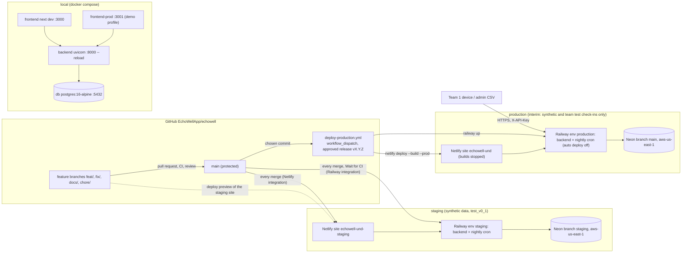
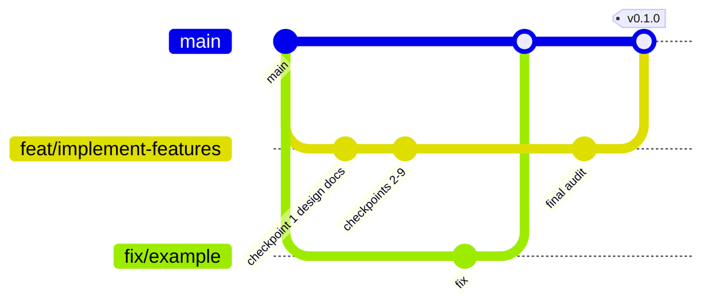
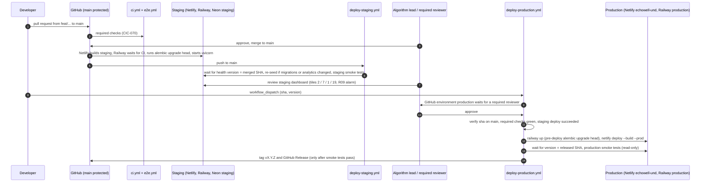
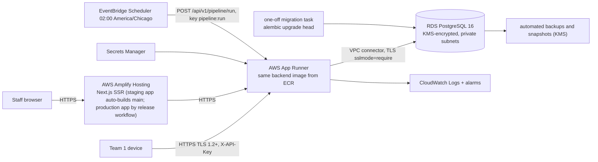

# EchoWell Deployment Architecture

Document: docs/design/Deployment_Architecture.md · Checkpoint 1 of PR #3 (Implement_Feature_Batches.md Phase 7, TRD 25 Phase 2) · Feature: FEAT-001 · Date: 21 October 2026

## 1. Purpose and sources

This document describes environments, hosting, branching and release, CI/CD workflows, configuration, security boundaries, backups, rollback and the AWS target that the deployment-configuration checkpoint (Phase 9, FEAT-077..FEAT-087) and the deployment PR #4 (Phase 10, FEAT-088..FEAT-090) implement. Normative content: TRD 01 §4.9–§4.10 (ARC-080..ARC-095), TRD 15 (DEP), TRD 16 (CIC), TRD 18 §4.2 (GIT), TRD 21 (ENV), TRD 22 (TPS), TRD 12 (SEC) and the decision log of TRD 24. No deployment is performed in this checkpoint (TRD 25 Phase 9 definition of done).

## 2. Owner decisions that shape the deployment

| Decision | Content | Design consequence | Source |
|---|---|---|---|
| D-OWNER-3 (D-27) | AWS (Amplify, App Runner, RDS PostgreSQL with KMS, Secrets Manager, CloudWatch) is the **target** production platform; Netlify + Railway + Neon is the **interim** stack until the AWS budget is approved | code stays portable: no Netlify, Railway or Neon SDK in application code; configuration only through environment variables; TLS 1.2+ everywhere including `sslmode=require` to PostgreSQL; encryption at rest | ARC-090..ARC-094, DEP-110, DEP-111, AGT-003 |
| D-OWNER-4 (D-28, closes OQ-23) | no real patient or resident data on the interim stack; the interim stack holds synthetic and test data only; go-live only on AWS after approval | every environment of the interim stack (local, staging, interim production) holds only synthetic data and team test check-ins under `T`-prefixed demo study IDs; seed and upload paths reference only `specs/data-samples` or `tests/fixtures` | ARC-008, DEP-008, DEP-118, AGT-014, UX-214, AC-AGT-10 |
| D-OWNER-2 (D-01) | production `baseline_n` = 30; profile `test_v0_1` (16) for build and test only | production runs `PIPELINE_PROFILE=production`; the backend refuses `test_v0_1` or `PIPELINE_AS_OF` when `APP_ENV=production` | ARC-056, API-058, ENV-010, ENV-012, AGT-015 |
| D-OWNER-1 (D-29) | third-party-licensed documents are linked, not committed | no licensed document in any image or artefact | AGT-016 |
| D-99 | branching: only `main` and feature branches; staging from `main` on every merge; production only by a manual, reviewer-approved release workflow; no `staging` branch | §4 below | GIT-010..GIT-012, DEP-002..DEP-004, CIC-001, CIC-053 |
| D-100 | PR plan: PR #3 (this branch `feat/implement-features`, nine review checkpoints), PR #4 deployment, PR #5 test cases | deployment happens in PR #4 after PR #3 merges | AGT-013, AGT-030 |

## 3. Environments and topology

| Aspect | local | staging | production (interim) | Source |
|---|---|---|---|---|
| Git source | working tree | `main`, automatically on every merge | a `main` commit chosen for a release | DEP-002..DEP-004, D-99 |
| Frontend | `next dev` :3000 (Compose) | Netlify `echowell-und-staging` (production branch `main`) + PR deploy previews | Netlify `echowell-und`, published only by `deploy-production.yml` | DEP-050..DEP-054 |
| Backend | uvicorn :8000 `--reload` | Railway project `echowell`, environment `staging`, service `backend` | Railway environment `production`, service `backend` | DEP-040..DEP-045 |
| Nightly | manual CLI | Railway Cron Job service `nightly`, `0 7,8 * * *` UTC | same | DEP-046, DEP-047, D-47 |
| Database | `postgres:16-alpine`, volume `pgdata` | Neon project `echowell`, branch `staging` | Neon project `echowell`, branch `main` | DEP-005, DEP-030, DEP-031 |
| `APP_ENV` / `PIPELINE_PROFILE` | `local` / `test_v0_1` | `staging` / `test_v0_1` | `production` / `production` | TRD 15 §4.1, ENV-050 |
| Seed data | `seed test_v0_1` allowed | `seed test_v0_1 --reset` after migrations or analytics changes | never | DEP-007, DEP-070..DEP-074 |
| Regions | — | Neon `aws-us-east-1`, Railway US East | same | ARC-084, D-54 |

Each environment has its own `JWT_SECRET`, API keys and users; no credential works across environments (DEP-006, ENV-051).

## 4. Branching and release model (D-99)

| Rule | Source |
|---|---|
| The repository has only `main` (protected: PR, 1 approving review, CODEOWNERS, required checks, up to date, no force push, no deletion) and short-lived `feat/`, `fix/`, `docs/`, `chore/` branches; every PR targets `main` directly | GIT-010..GIT-012, D-99 |
| There is no `staging` branch and no promotion merge; "staging" names only the staging environment, deployed from `main` on every merge | DEP-004, TRD 18 §4.2, D-99 |
| Production changes only through the manual, reviewer-approved `deploy-production.yml` run for a chosen `main` commit; automatic deploys of the production services are disabled and the production Netlify site's builds are stopped | DEP-002, DEP-003, CIC-053, D-99 |
| The only production secrets in GitHub are `RAILWAY_PRODUCTION_TOKEN` and `NETLIFY_AUTH_TOKEN`; the workflow never holds a production database URL | CIC-050, CIC-090 |
| Tags `vX.Y.Z` and GitHub Releases are created only by `deploy-production.yml` after the production smoke tests pass | CIC-052 |
| Migrations never run from GitHub Actions against production; only as the Railway pre-deploy command | CIC-003, DEP-060 |
| An urgent production fix is a `fix/` PR to `main` followed by a release run | GIT-012 |

## 5. Deployable units

| Unit | Build | Runtime | Source |
|---|---|---|---|
| Backend image | `backend/Dockerfile` from `python:3.12-slim`, repository root as context; copies `backend/`, `analytics/`, `alembic.ini`; installs `backend/requirements.txt` (`psycopg[binary]` 3.x, pinned) and `tzdata`; non-root UID 10001; no `.env`, tests, `specs/` or `frontend/` (root `.dockerignore`) | `sh -c "uvicorn backend.main:app --host 0.0.0.0 --port ${PORT:-8000}"`; no migration step in the image command | DEP-020..DEP-022, ARC-090, D-53, CIC-023 |
| Railway `backend` service | same image | pre-deploy `alembic upgrade head` (repository root, `DATABASE_MIGRATION_URL`); healthcheck `/api/v1/health` within 120 s; 1 replica | DEP-040, DEP-041, DEP-042, D-58 |
| Railway `nightly` service | same image | `python -m backend.jobs.nightly_run`, cron `0 7,8 * * *` UTC; never runs Alembic; exits non-zero on schema revision mismatch; has no `DATABASE_MIGRATION_URL` | DEP-046..DEP-048, D-58 |
| Frontend | `frontend/Dockerfile` multi-stage `node:20-alpine` for Compose; Netlify builds with base `frontend/`, `node scripts/check-csp.mjs && npm run build`, `@netlify/plugin-nextjs` | server-capable Next.js; security headers and CSP from `netlify.toml` | DEP-023, DEP-050, DEP-053, FE-041 |
| Configuration as code | `netlify.toml`, `railway.toml`, `docker-compose.yml`, `.env.example`, `.env.development.example`, `.env.production.example` at the repository root | dashboard-only settings listed in `railway.toml` comments | DEP-044, ENV-040 |

Railway Cron and FastAPI `BackgroundTasks` are the only schedulers and workers; no Celery, Redis or message queue (TRD 01 §8, AGT-059).

## 6. Local stack (Docker Compose)

| Service | Image or build | Ports | Notes | Source |
|---|---|---|---|---|
| `db` | `postgres:16-alpine` | 127.0.0.1:5432 | volume `pgdata`; healthcheck `pg_isready`; init runs `database/roles/provision_login_roles.sql` (extensions, UTC, roles) | DEP-010, DEP-011, D-72, D-90 |
| `backend` | `backend/Dockerfile` | 8000 | starts after `db` is healthy; runs `alembic upgrade head` then uvicorn `--reload`; bind-mounts `backend/`, `analytics/`, read-only `database/` and `tests/fixtures/` | DEP-012, DEP-013, DEP-119 |
| `frontend` | Node dev server | 3000 | `next dev` | DEP-010 |
| `frontend-prod` (profile `demo`) | `frontend/Dockerfile` | 3001 | E2E stack and demo fallback | DEP-017, CIC-030 |

`docker compose up` from a clean clone with `.env` from `.env.development.example` makes `GET /api/v1/health` return 200 with `database` "ok"; `docker compose exec backend python -m backend.cli seed test_v0_1` then shows tiles 2 / 7 / 1 / 19 at `http://localhost:3000/residents` (DEP-014..DEP-016). Compose files contain only `local-dev-only-*` placeholder passwords (DEP-018).

## 7. CI/CD workflows

| Workflow | Trigger | Jobs | Source |
|---|---|---|---|
| `ci.yml` | every PR, push to `main`, manual | `repo-hygiene`, `backend-lint`, `backend-test` (postgres:16-alpine service, provisioning script, unit + integration + validation, coverage 95 % analytics / 85 % backend, `budget` marker), `openapi-contract`, `frontend`, `security-audit`, `docker-build`; no repository secret; `ubuntu-24.04` runners | CIC-010..CIC-027, CIC-114, CIC-115 |
| `e2e.yml` | PR, push to `main`, nightly 08:00 UTC, manual | `playwright` (Compose demo stack, Chromium + axe), `performance` (nightly), `lighthouse` (PRs, informational), `nightly-validation` (nightly) | CIC-030..CIC-037, CIC-116 |
| `deploy-staging.yml` | push to `main` | wait for staging `version` = SHA (15 min), re-seed when `backend/alembic/**` or `analytics/**` changed, staging smoke tests; GitHub environment `staging` | CIC-040..CIC-043 |
| `deploy-production.yml` | manual `workflow_dispatch` (`sha`, `version`) | required-reviewer approval, verification, `railway up`, `netlify deploy --build --prod`, smoke tests, tag and release | CIC-050..CIC-053 |
| `uptime.yml` | every 30 minutes | production and staging health, production `/login`; opens an `incident` issue after two failures | CIC-060, CIC-061 |

Required checks on `main`: `repo-hygiene`, `backend-lint`, `backend-test`, `openapi-contract`, `frontend`, `security-audit`, `docker-build`, `playwright` (CIC-070). Phase 3 replaces the legacy `ci.yml` stub with `backend-lint`, `backend-test` and `frontend`; Phase 9 adds the remaining jobs and replaces the legacy `docker-compose.yml` (D-94, D-55).

## 8. Configuration and secrets

| Class | Where it lives | Examples | Source |
|---|---|---|---|
| Backend environment variables | Railway service variables (interim), Secrets Manager → App Runner (target), `.env` locally only | `APP_ENV`, `DATABASE_URL`, `DATABASE_MIGRATION_URL` (backend service pre-deploy only), `DATABASE_READONLY_URL` (local and staging, test-profile alarm timing only; not set in production, SEC-116), `JWT_SECRET`, `CORS_ORIGINS`, `PIPELINE_PROFILE`, `GIT_SHA`, `FACILITY_NAME`, `FACILITY_TZ`, `DATA_SOURCE_LABEL`, `NIGHTLY_RUN_HOUR_LOCAL`, `PORT` | TRD 21 §4.2–§4.3, ENV-005, D-58 |
| Frontend build variables | Netlify site settings (interim), Amplify (target) | `NEXT_PUBLIC_API_BASE_URL` (per site; previews never point to production), `NEXT_PUBLIC_APP_ENV` | FE-170, DEP-051, DEP-054 |
| GitHub Actions secrets | environments `staging` and `production` only | `STAGING_DATABASE_URL`, `STAGING_SEED_*`, `RAILWAY_PRODUCTION_TOKEN`, `NETLIFY_AUTH_TOKEN` | CIC-090..CIC-092 |
| Algorithm and operational parameters | `config_parameters` rows (not environment variables) | `baseline_n`, `cusum_h`, `alert_snooze_hours`, `review_explanations` | ENV-020, ANL-028 |

Production templates set `PIPELINE_PROFILE=production` and no `PIPELINE_AS_OF`; every non-local database URL uses `sslmode=require` (TRD 25 Phase 9, ENV-011, ENV-012, PGS-027). Secrets and `.env` files are never committed (AGT-016, CIC-021).

## 9. Security boundaries in deployment

| Boundary | Control | Source |
|---|---|---|
| Browser → frontend, browser and device → backend | HTTPS TLS 1.2+ terminated by the platform; HTTP redirected; HSTS on API and frontend in staging and production | ARC-005, DEP-045, FE-061, TST-135 |
| Backend → database | TLS `sslmode=require` (or `verify-full`); startup refused otherwise in staging and production | ARC-006, ARC-057, DEP-034 |
| Storage | provider-managed encryption at rest (Neon, Railway); RDS with KMS and encrypted backups on AWS | ARC-007, DEP-009, DEP-112 |
| Database roles | runtime `echowell_app` through the pooled endpoint; migrations `echowell_migrator` through the direct endpoint; readonly role only for the alarm-timing read | DEP-032, ARC-015, ARC-019 |
| Ingest | API keys with scope `ingest:write`, optional device binding; scheduler key `pipeline:run` | ARC-004, D-47 |
| Browser | CSP of TRD 12 §4.9 in `netlify.toml` (`connect-src` = API origin), `X-Frame-Options: DENY`, `Permissions-Policy` denying camera and microphone | FE-060, FE-061, DEP-053 |
| No audio | no endpoint, store or artefact accepts or keeps audio; `repo-hygiene` rejects audio files | ARC-003, CIC-020, AGT-006 |
| No LLM | dependency scan in `repo-hygiene` | AGT-004, CIC-070 |
| Data allowed | interim stack: synthetic data and team test check-ins only; real resident data only after AWS go-live | ARC-008, DEP-008, DEP-118, AGT-014, D-28 |

## 10. Migrations, seeding and bootstrap

- Schema changes only through Alembic as the Railway pre-deploy command (`alembic upgrade head`, advisory lock key `0x45434857`); a failed migration fails the deployment and the previous one stays live (DEP-040, DEP-060, DEP-064, DEP-065).
- Migrations are backward compatible with the previous release (expand/contract), applied to staging before any production release (DEP-061, DEP-062); before a production release with a migration a Neon restore branch `pre-<short-sha>` is created (DEP-063, DB-031).
- `python -m backend.cli bootstrap` creates the facility row and verifies the config seed; the first production admin is created with `railway run --environment production python -m backend.cli create-user ... --role admin` with an interactive password (DEP-072, DEP-075, SEC-017).
- Seeding is refused in production (exit code 2); production holds no `ingest_batches.source = seed` row (DEP-070, DEP-073, DB-059).

## 11. Post-deploy checks, rollback, backups

| Topic | Design | Source |
|---|---|---|
| Staging smoke | health 200 with `database` "ok" and `version` = SHA; `/login` 200; login with the seeded researcher; `GET /residents` 200; HSTS | DEP-080, TST-152 |
| Production smoke | unauthenticated and read-only: health, `/login` over HTTPS, headers; no login (no smoke user in production); manual authenticated check recorded afterwards | DEP-081, DEP-083 |
| Rollback | platform "publish/redeploy previous" within 10 minutes; never `alembic downgrade` in production; data damage → revoke keys, restore Neon branch or PITR, redeploy, `run-pipeline --scope all` | DEP-085..DEP-087, TRD 15 §4.12 |
| Backups | Neon PITR plus weekly `pg_dump` (and before migration releases) stored only on UND-approved storage; never in the repository or Actions artifacts; restore drill before 15 Nov 2026 | DEP-095..DEP-098, DB-051, OQ-01 |
| Monitoring | JSON logs to stdout (Railway logs; CloudWatch on AWS); optional Sentry via `SENTRY_DSN`; uptime workflow; nightly-missing banner on `/admin` | TRD 17, FEAT-084, FEAT-085, UX-219 |
| Demo fallback | if production does not pass smoke tests by 5 Nov 2026, the demo runs on a laptop with `docker compose --profile demo up -d db backend frontend-prod` (dashboard :3001, device posts to :8000) | DEP-090..DEP-093, RSK-12 |

## 12. Target AWS architecture (after approval)

| Concern | Interim (current) | AWS target | Change required | Source |
|---|---|---|---|---|
| Frontend | Netlify | Amplify Hosting | new app, same `NEXT_PUBLIC_*` variables; no code change | ARC-093, FE-044 |
| Backend | Railway | App Runner from ECR | same image, `PORT`, health path | ARC-090, DEP-111 |
| Database | Neon (or Railway) PostgreSQL 16 | RDS PostgreSQL 16 + KMS, `rds.force_ssl = 1` | provisioning step, roles, Alembic; credentials not migrated | DEP-112, DEP-117 |
| Secrets | platform variables, GitHub secrets | Secrets Manager | same variable names | DEP-113 |
| Scheduler | Railway Cron `nightly_run` | EventBridge → `POST /api/v1/pipeline/run` with `pipeline:run` key (or ECS scheduled task) | configuration only | DEP-116, D-47, D-70 |
| Logs | Railway logs | CloudWatch, 90-day retention | none | DEP-115 |
| Compliance | synthetic data only | BAA accepted, HIPAA-eligible services confirmed before live data | account setup | DEP-114, DEP-118 |

A migration to AWS changes only deployment configuration, never application source (ARC-094). The AWS work is the post-MVP item FEAT-092.

## 13. Open questions affecting deployment

| ID | Effect |
|---|---|
| OQ-07 | AWS budget and account ownership pending; the interim stack stays synthetic-only until then. |
| OQ-01 | Retention: no deletion jobs; dumps only on UND-approved storage. |
| OQ-17 | Site access windows do not affect software; the devices panel lists silent days. |
