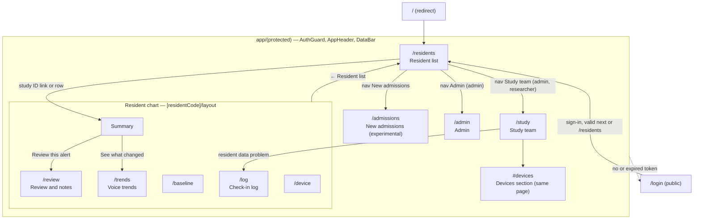
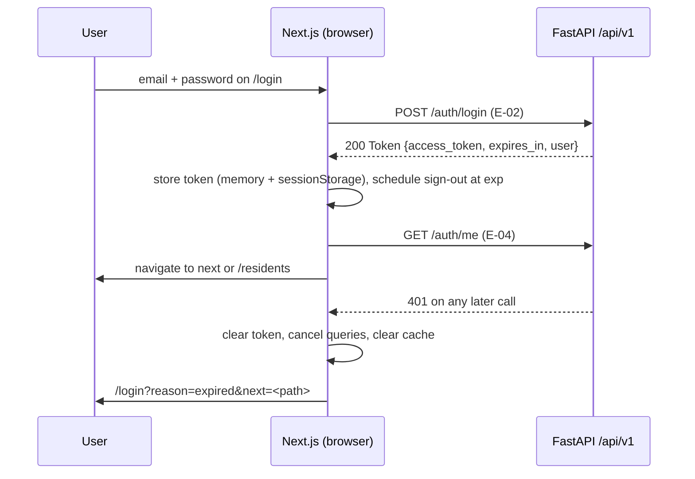
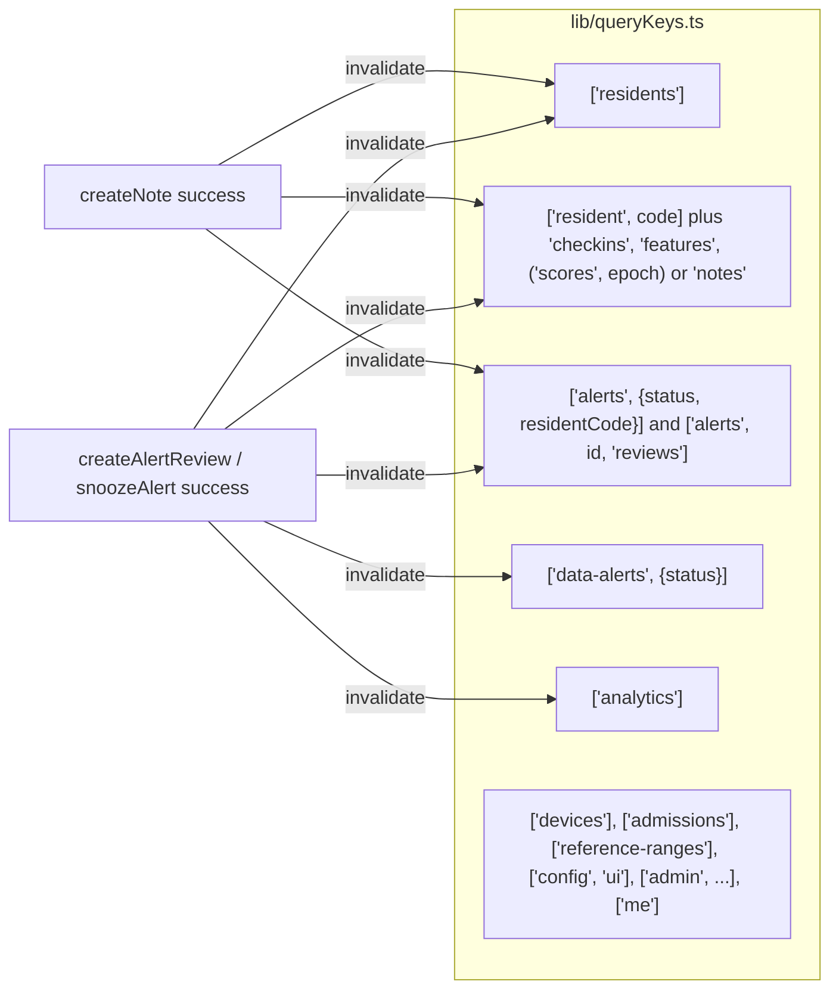

# EchoWell Frontend Architecture

Document: docs/design/Frontend_Architecture.md · Block 3 checkpoint 1, its own PR: GitHub PR #3 (Implement_Feature_Batches.md Phase 7, TRD 25 Phase 2) · Version 0.2 · Feature: FEAT-001 · Date: 21 October 2026 · Revised: 23 October 2026 (review round 1), 26 October 2026 (wireframe v0.2)

## 1. Purpose and sources

This document describes the Next.js dashboard that the Phase 3 scaffold (FEAT-004) and the Phase 8 frontend (FEAT-062..FEAT-076) build. It elaborates TRD 04 (FE) and TRD 11 (UX); the screen-level design, component hierarchy and the component → API → database mapping are in docs/design/UI_Architecture.md. API names are those of TRD 19 (TRD 04 §5: a name difference is resolved in favour of TRD 19).

| Topic | Source |
|---|---|
| Stack, layout, routes, rendering, auth, API client, state, components | TRD 04 v0.11 §4.1–§4.16 (FE-001..FE-211) |
| Screens, copy, accessibility, responsive rules, expected test rendering | TRD 11 v0.13 (UX-001..UX-433) |
| Wireframe | SRC-21 `specs/UI-wireframe/echowell-wireframes-v0.2.html` (notes `WIREFRAMES.md`); SRC-09, SRC-10, SRC-11, SRC-18, SRC-19 superseded by SRC-21 (TRD 24 D-108); removed from the repository |
| Endpoint contracts | TRD 19, docs/design/OpenAPI_Spec.md |
| Security headers, CSP | TRD 12 §4.9 |
| Frontend environment variables | TRD 21 §4.5 (ENV-030..ENV-033) |
| Pages, statuses, tokens, wording and API additions | TRD 24 D-110 (supersedes D-23), D-109, D-112, D-113, D-114 |

## 2. Technology

| Package | Pin | Purpose | Source |
|---|---|---|---|
| Node.js | 20 LTS | runtime | FE-002, AGT-024 |
| next | 14.2.x (App Router) | framework | FE-001, ARC-010 |
| react, react-dom | 18.3.x | UI | FE-003 |
| typescript | 5.x, `strict: true` | types | FE-001 |
| @tanstack/react-query | 5.x | all server state | FE-006 |
| recharts | 2.x | every chart (no other chart library) | FE-005 |
| openapi-typescript | 7.x (dev) | `lib/api-types.ts` from `docs/api_reference/openapi.json` | FE-012, OAS-014 |
| vitest, @vitest/coverage-v8, Testing Library, jsdom, msw | 2.x, 2.x, 16.x/14.x/6.x, 25.x, 2.x (dev) | unit, component, page tests | TRD 04 §4.1 |
| @playwright/test, @axe-core/playwright | 1.48+ / 4.x (dev) | E2E and accessibility | TRD 04 §4.1 |
| eslint (+ next, typescript-eslint, jsx-a11y), prettier | 8.x, 3.x (dev) | lint and format | FE-200, FE-201 |

No UI component library or icon set (CSS Modules and custom properties only; glyphs "▲", "!", "●", "○", "←" as text), font "Source Sans 3" 400/600/700 self-hosted through `next/font/google` with light and dark tokens of TRD 11 §4.15 (TRD 24 D-112), no audio component, no LLM feature (FE-003, FE-004, FE-007, FE-008, FE-211, AGT-004). The checkpoint 2 skeleton still loads IBM Plex in `frontend/app/layout.tsx`; it is switched to Source Sans 3 and the v0.2 tokens in checkpoint 7 (FEAT-062).

## 3. Source layout

```
frontend/
  app/
    layout.tsx                         root layout, Source Sans 3, <Providers>, skip link
    providers.tsx                      QueryClientProvider + AuthProvider
    page.tsx                           redirect "/" → "/residents"
    not-found.tsx, global-error.tsx
    login/page.tsx                     public (brand-only AppHeader, DataBar)
    (protected)/
      layout.tsx                       <AuthGuard>, AppHeader, DataBar
      error.tsx                        route error boundary
      residents/page.tsx               Resident list
      residents/[residentCode]/layout.tsx  Resident chart shell: BackLink, ChartBanner, ChartSectionNav
      residents/[residentCode]/page.tsx    chart section Summary
      residents/[residentCode]/{review,trends,baseline,log,device}/page.tsx  the other five chart sections
      admissions/page.tsx              New admissions (experimental)
      study/page.tsx                   Study team (admin, researcher), Devices section #devices
      admin/page.tsx                   Admin (admin)
  components/<Name>/<Name>.tsx, .module.css, .test.tsx
  lib/  auth.ts, AuthProvider.tsx, config.ts, format.ts, wording.ts, status.ts, queryKeys.ts,
        deviceGroups.ts, roles.ts, api-types.ts (generated)
  services/api.ts                      the only HTTP client (existing skeleton file kept)
  styles/tokens.css, globals.css
  middleware.ts                        Cache-Control: private, no-store on protected pages
  tests/unit, tests/pages, tests/fixtures (ds07), tests/msw/handlers.ts, tests/e2e
```

The existing files `frontend/package.json`, `frontend/next.config.js` and `frontend/services/api.ts` are filled in, not replaced (FE-010, AGT-010).

## 4. Routes

Exactly the routes of TRD 04 §4.3 and TRD 24 D-110; no other page exists (FE-020). `/` only redirects. The v0.1 routes `/alerts` and `/analytics` are retired (review form → chart "Review and notes", data alerts and devices → Study team, Analytics → Study team).

| Route | File | Access | Wireframe | Content | Source |
|---|---|---|---|---|---|
| `/login` | `app/login/page.tsx` | public | none (kept, D-111) | sign-in form, brand-only app bar, data bar | UX-170..UX-176, UX-400 |
| `/residents` | `app/(protected)/residents/page.tsx` | admin, clinician, researcher | SRC-21 Resident list | filter buttons (`?show=`), residents table (Status, Resident, What's happening, Last check-in), status legend, prompt note | UX-034..UX-048, UX-401..UX-408 |
| `/residents/[residentCode]` | `app/(protected)/residents/[residentCode]/page.tsx` (in `[residentCode]/layout.tsx`) | admin, clinician, researcher | SRC-21 Resident chart: Summary | back link, banner, section nav; "Right now", "More detail" | UX-060..UX-078, UX-410..UX-412 |
| `/residents/[residentCode]/review` | `…/review/page.tsx` | admin, clinician, researcher (review and notes: admin, clinician) | SRC-21 Review and notes | alarm review panel (Changed only), staff notes | UX-120..UX-135, UX-310..UX-324 |
| `/residents/[residentCode]/trends` | `…/trends/page.tsx` | admin, clinician, researcher | SRC-21 Voice trends | change score chart, 7 measurements, "12 other measurements" | UX-080..UX-108 |
| `/residents/[residentCode]/baseline` | `…/baseline/page.tsx` | admin, clinician, researcher | SRC-21 Baseline | baseline text, progress meter, explanation | UX-420..UX-423 |
| `/residents/[residentCode]/log` | `…/log/page.tsx` | admin, clinician, researcher | SRC-21 Check-in log | 30-day counts, events | UX-140..UX-150 |
| `/residents/[residentCode]/device` | `…/device/page.tsx` | admin, clinician, researcher | SRC-21 Device | device facts, history | UX-430..UX-433 |
| `/admissions` | `app/(protected)/admissions/page.tsx` | admin, clinician, researcher | SRC-21 New admissions | experimental note, admissions table, facility-range comparison | UX-181..UX-195 |
| `/study` (with `#devices`) | `app/(protected)/study/page.tsx` | admin, researcher | SRC-21 Study team | KPI tiles, data problems to follow up, daily chart, funnel, by-resident, alarm timing or review outcomes, Devices, Downloads | UX-017, UX-050..UX-058, UX-306..UX-309, UX-350..UX-384 |
| `/admin` | `app/(protected)/admin/page.tsx` | admin | none (kept, D-111) | Users, Pipeline runs, Upload data tabs | UX-210..UX-219 |

### 4.1 Route → endpoint map

Endpoint IDs of TRD 19 §4.3; client functions of TRD 04 §4.6.2. Every route calls at least one endpoint. Every protected page also calls E-32 GET /config/ui (`meta` for the app bar and data bar, FE-088), E-13 GET /alerts?status=open (nav badge), E-04 GET /auth/me and, on sign-out, E-03 POST /auth/logout (`getUiConfig`, `getAlerts({status:"open"})`, `getMe`, `logout`); these are not repeated below.

| Route | Endpoints called | Client functions | When |
|---|---|---|---|
| `/login` | E-02 POST /auth/login; E-04 GET /auth/me | `login`, `getMe` | sign in; then load the user (FE-054) |
| `/residents` | E-08 GET /residents?sort=alarm (summary `changed`/`needs_attention`/`learning`/`usual`, rows with `needs_attention`, `attention_reasons`, `alarm_reviewed`; D-114) | `getResidents` | page load, 5-minute refresh (FE-081); filtering makes no request (FE-082) |
| chart layout (every section) | E-09 GET /residents/{code} | `getResident` | banner and section nav (FE-206) |
| `/residents/[residentCode]` (Summary) | E-09; E-13 GET /alerts?resident_code= (alarm facts, `leaning_most`); E-12 GET /scores (latest change score); E-17 GET /devices (`uploaded_on_as_of_date`) | `getResident`, `getAlerts`, `getScores`, `getDevices` | section load (FE-087) |
| `…/review` | E-13 GET /alerts?resident_code=; E-28 GET /alerts/{id}/reviews; E-32 GET /config/ui; E-14 POST /alerts/{id}/reviews; E-29 POST /alerts/{id}/snooze; E-15 GET and E-16 POST /residents/{code}/notes | `getAlerts`, `getAlertReviews`, `getUiConfig`, `createAlertReview`, `snoozeAlert`, `getNotes`, `createNote` | section load; Save review; Remind me; Add note |
| `…/trends` | E-12 GET /scores?resident_code=&epoch=; E-11 GET /residents/{code}/features | `getScores`, `getFeatures` | section load; device-period select (OQ-28) |
| `…/baseline` | E-09; E-10 GET /residents/{code}/checkins (restart cause and values) | `getResident`, `getCheckins` | section load |
| `…/log` | E-09 (`last_30_days`); E-10 (incl. `checkins_started`, D-113) | `getResident`, `getCheckins` | section load; "Show earlier entries" (`from`/`to`) |
| `…/device` | E-09; E-17 GET /devices; E-10 (firmware restarts) | `getResident`, `getDevices`, `getCheckins` | section load |
| `/admissions` | E-22 GET /admissions; E-23 GET /admissions/{code}/comparison; E-24 GET /facility/reference-ranges | `getAdmissions`, `getAdmissionComparison`, `getReferenceRanges` | page load; row selection |
| `/study` | E-18 GET /analytics; E-30 GET /data-alerts?status=open; E-17 GET /devices; E-12 GET /scores (`Accept: text/csv`); E-19 GET /analytics/baselines (`Accept: text/csv`) | `getAnalytics`, `getDataAlerts`, `getDevices`, `downloadScoresCsv`, `downloadBaselinesCsv` | page load; Downloads; no call for clinicians (FE-037) |
| `/admin` | E-25 GET /users; E-26 POST /users; E-27 PATCH /users/{id}; E-31 GET /pipeline/runs; E-20 POST /pipeline/run; E-21 GET /pipeline/runs/{id}; E-06 POST /ingest (multipart); E-07 GET /ingest/batches/{id}; E-01 GET /health | `listUsers`, `createUser`, `updateUser`, `listPipelineRuns`, `triggerPipelineRun`, `getPipelineRun`, `uploadIngestCsv`, `getIngestBatch`, `getHealth` | tabs Users, Pipeline runs (status refreshed every 5 s while running, UX-212), Upload data; "Nightly run missing" banner from E-31 with `trigger=nightly&status=succeeded&limit=1` (UX-219, D-96) |

Endpoints with no browser caller: E-05 POST /sessions (devices only). No new endpoint is added for wireframe v0.2 (TRD 24 D-114).

### 4.2 Page hierarchy



## 5. Rendering, authentication and authorisation

| Rule | Design | Source |
|---|---|---|
| Client-side data | protected pages are client components fetching with TanStack Query; no protected data in server components, route handlers or at build time | FE-040 |
| Server-capable build | Netlify Next.js runtime (interim), Amplify SSR (target); no `output: "export"`; no Netlify-specific APIs | FE-041, FE-044, ARC-093 |
| No caching of protected pages | `Cache-Control: private, no-store` via `middleware.ts`; query cache in memory only | FE-042, FE-045 |
| Token storage | memory + `sessionStorage["echowell.auth"]`; never `localStorage`, cookies, URLs, logs | FE-050, FE-051 |
| Session expiry | sign-out at `exp`; any 401 clears token and cache and redirects to `/login?reason=expired&next=…` | FE-052, FE-056 |
| Open-redirect guard | `next` must start with a single `/` | FE-057 |
| Role helpers | `canWriteNotes`, `canReviewAlarms` (admin, clinician); `isAdmin`; `canSeeStudyTeam` (admin, researcher; formerly `canSeeAnalytics`) in `lib/roles.ts` | FE-059, SEC-043 |
| Access denied | non-admin on `/admin` and clinician on `/study` see "You do not have access to this page." and "← Resident list" without calling the API; any 403 renders "You do not have access to this information." | FE-034, FE-035, FE-037 |
| Browser hardening | CSP of TRD 12 §4.9 set by `netlify.toml` (not in `middleware.ts`); no `dangerouslySetInnerHTML`; no third-party scripts | FE-060..FE-064 |



## 6. API client (`frontend/services/api.ts`)

| Rule | Source |
|---|---|
| URL = `${NEXT_PUBLIC_API_BASE_URL}/api/v1<path>`, base read only in `lib/config.ts` | FE-070, ENV-030 |
| Headers: `Accept: application/json`, `Authorization: Bearer <token>`, `X-Request-ID: crypto.randomUUID()` | FE-071 |
| Timeouts 15 s (CSV upload 120 s) | FE-072 |
| Problem documents become `ApiError {status, code, title, detail, requestId, errors}`; network failure `status: 0` | FE-073, FE-074 |
| Forms map `errors[].field` to controls; logic branches on `code` only | FE-079, UX-207 |
| One typed function per endpoint, types from `lib/api-types.ts` | FE-075, FE-011 |
| Lists for the resident list, devices and admissions request `limit=500&offset=0` and show "Showing <n> of <total> residents." when truncated | FE-076, UX-041 |
| `meta` is the only source of facility name, time zone, data source label, as-of, `baseline_n`, `cusum_h`, profile; nothing hard-coded | FE-077, UX-007, UX-012 |

| Client function | Endpoint |
|---|---|
| `login`, `logout`, `getMe` | E-02, E-03, E-04 |
| `getUiConfig` | E-32 |
| `getResidents`, `getResident`, `getCheckins`, `getFeatures` | E-08, E-09, E-10, E-11 |
| `getScores`, `downloadScoresCsv` | E-12 |
| `getAlerts`, `getAlertReviews`, `createAlertReview`, `snoozeAlert` | E-13, E-28, E-14, E-29 |
| `getDataAlerts` | E-30 |
| `getNotes`, `createNote` | E-15, E-16 |
| `getDevices` | E-17 |
| `getAnalytics`, `downloadBaselinesCsv` | E-18, E-19 |
| `triggerPipelineRun`, `getPipelineRun`, `listPipelineRuns` | E-20, E-21, E-31 |
| `getAdmissions`, `getAdmissionComparison`, `getReferenceRanges` | E-22, E-23, E-24 |
| `listUsers`, `createUser`, `updateUser` | E-25, E-26, E-27 |
| `uploadIngestCsv`, `getIngestBatch` | E-06, E-07 |
| `getHealth` | E-01 |

## 7. State management

| Kind | Holder | Examples | Source |
|---|---|---|---|
| Server state | TanStack Query cache (memory only) | residents, resident detail, scores, features, check-ins, notes, devices, alerts, data alerts, analytics, admissions, UI config, admin lists | FE-006, FE-045 |
| Auth state | `AuthProvider` context + `lib/auth.ts` | token, user, role | FE-050..FE-054 |
| URL state | `useSearchParams`, route segments, hash | `?show=` on `/residents`, the chart section segment (`/review`, `/trends`, …), `?tab=` on `/admin`, `/study#devices` | FE-082, FE-206, UX-210, FE-026 |
| Local UI state | `useState` | note draft and type, review form, disclosures | FE-089 |

No Redux or Zustand. QueryClient defaults: `staleTime` 60 s, `gcTime` 300 s, refetch on focus, retry at most 2 times only for status 0 or ≥ 500 (FE-080); the resident list, nav count, devices and chart queries refetch every 5 minutes while visible (FE-081). The resident-list filter is applied in the browser to the API order and makes no request (FE-082, FE-084).



Invalidation rules: FE-085 (after a note) and FE-086 (after a review or snooze). After a review the UI renders the state returned by the API on refetch (Summary "Reviewed", list text "… Reviewed.", badges decreased); it never changes the status pill, change score or chart itself (FE-134, OQ-05).

## 8. Shared libraries

| Module | Responsibility | Source |
|---|---|---|
| `lib/format.ts` | every date, time and number in `meta.facility_tz` (`formatDateTimeShort`, `formatAsOf`, `formatLocalDate`, `formatLocalDateRange`, `formatTally` (change score, one decimal), `formatThreshold` ("5"), `formatSigned`, `formatOpenDays`); local dates never parsed with `new Date("YYYY-MM-DD")` | FE-150..FE-154, ARC-055 |
| `lib/wording.ts` | every clinical or plain-language template (status pill labels and legend meanings, "What's happening" sentences, Summary lead texts and note, Baseline texts, check-in log and device history lines, change-score chart summary) with the UI words of TRD 11 UX-167 ("held back", "change score", "Comparing with baseline started"); `CLINICAL_WORDING_APPROVED = false` appends "[Final clinical wording: confirm with PI]" to the Summary note and the resident-list note | FE-013, UX-073, UX-407, OQ-12, D-18, D-113 |
| `lib/status.ts` | `toDisplayStatus(status, needs_attention)` → `changed`, `needs_attention`, `learning`, `usual` (first match; presentation only, no data-alert rule in the browser) | FE-207, D-109 |
| `lib/deviceGroups.ts` | `compressDeviceCodes()` natural sort and " to " runs ("D01, D04 to D06, D08 to D10") | FE-102 |
| `lib/roles.ts` | role helpers | FE-059 |
| `lib/config.ts` | the only reader of `NEXT_PUBLIC_*` variables; build fails on a missing or non-HTTPS staging/production API URL | ENV-030, FE-171 |
| `styles/tokens.css` | v0.2 colour, font and spacing tokens (light, and dark under `prefers-color-scheme: dark`); no hex literals in component CSS | FE-160, FE-211, D-112 |

## 9. Loading, empty and error states

Each data section renders `SectionState` (loading with `role="status"`, error with "Try again" and "Reference: <request_id>", empty copy of TRD 11 UX-204); a failing section never blanks the others; a 404 resident renders only the not-found state; cached data after a failed refresh shows "Could not refresh. Showing data as of <as-of>." (FE-140..FE-145, UX-200..UX-206).

## 10. Environment variables

| Variable | Use | Source |
|---|---|---|
| `NEXT_PUBLIC_API_BASE_URL` | API origin (no path); also in CSP `connect-src` | FE-170, ENV-030 |
| `NEXT_PUBLIC_APP_ENV` | `local`, `staging`, `production`, `test`; ribbon "STAGING – synthetic data" or "LOCAL" outside production | FE-172, ENV-032 |
| `NEXT_PUBLIC_GIT_SHA` | derived in `next.config.js` from `COMMIT_REF` or `GIT_SHA` | ENV-033 |

No secret is referenced from frontend code (FE-173, ENV-031).

## 11. Build, lint and test

| Script | Command | Source |
|---|---|---|
| `lint` | `next lint --max-warnings 0` | FE-200, CIC-017 |
| `typecheck` | `tsc --noEmit` | FE-202 |
| `format:check` | `prettier --check .` | FE-201 |
| `test`, `test:coverage` | `vitest run` with line coverage ≥ 80 % | FE-180, TST-142, D-39 |
| `build` | `next build`; first-load JS ≤ 300 kB per route | FE-203, FE-204 |
| `test:e2e:readonly`, `test:e2e:mutating`, `test:e2e:isolated` | Playwright groups (D-73) | TRD 04 §4.15, TST-100 |
| `gen:api` | `openapi-typescript ../docs/api_reference/openapi.json -o lib/api-types.ts` | FE-012 |
| `fixtures:capture` | DS-07 JSON fixtures from the local stack | TRD 04 §4.14 |

Test levels and the E2E scenario list are in docs/design/Testing_Architecture.md.

## 12. Privacy and safety rules in the UI

- Residents are study IDs only; no names, photos or rooms (no room numbers, D-116) (UX-001, FE-068, AGT-017).
- No audio player, waveform or audio link on any page; the data bar on every page states "No audio is stored or played anywhere in EchoWell." (UX-400, UX-006, FE-007, FE-208).
- Wording says "Changed from their usual" and "a prompt to check in, not a diagnosis"; forbidden stems of UX-161 never appear (AGT-018, UX-160..UX-167).
- Facility named only from `meta.facility_name`; "Edge4Care" never appears (UX-012, AGT-019).
- No EWMA chart (OQ-18); no control to edit, reset or delete baselines, scores, change scores, alarms or records (UX-009).
- No request to any host other than the frontend origin and the API origin (FE-192).

## 13. Open questions affecting the frontend

| ID | Effect |
|---|---|
| OQ-05 | Review marks "Reviewed" only; status pill, change score and chart unchanged; note shown in the chart's review panel. |
| OQ-08, OQ-29 | `/admissions` stays experimental; v0.1 renders the empty state. |
| OQ-12 | Wording behind `CLINICAL_WORDING_APPROVED`. |
| OQ-13 | Alarm line value rendered from `meta.cusum_h`. |
| OQ-18 | No EWMA display. |
| OQ-25 | Explanation checklist from E-32. |
| OQ-28 | Earlier-epoch view: interim "Device period" select above the change score chart (TRD 24 OQ-28 interim decision, FEAT-067). |
| OQ-31 | Answered (D-115): `baseline_stalled` and `high_set_aside` only, never a silent device; computed by the API only; the browser maps the flag (FE-207). |
| OQ-32 | Answered (D-116): no room numbers requested or shown. |

## Revision History

| Version | Date | Change | Author |
|---|---|---|---|
| 0.2 | 26 Oct 2026 | Wireframe v0.2 (SRC-21; TRD 24 D-108 to D-114): SRC-09/10/11/18/19 superseded; routes `/residents` (Resident list), `/residents/[residentCode]` with five section routes, `/study` (replaces `/analytics`), `/alerts` retired; route → endpoint map with D-114 fields and E-32 `meta`; `lib/status.ts`; Source Sans 3 and light/dark tokens; wording, state and open questions updated; PR #5 review round 1: OQ-31, OQ-32 answered (D-115, D-116) | — |
