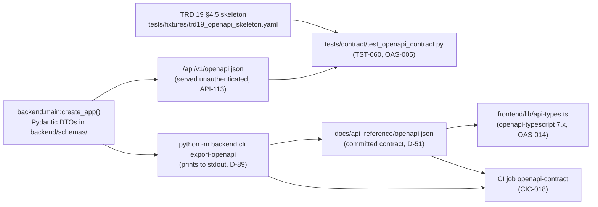

# EchoWell OpenAPI Specification (design)

Document: docs/design/OpenAPI_Spec.md · Block 3 checkpoint 1, its own PR: GitHub PR #3 (Implement_Feature_Batches.md Phase 7, TRD 25 Phase 2) · Feature: FEAT-001 · Date: 21 October 2026 · Version 0.2 · Revised: 23 October 2026 (review round 1), 26 October 2026 (wireframe v0.2)

## 1. Purpose and authority

This document turns the API contract of TRD 19 (OAS-001..OAS-028) and the backend behaviour of TRD 05 (API-001..API-137) into one implementation-ready reference for the backend agent (Phase 5, FEAT-019..FEAT-038) and the frontend agent (Phase 8, FEAT-062..FEAT-075). It does not add, rename or remove any path, parameter, schema property, status code or error code.

| Source | Role in this document |
|---|---|
| TRD 19 §4.3, §4.5 | Authoritative endpoint list E-01..E-32 and the OpenAPI 3.1 skeleton; the tables in §4 and §8 below are generated mechanically from the §4.5 YAML (stored verbatim as `tests/fixtures/trd19_openapi_skeleton.yaml`, OAS-005) |
| TRD 05 §4.1, §4.12 | Router file and service function of every endpoint (API-003, API-008) |
| TRD 12 §4.6 | Role matrix (SEC-040..SEC-045) |
| TRD 05 §4.7 | Error code catalogue (API-095..API-098) |
| TRD 20 §4.4 | Database enums mirrored by DTO enums (OAS-007) |
| TRD 24 | D-35 (no acknowledge endpoint), D-47 and D-70 (pipeline:run key), D-51 and D-89 (contract artefact), DSC-11 (prompt shorthand) |

Conflict note (AGT-001): `Implement_Feature_Batches.md` Phase 10 lists `GET /health`, `GET /residents/{id}`, `POST /sessions`, `POST /ingest` and others without a base path and with `{id}`. TRD 05 §4.12 and TRD 24 DSC-11 supersede that list: every path is under `/api/v1` (API-002, OAS-001) and residents are addressed by `resident_code`, never by a UUID (DME-004). The shorthand maps as follows: `GET /health` = E-01, `GET /residents` = E-08, `GET /residents/{id}` = E-09, `GET /alerts` = E-13, `GET /scores` = E-12, `GET /analytics` = E-18, `POST /sessions` = E-05, `POST /ingest` = E-06.

## 2. Contract artefacts and generation

| ID | Design rule | Source |
|---|---|---|
| OAS-A1 | DTO class names equal the component schema names of §8; request models use `ConfigDict(extra="forbid")`; nullable response fields are declared `X \| None` without a default and are always serialised (OAS-012). | TRD 19 §8, OAS-004, OAS-012 |
| OAS-A2 | `info.title` "EchoWell API", `info.version` "0.1.0", `openapi: 3.1.0`; servers `http://localhost:8000/api/v1` and `/api/v1`. | OAS-002, TRD 19 §4.4 |
| OAS-A3 | The committed file is regenerated only with `python -m backend.cli export-openapi > docs/api_reference/openapi.json` and never edited by hand; `frontend/lib/api-types.ts` is regenerated with `npm run gen:api` after every API change. | ARC-017, FE-012, AGT-061, D-51, D-89 |
| OAS-A4 | `POST /sessions` and `POST /ingest` read the raw body manually (so invalid bodies reach `ingest_rejections`) and attach the request schema through `openapi_extra`. | API-031, TRD 19 §8 |
| OAS-A5 | `GET /scores` and `GET /analytics/baselines` declare both `application/json` and `text/csv` 200 responses; the handler chooses from the `Accept` header. | OAS-018, API-129 |

The IDs `OAS-A1`..`OAS-A5` are local labels of this document for review; they are not TRD requirement IDs.

## 3. Common conventions

| Topic | Rule | Source |
|---|---|---|
| Base URL | `${NEXT_PUBLIC_API_BASE_URL}/api/v1`; local `http://localhost:8000/api/v1` | TRD 19 §4.2, FE-070 |
| Instants | `*_at` ISO 8601 UTC with `Z`; full float64 numbers, no API rounding | API-094, OAS-011, DME-014 |
| Local values | `*_local` ISO 8601 with facility offset; `local_date`, `*_on`, `*_since`, `from`, `to` are facility-local `YYYY-MM-DD` | TRD 19 §4.2, ARC-102 |
| Pagination | `limit` 1..500 (default 50), `offset` ≥ 0 (default 0); paged body `{meta, items, total, limit, offset}` plus endpoint fields | API-016, API-100 |
| `meta` block | `{facility_name, facility_tz, data_source_label, as_of, baseline_n, cusum_h, pipeline_profile}` on every paged list and on `ResidentDetail`, `FeaturesResponse`, `AdmissionComparison`, `AnalyticsResponse`, `UiConfig`; built once by the `get_meta()` dependency; `as_of` = as-of of the latest succeeded pipeline run | OAS-017, API-057, API-069, D-32 |
| Errors | `application/problem+json` `{type, title, status, detail, request_id, errors[]}` with `type` = `urn:echowell:error:<CODE>` | ARC-101, OAS-009, API-095, D-48 |
| Request ID | every response carries `X-Request-ID` (incoming value reused when it matches `^[A-Za-z0-9-]{8,64}$`) | OAS-010, API-105, ARC-100 |
| Security schemes | `bearerAuth` (HTTP bearer JWT) and `apiKeyAuth` (header `X-API-Key`) | OAS-013, API-114 |
| No audio | no schema property for audio, audio URLs, names or dates of birth; only `audio_quality_flag` contains "audio" | OAS-016, ARC-003, AGT-006, AC-ARC-08 |
| Experimental header | E-22, E-23, E-24 set `X-EchoWell-Experimental: true` | API-089 |
| CSV export | `Accept: text/csv` on E-12 and E-19 (admin, researcher): header row = DTO field names, `z` flattened to `z_<feature>`, at most 100,000 rows, audit `export.csv` | API-129, FR-244, FR-245 |

## 4. Endpoint catalogue (generated from TRD 19 §4.5)

Response names without a media type are shared `components/responses` entries; all of them return the `Problem` schema (OAS-009). Every operation also returns 500 `INTERNAL_ERROR` and 503 `SERVICE_UNAVAILABLE` through the global handlers of `backend/core/errors.py` (API-095..API-097).

| ID | Method | Path | operationId | Security | Parameters | Request body | Responses (status schema [media type]) |
|---|---|---|---|---|---|---|---|
| E-01 | GET | `/api/v1/health` | `getHealth` | none | — | — | 200 Health [application/json]; 503 Health [application/json] |
| E-02 | POST | `/api/v1/auth/login` | `login` | none | — | LoginRequest [application/json] | 200 Token [application/json]; 401 Unauthorized; 422 Unprocessable; 429 TooManyRequests |
| E-03 | POST | `/api/v1/auth/logout` | `logout` | bearerAuth | — | — | 204 (no body); 401 Unauthorized |
| E-04 | GET | `/api/v1/auth/me` | `getMe` | bearerAuth | — | — | 200 User [application/json]; 401 Unauthorized |
| E-05 | POST | `/api/v1/sessions` | `ingestSession` | apiKeyAuth | — | IngestRecord [application/json] | 201 IngestResult [application/json]; 200 IngestResult [application/json]; 401 Unauthorized; 403 Forbidden; 413 PayloadTooLarge; 415 UnsupportedMediaType; 422 Unprocessable; 429 TooManyRequests |
| E-06 | POST | `/api/v1/ingest` | `ingestBatch` | apiKeyAuth or bearerAuth | — | IngestBatchRequest [application/json] / object [multipart/form-data] | 202 IngestBatchAccepted [application/json]; 401 Unauthorized; 403 Forbidden; 413 PayloadTooLarge; 415 UnsupportedMediaType; 422 Unprocessable; 429 TooManyRequests |
| E-07 | GET | `/api/v1/ingest/batches/{id}` | `getIngestBatch` | bearerAuth | `id` (path, required; string (uuid)) | — | 200 IngestBatch [application/json]; 401 Unauthorized; 403 Forbidden; 404 NotFound; 422 Unprocessable |
| E-08 | GET | `/api/v1/residents` | `listResidents` | bearerAuth | `sort` (query; string enum [alarm, resident_id, last_checkin]; default alarm); `cohort` (query; Cohort); `include_withdrawn` (query; boolean; default false); `limit` (query; integer; minimum 1, maximum 500, default 50); `offset` (query; integer; minimum 0, default 0) | — | 200 ResidentsOverviewResponse [application/json]; 401 Unauthorized; 422 Unprocessable |
| E-09 | GET | `/api/v1/residents/{resident_code}` | `getResident` | bearerAuth | `resident_code` (path, required; ResidentCode) | — | 200 ResidentDetail [application/json]; 401 Unauthorized; 404 NotFound |
| E-10 | GET | `/api/v1/residents/{resident_code}/checkins` | `listCheckinEvents` | bearerAuth | `resident_code` (path, required; ResidentCode); `from` (query; string (date)); `to` (query; string (date)); `limit` (query; integer; minimum 1, maximum 500, default 50); `offset` (query; integer; minimum 0, default 0) | — | 200 CheckinEventList [application/json]; 401 Unauthorized; 404 NotFound; 422 Unprocessable |
| E-11 | GET | `/api/v1/residents/{resident_code}/features` | `getResidentFeatures` | bearerAuth | `resident_code` (path, required; ResidentCode); `from` (query; string (date)); `to` (query; string (date)) | — | 200 FeaturesResponse [application/json]; 401 Unauthorized; 404 NotFound; 422 Unprocessable |
| E-12 | GET | `/api/v1/scores` | `listScores` | bearerAuth | `resident_code` (query; ResidentCode); `epoch` (query; integer; minimum 1); `from` (query; string (date)); `to` (query; string (date)); `limit` (query; integer; minimum 1, maximum 500, default 50); `offset` (query; integer; minimum 0, default 0) | — | 200 ScoresResponse [application/json] / string [text/csv]; 403 Forbidden; 413 PayloadTooLarge; 401 Unauthorized; 404 NotFound; 422 Unprocessable |
| E-13 | GET | `/api/v1/alerts` | `listAlerts` | bearerAuth | `status` (query; AlertStatus); `resident_code` (query; ResidentCode); `limit` (query; integer; minimum 1, maximum 500, default 50); `offset` (query; integer; minimum 0, default 0) | — | 200 AlertList [application/json]; 401 Unauthorized; 422 Unprocessable |
| E-14 | POST | `/api/v1/alerts/{id}/reviews` | `createAlertReview` | bearerAuth | `id` (path, required; string (uuid)) | AlertReviewCreate [application/json] | 201 AlertReview [application/json]; 401 Unauthorized; 403 Forbidden; 404 NotFound; 409 Conflict; 422 Unprocessable |
| E-15 | GET | `/api/v1/residents/{resident_code}/notes` | `listNotes` | bearerAuth | `resident_code` (path, required; ResidentCode); `include_superseded` (query; boolean; default false); `limit` (query; integer; minimum 1, maximum 500, default 50); `offset` (query; integer; minimum 0, default 0) | — | 200 StaffNoteList [application/json]; 401 Unauthorized; 404 NotFound |
| E-16 | POST | `/api/v1/residents/{resident_code}/notes` | `createNote` | bearerAuth | `resident_code` (path, required; ResidentCode) | StaffNoteCreate [application/json] | 201 StaffNote [application/json]; 401 Unauthorized; 403 Forbidden; 404 NotFound; 409 Conflict; 422 Unprocessable |
| E-17 | GET | `/api/v1/devices` | `listDevices` | bearerAuth | `limit` (query; integer; minimum 1, maximum 500, default 50); `offset` (query; integer; minimum 0, default 0) | — | 200 DeviceList [application/json]; 401 Unauthorized |
| E-18 | GET | `/api/v1/analytics` | `getAnalytics` | bearerAuth | — | — | 200 AnalyticsResponse [application/json]; 401 Unauthorized; 403 Forbidden |
| E-19 | GET | `/api/v1/analytics/baselines` | `listBaselines` | bearerAuth | `resident_code` (query; ResidentCode); `epoch` (query; integer; minimum 1); `limit` (query; integer; minimum 1, maximum 500, default 50); `offset` (query; integer; minimum 0, default 0) | — | 200 BaselineRowList [application/json] / string [text/csv]; 413 PayloadTooLarge; 401 Unauthorized; 403 Forbidden; 422 Unprocessable |
| E-20 | POST | `/api/v1/pipeline/run` | `startPipelineRun` | bearerAuth or apiKeyAuth | — | PipelineRunRequest [application/json] | 202 PipelineRunAccepted [application/json]; 401 Unauthorized; 403 Forbidden; 404 NotFound; 409 Conflict; 422 Unprocessable |
| E-21 | GET | `/api/v1/pipeline/runs/{id}` | `getPipelineRun` | bearerAuth | `id` (path, required; string (uuid)) | — | 200 PipelineRun [application/json]; 401 Unauthorized; 403 Forbidden; 404 NotFound |
| E-22 | GET | `/api/v1/admissions` | `listAdmissions` | bearerAuth | `limit` (query; integer; minimum 1, maximum 500, default 50); `offset` (query; integer; minimum 0, default 0) | — | 200 AdmissionList [application/json]; 401 Unauthorized |
| E-23 | GET | `/api/v1/admissions/{resident_code}/comparison` | `getAdmissionComparison` | bearerAuth | `resident_code` (path, required; ResidentCode) | — | 200 AdmissionComparison [application/json]; 401 Unauthorized; 404 NotFound |
| E-24 | GET | `/api/v1/facility/reference-ranges` | `listReferenceRanges` | bearerAuth | `limit` (query; integer; minimum 1, maximum 500, default 50); `offset` (query; integer; minimum 0, default 0) | — | 200 ReferenceRangeList [application/json]; 401 Unauthorized |
| E-25 | GET | `/api/v1/users` | `listUsers` | bearerAuth | `role` (query; Role); `active` (query; boolean); `limit` (query; integer; minimum 1, maximum 500, default 50); `offset` (query; integer; minimum 0, default 0) | — | 200 UserList [application/json]; 401 Unauthorized; 403 Forbidden |
| E-26 | POST | `/api/v1/users` | `createUser` | bearerAuth | — | UserCreate [application/json] | 201 User [application/json]; 401 Unauthorized; 403 Forbidden; 409 Conflict; 422 Unprocessable |
| E-27 | PATCH | `/api/v1/users/{id}` | `updateUser` | bearerAuth | `id` (path, required; string (uuid)) | UserUpdate [application/json] | 200 User [application/json]; 401 Unauthorized; 403 Forbidden; 404 NotFound; 409 Conflict; 422 Unprocessable |
| E-28 | GET | `/api/v1/alerts/{id}/reviews` | `listAlertReviews` | bearerAuth | `id` (path, required; string (uuid)); `limit` (query; integer; minimum 1, maximum 500, default 50); `offset` (query; integer; minimum 0, default 0) | — | 200 AlertReviewList [application/json]; 401 Unauthorized; 404 NotFound |
| E-29 | POST | `/api/v1/alerts/{id}/snooze` | `snoozeAlert` | bearerAuth | `id` (path, required; string (uuid)) | SnoozeRequest [application/json] | 200 Alert [application/json]; 401 Unauthorized; 403 Forbidden; 404 NotFound; 409 Conflict; 422 Unprocessable |
| E-30 | GET | `/api/v1/data-alerts` | `listDataAlerts` | bearerAuth | `status` (query; DataAlertStatus); `kind` (query; DataAlertKind); `limit` (query; integer; minimum 1, maximum 500, default 50); `offset` (query; integer; minimum 0, default 0) | — | 200 DataAlertList [application/json]; 401 Unauthorized; 422 Unprocessable |
| E-31 | GET | `/api/v1/pipeline/runs` | `listPipelineRuns` | bearerAuth | `trigger` (query; PipelineTrigger); `status` (query; PipelineStatus); `limit` (query; integer; minimum 1, maximum 500, default 50); `offset` (query; integer; minimum 0, default 0) | — | 200 PipelineRunList [application/json]; 401 Unauthorized; 403 Forbidden; 422 Unprocessable |
| E-32 | GET | `/api/v1/config/ui` | `getUiConfig` | bearerAuth | — | — | 200 UiConfig [application/json]; 401 Unauthorized |

## 5. Endpoint → router → service → tables → features

Router files are under `backend/api/`; service modules under `backend/services/` (TRD 05 §4.1, §4.12). Existing skeleton files are kept (`alarms.py` serves `/alerts`, reviews, snooze and `/data-alerts`; D-24, AGT-010, API-008). Roles: A admin, C clinician, Rs researcher, K API key with scope `ingest:write`, P API key with scope `pipeline:run` (TRD 12 §4.6).

| ID | Method and path (`/api/v1`) | Roles / keys | Router file | Service function (module) | Tables read (R) / written (W) | Backlog features |
|---|---|---|---|---|---|---|
| E-01 | GET /health | none | `health.py` | `health_service.get_health` (`health_service.py`): `SELECT 1` within 2 s through `backend/core/db.py` (TRD 05 §4.12) | R `SELECT 1` | FEAT-003 |
| E-02 | POST /auth/login | none | `auth.py` | `auth_service.login` (`auth_service.py`) | R users; W users.last_login_at, audit_logs | FEAT-020, FEAT-022 |
| E-03 | POST /auth/logout | A C Rs | `auth.py` | `auth_service.logout` (`auth_service.py`) | W audit_logs | FEAT-020 |
| E-04 | GET /auth/me | A C Rs | `auth.py` | `auth_service.me` (`auth_service.py`) | R users | FEAT-020 |
| E-05 | POST /sessions | K | `sessions.py` | `ingestion.ingest_single` then `pipeline_runner.run` (`ingestion.py`, `pipeline_runner.py`) | R residents, devices, device_assignments, api_keys; W ingest_rejections, raw_sessions, all derived tables, pipeline_runs, audit_logs (run rows only) | FEAT-023, FEAT-025, FEAT-054 |
| E-06 | POST /ingest | K, A | `ingest.py` | `ingestion.ingest_batch` then `pipeline_runner.run` in a background task (`ingestion.py`, `pipeline_runner.py`) | as E-05 plus W ingest_batches | FEAT-026, FEAT-054 |
| E-07 | GET /ingest/batches/{id} | A Rs | `ingest.py` | `ingestion.get_batch` (`ingestion.py`) | R ingest_batches, ingest_rejections, pipeline_runs | FEAT-026 |
| E-08 | GET /residents | A C Rs | `residents.py` | `resident_service.overview` (`resident_service.py`) | R residents, device_assignments, devices, processed_sessions, day_ledger, epochs, baselines, alerts, cusum_state, data_alerts (attention flag), pipeline_runs | FEAT-027, FEAT-014 |
| E-09 | GET /residents/{resident_code} | A C Rs | `residents.py` | `resident_service.detail` (`resident_service.py`) | as E-08 plus scores | FEAT-028 |
| E-10 | GET /residents/{resident_code}/checkins | A C Rs | `residents.py` | `checkin_service.list_events` (`checkin_service.py`) | R processed_sessions, raw_sessions (`checkins_started` device), day_ledger, epochs, baselines, alerts, scores | FEAT-028 |
| E-11 | GET /residents/{resident_code}/features | A C Rs | `residents.py` | `feature_service.series` (`feature_service.py`) | R processed_sessions, raw_sessions, baselines, scores | FEAT-028 |
| E-12 | GET /scores | A C Rs (CSV: A Rs) | `scores.py` | `scoring.list_scores`; CSV through `export_service` (`scoring.py`, `export_service.py`) | R scores, processed_sessions, baselines, epochs; W audit_logs (CSV) | FEAT-034 |
| E-13 | GET /alerts | A C Rs | `alarms.py` | `alert_service.list` (`alert_service.py`; `leaning_most` from `analytics.alert_generator.leaning_most`, API-006) | R alerts, cusum_state, alert_reviews, scores, residents | FEAT-030, FEAT-048 |
| E-14 | POST /alerts/{id}/reviews | A C | `alarms.py` | `review_service.create` (`review_service.py`) | W alert_reviews, alerts, data_alerts, audit_logs | FEAT-031 |
| E-15 | GET /residents/{resident_code}/notes | A C Rs | `residents.py` | `note_service.list` (`note_service.py`) | R staff_notes, users | FEAT-033 |
| E-16 | POST /residents/{resident_code}/notes | A C | `residents.py` | `note_service.create` (`note_service.py`) | W staff_notes, audit_logs | FEAT-033 |
| E-17 | GET /devices | A C Rs | `devices.py` | `device_service.panel` (`device_service.py`) | R devices, device_assignments, raw_sessions, day_ledger | FEAT-029 |
| E-18 | GET /analytics | A Rs | `analytics.py` | `analytics_summary.build` (`analytics_summary.py`; aggregates from `analytics.aggregates.build_analytics_summary`, D-79; alarm timing through the `DATABASE_READONLY_URL` engine, API-136) | R processed_sessions, day_ledger, epochs, baselines, scores, alerts, alert_reviews, pipeline_runs, evaluation_ground_truth (test_v0_1 only) | FEAT-035, FEAT-051 |
| E-19 | GET /analytics/baselines | A Rs | `analytics.py` | `analytics_service.baselines` (`analytics_service.py`; CSV through `export_service.py`) | R baselines, epochs, devices, residents; W audit_logs (CSV) | FEAT-034 |
| E-20 | POST /pipeline/run | A, P | `pipeline.py` | `pipeline_runner.start` (`pipeline_runner.py`) | W pipeline_runs, derived tables, audit_logs | FEAT-024, FEAT-053 |
| E-21 | GET /pipeline/runs/{id} | A Rs | `pipeline.py` | `pipeline_runner.get` (`pipeline_runner.py`) | R pipeline_runs | FEAT-024 |
| E-22 | GET /admissions | A C Rs | `admissions.py` | `admission_service.list` (`admission_service.py`) | R residents, processed_sessions, facility_reference_ranges, baselines | FEAT-036 |
| E-23 | GET /admissions/{resident_code}/comparison | A C Rs | `admissions.py` | `admission_service.comparison` (`admission_service.py`) | R processed_sessions, facility_reference_ranges | FEAT-036 |
| E-24 | GET /facility/reference-ranges | A C Rs | `admissions.py` | `admission_service.ranges` (`admission_service.py`) | R facility_reference_ranges | FEAT-036 |
| E-25 | GET /users | A | `users.py` | `user_service.list` (`user_service.py`) | R users | FEAT-037 |
| E-26 | POST /users | A | `users.py` | `user_service.create` (`user_service.py`) | W users, audit_logs | FEAT-037 |
| E-27 | PATCH /users/{id} | A | `users.py` | `user_service.update` (`user_service.py`) | W users, audit_logs | FEAT-037 |
| E-28 | GET /alerts/{id}/reviews | A C Rs | `alarms.py` | `review_service.list` (`review_service.py`) | R alert_reviews, users | FEAT-031 |
| E-29 | POST /alerts/{id}/snooze | A C | `alarms.py` | `alert_service.snooze` (`alert_service.py`) | W alerts, audit_logs | FEAT-031 |
| E-30 | GET /data-alerts | A C Rs | `alarms.py` | `data_alert_service.list` (`data_alert_service.py`) | R data_alerts, residents, devices | FEAT-032 |
| E-31 | GET /pipeline/runs | A Rs | `pipeline.py` | `pipeline_runner.list` (`pipeline_runner.py`) | R pipeline_runs | FEAT-024 |
| E-32 | GET /config/ui | A C Rs | `config.py` | `config_service.ui_config` (`config_service.py`) | R config_parameters, facilities | FEAT-030 |

Cross-cutting features for every row: FEAT-019 (Problem model, middleware, `meta`), FEAT-021 (role matrix), FEAT-022 (rate limits), FEAT-038 (contract export and drift check), FEAT-039 (security verification suite).

## 6. Behaviour notes per endpoint group

### 6.1 Ingest (E-05, E-06, E-07)

| Case | Response | Effects | Source |
|---|---|---|---|
| Valid first arrival (single) | 201 `IngestResult`, `status_after_processing` usable, set_aside or quarantined | `raw_sessions` committed first, then synchronous resident-scoped run (record's resident plus residents sharing the device that day) with trigger `ingest`; no `ingest_batches` row, no ingest audit row | API-042, API-045, API-046, API-032, ARC-022, ING-002 |
| Synchronous run fails | 201 with `status_after_processing` "pending" | raw row kept; run `failed`; next run processes it | API-047, ARC-025, D-52, D-91 |
| Repeat `session_id` | 200 with "duplicate", reasons `["session_id already received"]`, `pipeline_run_id` null | stored in `raw_sessions`; no run triggered | API-044, ING-003, AGT-043 |
| Invalid record | 422 Problem with one `errors[]` item per field | `ingest_rejections` row with the exact body; nothing in `raw_sessions` | API-034..API-041, ING-004 |
| Key bound to another device | 403 `DEVICE_KEY_MISMATCH` | stored in `ingest_rejections` | API-040 |
| Batch JSON or CSV | 202 `IngestBatchAccepted` (SRC-05: accepted 283, rejected 0, duplicates 2) | records validated independently, inserted in file order so `arrival_seq` keeps source order; one background run | API-048..API-053, ING-005..ING-008, ING-032 |
| Legacy SRC-06 CSV | 422 `CSV_HEADER_MISMATCH` | nothing stored | API-050, ING-055, AGT-025 |
| Body with an audio field or audio media type | 422 `VALIDATION_ERROR` (`extra_forbidden`) or 415 | nothing stored | AC-API-07, ING-012, AGT-006 |

### 6.2 Reads (E-08..E-13, E-15, E-17..E-19, E-22..E-24, E-28, E-30..E-32)

- Read endpoints never invoke the pipeline; they read persisted derived tables (ARC-024) and derive display values on read (DME-011, DME-012, TRD 23 §4.4).
- E-08 sort orders are computed by the API, not the client: `alarm` (default; TRD 24 D-109, amending D-17: Changed by alarm date, then Needs attention, Learning, Usual, each by natural code; test order R09, R10, R03, R08, R01, R02, R04, R05, R06, R07), `resident_id` (natural sort, R2 before R10), `last_checkin` (API-070..API-072, AGT-052, OAS-021); the v0.2 UI uses only the default and filters in the browser.
- E-08 `summary` is `{changed, needs_attention, learning, usual}` (test data 2 / 2 / 0 / 6, API-073); E-08 rows and E-09 carry `needs_attention`, `attention_reasons`, `alarm_reviewed` and `restart_cause`, and E-09 the 30-day `window` (`DateWindow` gains `days`) (API-138, D-114); the pipeline `status` is unchanged and the frontend maps it with the flag to the four display statuses (DME-011).
- E-10 adds the derived `checkins_started` event (one per resident, local date of the first non-duplicate record, `device_code` of that record; same-date order last; API-077, D-113); E-17 adds `uploaded_on_as_of_date` (API-086); E-30 `detail` strings follow the v0.2 wording with titles unchanged (API-133, CUS-040, D-114).
- Duplicates never appear in counts, rows or logs (API-074, AGT-053).
- E-13 `status=open` total is the red badge on the "Resident list" navigation link (FE-036, UX-018); there is no `/alerts` page (D-110).
- E-18 returns exactly one of `alarm_timing` (profile `test_v0_1`) or `review_outcomes` (production) (API-087, CUS-047, CUS-049).

### 6.3 Human writes (E-14, E-16, E-29)

| Endpoint | Effect | Never changes | Source |
|---|---|---|---|
| E-14 review | inserts `alert_reviews`; alert `open` → `acknowledged`; outcome `data_problem` creates or links a `review_flagged_data_problem` data alert in the same transaction; audit `alert.reviewed` | `cusum_state`, `scores`, alarm state, display status | API-081, API-130, CUS-016, CUS-040, D-35, OQ-05 |
| E-16 note | inserts `staff_notes` (corrections are new rows with `supersedes_id`); audit `note.created` | alert status | API-084, API-085, DB-010, D-83 |
| E-29 snooze | sets `snoozed_until` (application clock + hours, default `alert_snooze_hours` 24) and `snoozed_by`; audit `alert.snoozed` | status, alarm state | API-132, DME-022, CUS-039, D-37 |

There is no `POST /alerts/{id}/acknowledge` (API-082, D-35). Reviewing or snoozing a closed alert returns 409 `ALERT_CLOSED`.

### 6.4 Pipeline (E-20, E-21, E-31)

- Admin JWT → `trigger = manual`; API key with scope `pipeline:run` → scope `all`, `trigger = nightly`, once-per-night dedupe (API-065, D-47, D-70).
- `as_of` precedence: request `as_of` → `PIPELINE_AS_OF` (refused in production) → current time (API-135, ARC-068).
- 409 `PIPELINE_RUN_IN_PROGRESS` while a full-scope run is running; 422 `PROFILE_NOT_ALLOWED` for `test_v0_1` or a non-configured profile in production (API-065, API-066, AGT-015).

## 7. Error catalogue

The complete list of codes (TRD 05 §4.7); no other code may be emitted (OAS-020).

| HTTP | Codes |
|---|---|
| 401 | `NOT_AUTHENTICATED`, `INVALID_CREDENTIALS`, `TOKEN_EXPIRED`, `TOKEN_INVALID`, `API_KEY_INVALID` (every 401 carries `WWW-Authenticate: Bearer`, API-024) |
| 403 | `FORBIDDEN`, `DEVICE_KEY_MISMATCH` |
| 404 | `NOT_FOUND`, `RESIDENT_NOT_FOUND`, `ALERT_NOT_FOUND`, `BATCH_NOT_FOUND`, `PIPELINE_RUN_NOT_FOUND`, `USER_NOT_FOUND` |
| 405 | `METHOD_NOT_ALLOWED` |
| 409 | `ALERT_CLOSED`, `EMAIL_ALREADY_EXISTS`, `LAST_ADMIN`, `PIPELINE_RUN_IN_PROGRESS` |
| 413 | `PAYLOAD_TOO_LARGE` (64 KB on all endpoints except 5 MB on E-06, API-104; more than 100,000 CSV rows, API-129) |
| 415 | `UNSUPPORTED_MEDIA_TYPE` |
| 422 | `VALIDATION_ERROR`, `INVALID_QUERY_PARAMETER`, `UNSUPPORTED_SCHEMA_VERSION`, `UNKNOWN_RESIDENT`, `UNKNOWN_DEVICE`, `RESIDENT_WITHDRAWN`, `SESSION_ID_MISMATCH`, `CSV_HEADER_MISMATCH`, `EMPTY_BATCH`, `ALERT_RESIDENT_MISMATCH`, `PASSWORD_POLICY_VIOLATION`, `PROFILE_NOT_ALLOWED` |
| 429 | `RATE_LIMITED`, `ACCOUNT_TEMPORARILY_LOCKED` (with `Retry-After`, API-098) |
| 500 | `INTERNAL_ERROR` (detail "An unexpected error occurred.", API-096; SQLSTATE `EW001` from an append-only table also maps here, PGS-028) |
| 503 | `SERVICE_UNAVAILABLE` (database unreachable, `Retry-After: 30`, API-097) |

Ingest field-level `errors[].code` values are the TRD 10 ING-023 codes (`missing_field`, `invalid_type`, `invalid_format`, `invalid_enum`, `extra_forbidden`, `unknown_resident` and the others listed there).

## 8. Component schemas (generated from TRD 19 §4.5)

Pydantic modules per TRD 23 §4.6: `common.py` (`Meta`, `PageMeta`, `Problem`, `ProblemFieldError`), `health.py`, `auth.py`, `user.py`, `config.py`, `session.py`, `ingest.py`, `resident.py`, `checkin.py`, `feature.py`, `score.py`, `alert.py`, `note.py`, `device.py`, `analytics.py`, `pipeline.py`, `admission.py`, `reference_range.py`.

| Schema | Required properties | All properties (type) |
|---|---|---|
| `ResidentCode` | — | string |
| `DeviceCode` | — | string |
| `SessionId` | — | string |
| `ProcessedStatus` | — | string enum [usable, set_aside, quarantined, duplicate] |
| `IngestOutcome` | — | string enum [usable, set_aside, quarantined, duplicate, pending] |
| `DayStatus` | — | string enum [checked_in, missing_resident, missing_device_gap] |
| `DisplayStatus` | — | string enum [alarm_on, no_alarm, baseline_forming] |
| `AttentionReason` | — | string enum [baseline_stalled, high_set_aside] (subset of DataAlertKind that sets `needs_attention`; D-114, OQ-31) |
| `AlarmState` | — | string enum [off, rings, on] |
| `AlertStatus` | — | string enum [open, acknowledged, closed] |
| `NoteType` | — | string enum [observation, action_taken, follow_up] |
| `Role` | — | string enum [admin, clinician, researcher] |
| `Cohort` | — | string enum [longitudinal, new_admission] |
| `ResidentStatus` | — | string enum [active, withdrawn] |
| `Sex` | — | string or null enum [F, M, null] |
| `PipelineTrigger` | — | string enum [ingest, nightly, manual, test] |
| `PipelineStatus` | — | string enum [running, succeeded, failed] |
| `ConfigProfile` | — | string enum [production, test_v0_1] |
| `IngestSource` | — | string enum [api_single, api_batch, csv_upload, seed] |
| `CheckinEventType` | — | string enum [alarm_on, watching_started, baseline_complete, baseline_restarted, set_aside, quarantined, missed, device_silent, checkins_started] |
| `ComparisonStatus` | — | string enum [outside_range, within_range, not_enough_checkins, range_not_available] |
| `RestartCause` | — | string or null enum [device, firmware, software, null] |
| `ReviewOutcome` | — | string enum [no_concern, known_cause, referred, data_problem] |
| `ReviewExplanationCode` | — | string |
| `ReviewExplanation` | `code`, `label` | `code` ReviewExplanationCode; `label` string |
| `UiConfig` | `meta`, `alert_snooze_hours`, `review_explanations` | `meta` Meta; `alert_snooze_hours` integer; `review_explanations` array<ReviewExplanation> |
| `DataAlertKind` | — | string enum [baseline_stalled, possible_other_speaker, high_set_aside, device_silent, review_flagged_data_problem] |
| `DataAlertStatus` | — | string enum [open, resolved] |
| `Meta` | `facility_name`, `facility_tz`, `data_source_label`, `as_of`, `baseline_n`, `cusum_h`, `pipeline_profile` | `facility_name` string; `facility_tz` string; `data_source_label` string; `as_of` string or null (date-time); `baseline_n` integer; `cusum_h` number; `pipeline_profile` ConfigProfile |
| `ScoredFeatureKey` | — | string enum [loudness_dbfs, total_phrase_duration_s, speech_rate_syl_per_s, articulation_rate_syl_per_s, number_of_pauses, pause_fraction, voiced_fraction] |
| `FeatureKey` | — | string enum [loudness_dbfs, total_phrase_duration_s, speech_rate_syl_per_s, articulation_rate_syl_per_s, number_of_pauses, pause_fraction, voiced_fraction, mean_f0_hz, f0_variability_st, jitter_local_pct, shimmer_local_pct, hnr_db, cpps_db, alpha_ratio_db, hammarberg_index_db, mfcc1, mfcc2, mfcc3, mfcc4] |
| `BaselineFeatureKey` | — | string enum [loudness_dbfs, total_phrase_duration_s, speech_rate_syl_per_s, articulation_rate_syl_per_s, number_of_pauses, pause_fraction, voiced_fraction, mean_f0_hz, f0_variability_st, jitter_local_pct, shimmer_local_pct, hnr_db, cpps_db, alpha_ratio_db, hammarberg_index_db, mfcc1, mfcc2, mfcc3, mfcc4, composite] |
| `PageMeta` | `meta`, `total`, `limit`, `offset` | `meta` Meta; `total` integer; `limit` integer; `offset` integer |
| `Last30Days` | `used`, `set_aside`, `quarantined`, `missed` | `used` integer; `set_aside` integer; `quarantined` integer; `missed` integer |
| `DateWindow` | `from`, `to` | `from` string (date); `to` string (date) |
| `ProblemFieldError` | `field`, `code`, `message` | `field` string; `code` string; `message` string |
| `Problem` | `type`, `title`, `status`, `detail`, `request_id`, `errors` | `type` string; `title` string; `status` integer; `detail` string; `request_id` string; `errors` array<ProblemFieldError> |
| `Health` | `status`, `database`, `version`, `time` | `status` string enum [ok, degraded]; `database` string enum [ok, unavailable]; `version` string; `time` string (date-time) |
| `LoginRequest` | `email`, `password` | `email` string (email); `password` string |
| `User` | `id`, `email`, `display_name`, `role`, `active`, `last_login_at`, `created_at` | `id` string (uuid); `email` string (email); `display_name` string; `role` Role; `active` boolean; `last_login_at` string or null (date-time); `created_at` string (date-time) |
| `UserCreate` | `email`, `display_name`, `role`, `password` | `email` string (email); `display_name` string; `role` Role; `password` string |
| `UserUpdate` | — | `display_name` string; `role` Role; `active` boolean; `password` string |
| `UserList (allOf PageMeta)` | `meta`, `total`, `limit`, `offset`, `items` | `meta` Meta; `total` integer; `limit` integer; `offset` integer; `items` array<User> |
| `Token` | `access_token`, `token_type`, `expires_in`, `user` | `access_token` string; `token_type` string; `expires_in` integer; `user` User |
| `IngestRecord` | `schema_version`, `session_id`, `resident_id`, `device_id`, `timestamp_utc`, `mic_noise_level_dbfs`, `audio_quality_flag`, `extraction_software_version`, `device_firmware_version`, `speech_duration_s`, `phrase_id`, `loudness_dbfs`, `total_phrase_duration_s`, `speech_rate_syl_per_s`, `articulation_rate_syl_per_s`, `number_of_pauses`, `pause_fraction`, `voiced_fraction`, `mean_f0_hz`, `f0_variability_st`, `jitter_local_pct`, `shimmer_local_pct`, `hnr_db`, `cpps_db`, `alpha_ratio_db`, `hammarberg_index_db`, `mfcc1`, `mfcc2`, `mfcc3`, `mfcc4` | `schema_version` string enum [0.1]; `session_id` SessionId; `resident_id` ResidentCode; `device_id` DeviceCode; `timestamp_utc` string; `mic_noise_level_dbfs` number; `audio_quality_flag` string enum [ok, poor]; `extraction_software_version` string; `device_firmware_version` string; `speech_duration_s` number; `phrase_id` string; `loudness_dbfs` number; `total_phrase_duration_s` number; `speech_rate_syl_per_s` number; `articulation_rate_syl_per_s` number; `number_of_pauses` integer; `pause_fraction` number; `voiced_fraction` number; `mean_f0_hz` number; `f0_variability_st` number; `jitter_local_pct` number; `shimmer_local_pct` number; `hnr_db` number; `cpps_db` number; `alpha_ratio_db` number; `hammarberg_index_db` number; `mfcc1` number; `mfcc2` number; `mfcc3` number; `mfcc4` number |
| `IngestResult` | `raw_session_id`, `arrival_seq`, `session_id`, `status_after_processing`, `reasons`, `pipeline_run_id` | `raw_session_id` string (uuid); `arrival_seq` integer; `session_id` SessionId; `status_after_processing` IngestOutcome; `reasons` array<string>; `pipeline_run_id` string or null (uuid) |
| `IngestBatchRequest` | `records` | `records` array<IngestRecord> |
| `IngestBatchAccepted` | `ingest_batch_id`, `source`, `accepted`, `rejected`, `duplicates`, `pipeline_run_id` | `ingest_batch_id` string (uuid); `source` IngestSource; `accepted` integer; `rejected` integer; `duplicates` integer; `pipeline_run_id` string or null (uuid) |
| `IngestRejection` | `row_number`, `session_id`, `received_at`, `errors` | `row_number` integer; `session_id` string or null; `received_at` string (date-time); `errors` array<ProblemFieldError> |
| `IngestBatch` | `id`, `source`, `filename`, `record_count`, `accepted_count`, `rejected_count`, `duplicate_count`, `uploaded_by`, `received_at`, `pipeline_run_id`, `rejections` | `id` string (uuid); `source` IngestSource; `filename` string or null; `record_count` integer; `accepted_count` integer; `rejected_count` integer; `duplicate_count` integer; `uploaded_by` string or null (uuid); `received_at` string (date-time); `pipeline_run_id` string or null (uuid); `rejections` array<IngestRejection> |
| `BaselineProgress` | `n_usable`, `n_required` | `n_usable` integer; `n_required` integer |
| `ResidentOverviewRow` | `resident_code`, `cohort`, `resident_status`, `device_code`, `device_shared`, `previous_device_code`, `status`, `needs_attention`, `attention_reasons`, `alarm_since`, `open_alert_id`, `alarm_reviewed`, `current_epoch`, `baseline_restarted_on`, `restart_cause`, `baseline_progress`, `last_checkin_at`, `last_checkin_local`, `last_30_days` | `resident_code` ResidentCode; `cohort` Cohort; `resident_status` ResidentStatus; `device_code` string or null; `device_shared` boolean; `previous_device_code` string or null; `status` DisplayStatus; `needs_attention` boolean; `attention_reasons` array<AttentionReason>; `alarm_since` string or null (date); `open_alert_id` string or null (uuid); `alarm_reviewed` boolean or null; `current_epoch` integer or null; `baseline_restarted_on` string or null (date); `restart_cause` RestartCause; `baseline_progress` BaselineProgress; `last_checkin_at` string or null (date-time); `last_checkin_local` string or null (date-time); `last_30_days` Last30Days |
| `OverviewSummary` | `changed`, `needs_attention`, `learning`, `usual` | `changed` integer; `needs_attention` integer; `learning` integer; `usual` integer (display-status counts, first match Changed, Needs attention, Learning, Usual; sum = `total`; D-114) |
| `ResidentsOverviewResponse (allOf PageMeta)` | `meta`, `total`, `limit`, `offset`, `window`, `summary`, `items` | `meta` Meta; `total` integer; `limit` integer; `offset` integer; `window` DateWindow; `summary` OverviewSummary; `items` array<ResidentOverviewRow> |
| `EpochInfo` | `epoch_number`, `device_code`, `device_firmware_version`, `extraction_software_version`, `started_at`, `started_on`, `from_value`, `to_value` | `epoch_number` integer; `device_code` string; `device_firmware_version` string; `extraction_software_version` string; `started_at` string (date-time); `started_on` string (date); `from_value` string or null; `to_value` string or null |
| `BaselineInfo` | `state`, `n_usable`, `n_required`, `first_session_id`, `frozen_after_session_id`, `first_local_date`, `frozen_after_local_date` | `state` string enum [forming, frozen]; `n_usable` integer; `n_required` integer; `first_session_id` string or null; `frozen_after_session_id` string or null; `first_local_date` string or null (date); `frozen_after_local_date` string or null (date) |
| `DeviceRef` | `device_code`, `shared`, `shared_with`, `previous_device_code` | `device_code` string or null; `shared` boolean; `shared_with` array<ResidentCode>; `previous_device_code` string or null |
| `Explanation` | `compared_with`, `alarm_crossed_on`, `still_above_line`, `baseline_restarted_on`, `baseline_n_usable`, `baseline_n_required` | `compared_with` string; `alarm_crossed_on` string or null (date); `still_above_line` boolean; `baseline_restarted_on` string or null (date); `baseline_n_usable` integer; `baseline_n_required` integer |
| `ResidentDetail` | `meta`, `resident_code`, `cohort`, `resident_status`, `sex`, `enrolled_on`, `admitted_on`, `withdrawn_on`, `status`, `needs_attention`, `attention_reasons`, `alarm_reviewed`, `restart_cause`, `device`, `current_epoch`, `epoch_count`, `baseline`, `watching_since`, `alarm_since`, `open_alert_id`, `current_tally`, `last_checkin_at`, `last_checkin_local`, `window`, `last_30_days`, `explanation` | `resident_code` ResidentCode; `cohort` Cohort; `resident_status` ResidentStatus; `sex` Sex; `enrolled_on` string (date); `admitted_on` string or null (date); `withdrawn_on` string or null (date); `meta` Meta; `status` DisplayStatus; `needs_attention` boolean; `attention_reasons` array<AttentionReason>; `alarm_reviewed` boolean or null; `restart_cause` RestartCause; `device` DeviceRef; `current_epoch` EpochInfo or null; `epoch_count` integer; `baseline` BaselineInfo; `watching_since` string or null (date); `alarm_since` string or null (date); `open_alert_id` string or null (uuid); `current_tally` number or null; `last_checkin_at` string or null (date-time); `last_checkin_local` string or null (date-time); `window` DateWindow; `last_30_days` Last30Days; `explanation` Explanation |
| `CheckinEvent` | `local_date`, `event_type`, `epoch_number`, `session_id`, `detail`, `cusum_tally`, `restart_cause`, `previous_device_code`, `from_value`, `to_value`, `device_code` | `local_date` string (date); `event_type` CheckinEventType; `epoch_number` integer or null; `session_id` string or null; `detail` string or null; `cusum_tally` number or null; `restart_cause` RestartCause; `previous_device_code` string or null; `from_value` string or null; `to_value` string or null; `device_code` string or null (`checkins_started` only) |
| `CheckinEventList (allOf PageMeta)` | `meta`, `total`, `limit`, `offset`, `items` | `meta` Meta; `total` integer; `limit` integer; `offset` integer; `items` array<CheckinEvent> |
| `FeaturePoint` | `session_id`, `local_date`, `is_morning`, `raw_value`, `adjusted_value`, `z`, `in_baseline` | `session_id` SessionId; `local_date` string (date); `is_morning` boolean; `raw_value` number; `adjusted_value` number; `z` number or null; `in_baseline` boolean |
| `FeatureSeries` | `feature_key`, `label`, `unit`, `composite_sign`, `baseline_median`, `baseline_robust_spread`, `points` | `feature_key` ScoredFeatureKey; `label` string; `unit` string; `composite_sign` integer enum [-1, 1]; `baseline_median` number or null; `baseline_robust_spread` number or null; `points` array<FeaturePoint> |
| `FeaturesResponse` | `meta`, `resident_code`, `epoch_number`, `scored_features`, `stored_feature_keys` | `meta` Meta; `resident_code` ResidentCode; `epoch_number` integer or null; `scored_features` array<FeatureSeries>; `stored_feature_keys` array<FeatureKey> |
| `ZValues` | `z_loudness_dbfs`, `z_total_phrase_duration_s`, `z_speech_rate_syl_per_s`, `z_articulation_rate_syl_per_s`, `z_number_of_pauses`, `z_pause_fraction`, `z_voiced_fraction` | `z_loudness_dbfs` number; `z_total_phrase_duration_s` number; `z_speech_rate_syl_per_s` number; `z_articulation_rate_syl_per_s` number; `z_number_of_pauses` number; `z_pause_fraction` number; `z_voiced_fraction` number |
| `ScoreRow` | `session_id`, `resident_code`, `epoch_number`, `local_date`, `is_morning`, `z`, `composite_raw`, `composite_z`, `cusum_tally`, `alarm_state` | `session_id` SessionId; `resident_code` ResidentCode; `epoch_number` integer; `local_date` string (date); `is_morning` boolean; `z` ZValues; `composite_raw` number; `composite_z` number; `cusum_tally` number; `alarm_state` AlarmState |
| `BaselinePeriod` | `resident_code`, `epoch_number`, `first_local_date`, `frozen_after_local_date`, `frozen_after_session_id`, `n_sessions` | `resident_code` ResidentCode; `epoch_number` integer; `first_local_date` string (date); `frozen_after_local_date` string (date); `frozen_after_session_id` SessionId; `n_sessions` integer |
| `ScoresResponse (allOf PageMeta)` | `meta`, `total`, `limit`, `offset`, `cusum_k`, `baseline_periods`, `items` | `meta` Meta; `total` integer; `limit` integer; `offset` integer; `cusum_k` number; `baseline_periods` array<BaselinePeriod>; `items` array<ScoreRow> |
| `Alert` | `id`, `resident_code`, `device_code`, `epoch_number`, `session_id`, `triggered_at`, `local_date`, `cusum_value`, `current_tally`, `open_days`, `status`, `reviewed`, `review_count`, `last_reviewed_at`, `snoozed_until`, `snoozed_by`, `leaning_most`, `closed_reason` | `id` string (uuid); `resident_code` ResidentCode; `device_code` string or null; `epoch_number` integer; `session_id` SessionId; `triggered_at` string (date-time); `local_date` string (date); `cusum_value` number; `current_tally` number or null; `open_days` integer; `status` AlertStatus; `reviewed` boolean; `review_count` integer; `last_reviewed_at` string or null (date-time); `snoozed_until` string or null (date-time); `snoozed_by` string or null (uuid); `leaning_most` array<ScoredFeatureKey>; `closed_reason` string or null |
| `AlertList (allOf PageMeta)` | `meta`, `total`, `limit`, `offset`, `items` | `meta` Meta; `total` integer; `limit` integer; `offset` integer; `items` array<Alert> |
| `AlertReviewCreate` | `outcome` | `explanations` array<ReviewExplanationCode>; `outcome` ReviewOutcome; `note` string or null |
| `AlertReview` | `id`, `alert_id`, `reviewer`, `explanations`, `outcome`, `note`, `created_at` | `id` string (uuid); `alert_id` string (uuid); `reviewer` object; `explanations` array<ReviewExplanationCode>; `outcome` ReviewOutcome; `note` string or null; `created_at` string (date-time) |
| `AlertReviewList (allOf PageMeta)` | `meta`, `total`, `limit`, `offset`, `items` | `meta` Meta; `total` integer; `limit` integer; `offset` integer; `items` array<AlertReview> |
| `SnoozeRequest` | — | `hours` integer |
| `DataAlert` | `id`, `kind`, `resident_code`, `device_code`, `title`, `detail`, `status`, `first_detected_at`, `last_detected_at`, `pipeline_run_id` | `id` string (uuid); `kind` DataAlertKind; `resident_code` string or null; `device_code` string or null; `title` string; `detail` string; `status` DataAlertStatus; `first_detected_at` string (date-time); `last_detected_at` string (date-time); `pipeline_run_id` string or null (uuid) |
| `DataAlertList (allOf PageMeta)` | `meta`, `total`, `limit`, `offset`, `items` | `meta` Meta; `total` integer; `limit` integer; `offset` integer; `items` array<DataAlert> |
| `StaffNoteCreate` | `note_type`, `body` | `note_type` NoteType; `body` string; `alert_id` string or null (uuid); `supersedes_id` string or null (uuid) |
| `StaffNote` | `id`, `resident_code`, `alert_id`, `author`, `note_type`, `body`, `supersedes_id`, `created_at` | `id` string (uuid); `resident_code` ResidentCode; `alert_id` string or null (uuid); `author` object; `note_type` NoteType; `body` string; `supersedes_id` string or null (uuid); `created_at` string (date-time) |
| `StaffNoteList (allOf PageMeta)` | `meta`, `total`, `limit`, `offset`, `items` | `meta` Meta; `total` integer; `limit` integer; `offset` integer; `items` array<StaffNote> |
| `Device` | `device_code`, `room_label`, `active`, `resident_codes`, `shared`, `replaces_device_code`, `replaced_by_device_code`, `in_use_since`, `in_use_until`, `last_upload_at`, `last_upload_local`, `firmware_version`, `uploaded_on_as_of_date`, `silent_days_last_30`, `device_gap_days_last_30` | `device_code` DeviceCode; `room_label` string or null; `active` boolean; `resident_codes` array<ResidentCode>; `shared` boolean; `replaces_device_code` string or null; `replaced_by_device_code` string or null; `in_use_since` string or null (date); `in_use_until` string or null (date); `last_upload_at` string or null (date-time); `last_upload_local` string or null (date-time); `firmware_version` string or null; `uploaded_on_as_of_date` boolean; `silent_days_last_30` array<string (date)>; `device_gap_days_last_30` array<string (date)> |
| `DeviceList (allOf PageMeta)` | `meta`, `total`, `limit`, `offset`, `items` | `meta` Meta; `total` integer; `limit` integer; `offset` integer; `items` array<Device> |
| `StatusCountsRow` | `resident_code`, `usable`, `set_aside`, `quarantined`, `duplicate`, `missing_resident`, `missing_device_gap` | `resident_code` ResidentCode; `usable` integer; `set_aside` integer; `quarantined` integer; `duplicate` integer; `missing_resident` integer; `missing_device_gap` integer |
| `StatusTotals` | `usable`, `set_aside`, `quarantined`, `duplicate`, `missing_resident`, `missing_device_gap` | `usable` integer; `set_aside` integer; `quarantined` integer; `duplicate` integer; `missing_resident` integer; `missing_device_gap` integer |
| `ResidentOutcome` | `resident_code`, `epoch_number`, `device_code`, `usable_in_epoch`, `baseline_formed`, `baseline_frozen_after`, `scored_sessions`, `first_alarm_session`, `note` | `resident_code` ResidentCode; `epoch_number` integer; `device_code` string; `usable_in_epoch` integer; `baseline_formed` boolean; `baseline_frozen_after` string or null; `scored_sessions` integer or null; `first_alarm_session` string or null; `note` string or null |
| `PipelineRun` | `id`, `trigger`, `scope`, `config_profile`, `code_version`, `as_of`, `started_at`, `finished_at`, `status`, `counts`, `warnings` | `id` string (uuid); `trigger` PipelineTrigger; `scope` string or array<ResidentCode>; `config_profile` ConfigProfile; `code_version` string; `as_of` string (date-time); `started_at` string (date-time); `finished_at` string or null (date-time); `status` PipelineStatus; `counts` object map<integer>; `warnings` array<object> |
| `PipelineRunRequest` | `scope` | `scope` string or array<ResidentCode>; `profile` ConfigProfile; `as_of` string or null (date-time) |
| `PipelineRunAccepted` | `pipeline_run_id` | `pipeline_run_id` string (uuid) |
| `PipelineRunList (allOf PageMeta)` | `meta`, `total`, `limit`, `offset`, `items` | `meta` Meta; `total` integer; `limit` integer; `offset` integer; `items` array<PipelineRun> |
| `CountOfExpected` | `count`, `expected`, `percent` | `count` integer; `expected` integer; `percent` integer |
| `AnalyticsKpis` | `checkins_received`, `used_for_scoring`, `baselines_formed`, `alarms_raised` | `checkins_received` CountOfExpected; `used_for_scoring` CountOfExpected; `baselines_formed` object; `alarms_raised` object |
| `DailySeriesPoint` | `local_date`, `used`, `set_aside`, `quarantined`, `missed`, `silent_device_codes` | `local_date` string (date); `used` integer; `set_aside` integer; `quarantined` integer; `missed` integer; `silent_device_codes` array<DeviceCode> |
| `Funnel` | `expected`, `residents`, `days`, `received`, `missed`, `duplicates_removed`, `passed_quality`, `set_aside`, `set_aside_reasons`, `set_aside_multi_reason`, `quarantined`, `used` | `expected` integer; `residents` integer; `days` integer; `received` integer; `missed` integer; `duplicates_removed` integer; `passed_quality` integer; `set_aside` integer; `set_aside_reasons` object; `set_aside_multi_reason` integer; `quarantined` integer; `used` integer |
| `ByResidentRow` | `resident_code`, `days`, `used_days`, `set_aside_days`, `quarantined_days`, `missed_days`, `used_percent` | `resident_code` ResidentCode; `days` integer; `used_days` integer; `set_aside_days` integer; `quarantined_days` integer; `missed_days` integer; `used_percent` integer |
| `AlarmTimingRow` | `resident_code`, `planted_change`, `change_began`, `alarm_rang`, `delay_days`, `result` | `resident_code` ResidentCode; `planted_change` string; `change_began` string or null (date); `alarm_rang` string or null (date); `delay_days` integer or null; `result` string enum [detected, missed, correct_no_alarm, false_alarm] |
| `ReviewOutcomes` | `alarms_raised`, `reviewed`, `by_outcome` | `alarms_raised` integer; `reviewed` integer; `by_outcome` object |
| `AnalyticsResponse` | `meta`, `period`, `kpis`, `daily_series`, `funnel`, `by_resident`, `alarm_timing`, `review_outcomes`, `status_totals`, `status_counts`, `resident_outcomes`, `pipeline_run` | `meta` Meta; `period` object; `kpis` AnalyticsKpis; `daily_series` array<DailySeriesPoint>; `funnel` Funnel; `by_resident` array<ByResidentRow>; `alarm_timing` array<AlarmTimingRow> or null; `review_outcomes` ReviewOutcomes or null; `status_totals` StatusTotals; `status_counts` array<StatusCountsRow>; `resident_outcomes` array<ResidentOutcome>; `pipeline_run` PipelineRun or null |
| `BaselineRow` | `resident_code`, `epoch_number`, `device_code`, `feature_key`, `n_sessions`, `first_session_id`, `frozen_after_session_id`, `median`, `mad`, `robust_spread`, `floor_applied` | `resident_code` ResidentCode; `epoch_number` integer; `device_code` string; `feature_key` BaselineFeatureKey; `n_sessions` integer; `first_session_id` SessionId; `frozen_after_session_id` SessionId; `median` number; `mad` number; `robust_spread` number; `floor_applied` boolean |
| `BaselineRowList (allOf PageMeta)` | `meta`, `total`, `limit`, `offset`, `items` | `meta` Meta; `total` integer; `limit` integer; `offset` integer; `items` array<BaselineRow> |
| `AdmissionRow` | `resident_code`, `admitted_on`, `checkins_so_far`, `comparison_status`, `own_baseline_progress` | `resident_code` ResidentCode; `admitted_on` string or null (date); `checkins_so_far` integer; `comparison_status` ComparisonStatus; `own_baseline_progress` BaselineProgress |
| `AdmissionList (allOf PageMeta)` | `meta`, `total`, `limit`, `offset`, `items` | `meta` Meta; `total` integer; `limit` integer; `offset` integer; `items` array<AdmissionRow> |
| `ReferenceRange` | `feature_key`, `low`, `high`, `method`, `n_residents`, `computed_at`, `pipeline_run_id` | `feature_key` FeatureKey; `low` number; `high` number; `method` string; `n_residents` integer; `computed_at` string (date-time); `pipeline_run_id` string or null (uuid) |
| `ReferenceRangeList (allOf PageMeta)` | `meta`, `total`, `limit`, `offset`, `items` | `meta` Meta; `total` integer; `limit` integer; `offset` integer; `items` array<ReferenceRange> |
| `AdmissionComparison` | `meta`, `resident_code`, `comparison_status`, `features` | `meta` Meta; `resident_code` ResidentCode; `comparison_status` ComparisonStatus; `features` array<object> |

## 9. DTO enums ↔ database enums

| DTO enum (TRD 19) | Database enum (TRD 20 §4.4) | Values |
|---|---|---|
| `ProcessedStatus` | `session_status` | usable, set_aside, quarantined, duplicate |
| `DayStatus` | `day_status` | checked_in, missing_resident, missing_device_gap |
| `AlarmState` | `alarm_state` | off, rings, on |
| `AlertStatus` | `alert_status` | open, acknowledged, closed |
| `NoteType` | `note_type` | observation, action_taken, follow_up |
| `Role` | `user_role` | admin, clinician, researcher |
| `Cohort` | `resident_cohort` | longitudinal, new_admission |
| `ResidentStatus` | `resident_status` | active, withdrawn |
| `PipelineTrigger` | `pipeline_trigger` | ingest, nightly, manual, test |
| `PipelineStatus` | `pipeline_run_status` | running, succeeded, failed |
| `IngestSource` | `ingest_source` | api_single, api_batch, csv_upload, seed |
| `ReviewOutcome` | `review_outcome` | no_concern, known_cause, referred, data_problem |
| `DataAlertKind` | `data_alert_kind` | baseline_stalled, possible_other_speaker, high_set_aside, device_silent, review_flagged_data_problem |
| `DataAlertStatus` | `data_alert_status` | open, resolved |

`DisplayStatus`, `IngestOutcome` (adds `pending`), `CheckinEventType` (incl. `checkins_started`), `AttentionReason`, `ComparisonStatus`, `RestartCause` and `ConfigProfile` are API-only vocabularies with no database enum (OAS-007 lists the fourteen pairs above). Python mirrors of the fifteen database enums live in `backend/models/__init__.py` (DME-003).

## 10. Contract tests

| Test | What it proves | Source |
|---|---|---|
| `tests/contract/test_openapi_contract.py` | generated document equals the committed file and matches the §4.5 skeleton (paths, methods, status codes, parameters, property names, types, required lists, enums) | OAS-003..OAS-005, AC-OAS-02 |
| `tests/contract/test_response_schemas.py` | every integration-test response validates against its declared schema, including Problem bodies | OAS-006, AC-OAS-03 |
| `tests/integration/db/test_enums.py` | DTO enums equal `pg_enum` | OAS-007, AC-OAS-06 |
| `tests/security/test_auth_matrix.py`, `tests/integration/test_auth_coverage.py` | every (endpoint × credential) cell of TRD 12 §4.6; no unintended anonymous route | SEC-041, SEC-042 |
| `tests/security/test_no_audio.py` | no route accepts `audio/*`; no schema property names audio data | AGT-006, AC-ARC-08 |
| CI `openapi-contract` job | regenerated schema equals `docs/api_reference/openapi.json` | CIC-018, D-51 |

## 11. Open points

| Item | Status |
|---|---|
| Q-1 | Resolved (PR #3 review, 23 Oct 2026): E-01 has a service function, `health_service.get_health` in `backend/services/health_service.py`, called by the `health.py` handler (API-003); TRD 05 §4.1 and §4.12 updated. |
| Q-2 | Resolved (PR #3 review, 23 Oct 2026): `config_service.py` (E-32 `config_service.ui_config` and the FEAT-040 `PipelineConfig` loader) is in the TRD 05 §4.1 service list. |
| OQ-03 | Feature key names are placeholders; renaming changes `FeatureKey` only through a v2 or the feature-name mapping. |
| OQ-04 | `phrase_id` stays a required field. |
| OQ-05 | E-14 leaves tally and alarm unchanged. |
| OQ-08, OQ-29 | E-22..E-24 return empty items until the facility norm is defined; `comparison_status` is `range_not_available` in v0.1. |
| OQ-12 | E-09 returns only structured `explanation` facts; wording lives in the frontend. |
| OQ-31 | `needs_attention` is set by open `baseline_stalled` and `high_set_aside` data alerts only; `uploaded_on_as_of_date` false does not set it (API-138). |
| OQ-14 | Speaker verification field not in schema 0.1. |
| OQ-24, OQ-25, OQ-26 | Data-alert thresholds, review explanation list (`review_explanations` via E-32) and reviewer roles are configuration or interim decisions. |

## Revision History

| Version | Date | Change | Author |
|---|---|---|---|
| 0.2 | 26 Oct 2026 | Wireframe v0.2 (SRC-21; TRD 24 D-108 to D-114): §6.2 E-08 default order (D-109) and summary, attention flag, `alarm_reviewed`, `checkins_started`, `uploaded_on_as_of_date`, v0.2 data-alert details and the nav badge consumer; §8 `ResidentOverviewRow`, `OverviewSummary`, `DateWindow`, `EpochInfo`, `ResidentDetail`, `CheckinEvent`, `CheckinEventType`, `Device` and new `AttentionReason` per TRD 19 v0.6; OQ-31 | — |
