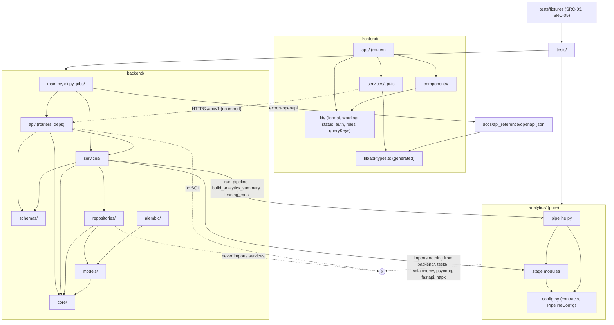

# EchoWell Repository Structure

Document: docs/design/Repository_Structure.md · Block 3 checkpoint 1, its own PR: GitHub PR #3 (Implement_Feature_Batches.md Phase 7, TRD 25 Phase 2) · Version 0.2 · Feature: FEAT-001 · Date: 21 October 2026 · Revised: 23 October 2026 (review round 1), 26 October 2026 (wireframe v0.2 frontend routes)

## 1. Purpose and sources

This document fixes the monorepo layout that the skeleton phase (Phase 3, FEAT-002..FEAT-007) creates and every later phase fills, and the dependency rules between its parts. Normative sources: TRD 01 §4.6 (ARC-016, ARC-050..ARC-053), TRD 18 §4.1 (GIT-001..GIT-004), TRD 05 §4.1 (API-001..API-008), TRD 04 §4.2 (FE-010), TRD 07 §4.2 and §8 (ANL-004), TRD 13 §4.2 (TST-010), TRD 25 AGT-010, TRD 24 D-24, D-53, D-55.

## 2. Top-level layout

```
echowell/                       single GitHub monorepo EchoWellApp/echowell (ARC-016, GIT-001)
├── .github/
│   ├── workflows/              ci.yml, e2e.yml, deploy-staging.yml, deploy-production.yml, uptime.yml (CIC-002)
│   ├── ISSUE_TEMPLATE/         bug_report.yml, feature_request.yml, config.yml
│   ├── pull_request_template.md, CODEOWNERS, dependabot.yml
├── frontend/                   Next.js 14.2 App Router (TRD 04 §4.2)
├── backend/                    FastAPI application (TRD 05 §4.1)
├── analytics/                  pure Python engine (TRD 07 §4.2)
├── scripts/                    run_engine.py (ANL-007), dump_schema.sh (PGS-017)
├── database/                   schema.sql (generated), seeds/, roles/provision_login_roles.sql
├── tests/                      unit/, integration/, contract/, security/, validation/, performance/, smoke/, fixtures/
├── docs/                       architecture.md, algorithm.md, api_reference.md, database_design.md, deployment.md,
│                               team_workflow.md, api_reference/openapi.json, design/, reports/
├── specs/                      requirement sources, TRD/, prompts/, TEMPLATES/, backlog/
├── alembic.ini  pyproject.toml  netlify.toml  railway.toml  docker-compose.yml  .dockerignore
├── .env.example  .env.development.example  .env.production.example
└── .editorconfig  .gitignore  .gitattributes  README.md  LICENSE
```

New top-level directories require a change to TRD 18 and TRD 01 in the same PR (GIT-002). The root `scripts/` directory of TRD 07 ANL-007 (`scripts/run_engine.py`) and TRD 20 PGS-017 (`scripts/dump_schema.sh`) is now listed in the TRD 18 §4.1 and TRD 01 §4.6 layouts (Q-4 resolved in PR #3 review).

## 3. Backend (`backend/`)

```
backend/
├── main.py                     create_app(), middleware, handlers, routers under /api/v1      [skeleton, kept]
├── cli.py                      python -m backend.cli … (TRD 15 §4.8)
├── jobs/nightly_run.py         nightly entry point (Railway cron)
├── Dockerfile, requirements.txt (psycopg[binary] 3.x, pinned; D-53), requirements-dev.txt
├── api/
│   ├── health.py               E-01                                                            [skeleton, kept]
│   ├── auth.py                 E-02, E-03, E-04
│   ├── config.py               E-32
│   ├── sessions.py             E-05                                                            [skeleton, kept]
│   ├── ingest.py               E-06, E-07
│   ├── residents.py            E-08, E-09, E-10, E-11, E-15, E-16                              [skeleton, kept]
│   ├── scores.py               E-12
│   ├── alarms.py               E-13, E-14, E-28, E-29, E-30 (serves /alerts, D-24)             [skeleton, kept]
│   ├── devices.py              E-17
│   ├── analytics.py            E-18, E-19                                                      [skeleton, kept]
│   ├── pipeline.py             E-20, E-21, E-31
│   ├── admissions.py           E-22, E-23, E-24
│   ├── users.py                E-25, E-26, E-27
│   └── deps.py                 settings, db session, auth, roles, pagination, meta
├── schemas/                    common, health, auth, user, config, session, ingest, resident, checkin, feature,
│                               score, alert, note, device, analytics, pipeline, admission, reference_range (TRD 23 §4.6)
├── services/
│   ├── ingestion.py, validation.py, baseline.py, cusum.py, morning_adjustment.py,
│   │   scoring.py, speaker_screen.py                                                           [skeletons, kept]
│   └── pipeline_runner.py, health_service.py, config_service.py, resident_service.py, checkin_service.py, feature_service.py,
│       export_service.py, alert_service.py, review_service.py, data_alert_service.py, note_service.py,
│       device_service.py, analytics_service.py, analytics_summary.py, admission_service.py,
│       auth_service.py, user_service.py, audit_service.py
├── repositories/               one module per aggregate; names fixed by docs/design/Database_ERD.md §5
├── models/
│   ├── __init__.py             declarative Base, 15 Python enums (DME-003)
│   ├── alarm.py (Alert, AlertReview, DataAlert), baseline.py, resident.py, score.py (Score, CusumState),
│   │   session.py (RawSession, ProcessedSession)                                               [skeletons, kept]
│   └── facility.py, user.py, device.py, api_key.py, ingest_batch.py, pipeline_run.py, epoch.py,
│       day_ledger.py, staff_note.py, reference_range.py, config_parameter.py, audit_log.py, evaluation.py
├── core/                       config.py, db.py, security.py, errors.py, logging.py, middleware.py, rate_limit.py
└── alembic/                    env.py, script.py.mako, versions/0001_initial_schema.py, 0002_seed_config_parameters.py, …
```

## 4. Analytics (`analytics/`)

```
analytics/
├── duplicate_detection.py, quality_screening.py, epoch_detection.py, morning_offset.py, baseline_builder.py,
│   zscore_calculator.py, composite_score.py, cusum_engine.py, alert_generator.py                [skeletons, kept]
└── __init__.py, config.py, robust_stats.py, speaker_screen.py, day_ledger.py, data_alerts.py,
    aggregates.py, pipeline.py                                                                   [created, TRD 07 §8]
```

Exactly these modules; no others (ANL-004). The engine command line `scripts/run_engine.py` sits outside the package, in the root `scripts/` directory (ANL-007, GIT-002).

## 5. Frontend (`frontend/`)

```
frontend/
├── package.json, next.config.js                                                               [skeletons, kept]
├── services/api.ts             the only HTTP client                                           [skeleton, kept]
├── app/                        layout, providers, page (redirect), not-found, global-error, login/,
│                               (protected)/{layout, error, residents, residents/[residentCode] (layout, page,
│                               review/, trends/, baseline/, log/, device/), admissions, study, admin}
│                               (wireframe v0.2 routes, TRD 04 §4.2, TRD 24 D-110; no alerts/ or analytics/)
├── components/<Name>/          <Name>.tsx, <Name>.module.css, <Name>.test.tsx
├── lib/                        auth.ts, AuthProvider.tsx, config.ts, format.ts, wording.ts, status.ts, queryKeys.ts,
│                               deviceGroups.ts, roles.ts, api-types.ts (generated)
├── styles/                     tokens.css (v0.2 tokens, light and dark; TRD 04 §4.12), globals.css
├── middleware.ts, scripts/check-csp.mjs, Dockerfile
├── tests/                      unit/, pages/, fixtures/ds07/, msw/handlers.ts, e2e/
└── vitest.config.ts, vitest.setup.ts, playwright.config.ts, playwright.isolated.config.ts,
    .eslintrc.json, .prettierrc, .nvmrc, tsconfig.json, .env.example
```

## 6. Database, tests and docs

| Path | Content | Source |
|---|---|---|
| `database/schema.sql` | generated reference DDL (regenerated with every migration, never hand-edited) | PGS-016, PGS-017, DB-026 |
| `database/roles/provision_login_roles.sql` | extensions, UTC, group and login roles for local and CI | D-72, D-90 |
| `database/seeds/test_v0_1/` | `facilities.csv`, `residents.csv`, `devices.csv`, `device_assignments.csv` | PGS-026, DB-060 |
| `database/seeds/load_evaluation_ground_truth.py` | test-only ground-truth loader (the only seed script allowed to read answer-key data) | AGT-007, D-38 |
| `tests/` | layout of docs/design/Testing_Architecture.md §3 | TST-010 |
| `docs/api_reference/openapi.json` | committed OpenAPI contract (generated) | D-51, D-89 |
| `docs/design/` | the nine design documents of this checkpoint | TRD 25 Phase 2 |
| `docs/reports/` | phase reports, validation report and results | D-21, AGT-032 |
| `specs/backlog/` | backlog, feature files, roadmap, deployment and MVP readiness checklists | D-21 |

## 7. Existing skeleton files (kept and filled)

| Existing file | Filled by | Role | Source |
|---|---|---|---|
| `backend/main.py` | FEAT-003 | app factory | ARC-050 |
| `backend/api/{alarms,analytics,health,residents,sessions}.py` | FEAT-003, FEAT-025, FEAT-027..FEAT-031, FEAT-035 | routers | API-008, D-24 |
| `backend/models/{alarm,baseline,resident,score,session}.py` | FEAT-009..FEAT-012 | ORM models | ARC-050 |
| `backend/services/{baseline,cusum,ingestion,morning_adjustment,scoring,speaker_screen,validation}.py` | FEAT-023, FEAT-025, FEAT-034 | services (thin adapters for stage names) | API-008, ARC-052 |
| `backend/requirements.txt` | FEAT-002 | `psycopg2-binary` replaced by `psycopg[binary]` 3.x, all pins | D-53, AC-AGT-11 |
| `analytics/*.py` (nine files) | FEAT-041..FEAT-048 | stage modules | ARC-050, TRD 07 §8 |
| `frontend/package.json`, `frontend/next.config.js`, `frontend/services/api.ts` | FEAT-004, FEAT-062 | frontend | FE-010 |
| `database/schema.sql` | FEAT-008 | regenerated reference DDL | PGS-017 |
| `docker-compose.yml`, `.github/workflows/ci.yml` (legacy stubs) | FEAT-006, FEAT-007, FEAT-077, FEAT-078 | replaced content at the same paths | D-55, D-94 |

No existing file is renamed, moved or deleted (AGT-010, GIT-003, AC-AGT-06).

## 8. Repository dependency diagram



| Rule | Enforcement | Source |
|---|---|---|
| `api → services → repositories → models`; routers issue no SQL; repositories never call services | import-linter contract in `backend-lint` | ARC-051, API-003..API-005 |
| Services never import `fastapi` | import-linter | API-004 |
| `analytics/` imports nothing from `backend/`, `tests/`, database, HTTP, clock or random libraries | `tests/unit/backend/test_import_boundary.py`, AC-ARC-01, AC-ANL-04 | ARC-041, ANL-002 |
| Only `pipeline_runner.py` calls `run_pipeline`; read services call only `build_analytics_summary` and `leaning_most` | inspection | API-006, ANL-033 |
| No module in `analytics/` or `backend/` reads the answer-key workbook; only `analytics_summary.py` references `evaluation_ground_truth`, through its own read-only engine (the one exception to the repositories-only rule, API-005, API-136) | `grep -rn "pipeline_test_v0_1.xlsx" analytics backend`, `grep -rn "evaluation_ground_truth" analytics` return nothing | AGT-007, AGT-057, AC-AGT-02 |
| Only `backend/core/db.py` builds engines; only the migrator path reads `DATABASE_MIGRATION_URL` | `tests/unit/backend/core/test_migration_url_boundary.py` | API-125, D-58 |
| The frontend reaches the backend only through `services/api.ts` and HTTP | ESLint and inspection | FE-011, ARC-014 |
| Frontend types are generated from the committed contract | CI diff | FE-012, OAS-014 |

## 9. Naming and content rules

- Python modules snake_case; React components PascalCase folders; tests `test_<subject>.py`, `<Subject>.test.tsx`, `<subject>.spec.ts` (TST-010).
- Migrations `NNNN_<snake_case_summary>.py`, linear history (DB-027).
- No secrets, `.env` files, audio files, files over 10 MB or licensed documents are committed (CIC-020, CIC-021, AGT-016).
- No resident names or PII in code, fixtures, logs or seeds; study IDs only (AGT-017).
- "Edge4Care" never appears outside `specs/` and `docs/reports/` (CIC-114, AGT-019).
- No LLM dependency anywhere (`grep -rniE "openai|anthropic|langchain|llama|gpt" frontend backend analytics` returns nothing; AGT-004).

## 10. Reviewer questions raised by this document

| ID | Question and resolution |
|---|---|
| Q-4 | Should root `scripts/` (named by ANL-007 and PGS-017) be added to the TRD 18 §4.1 and TRD 01 §4.6 layouts (GIT-002)? Resolved (PR #3 review, 23 Oct 2026): yes; both layouts and §2 above list `scripts/`. |

## Revision History

| Version | Date | Change | Author |
|---|---|---|---|
| 0.2 | 26 Oct 2026 | Wireframe v0.2 (SRC-21; TRD 24 D-108 to D-114): frontend route folders `residents/[residentCode]/{layout, review, trends, baseline, log, device}` and `study/` replace `alerts/` and `analytics/`; `lib/status.ts` added; tokens note | — |
