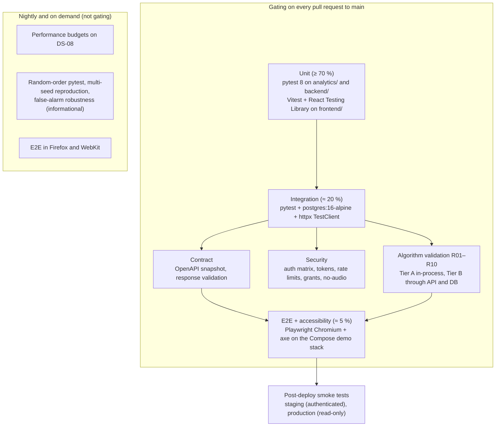
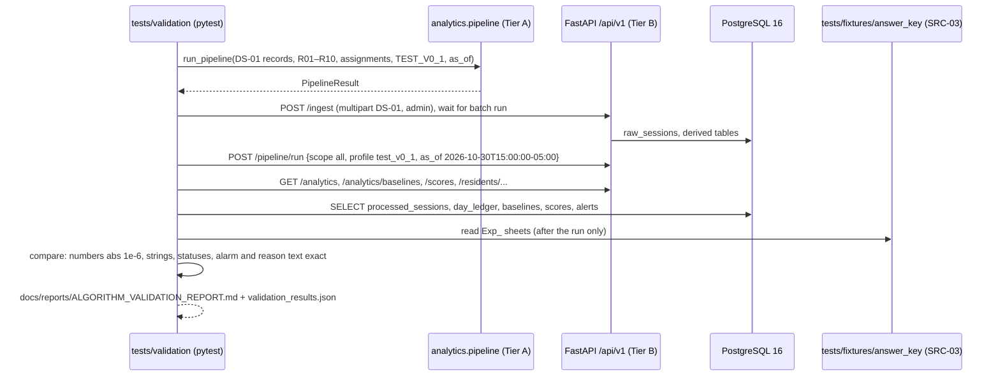
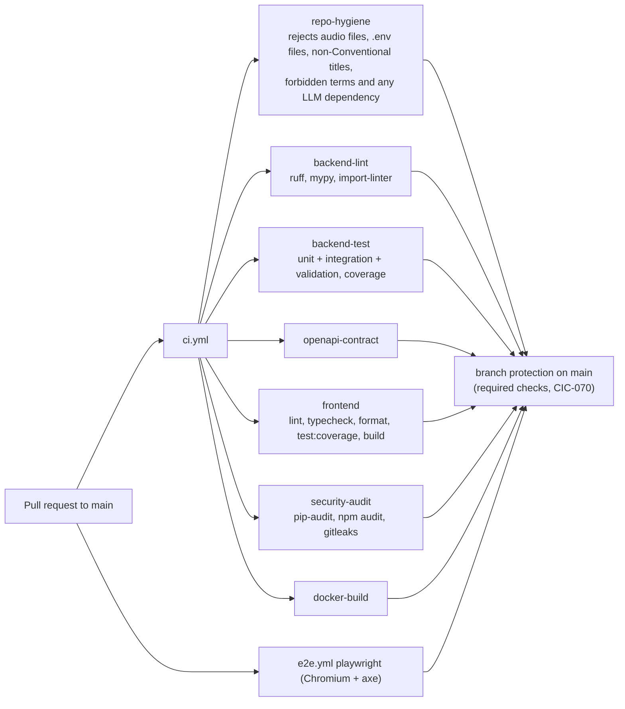

# EchoWell Testing Architecture

Document: docs/design/Testing_Architecture.md · Block 3 checkpoint 1, its own PR: GitHub PR #3 (Implement_Feature_Batches.md Phase 7, TRD 25 Phase 2) · Feature: FEAT-001 · Date: 21 October 2026 · Revised: 23 October 2026 (review round 1); 26 October 2026 (wireframe v0.2, SRC-21; TRD 24 D-108 to D-114: test routes and fixture values for the Resident list, Resident chart and Study team pages)

## 1. Purpose and sources

This document lays out the test levels, directories, fixtures, validation tiers, gates and CI wiring that the build phases implement (FEAT-005 test infrastructure, FEAT-039 security suite, FEAT-057..FEAT-061 validation, FEAT-076 E2E, FEAT-079 performance, FEAT-078 and FEAT-080 workflows). Normative content: TRD 13 (TST, E2E-01..E2E-21), TRD 14 (TDV, VC-R01..VC-R10, VC-G01..VC-G12), TRD 16 (CIC), TRD 04 §4.14 (FE-180..FE-205) and TRD 25 §4.8 (AGT-040..AGT-062).

## 2. Test pyramid



| Level | Tooling (pinned majors) | Runs against | Source |
|---|---|---|---|
| Unit | pytest 8.x, pytest-cov 5.x, Hypothesis 6.x; Vitest 2.x, RTL 16.x, jsdom 25.x, MSW 2.x | in-process, no DB, no network, frozen clock | TST-001, TST-003, TST-005, TST-022 |
| Integration | pytest, httpx `TestClient`, testcontainers-python 4.x (`postgres:16-alpine`) or the CI service container; never SQLite | real PostgreSQL 16 provisioned by `database/roles/provision_login_roles.sql` | TST-002, CIC-012, CIC-015 |
| Contract | pytest + `openapi-core` 0.19.x | generated `/api/v1/openapi.json`, committed `docs/api_reference/openapi.json`, TRD 19 skeleton | TST-060..TST-064, OAS-005, OAS-006 |
| Validation | pytest + pandas 2.2.x + openpyxl 3.1.x (tests only) | `analytics` package (Tier A), full stack (Tier B) | TST-080, TST-081, TDV-030, TDV-031 |
| Security | pytest + httpx | integration stack | TST-130..TST-137 |
| E2E | Playwright 1.4x (Chromium on PRs; Firefox, WebKit nightly) | Compose `demo` profile (db, backend :8000, frontend-prod :3001) seeded with DS-07 | TST-004, TST-100, CIC-030 |
| Accessibility | `@axe-core/playwright` 4.x | every route | TST-110, FE-190 |
| Performance | pytest + `time.perf_counter`; Lighthouse CI 0.14.x | local Postgres container, Compose demo stack | TST-120..TST-126, TST-190, TST-191 |
| Smoke | pytest marker `smoke` | staging and production after deploy | TST-152, DEP-080, DEP-081 |

Pytest markers (single list, registered in `pyproject.toml` `[tool.pytest.ini_options]` with `--strict-markers`; no `pytest.ini`): `unit`, `integration`, `contract`, `validation`, `security`, `performance`, `smoke`, `slow`, `authenticated`, `budget`, `req` (TST-006, TRD 25 Phase 3).

## 3. Directory layout

```
tests/
  conftest.py                 profiles, frozen clock, DB session, API client, auth helpers, limiter reset (D-74)
  unit/
    analytics/                test_<module>.py for every analytics module (TST-011)
    backend/                  services/, schemas/, core/, repositories/ (mocked session), jobs/, api/
  integration/
    db/                       migrations, constraints, triggers, grants, enums, indexes, read models
    api/                      one file per router: test_health.py, test_auth.py, test_sessions.py, test_ingest.py,
                              test_residents.py, test_scores.py, test_alerts.py, test_notes.py, test_devices.py,
                              test_analytics.py, test_pipeline.py, test_admissions.py, test_users.py
    pipeline/                 ingest → pipeline → API flows, rebuild, nightly trigger, concurrent ingest
  contract/                   test_openapi_contract.py, test_response_schemas.py
  validation/                 conftest.py, comparator.py, report.py, test_r01_clean_control.py … test_r10_gradual_drift.py,
                              test_global_checks.py, test_invariance.py, test_answer_key_integrity.py, robustness.py
  security/                   test_auth_matrix.py, test_rate_limits.py, test_tokens.py, test_api_keys.py, test_no_audio.py
  performance/                test_pipeline_runtime.py, test_api_latency.py, make_load_dataset.py
  smoke/                      post-deploy smoke tests
  fixtures/
    pipeline_input/           EchoWell_pipeline_test_input_v0_1.csv (copy of SRC-05; the only pipeline input fixture)
    answer_key/               EchoWell_pipeline_test_v0_1.xlsx (copy of SRC-03), evaluation_ground_truth_v0_1.csv, SHA256SUMS
    legacy/                   echowell_mock_data_500.csv (SRC-06, negative fixture only)
    seeds/demo_overlay/       R11/D11 overlay roster for the @isolated E2E scenarios
    trd19_openapi_skeleton.yaml
frontend/
  components/<Name>/<Name>.test.tsx   co-located component tests
  tests/unit/                 format, wording, deviceGroups, auth, api client
  tests/pages/                one test file per route (MSW)
  tests/fixtures/ds07/        captured API responses (DS-07)
  tests/e2e/                  Playwright specs, a11y.spec.ts, mutating.spec.ts, isolated.spec.ts, global-setup.ts
```

Source: TRD 13 §4.2 (TST-010), TRD 04 §4.14. Test names cite requirement or case IDs (for example `test_ing_004_duplicate_keeps_first_arrival`, `test_rob_03_even_count_median`) and Must requirements carry `@pytest.mark.req("<ID>")` or `// req: <ID>` for the trace report `tests/trace_report.py` (TST-012, TST-013, TRD 25 §4.2).

## 4. Where each part of the system is tested

| System part | Unit | Integration | Contract or security | Validation or E2E | Features |
|---|---|---|---|---|---|
| Analytics stages (`analytics/*`) | Table 4.3-A cases per module (TST-020), Hypothesis properties (TST-022), import-lint (TST-021) | pipeline flows (TST-048..TST-051) | — | Tier A and Tier B (TST-080, TST-081) | FEAT-040..FEAT-052 |
| Ingest and validation | schema rules (TST-030), feature-name mapping (TST-031) | TST-043..TST-047, TST-055 | no-audio (TST-133) | VC-G11 raw store fidelity | FEAT-023, FEAT-025, FEAT-026 |
| Pipeline runner and triggers | runner, nightly job with DST clock (TST-052, AGT-059) | rebuild idempotency (TST-050, DB-019), one-by-one vs batch (TST-049), concurrent ingest (AC-ARC-06) | — | VC-G12 | FEAT-053..FEAT-055 |
| Read APIs | display status, attention flag, summary counts and sorts (TST-033) | `tests/integration/api/*` with test_v0_1 values (OAS-021..OAS-028) | response validation (TST-061), meta block (TST-064) | E2E-03..E2E-12, E2E-17, E2E-20 | FEAT-027..FEAT-036 |
| Reviews, notes, snooze | — | TST-056..TST-059, TST-065..TST-067, TST-189 | role matrix (TST-130) | E2E-09, E2E-18, E2E-19 (`@mutating`, `@isolated`) | FEAT-031, FEAT-033, FEAT-070, FEAT-071 |
| Auth and roles | security core (TST-032) | audit rows (TST-053) | TST-130..TST-132, TST-134, TST-135 | E2E-01, E2E-02, E2E-14, E2E-21 | FEAT-020..FEAT-022, FEAT-039 |
| Database | repositories with mocked session | migrations round trip (TST-040), grants (TST-041), uniques (TST-042), schema reference (PGS-016) | — | — | FEAT-008..FEAT-014 |
| OpenAPI contract | — | — | TST-060..TST-063, CIC-018 | — | FEAT-038 |
| Frontend | `format.ts`, `wording.ts`, `deviceGroups.ts`, `auth.ts`, `api.ts`; components with DS-07 fixtures (FE-181..FE-184, FE-195, FE-205) | page tests with MSW | — | FE-185..FE-194, E2E-01..E2E-21, axe (TST-110) | FEAT-062..FEAT-076 |
| Deployment | startup guards (AGT-015, AC-AGT-05) | container start against `postgres:16` (AC-ARC-07) | TLS and HSTS smoke (TST-135) | staging and production smoke (TST-152) | FEAT-077..FEAT-088 |

## 5. R01–R10 validation (answer key)

The validation suite compares pipeline output with the SRC-03 workbook (profile `test_v0_1`, SRC-05 input, enrolment 2026-10-01, as-of 2026-10-30 15:00 America/Chicago). The workbook is read only by tests under `tests/validation/` and by the test-only ground-truth loader; comparison happens after the run (AGT-007, AGT-057, ARC-033).



| Case | Resident scenario | Key expectations | Pitfall covered |
|---|---|---|---|
| VC-R01 | R01 clean control | 30 usable, baseline frozen after R01-20261016-01, 14 scores, no alarm | AGT-041 |
| VC-R02 | R02 missing days | 24 usable, 5 missing_resident, 1 missing_device_gap, 8 scores | AGT-046 |
| VC-R03 | R03 set-aside sessions | 22 usable, 7 set aside (Oct 18 "quality flag poor; noise above limit"), 1 device gap, 6 scores | AGT-049 |
| VC-R04 | R04 duplicate records | 2 duplicates dropped; output identical to a run without them | AGT-043, AGT-053 |
| VC-R05 | R05 possible other speaker | 2 quarantined (day 8 pre-freeze, day 22 post-freeze), 12 scores | AGT-044 |
| VC-R06 | R06 morning effect | 10 morning sessions adjusted; baselines from adjusted values | AGT-040, AGT-050 |
| VC-R07 | R07 device move | epoch 2 on D07B from day 13; epoch 1 never formed; 2 scores | AGT-045 |
| VC-R08 | R08 too few sessions | 13 usable, 5 set aside, 12 missed; baseline pending; no scores | AGT-046 |
| VC-R09 | R09 step change | first ring R09-20261021-01 with tally 5.431965; 14 scores | AGT-047, AGT-048 |
| VC-R10 | R10 gradual drift | first ring R10-20261024-01; baseline unchanged by drift | AGT-051 |
| VC-G01..VC-G12 | global checks | status totals usable 267, set_aside 12, quarantined 2, duplicate 2, missing_resident 17, missing_device_gap 2; 302 annotated rows; 180 baselines (8 floor rows); 98 scores (off 81, on 15, rings 2); 300 ledger rows; exactly 2 alerts; raw store fidelity; determinism and rebuild | AGT-054, AGT-055, AGT-056 |

Rules: one module per resident (`test_r01_clean_control.py` … `test_r10_gradual_drift.py`) plus totals and global checks (TRD 25 Phase 7); no skip, xfail or retry under `tests/validation/` (TST-083); expected values and tolerances are never edited (AGT-008, TST-072..TST-074); golden files are byte-identical copies with `SHA256SUMS` (TST-070, TST-071); the frontend phase starts only after `pytest tests/validation -q` passes (AGT-023). The false-alarm robustness check is informational and nightly (TST-084, FEAT-061).

## 6. End-to-end scenarios

| Group | Scenarios | Order and data | Source |
|---|---|---|---|
| Read-only | E2E-01..E2E-08, E2E-10..E2E-14, E2E-16, E2E-17, E2E-20, E2E-21, FE-185, FE-186, FE-188..FE-194 | DS-07 on the main E2E database, reset and re-seeded by `global-setup.ts` per browser project; one API login per role reused | TST-100, D-73, D-74 |
| `@mutating` | E2E-18 (save review), E2E-09 = FE-187 (note and review in the Resident chart's "Review and notes" section), FE-193 snooze step | run serially after all read-only scenarios | D-73 |
| `@isolated` | E2E-15 (new check-in appears), TST-187, E2E-19 (snooze) | Chromium only, database `echowell_demo` | TST-100, CIC-030 |
| Accessibility | `a11y.spec.ts` on `/login`, `/residents`, `/residents/R09`, `/residents/R09/review`, `/residents/R09/trends`, `/residents/R08`, `/admissions`, `/study`, `/admin`, light and dark colour schemes | zero serious or critical findings | TST-110, FE-190 |
| Responsive | `/residents`, `/residents/R09`, `/residents/R09/trends` at 320, 360, 375, 390 px wide | no page-level horizontal scroll | FE-191, D-78 |
| Privacy | every route | no request to other hosts; no `<audio>` or `<video>` | FE-192 |

## 7. Coverage and CI gates

| Gate | Threshold | Source |
|---|---|---|
| `analytics/` line coverage | ≥ 95 % (unit + validation) | TST-140, CIC-016, D-39 |
| `backend/` line coverage | ≥ 85 % (unit + integration + contract + security) | TST-141, CIC-016, D-39 |
| `frontend/` line coverage | ≥ 80 % (Vitest v8) | TST-142, FE-180, D-39 |
| Engine runtime on SRC-05 | ≤ 5 s (marker `budget`, every PR) | TST-120, CIC-036 |



Required checks: `repo-hygiene`, `backend-lint`, `backend-test`, `openapi-contract`, `frontend`, `security-audit`, `docker-build`, `playwright` (TST-150, CIC-070). Nightly (`e2e.yml` at 08:00 UTC): full E2E in three browsers, `performance` job on DS-08, `nightly-validation` (random order, multi-seed reproduction, robustness); failures open a `ci-failure` issue (TST-151, CIC-033, CIC-035, CIC-037). Phase 3 replaces the `ci.yml` stub with `backend-lint`, `backend-test` and `frontend`; Phase 9 completes the required set (D-94, D-55). A skipped test without a reason naming a requirement or OQ blocks the merge (TST-153).

## 8. Test data sets

| Data set | Content | Used by | Source |
|---|---|---|---|
| DS-01 | SRC-05: 283 arrivals (281 unique + 2 duplicates), 10 residents, 30 local days, 30 columns | validation tiers, integration, UI fixtures, E2E | TRD 14 §4.1 |
| DS-07 | API responses of the test_v0_1 system as of Oct 30 (`frontend/tests/fixtures/ds07/`) | component and page tests, E2E expectations | TRD 04 §4.14, TDV-016 |
| DS-08 | 100 residents × 120 days, 10,800 records from `tests/performance/make_load_dataset.py` | performance budgets | TST-122, TST-123 |
| DS-10 | `evaluation_ground_truth_v0_1.csv` (planted change per resident) | ground-truth loader, Study team alarm timing | D-38, TRD 14 |
| SRC-06 | legacy mock CSV | negative ingest test only | AGT-025, TST-047 |

Only synthetic and test data are used in every environment of the interim stack (AGT-014, AC-AGT-10); no test reads or requires audio files (TST-007).

## 9. Commands per phase

| Phase (checkpoint) | Commands | Source |
|---|---|---|
| 2 Design docs (this) | `grep -rnE "T[B]D\|T[O]DO" docs/design` | TRD 25 Phase 2 |
| 3 Skeleton | `docker compose up -d`; `pytest -q`; `cd frontend && npm ci && npm run lint && npm run build && npm run test` | TRD 25 Phase 3 |
| 4 Database | `alembic upgrade head && alembic downgrade base && alembic upgrade head`; `pytest tests/unit tests/integration -q -k "db or model or repository"` | TRD 25 Phase 4 |
| 5 Backend | `pytest tests/integration -q`; OpenAPI diff with `python -m backend.cli export-openapi` | TRD 25 Phase 5, CIC-018 |
| 6 Analytics | `pytest tests/unit -q`; `pytest tests/integration -q -k pipeline` | TRD 25 Phase 6 |
| 7 Validation | `pytest tests/validation -q` | TRD 25 Phase 7 |
| 8 Frontend | `npm run lint && npm run build && npm run test && npm run test:e2e:readonly -- --project=chromium && npm run test:e2e:mutating -- --project=chromium` | TRD 25 Phase 8 |
| 9 Deployment config | `docker compose config`; `docker compose up -d && pytest -q` | TRD 25 Phase 9 |

## 10. Open questions affecting testing

| ID | Effect |
|---|---|
| OQ-13, OQ-27 | Calibration targets unknown; DS-04 results stay informational (FEAT-093). |
| OQ-24 | Data-alert threshold tests assert the provisional defaults. |
| OQ-05 | Tests assert that reviews never change tallies or alarms (TST-056, AGT-058). |
