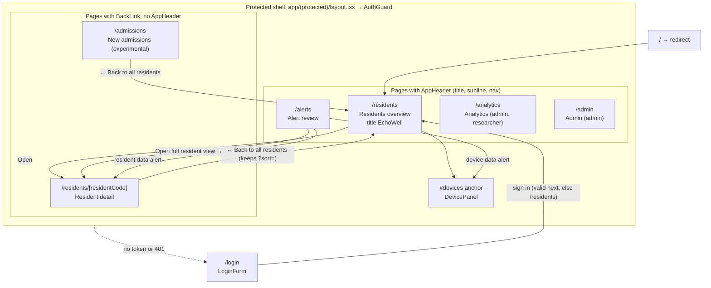
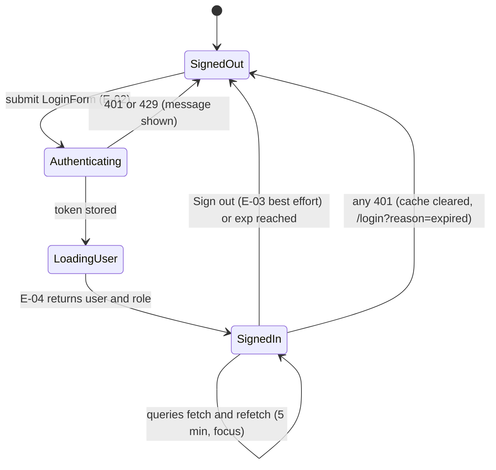
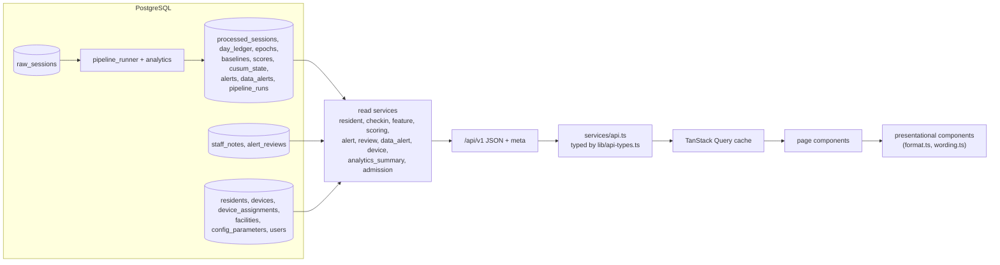
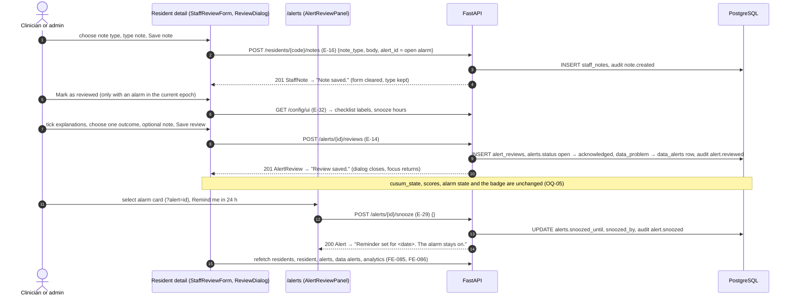
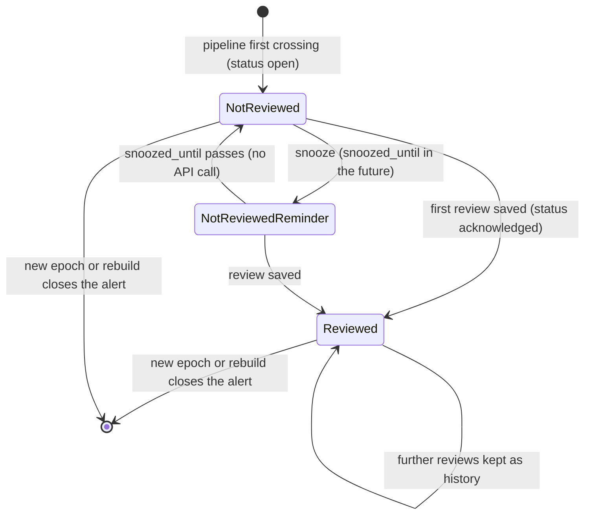

# EchoWell UI Architecture

Document: docs/design/UI_Architecture.md · Block 3 checkpoint 1, its own PR: GitHub PR #3 (Implement_Feature_Batches.md Phase 7 "UI Design Requirements", TRD 25 Phase 2) · Feature: FEAT-001 · Date: 21 October 2026 · Revised: 23 October 2026 (review round 1)

## 1. Purpose and sources

This document translates the five wireframes and TRD 11 into the page, navigation, component, state and data-flow design that the Phase 8 frontend implements (FEAT-062..FEAT-076), with screen designs for the Residents overview, Resident detail and New admissions pages, and maps every UI component to the API endpoints and database tables that supply it. Copy strings, sizes and expected test renderings are normative in TRD 11; component props in TRD 04 §4.8; this document never changes them.

| Source | Content | Route |
|---|---|---|
| SRC-09 `specs/UI-wireframe/Main.dc.html` | Residents overview with Devices panel | `/residents`, `/residents#devices` |
| SRC-10 `specs/UI-wireframe/Resident.dc.html` | Resident detail | `/residents/[residentCode]` |
| SRC-11 `specs/UI-wireframe/Admission.dc.html` | New admissions (experimental) | `/admissions` |
| SRC-18 `specs/UI-wireframe/Alerts.dc.html` | Alert review | `/alerts` |
| SRC-19 `specs/UI-wireframe/Analytics.dc.html` | Analytics | `/analytics` |
| TRD 11 (UX), TRD 04 (FE), TRD 02 §4.12–§4.26 (FR), TRD 19 (E-xx), TRD 23 §4.4 (derived values) | requirements | all |

Pages are exactly `/residents` (with `#devices`), `/residents/[residentCode]`, `/admissions`, `/alerts`, `/analytics`, `/login` and `/admin` (TRD 24 D-23, FE-020). No EWMA chart exists (OQ-18, CUS-036). No audio control exists on any page (UX-006, AGT-006).

### 1.1 Wireframe versus TRD differences (TRDs win, AGT-001)

| Wireframe detail | Implemented as | Source |
|---|---|---|
| SRC-09 navigation "Residents · New admissions · Devices" | "Residents", "Alerts (<n>)", "Analytics" (admin, researcher), "New admissions", plus "Admin" for admins; no "Devices" link, the panel stays at `/residents#devices` | UX-013, UX-014, UX-016, FE-026, FE-028 |
| SRC-09 subline "[Facility name]" | `meta.facility_name` (`facilities.name`) | UX-011, UX-012 |
| SRC-09 row order R05 before R03, R02 | API "Alarms first" rule gives R09, R10, R08, R07, R03, R02, R05, R01, R04, R06 | TRD 11 §4.13.2, API-071 |
| SRC-10 staff review shows only a note box and "Mark as reviewed" | adds note type select, "Save note", character counter, previous notes; "Mark as reviewed" opens the alarm review dialog; no "Reviewed by" line, as in the wireframe (the wireframe wins here, UX-127 withdrawn) | UX-121..UX-138, D-35, D-102 |
| SRC-10 chart caption "Bar heights drawn from the test answer key" | bars come from `GET /api/v1/scores`; caption "Set-aside, quarantined and missed days leave the tally unchanged." | UX-081, UX-088, AGT-007 |
| SRC-11 "[n] of [N] days" | "<n> of <N> usable check-ins" | UX-186 |
| SRC-18 subline "test data v0.1" | `<data source label>` from `meta` ("pipeline test data v0.1") | UX-017 |
| SRC-18 "Leaning most" placeholder text | API `leaning_most` rendered as lower-cased labels | UX-312 |

## 2. Page hierarchy and navigation architecture



| Navigation element | Shown on | Targets | Visibility | Source |
|---|---|---|---|---|
| Nav "Residents" | `/residents`, `/alerts`, `/analytics`, `/admin` | `/residents` | all roles | UX-013 |
| Nav "Alerts (<n>)" | same | `/alerts` | all roles; n = `total` of E-13 `status=open`; "Alerts" while loading or on failure | UX-018, FE-036, D-97 |
| Nav "Analytics" | same | `/analytics` | admin, researcher | FE-028, UX-018 |
| Nav "New admissions" | same | `/admissions` | all roles | UX-013 |
| Nav "Admin" | same | `/admin` | admin | UX-014 |
| User name + "Sign out" | same | E-03, then `/login` | all roles | UX-015, FE-058 |
| "Open" link per row | `/residents` | `/residents/<R>` | all roles | UX-040 |
| "← Back to all residents" | detail, admissions | `/residents` (detail keeps last `?sort=`) | all roles | UX-060, UX-180 |
| "Open full resident view →" | `/alerts` review panel | `/residents/<R>` | all roles | UX-310 |
| Data-alert card link | `/alerts` | `/residents/<R>` or `/residents#devices` | all roles | UX-308 |
| Current-page link | nav | — | `aria-current="page"`, 2px ink border | FE-027 |
| Skip link | every page | `<main id="main">` | — | FE-033 |
| Document titles | every page | "Residents – EchoWell", "R09 – EchoWell", … | — | FE-032 |

## 3. Component hierarchy

```mermaid
flowchart TB
  APP["RootLayout (fonts, skip link, ribbon)"] --> PROV["Providers: QueryClientProvider, AuthProvider"]
  PROV --> LG["/login: LoginForm, Footer"]
  PROV --> GUARD["(protected)/layout: AuthGuard"]
  GUARD --> P1["/residents page"]
  P1 --> H1["AppHeader"]
  P1 --> ST["SummaryTiles"]
  P1 --> SS["SortSelect"]
  P1 --> RT["ResidentsTable"]
  RT --> SB1["StatusBadge (sm)"]
  RT --> DC["DeviceCell"]
  P1 --> DP["DevicePanel"]
  P1 --> F1["Footer (overview)"]
  GUARD --> P2["/residents/[residentCode] page"]
  P2 --> BL["BackLink"]
  P2 --> RH["ResidentHeader"]
  RH --> SB2["StatusBadge (lg)"]
  P2 --> WTM["WhatThisMeans"]
  P2 --> CC["CusumChart"]
  CC --> CT["CusumTable (details)"]
  P2 --> FC["FeatureCard × 7"]
  FC --> SP["Sparkline"]
  P2 --> OMC["OtherMeasurementsCard"]
  P2 --> SRF["StaffReviewForm"]
  SRF --> NL["NotesList"]
  SRF --> RD["ReviewDialog"]
  RD --> ARF1["AlertReviewForm"]
  P2 --> CL["CheckinLog"]
  P2 --> F2["Footer (default)"]
  GUARD --> P3["/admissions page"]
  P3 --> BL3["BackLink"]
  P3 --> EB["ExperimentalBanner"]
  P3 --> AT["AdmissionsTable"]
  P3 --> FRC["FacilityRangeChart"]
  P3 --> F3["Footer (default)"]
  GUARD --> P4["/alerts: AlertsPage"]
  P4 --> H4["AppHeader"]
  P4 --> AQ["AlertQueue"]
  AQ --> AC["AlertCard"]
  P4 --> DAQ["DataAlertQueue"]
  P4 --> ARP["AlertReviewPanel"]
  ARP --> MTC["MiniTallyChart"]
  ARP --> LM["LeaningMost"]
  ARP --> ARF2["AlertReviewForm"]
  ARP --> RH2["ReviewHistory"]
  P4 --> F4["Footer (alerts)"]
  GUARD --> P5["/analytics: AnalyticsPage"]
  P5 --> H5["AppHeader"]
  P5 --> KT["KpiTiles"]
  P5 --> DCC["DailyCheckinsChart"]
  P5 --> LF["LossFunnel"]
  P5 --> UBR["UsableByResidentChart"]
  P5 --> ATT["AlarmTimingTable or ReviewOutcomesTable"]
  P5 --> F5["Footer (analytics)"]
  GUARD --> P6["/admin page"]
  P6 --> H6["AppHeader"]
  P6 --> AP["AdminPanel: Users, Pipeline runs, Upload data"]
  P6 --> F6["Footer (default)"]
```



Every data section is wrapped in `SectionState` for loading, empty and error states (FE-140..FE-143). Presentational components receive data as props and never fetch (FE-091); pages own the queries.

## 4. State management design

| State | Owner | Lifetime | Examples | Source |
|---|---|---|---|---|
| Server state | TanStack Query cache, in memory only | until sign-out or `gcTime` | residents, resident, scores, features, check-ins, notes, devices, alerts, data alerts, analytics, admissions, admin lists | FE-006, FE-045, FE-080 |
| Session | `AuthProvider` + `lib/auth.ts` | tab session (`sessionStorage`) | token, `exp`, user, role | FE-050..FE-054 |
| URL | search params and hash | shareable | `?sort=` (overview), `?alert=` (alerts), `?tab=` (admin), `#devices`, `next`, `reason` | FE-082, FE-139, UX-210, FE-026 |
| Local UI | component `useState` | component | note text and type, review form fields, dialog open, disclosures | FE-089 |



Mutations and their invalidations: `createNote` → `["resident", code]`, `["residents"]`, `["alerts"]` (FE-085); `createAlertReview`, `snoozeAlert` → `["alerts"]`, `["data-alerts"]`, `["resident", code]`, `["residents"]`, `["analytics"]` (FE-086). The UI never changes alarm state locally (FE-134).

## 5. Data flow

### 5.1 Read path (all pages)



Reads never run the pipeline (ARC-024); every displayed date and time uses `meta.facility_tz` (UX-002, FE-150); N, h and the profile come from `meta` (UX-007, FE-077).

### 5.2 Write paths (staff review workflow)



Alert status during the workflow:



Badges: "Not reviewed" (accent, weight 600), "Not reviewed · reminder <Mon D, h:mm AM/PM>" (secondary), "Reviewed" (secondary) (UX-303, FE-205). Researchers see history and charts but no form ("Only clinicians and admins can review alarms.", UX-322; "Only clinicians and admins can add notes.", UX-132).

## 6. Screen design: Residents overview (`/residents`, SRC-09)

### 6.1 Layout (desktop ≥ 1024 px; navigation shown as an admin sees it)

```text
+---------------------------------------------------------------------------------------------+
| EchoWell                                                [Residents] [Alerts (2)] [Analytics] |
| Voice check-ins · Edgewood · Showing pipeline test data          [New admissions] [Admin]   |
| v0.1 as of Oct 30, 2026, 3:00 PM CT                               <display name>  Sign out  |
|=============================================================================================|
| +--------------------+ +----------------------+ +---------------------+ +-------------------+ |
| | Alarm on           | | Being watched,       | | Baseline still      | | Missed check-ins, | |
| | 2  (accent border) | | no alarm   7         | | forming   1         | | last 30 days  19  | |
| +--------------------+ +----------------------+ +---------------------+ +-------------------+ |
| Residents                                                         Sort by [Alarms first  v]  |
| +-----------------------------------------------------------------------------------------+ |
| | Resident | Device          | Status                       | Last check-in | Last 30 days | |
| | **R09**  | D09             | ▲ Alarm since Oct 21         | Oct 30, 2:28 PM | 30 · 0 · 0 · 0 | [Open] |
| | R08      | D08             | Baseline forming · 13 of 16 sessions | …     | 13 · 5 · 0 · 12 | [Open] |
| | R07      | D07B (was D07)  | No alarm · baseline restarted Oct 13 | …     | 30 · 0 · 0 · 0 | [Open] |
| +-----------------------------------------------------------------------------------------+ |
| Devices                                                                                      |
| [D02 · shared by R02, R03 / Last upload … · silent all day Oct 12] [D07B · R07 / In use …]  |
| [D01, D04–D06, D08–D10 / All uploaded on Oct 30 · firmware fw-1.0.0] (dashed)               |
| ▸ Show all devices (10)                                                                      |
| No audio is stored or played here — only extracted voice measurements. Duplicate records are |
| removed quietly and not shown.                                                               |
+---------------------------------------------------------------------------------------------+
```

Below 1024 px tiles become 2 × 2 and the device grid 2 columns; below 640 px everything stacks; the table (min 900 px) scrolls inside its focusable container (UX-240..UX-245).

### 6.2 Summary tiles

| Order | Label | API field (E-08 `summary`) | Test value | Style |
|---|---|---|---|---|
| 1 | "Alarm on" | `alarm_on` | 2 | 2px accent border and accent value when > 0 (UX-021) |
| 2 | "Being watched, no alarm" | `no_alarm` | 7 | 1px border |
| 3 | "Baseline still forming" | `baseline_forming` | 1 | 1px border |
| 4 | "Missed check-ins, last 30 days" | `missed_last_30_days` | 19 | 1px border |

Tiles count exactly the listed residents (longitudinal, not withdrawn) and are static text (UX-020..UX-024, FR-136, FR-137).

### 6.3 Residents table

| Column (exact header) | Content | API field (`ResidentOverviewRow`) | Source |
|---|---|---|---|
| "Resident" | study ID, weight 600 when alarm on | `resident_code`, `status` | UX-037 |
| "Device" | current device; " (shared)" or " (was <D>)" in secondary text | `device_code`, `device_shared`, `previous_device_code` | UX-035 |
| "Status" | `StatusBadge` | `status`, `alarm_since`, `baseline_progress`, `baseline_restarted_on`, `current_epoch` | UX-036, TRD 11 §4.3.4 |
| "Last check-in (local)" | "Oct 30, 2:28 PM" or "No check-ins yet" | `last_checkin_at` + `meta.facility_tz` | UX-038, DB-045 |
| "Last 30 days: used · set aside · quarantined · missed" | "13 · 5 · 0 · 12" | `last_30_days` | UX-039, API-074 |
| (Actions, visually hidden header) | link "Open" (accessible name "Open <R>") | `resident_code` | UX-040 |

Caption "Residents, sorted by <option label>" (visually hidden); `scope="col"` headers; `aria-busy` while a new sort loads (UX-043, FE-083). Duplicates never appear in any count or row; missed days are never hidden or backfilled (UX-044, UX-047, AGT-046, AGT-053).

### 6.4 Filters

The overview has no user-editable filter. The client always requests the filter set of TRD 04 §4.6.2, which the API applies (API-070):

| Filter | Value sent | Effect | Source |
|---|---|---|---|
| `cohort` | `longitudinal` | new admissions without their own baseline are excluded until the cohort transition | UX-034, UX-046, DME-008 |
| `include_withdrawn` | `false` | withdrawn residents are neither listed nor counted | UX-045, OQ-11 |
| `limit`, `offset` | 500, 0 | one page; "Showing <n> of <total> residents." if truncated | FE-076, UX-041 |
| 30-day window | server-side | local dates as-of − 29 … as-of, not before enrolment | DB-041, API-069 |

### 6.5 Sorting logic

| Option (select `id="sort"`) | `?sort=` / API value | Rule (computed by the API; the client never re-sorts, FE-084) | Test order |
|---|---|---|---|
| "Alarms first" (default) | `alarm` | groups alarm_on → baseline_forming → no_alarm; alarm group by alarm date ascending then code; forming group by code; no-alarm group: current epoch > 1 first, then (set aside + quarantined + missed in 30 days) descending, then code | R09, R10, R08, R07, R03, R02, R05, R01, R04, R06 |
| "Resident ID" | `resident_id` | natural ascending (R2 before R10) | R01 … R10 |
| "Last check-in" | `last_checkin` | most recent first; no check-in last; ties by code | R02, R07, R05, R10, R06, R08, R09, R03, R04, R01 |

Changing the option keeps focus on the select, keeps previous rows visible until the response arrives, announces "Sorted by <option label>" and stores `?sort=` (UX-030..UX-033, FE-082, FE-083, AGT-052).

### 6.6 Device panel (`#devices`)

| Card kind | Condition | Line 1 | Line 2 | Border | API fields (E-17 `Device`) |
|---|---|---|---|---|---|
| Shared | ≥ 2 residents assigned on the as-of date | "D02 · shared by R02, R03" | "Last upload Oct 30, 2:55 PM · silent all day Oct 12" | 1px solid | `shared`, `resident_codes`, `last_upload_at`, `device_gap_days_last_30` |
| Replacement | replaced another device within 30 days | "D07B · R07" | "In use since Oct 13 (replaced D07) · last upload Oct 30, 2:52 PM" | 1px solid | `replaces_device_code`, `in_use_since` |
| Needing attention | no upload on the as-of date, device-gap days, or uncommon firmware | "<D> · <R list>" | last upload, " · no upload on <date>", silent text, " · firmware <v>" | 1px solid | `last_upload_at`, `device_gap_days_last_30`, `firmware_version` |
| Grouped | all remaining active devices, one card per firmware | "D01, D04–D06, D08–D10" (`compressDeviceCodes`) | "All uploaded on Oct 30 · firmware fw-1.0.0" | 1px dashed | `device_code`, `firmware_version` |

Order: shared, replacement, needing attention, grouped; natural code order within a kind; the retired device (D07) gets no card. The disclosure "Show all devices (<count>)" reveals the table "Device", "Residents", "In use", "Last upload", "Firmware", "Days with no device activity (last 30 days)" (`silent_days_last_30`), "Silent days (shared device)" (`device_gap_days_last_30`) (UX-050..UX-058, FR-150..FR-156, DB-044, DB-066).

### 6.7 Alert and status indicators on the overview

- "Alarm on" tile with accent border when any alarm is on (UX-021).
- Status badge "▲ Alarm since <Mon D>" (2px accent, accent text, weight 600) and bold resident code (UX-037, TRD 11 §4.3.4).
- Nav "Alerts (<n>)" counts unreviewed change alarms only; data alerts are never counted (UX-018, FR-300).
- Status is never conveyed by colour alone: glyph "▲", text and border style (solid accent, solid, dashed) always accompany colour (UX-004, FE-092).

## 7. Screen design: Resident detail (`/residents/[residentCode]`, SRC-10)

### 7.1 Layout

```text
+---------------------------------------------------------------------------------------------+
| [← Back to all residents]                                                                    |
| R09 · Device D09                                                  [ ▲ Alarm since Oct 21 ]   |
| Baseline: first 16 usable check-ins, Oct 1–16 (then frozen) · watched since Oct 17           |
|---------------------------------------------------------------------------------------------|
| What this means                                                                              |
| R09’s voice has moved away from their own usual pattern, steadily enough and for long enough |
| to cross the alarm line on Oct 21. It is still above the line.                               |
| This compares R09 only with R09. It is a prompt to check in, not a diagnosis.                |
| [Final clinical wording: confirm with PI]                                                    |
|---------------------------------------------------------------------------------------------|
| Running change tally            Builds up when check-ins keep leaning the same way; alarm at 5.0 |
| |Baseline Oct 1–16|  ▮ ▮ ▮ ▮  ▲█ █ █ █ █ █ █ █ █ █   - - - - alarm line 5.0 - - - -          |
|  Oct 17                Oct 21 · alarm                         Oct 30                         |
| Set-aside, quarantined and missed days leave the tally unchanged.                            |
| ▸ Show tally as a table                                                                      |
|---------------------------------------------------------------------------------------------|
| The 7 measurements behind the score                                                          |
| Each is compared with R09’s own baseline. The score rises when the voice is:                 |
| [Quieter (loudness) ~~~]               [Slower to say the phrase (phrase duration) ~~~]      |
| [Fewer syllables per second ~~~]       [Slower while talking (articulation rate) ~~~]        |
| [More pauses (number of pauses) ~~~]   [More time in pauses (pause fraction) ~~~]            |
| [Less voiced sound (voiced fraction) ~~~] [12 other measurements (pitch, jitter, MFCCs …) / stored, not scored] |
| Column names are placeholders until Team 1 confirms extractor output names. Morning …        |
|---------------------------------------------------------------------------------------------|
| Staff review                               | Check-in log                                    |
| Type of note [Observation v]               | Oct 21 · Alarm on · tally crossed 5.0           |
| Note (what staff saw or did) [..........]  | Oct 17 · Watching started                       |
| 0 / 2000                                   | Oct 16 · Baseline complete (16 of 16)           |
| [Mark as reviewed] [Save note]             | Other residents’ logs can also show: …          |
| Open question (OQ-05): does review reset … | [Show earlier entries]                          |
| Previous notes                             |                                                 |
|---------------------------------------------------------------------------------------------|
| No audio is stored or played here — only extracted voice measurements.                       |
+---------------------------------------------------------------------------------------------+
```

The five reads (E-09, E-12, E-11, E-10, E-15) run in parallel and fail independently (FE-087, UX-202). An invalid or unknown code shows only "Resident <code> was not found." with the back link (FE-030, FE-142, UX-205).

### 7.2 Baseline status displays

| Situation | Header badge | Baseline line (UX-063, §4.5.1.1) | Chart area | Feature cards |
|---|---|---|---|---|
| Frozen, scored sessions exist | status badge | "Baseline: first <N> usable check-ins, <first>–<frozen-after> (then frozen) · watched since <first scored date>" | bars | sparklines |
| Frozen, nothing scored yet | "No alarm" | same with "watched since <day after freeze>" | empty chart with baseline slot | "Not scored yet" |
| Forming | "Baseline forming · <n> of <N> sessions" (dashed) | "Baseline: forming · <n> of <N> usable check-ins so far (frozen when <N> are reached)" plus `<progress>` "Baseline progress: <n> of <N> usable check-ins" | "No tally yet. The tally starts after the baseline is complete (<n> of <N> usable check-ins so far)." | "Not scored yet", dashed border |
| Restarted (epoch > 1) | "No alarm · baseline restarted <Mon D>" or forming variant with " · restarted <Mon D>" | suffix " · restarted <Mon D> (new device <D>, was <old D>)" or the firmware or software variant | line "Showing the current device period since <Mon D>. Earlier periods are not scored against this baseline." | per new epoch |

Data: `ResidentDetail.baseline` (`state`, `n_usable`, `n_required`, `first_local_date`, `frozen_after_local_date`), `watching_since`, `current_epoch`, `epoch_count`, `explanation.baseline_restarted_on` (E-09); restart cause from E-10 `restart_cause` (UX-061..UX-066, UX-089, UX-092, UX-104, DME-010, DB-065). The baseline dates never change after freeze (UX-066, AGT-051). Earlier epochs: interim "Device period" select of TRD 24 OQ-28 (FEAT-067), shown only when `epoch_count` > 1.

### 7.3 CUSUM visualisation ("Running change tally")

| Element | Specification | Data | Source |
|---|---|---|---|
| Chart | Recharts `ComposedChart`, plot height 200 px, min width 700 px in an `overflow-x: auto` container | E-12 `items` of the current epoch | FE-093, FE-096 |
| Baseline slot | leading category "Baseline <first>–<frozen-after>" as `ReferenceArea`, #BDBDB8 at 40 % | E-12 `baseline_periods` | UX-082 |
| Bars | one per scored session in time order; height = `cusum_tally`; fill #BDBDB8 with #8A8A85 outline when `alarm_state` = off; #9A4508 when rings or on; a 0 tally drawn as a 2 px stub | `cusum_tally`, `alarm_state` | UX-081, UX-083, FE-095 |
| Alarm line | dashed 2 px accent line at y = h, label "alarm line <h>" | `meta.cusum_h` | UX-084, FE-077 |
| First crossing | "▲" above the `rings` bar; tick "<Mon D> · alarm" | `alarm_state = rings` | UX-085, FE-094 |
| Axes | x labels first, alarm and last dates; y from 0 to max(1.2 × h, 1.05 × max tally), ticks every 5 | — | UX-086, UX-087 |
| Caption | "Set-aside, quarantined and missed days leave the tally unchanged." | — | UX-088 |
| Text alternative | `role="img"` with the UX-091 sentence; disclosure "Show tally as a table" with Date, Tally (1 decimal), Alarm ("—", "▲ Alarm rings (first crossing)", "▲ Alarm on") | same | UX-090, UX-091, FE-097 |

Colour follows `alarm_state` from the API, not a client-side comparison with h, so persistence after the first crossing is visible even when the tally falls below the line (TRD 04 §8, AGT-048). The Alert review page reuses the design as `MiniTallyChart` (plot height 90 px, UX-311). Test data R09: 14 bars, Oct 17–20 grey (3.2, 2.6, 1.8, 1.6), Oct 21 accent ▲ 5.4, then accent up to 26.8 (FE-183, FE-184).

### 7.4 "The 7 measurements behind the score"

Seven `FeatureCard`s in contract order with plain labels ("Quieter (loudness)", "Slower to say the phrase (phrase duration)", "Fewer syllables per second (speech rate)", "Slower while talking (articulation rate)", "More pauses (number of pauses)", "More time in pauses (pause fraction)", "Less voiced sound (voiced fraction)"); each `Sparkline` plots sign × z of the current epoch's scored sessions with a dashed zero line; eighth card "12 other measurements (pitch, jitter, MFCCs …)" / "stored, not scored"; no per-feature alarm or "abnormal" label (UX-100..UX-108, FE-098). Data: E-11 `scored_features[].points[].z`, `composite_sign`, `stored_feature_keys`.

### 7.5 Staff review and check-in log

| Area | Controls and copy | API | Source |
|---|---|---|---|
| Note form | "Type of note" (Observation, Action taken, Follow-up); textarea "Note (what staff saw or did)"; counter "<n> / 2000"; "Save note" disabled when empty or > 2000; "Write a short note before saving." | E-16 | UX-121..UX-124, FE-130, FE-132 |
| Mark as reviewed | primary button, only with an alarm in the current epoch; opens `ReviewDialog` "Review alarm · <R> · alarm since <Mon D>" with the `/alerts` form | E-32, E-14 | UX-136..UX-138, FE-131 |
| Open-question note | "Open question (OQ-05): does review reset the tally or turn the alarm off? Not in pipeline v0.1 — a saved review marks the alarm as reviewed only; the alarm and the tally stay as they are." | — | UX-125 |
| Previous notes | newest first, "<Mon D, h:mm AM/PM> · <Type> · <display name>" and the text as typed; max 10 then "Show all notes (<count>)"; no edit or delete | E-15 | UX-128, UX-129, UX-134, UX-135 |
| Check-in log | newest date first; same-date order alarm_on, watching_started, baseline_complete, baseline_restarted, quarantined, set_aside, device_silent, missed; line texts of TRD 11 §4.5.6; last 30 days then "Show earlier entries" (E-10 `from`/`to`); legend line; no usable or duplicate lines; quarantine shows only "possible other speaker" | E-10 | UX-140..UX-150, FE-101 |

The page follows the SRC-10 wireframe (`specs/UI-wireframe/Resident.dc.html`): "Staff review" has the note form, "Mark as reviewed" and "Previous notes" but no "Reviewed by <name> … <outcome>" line, so Resident detail makes no E-28 call, as TRD 04 §4.6.2 and §4.16 list (Q-6 resolved in PR #3 review; UX-127 withdrawn, D-102). Reviewer names and outcomes are shown in "Previous reviews" on `/alerts` (E-28, UX-320, FEAT-070).

## 8. Screen design: New admissions (`/admissions`, SRC-11)

### 8.1 Layout

```text
+---------------------------------------------------------------------------------------------+
| [← Back to all residents]                                                                    |
| +- - - - - - - - - - - - - - - - - - - - - - - - - - - - - - - - - - - - - - - - - - - - -+ |
| | ▲ Future / experimental study arm                                                        | |
| | Not in pipeline test v0.1 — the test data has no admission arm or facility norm yet.     | |
| | Open question for Shaba and the PI.                                                      | |
| +- - - - - - - - - - - - - - - - - - - - - - - - - - - - - - - - - - - - - - - - - - - - -+ |
| New admissions                                                                               |
| New residents don’t have their own baseline yet, so their first check-ins are compared with  |
| the facility’s usual range.                                                                  |
|=============================================================================================|
| Resident | Admitted | Check-ins so far | Compared with facility range | Own baseline |        |
| <R> | <Mon D> | <k> | <comparison badge> | <n> of <N> usable check-ins | [Show comparison]   |
| No new admissions. The pipeline test data v0.1 has no admission arm.   (v0.1 empty state)   |
|---------------------------------------------------------------------------------------------|
| <R> compared with facility range                                                             |
| feature row:  |=====grey band=====|   ● resident value (▲ accent when outside)               |
| grey band = usual range across current residents                                             |
| Once <N> usable check-ins are collected, this resident moves to the main list …              |
| Select a resident to see the comparison.   (when none selected)                              |
| No audio is stored or played here — only extracted voice measurements.                       |
+---------------------------------------------------------------------------------------------+
```

### 8.2 Table, filters, sorting and comparison

| Element | Design | API field | Source |
|---|---|---|---|
| Banner | 2px dashed accent, accent text; second line stays until OQ-08 closes | — | UX-181, OQ-08 |
| Columns | "Resident", "Admitted", "Check-ins so far", "Compared with facility range", "Own baseline"; min width 760 px | E-22 `AdmissionRow` (`resident_code`, `admitted_on`, `checkins_so_far`, `comparison_status`, `own_baseline_progress`) | UX-183..UX-186 |
| Comparison badge | "▲ Outside facility range" (2px accent), "Within facility range" (1px), "Not enough check-ins yet" (dashed), "Facility range not available yet" (dashed) | `comparison_status` | UX-185, FR-202 |
| Filter | server-side: only `new_admission` residents whose own baseline has not formed; they move to the overview when it forms | — | UX-188, FR-201, DB-025 |
| Sorting | API order (no sort control is specified by TRD 11 or TRD 04) | — | E-22 |
| Row selection | "Show comparison" button, `aria-selected`, 2px ink left border | — | UX-187 |
| Comparison chart | one row per feature, grey band low–high (#E2E2DE), resident dot (accent with "▲" when outside); text table "Measurement", "Resident value", "Facility range", "Outside range" | E-23 `features`, E-24 ranges (`method`, `n_residents`, `computed_at`) | UX-189..UX-195, FE-100 |
| v0.1 state | no new-admission residents and no range rows: empty table text and "Select a resident to see the comparison." | E-22 empty `items` | UX-194, TRD 11 §4.13.5 |

The experimental arm never creates alerts or affects any tally (FR-206). OQ-29 interim rules (TRD 24) govern `not_enough_checkins` and the compared value once ranges exist.

## 9. Other pages (summary)

| Page | Main components | Key design points | Source |
|---|---|---|---|
| `/alerts` | `AlertQueue`/`AlertCard`, `DataAlertQueue`, `AlertReviewPanel` (`MiniTallyChart`, `LeaningMost`, `AlertReviewForm`, `ReviewHistory`) | two columns (5fr / 7fr); queue order not reviewed → snoozed → reviewed, then alarm date and code; `?alert=` selection; data alerts never use "▲" or accent; test data R09 and R10 cards and four data alerts | UX-300..UX-331, FR-260..FR-301 |
| `/analytics` | `KpiTiles`, `DailyCheckinsChart`, `LossFunnel`, `UsableByResidentChart`, `AlarmTimingTable` (test_v0_1) or `ReviewOutcomesTable` (production), Downloads | counts only; text table for every chart; percentages half-up; no "▲" in charts | UX-350..UX-384, FR-310..FR-323 |
| `/login` | `LoginForm`, `Footer` | no self-registration; "Accounts are created by the EchoWell admin." | UX-170..UX-176 |
| `/admin` | `AdminPanel` tabs Users, Pipeline runs, Upload data | no resident, device or API-key editing; "Only synthetic or test data may be uploaded to this environment."; nightly-missing banner; API status line | UX-210..UX-219, D-96 |

## 10. Component → API → database mapping

Every component of TRD 04 §4.8 (plus the lib-level `AuthGuard` and `AuthProvider`). Tables are those read or written by the endpoint's service (docs/design/OpenAPI_Spec.md §5, TRD 05 §4.12).

| Component | Page(s) | API endpoint(s) | DTO fields used | Database tables | Requirements |
|---|---|---|---|---|---|
| `AuthProvider`, `AuthGuard` | all protected | E-04 GET /auth/me | `User.display_name`, `role` | users | FE-053..FE-055 |
| `LoginForm` | `/login` | E-02 POST /auth/login | `Token`, Problem codes `INVALID_CREDENTIALS`, `RATE_LIMITED`, `ACCOUNT_TEMPORARILY_LOCKED` | users, audit_logs | UX-170..UX-176, FE-050..FE-057 |
| `AppHeader` | `/residents`, `/alerts`, `/analytics`, `/admin` | E-08 (`meta`), E-13 `status=open` (`total`), E-04, E-03 | `meta.facility_name`, `data_source_label`, `as_of`, `facility_tz`, `pipeline_profile`; alert `total` | facilities, pipeline_runs, config_parameters, alerts, users, audit_logs | UX-010..UX-018, FE-023..FE-029, FE-036 |
| `SummaryTiles` | `/residents` | E-08 | `summary.alarm_on`, `no_alarm`, `baseline_forming`, `missed_last_30_days` | residents, epochs, baselines, processed_sessions, alerts, day_ledger | UX-020..UX-024, FE-181 |
| `SortSelect` | `/residents` | E-08 `?sort=` | sort value | residents, alerts, epochs, processed_sessions, day_ledger | UX-030..UX-033, FE-082..FE-084 |
| `ResidentsTable` | `/residents` | E-08 | `items[]` (`ResidentOverviewRow`), `total` | residents, device_assignments, devices, processed_sessions, day_ledger, epochs, baselines, alerts, cusum_state | UX-034..UX-046, FE-182 |
| `StatusBadge` | `/residents`, detail | E-08, E-09 | `status`, `alarm_since`, `baseline_progress`, `baseline_restarted_on`, `current_epoch` | alerts, epochs, processed_sessions, baselines | UX-036, UX-062, FE-092, CUS-020 |
| `DeviceCell` | `/residents` | E-08 | `device_code`, `device_shared`, `previous_device_code` | devices, device_assignments | UX-035 |
| `DevicePanel` | `/residents#devices` | E-17 | `Device` items | devices, device_assignments, raw_sessions, day_ledger | UX-050..UX-058, FE-102 |
| `BackLink` | detail, `/admissions` | none | — | — | UX-060, UX-180 |
| `ResidentHeader` | detail | E-09 | `resident_code`, `device`, `status`, `baseline`, `watching_since`, `alarm_since`, `current_epoch` | residents, devices, device_assignments, epochs, baselines, processed_sessions, scores, alerts | UX-061..UX-066 |
| `WhatThisMeans` | detail | E-09 | `explanation`, `status`, `current_tally`, `meta.cusum_h` | alerts, cusum_state, epochs, baselines | UX-070..UX-075, OQ-12 |
| `CusumChart` | detail | E-12 `resident_code`, `epoch` | `items[]` (`cusum_tally`, `alarm_state`, `local_date`), `baseline_periods`, `meta.cusum_h` | scores, processed_sessions, baselines, epochs, config_parameters | UX-080..UX-092, FE-093..FE-097 |
| `CusumTable` | detail | E-12 | same | scores | UX-090, FE-184 |
| `FeatureCard` | detail | E-11 | `scored_features[]` (`label`, `feature_key`, `composite_sign`, `points[].z`) | processed_sessions, raw_sessions, baselines, scores | UX-100..UX-105 |
| `Sparkline` | detail | E-11 | `points[].z` × `composite_sign` | scores | UX-102, UX-103, FE-098 |
| `OtherMeasurementsCard` | detail | E-11 | `stored_feature_keys` (12) | raw_sessions (stored columns), processed_sessions | UX-106, UX-107 |
| `StaffReviewForm` | detail | E-16 POST notes; E-09 `open_alert_id`; E-13 `resident_code` (no E-28, D-102) | `StaffNoteCreate` | staff_notes, alerts, alert_reviews, users, audit_logs | UX-120..UX-133, FE-130..FE-135 |
| `NotesList` | detail | E-15 | `StaffNote` items | staff_notes, users | UX-134, UX-135 |
| `ReviewDialog` | detail | E-32, E-14 | `UiConfig`, `AlertReviewCreate`, `AlertReview` | config_parameters, alert_reviews, alerts, data_alerts, audit_logs | UX-136..UX-138, FE-131 |
| `CheckinLog` | detail | E-10 | `CheckinEvent` items (`event_type`, `detail`, `restart_cause`, `from_value`, `to_value`) | processed_sessions, day_ledger, epochs, baselines, alerts, scores | UX-140..UX-150, FE-101 |
| `ExperimentalBanner` | `/admissions` | none | — | — | UX-181, OQ-08 |
| `AdmissionsTable` | `/admissions` | E-22 | `AdmissionRow` items, `meta.baseline_n` | residents, processed_sessions, baselines, facility_reference_ranges | UX-182..UX-188 |
| `FacilityRangeChart` | `/admissions` | E-23, E-24 | `AdmissionComparison.features`, `ReferenceRange` | processed_sessions, facility_reference_ranges | UX-189..UX-195, FE-100 |
| `AlertsPage` | `/alerts` | E-13, E-30, E-12, E-28, E-32 | page orchestration | see components | UX-300..UX-331 |
| `AlertQueue`, `AlertCard` | `/alerts` | E-13 | `Alert` (`resident_code`, `device_code`, `local_date`, `open_days`, `current_tally`, `status`, `reviewed`, `snoozed_until`) | alerts, cusum_state, alert_reviews, residents, devices | UX-300..UX-305, FE-205 |
| `DataAlertQueue` | `/alerts` | E-30 `status=open` | `DataAlert` (`kind`, `title`, `detail`, `resident_code`, `device_code`) | data_alerts, residents, devices | UX-306..UX-309, CUS-045 |
| `AlertReviewPanel` | `/alerts` | E-13, E-12, E-28 | selected `Alert`, scores, reviews | alerts, scores, baselines, alert_reviews, users | UX-310..UX-322 |
| `MiniTallyChart` | `/alerts` | E-12 | `items[]`, `baseline_periods`, `meta.cusum_h` | scores, baselines | UX-311 |
| `LeaningMost` | `/alerts` | E-13 | `leaning_most` | scores (via `analytics.alert_generator.leaning_most`) | UX-312, CUS-041 |
| `AlertReviewForm` | `/alerts`, detail dialog | E-32, E-14, E-29 | `review_explanations`, `alert_snooze_hours`; `AlertReviewCreate`; `SnoozeRequest` | config_parameters, alert_reviews, alerts, data_alerts, audit_logs | UX-313..UX-318, FE-136..FE-138 |
| `ReviewHistory` | `/alerts` | E-28 | `AlertReview` items | alert_reviews, users | UX-320 |
| `AnalyticsPage` | `/analytics` | E-18; E-12 and E-19 CSV | page orchestration, downloads | see components; audit_logs (CSV) | UX-350..UX-384, UX-377 |
| `KpiTiles` | `/analytics` | E-18 | `kpis` | processed_sessions, day_ledger, epochs, baselines, alerts | UX-351..UX-355 |
| `DailyCheckinsChart` | `/analytics` | E-18 | `daily_series` | processed_sessions, day_ledger, data_alerts | UX-356..UX-361 |
| `LossFunnel` | `/analytics` | E-18 | `funnel` | processed_sessions, day_ledger | UX-362..UX-366 |
| `UsableByResidentChart` | `/analytics` | E-18 | `by_resident` | processed_sessions, day_ledger | UX-367..UX-370 |
| `AlarmTimingTable` | `/analytics` (test_v0_1) | E-18 | `alarm_timing` | alerts, evaluation_ground_truth (read only through `DATABASE_READONLY_URL`) | UX-371..UX-374, UX-376, CUS-047 |
| `ReviewOutcomesTable` | `/analytics` (production) | E-18 | `review_outcomes` | alerts, alert_reviews | UX-375, CUS-049 |
| `AdminPanel` | `/admin` | E-25, E-26, E-27, E-31, E-20, E-21, E-06, E-07, E-01 | `User`, `PipelineRun`, `IngestBatchAccepted`, `IngestBatch`, `Health` | users, pipeline_runs (and every derived table through the run), ingest_batches, ingest_rejections, raw_sessions, audit_logs | UX-210..UX-219 |
| `SectionState` | all | none (renders `ApiError.requestId`) | — | — | UX-200..UX-206 |
| `Footer` | all | none | — | — | UX-005, FE-103 |

## 11. Accessibility and responsive rules (summary)

WCAG 2.1 AA: status never by colour alone, text alternatives for every chart, 44 px targets, visible focus, reduced motion, 200 % zoom, no page-level horizontal scroll at ≥ 320 px (only the residents table, admissions table and tally chart scroll in focusable containers), axe with zero serious or critical findings on every route (UX-004, UX-240..UX-246, FE-160..FE-165, FE-190, FE-191, TRD 11 §4.14).

## 12. Open questions affecting the UI

| ID | Effect on this design |
|---|---|
| OQ-05 | Review does not reset the tally or turn the alarm off; note shown on detail and alerts pages. |
| OQ-08 | New admissions stay experimental; banner stays. |
| OQ-12 | "What this means" wording awaits PI approval. |
| OQ-18 | No EWMA chart anywhere. |
| OQ-25 | Explanation checklist is provisional configuration. |
| OQ-26 | Reviewers are clinicians and admins; no deadline. |
| OQ-28 | Earlier-epoch selection uses the TRD 24 interim "Device period" select. |
| OQ-29 | Admissions comparison rules interim. |
