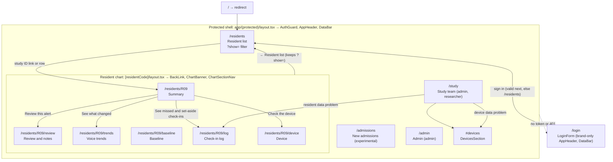
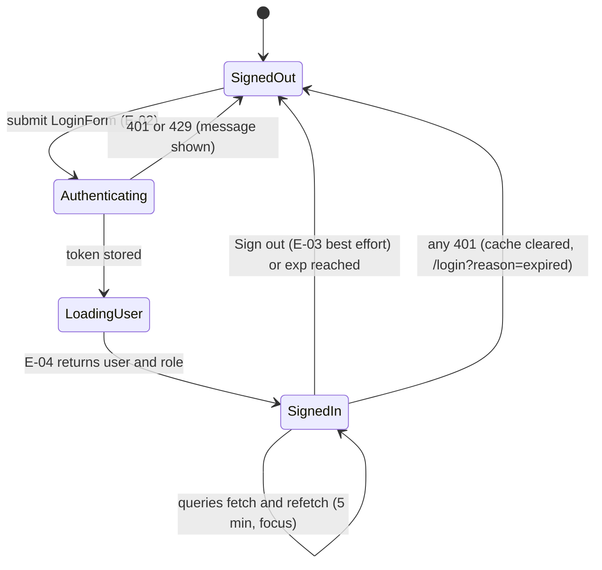
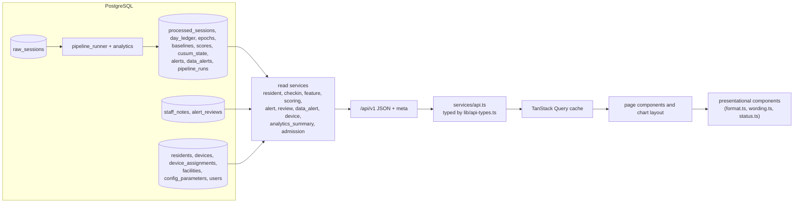
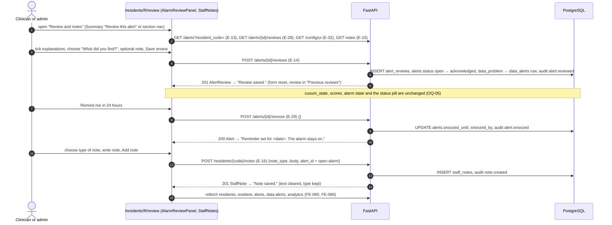
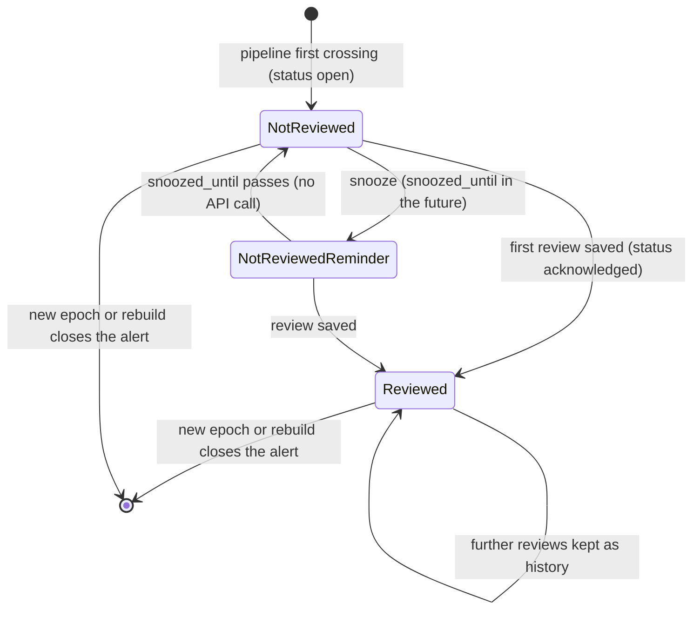

# EchoWell UI Architecture

Document: docs/design/UI_Architecture.md · Version 0.2 · Block 3 checkpoint 1, its own PR: GitHub PR #3 (Implement_Feature_Batches.md Phase 7 "UI Design Requirements", TRD 25 Phase 2) · Feature: FEAT-001 · Date: 21 October 2026 · Revised: 23 October 2026 (review round 1), 26 October 2026 (wireframe v0.2)

## 1. Purpose and sources

This document translates the clinical dashboard wireframe v0.2 and TRD 11 into the page, navigation, component, state and data-flow design that the Phase 8 frontend implements (FEAT-062..FEAT-076), with screen designs for the Resident list, the Resident chart and New admissions, and maps every UI component to the API endpoints and database tables that supply it. Copy strings, sizes and expected test renderings are normative in TRD 11 (v0.13); component props in TRD 04 §4.8 (v0.11); this document never changes them.

| Source | Content | Route |
|---|---|---|
| SRC-21 `specs/UI-wireframe/echowell-wireframes-v0.2.html` (notes: `specs/UI-wireframe/WIREFRAMES.md`) | Resident list | `/residents` |
| SRC-21 | Resident chart: Summary, Review and notes, Voice trends, Baseline, Check-in log, Device | `/residents/[residentCode]`, `/review`, `/trends`, `/baseline`, `/log`, `/device` |
| SRC-21 | New admissions (experimental) | `/admissions` |
| SRC-21 | Study team (with Devices and data problems) | `/study`, `/study#devices` |
| SRC-09, SRC-10, SRC-11, SRC-18, SRC-19 (wireframes v0.1) | superseded by SRC-21 (TRD 24 D-108); removed from the repository | — |
| TRD 11 (UX), TRD 04 (FE), TRD 02 §4.12–§4.26 (FR), TRD 19 (E-xx), TRD 23 §4.4 (derived values), TRD 24 D-108 to D-114 | requirements | all |

Pages are exactly `/residents`, `/residents/[residentCode]` with its five section routes, `/admissions`, `/study`, `/login` and `/admin` (TRD 24 D-110, FE-020). The v0.1 pages `/alerts` and `/analytics` do not exist: the review form moves into the chart's "Review and notes" section, the data alerts and devices to the Study team page. No EWMA chart exists (OQ-18, CUS-036). No audio control exists on any page (UX-006, AGT-006).

### 1.1 Wireframe versus TRD differences (TRDs win, AGT-001)

| Wireframe detail | Implemented as | Source |
|---|---|---|
| App bar "[Facility name], Assisted living" | `meta.facility_name` (`facilities.name`) + ", Assisted living" | UX-011, UX-012 |
| "Show wireframe notes" toggle and inline notes | not a product feature; only the open-question notes listed in TRD 11 §8 are shown | TRD 11 §2, RAQ-018 |
| No "Learning" filter button | "Learning (<n>)" shown after "Needs attention" only when at least one resident is Learning (test data: hidden) | UX-401, D-109 |
| Note on room numbers and sorting by room | no room data and no room sort (OQ-32 answered) | UX-001, D-116 |
| Summary note "Show the 2 or 3 measurements leaning most…" | API `leaning_most` rendered as "Leaning most: <labels>" | UX-312, D-92, D-111 |
| Change-score bars coloured by value ≥ 5 | bar colour follows `alarm_state` (same result on the test data; keeps alarm persistence visible) | UX-083, D-03, D-111 |
| Bar heights approximate | bars come from E-12 `cusum_tally` | UX-081, TRD 11 §4.13.3 |
| Not drawn: Login, Admin, Sign out, note types, previous notes, previous reviews, the change-score baseline slot and data table, "Show all devices", Downloads | kept from v0.1 in the v0.2 style | D-111 |
| "[n] of [N]" | `<n> of <N>` from `baseline_progress` and `meta.baseline_n` | UX-007, UX-186 |
| Offline device rule | Device section shows "○ No upload today" without changing the resident's status (OQ-31 answered) | UX-433, D-115 |

## 2. Page hierarchy and navigation architecture



| Navigation element | Shown on | Targets | Visibility | Source |
|---|---|---|---|---|
| Nav "Resident list" + red count badge | every protected page | `/residents` | all roles; badge n = `total` of E-13 `status=open` when > 0; accessible name "Resident list, <n> alarms not reviewed"; no badge while loading or on failure | UX-013, UX-018, FE-036, D-97 |
| Nav "New admissions" | same | `/admissions` | all roles | UX-013 |
| Nav "Study team" | same | `/study` | admin, researcher | UX-018, FE-028 |
| Nav "Admin" | same | `/admin` | admin | UX-014 |
| User name + "Sign out" | same | E-03, then `/login` | all roles | UX-015, FE-058 |
| Study-ID link (and row click) | `/residents` | `/residents/<R>` | all roles; accessible name "Open chart for <R>" | UX-037, UX-040 |
| Filter buttons | `/residents` | `?show=all\|changed\|needs_attention\|learning\|usual` | all roles | UX-401..UX-404, FE-082 |
| "← Resident list" | every chart section | `/residents` with the last `?show=` | all roles | UX-060, FE-025 |
| Chart section navigation | every chart section | the six section routes; "Review and notes" badge "1" for an unreviewed alarm | all roles | UX-410, UX-411, FE-206, FE-210 |
| Summary buttons | chart Summary | review / trends (Changed); log / device (Needs attention) | all roles | UX-076, UX-077 |
| "More detail" tiles | chart Summary | trends, baseline, log, device | all roles | UX-078 |
| Data-problem code link | `/study` | `/residents/<R>/log` or `/study#devices` | admin, researcher | UX-308 |
| Current-page link | nav and section nav | — | `aria-current="page"` (nav: white at 16% on `--chrome`; section nav: `--chrome` background) | UX-013, UX-410, FE-027 |
| Skip link | every page | `<main id="main">` | — | FE-033 |
| Document titles | every page | "Resident list – EchoWell", "R09 · Summary – EchoWell", … | — | UX-229, FE-032 |

## 3. Component hierarchy

```mermaid
flowchart TB
  APP["RootLayout (Source Sans 3, skip link, ribbon)"] --> PROV["Providers: QueryClientProvider, AuthProvider"]
  PROV --> LG["/login: AppHeader (brand only), DataBar, LoginForm"]
  PROV --> GUARD["(protected)/layout: AuthGuard, AppHeader (CountBadge), DataBar"]
  GUARD --> P1["/residents page"]
  P1 --> FB["FilterButtons"]
  P1 --> RT["ResidentsTable"]
  RT --> SP1["StatusPill (sm)"]
  RT --> WH["WhatsHappening"]
  P1 --> SL["StatusLegend"]
  GUARD --> CH["[residentCode]/layout"]
  CH --> BL["BackLink"]
  CH --> CB["ChartBanner"]
  CB --> SP2["StatusPill (lg)"]
  CH --> CSN["ChartSectionNav (CountBadge)"]
  CH --> S1["Summary: SummaryPanel (LeaningMost), MoreDetailTiles"]
  CH --> S2["Review and notes: AlarmReviewPanel, StaffNotes"]
  S2 --> ARF["AlertReviewForm"]
  S2 --> RH["ReviewHistory"]
  S2 --> NL["NotesList"]
  CH --> S3["Voice trends: ChangeScoreChart, MeasurementCards"]
  S3 --> CST["ChangeScoreTable (details)"]
  S3 --> FC["FeatureCard × 7, Sparkline, OtherMeasurementsCard"]
  CH --> S4["Baseline: BaselinePanel"]
  CH --> S5["Check-in log: CheckinCounts, CheckinLog"]
  CH --> S6["Device: DevicePanel"]
  GUARD --> P3["/admissions page"]
  P3 --> EB["ExperimentalBanner"]
  P3 --> AT["AdmissionsTable (StatusPill)"]
  P3 --> FRC["FacilityRangeChart"]
  GUARD --> P5["/study: StudyTeamPage"]
  P5 --> KT["KpiTiles"]
  P5 --> DPL["DataProblemsList"]
  P5 --> DCC["DailyCheckinsChart"]
  P5 --> LF["LossFunnel"]
  P5 --> UBR["UsableByResidentChart"]
  P5 --> ATT["AlarmTimingTable or ReviewOutcomesTable"]
  P5 --> DS["DevicesSection (#devices)"]
  GUARD --> P6["/admin page"]
  P6 --> AP["AdminPanel: Users, Pipeline runs, Upload data"]
```



Every data panel is wrapped in `SectionState` for loading, empty and error states (FE-140..FE-143). Presentational components receive data as props and never fetch (FE-091); pages and the chart layout own the queries. Retired with the v0.1 screens (TRD 24 D-110): `SummaryTiles`, `SortSelect`, `DeviceCell`, `Footer`, `AlertsPage`, `AlertQueue`, `AlertCard`, `MiniTallyChart`, `ReviewDialog` (TRD 04 §4.8).

## 4. State management design

| State | Owner | Lifetime | Examples | Source |
|---|---|---|---|---|
| Server state | TanStack Query cache, in memory only | until sign-out or `gcTime` | residents, resident, scores, features, check-ins, notes, devices, alerts, data alerts, analytics, admissions, UI config, admin lists | FE-006, FE-045, FE-080 |
| Session | `AuthProvider` + `lib/auth.ts` | tab session (`sessionStorage`) | token, `exp`, user, role | FE-050..FE-054 |
| URL | search params, route segments and hash | shareable | `?show=` (resident list), chart section segment, `?tab=` (admin), `/study#devices`, `next`, `reason` | FE-082, FE-206, UX-210, FE-026 |
| Local UI | component `useState` | component | note text and type, review form fields, disclosures | FE-089 |



Mutations and their invalidations: `createNote` → `["resident", code]`, `["residents"]`, `["alerts"]` (FE-085); `createAlertReview`, `snoozeAlert` → `["alerts"]`, `["data-alerts"]`, `["resident", code]`, `["residents"]`, `["analytics"]` (FE-086). The UI never changes alarm state locally (FE-134).

Display status (presentation only): `lib/status.ts` `toDisplayStatus(status, needs_attention)` maps the API values to Changed (`alarm_on`), Needs attention (`needs_attention` true), Learning (`baseline_forming`), Usual (`no_alarm`), first match wins (TRD 11 §4.3.4, FE-207). The flag itself is computed by the API from open `baseline_stalled` and `high_set_aside` data alerts (D-109, D-114, OQ-31).

## 5. Data flow

### 5.1 Read path (all pages)



Reads never run the pipeline (ARC-024); every displayed date and time uses `meta.facility_tz` (UX-002, FE-150); N, h and the profile come from `meta` (UX-007, FE-077). The wireframe v0.2 fields are derived on read (TRD 24 D-114; no table change): `needs_attention` / `attention_reasons` from open `data_alerts`, `alarm_reviewed` from `alerts.status`, the summary counts from the listed rows, `checkins_started` from the first non-duplicate `processed_sessions` record of the enrolment, `uploaded_on_as_of_date` from `raw_sessions`.

### 5.2 Write paths (staff review workflow, chart "Review and notes")



Alert status during the workflow:



Indicators: Summary fact "Not reviewed" / "Reviewed", list text "… Not reviewed yet." / "… Reviewed.", the nav badge and the "Review and notes" badge (only while not reviewed), and the line "Reminder set for <Mon D, h:mm AM/PM CT>." while a reminder is active (UX-076, UX-317, UX-405, UX-411, FE-205, FE-210). Researchers see the chart and "Previous reviews" but no form ("Only clinicians and admins can review alarms.", UX-322; "Only clinicians and admins can add notes.", UX-132).

## 6. Screen design: Resident list (`/residents`, SRC-21)

### 6.1 Layout (desktop ≥ 1024 px; navigation shown as an admin sees it)

```text
+---------------------------------------------------------------------------------------------+
| EchoWell  Edgewood, Assisted living     [Resident list (2)] [New admissions] [Study team]    |
|                                          [Admin]   <display name>  [Sign out]                |
|---------------------------------------------------------------------------------------------|
| Test data only (pipeline test data v0.1, Oct 1–30, 2026). No real residents. No audio is     |
| stored or played anywhere in EchoWell.                                          (data bar)   |
|=============================================================================================|
| +-----------------------------------------------------------------------------------------+ |
| | Residents in the study      [All (10)] [Changed (2)] [Needs attention (2)] [Usual (6)]  | |
| | Status             | Resident | What's happening                          | Last check-in | |
| | ▲ Changed          | R09      | Changed from their usual since Oct 21. Not reviewed yet. | Oct 30, 2:28 PM CT |
| | ▲ Changed          | R10      | Changed from their usual since Oct 24. Not reviewed yet. | Oct 30, 2:39 PM CT |
| | ! Needs attention  | R03      | 7 check-ins too noisy or too short to use. | Oct 30, 2:19 PM CT |
| | ! Needs attention  | R08      | Missing many check-ins. Baseline stuck at 13 of 16. | Oct 30, 2:28 PM CT |
| | ● Usual            | R01      | Within their usual range.                  | Oct 30, 2:07 PM CT |
| | ● Usual            | R07      | Usual. Baseline restarted Oct 13 after a new device. | Oct 30, 2:52 PM CT |
| | ▲ Changed  Their voice has moved away from their own usual. Check on them.  ! Needs …    | |
| +-----------------------------------------------------------------------------------------+ |
| A status is a prompt to check on someone, not a diagnosis. [Final clinical wording: confirm  |
| with PI]                                                                                     |
+---------------------------------------------------------------------------------------------+
```

Below 640 px the navigation wraps under the brand and the filter buttons move below the heading; the table (min 640 px) scrolls inside its focusable container "Residents table" (UX-042, UX-242, UX-245).

### 6.2 Filter buttons

| Order | Label | Count (E-08 `summary`, D-114) | Shown | Source |
|---|---|---|---|---|
| 1 | "All (<n>)" | number of listed rows (`total`) | always; pressed by default | UX-401 |
| 2 | "Changed (<n>)" | `changed` | always | UX-401 |
| 3 | "Needs attention (<n>)" | `needs_attention` | always | UX-401 |
| 4 | "Learning (<n>)" | `learning` | only when > 0 | UX-401, D-109 |
| 5 | "Usual (<n>)" | `usual` | always | UX-401 |

`role="group"` named "Show", `aria-pressed` on the pressed button, filter kept in `?show=`; filtering is done in the browser on the rows' display status without a request and announces "Showing <label> residents"; counts never change with the filter; an empty filter shows "No residents with this status." (UX-402..UX-404, FE-082). Test values: "All (10)", "Changed (2)", "Needs attention (2)", "Usual (6)".

### 6.3 Residents table

| Column (exact header) | Content | API field (`ResidentOverviewRow`) | Source |
|---|---|---|---|
| "Status" | `StatusPill` (glyph, label, colour, border); Changed rows have a 5 px `--red`, Needs-attention rows a 5 px `--yellow-edge` left border | `status`, `needs_attention` → `toDisplayStatus()` | UX-034, UX-036, TRD 11 §4.3.4 |
| "Resident" | study ID, weight 700, link "Open chart for <R>" | `resident_code` | UX-037, UX-040 |
| "What's happening" | one sentence of TRD 11 §4.3.6 | `alarm_since`, `alarm_reviewed`, `attention_reasons`, `baseline_progress`, `last_30_days.set_aside`, `current_epoch`, `baseline_restarted_on` | UX-405 |
| "Last check-in" | "Oct 30, 2:28 PM CT" or "No check-ins yet" | `last_checkin_at` + `meta.facility_tz` | UX-038, DB-045 |

Visually hidden caption "Residents in the study, <filter label>"; `scope="col"` headers; `aria-busy` during a background refresh while previous rows stay visible (UX-043, UX-201, FE-083). Duplicates never appear in any count or row; missed days are never hidden or backfilled (UX-044, UX-047, AGT-046, AGT-053). The device column, the 30-day counts column and the "Open" column of v0.1 are removed; the device moves to the chart banner and Study team, the counts to the chart banner and Check-in log (UX-035, UX-039 retired).

### 6.4 Server-side filters

The client always requests the filter set of TRD 04 §4.6.2, which the API applies (API-070):

| Filter | Value sent | Effect | Source |
|---|---|---|---|
| `sort` | `alarm` | the D-109 order (section 6.5) | UX-408, FE-084 |
| `cohort` | `longitudinal` | new admissions without their own baseline are excluded until the cohort transition | UX-034, UX-046, DME-008 |
| `include_withdrawn` | `false` | withdrawn residents are neither listed nor counted | UX-045, OQ-11 |
| `limit`, `offset` | 500, 0 | one page; "Showing <n> of <total> residents." if truncated | FE-076, UX-041 |
| 30-day window | server-side | local dates as-of − 29 … as-of, not before enrolment | DB-041, API-069 |

### 6.5 Sorting logic

| Order rule (computed by the API; the client never re-sorts, FE-084) | Test order | Source |
|---|---|---|
| Changed (alarm date oldest first, then natural resident code) → Needs attention → Learning → Usual (each by natural resident code) | R09, R10, R03, R08, R01, R02, R04, R05, R06, R07 | UX-408, TRD 24 D-109 (amends D-17) |

The API sorts `resident_id` and `last_checkin` stay available to other clients but the UI offers no sort control (the v0.1 "Sort by" select is retired, UX-030).

### 6.6 Status indicators and legend

| Display status | Pill | Rule (first match) | Legend meaning | Test residents |
|---|---|---|---|---|
| Changed | "▲ Changed", `--red` / `--red-bg` | `status` = `alarm_on` | "Their voice has moved away from their own usual. Check on them." | R09, R10 |
| Needs attention | "! Needs attention", `--yellow` / `--yellow-bg` / `--yellow-edge` | `needs_attention` = true | "Not enough good check-ins to judge. Check the device or the routine." | R03, R08 |
| Learning | "○ Learning", `--grey` / `--grey-bg` | `status` = `baseline_forming` | "Still collecting the first <N> check-ins to learn their usual." | none |
| Usual | "● Usual", `--green` / `--green-bg` | `status` = `no_alarm` | "Within their own usual range." | R01, R02, R04, R05, R06, R07 |

Status is never conveyed by colour alone: glyph, text label and border always accompany colour (UX-004, FE-092). The nav badge counts unreviewed change alarms only; data alerts are never counted (UX-018, FR-300). R05's held-back check-ins and D02's silent day are Study team items and do not change a resident's colour (D-109, OQ-31).

## 7. Screen design: Resident chart (`/residents/[residentCode]`, SRC-21)

### 7.1 Layout (Summary section of a Changed resident)

```text
+---------------------------------------------------------------------------------------------+
| (app bar and data bar as on the Resident list; "Resident list" is the current nav link)      |
| [← Resident list]                                                                            |
| +-----------------------------------------------------------------------------------------+ |
| | R09   Device D09 · Last check-in Oct 30, 2:28 PM CT · Usable check-ins, last 30 days       | |
| |       30 of 30 · Baseline Complete                                   [ ▲ Changed ] (lg)  | |
| +-----------------------------------------------------------------------------------------+ |
| +----------------------+ +--------------------------------------------------------------+ |
| | [Summary]            | | Right now                                     (red left edge) | |
| | Review and notes (1) | | R09’s voice has moved away from their own usual pattern,     | |
| | Voice trends         | | steadily and long enough to set off the alarm on Oct 21.     | |
| | Baseline             | | It is still changed.                                          | |
| | Check-in log         | | Oct 21 Alarm started · 9 days Open · Not reviewed Review status| |
| | Device               | | Leaning most: more pauses, quieter, less voiced sound        | |
| +----------------------+ | [Review this alert] [See what changed]                        | |
|                          | This compares R09 only with R09. It is a prompt to check in, | |
|                          | not a diagnosis. [Final clinical wording: confirm with PI]   | |
|                          +--------------------------------------------------------------+ |
|                          | More detail                                                   | |
|                          | [Voice trends     ] [Baseline        ] [Check-ins, last 30] [Device    ] |
|                          | [Change score 26.8] [16 of 16 check-ins] [30 used, 0 missed] [D09 online] |
|                          +--------------------------------------------------------------+ |
+---------------------------------------------------------------------------------------------+
```

Grid: 200 px section navigation | content (gap 16 px); below 760 px the navigation becomes a horizontally scrolling row above the content and the banner pill moves below the facts (UX-240, UX-241). The banner and navigation come from the chart layout's E-09 query; each section issues only its own reads in parallel and fails independently (FE-087, FE-206, UX-202). An invalid or unknown code shows only "Resident <code> was not found." with the back link (FE-030, FE-142, UX-412).

### 7.2 Banner and section navigation

| Element | Content | API field | Source |
|---|---|---|---|
| `<h1>` | resident code | `resident_code` | UX-061 |
| "Device" | "D07B (replaced D07)", "D02 (shared with R03)", "D09" | `device.device_code`, `device.previous_device_code`, `device.shared_with` | UX-063 |
| "Last check-in" | as the list | `last_checkin_at` | UX-038, UX-063 |
| "Usable check-ins, last 30 days" | "<used> of <days in window>" | `last_30_days` | UX-063 |
| "Baseline" | "Complete" or "<n> of <N>" | `baseline.state`, `baseline.n_usable`, `baseline.n_required` | UX-063 |
| Large pill | display status | `status`, `needs_attention` | UX-062 |
| Section nav | Summary, Review and notes (badge "1" when `alarm_reviewed` is false), Voice trends, Baseline, Check-in log, Device | `alarm_reviewed` (D-114) | UX-410, UX-411, FE-210 |

### 7.3 Summary ("Right now" and "More detail")

| Situation | Lead text (TRD 11 §4.5.2.1) | Extra content | Data |
|---|---|---|---|
| Changed | "<R>’s voice has moved away … It is still changed." or the "now below the alarm line, but the alarm stays on" variant | facts "Alarm started", "Open", "Review status"; "Leaning most: …"; buttons "Review this alert", "See what changed" | E-09 `alarm_since`, `explanation.still_above_line`, `alarm_reviewed`; E-13 `open_days`, `leaning_most` |
| Needs attention | "What's happening" sentence + " EchoWell can’t judge their voice well until more good check-ins come in." | buttons "See missed and set-aside check-ins", "Check the device" | E-09 `attention_reasons`, `baseline`, `last_30_days` |
| Learning | "EchoWell is still learning <R>’s usual pattern: <n> of <N> usable check-ins so far. …" | — | E-09 `baseline` |
| Usual | "<R>’s voice is within their own usual range. Nothing to do." / "<R>’s baseline is complete. Comparing starts with the next usable check-in." | — | E-09 `watching_since`, E-12 |
| Epoch > 1 | appended restart sentence | — | E-09 `current_epoch`, `explanation.baseline_restarted_on`; E-10 restart cause |

The panel ends with "This compares <R> only with <R>. It is a prompt to check in, not a diagnosis. [Final clinical wording: confirm with PI]" (UX-072, UX-073). "More detail" tiles: "Voice trends" ("Change score <tally>", "Not scored yet" or "No change"; E-12), "Baseline" ("<n> of <N> check-ins"), "Check-ins, last 30 days" ("<used> used, <missed> missed"), "Device" ("<D> online" / "<D> no upload today"; E-17 `uploaded_on_as_of_date`) (UX-078).

### 7.4 Review and notes

| Area | Controls and copy | API | Source |
|---|---|---|---|
| Alarm review panel (Changed only) | heading "Review alert: changed since <Mon D>"; fieldset "Anything that could explain it?" (configured checklist, hint "Provisional list — to be confirmed with the clinical team (OQ-25)."); required fieldset "What did you find?" (4 choices); "Note" (≤ 2000, counter, placeholder "What you saw or did"); "Save review"; "Remind me in 24 hours"; reminder line; "Previous reviews"; open-questions note (OQ-05, OQ-26) | E-13, E-28, E-32, E-14, E-29 | UX-310..UX-322, FE-136..FE-138, FE-209 |
| Staff notes | "Type of note" (Observation, Action taken, Follow-up); textarea "New note" (placeholder "Add a note"); counter "<n> / 2000"; "Add note" disabled when empty or > 2000; "Write a short note before saving."; "Note saved."; "Previous notes" newest first, max 10 then "Show all notes (<count>)"; empty text "No notes yet. …"; no edit or delete | E-15, E-16 | UX-120..UX-135, FE-130, FE-132, FE-133 |

A note never marks an alarm as reviewed (UX-123, contract §20 R5). The v0.1 "Mark as reviewed" button, review dialog and the separate Alert review page are retired; reviewer names and outcomes are shown in "Previous reviews" on this section (UX-320, D-110, D-111).

### 7.5 Voice trends: change score visualisation ("Change score")

| Element | Specification | Data | Source |
|---|---|---|---|
| Intro | "Goes up when check-ins keep leaning away from <R>’s usual. The alarm turns on at <h>. Missed, set-aside and held-back check-ins leave it unchanged." | `meta.cusum_h` | UX-080 |
| Chart | Recharts `ComposedChart`, plot height 200 px, min width 520 px in a focusable `overflow-x: auto` container | E-12 `items` of the current epoch | FE-093, FE-096 |
| Baseline slot | leading category "Baseline <first>–<frozen-after>" as `ReferenceArea`, `--grey-bg` | E-12 `baseline_periods` | UX-082, D-111 |
| Bars | one per scored session in time order; height = `cusum_tally`; `--c-aside` when `alarm_state` = off, `--red` when rings or on; a 0 value drawn as a 2 px stub | `cusum_tally`, `alarm_state` | UX-081, UX-083, FE-095 |
| Alarm line | dashed 2 px `--red` line at y = h, label "Alarm line: <h>" ("Alarm line: 5") | `meta.cusum_h` | UX-084, FE-077 |
| First crossing | "▲" above the `rings` bar; tick "<Mon D> · alarm" | `alarm_state = rings` | UX-085, FE-094 |
| Axes | x labels first, alarm and last dates; y from 0 to max(1.2 × h, 1.05 × max value), ticks every 5 (every 10 above 20) | — | UX-086, UX-087 |
| Forming | "No change score yet. Scoring starts after the baseline is complete (<n> of <N> usable check-ins so far)." | E-09 `baseline` | UX-089 |
| Epoch > 1 | "Showing the current device period since <Mon D>. Earlier periods are not scored against this baseline." | E-09 `current_epoch` | UX-092 |
| Text alternative | `role="img"` with the UX-091 sentence; disclosure "Show change score as a table" with Date, Change score (1 decimal), Alarm ("—", "▲ Alarm rings (first crossing)", "▲ Alarm on") | same | UX-090, UX-091, FE-097 |

Colour follows `alarm_state` from the API, not a client-side comparison with h, so persistence after the first crossing is visible even when the change score falls below the line (TRD 04 §8, AGT-048). Test data R09: baseline slot "Baseline Oct 1–16", 14 bars, Oct 17–20 `--c-aside` (3.2, 2.6, 1.8, 1.6), Oct 21 `--red` ▲ 5.4, then `--red` up to 26.8 (FE-183, FE-184). Earlier epochs: interim "Device period" select of TRD 24 OQ-28 (FEAT-067), shown only when `epoch_count` > 1.

"The 7 voice measurements behind the score": intro "Each is compared with <R>’s own baseline. The score rises when the voice is:"; seven `FeatureCard`s in contract order with plain labels ("Quieter (loudness)", "Slower to say the phrase (phrase duration)", "Fewer syllables per second (speech rate)", "Slower while talking (articulation rate)", "More pauses (number of pauses)", "More time in pauses (pause fraction)", "Less voiced sound (voiced fraction)"); each `Sparkline` (110 × 28 px) plots sign × z of the current epoch's scored sessions with a dashed zero line, or "Not scored yet" with a dashed card border while the baseline forms; eighth card "12 other measurements (pitch, jitter, MFCCs and others)" / "Stored, not scored"; caption "Measurement names are placeholders until Team 1 confirms the openSMILE output names. Morning check-ins are adjusted before comparing."; no per-feature alarm or "abnormal" label (UX-100..UX-108, FE-098). Data: E-11 `scored_features[].points[].z`, `composite_sign`, `stored_feature_keys`.

### 7.6 Baseline

| Situation | Text (TRD 11 §4.5.7.1) | Meter | Data |
|---|---|---|---|
| Frozen, scored sessions exist | "First <N> usable check-ins, <first>–<frozen-after>, then frozen. Compared with it since <first scored date>." | full | E-09 `baseline`, `watching_since` |
| Frozen, nothing scored yet | "… then frozen. Comparing starts with the next usable check-in." | full | same |
| Forming | "Still forming: <n> of <N> usable check-ins so far." + " <m> missed and <s> set-aside check-ins have slowed it down." when any occurred | `<progress>` n of N | E-09 `baseline`; epoch counts |
| Restarted (epoch > 1) | prefix "Restarted <Mon D> when the device was replaced (<old> to <new>), so readings from the old device are not mixed in." (or the firmware or software variant) | per new epoch | E-10 `restart_cause`, `previous_device_code`, `from_value`, `to_value` |

The panel ends with "The baseline is built from the first <N> usable check-ins, then frozen so slow changes still show up. It restarts if the resident gets a new device or the device or extraction software changes." The baseline dates never change after freeze (UX-066, UX-420..UX-423, AGT-051, DME-010, DB-065).

### 7.7 Check-in log and Device

| Area | Content | API | Source |
|---|---|---|---|
| "Check-ins, last 30 days" | tiles "Used", "Set aside (noise, poor quality or too short)", "Held back (possible other voice)", "Missed" | E-09 `last_30_days` | UX-140, TRD 11 §4.3.5 |
| "Events" | newest date first; same-date order alarm_on, watching_started, baseline_complete, baseline_restarted, quarantined, set_aside, device_silent, missed, checkins_started; texts of TRD 11 §4.5.6 (e.g. "Alarm on. Change score crossed 5.", "Comparing with baseline started.", "Check-in held back: possible other voice.", "Check-ins started on D07."); last 30 days then "Show earlier entries" (E-10 `from`/`to`); caption "Duplicate records are removed quietly and not shown."; no usable or duplicate lines | E-10 | UX-140..UX-150, FE-101, D-113 |
| "Device <D>" | facts "● Online" / "○ No upload today", "Last upload", "Firmware", "Used by"; "History" (silent days, replacement, firmware change) or "No problems in the last 30 days."; caption "Audio never leaves the device. Only voice measurements are uploaded." | E-09 `device`, E-17 (`uploaded_on_as_of_date`, `last_upload_at`, `firmware_version`, `resident_codes`, `device_gap_days_last_30`, `replaces_device_code`), E-10 firmware restarts | UX-430..UX-433, OQ-31 |

## 8. Screen design: New admissions (`/admissions`, SRC-21)

### 8.1 Layout

```text
+---------------------------------------------------------------------------------------------+
| (app bar and data bar; "New admissions" is the current nav link)                            |
| +- - - - - - - - - - - - - - - - - - - - - - - - - - - - - - - - - - - - - - - - - - - - -+ |
| | Future / experimental. Not in pipeline test v0.1: the test data has no admission group   | |
| | or facility range yet. Open question for Shaba and the PI.              (yellow, dashed) | |
| +- - - - - - - - - - - - - - - - - - - - - - - - - - - - - - - - - - - - - - - - - - - - -+ |
| New admissions                                                                               |
| New residents don’t have their own baseline yet, so their first check-ins are compared with  |
| the facility’s usual range.                                                                  |
| Status | Resident | Admitted | Compared with facility range | Own baseline |                 |
| <pill> | <R>      | <Mon D>  | Outside facility range       | <n> of <N>   | [Show comparison] |
| No new admissions. The pipeline test data v0.1 has no admission group.   (v0.1 empty state) |
|---------------------------------------------------------------------------------------------|
| <R> compared with facility range                                                             |
| feature row:  |=====grey band=====|   ● resident value (▲ red when outside)                  |
| Grey band = usual range across current residents                                             |
| After <N> usable check-ins, the resident moves to the resident list and is compared with     |
| their own baseline instead.                                                                  |
| Select a resident to see the comparison.   (when none selected)                              |
+---------------------------------------------------------------------------------------------+
```

### 8.2 Table, filters, sorting and comparison

| Element | Design | API field | Source |
|---|---|---|---|
| Note | 1 px dashed `--yellow-edge`, `--yellow-bg`, `--yellow` text; second and third sentences stay until OQ-08 closes | — | UX-181, OQ-08 |
| Columns | "Status", "Resident", "Admitted", "Compared with facility range", "Own baseline", hidden "Actions"; min width 640 px | E-22 `AdmissionRow` (`resident_code`, `admitted_on`, `comparison_status`, `own_baseline_progress`) | UX-183..UX-186 |
| Status pill and text | `outside_range` neutral "Out of range" / "Outside facility range"; `within_range` neutral "In range" / "Within facility range" (D-117); `not_enough_checkins` grey "Learning" / "Not enough check-ins yet"; `range_not_available` grey "Learning" / "Facility range not available yet" | `comparison_status` | UX-185, FR-202 |
| Filter | server-side: only `new_admission` residents whose own baseline has not formed; they move to the resident list when it forms | — | UX-188, FR-201, DB-025 |
| Sorting | API order (no sort control is specified by TRD 11 or TRD 04) | — | E-22 |
| Row selection | "Show comparison" button, `aria-selected`, 5 px `--chrome` left border | — | UX-187 |
| Comparison chart | one row per feature, `--grey-bg` band low–high, resident dot (`--red` with "▲" when outside); text table "Measurement", "Resident value", "Facility range", "Outside range" | E-23 `features`, E-24 ranges (`method`, `n_residents`, `computed_at`) | UX-189..UX-195, FE-100 |
| v0.1 state | no new-admission residents and no range rows: empty table text and "Select a resident to see the comparison." | E-22 empty `items` | UX-194, TRD 11 §4.13.5 |

The experimental arm never creates alerts or affects any change score (FR-206). OQ-29 interim rules (TRD 24) govern `not_enough_checkins` and the compared value once ranges exist.

## 9. Other pages (summary)

| Page | Main components | Key design points | Source |
|---|---|---|---|
| `/study` | `StudyTeamPage`: `KpiTiles`, `DataProblemsList`, `DailyCheckinsChart`, `LossFunnel`, `UsableByResidentChart`, `AlarmTimingTable` (test_v0_1) or `ReviewOutcomesTable` (production), `DevicesSection` (`#devices`), Downloads | `<h1>` "Study team: how the system is working", "Counts only. No audio, no names."; data problems tagged "Staff can help" / "Study team", rendered "**<code>:** <detail>" with v0.2 `detail` texts, never "▲" or red; devices grouped as "D01, D04 to D06, D08 to D10: all uploaded Oct 30. Firmware fw-1.0.0." with "● Online" / "○ No upload today" tags and "Show all devices (<n>)"; text table for every chart; percentages half-up; clinicians get the access-denied state | UX-017, UX-050..UX-058, UX-306..UX-309, UX-350..UX-384, FR-310..FR-323 |
| `/login` | `AppHeader` (brand only), `DataBar`, `LoginForm` | no self-registration; "Accounts are created by the EchoWell admin." | UX-170..UX-176 |
| `/admin` | `AdminPanel` tabs Users, Pipeline runs, Upload data | no resident, device or API-key editing; "Only synthetic or test data may be uploaded to this environment."; nightly-missing banner; API status line | UX-210..UX-219, D-96 |

## 10. Component → API → database mapping

Every component of TRD 04 §4.8 (plus the lib-level `AuthGuard` and `AuthProvider`). Tables are those read or written by the endpoint's service (docs/design/OpenAPI_Spec.md §5, TRD 05 §4.12).

| Component | Page(s) | API endpoint(s) | DTO fields used | Database tables | Requirements |
|---|---|---|---|---|---|
| `AuthProvider`, `AuthGuard` | all protected | E-04 GET /auth/me | `User.display_name`, `role` | users | FE-053..FE-055 |
| `LoginForm` | `/login` | E-02 POST /auth/login | `Token`, Problem codes `INVALID_CREDENTIALS`, `RATE_LIMITED`, `ACCOUNT_TEMPORARILY_LOCKED` | users, audit_logs | UX-170..UX-176, FE-050..FE-057 |
| `AppHeader`, `CountBadge` | all pages | E-32 (`meta`), E-13 `status=open` (`total`), E-04, E-03 | `meta.facility_name`; alert `total` | facilities, config_parameters, alerts, users, audit_logs | UX-010..UX-018, FE-023..FE-029, FE-036, FE-088 |
| `DataBar` | all pages | E-32 (`meta`) | `meta.pipeline_profile`, `data_source_label`, `as_of`, `facility_tz` | facilities, pipeline_runs, config_parameters | UX-400, FE-208 |
| `FilterButtons` | `/residents` | E-08 | `summary.changed`, `needs_attention`, `learning`, `usual`, `total` (D-114) | residents, epochs, baselines, processed_sessions, alerts, data_alerts | UX-401..UX-404, FE-082, FE-181 |
| `ResidentsTable`, `WhatsHappening` | `/residents` | E-08 | `items[]` (`ResidentOverviewRow` incl. `needs_attention`, `attention_reasons`, `alarm_reviewed`), `total` | residents, device_assignments, devices, processed_sessions, day_ledger, epochs, baselines, alerts, data_alerts, cusum_state | UX-034..UX-046, UX-405, UX-408, FE-182 |
| `StatusPill`, `StatusLegend` | `/residents`, chart, `/admissions` | E-08, E-09, E-22 | `status`, `needs_attention` (via `toDisplayStatus`); `comparison_status` | alerts, epochs, processed_sessions, baselines, data_alerts | UX-004, UX-036, UX-062, UX-185, UX-406, FE-092, FE-207, CUS-020 |
| `BackLink` | chart | none | — | — | UX-060, FE-025 |
| `ChartBanner` | chart | E-09 | `resident_code`, `device`, `status`, `needs_attention`, `baseline`, `last_checkin_at`, `last_30_days` | residents, devices, device_assignments, epochs, baselines, processed_sessions, day_ledger, alerts, data_alerts | UX-061..UX-063 |
| `ChartSectionNav` | chart | E-09 | `alarm_reviewed` | alerts | UX-410, UX-411, FE-206, FE-210 |
| `SummaryPanel`, `LeaningMost` | chart Summary | E-09, E-13 `resident_code` | `explanation`, `status`, `needs_attention`, `attention_reasons`, `alarm_since`, `alarm_reviewed`, `current_tally`, `meta.cusum_h`; alert `open_days`, `leaning_most` | alerts, cusum_state, epochs, baselines, data_alerts, scores (via `analytics.alert_generator.leaning_most`) | UX-070..UX-077, UX-312, OQ-12, CUS-041 |
| `MoreDetailTiles` | chart Summary | E-09, E-12, E-17 | `baseline`, `last_30_days`; latest `cusum_tally`; `uploaded_on_as_of_date` | baselines, processed_sessions, day_ledger, scores, devices, raw_sessions | UX-078 |
| `AlarmReviewPanel` | chart Review and notes | E-13 `resident_code`, E-28 | non-closed `Alert` (`id`, `local_date`, `status`, `snoozed_until`), reviews | alerts, alert_reviews, users | UX-310, UX-317, UX-320..UX-322, FE-209 |
| `AlertReviewForm` | chart Review and notes | E-32, E-14, E-29 | `review_explanations`, `alert_snooze_hours`; `AlertReviewCreate`; `SnoozeRequest` | config_parameters, alert_reviews, alerts, data_alerts, audit_logs | UX-313..UX-318, FE-136..FE-138 |
| `ReviewHistory` | chart Review and notes | E-28 | `AlertReview` items | alert_reviews, users | UX-320 |
| `StaffNotes` | chart Review and notes | E-16 POST notes; E-09 `open_alert_id` | `StaffNoteCreate` | staff_notes, alerts, users, audit_logs | UX-120..UX-133, FE-130..FE-135 |
| `NotesList` | chart Review and notes | E-15 | `StaffNote` items | staff_notes, users | UX-134, UX-135 |
| `ChangeScoreChart` | chart Voice trends | E-12 `resident_code`, `epoch` | `items[]` (`cusum_tally`, `alarm_state`, `local_date`), `baseline_periods`, `meta.cusum_h` | scores, processed_sessions, baselines, epochs, config_parameters | UX-080..UX-092, FE-093..FE-097 |
| `ChangeScoreTable` | chart Voice trends | E-12 | same | scores | UX-090, FE-184 |
| `MeasurementCards`, `FeatureCard` | chart Voice trends | E-11 | `scored_features[]` (`label`, `feature_key`, `composite_sign`, `points[].z`) | processed_sessions, raw_sessions, baselines, scores | UX-100..UX-105, UX-108 |
| `Sparkline` | chart Voice trends | E-11 | `points[].z` × `composite_sign` | scores | UX-102, UX-103, FE-098 |
| `OtherMeasurementsCard` | chart Voice trends | E-11 | `stored_feature_keys` (12) | raw_sessions (stored columns), processed_sessions | UX-106, UX-107 |
| `BaselinePanel` | chart Baseline | E-09, E-10 | `baseline`, `watching_since`, `current_epoch`; restart event (`restart_cause`, `previous_device_code`, `from_value`, `to_value`) | epochs, baselines, processed_sessions, day_ledger | UX-420..UX-423, UX-066 |
| `CheckinCounts` | chart Check-in log | E-09 | `last_30_days` | processed_sessions, day_ledger | UX-140, UX-047, UX-048 |
| `CheckinLog` | chart Check-in log | E-10 | `CheckinEvent` items (`event_type` incl. `checkins_started`, `detail`, `restart_cause`, `from_value`, `to_value`) | processed_sessions, day_ledger, epochs, baselines, alerts, scores | UX-140..UX-150, FE-101 |
| `DevicePanel` | chart Device | E-09, E-17, E-10 | `device`; `Device` (`uploaded_on_as_of_date`, `last_upload_at`, `firmware_version`, `resident_codes`, `device_gap_days_last_30`, `replaces_device_code`, `in_use_since`) | devices, device_assignments, raw_sessions, day_ledger, epochs | UX-430..UX-433 |
| `ExperimentalBanner` | `/admissions` | none | — | — | UX-181, OQ-08 |
| `AdmissionsTable` | `/admissions` | E-22 | `AdmissionRow` items, `meta.baseline_n` | residents, processed_sessions, baselines, facility_reference_ranges | UX-182..UX-188 |
| `FacilityRangeChart` | `/admissions` | E-23, E-24 | `AdmissionComparison.features`, `ReferenceRange` | processed_sessions, facility_reference_ranges | UX-189..UX-195, FE-100 |
| `StudyTeamPage` | `/study` | E-18, E-30, E-17; E-12 and E-19 CSV | page orchestration, downloads | see components; audit_logs (CSV) | UX-017, UX-350..UX-384, UX-377 |
| `KpiTiles` | `/study` | E-18 | `kpis` | processed_sessions, day_ledger, epochs, baselines, alerts | UX-351..UX-355 |
| `DataProblemsList` | `/study` | E-30 `status=open` | `DataAlert` (`kind`, `title`, `detail`, `resident_code`, `device_code`) | data_alerts, residents, devices | UX-306..UX-309, CUS-045 |
| `DailyCheckinsChart` | `/study` | E-18 | `daily_series` | processed_sessions, day_ledger, data_alerts | UX-356..UX-361 |
| `LossFunnel` | `/study` | E-18 | `funnel` | processed_sessions, day_ledger | UX-362..UX-366 |
| `UsableByResidentChart` | `/study` | E-18 | `by_resident` | processed_sessions, day_ledger | UX-367..UX-370 |
| `AlarmTimingTable` | `/study` (test_v0_1) | E-18 | `alarm_timing` | alerts, evaluation_ground_truth (read only through `DATABASE_READONLY_URL`) | UX-371..UX-374, UX-376, CUS-047 |
| `ReviewOutcomesTable` | `/study` (production) | E-18 | `review_outcomes` | alerts, alert_reviews | UX-375, CUS-049 |
| `DevicesSection` | `/study#devices` | E-17 | `Device` items | devices, device_assignments, raw_sessions, day_ledger | UX-050..UX-058, FE-026, FE-102 |
| `AdminPanel` | `/admin` | E-25, E-26, E-27, E-31, E-20, E-21, E-06, E-07, E-01 | `User`, `PipelineRun`, `IngestBatchAccepted`, `IngestBatch`, `Health` | users, pipeline_runs (and every derived table through the run), ingest_batches, ingest_rejections, raw_sessions, audit_logs | UX-210..UX-219 |
| `SectionState` | all | none (renders `ApiError.requestId`) | — | — | UX-200..UX-206 |

## 11. Accessibility and responsive rules (summary)

WCAG 2.1 AA in the light and the dark colour scheme: status never by colour alone (glyph, label and border on every pill), text alternatives for every chart, 44 px targets, visible 3 px `--link` focus ring, reduced motion, 200 % zoom, no page-level horizontal scroll at ≥ 320 px (only the residents table, admissions table, change-score chart, check-ins-per-day chart and alarm timing table scroll in focusable containers), the chart section navigation as a scrolling row below 760 px, axe with zero serious or critical findings on every route (UX-004, UX-220..UX-245, FE-160..FE-165, FE-190, FE-191, FE-211, TRD 11 §4.14). Tokens: TRD 11 §4.15 (Source Sans 3, v0.2 palette, TRD 24 D-112).

## 12. Open questions affecting the UI

| ID | Effect on this design |
|---|---|
| OQ-05 | Review does not reset the change score or turn the alarm off; note shown in the review panel. |
| OQ-08 | New admissions stay experimental; note stays. |
| OQ-12 | Summary note, status meanings and the resident-list note await PI approval. |
| OQ-18 | No EWMA chart anywhere. |
| OQ-25 | Explanation checklist is provisional configuration. |
| OQ-26 | Reviewers are clinicians and admins; no deadline. |
| OQ-28 | Earlier-epoch selection uses the TRD 24 interim "Device period" select. |
| OQ-29 | Admissions comparison rules interim. |
| OQ-31 | Answered (D-115): only `baseline_stalled` and `high_set_aside` turn a resident yellow; a silent device does not. |
| OQ-32 | Answered (D-116): no room numbers on the resident list. |

## Revision History

| Version | Date | Change | Author |
|---|---|---|---|
| 0.2 | 26 Oct 2026 | Wireframe v0.2 (SRC-21; TRD 24 D-108 to D-114): SRC-09/10/11/18/19 superseded; pages Resident list (filters, four display statuses, legend), Resident chart with six section routes, New admissions restyled, Study team (`/study`, with data problems and Devices); Alert review page, summary tiles, sort select and footers retired; component hierarchy, navigation, state, write-path diagrams and component → API → database map updated; D-114 fields; v0.2 wording and tokens; PR #5 review round 1: neutral New admissions pills (D-117), OQ-31 and OQ-32 answered (D-115, D-116), date-times with "CT" (D-119) | — |
