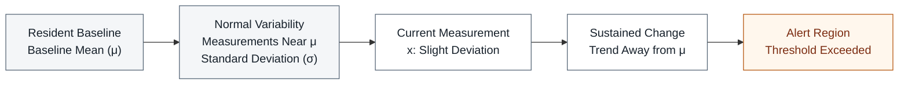

# Figure 2: Individualized Baseline Monitoring Concept

*Figure 2. Conceptual illustration of personalized baseline monitoring used to identify meaningful changes relative to an individual resident's normal voice characteristics.*

