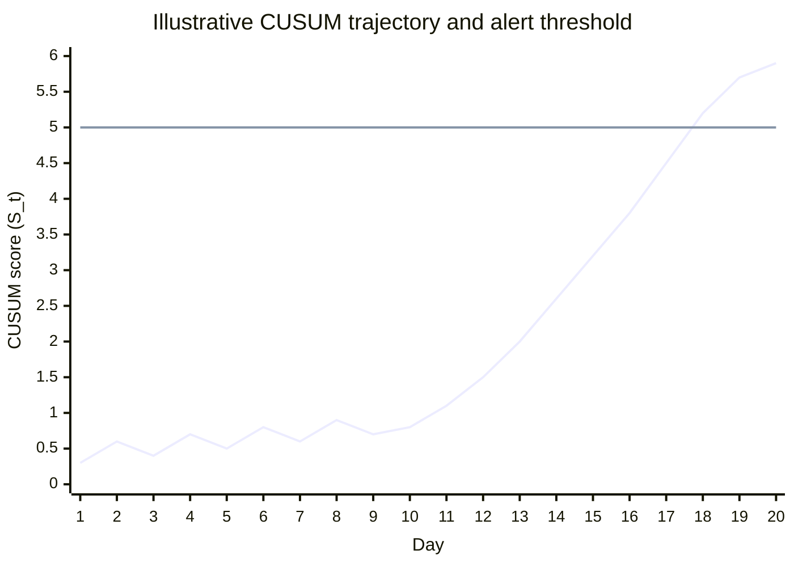

# Figure 5: Example Longitudinal Trend Detection

*Figure 5. Example of sustained longitudinal change detected by CUSUM. The gradual trend would not be captured reliably by a single-measurement threshold.*

The synthetic ground-truth fixture labels resident R10 as a slow-drift case (onset 2026-10-17). The plotted CUSUM scores are schematic, not observed measurements.

Series order: cumulative CUSUM score S_t; alert threshold h = 5. The threshold is crossed on Day 18.
