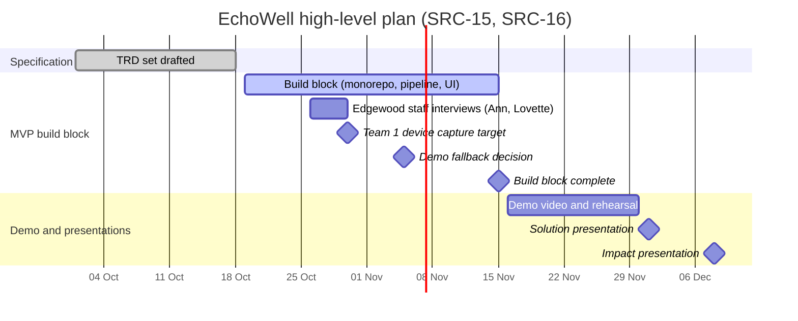

# 00 Project Vision and Scope

Document ID: ECHOWELL-TRD-00 · Version 0.5 (draft for review) · Date: 18 October 2026, revised 26 October 2026 · Owner: Team 2 · Status: Draft

## 1. Purpose

This document is the root of the EchoWell Technical Requirement Document (TRD) set. It states:

- the product vision and the problem EchoWell addresses;
- the intended use and the claims EchoWell may and may not make;
- the stakeholders and provisional user personas;
- what is in and out of scope for the minimum viable product (MVP), including both analysis arms;
- the MVP definition (end-of-semester demo) and measurable success criteria;
- the fixed project constraints;
- the business requirements **BR-01 to BR-18**, which every other TRD cites as trace parents;
- the high-level phases and milestones.

Owner decisions D-OWNER-1 to D-OWNER-4 (18 Oct 2026) are incorporated and override earlier source statements where they differ.

Every requirement in TRDs 01 to 25 SHALL trace to at least one BR-xx defined in section 4.6 of this document.

## 2. Scope

### 2.1 In scope (MVP, Team 2 ownership)

| # | Item | Owning TRD |
|---|---|---|
| S-01 | Cloud ingest API that receives one acoustic feature record per check-in from Team 1 devices over HTTPS, plus batch and CSV upload for test data | 05, 10 |
| S-02 | Immutable raw record store; all other data derived from it and rebuildable | 01, 06, 20 |
| S-03 | Deterministic analytics pipeline: duplicate detection, schema validation, quality gate, epoch detection, speaker screen, morning adjustment, frozen personal baseline, signed z and composite scoring, CUSUM persistence rule, alert generation, missing-day ledger | 07, 08, 09, 10 |
| S-04 | Clinical dashboard (web, SRC-21): Resident list (`/residents`), Resident chart (`/residents/[code]` with the sections Summary, Review and notes, Voice trends, Baseline, Check-in log and Device), New admissions (`/admissions`, future/experimental), Study team (`/study`, with devices and data problems), Admin and Login | 04, 11 |
| S-05 | Alarm review (explanation checklist, required outcome, optional note, review history, 24 h reminder) and free staff notes in the "Review and notes" section of the Resident chart | 02, 05, 09, 11 |
| S-06 | Study team page (KPIs, data problems to follow up, check-ins per day, loss funnel, usable check-ins by resident, alarm timing check on test data / review outcomes in production, devices) and researcher read-outs and CSV export in the shape of the test workbook answer key | 02, 05, 11, 14 |
| S-07 | Authentication, roles (admin, clinician, researcher), audit trail, HTTPS, secrets management | 12 |
| S-08 | Automated validation against the pipeline test workbook v0.1 (residents R01 to R10) | 13, 14 |
| S-09 | Monorepo, CI/CD with GitHub Actions, deployment to the current (interim) hosting — Netlify (frontend), Railway (backend), Neon or Railway PostgreSQL (database) — and a local Docker Compose environment, designed for migration to the target AWS platform (Amplify, App Runner, RDS PostgreSQL with KMS, Secrets Manager, CloudWatch) without significant code change | 01, 15, 16, 18, 21, 22 |
| S-10 | Data model for the future new-admission arm (facility reference ranges, admission cohort) and an experimental UI page | 02, 06, 11 |
| S-11 | Protection of live feature data as sensitive, potentially PHI-derived data: encryption in transit and at rest, least privilege, audit logging, no PII in logs | 03, 12, 17 |
| S-12 | Rule-based data-quality alerts for the study team (baseline stalled, possible other speaker, many check-ins set aside, device silent, review-flagged data problem), separate from health alarms | 02, 07, 09 |
| S-13 | Evaluation ground truth (answer key) loaded only in the `test_v0_1` profile into a table the pipeline never reads, used only for the Study team alarm timing check | 01, 06, 14 |

### 2.2 Out of scope

| # | EchoWell will not ... | Reason | Source |
|---|---|---|---|
| X-01 | receive, store, transmit, or replay raw audio | Raw audio never leaves the room; features are extracted on the device | SRC-14 Part B.2 |
| X-02 | listen continuously or analyse conversations | Device captures one agreed command phrase after a wake word | SRC-14 Part B.2 |
| X-03 | diagnose depression or any condition, or measure severity | The claim is detection of change, not quantification or diagnosis | SRC-14 Part B.2 |
| X-04 | use large language models for any feature, summary or chat | Excluded by PI direction | SRC-14 Part B.2 |
| X-05 | put machine learning on the critical path | Primary method is mixed-effects regression (offline); any ML is exploratory | SRC-14 Part B.2 |
| X-06 | perform the study's mixed-effects regression analysis inside the app | Offline research analysis owned by the research team; the app exports data for it | SRC-14 Part B.2 |
| X-07 | design device hardware, audio capture, wake-word detection, feature extraction, or device-to-cloud transport | Team 1 ownership; described only as interfaces | SRC-14 Part B.3 |
| X-08 | send SMS, e-mail, pager or push notifications for alarms | Alert delivery is OQ-06; MVP shows alerts in the dashboard only | SRC-02, OQ-06 |
| X-09 | store resident names or any other personally identifiable information | Study IDs only (e.g. R01) | SRC-13 §6, BR-16 |
| X-10 | estimate the morning offset from data | Offset is configured in v0.1; estimation deferred to the larger dataset | SRC-03 README note 3, OQ-09 |
| X-11 | verify speaker identity on the device or receive a speaker-verification confidence | Deferred by Team 1 | OQ-14 |
| X-12 | reconstruct data lost during device network outages (store-and-forward) | Deferred by Team 1; gaps are logged as missing days | OQ-15 |
| X-13 | use public datasets (DAIC-WOZ, E-DAIC) as study ground truth | Development and pipeline validation only | SRC-14 Part B.2 |
| X-14 | delete data on a retention schedule | Retention policy is OQ-01 | OQ-01 |
| X-15 | show an EWMA trend against a baseline band | Shown in SRC-02 final box but not in the wireframes; deferred | OQ-18 |
| X-16 | integrate with external records systems (EHR, facility systems) or smart-home platforms | Not requested; smart-home activation is OQ-16 | SRC-15 item 5, OQ-16 |
| X-17 | support multiple facilities in the user interface | Single facility (Edgewood) in MVP; the schema supports more | ASM-03 |
| X-18 | claim regulatory clearance | EchoWell is a research system, not an FDA-cleared device | SRC-14 |
| X-19 | load any real resident data onto the interim Netlify/Railway/Neon stack, or go live with real residents anywhere other than the approved AWS platform | Interim stack = synthetic and test data only; EchoWell goes live only on AWS after approval (OQ-23 closed) | D-OWNER-3, D-OWNER-4, RSK-14 |
| X-20 | use the `test_v0_1` profile (baseline_n = 16) in production | The test profile exists only because the 30-day build/test dataset must reach scoring | D-OWNER-2 |
| X-21 | commit third-party-licensed documents (for example the JMIR preprint PDF) to the repository | Licence prohibits redistribution; such documents are linked in specs/business-requirements/REFERENCES.md | D-OWNER-1 |

## 3. References

| ID | Document | Used here for |
|---|---|---|
| SRC-01 | Deployment Architecture (specs/architecture/Deployment_Architecture.md) | Technology and hosting decisions |
| SRC-02 | EchoWell Daily Data Storage and Processing Flowcharts | Storage flow and 6-stage processing flow |
| SRC-03 | Pipeline test workbook v0.1 | Acceptance answer key (BR-15) |
| SRC-04 | Pipeline test generator script v0.1 | Reference implementation of the rules |
| SRC-05 | Pipeline test input CSV v0.1 | Ingest schema and test input |
| SRC-07 | Preprint, systematic review, JMIR Preprint 113062 — cited by link only: https://preprints.jmir.org/preprint/113062 (DOI 10.2196/preprints.113062), listed in specs/business-requirements/REFERENCES.md; the PDF is not in the repository (JMIR exclusive licence) | Evidence rationale |
| SRC-08 | PROSPERO registration CRD420261473970 | Evidence rationale |
| SRC-09, SRC-10, SRC-11 | UI wireframes v0.1 (Main, Resident, Admission): superseded by SRC-21 (TRD 24 D-108); removed from the repository | — |
| SRC-18 | UI wireframe v0.1: Alert review: superseded by SRC-21 (TRD 24 D-108); removed from the repository | — |
| SRC-19 | UI wireframe v0.1: Analytics: superseded by SRC-21 (TRD 24 D-108); removed from the repository | — |
| SRC-21 | Clinical dashboard wireframe v0.2 (specs/UI-wireframe/echowell-wireframes-v0.2.html, notes in specs/UI-wireframe/WIREFRAMES.md): Resident list, Resident chart, New admissions, Study team | Dashboard, alarm review and study team scope |
| SRC-12 | TRD Generation Prompt | Required pages and documentation standard |
| SRC-13 | Synthetic dataset specification for Team 1 (E4C-TEAM2-SYNDATA v0.1) | Record fields, features, extractor request |
| SRC-14 | Team 2 PRD Guide (TEAM2-PRDGUIDE v1.0), Part B | Fixed constraints, stakeholders, team boundaries |
| SRC-15 | Team 1 + Team 2 Meeting Agenda, 17 Oct 2026 | Demo goal, open decisions, interview timing |
| SRC-16 | Team 2 Gantt plan (E4C-TEAM2-PLAN v0.2) | Milestone dates |
| SRC-17 | Later-stage build prompts | Downstream use of these TRDs |
| Contract §19–§20 | Owner wireframe decision and lead reconciliation decisions R1–R17 (18 Oct 2026) | Alarm review and study team views in MVP scope (pages reorganised by SRC-21, TRD 24 D-110); review model; budgets |
| D-OWNER-1..4 | Owner decisions of 18 Oct 2026 (Megan Stubbs, project coordinator): preprint link-only; production baseline 30 with test 16 for build/test only; AWS target with Netlify/Railway/Neon as interim hosting and PHI-derived data protection; OQ-23 closed — no real resident data on the interim stack, go-live on AWS only | Overrides earlier statements where they differ |

Related TRDs: all of 01 to 25. TRD 24 is the master list of OQ, ASM and RSK identifiers cited here.

## 4. Requirements

### 4.1 Vision

**Vision statement.** EchoWell makes voice a vital sign for residents of Edgewood: a short daily spoken check-in lets staff see, in one dashboard, when a resident's voice has moved away from that resident's own usual pattern steadily enough to be worth a conversation, while no audio ever leaves the resident's room.

**Problem statement (SRC-14 Part D §1).** Edgewood staff do not have a timely and objective way to detect when a resident's mental state changes from their own baseline. A change in mood is often an early sign of broader health decline; when it is caught late, the resident may already need intensive care.

**What EchoWell changes.** Each resident says one agreed command phrase after a wake word. Team 1's device extracts acoustic features and discards the audio. EchoWell (Team 2) stores the feature record unaltered, screens it for quality and wrong-speaker suspicion, compares it with the resident's own frozen baseline, and raises a flag for clinician review only when a deviation persists across several sessions (SRC-02: "A single odd day never raises a flag").

**Project context.** EchoWell is the product for the Speech Study ("voice as a vital sign"), funded by the ARPA-H grant awarded to the University of North Dakota (UND) (pending). There is no commercial partner. The Principal Investigator (PI) is Dr. Zvika Shinar. The study site is Edgewood, an assisted living facility. Edge4Care is a separate UND AI initiative and is never the name of the facility.

### 4.2 Intended use

**Intended use statement.** EchoWell is intended for research use within the Speech Study. It is used by Edgewood care staff and the Speech Study research team to detect a change in an enrolled, consenting resident's voice relative to that resident's own frozen baseline, from acoustic features extracted on a device in the resident's room, and to prompt staff to check in with the resident. EchoWell output is a prompt to check in, not a diagnosis.

**EchoWell is not intended to:** diagnose depression, anxiety or any other condition; measure the severity of any condition; replace clinical assessment; trigger emergency response; compare a resident with the general population for a clinical decision; or make any claim as a medical device.

**Wording rules (apply to UI, API messages, documentation and presentations):**

| Allowed | Not allowed |
|---|---|
| "detects a change", "has moved away from their own usual pattern" | "measures severity", "depression score", "risk score" |
| "prompt to check in, not a diagnosis", "An alarm is a prompt to check in, not a diagnosis." | "diagnoses depression", "detects depression" |
| "Changed", "Needs attention", "Learning", "Usual" (display statuses, TRD 24 D-109); "A status is a prompt to check on someone, not a diagnosis." | "abnormal", "sick", "at risk" |

**Possible future application areas (future, not MVP, not claims):** other target states named by the parent device concept (anxiety, stress, agitation/irritability, apathy; SRC-07), other long-term care sites, new-admission screening once OQ-08 is resolved.

### 4.3 Analysis arms

| Arm | Question | Comparison | MVP status |
|---|---|---|---|
| Longitudinal (primary) | Has this resident's voice changed from their own usual pattern? | Each resident against their own frozen baseline per device epoch (within-subject) | Fully implemented, validated against SRC-03 |
| New-admission screening (second arm) | Before a new resident has a personal baseline, how do their first check-ins compare with the facility's usual range? | New resident against a facility reference range across current residents (between-person) | In scope as FUTURE/EXPERIMENTAL: data model, API and a page labelled "Future / experimental" (TRD 11 UX-181); the comparison method is OQ-08; not in pipeline test v0.1 (SRC-21) |

The second arm is experimental because the systematic review supports between-person comparison only weakly (SRC-07; RSK-13). Once a new resident has a formed personal baseline, the resident moves to the resident list and is compared only with their own baseline (SRC-21, SRC-12).

### 4.4 Stakeholders

| ID | Stakeholder group | Who they are | Key needs and priorities | Interaction with EchoWell |
|---|---|---|---|---|
| STK-01 | Edgewood care staff and clinicians | Nurses, care aides and clinical staff responsible for residents | Notice a change early without extra workload; trustworthy, few false alarms; plain language | Primary dashboard users (role `clinician`) |
| STK-02 | Residents | Enrolled, consenting Edgewood residents (study IDs only) | Privacy (no audio leaves the room), dignity, low burden (one short phrase per day) | Speak to the device; never see the dashboard |
| STK-03 | Principal Investigator | Dr. Zvika Shinar | Scientific validity, correct claims, final clinical wording (OQ-12), study constraints respected | Decision maker; reviews wording and thresholds |
| STK-04 | Research team (Team 2 analysts, project coordinator) | Megan Stubbs (project coordinator, data processing), Team 2 research members | Reproducible, exportable data for the offline mixed-effects analysis and publications; exact match with the answer key | Dashboard users (role `researcher`); data export |
| STK-05 | Team 2 engineering | Team 2 software engineer (Shaba Rahavi) and student developers | Implementable, testable specifications; low-cost hosting; simple operations | Builders and operators (role `admin`) |
| STK-06 | Team 1 | Device hardware, audio capture, wake word, feature extraction and transport team | A stable, documented ingest interface and record schema | Sends feature records to the ingest API |
| STK-07 | Facility leadership | Edgewood management | Staff time, resident satisfaction, privacy and reputation, site access (OQ-17) | Approves site participation; possible report reader |
| STK-08 | IRB and faculty | UND faculty who own the IRB and research protocol | Consent, privacy, data retention (OQ-01) and withdrawal handling (OQ-11) | Governance; EchoWell must support their decisions, not make them |
| STK-09 | Families | Residents' family members | Their relative's wellbeing and privacy | Indirect beneficiaries; no system access in MVP |
| STK-10 | Funder | ARPA-H (grant awarded to UND, pending) | Credible results, responsible conduct | No system access |
| STK-11 | Team mentor | Tal Klap (contracted engineer and team mentor) | Device design direction, cross-team alignment | No system access in MVP |

### 4.5 Personas and user needs (PROVISIONAL)

> **Status: PROVISIONAL.** SRC-14 requires personas and user needs to be based on interview evidence from Ann and Lovette. Their Edgewood staff interviews take place during the last week of October 2026 (SRC-15 item 1). Until those findings are available, the personas below are working hypotheses derived from SRC-14 Part C prompts, the wireframes (SRC-21) and the project givens. Every persona and user need SHALL be reviewed and either confirmed, revised, or removed after the interviews (VIS-021). No requirement may be justified by a provisional persona alone; each traces to a BR-xx.

| ID | Persona (tag) | Role and responsibilities | Pain points today (hypothesis) | Goals | What they need from EchoWell | Dashboard role |
|---|---|---|---|---|---|---|
| PER-01 | Care staff member / nurse (Primary user) | Looks after many residents per shift; limited spare attention | Changes in mood are noticed late and subjectively | Know which residents to check on today | A short, ranked list with alarms first; plain-language reasons; a place to record what they did | clinician |
| PER-02 | Resident (End user) | Says the command phrase once a day | Worry about being recorded; may forget; hearing loss, dentures, colds, roommates | Low burden; privacy | No audio stored or played; missed days never counted against them | none |
| PER-03 | Principal Investigator (Decision maker) | Directs the study and its claims | Over-claiming or misleading outputs would damage the study | Valid, defensible detection of change | Correct wording; configurable thresholds; traceable results | researcher or admin (OQ-12 wording review) |
| PER-04 | Research analyst (Secondary user) | Validates the pipeline, prepares data for the offline analysis | Silent data loss; results that cannot be reproduced | Exact, reproducible, exportable outputs | Answer-key-shaped outputs; run history with parameters | researcher |
| PER-05 | System administrator (Team 2) (Secondary user) | Manages users, devices, API keys, uploads, pipeline runs | Free-tier hosting limits; debugging without logs | Keep the system running for the demo and study | Admin page, run status, audit and logs | admin |
| PER-06 | Team 1 device engineer (Interface partner) | Builds the device and sends records | Unclear interface, silent rejections | Records accepted first time | Clear schema, 422 errors with field-level reasons | API key only |
| PER-07 | Charge nurse or clinical lead (Primary user) | Works through open alarms, decides whether to check on a resident or refer | Alarms without context; no record of what was done | Review each alarm once, with a recorded outcome | A review queue, "leaning most" summary, quick checklist of everyday explanations, outcome and note | clinician |

| ID | Persona | User need (stakeholder's voice) | Phase | Source | Parent BR |
|---|---|---|---|---|---|
| UN-01 | PER-01 | "I need to know which residents' voices have changed from their own usual pattern, so that I can check on them early." | MVP | SRC-14 Part D §1; SRC-21 | BR-11, BR-12 |
| UN-02 | PER-01 | "I need to understand, in plain words, why a resident is flagged, without reading statistics." | MVP | SRC-21 | BR-13 |
| UN-03 | PER-01 | "I need one odd day not to raise an alarm, so that I can trust the alarms I see." | MVP | SRC-02 | BR-11 |
| UN-04 | PER-01 | "I need to record what I saw or did after an alarm." | MVP | SRC-21, SRC-12 | BR-13 |
| UN-05 | PER-02 | "I need my voice recordings never to leave my room." | MVP | SRC-14 Part B.2 | BR-01, BR-16 |
| UN-06 | PER-01, PER-05 | "I need to know when a device has gone silent, so that a broken device is not mistaken for a resident who stopped talking." | MVP | SRC-21, SRC-14 Part C | BR-06, BR-12 |
| UN-07 | PER-04 | "I need every result to be reproducible from the records as received." | MVP | SRC-02, SRC-03 | BR-02, BR-15 |
| UN-08 | PER-03 | "I need the system never to present a change as a diagnosis." | MVP | SRC-14 Part B.2 | BR-18 |
| UN-09 | PER-01 | "I need to see how a newly admitted resident compares with others until they have their own baseline." | Future | SRC-21 | BR-14 |
| UN-10 | PER-06 | "I need to know immediately and precisely why a record was rejected." | MVP | SRC-13 §6 | BR-01 |
| UN-11 | PER-07 | "I need to record what I found when I checked on a resident after an alarm, so that the team knows it was handled." | MVP | SRC-21 | BR-11, BR-13 |
| UN-12 | PER-04 | "I need data problems (silent devices, stalled baselines, other speakers) to reach the study team, not the nurses." | MVP | SRC-21 | BR-04, BR-05, BR-06 |
| UN-13 | PER-04, PER-03 | "I need to see how many check-ins are lost at each step and whether alarms rang when a known change began." | MVP | SRC-21 | BR-15 |

### 4.6 Business requirements (BR-01 to BR-18)

These are the trace parents for all TRDs. Wording is fixed by the shared contract and SHALL NOT be changed without a revision of this document.

| ID | Business requirement | Priority | Rationale | Source trace | Primary TRDs |
|---|---|---|---|---|---|
| BR-01 | Ingest per-session acoustic feature records from devices without receiving audio. | Must | Raw audio never leaves the room; features extracted on device | SRC-14 B.2, SRC-13 §6, SRC-05, SRC-02 (diagram 1 "Daily record arrives") | 05, 10, 19 |
| BR-02 | Keep every received record unaltered; derive all other data from it. | Must | "Raw record store: kept as received, never edited"; "every other table can be rebuilt from it" | SRC-02 (diagram 1) | 01, 06, 20 |
| BR-03 | Detect and drop duplicate records, keeping the first arrival. | Must | Session ID requested so duplicates can be detected; R04 test case | SRC-02 (stage 1), SRC-03 (Parameters "duplicate rule", R04), SRC-13 §6 | 07, 10 |
| BR-04 | Set aside poor-quality sessions with all reasons recorded. | Must | Noisy sessions must not cause false alarms; R03 test case | SRC-02 (stage 2), SRC-03 (R03, set-aside reasons), SRC-13 §5 | 07, 10 |
| BR-05 | Quarantine sessions that look like a different speaker. | Must | Wrong-speaker suspects go to the set-aside log; no speaker verification on device (RSK-01); R05 test case | SRC-02 (diagram 1 set-aside log), SRC-03 (R05), SRC-04 | 07, 08 |
| BR-06 | Log missing days honestly (resident vs shared-device gap); never backfill. | Must | Adherence 71% to 93%, gaps where signal is strongest; R02 test case | SRC-03 (R02, missing_device_gap), SRC-07, SRC-12, SRC-13 §5 | 07, 11 |
| BR-07 | Remove the configured morning offset using local time. | Must | Time-of-day effect documented; R06 test case | SRC-02 (stage 3), SRC-03 (Exp_morning_offset, R06), SRC-07 | 07, 08 |
| BR-08 | Separate device/firmware/software epochs; restart the baseline in a new epoch. | Must | Values not comparable across extractor versions; R07 test case | SRC-02 (stage 3, diagram 1 "per device epoch"), SRC-03 (R07), SRC-07, SRC-13 §3 | 07, 08 |
| BR-09 | Build a robust personal baseline from the first N usable sessions and freeze it. | Must | Within-subject comparison; baseline never drifts; R10 test case | SRC-02 (stage 4), SRC-03 (Parameters, R10), SRC-12 | 08 |
| BR-10 | Score each later session as signed z per feature and a composite. | Must | Daily deviation score | SRC-02 (stage 5), SRC-03 (Exp_scores) | 08 |
| BR-11 | Raise a flag only for persistent deviation (CUSUM, h=5.0), never for a single odd day. | Must | "A single odd day never raises a flag"; R09 test case | SRC-02 (stage 6, flag), SRC-03 (Parameters CUSUM, alarm; R09, R10) | 09 |
| BR-12 | Show staff a resident list with each resident's status, and each resident's 30-day activity and device health. | Must | Primary staff view | SRC-21, SRC-12 | 04, 11 |
| BR-13 | Show a resident chart: change score chart, 7 measurements, baseline info, check-in log, device, staff review. | Must | Explain why a resident is flagged; record staff response | SRC-21, SRC-12 | 04, 11 |
| BR-14 | Support the future new-admission arm (facility range until own baseline forms), marked experimental. | Should | Second analysis arm in scope but method undefined | SRC-21, SRC-12, SRC-14 B.2, OQ-08 | 02, 04, 06, 11 |
| BR-15 | Reproduce the pipeline test workbook answer key exactly (R01–R10). | Must | Demo "done means" step 4: pipeline passes the test set answer key | SRC-03, SRC-04, SRC-05, SRC-15 item 2 | 13, 14 |
| BR-16 | Protect research data: authenticated access, roles, audit trail, HTTPS, no PII, no audio. | Must | Research data under IRB | SRC-14 B.2/B.3, SRC-12 (Security Requirements) | 12, 17 |
| BR-17 | Deploy as a monorepo: Next.js on Netlify, FastAPI on Railway, PostgreSQL on Neon/Railway, GitHub Actions CI/CD. | Must | Fixed architecture decision | SRC-01, SRC-12 | 01, 15, 16, 18, 21, 22 |
| BR-18 | Respect study constraints: detection not diagnosis, no LLMs, no ML on the critical path. | Must | Fixed constraints | SRC-14 B.2 | all |

Note on BR-12, BR-13 and BR-15 (contract §19, R17; TRD 24 D-110): the alarm review in the Resident chart's "Review and notes" section (SRC-21) traces to BR-11 and BR-13 (staff review of alarms); the Study team page (SRC-21) traces to BR-12 and BR-15 and, for its "Data problems to follow up" list, to BR-04..BR-06. Both are MVP scope.

Note on BR-17 and BR-16 (D-OWNER-3, 18 Oct 2026): the hosting named in BR-17 is the **current (interim)** platform. The **target** production platform is AWS (Amplify, App Runner, RDS PostgreSQL with KMS, Secrets Manager, CloudWatch), adopted when the AWS budget is approved (OQ-07). BR-16 covers live feature data as potentially PHI-derived (C-13), and the interim stack holds synthetic and test data only; go-live with real resident data happens only on AWS (C-14, D-OWNER-4). Note on BR-09 (D-OWNER-2): N = 30 in production; N = 16 only in the `test_v0_1` build/test profile.

### 4.7 Fixed constraints

| ID | Constraint | Consequence for requirements | Source |
|---|---|---|---|
| C-01 | Features extracted on device; raw audio discarded; no raw audio leaves the room | No requirement may depend on audio; no audio fields or endpoints | SRC-14 B.2 |
| C-02 | Single agreed command phrase after a wake word | At most one check-in per resident per day expected (ASM-02) | SRC-14 B.2 |
| C-03 | Within-subject change detection | Score only against the resident's own frozen baseline | SRC-14 B.2 |
| C-04 | Two analysis arms, both in scope | New-admission arm supported as experimental (BR-14) | SRC-14 B.2 |
| C-05 | Detection, not quantification | Wording rules in 4.2 | SRC-14 B.2 |
| C-06 | No LLMs | No LLM libraries, APIs or generated text | SRC-14 B.2 |
| C-07 | Mixed-effects regression is the primary method; ML exploratory | MVP pipeline uses deterministic robust statistics and CUSUM only | SRC-14 B.2 |
| C-08 | Cloud/edge split accepted; Team 1 owns device side | Team 1 parts described only as interfaces | SRC-14 B.2, B.3 |
| C-09 | Public datasets for development only | Validation uses SRC-03 synthetic data, never DAIC-WOZ/E-DAIC as ground truth | SRC-14 B.2 |
| C-10 | Architecture fixed by SRC-01 and D-OWNER-3 | Current (interim): Next.js/Netlify, FastAPI/Railway, PostgreSQL Neon/Railway, GitHub Actions. Target: AWS (Amplify, App Runner, RDS PostgreSQL + KMS, Secrets Manager, CloudWatch) once the budget is approved (OQ-07). Regions: Neon aws-us-east-1 and Railway US East (current), AWS us-east-1 (target) | SRC-01, D-OWNER-3, R25 |
| C-11 | Research system, not FDA-cleared; IRB handled by faculty | Design-control-style traceability as good practice; no regulatory claims | SRC-14 |
| C-12 | Low cost until AWS budget approval | Free or trial tiers for the interim stack (RSK-07) | SRC-01, D-OWNER-3 |
| C-13 | Live feature data is potentially PHI-derived | Encryption in transit (TLS 1.2+ everywhere, including `sslmode=require` to PostgreSQL) and at rest (provider-managed on Neon/Railway; RDS with KMS and encrypted backups on AWS); least privilege; audit logging; no PII in logs | D-OWNER-3 |
| C-14 | Interim data rule (decided) | The interim stack holds synthetic and test data only, permanently; go-live with real resident data happens only on AWS once approved | D-OWNER-3, D-OWNER-4, RSK-14 |
| C-15 | Production baseline length | baseline_n = 30 in production (confirmed); `test_v0_1` (16) for build-out and testing only and refused when APP_ENV=production | D-OWNER-2 |
| C-16 | Third-party-licensed documents | Linked, never committed (SRC-07 by link only) | D-OWNER-1 |

### 4.8 MVP definition

The MVP is the smallest system that achieves the end-of-semester demo goal (SRC-15 item 2): **a demo video of one voice check-in travelling the whole path — device hears the phrase, extracts features, sends the record to the cloud, the pipeline processes it, and the dashboard shows the result.**

| Demo step (SRC-15) | Owner | "Done means" (SRC-15) | EchoWell MVP capability that satisfies it |
|---|---|---|---|
| 1. Device captures wake word and phrase | Team 1 | Device records the agreed phrase on cue, 10 times in a row | Out of scope (interface only) |
| 2. Device checks audio and extracts features | Team 1 | A feature record is produced on the device and the raw audio is deleted | Out of scope (interface only); record conforms to schema v0.1 |
| 3. Feature record sent to cloud storage | Team 1 + Team 2 | A record made on the device appears in cloud storage | `POST /api/v1/sessions` accepts the record and stores it in `raw_sessions` |
| 4. Pipeline processes the record | Team 2 | Pipeline passes the test set answer key, then processes a real record | Full pipeline reproduces SRC-03 exactly; processes the live record within the targets of TRD 03 |
| 5. Dashboard shows the result | Team 2 | The new check-in shows up on the dashboard | Resident list "Last check-in" and the Resident chart's 30-day "used" count update; with a frozen baseline the Resident chart's change score chart gains one bar (D-67) |
| 6. Full run recorded on video | Both teams | Two videos: spoken phrase to cloud (Team 1), cloud to dashboard (Team 2) | Staging or production deployment usable for recording |

MVP feature set: all items S-01 to S-13 in section 2.1, with the New admissions page delivered as an experimental page whose comparison status reads "Facility range not available yet" or "Not enough check-ins yet" unless facility reference ranges exist (OQ-08; TRD 02 FR-202).

All data used for the demo, including the record spoken in the demo video, is test data (team members' voices or synthetic data), never real resident data (VIS-024, D-OWNER-4). Whose voices appear in the demo is an open item of SRC-15 item 8.

**Demo fallback (RSK-12, SRC-15 item 8):** if the cloud deployment or the device is not ready by 5 November 2026, the demo may be filmed against the local Docker Compose environment (TRD 15). The local environment SHALL run the same code and pipeline as the cloud environments.

### 4.9 Vision-level requirements

| ID | Requirement | Priority | Trace | Verification |
|---|---|---|---|---|
| VIS-001 | EchoWell cloud components shall not receive, store, transmit or replay audio in any form. | Must | BR-01, BR-16, C-01, SRC-14 | Inspection (API schema, DB schema), Test |
| VIS-002 | EchoWell shall compare each longitudinal-arm resident only with that resident's own frozen baseline for the current epoch. | Must | BR-09, BR-10, C-03, SRC-12 | Test (TRD 14 R01–R10) |
| VIS-003 | Every user-facing statement of a result shall use detection wording ("detects a change", "prompt to check in, not a diagnosis") and shall not use diagnosis or severity wording listed in section 4.2. | Must | BR-18, C-05, SRC-14 | Inspection (UI copy review) |
| VIS-004 | EchoWell shall contain no large-language-model component, library call, or external LLM API. | Must | BR-18, C-06 | Inspection (dependency scan in CI, TRD 16) |
| VIS-005 | The MVP alarm decision shall depend only on deterministic robust statistics and the CUSUM rule, with no trained ML model on the path from record to alarm. | Must | BR-11, BR-18, C-07 | Inspection, Test |
| VIS-006 | EchoWell shall store no resident names or other PII; residents are identified only by study ID. | Must | BR-16, X-09 | Inspection (schema), Test |
| VIS-007 | The facility shall be named "Edgewood" wherever it is named, and the UI shall take the facility name from the FACILITY_NAME configuration value. | Must | SRC-14 B.4, RSK-10 | Inspection |
| VIS-008 | The term "Edge4Care" shall not be used to refer to the facility in any TRD, UI string, seed data or documentation. | Must | SRC-14 B.4, RSK-10 | Inspection (repository text search in CI) |
| VIS-009 | The New admissions page and API shall be labelled "Future / experimental" in every place they are shown (page note: TRD 11 UX-181). | Must | BR-14, SRC-21, SRC-12 | Inspection, Test (E2E) |
| VIS-010 | The pipeline, run with profile `test_v0_1` on SRC-05, shall reproduce every expected result in SRC-03 within absolute tolerance 1e-6 for numeric values and exactly for statuses, reasons and alarm states. | Must | BR-15, SRC-03 | Test (TRD 13/14 validation suite) |
| VIS-011 | The `production` profile shall use baseline_n = 30 and the `test_v0_1` profile baseline_n = 16, both selectable through PIPELINE_PROFILE without code change. | Must | BR-09, ASM-04, SRC-02, SRC-03, D-OWNER-2 | Test, Inspection |
| VIS-012 | Clinical explanation text (the Resident chart's "Right now" summary, the "What's happening" texts and the status legend) shall come from a configuration string that is reviewed by the PI, and shall carry the marker "[Final clinical wording: confirm with PI]" until OQ-12 is closed. | Must | BR-13, BR-18, OQ-12, SRC-21 | Inspection |
| VIS-013 | Alerts shall be presented as flags "for clinician review" in the dashboard only; no outbound notification channel shall exist in the MVP. | Must | BR-11, SRC-02, OQ-06 | Inspection, Test |
| VIS-014 | Every TRD requirement shall carry a trace to at least one BR-xx and at least one SRC-xx or another TRD requirement ID. | Must | All BRs, C-11 | Inspection (TRD 13 traceability check) |
| VIS-015 | Each component boundary with Team 1 shall be specified as an interface (record schema, transport endpoint, authentication) and shall not specify Team 1 internals. | Must | BR-01, C-08, SRC-14 B.3 | Inspection |
| VIS-016 | The system shall deploy on the current (interim) hosting fixed in SRC-01 (Netlify, Railway, Neon or Railway PostgreSQL, GitHub Actions, single monorepo) until the AWS budget is approved. | Must | BR-17, C-10, D-OWNER-3 | Inspection, Demo |
| VIS-017 | Validation of the analytics shall use the synthetic SRC-03/SRC-05 data and later Team 1 synthetic data; public datasets shall not be used as evidence that the study works. | Must | BR-15, C-09 | Inspection (TRD 14) |
| VIS-018 | The application shall be deployable to the target AWS platform (Amplify, App Runner, RDS PostgreSQL with KMS, Secrets Manager, CloudWatch) with changes limited to deployment configuration and no significant application code change. | Must | BR-17, SRC-01, D-OWNER-3 | Analysis (TRD 01 migration mapping) |
| VIS-019 | Missing days shall remain visible to staff and shall never be backfilled, carried forward or imputed. | Must | BR-06, SRC-12 | Test |
| VIS-020 | Every dashboard page, including Login, shall show under the app bar the data bar stating that no audio is stored or played: "No audio is stored or played anywhere in EchoWell.", preceded on the `test_v0_1` profile by "Test data only (<data source label>, <period>). No real residents."; the Study team page shall also state "Counts only. No audio, no names." (TRD 11 UX-400, UX-017; TRD 24 D-110). | Must | BR-01, BR-16, SRC-21 | Inspection, Test (E2E) |
| VIS-021 | Personas PER-01 to PER-07 and user needs UN-01 to UN-13 shall be reviewed against the Ann and Lovette interview findings, and this document revised, within 2 weeks after the interviews conclude. | Should | SRC-14 Part D §2.2, SRC-15 item 1 | Inspection (revision history) |
| VIS-022 | Requirements that depend on an unresolved open question shall reference the OQ-xx identifier and shall implement the documented interim behaviour, not a guessed final behaviour. | Must | BR-18, SRC-14 B.6 | Inspection |
| VIS-023 | All live feature data shall be treated as sensitive, potentially PHI-derived data and protected by encryption in transit (TLS 1.2 or higher on every hop, including `sslmode=require` to PostgreSQL) and encryption at rest (provider-managed on the interim stack; RDS with KMS and encrypted backups on AWS). | Must | BR-16, C-13, D-OWNER-3 | Inspection, Test (TRD 03, 12) |
| VIS-024 | Only synthetic and test data shall be loaded on the interim Netlify/Railway/Neon stack; real resident data shall not be loaded there at any time. | Must | BR-16, C-14, D-OWNER-4, RSK-14 | Inspection (data-source label and ingest-batch audit) |
| VIS-025 | Third-party-licensed documents shall be cited by link in specs/business-requirements/REFERENCES.md and shall not be committed to the repository. | Must | C-16, D-OWNER-1, TRD 18 | Inspection |
| VIS-026 | The backend shall refuse to start when APP_ENV=production and PIPELINE_PROFILE=test_v0_1. | Must | BR-09, D-OWNER-2 | Test |
| VIS-027 | EchoWell shall go live with real resident data only on the approved target AWS platform. | Must | BR-16, BR-17, D-OWNER-4, OQ-07 | Inspection (go-live checklist, TRD 15) |
| VIS-028 | The MVP shall include the alarm review in the Resident chart (`/residents/[code]/review`, saving for roles clinician and admin) and the Study team page (`/study`, roles researcher and admin) as specified by SRC-21 (TRD 24 D-110). | Must | BR-11, BR-12, BR-13, BR-15, SRC-21 | Demo, Test (E2E) |
| VIS-029 | Data alerts shall be labelled and routed as data-quality issues for the study team and shall never be presented as health alarms. | Must | BR-11, BR-18, SRC-21 | Inspection |
| VIS-030 | The answer key (evaluation ground truth) shall be loaded only in the `test_v0_1` profile, into a store that the pipeline never reads. | Must | BR-15, SRC-02, SRC-21 | Inspection, Test |

### 4.10 Success criteria

| ID | Criterion | Measure | Target | Verification |
|---|---|---|---|---|
| SC-01 | Answer-key reproduction | Fraction of SRC-03 expected values matched (status counts, outcomes, 180 baseline rows, 98 score rows, reasons) | 100% within 1e-6 / exact strings | Automated validation suite in CI (TRD 14) |
| SC-02 | Resident list matches wireframe numbers | Filter counts for test data as of 2026-10-30 15:00 America/Chicago | All 10, Changed 2, Needs attention 2, Learning 0 (no button), Usual 6 | E2E test (TRD 13) |
| SC-03 | End-to-end demo | One record posted with a valid API key shows on the dashboard: (a) the Resident list "Last check-in" of that resident shows the record's local time and its 30-day "used" count (Resident chart) rises by 1; and (b) when the resident's baseline is frozen, the Resident chart's change score chart gains one bar for that session (usable check-ins are not check-in log events, TRD 11 UX-144; TRD 24 D-67) | Within 5 s of the POST returning (warm services) | E2E timing test (TRD 13 TST-187); demo (TST-181) |
| SC-04 | No audio, no PII | Audio-like fields or endpoints; name-like fields | 0 | Inspection, schema test |
| SC-05 | Reproducibility | Two full rebuilds of SRC-05 with the same config produce identical derived tables | Byte-identical comparison of exported derived tables | Test |
| SC-06 | Deployed | Frontend on Netlify and backend on Railway reachable over HTTPS with green CI on `main` | Both environments (staging, production) | Demo |
| SC-07 | Accessibility | Automated axe-core checks on the 9 routes of TRD 13 TST-110 | 0 serious or critical violations | Test (TRD 13) |
| SC-08 | Traceability | Requirements without BR trace | 0 | Inspection |

### 4.11 Phases and milestones

Dates from SRC-15 and SRC-16. Phases are high level; task-level planning lives in the backlog (SRC-17).

| Phase | Window | Content | Exit |
|---|---|---|---|
| P0 Specification | to 18 Oct 2026 | Sources gathered; wireframes, test set and answer key issued (7 Oct 2026); TRDs 00–25 drafted | TRD set reviewed |
| P1 MVP build block | 19 Oct – 15 Nov 2026 | Monorepo, database, ingest, analytics pipeline passing SRC-03, dashboard pages, auth, CI/CD, deployments | AC-VIS-01..05 met |
| P1a Customer discovery | last week of Oct 2026 (26–30 Oct) | Ann and Lovette interview Edgewood staff | Personas and user needs revised (VIS-021) |
| P1b Team 1 device capture | target 30 Oct 2026 | Device records the agreed phrase on cue (Team 1 step 1) | Team 1 demo step 1 done |
| P1c Demo fallback decision | 5 Nov 2026 | If cloud or device not ready, film on the local server | Decision recorded |
| P2 Demo and presentations | 16 Nov – 8 Dec 2026 | End-to-end demo video; Solution presentation 1 Dec 2026; Impact presentation 8 Dec 2026 (both dates confirmed by the owner, contract §19) | Presentations delivered |
| P3 Study preparation (semester 2) | not dated (depends on OQ-07, OQ-17, IRB) | Migration to the target AWS platform after budget approval (go-live with real resident data only there); alarm-limit calibration on Team 1's 50-resident/120-day dataset (OQ-13); morning offset estimation (OQ-09); facility norm method (OQ-08); Edgewood deployment with live data | Separate plan |

### 4.12 TRD document map

| TRD | Title | Prefix |
|---|---|---|
| 00 | Project Vision and Scope | VIS, BR |
| 01 | System Architecture | ARC |
| 02 | Functional Requirements Specification | FR |
| 03 | Non-Functional Requirements | NFR |
| 04 | Frontend | FE |
| 05 | Backend API | API |
| 06 | Database Design | DB |
| 07 | Analytics Engine | ANL |
| 08 | Baseline and Scoring Algorithm | BSC |
| 09 | CUSUM and Alerting | CUS |
| 10 | Data Ingestion and Validation | ING |
| 11 | User Interface / UX | UX |
| 12 | Security and Authentication | SEC |
| 13 | Testing Strategy and Acceptance Criteria | TST |
| 14 | Test Data and Validation | TDV |
| 15 | Deployment and DevOps | DEP |
| 16 | CI/CD Pipeline | CIC |
| 17 | Logging, Monitoring and Error Handling | LOG |
| 18 | GitHub Repository Standards | GIT |
| 19 | API Contracts (OpenAPI) | OAS |
| 20 | PostgreSQL Schema Definition | PGS |
| 21 | Environment Configuration | ENV |
| 22 | Third-Party Services and Hosting | TPS |
| 23 | Data Model and Entity Definitions | DME |
| 24 | Risks, Assumptions and Open Questions | RSK, ASM, OQ |
| 25 | AI Agent Build Instructions | AGT |

## 5. Assumptions

| ID | Assumption (master list in TRD 24) |
|---|---|
| ASM-01 | Facility timezone is America/Chicago. |
| ASM-02 | At most one session per resident per local day in v0.1. |
| ASM-03 | Single facility (Edgewood) in the MVP; the schema supports more. |
| ASM-04 | Test profile baseline_n = 16; production 30. |
| ASM-05 | Records arrive via HTTPS POST from Team 1 or CSV upload; transport is Team 1's. |
| ASM-08 | Fewer than 25 dashboard users, fewer than 100 residents, fewer than 1 session per resident per day. |

Risks cited: RSK-07 free-tier limits, RSK-09 misinterpretation as diagnosis, RSK-10 naming errors, RSK-12 timeline, RSK-13 experimental facility-norm arm, RSK-14 interim hosting may lack a BAA / HIPAA-eligible plan (mitigation in place: synthetic and test data only on the interim stack; go-live on AWS only; AWS migration path ready). OQ-23 is closed by D-OWNER-4.

Notes for lead (TRD-local, not in TRD 24): personas PER-01..07 and user needs UN-01..13 are provisional working hypotheses (section 4.5).

## 6. Dependencies

| Dependency | Needed for | Owner |
|---|---|---|
| Team 1 record schema v0.1 conformance and final feature names (OQ-03) | Live ingest (demo step 3) | Team 1 |
| Team 1 transport mechanism to the cloud endpoint (ASM-05) | Live ingest | Team 1 |
| Ann and Lovette interview findings | Confirming personas and user needs | Team 2 customer discovery |
| PI review of clinical wording (OQ-12) | Final "Right now" and status text | PI |
| IRB decisions on retention (OQ-01) and withdrawal (OQ-11) | Data lifecycle features | Faculty |
| Free/trial hosting accounts (Netlify, Railway, Neon) | Current (interim) deployment | Team 2 |
| AWS budget approval timing and account ownership (OQ-07) | Target AWS deployment | Grant team / UND IT |
| AWS approval and account (OQ-07) | Go-live with any real resident data (D-OWNER-4) | Grant team / UND IT / IRB |

## 7. Acceptance Criteria

| ID | Criterion |
|---|---|
| AC-VIS-01 | The validation suite (TRD 14) passes 100% of SRC-03 comparisons for R01–R10 on the `test_v0_1` profile. |
| AC-VIS-02 | With the SRC-05 data loaded and as-of 2026-10-30 15:00 America/Chicago, the Resident list shows the filters "All (10)", "Changed (2)", "Needs attention (2)", "Usual (6)" and the R09 row reads "▲ Changed" with "Changed from their usual since Oct 21. Not reviewed yet." |
| AC-VIS-03 | A record posted to `POST /api/v1/sessions` in the interim production environment for a `T`-prefixed demo study ID (profile `production`, as-of = request time; TRD 15 DEP-093) shows on the dashboard after a page reload, demonstrated on video: (a) the Resident list "Last check-in" of that resident shows the record's local time and its 30-day "used" count (Resident chart) rises by 1; and (b) when the resident's baseline is frozen, the Resident chart's change score chart gains one bar for that session (usable check-ins are not check-in log events, TRD 11 UX-144; TRD 24 D-67). Staging is not used for this step because its fixed PIPELINE_AS_OF (2026-10-30) excludes later records (TRD 07 ANL-015, TRD 24 D-59). |
| AC-VIS-04 | A repository search finds no audio upload/download endpoint, no audio column, no LLM dependency, and no use of "Edge4Care" to name the facility. |
| AC-VIS-05 | Every requirement row in TRDs 01–25 contains at least one BR-xx trace (checked by script or review). |
| AC-VIS-06 | Every page of the dashboard shows the no-audio data bar (VIS-020) and the New admissions page shows the "Future / experimental" note. |
| AC-VIS-07 | No UI string contains "diagnos" except within "not a diagnosis", and none contains "severity" or "risk score". |
| AC-VIS-08 | Starting the backend with APP_ENV=production and PIPELINE_PROFILE=test_v0_1 fails with a configuration error. |
| AC-VIS-09 | The repository contains no copy of the SRC-07 preprint PDF; specs/business-requirements/REFERENCES.md links it. |
| AC-VIS-10 | With the SRC-05 data at as-of 2026-10-30 15:00 America/Chicago, the Resident chart Summaries of R09 (alarm started Oct 21, open 9 days, change score 26.8) and R10 (Oct 24, 6 days, 13.4) show "Not reviewed" with "Review this alert", and the Study team page (`/study`) lists exactly four data problems (R08 baseline stuck, R03 many set aside, R05 possible other voice, D02 silent Oct 12) and shows 281 of 300 expected received and 267 of 300 used. |

## 8. Implementation Notes

- Treat this document as the dictionary of scope. If an implementation task is not traceable to S-01..S-13 and a BR-xx, do not build it; raise it to the lead.
- Use the glossary in TRD 23 and the shared terms exactly: check-in/session, record/arrival, usable, set aside, quarantined, duplicate, missed day, epoch, baseline (frozen), baseline forming, baseline restart, scored session, composite, running change tally, alarm, watching, facility range. The UI shows some of them in other words (TRD 11 UX-167, TRD 24 D-113): "change score" for the tally, "held back (possible other voice)" for quarantined, "Comparing with baseline started" for watching started.
- Never hard-code the facility name; read FACILITY_NAME. Never hard-code baseline_n; read the active pipeline profile.
- Seed and demo data on the interim stack are synthetic only (VIS-024); set DATA_SOURCE_LABEL accordingly (for example "pipeline test data v0.1").
- Copy for the "Right now" summary and the status texts lives in configuration, not in React components (VIS-012).
- Add a CI text check (TRD 16) for forbidden terms: "Edge4Care" (as facility), "diagnoses", "severity", and LLM SDK package names (for example `openai`, `anthropic`, `langchain`).

## 9. Open Questions

| ID | Question | Impact on this document |
|---|---|---|
| OQ-01 | Data retention architecture | Out-of-scope item X-14 |
| OQ-02 | Unit count: deployed or built | Scale assumptions (ASM-08) |
| OQ-03 | Final feature column names | Live ingest readiness |
| OQ-05 | Does staff review reset the tally? | Staff review scope |
| OQ-06 | Alert delivery | X-08, VIS-013 |
| OQ-07 | AWS budget approval timing and account ownership (UND IT) | Target platform timing, VIS-018 |
| OQ-08 | Facility norm definition | Second arm (BR-14) |
| OQ-09 | Morning offset estimation | X-10 |
| OQ-11 | Withdrawal handling | Data lifecycle |
| OQ-12 | Final clinical wording | VIS-012 |
| OQ-13 | Alarm-limit calibration on the larger dataset and the participant-criteria 90-day minimum stay question (production baseline_n = 30 is decided, D-OWNER-2) | VIS-011 |
| OQ-16 | Smart-home wake phrase vs no-raw-audio rule | X-16, C-01 |
| OQ-17 | Edgewood site access | Phase P3 |
| OQ-19 | Who owns "compare to baseline" between teams | Team boundary; this TRD set assumes Team 2 owns everything downstream of the ingest endpoint |
| OQ-24 | Confirmation of data-alert thresholds (study team) | S-12 |
| OQ-25 | Confirmation of the alarm-review explanation checklist (clinical team) | S-05 |
| OQ-26 | Who may review alarms and how soon (PI / clinical lead) | S-05 |

## Revision History

| Version | Date | Change | Author |
|---|---|---|---|
| 0.1 | 18 Oct 2026 | Initial generation from TRD_Generation_Prompt.md | — |
| 0.1 | 18 Oct 2026 | Cross-TRD consistency review | — |
| 0.2 | 19 Oct 2026 | Phase 1 validation fixes (F-17, F-19, F-27) | — |
| 0.3 | 19 Oct 2026 | Phase 1 round-2 fixes (R2-01) | — |
| 0.4 | 19 Oct 2026 | Phase 1 round-3 fixes (R3-06) | — |
| 0.5 | 26 Oct 2026 | Wireframe v0.2 (SRC-21; TRD 24 D-108 to D-114): S-04..S-06, S-13 pages (Resident list, Resident chart, Study team; Alert review page retired); SRC-21 added and SRC-09/10/11/18/19 marked superseded; display-status wording; UN, BR-12..BR-14 and VIS traces to SRC-21; VIS-009, VIS-012, VIS-020 (data bar), VIS-028; SC-02, SC-03, AC-VIS-02, AC-VIS-03, AC-VIS-06, AC-VIS-10 | — |
