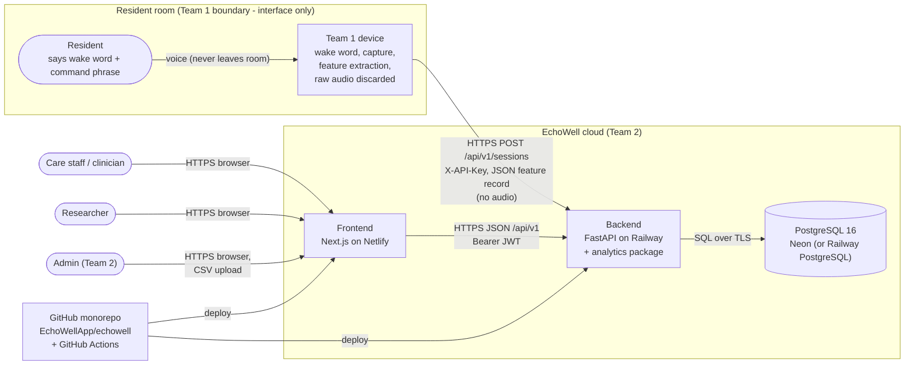
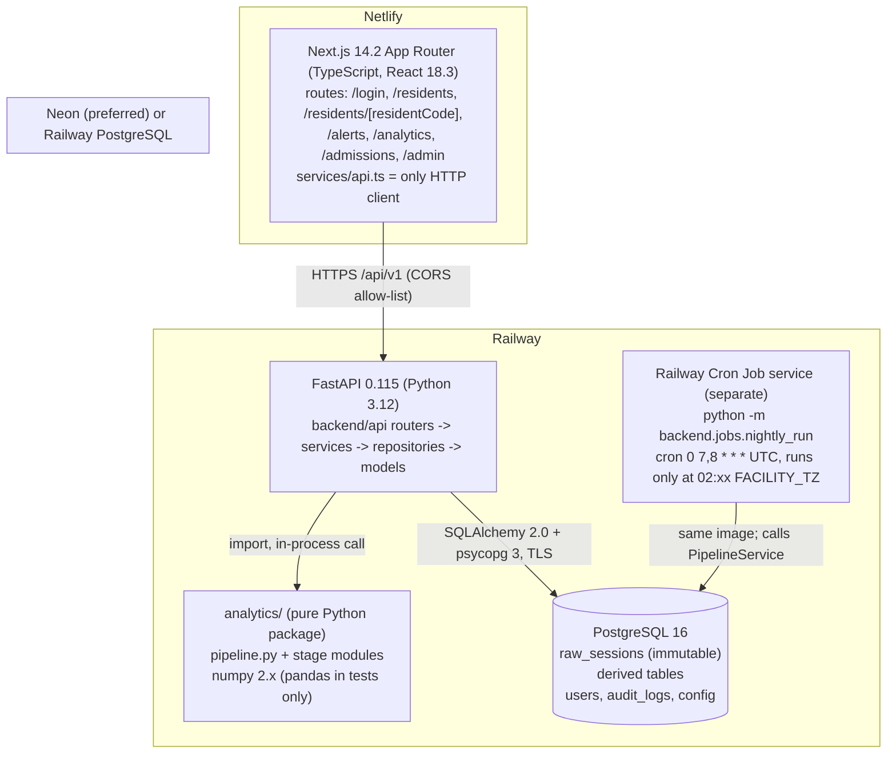
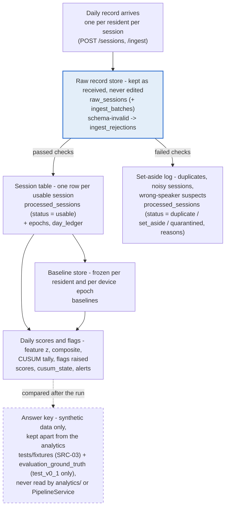
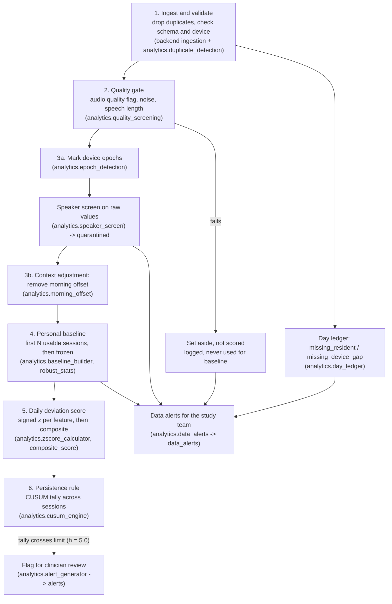
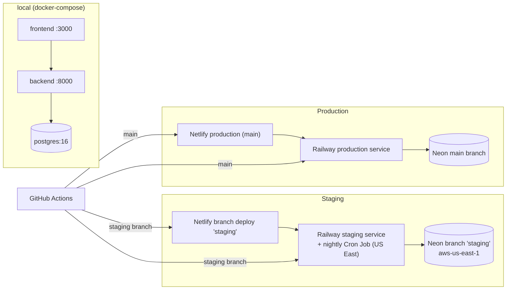
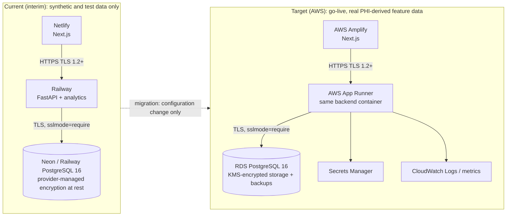

# 01 System Architecture TRD

Document ID: ECHOWELL-TRD-01 · Version 0.2 (draft for review) · Date: 18 October 2026 · Owner: Team 2 · Status: Draft

## 1. Purpose

This document specifies the EchoWell system architecture: system context and the Team 1 boundary, deployable containers, the monorepo module decomposition, the flow of one check-in through the system, the storage and processing flows of SRC-02, pipeline triggering, rebuild and reproducibility rules, environments, and the **current (interim) versus target (AWS)** architecture. Per owner decision D-OWNER-3 (18 Oct 2026), AWS (Amplify, App Runner, RDS PostgreSQL + KMS, Secrets Manager, CloudWatch) is the target production platform; Netlify + Railway + Neon is the current, interim hosting used until the AWS budget is approved. Live feature data is treated as potentially PHI-derived. It is the architectural reference that TRDs 04–23 refine. It does not invent alternatives to SRC-01.

## 2. Scope

**In scope:** logical and physical architecture of Team 2 components (Next.js frontend, FastAPI backend, `analytics/` package, PostgreSQL database, GitHub Actions CI/CD); interfaces to Team 1 devices, browsers and hosting platforms; architectural rules (layering, purity of analytics, immutability of raw data, determinism); pipeline orchestration model.

**Out of scope:** Team 1 internals (device hardware, wake word, audio capture, feature extraction, transport implementation) — described as interfaces only; detailed API contracts (TRD 05, 19); table DDL (TRD 06, 20); algorithm formulas (TRD 07–09); UI layout (TRD 04, 11); deployment procedures (TRD 15); CI workflow details (TRD 16).

## 3. References

| ID | Used for |
|---|---|
| SRC-01 | Technology stack, hosting, repository strategy, target AWS platform |
| SRC-02 | Storage flow (diagram 1) and 6-stage daily processing flow (diagram 2) |
| SRC-03, SRC-04, SRC-05 | Pipeline rules, reference implementation, input format |
| SRC-09, SRC-10, SRC-11, SRC-18, SRC-19 | Dashboard views served by the frontend (Residents, Resident detail, New admissions, Alert review, Analytics) |
| Contract §19–§20 (R1–R17) | Data alerts, alert reviews, evaluation ground truth, as-of rule, budgets |
| SRC-13 | Record fields; transport to the cloud is Team 1's |
| SRC-14 | Cloud/edge split and team boundaries |
| SRC-15 | Demo path; mention of AWS server and local SQLite prototype |
| D-OWNER-2, D-OWNER-3 | Owner decisions 18 Oct 2026: production baseline 30 / test 16 for build-test only; AWS target, interim hosting, PHI-derived data protection |

Related TRDs: 00 (BR-xx), 03 (NFR targets), 05 (API), 06/20 (database), 07/08/09 (algorithm), 10 (ingestion), 12 (security), 15 (deployment), 16 (CI/CD), 17 (logging), 21 (environment), 22 (hosting), 23 (entities).

## 4. Requirements

### 4.1 System context



| ID | Requirement | Priority | Trace | Verification |
|---|---|---|---|---|
| ARC-001 | The system boundary between Team 1 and Team 2 shall be the ingest API (`POST /api/v1/sessions` and `POST /api/v1/ingest`); no EchoWell component shall run on or require access to the device. | Must | BR-01, SRC-14 B.3, ASM-05 | Inspection |
| ARC-002 | The only data that shall cross the Team 1 → Team 2 boundary is the feature record defined in TRD 10 (schema v0.1), transported as JSON or CSV over HTTPS. | Must | BR-01, BR-16, SRC-05, SRC-13 §6 | Inspection, Test |
| ARC-003 | No EchoWell container shall expose an endpoint, column, file store or message type that accepts or returns audio. | Must | BR-01, BR-16, SRC-14 B.2 | Inspection, Test (OpenAPI scan) |
| ARC-004 | Devices shall authenticate to the ingest API with an `X-API-Key` header holding a key with scope `ingest:write`; scheduled callers may trigger pipeline runs with a key of scope `pipeline:run`; dashboard users shall authenticate with a JWT bearer token. | Must | BR-16, TRD 12, R18 | Test |
| ARC-005 | All external traffic (device → backend, browser → frontend, frontend → backend) shall use HTTPS with TLS 1.2 or higher, terminated by the hosting platform. | Must | BR-16, SRC-01, D-OWNER-3 | Inspection, Test |
| ARC-006 | The backend-to-database connection shall use TLS 1.2 or higher with `sslmode=require` (or stricter) in `DATABASE_URL` in staging and production. | Must | BR-16, D-OWNER-3 | Test (startup check), Inspection |
| ARC-007 | All persistent stores holding feature data (database storage, backups, snapshots) shall be encrypted at rest: provider-managed encryption on Neon/Railway (current); RDS storage encryption with an AWS KMS key and encrypted backups/S3 on AWS (target). | Must | BR-16, D-OWNER-3 | Inspection (provider configuration evidence, TRD 22) |
| ARC-008 | The current (interim) stack shall hold only synthetic and test data; real resident data shall be ingested only on the approved target AWS platform (go-live on AWS only). | Must | BR-16, RSK-14, D-OWNER-3, D-OWNER-4 | Inspection (ingest batch sources, DATA_SOURCE_LABEL) |

### 4.2 Containers



| Container | Technology (pinned per contract) | Responsibility | Hosting (current interim → target AWS) |
|---|---|---|---|
| Frontend | Next.js 14.2.x App Router, React 18.3.x, TypeScript 5.x, Recharts 2.x, Node.js 20 LTS | Dashboard pages, login, admin UI; calls backend REST API only | Netlify (prod from `main`, branch deploy `staging`) → AWS Amplify |
| Backend API | Python 3.12, FastAPI 0.115.x, Pydantic 2.x, SQLAlchemy 2.0.x, Alembic 1.13.x, psycopg 3.x | Auth, ingest, validation, persistence, pipeline orchestration, read APIs, audit | Railway (production and staging services) → AWS App Runner |
| Analytics engine | Python package `analytics/` (numpy 2.x only at runtime; pandas and openpyxl in tests only, TRD 07 ANL-005) | Pure deterministic pipeline functions (stages 1–12 of TRD 07 ANL-006) | Imported by the backend; runs in the backend process |
| Database | PostgreSQL 16 | System of record: raw store, derived tables, users, config, audit | Neon (preferred) or Railway PostgreSQL → AWS RDS PostgreSQL (KMS-encrypted) |
| CI/CD | GitHub Actions | Lint, type-check, tests, validation suite, build, deploy | GitHub |

| ID | Requirement | Priority | Trace | Verification |
|---|---|---|---|---|
| ARC-010 | The frontend shall be a Next.js App Router application written in TypeScript and deployed to Netlify. | Must | BR-17, SRC-01 | Inspection |
| ARC-011 | The backend shall be a FastAPI application written in Python 3.12 and deployed to Railway. | Must | BR-17, SRC-01 | Inspection |
| ARC-012 | The database shall be PostgreSQL 16, hosted on Neon (preferred) or Railway PostgreSQL in the current (interim) stack and on AWS RDS PostgreSQL in the target stack. | Must | BR-17, SRC-01, D-OWNER-3 | Inspection |
| ARC-013 | The analytics engine shall be the Python package `analytics/` in the monorepo, imported by the backend and executed in the backend process. | Must | BR-17, SRC-01 ("contained within the backend codebase as a dedicated analytics module") | Inspection |
| ARC-014 | The frontend shall access data only through the backend REST API at `NEXT_PUBLIC_API_BASE_URL`; it shall hold no database credentials. | Must | BR-16, BR-17 | Inspection |
| ARC-015 | Only backend processes (API service, nightly job, CLI) shall hold database connection strings: `DATABASE_URL` for the `echowell_app` role; `DATABASE_READONLY_URL` for the `echowell_readonly` role, opened only by `backend/services/analytics_summary.py` in the `test_v0_1` profile (contract R27); and, for migrations and the operator CLI only, `DATABASE_MIGRATION_URL` for the `echowell_migrator` role, read only by the Railway pre-deploy step and the CLI, never by request or pipeline code (TRD 15 DEP-040). | Must | BR-16, R20 | Inspection |
| ARC-016 | All components shall live in the single GitHub monorepo `EchoWellApp/echowell` with the layout in section 4.6. | Must | BR-17, SRC-01 | Inspection |
| ARC-017 | The backend shall serve its OpenAPI document at `/api/v1/openapi.json`, and the committed contract file `docs/api_reference/openapi.json` produced by `python -m backend.cli export-openapi` shall equal the generated schema (CI fails on difference); frontend types shall be generated from it to `frontend/lib/api-types.ts`. | Must | BR-17, TRD 19, R22 | Test (CI diff) |
| ARC-018 | In the current stack the system shall not depend on any service other than Netlify, Railway, Neon/Railway PostgreSQL and GitHub (optional Sentry via `SENTRY_DSN`) to serve a request; in the target stack the equivalents are the AWS services of section 4.10. | Must | BR-17, SRC-01, D-OWNER-3, TRD 22 | Inspection |
| ARC-019 | The database shall have three roles: `echowell_migrator` (owns the schema; used only by Alembic), `echowell_app` (DML; no UPDATE/DELETE on `raw_sessions`, `audit_logs`, `alert_reviews`, `staff_notes`; no SELECT on `evaluation_ground_truth`) and `echowell_readonly` (SELECT for researcher read-outs and exports, including `evaluation_ground_truth` in the test profile). | Must | BR-02, BR-16, R20 | Test (privilege tests in CI) |

### 4.3 Data flow of one check-in

```mermaid
sequenceDiagram
    autonumber
    participant D as Team 1 device
    participant A as FastAPI /api/v1/sessions
    participant V as Ingestion service (schema + dedupe)
    participant DB as PostgreSQL
    participant P as PipelineService
    participant AN as analytics.pipeline (pure)
    participant UI as Next.js dashboard

    D->>A: POST record (X-API-Key, JSON, no audio)
    A->>V: validate schema v0.1, resident & device known, resident active
    alt invalid
        V->>DB: insert ingest_rejections (errors)
        A-->>D: 422 problem+json with field errors
    else valid
        V->>DB: insert raw_sessions (payload as received, arrival_seq)
        V->>DB: audit_logs (ingest)
        A->>P: run(scope = this resident, trigger = ingest) [synchronous]
        P->>DB: load raw_sessions, frozen baselines, config snapshot for resident
        P->>AN: run_pipeline(records, config, frozen_baselines, as_of)
        AN-->>P: processed_sessions, epochs, baselines, scores, cusum_state, alerts, day_ledger
        P->>DB: replace derived rows for resident in one transaction + pipeline_runs row
        alt first (or only) arrival of session_id
            A-->>D: 201 {raw_session_id, arrival_seq, status_after_processing}<br/>("pending" if the synchronous run failed)
        else repeat session_id
            A-->>D: 200 {..., status_after_processing: "duplicate"}
        end
    end
    UI->>A: GET /api/v1/residents, /residents/{code}, /checkins (Bearer JWT)
    A->>DB: read derived tables
    A-->>UI: JSON; page shows new last check-in, status, log entry
```

| ID | Requirement | Priority | Trace | Verification |
|---|---|---|---|---|
| ARC-020 | A schema-invalid record shall be rejected with HTTP 422, logged in `ingest_rejections`, and shall never be written to `raw_sessions`. | Must | BR-01, BR-02, SRC-02 stage 1 | Test |
| ARC-021 | A schema-valid record, including a repeat `session_id`, shall be written to `raw_sessions` before any processing begins. | Must | BR-02, BR-03, SRC-02 diagram 1 | Test |
| ARC-022 | After a single-record ingest commits, the backend shall run the pipeline for the affected resident synchronously and return `status_after_processing` in the same HTTP response. | Must | BR-01, SRC-15 demo step 4 | Test |
| ARC-023 | After a batch or CSV ingest commits, the backend shall return 202 and run the pipeline for all affected residents as a background task. | Must | BR-01, BR-15 | Test |
| ARC-024 | Dashboard reads shall be served from persisted derived tables; read endpoints shall not invoke the analytics pipeline. | Must | BR-12, BR-13, NFR performance (TRD 03) | Inspection, Test |
| ARC-025 | If the pipeline fails after the raw record is committed, the raw record shall remain stored, the `pipeline_runs` row shall be marked `failed`, `POST /api/v1/sessions` shall return 201 with `status_after_processing: "pending"`, and the next successful run (ingest, nightly or manual) shall process the record. | Must | BR-02, TRD 17, R23 | Test (fault injection) |

### 4.4 Storage flow (SRC-02 diagram 1)

SRC-02 diagram 1 "Raw records stay untouched; every other table is derived from them" has seven boxes. The mapping to EchoWell tables is:



| SRC-02 store | EchoWell table(s) | Writable by | Rebuildable |
|---|---|---|---|
| Raw record store | `raw_sessions`, `ingest_batches` | Ingestion service only (INSERT only) | No (source of truth) |
| (schema failures, before raw store) | `ingest_rejections` | Ingestion service only | No (log) |
| Session table | `processed_sessions` (usable rows), `epochs`, `day_ledger` | PipelineService only | Yes |
| Set-aside log | `processed_sessions` rows with status `duplicate`, `set_aside`, `quarantined` and their `reasons` | PipelineService only | Yes |
| Baseline store | `baselines` | PipelineService only | Frozen rows are preserved (ARC-043) |
| Daily scores and flags | `scores`, `cusum_state`, `alerts`, `data_alerts` | PipelineService (alerts: status and snooze changed also by alarm review; data alerts of kind `review_flagged_data_problem` created by alarm review) | Yes, preserving human-entered fields (ARC-044) |
| Answer key | `tests/fixtures/` copy of SRC-03; `evaluation_ground_truth` table (resident_code, planted_change, true_onset_date, source_file), loaded only in the `test_v0_1` profile | Loader script `database/seeds/load_evaluation_ground_truth.py` only (run directly; not via the CLI) | n/a (never derived, never read by the pipeline) |

Human-entered and operational data outside SRC-02's diagram: `alert_reviews`, `alerts.snoozed_until`/`snoozed_by`, `staff_notes`, `users`, `api_keys`, `audit_logs`, `config_parameters`, `facilities`, `residents`, `devices`, `device_assignments`, `facility_reference_ranges`, `pipeline_runs`.

| ID | Requirement | Priority | Trace | Verification |
|---|---|---|---|---|
| ARC-030 | `raw_sessions` shall be insert-only: the `echowell_app` role shall hold no UPDATE or DELETE privilege on it and a trigger shall reject UPDATE and DELETE. | Must | BR-02, SRC-02 diagram 1, TRD 12, R20 | Test |
| ARC-031 | `raw_sessions.payload` shall hold the record exactly as received (JSON object; for CSV, the row as a header-keyed object of strings). | Must | BR-02, SRC-02 | Test |
| ARC-032 | Every derived table (processed_sessions, epochs, day_ledger, baselines, scores, cusum_state, alerts, data_alerts, facility_reference_ranges) shall be writable only by the PipelineService code path, except alert status and snooze fields and `review_flagged_data_problem` data alerts written by the alarm review service. | Must | BR-02, SRC-02, SRC-18 | Inspection |
| ARC-033 | The answer key files (SRC-03) shall be stored only under `tests/fixtures/` and shall not be importable or readable by `analytics/` or `backend/` runtime code. | Must | BR-15, SRC-02 ("answer key never touches the analytics"), SRC-03 README | Inspection (import-lint in CI) |
| ARC-034 | The `evaluation_ground_truth` table shall be populated only when the active profile is `test_v0_1`, by the loader `database/seeds/load_evaluation_ground_truth.py` (contract R27), and shall be read only by `backend/services/analytics_summary.py` for the alarm timing check after the run, through a second connection `DATABASE_READONLY_URL` (role `echowell_readonly`); the `echowell_app` role shall have no SELECT on it, and `analytics/` and PipelineService shall never query it. | Must | BR-15, SRC-02, SRC-19, R17, R20 | Inspection, Test (privilege test; pipeline run with the table populated vs empty gives identical outputs) |
| ARC-035 | In the `production` profile the `evaluation_ground_truth` table shall be empty and the Analytics page shall show review outcomes instead of the alarm timing check. | Must | BR-15, SRC-19 | Test |

### 4.5 Processing flow (SRC-02 diagram 2) and stage mapping

SRC-02 diagram 2 "Each day is scored against a frozen personal baseline" defines six stages and a final flag. The contract (§7) refines them into ten pure stages, and TRD 07 ANL-006 adds two more (11 data alerts, 12 analytics aggregates), giving twelve. The order of execution is fixed:



| SRC-02 stage | Contract stage(s) | Module | Output status / table |
|---|---|---|---|
| 1. Ingest and validate | 1 Duplicate detection + schema check | `backend/services/ingestion.py`, `backend/services/validation.py`, `analytics/duplicate_detection.py` | 422 rejection; `duplicate` |
| 2. Quality gate | 2 Quality gate | `analytics/quality_screening.py` | `set_aside` with reasons; else `pending_screen` (internal) |
| 3. Context adjustment (mark device epochs) | 3 Epoch detection | `analytics/epoch_detection.py` | `epochs` |
| (Set-aside log: wrong-speaker suspects) | 4 Speaker screen | `analytics/speaker_screen.py` | `quarantined` or `usable` |
| 3. Context adjustment (remove morning offset) | 5 Morning adjustment | `analytics/morning_offset.py` | `adjusted_features`, `is_morning` |
| 4. Personal baseline (30 production / 16 test) | 6 Personal baseline | `analytics/baseline_builder.py`, `analytics/robust_stats.py` | `baselines` |
| 5. Daily deviation score | 7 Scoring | `analytics/zscore_calculator.py`, `analytics/composite_score.py` | `scores` |
| 6. Persistence rule | 8 CUSUM | `analytics/cusum_engine.py` | `scores.cusum_tally`, `cusum_state` |
| Flag for clinician review | 9 Alert generation | `analytics/alert_generator.py` | `alerts` |
| (missing days, SRC-03) | 10 Day ledger | `analytics/day_ledger.py` | `day_ledger` |
| (data-quality flags for the study team, SRC-18) | 11 Data-alert generation (after all other stages; rules baseline_stalled, possible_other_speaker, high_set_aside, device_silent over the last 30 days; thresholds from `config_parameters`) | `analytics/data_alerts.py` | `data_alerts` (kinds as above; `review_flagged_data_problem` is created by alarm review, not by the pipeline) |
| (study-team analytics, SRC-19) | 12 Analytics aggregates (KPIs, check-ins per day, funnel, by resident; after stage 11) | `analytics/aggregates.py` | `GET /api/v1/analytics` (computed, not stored) |

SRC-02's final box also mentions "EWMA trend shown against baseline band"; this display is deferred (OQ-18) and is not part of the MVP pipeline.

| ID | Requirement | Priority | Trace | Verification |
|---|---|---|---|---|
| ARC-040 | `analytics.pipeline.run_pipeline` shall execute the stages in the order of section 4.5, with data-alert generation last, and shall be the single entry point used by every trigger. | Must | BR-03..BR-11, SRC-02, SRC-04, SRC-18 | Inspection, Test |
| ARC-041 | Modules in `analytics/` shall be pure: they shall not import `backend`, SQLAlchemy, psycopg, FastAPI, httpx, or perform file, network, clock or random-number access; current time is passed in as `as_of`. | Must | BR-15, SRC-01 | Inspection (import-lint in CI), Test |
| ARC-042 | Given identical raw records (in arrival order), identical frozen baselines, identical configuration snapshot and identical `as_of`, `run_pipeline` shall return identical outputs (bit-identical float64 values and identical ordering). | Must | BR-15, SRC-02 | Test (run twice, compare) |
| ARC-043 | A baseline that has been persisted as frozen shall be passed to the pipeline as an input on later runs and shall not be recomputed, except by the operator rebuild command after an algorithm-key change (TRD 07 ANL-032, TRD 24 D-56); a late record that would change its membership shall be recorded as a `late_arrival` warning in `pipeline_runs.warnings`. | Must | BR-09, ASM-07, OQ-10 | Test |
| ARC-044 | Re-running the pipeline shall preserve human-entered data: `staff_notes`, `alert_reviews`, data alerts of kind `review_flagged_data_problem`, and alert `status`, `acknowledged_by`, `acknowledged_at`, `snoozed_until`, `snoozed_by` for alerts whose natural key (epoch_id, session_id) is unchanged. | Must | BR-02, BR-13, R15 | Test |
| ARC-045 | Derived rows shall be identified by natural keys (`raw_session_id` for processed_sessions; `(resident_id, epoch_number)` for epochs; `(epoch_id, feature_key)` for baselines; `processed_session_id` for scores; `(resident_id, local_date)` for day_ledger; `(epoch_id, session_id)` for alerts; `(kind, resident_id, device_id)` for pipeline-generated data_alerts, keeping `first_detected_at` and setting status `resolved` when a rule no longer holds) so that re-runs are idempotent upserts. | Must | BR-02, BR-15 | Test |
| ARC-046 | The analytics engine shall compute in float64 (numpy) and shall use numpy median semantics (mean of the two middle values for an even count). | Must | BR-09, BR-15, SRC-03 README note 2 | Test |

### 4.6 Module decomposition (monorepo layout)

```
echowell/
├── frontend/                 Next.js app
│   ├── app/                  routes: login/, residents/, residents/[residentCode]/, alerts/, analytics/,
│   │                         admissions/, admin/
│   ├── components/           presentational components (tables, badges, TallyChart, Sparkline, ...)
│   ├── lib/                  formatting (dates in FACILITY_TZ), auth helpers, types
│   ├── services/api.ts       the only HTTP client to /api/v1
│   └── tests/                Vitest + React Testing Library; e2e/ Playwright
├── backend/
│   ├── main.py               FastAPI app factory, middleware (request ID, CORS, errors), router mounting
│   ├── api/                  routers: health, auth (login, logout, me), sessions, ingest, residents, scores,
│   │                         alarms (alerts, reviews, snooze), data_alerts, notes, devices, analytics,
│   │                         pipeline (run, runs list), admissions, facility, users
│   ├── schemas/              Pydantic DTOs (request/response)
│   ├── services/             ingestion, validation, pipeline orchestration, baseline, scoring, cusum,
│   │                         morning_adjustment, speaker_screen (thin adapters to analytics/), auth, audit
│   ├── repositories/         SQLAlchemy queries per aggregate
│   ├── models/               SQLAlchemy ORM models (resident, session, baseline, score, alarm, ...)
│   ├── core/                 config (env), security (JWT, argon2id, API keys), logging (JSON), errors
│   └── alembic/              migrations (source of truth for schema)
├── analytics/                pure engine: config.py, robust_stats.py, duplicate_detection.py,
│                             quality_screening.py, epoch_detection.py, speaker_screen.py,
│                             morning_offset.py, baseline_builder.py, zscore_calculator.py,
│                             composite_score.py, cusum_engine.py, alert_generator.py,
│                             day_ledger.py, data_alerts.py, pipeline.py
├── database/                 schema.sql (generated reference DDL), seeds/, roles/provision_login_roles.sql (local/CI)
├── tests/                    unit/, integration/, validation/ (R01–R10), fixtures/ (SRC-03, SRC-05)
├── docs/                     architecture.md, algorithm.md, api_reference.md, database_design.md,
│                             deployment.md, team_workflow.md, design/
├── specs/                    sources and TRDs
├── .github/workflows/        ci.yml, deploy workflows
└── docker-compose.yml        postgres:16, backend :8000, frontend :3000
```

| ID | Requirement | Priority | Trace | Verification |
|---|---|---|---|---|
| ARC-050 | The repository shall follow the layout above; existing skeleton files (`backend/api/{alarms,analytics,health,residents,sessions}.py`, `backend/models/{alarm,baseline,resident,score,session}.py`, `backend/services/{baseline,cusum,ingestion,morning_adjustment,scoring,speaker_screen,validation}.py`, `analytics/*.py`) shall be kept and filled in, not renamed. | Must | BR-17, SRC-01 | Inspection |
| ARC-051 | Backend code shall follow the dependency direction `api → services → repositories → models`; routers shall not issue SQL directly and repositories shall not call services. | Must | BR-17 | Inspection (import-lint) |
| ARC-052 | `backend/services/*` modules named after algorithm stages shall delegate the computation to the corresponding `analytics/` function and shall contain no duplicate statistical logic. | Must | BR-15 | Inspection |
| ARC-053 | Pipeline parameters shall be read from `config_parameters` for the active profile (`PIPELINE_PROFILE`) into `analytics.config.PipelineConfig` and passed to `run_pipeline`; analytics modules shall contain no hard-coded thresholds other than defaults in `PipelineConfig`. | Must | BR-09, BR-11, ASM-04 | Inspection, Test |
| ARC-054 | Feature column names shall be mapped through a configurable feature-name mapping (external name → internal key of TRD 08 §6) so that Team 1 renaming requires no code change. | Must | BR-01, OQ-03, RSK-02 | Test |
| ARC-055 | The frontend shall format all displayed times in the facility timezone returned by the API (`FACILITY_TZ`), never in the browser's local timezone. | Must | BR-07, BR-12, ASM-01 | Test |
| ARC-056 | The backend shall refuse to start when `APP_ENV=production` and `PIPELINE_PROFILE=test_v0_1`; the `test_v0_1` profile (baseline_n = 16) is for build-out and testing only, and production uses baseline_n = 30. | Must | BR-09, ASM-04, D-OWNER-2 | Test |
| ARC-057 | The backend shall refuse to start when `APP_ENV` is `staging` or `production` and `DATABASE_URL`, `DATABASE_MIGRATION_URL` or `DATABASE_READONLY_URL` (when set) does not specify `sslmode=require` or `sslmode=verify-full` (the accepted values of TRD 21 ENV-011 and TRD 05 API-059). | Must | BR-16, D-OWNER-3 | Test |

### 4.7 Pipeline triggering and concurrency

| Trigger | `pipeline_runs.trigger` | Scope | Mode | Caller |
|---|---|---|---|---|
| Single record ingest | `ingest` | the record's resident (and co-residents of a shared device for the day ledger) | synchronous within request | `POST /api/v1/sessions` |
| Batch / CSV ingest | `ingest` | all residents in the batch (plus device co-residents) | background task after 202 | `POST /api/v1/ingest` |
| Nightly | `nightly` | all active residents | separate Railway Cron Job service at `0 7,8 * * *` UTC; proceeds only when facility-local time is 02:xx (`NIGHTLY_RUN_HOUR_LOCAL`) and that local night has not yet run | `python -m backend.jobs.nightly_run` (TRD 15) |
| Manual | `manual` | `{scope, profile, as_of?}` from request | background task | `POST /api/v1/pipeline/run` (admin JWT or API key scope `pipeline:run`) |
| Test | `test` | all | synchronous in test harness | pytest validation suite |

| ID | Requirement | Priority | Trace | Verification |
|---|---|---|---|---|
| ARC-060 | Every pipeline execution shall create one `pipeline_runs` row recording trigger, scope, config profile, config snapshot, code version (`GIT_SHA`), start and finish times, status, counts and warnings. | Must | BR-15, BR-16, TRD 17 | Test |
| ARC-061 | The nightly run shall be executed by a separate Railway Cron Job service running `python -m backend.jobs.nightly_run` at `0 7,8 * * *` UTC; the job shall proceed only when facility-local time is 02:xx and no nightly run exists for that local night, so it runs exactly once per local day including daylight-saving transition days; no in-process scheduler (e.g. APScheduler) shall exist. | Must | BR-06, ASM-01, R18 | Test (job unit test with DST dates 2026-11-01 and 2027-03-14) |
| ARC-062 | The nightly run shall recompute the day ledger up to the new as-of date so that a resident with no record on the previous local day receives a missing-day entry even when no record arrived. | Must | BR-06, SRC-03 | Test |
| ARC-063 | Pipeline executions that touch the same resident shall be serialized using a transaction-scoped PostgreSQL advisory lock keyed on the resident, taken by every run including full-scope runs (keys and helper in TRD 06 DB-021); there is no global run lock, because session-level advisory locks do not work over the Neon pooled endpoint. | Must | BR-02, BR-15 | Test (concurrent ingest) |
| ARC-064 | The derived-table writes of one pipeline execution shall commit in a single database transaction per resident, so that readers never observe a partially processed resident. | Must | BR-12, BR-13 | Test |
| ARC-065 | A resident-scoped run shall include all residents sharing a device with that resident on any affected local date, because `missing_device_gap` depends on all of them. | Must | BR-06, SRC-03 (R02/R03 day 12) | Test |
| ARC-066 | The pipeline shall be runnable from the command line (`python -m backend.cli run-pipeline --scope all --profile <profile>` (TRD 15 §4.8)) for local use, CI and the demo fallback. | Should | BR-15, RSK-12 | Demo, Test |
| ARC-067 | API keys, residents, devices and device assignments shall be managed only through `python -m backend.cli ...` commands and seed files in the MVP; no HTTP endpoints shall exist for them. | Must | BR-16, R4 | Inspection |
| ARC-068 | The `as_of` of a pipeline run shall be, in order of precedence: the explicit `as_of` in `POST /api/v1/pipeline/run`; the `PIPELINE_AS_OF` environment variable (refused when `APP_ENV=production`); the current time. Read endpoints shall use the `as_of` of the latest succeeded run as `meta.as_of`. In-process tests freeze the clock (time-machine). | Must | BR-06, BR-15, R11, R21 | Test |

### 4.8 Rebuild and reproducibility

| ID | Requirement | Priority | Trace | Verification |
|---|---|---|---|---|
| ARC-070 | An admin shall be able to trigger a full rebuild (`POST /api/v1/pipeline/run` with scope `all`) that recomputes every derived table from `raw_sessions`, `residents`, `devices`, `device_assignments`, frozen `baselines` and the configuration snapshot; frozen baselines themselves are recomputed only by the operator rebuild command after an algorithm-key change (TRD 07 ANL-032, TRD 24 D-56). | Must | BR-02, SRC-02 ("every other table can be rebuilt") | Test |
| ARC-071 | Two consecutive full rebuilds with unchanged inputs and configuration shall produce identical derived-table contents (excluding surrogate ids, `pipeline_run_id` and run timestamps). | Must | BR-15, SRC-02 | Test |
| ARC-072 | A rebuild into an empty derived schema (no frozen baselines persisted) on SRC-05 with profile `test_v0_1` shall reproduce the SRC-03 answer key. | Must | BR-15, SRC-03 | Test (validation suite) |
| ARC-073 | Each `pipeline_runs.config_snapshot` shall contain every parameter of section 7 of the contract (TRD 07) as used by that run, so any run can be reproduced from raw data plus snapshot plus `code_version`. | Must | BR-15 | Inspection, Test |
| ARC-074 | Processing order shall be defined by `arrival_seq` for duplicate detection and by `timestamp_utc` (ties broken by `arrival_seq`) for all per-resident time-ordered stages. | Must | BR-03, BR-09, SRC-04 | Test |

### 4.9 Environments and deployment topology



| ID | Requirement | Priority | Trace | Verification |
|---|---|---|---|---|
| ARC-080 | The system shall support three environments — local, staging, production — with the topology above and configuration only through environment variables listed in TRD 21. | Must | BR-17, TRD 21 | Inspection, Demo |
| ARC-081 | The local environment shall run the same backend, analytics and frontend code as the cloud environments and shall be usable as the demo fallback. | Must | BR-17, RSK-12, SRC-15 item 8 | Demo |
| ARC-082 | Database schema changes shall be applied only through Alembic migrations using `DATABASE_MIGRATION_URL` (`echowell_migrator` role), run as a deploy step before the new backend version serves traffic. | Must | BR-17, TRD 15, R20 | Inspection |
| ARC-083 | The backend shall expose `GET /api/v1/health` returning `{status, database, version, time}` for platform health checks, with HTTP 503 and status "degraded" when the database check fails. | Must | BR-17, TRD 05, R19 | Test |
| ARC-084 | Hosting regions shall be Neon `aws-us-east-1` and Railway US East for the current stack and AWS `us-east-1` for the target stack. | Must | BR-17, R25 | Inspection |

### 4.10 Current (interim) versus target (AWS) architecture

AWS is the **target** production platform; Netlify + Railway + Neon is the **current** interim hosting until the AWS budget is approved (D-OWNER-3, OQ-07). The interim stack holds synthetic and test data only; EchoWell goes live with real resident data only on AWS once approved (D-OWNER-4; OQ-23 closed).



| Concern | Current (interim; SRC-01) | Target AWS (SRC-01, D-OWNER-3) | Portability rule |
|---|---|---|---|
| Frontend hosting | Netlify | AWS Amplify Hosting | Standard Next.js build; no Netlify-specific runtime APIs (Netlify Functions, Edge Functions, Netlify Identity) |
| Backend hosting | Railway | AWS App Runner | Containerized via `backend/Dockerfile`; listens on `$PORT`; stateless |
| Database | Neon / Railway PostgreSQL 16 | AWS RDS PostgreSQL 16 | Standard PostgreSQL only; no Neon-specific SQL; connection via `DATABASE_URL` |
| Scheduler | Separate Railway Cron Job service running `python -m backend.jobs.nightly_run` (R18) | Amazon EventBridge Scheduler at 02:00 America/Chicago calling `POST /api/v1/pipeline/run` with an API key of scope `pipeline:run` (D-47) | Trigger calls the same `pipeline_runner` entry |
| Region | Neon `aws-us-east-1`, Railway US East | AWS `us-east-1` | Region set only in hosting configuration (R25) |
| Secrets | Netlify/Railway env vars, GitHub secrets | AWS Secrets Manager injected as App Runner environment variables | Read only from environment variables |
| Encryption at rest | Provider-managed storage encryption (Neon/Railway) | RDS storage encryption with AWS KMS key; encrypted automated backups and snapshots; any S3 objects encrypted (SSE-KMS) | No application-level dependency on the mechanism |
| Encryption in transit | Platform TLS; `sslmode=require` to PostgreSQL | ACM TLS; `sslmode=require` (RDS CA) to PostgreSQL | TLS settings via configuration only |
| Data permitted | Synthetic and test data only (permanent rule, D-OWNER-4) | Real PHI-derived feature data after AWS approval and account setup (OQ-07) | Same schema and code |
| Logs | Railway logs (JSON stdout) | CloudWatch Logs | JSON to stdout, no file logging, no PII or feature payloads in logs |
| TLS | Platform-managed | Platform-managed (ACM) | No TLS in application code |

| ID | Requirement | Priority | Trace | Verification |
|---|---|---|---|---|
| ARC-090 | The backend shall be packaged as an OCI container image built from `backend/Dockerfile` that reads all configuration from environment variables and listens on the port given by `PORT` (default 8000). | Must | BR-17, SRC-01, D-OWNER-3 (target AWS) | Test (container build in CI) |
| ARC-091 | The backend shall keep no state on local disk between requests; background tasks shall be re-creatable from database state. | Must | BR-17, SRC-01 | Inspection |
| ARC-092 | SQL and migrations shall use only features available in standard PostgreSQL 16 (including `gen_random_uuid()` and advisory locks) and shall not depend on Neon- or Railway-specific extensions. | Must | BR-17, SRC-01 | Test (CI against `postgres:16`) |
| ARC-093 | The frontend shall not use hosting-vendor-specific runtime features; it shall build with `next build` and run on any Next.js-compatible host. | Must | BR-17, SRC-01 | Inspection |
| ARC-094 | A migration to the target AWS platform shall require changes only to deployment configuration (environment variables, workflow files, infrastructure settings) and no change to application source in `frontend/`, `backend/` or `analytics/`. | Must | BR-17, SRC-01 ("no significant application code changes"), D-OWNER-3 | Analysis, Demo (container run against `postgres:16` with `sslmode=require`) |
| ARC-095 | Application logs shall not contain resident feature values, raw request bodies of ingest calls, passwords, tokens or API keys; they may contain study IDs, session IDs and request IDs. | Must | BR-16, D-OWNER-3, TRD 17 | Test (log capture), Inspection |

### 4.11 Cross-cutting architectural rules

| ID | Requirement | Priority | Trace | Verification |
|---|---|---|---|---|
| ARC-100 | Every HTTP response shall carry an `X-Request-ID` header; the backend shall propagate the request ID into logs, `audit_logs.request_id` and `pipeline_runs` started by that request. | Must | BR-16, TRD 17 | Test |
| ARC-101 | Errors shall be returned as `application/problem+json` with `{type, title, status, detail, request_id, errors}`, where `type` = `urn:echowell:error:<CODE>` (UPPER_SNAKE codes catalogued in TRD 05) and `errors[]` items are `{field, code, message}`. | Must | BR-01, TRD 05, R19 | Test |
| ARC-102 | All timestamps shall be stored as `timestamptz` in UTC; conversion to local time shall use the IANA zone in `facilities.timezone` (default `America/Chicago`) via Python `zoneinfo`. | Must | BR-07, ASM-01 | Test |
| ARC-103 | Security-relevant actions listed in TRD 12 shall be written to the append-only `audit_logs` table. | Must | BR-16 | Test |
| ARC-104 | The system shall contain no LLM component and no machine-learning model in the processing path. | Must | BR-18 | Inspection (dependency scan) |
| ARC-105 | The facility shall be modelled as a row in `facilities`; all residents and devices shall reference a facility, and the MVP shall operate with exactly one facility (Edgewood). | Must | ASM-03, BR-17 | Test |

## 5. Assumptions

- ASM-01 facility timezone America/Chicago; ASM-03 single facility; ASM-05 records arrive via HTTPS POST or CSV upload; ASM-06 a new epoch closes the open alert of the previous epoch; ASM-07 frozen baselines never recomputed; ASM-08 small scale (< 25 users, < 100 residents, < 1 session per resident per day) — this is why in-process analytics and synchronous single-resident runs are sufficient.
- Note for lead (TRD-local): the per-resident advisory-lock concurrency model (ARC-063), natural-key upserts preserving human-entered alert fields (ARC-044/045), and the CLI entry point name (ARC-066) are introduced here.

## 6. Dependencies

- Team 1 transport to the cloud endpoint and device API key provisioning (ASM-05).
- Hosting accounts: Netlify, Railway, Neon (TRD 22) for the current stack; AWS account and budget for the target stack (OQ-07); GitHub organisation `EchoWellApp`.
- AWS approval before any real resident data is loaded (D-OWNER-4, OQ-07, RSK-14).
- Railway Cron Job service for the nightly run (R18, TRD 15).
- TRD 07 stage contracts and TRD 06/20 table definitions.

## 7. Acceptance Criteria

| ID | Criterion |
|---|---|
| AC-ARC-01 | An import-lint check in CI fails if any module under `analytics/` imports `backend`, `sqlalchemy`, `psycopg`, `fastapi`, `httpx`, `requests`, `os`, `datetime.now`-style clock access or `random`, or if runtime code reads `tests/fixtures/`. |
| AC-ARC-02 | An attempt by the application DB role to `UPDATE` or `DELETE` a `raw_sessions` row fails. |
| AC-ARC-03 | Posting one valid record returns 201 with `status_after_processing`, creates one `raw_sessions` row and one `pipeline_runs` row with trigger `ingest` and status `succeeded`. |
| AC-ARC-04 | Loading SRC-05 via CSV upload and then running two full rebuilds yields identical derived tables (excluding ids and run metadata) and matches SRC-03. |
| AC-ARC-05 | With a staff note and an acknowledged R09 alert present, a full rebuild leaves the note and the alert's acknowledgement intact. |
| AC-ARC-06 | Two concurrent `POST /api/v1/sessions` for residents R02 and R03 (shared device D02) complete without deadlock and leave a consistent day ledger. |
| AC-ARC-07 | The backend container image builds in CI and starts with only environment variables; `GET /api/v1/health` returns `status: "ok"` against `postgres:16`. |
| AC-ARC-08 | The OpenAPI document contains no operation or schema property whose name contains "audio" other than `audio_quality_flag`. |
| AC-ARC-09 | With `APP_ENV=production`, the backend refuses to start if `DATABASE_URL` lacks `sslmode=require` (or `verify-full`) or if `PIPELINE_PROFILE=test_v0_1`. |
| AC-ARC-10 | With `evaluation_ground_truth` populated and then emptied, two pipeline runs on SRC-05 give identical derived tables; with profile `production`, loading the table is refused. |
| AC-ARC-11 | After a full rebuild, an existing `alert_reviews` row, a snooze on the R09 alert and a `review_flagged_data_problem` data alert are all still present and linked. |

## 8. Implementation Notes

- Missing analytics files to create next to the existing skeletons: `analytics/data_alerts.py`, `analytics/speaker_screen.py`, `analytics/day_ledger.py`, `analytics/robust_stats.py`, `analytics/pipeline.py`, `analytics/config.py`, `analytics/__init__.py`.
- `run_pipeline` signature (recommended): `run_pipeline(records: list[RawRecord], residents: list[ResidentInfo], assignments: list[DeviceAssignment], frozen_baselines: dict[(resident, epoch_number), BaselineSet], config: PipelineConfig, as_of: datetime) -> PipelineResult`. All inputs are plain dataclasses; the backend repository layer converts ORM rows to them.
- Use `SRC-04` as the executable reference when in doubt; its output must equal SRC-03.
- Railway and Neon free tiers may sleep or auto-suspend (RSK-07); the first request after idle can be slow. Do not add keep-alive pingers without TRD 15 approval.
- Database driver is psycopg 3 (`psycopg[binary]`); replace `psycopg2-binary` in `backend/requirements.txt` (R24). SQLAlchemy URLs use the `postgresql+psycopg://` scheme.
- The existing `docker-compose.yml` (`version: "3"`) and CI stub are replaced in the deployment-config phase (R26).
- FastAPI `BackgroundTasks` is acceptable for batch processing at ASM-08 scale; do not introduce Celery, Redis or a message queue (not in SRC-01).
- The local SQLite prototype mentioned in SRC-15 is superseded by PostgreSQL in all environments.

## 9. Open Questions

| ID | Relevance |
|---|---|
| OQ-03 | Feature names → feature-name mapping (ARC-054). |
| OQ-07 | AWS budget approval timing and account ownership (UND IT) (4.10); device transport is Team 1's (ASM-05, ARC-001). |
| OQ-10 | Late records predating a frozen baseline (ARC-043). |
| OQ-15 | Store-and-forward not available; gaps become missing days. |
| OQ-18 | EWMA trend display deferred (4.5). |
| OQ-19 | Ownership of "compare to baseline" between teams; this architecture places it in Team 2's backend. |

## Revision History

| Version | Date | Change | Author |
|---|---|---|---|
| 0.1 | 18 Oct 2026 | Initial generation from TRD_Generation_Prompt.md | — |
| 0.1 | 18 Oct 2026 | Cross-TRD consistency review | — |
| 0.2 | 19 Oct 2026 | Phase 1 validation fixes (F-03, F-04, F-16, F-32, F-33) | — |
