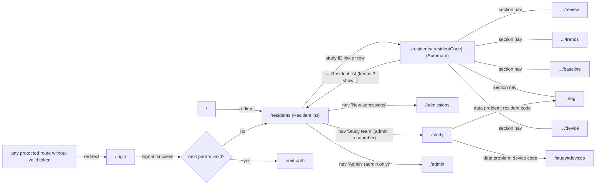
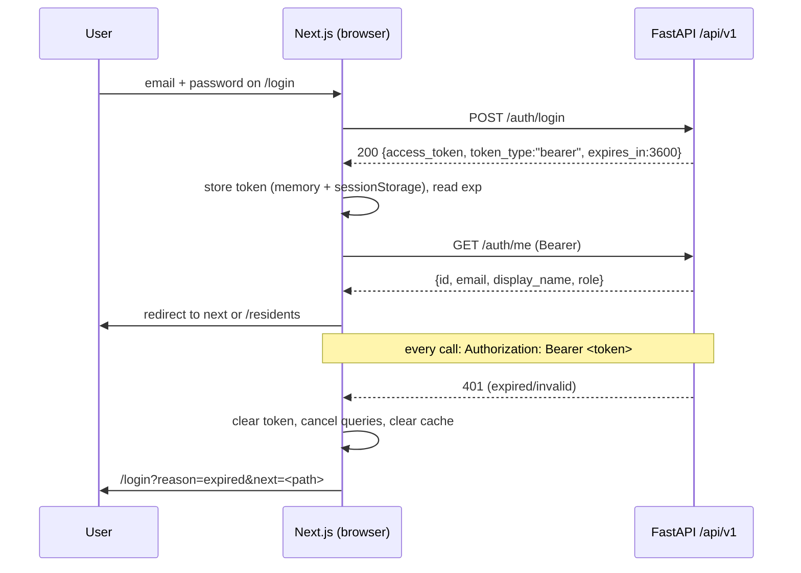

# 04 Frontend TRD

Document ID: ECHOWELL-TRD-04 · Version 0.11 (draft for review) · Date: 18 October 2026, revised 26 October 2026 · Owner: Team 2 · Status: Draft

## 1. Purpose

This document specifies the technical design of the EchoWell staff dashboard: a Next.js 14 (App Router) application written in TypeScript and hosted on Netlify. It defines the route map, layouts, authentication guard and token handling, the typed API client, the data-fetching and caching strategy, the component inventory with props, state management, loading/empty/error behaviour, date and number formatting, environment variables, testing, and build tooling.

The screen-level content (exact copy, element order, semantics and expected rendering with test data) is owned by TRD 11 (User Interface and UX Specification). This TRD owns *how* the frontend is built; TRD 11 owns *what* each screen shows. Where both touch the same element, the UX-xxx requirement is the content authority and the FE-xxx requirement is the implementation authority.

The screens follow the clinical dashboard wireframe v0.2 (SRC-21; TRD 24 D-108 to D-114), which replaced the five v0.1 wireframes on 26 October 2026: a Resident list, a Resident chart with six sections, New admissions and a Study team page. FE-xxx IDs of version 0.10 are kept where the requirement survives (with updated text); requirements of removed screen elements are marked "Retired" with the decision that retired them; new requirements use FE-206 onward.

## 2. Scope

### In scope

- Frontend application in `frontend/` of the monorepo `EchoWellApp/echowell` (SRC-01).
- Routes `/login`, `/`, `/residents` (Resident list), `/residents/[residentCode]` and its sections `review`, `trends`, `baseline`, `log`, `device` (Resident chart), `/admissions`, `/study` (Study team, with the Devices section `#devices`), `/admin`.
- Client-side authentication state (JWT Bearer token), role-aware rendering, sign-out.
- Typed REST client for the `/api/v1` endpoints of contract section 10 (consumed, not defined, here).
- Charts (Recharts 2.x): change score chart (CUSUM tally), feature sparklines, check-ins per day, facility range chart.
- Design tokens (light and dark), fonts, responsive layout, accessibility implementation (WCAG 2.1 AA).
- Frontend unit/component tests (Vitest + React Testing Library), end-to-end tests (Playwright), linting and formatting.

### Out of scope

- API behaviour, request validation and authorisation enforcement (TRD 05, TRD 12, TRD 19). The frontend hides controls by role for usability only; the backend is the security boundary.
- Algorithm results (TRD 07, 08, 09). The frontend never recomputes statuses, counts, baselines, z-scores, change scores or data alerts; it renders API values. Mapping the API `status` and `needs_attention` flag to the four display statuses (Changed, Needs attention, Learning, Usual) is a presentation mapping (FE-207), not business logic.
- Netlify build/deploy pipelines (TRD 15, 16), environment value management (TRD 21).
- Audio of any kind. No audio upload, playback, recording or waveform component exists (contract section 2; BR-01, BR-16).
- Push notifications, SMS or email alerts (OQ-06).
- Any LLM-based feature, summary or chat (BR-18).

## 3. References

| ID | Document | Use in this TRD |
|---|---|---|
| SRC-01 | Deployment Architecture | Next.js + React on Netlify, monorepo, AWS Amplify migration path |
| SRC-03 | Pipeline test workbook v0.1 | Exp_status_counts, Exp_scores, Exp_resident_outcomes drive E2E expectations |
| SRC-05 | Pipeline test input CSV v0.1 | Seed data for E2E environment |
| SRC-21 | specs/UI-wireframe/echowell-wireframes-v0.2.html — clinical dashboard wireframe v0.2 (Resident list, Resident chart, New admissions, Study team), notes in specs/UI-wireframe/WIREFRAMES.md | Pages, layout and tokens |
| SRC-09, SRC-10, SRC-11, SRC-18, SRC-19 | Wireframes v0.1 (Main, Resident, Admission, Alerts, Analytics) | Superseded by SRC-21 (TRD 24 D-108); removed from the repository |
| SRC-12 | TRD_Generation_Prompt.md, "Frontend Requirements" | Mandatory views and content |
| Contract §19, §20 | Wireframe additions and reconciliation decisions R1–R17 (18 Oct 2026) | Review model, meta block, logout, CSV export |
| TRD 00 | Project Vision and Scope | BR-xx definitions |
| TRD 02 | Functional Requirements | FR-xxx requirements traced to the same BR-xx |
| TRD 05 / TRD 19 | Backend API / OpenAPI contracts | Authoritative request/response schemas |
| TRD 11 | User Interface and UX Specification | UX-xxx screen content and copy |
| TRD 12 | Security and Authentication | JWT, roles, CORS, headers |
| TRD 13 / TRD 14 | Testing strategy / Test data | Test levels, R01–R10 expectations |
| TRD 15 / TRD 16 / TRD 21 | Deployment, CI/CD, Environment configuration | Netlify build, env values |
| TRD 24 | Decisions and open questions | D-108 to D-114 (wireframe v0.2), OQ-31, OQ-32 |

## 4. Requirements

Priority: Must / Should / May. Verification: T = Test, I = Inspection, A = Analysis, D = Demo.

### 4.1 Technology stack and versions

| Package | Version pin | Purpose |
|---|---|---|
| Node.js | 20 LTS (`.nvmrc` = `20`) | Build and test runtime |
| next | 14.2.x | App Router framework |
| react, react-dom | 18.3.x | UI library |
| typescript | 5.x (`strict: true`) | Type safety |
| @tanstack/react-query | 5.x | Server-state fetching, caching, mutations |
| recharts | 2.x | CUSUM chart, sparklines, facility range chart |
| openapi-typescript | 7.x (dev) | Generates `lib/api-types.ts` from the committed `docs/api_reference/openapi.json` (contract §21 R22) |
| vitest | 2.x (dev) | Unit and component test runner |
| @vitest/coverage-v8 | 2.x, same major as vitest (dev) | Coverage provider for `vitest.config.ts` (`coverage.provider: "v8"`) |
| @testing-library/react, @testing-library/user-event, @testing-library/jest-dom | 16.x / 14.x / 6.x (dev) | Component tests |
| jsdom | 25.x (dev) | DOM for Vitest |
| msw | 2.x (dev) | HTTP mocking in component tests |
| @playwright/test | 1.48.x or later 1.x (dev) | End-to-end tests |
| @axe-core/playwright | 4.x (dev) | Automated accessibility checks |
| eslint | 8.x with `eslint-config-next` 14.2.x, `@typescript-eslint` 7.x, `eslint-plugin-jsx-a11y` 6.x (dev) | Linting |
| prettier | 3.x (dev) | Formatting |
| eslint-config-prettier | 9.x (dev) | Turns off ESLint rules that conflict with Prettier |

The font "Source Sans 3" (weights 400, 600 and 700; TRD 11 §4.15, TRD 24 D-112) is loaded with `next/font/google` so that the font files are self-hosted at build time and no request goes to Google at runtime. Request IDs and the environment ribbon use the system monospace stack; no second web font is loaded. The checkpoint 2 skeleton still loads IBM Plex Sans and Mono in `frontend/app/layout.tsx`; the switch to Source Sans 3 and the v0.2 tokens of section 4.12 is made in checkpoint 7 (FEAT-062), not in this documentation change.

| ID | Requirement | Priority | Trace | Verification |
|---|---|---|---|---|
| FE-001 | The frontend shall be a Next.js 14.2.x App Router application written in TypeScript 5.x with `compilerOptions.strict` set to `true`, located in `frontend/`. | Must | BR-17, SRC-01 | I |
| FE-002 | The frontend shall pin the package versions in section 4.1 in `frontend/package.json` and commit `frontend/package-lock.json`. | Must | BR-17 | I |
| FE-003 | The frontend shall use React 18.3.x and shall not depend on any UI component library or icon set; components shall be built in `frontend/components/` with CSS Modules and CSS custom properties, and the only glyphs shall be the text characters of TRD 11 UX-251 ("▲", "!", "●", "○", "←"). | Must | SRC-21, UX-251 | I |
| FE-004 | The frontend shall load "Source Sans 3" (weights 400, 600 and 700, subset `latin`, `display: "swap"`, CSS variable `--font-source-sans-3`) through `next/font/google`, shall load no other web font, and shall make no runtime request to `fonts.googleapis.com` or `fonts.gstatic.com` (TRD 11 UX-252). | Must | SRC-21, D-112, UX-252 | T |
| FE-005 | The frontend shall use Recharts 2.x for all charts and shall not include any other charting library. | Must | SRC-21, contract §3 | I |
| FE-006 | The frontend shall use @tanstack/react-query 5.x for all server-state reads and writes. | Must | BR-12, BR-13 | I |
| FE-007 | The frontend shall contain no component, route, API call or dependency that records, uploads, stores, plays or renders audio. | Must | BR-01, BR-16 | I |
| FE-008 | The frontend shall contain no LLM-based feature, dependency or API call. | Must | BR-18 | I |

Rationale for TanStack Query 5.x over SWR 2.x: the dashboard has write paths (staff notes, alarm reviews, review snoozes, CSV upload, pipeline run trigger, user management) whose success must refresh several dependent reads (chart banner and Summary, check-in log, resident list, nav badge, alerts). TanStack Query provides first-class `useMutation` with `onSuccess` invalidation by structured query key prefix, per-query retry predicates (no retry on 4xx), `placeholderData: keepPreviousData` for background refreshes without flashing, and typed query-key factories. SWR can do these with manual `mutate` calls across keys, which is more error-prone for AI-generated code.

### 4.2 Repository layout

```
frontend/
  app/
    layout.tsx                      Root layout: <html lang="en">, Source Sans 3 (next/font/google), <Providers>
    providers.tsx                   "use client": QueryClientProvider + AuthProvider
    page.tsx                        Redirects "/" to "/residents"
    not-found.tsx                   Global 404
    global-error.tsx                Global error boundary
    login/page.tsx                  Login screen (public; brand-only AppHeader + DataBar)
    (protected)/
      layout.tsx                    "use client": <AuthGuard>, AppHeader, DataBar around every protected route
      error.tsx                     Route-level error boundary
      residents/page.tsx            Resident list
      residents/[residentCode]/
        layout.tsx                  Resident chart shell: BackLink, ChartBanner, ChartSectionNav (shared by the six sections)
        page.tsx                    Chart section "Summary"
        review/page.tsx             Chart section "Review and notes" (review: admin, clinician; notes: admin, clinician)
        trends/page.tsx             Chart section "Voice trends"
        baseline/page.tsx           Chart section "Baseline"
        log/page.tsx                Chart section "Check-in log"
        device/page.tsx             Chart section "Device"
      admissions/page.tsx           New admissions (experimental)
      study/page.tsx                Study team (StudyTeamPage; roles researcher, admin), Devices section #devices
      admin/page.tsx                Admin (role admin only)
  components/                       One folder per component: Component.tsx, Component.module.css, Component.test.tsx
  lib/
    auth.ts                         Token store (memory + sessionStorage mirror), JWT exp parsing
    AuthProvider.tsx                React context: user, role, signIn, signOut
    format.ts                       All date/time/number formatting (facility time zone)
    wording.ts                      All clinical / plain-language copy templates (PI-reviewed, OQ-12)
    status.ts                       toDisplayStatus(): API status + needs_attention → Changed / Needs attention / Learning / Usual (presentation only)
    queryKeys.ts                    Query-key factory
    deviceGroups.ts                 Device-range compression ("D04 to D06")
    roles.ts                        Role helpers (canWriteNotes, canReviewAlarms, isAdmin, canSeeStudyTeam)
    api-types.ts                    GENERATED by openapi-typescript from docs/api_reference/openapi.json (do not edit by hand)
  services/
    api.ts                          Typed API client (single module for all HTTP calls)
  styles/
    tokens.css                      Design tokens as CSS custom properties
    globals.css                     Reset, base typography, focus styles, utility classes
  middleware.ts                     `Cache-Control: private, no-store` on protected pages (FE-042); no CSP (TRD 12 §4.9, FE-060)
  tests/
    unit/                           Pure function tests (format, wording, deviceGroups, auth)
    pages/                          One test file per route (`<route>.test.tsx`), API mocked with MSW (component tests are co-located in `components/<Name>/`)
    fixtures/                       JSON API responses for the test_v0_1 data set as of 2026-10-30 15:00
    msw/handlers.ts                 MSW handlers serving fixtures
    e2e/                            Playwright specs (incl. mutating.spec.ts, isolated.spec.ts), global-setup.ts, isolated-setup.ts, .auth/ (git-ignored)
  next.config.js  vitest.config.ts  vitest.setup.ts  playwright.config.ts  playwright.isolated.config.ts
  .eslintrc.json  .prettierrc  .nvmrc  tsconfig.json  .env.example
```

| ID | Requirement | Priority | Trace | Verification |
|---|---|---|---|---|
| FE-010 | The frontend source tree shall follow the layout in section 4.2; the existing files `frontend/package.json`, `frontend/next.config.js` and `frontend/services/api.ts` shall be filled in, not replaced by files at other paths. | Must | contract §3 | I |
| FE-011 | Every HTTP request to the backend shall be made through `frontend/services/api.ts`; no component or hook shall call `fetch` directly. | Must | BR-16 | I |
| FE-012 | `frontend/lib/api-types.ts` shall be generated by `npm run gen:api` (`openapi-typescript ../docs/api_reference/openapi.json -o lib/api-types.ts`) from the committed OpenAPI contract file that the backend produces with `python -m backend.cli export-openapi`; a CI step shall regenerate it and fail when the committed file differs (contract §21 R22). | Must | TRD 19, contract §21 R22 | T |
| FE-013 | All user-facing clinical or plain-language sentence templates (status pill labels and legend meanings, the "What's happening" sentences, the Summary lead texts and note, the Baseline texts, the check-in log and device history lines, the data-problem tags, and the review and open-question notes; TRD 11 §4.3.4, §4.3.6, §4.5.2.1, §4.5.6, §4.5.7.1, UX-074) shall be defined only in `frontend/lib/wording.ts`, using the UI words of TRD 11 UX-167 ("held back", "change score", "Comparing with baseline started", "What did you find?"). | Must | BR-18, OQ-12, SRC-21, D-113 | I |

### 4.3 Routes, layouts and navigation

| Route | File | Access | Content owner |
|---|---|---|---|
| `/login` | `app/login/page.tsx` | Public | Login (TRD 11 §4.9, UX-170–UX-176) |
| `/` | `app/page.tsx` | Public (redirect) | Redirects to `/residents` |
| `/residents` | `app/(protected)/residents/page.tsx` | admin, clinician, researcher | Resident list: filter buttons (`?show=`), residents table, status legend, prompt note (TRD 11 §4.3) |
| `/residents/[residentCode]` | `app/(protected)/residents/[residentCode]/page.tsx` (inside `[residentCode]/layout.tsx`) | admin, clinician, researcher | Resident chart, section "Summary": "Right now", "More detail" (TRD 11 §4.5.1, §4.5.2) |
| `/residents/[residentCode]/review` | `…/[residentCode]/review/page.tsx` | admin, clinician, researcher (review and notes: admin, clinician) | Section "Review and notes": alarm review panel, staff notes (TRD 11 §4.5.5, §4.17) |
| `/residents/[residentCode]/trends` | `…/[residentCode]/trends/page.tsx` | admin, clinician, researcher | Section "Voice trends": change score chart, the 7 measurements (TRD 11 §4.5.3, §4.5.4) |
| `/residents/[residentCode]/baseline` | `…/[residentCode]/baseline/page.tsx` | admin, clinician, researcher | Section "Baseline" (TRD 11 §4.5.7) |
| `/residents/[residentCode]/log` | `…/[residentCode]/log/page.tsx` | admin, clinician, researcher | Section "Check-in log" (TRD 11 §4.5.6) |
| `/residents/[residentCode]/device` | `…/[residentCode]/device/page.tsx` | admin, clinician, researcher | Section "Device" (TRD 11 §4.5.8) |
| `/admissions` | `app/(protected)/admissions/page.tsx` | admin, clinician, researcher | New admissions, experimental (TRD 11 §4.7) |
| `/study` | `app/(protected)/study/page.tsx` | admin, researcher | Study team: KPI tiles, data problems to follow up, check-ins per day, where check-ins are lost, usable check-ins by resident, alarm timing, devices, downloads (TRD 11 §4.18, §4.4) |
| `/study#devices` | same page, `<section id="devices">` | as above | Devices section; target of device data-problem links |
| `/admin` | `app/(protected)/admin/page.tsx` | admin | Users, pipeline runs, data upload (TRD 11 §4.10) |

The v0.1 routes `/alerts` (Alert review) and `/analytics` (Analytics) do not exist (TRD 24 D-110): the review form, reminder and previous reviews are in the chart's "Review and notes" section, the alarm queue is replaced by the resident list order and the nav badge, the data alerts are on the Study team page, and Analytics is renamed Study team (`/study`).



| ID | Requirement | Priority | Trace | Verification |
|---|---|---|---|---|
| FE-020 | The application shall implement exactly the routes in the table in section 4.3. | Must | SRC-12, SRC-21, contract §11, D-110 | T |
| FE-021 | A request for `/` shall redirect to `/residents` using `redirect()` from `next/navigation` in `app/page.tsx`. | Must | contract §11 | T |
| FE-022 | All routes except `/login` and `/` shall be nested in the route group `app/(protected)/` whose layout renders `<AuthGuard>`. | Must | BR-16 | I |
| FE-023 | The layout `app/(protected)/layout.tsx` shall render, above the content of every protected page (Resident list, every chart section, New admissions, Study team, Admin), the global `AppHeader` (brand, facility line, navigation links "Resident list" with its count badge, "New admissions", "Study team", "Admin", user name, "Sign out"; TRD 11 UX-010–UX-018) followed by the `DataBar` (UX-400); `/login` shall render the brand-only `AppHeader` variant (no facility line, no navigation) and the `DataBar` (TRD 11 §4.9). | Must | SRC-21, BR-12, D-110 | T |
| FE-024 | The `AppHeader` shall show the brand text "EchoWell" and the facility line "<meta.facility_name>, Assisted living" (TRD 11 UX-010, UX-011); page titles are not part of the `AppHeader`: each page renders its own single `<h1>` in the main content as listed in UX-010. | Must | SRC-21 | T |
| FE-025 | Every Resident chart route shall start with the `BackLink` "← Resident list" to `/residents`, carrying the list's last `?show=` value (kept in `sessionStorage["echowell.residentList.show"]`, wrapped in `try/catch`, default `all`; TRD 11 UX-060); `/admissions`, `/study` and `/admin` have no back link (UX-180 retired). | Must | SRC-21 | T |
| FE-026 | (Retired in contract §20 R2: the navigation has no "Devices" link.) The Devices section shall be addressable as `/study#devices` (TRD 24 D-110); loading that URL shall scroll to the `<section id="devices">` and move keyboard focus to its heading. | Must | SRC-21, contract §20 R2, D-110 | T |
| FE-027 | The navigation link of the current page shall carry `aria-current="page"` and the active style of TRD 11 UX-013 (background white at 16% opacity on `--chrome`); every Resident chart route counts as "Resident list". | Must | SRC-21 | T |
| FE-028 | The navigation shall show "Resident list", "New admissions" and "Study team" in that order, "Study team" only for roles `admin` and `researcher` (`canSeeStudyTeam`); when the role is `admin` it shall add a fourth link "Admin" to `/admin` after "Study team"; for other roles the link shall not render. | Must | contract §19, §20 R2, D-110 | T |
| FE-029 | The `AppHeader` shall show the signed-in user's display name and a button "Sign out" at the end of the navigation row. | Must | BR-16 | T |
| FE-030 | The `[residentCode]` route parameter shall be validated against the TRD 19 `ResidentCode` pattern `^[A-Z0-9]{1,16}$`; a value that does not match shall render the resident not-found state (TRD 11 UX-412 "Resident <code> was not found.") without calling the API. | Must | BR-16 | T |
| FE-031 | The `[residentCode]` value shall be passed to the API through `encodeURIComponent`. | Must | BR-16 | T |
| FE-032 | Every page shall set a unique document title of the form "<Page> – EchoWell" (TRD 11 UX-229): "Resident list – EchoWell", "<R> · <Section> – EchoWell" for each chart section (e.g. "R09 · Summary – EchoWell", "R09 · Review and notes – EchoWell", "R09 · Voice trends – EchoWell"), "New admissions – EchoWell", "Study team – EchoWell", "Admin – EchoWell", "Sign in – EchoWell". | Must | WCAG 2.4.2 | T |
| FE-033 | The root layout shall render a "Skip to main content" link as the first focusable element, targeting `<main id="main">`. | Must | WCAG 2.4.1 | T |
| FE-034 | A signed-in user whose role is not `admin` who navigates to `/admin` shall see the access-denied state "You do not have access to this page." with the link "← Resident list"; no admin API call shall be made. | Must | BR-16 | T |
| FE-035 | When the API returns 403 for any call, the affected component shall render "You do not have access to this information." and shall not retry. | Must | BR-16 | T |
| FE-036 | The "Resident list" link shall be followed by a `CountBadge` showing n = the number of change alarms with status `open` (not yet reviewed) from `GET /alerts?status=open` (`total`), refreshed with the resident-list query, and the link's accessible name shall be "Resident list, <n> alarms not reviewed" ("1 alarm not reviewed"); data alerts are not counted. With the test data n = 2. When n = 0, while the count is loading or when its request fails, no badge shall render and the link shall stay usable (TRD 11 UX-018; TRD 24 D-97). | Must | SRC-21, contract §19 | T |
| FE-037 | A signed-in clinician who navigates to `/study` shall see the access-denied state of FE-034 and no Study team API call (analytics, data alerts, devices, CSV) shall be made. | Must | contract §19 roles, D-110 | T |
| FE-206 | The six chart sections shall be separate routes sharing `app/(protected)/residents/[residentCode]/layout.tsx`, which renders the `BackLink`, the `ChartBanner` (TRD 11 UX-061–UX-063) and the `ChartSectionNav` (UX-410, UX-411) from the `getResident` query, so that switching sections keeps the banner without a new resident request, each section can be bookmarked and the browser back button works; the section link of the current route shall carry `aria-current="page"`; an unknown section path shall render the global 404. | Must | SRC-21, D-110 | T |

### 4.4 Rendering model

All protected data is fetched in the browser with the user's Bearer token. The JWT is not available to the Next.js server (it is not a cookie), so protected pages are client components (`"use client"`) inside server-rendered shells. No resident data is rendered on the server, cached at the CDN, or embedded in HTML at build time.

| ID | Requirement | Priority | Trace | Verification |
|---|---|---|---|---|
| FE-040 | Pages under `app/(protected)/` shall fetch all resident, device, admission and admin data in client components via TanStack Query; no protected data shall be fetched in server components, route handlers or at build time. | Must | BR-16 | I |
| FE-041 | The application shall be deployed as a server-capable Next.js build (on the interim host: the Netlify Next.js runtime `@netlify/plugin-nextjs`, auto-detected; on the AWS target: Amplify Hosting Next.js SSR) rather than `output: "export"`, so that `middleware.ts` (`Cache-Control` headers, FE-042; no CSP, TRD 12 §4.9) and the dynamic routes `/residents/[residentCode]` and its five section routes work. | Must | SRC-01, D-OWNER-3, TRD 15 | I |
| FE-042 | Responses of protected pages shall carry `Cache-Control: private, no-store`. | Must | BR-16 | T |
| FE-043 | `next.config.js` shall set `reactStrictMode: true`, `poweredByHeader: false`, and shall not enable `images.remotePatterns` for any domain. | Must | BR-16 | I |
| FE-044 | The frontend shall use only standard Next.js 14 features (App Router, middleware, `next/font`) and shall not depend on Netlify-specific APIs (Netlify Functions, Edge Functions, Blobs, Forms, Identity), so that it can move to AWS Amplify Hosting without significant code change. | Must | SRC-01, D-OWNER-3 | I |
| FE-045 | The TanStack Query cache shall be held in memory only and shall not be persisted to `localStorage`, `sessionStorage`, IndexedDB or the Cache API, because feature data is treated as sensitive (potentially PHI-derived) data. | Must | BR-16, D-OWNER-3 | I |

### 4.5 Authentication and authorisation

#### 4.5.1 Token storage decision

Decision: the access token returned by `POST /api/v1/auth/login` is kept **in memory** (a module-scoped variable in `lib/auth.ts`) and **mirrored to `sessionStorage`** under the key `echowell.auth` so that a page reload in the same tab keeps the user signed in. It is never written to `localStorage`, cookies, URLs, logs or analytics.

Justification:
- Contract section 10 and 12 define Bearer JWT (HS256, 60 min, no refresh token) for dashboard users. The frontend (Netlify origin) and backend (Railway origin) are different sites; an httpOnly cookie would need a cross-site `SameSite=None; Secure` cookie issued by the backend, CSRF protection and backend changes that the contract does not define. A Bearer token sent in the `Authorization` header is therefore the only mechanism consistent with the contract.
- Memory-only storage would sign the user out on every reload, which is unworkable on a dashboard that staff reload. `sessionStorage` is scoped to one tab and is cleared when the tab closes, unlike `localStorage` which persists and is shared by all tabs.
- Residual risk: script injection (XSS) could read the token. Mitigations FE-060 to FE-068 reduce this risk, and the 60-minute expiry limits the window of misuse.



| ID | Requirement | Priority | Trace | Verification |
|---|---|---|---|---|
| FE-050 | `lib/auth.ts` shall hold the access token in a module-scoped variable and mirror it to `sessionStorage["echowell.auth"]` as JSON `{ "token": string, "exp": number }`; every `sessionStorage` access shall be wrapped in `try/catch` and failures shall fall back to memory-only storage. | Must | BR-16, contract §12 | T |
| FE-051 | The frontend shall never write the access token to `localStorage`, `document.cookie`, IndexedDB, a URL, a query string, the console, or an error report. | Must | BR-16 | I, T |
| FE-052 | After a successful login the frontend shall decode the JWT payload (base64url, without signature verification) to read `exp`, and shall schedule automatic sign-out at `exp` minus 0 seconds. | Must | contract §12 | T |
| FE-053 | On startup, `AuthProvider` shall restore the token from `sessionStorage` only if `exp` is more than 30 seconds in the future; otherwise it shall delete the stored value. | Must | contract §12 | T |
| FE-054 | After restoring or receiving a token, `AuthProvider` shall call `GET /api/v1/auth/me` and expose `{ id, email, displayName, role }` through `useAuth()`; while this call is pending, `AuthGuard` shall render the page-level loading state. | Must | BR-16 | T |
| FE-055 | `AuthGuard` shall redirect to `/login?next=<current path and hash, URL-encoded>` when no valid token exists. | Must | BR-16 | T |
| FE-056 | On any API response with status 401, the API client shall clear the token (memory and `sessionStorage`), call `queryClient.cancelQueries()` and `queryClient.clear()`, and navigate to `/login?reason=expired&next=<current path>`. | Must | BR-16 | T |
| FE-057 | After sign-in, the login page shall navigate to the `next` parameter only if it starts with a single `/` and does not start with `//` or contain `://`; otherwise it shall navigate to `/residents`. | Must | BR-16 (open-redirect prevention) | T |
| FE-058 | "Sign out" shall send `POST /api/v1/auth/logout` best-effort (ignoring any error, timeout 3 s) so the backend can write the logout audit event, then clear the token and query cache and navigate to `/login`. | Must | contract §12 (audit logout) | T |
| FE-059 | Role-dependent rendering shall use `lib/roles.ts`: `canWriteNotes(role)` and `canReviewAlarms(role)` are true for `admin` and `clinician`; `isAdmin(role)` is true for `admin`; `canSeeStudyTeam(role)` (named `canSeeAnalytics` before TRD 24 D-110) is true for `admin` and `researcher`. | Must | contract §10, §19 | T |

#### 4.5.2 XSS and browser-side hardening

| ID | Requirement | Priority | Trace | Verification |
|---|---|---|---|---|
| FE-060 | The Content-Security-Policy shall be exactly the one of TRD 12 §4.9 (netlify.toml, SEC-070), whose `connect-src` lists the origin in NEXT_PUBLIC_API_BASE_URL; in the MVP the frontend shall not set a CSP in `middleware.ts`. The nonce-based CSP (`'nonce-<n>' 'strict-dynamic'`) is deferred to the AWS Amplify move (TRD 12 SEC-075). | Must | BR-16, TRD 12 | T |
| FE-061 | Responses shall carry exactly the other headers of the TRD 12 §4.9 netlify.toml excerpt: `X-Content-Type-Options: nosniff`, `Referrer-Policy: no-referrer`, `X-Frame-Options: DENY`, `Permissions-Policy: camera=(), microphone=(), geolocation=(), payment=(), usb=()` and `Strict-Transport-Security: max-age=31536000; includeSubDomains` (production and staging). | Must | BR-16, contract §12 | T |
| FE-062 | The codebase shall not use `dangerouslySetInnerHTML`, `eval`, `new Function` or `innerHTML`; ESLint rule `react/no-danger` shall be set to `error`. | Must | BR-16 | I |
| FE-063 | Staff note bodies and every API-provided string shall be rendered as React text children (escaped), never as HTML or Markdown. | Must | BR-16 | T |
| FE-064 | The frontend shall load no third-party script (no analytics, tag manager, chat widget or CDN script). | Must | BR-16 | I |
| FE-065 | `npm audit --omit=dev --audit-level=high` shall pass in CI. | Must | BR-16, TRD 16 | T |
| FE-066 | The login form password field shall use `type="password"` and `autocomplete="current-password"`; the email field shall use `type="email"` and `autocomplete="username"`. | Must | BR-16 | T |
| FE-067 | Error messages shown to users shall not include stack traces, tokens or raw response bodies; they may include the API `request_id` labelled "Reference:". | Must | BR-16, TRD 17 | T |
| FE-068 | The frontend shall not display or request any personal name, date of birth, room number or other PII; residents are identified only by `resident_code`. | Must | BR-16, contract §2 | I |

### 4.6 API client (`frontend/services/api.ts`)

#### 4.6.1 Client behaviour

| ID | Requirement | Priority | Trace | Verification |
|---|---|---|---|---|
| FE-070 | `api.ts` shall build every URL as `${apiBaseUrl}/api/v1<path>`, where `apiBaseUrl` is `NEXT_PUBLIC_API_BASE_URL` read in `frontend/lib/config.ts` (TRD 21 ENV-030): an origin only, with no path and no trailing slash. | Must | contract §10, §13 | T |
| FE-071 | Every request shall send `Accept: application/json`, `Authorization: Bearer <token>` when a token exists, and `X-Request-ID: <crypto.randomUUID()>`. | Must | contract §10, TRD 17 | T |
| FE-072 | Every request shall be aborted after 15 seconds (`AbortController`), except CSV upload which shall be aborted after 120 seconds. | Must | NFR (TRD 03) | T |
| FE-073 | Non-2xx responses with `Content-Type: application/problem+json` shall be parsed as `{type, title, status, detail, request_id, errors}` where `type` is `urn:echowell:error:<CODE>` (UPPER_SNAKE code, catalogue in TRD 05 §4.7) and `errors[]` items are `{field, code, message}`; they shall be thrown as `ApiError` with fields `status`, `code` (the `<CODE>` suffix of `type`, or `"UNKNOWN"`), `title`, `detail`, `requestId` (from body or `X-Request-ID` header) and `errors` (default `[]`). A non-JSON error body shall produce `code: "UNKNOWN"`. | Must | contract §10, §21 R19 | T |
| FE-074 | Network failures and timeouts shall be thrown as `ApiError` with `status: 0` and `title: "Network error"`. | Must | TRD 17 | T |
| FE-079 | Forms (login, staff note, alarm review, add user, CSV upload) shall map `ApiError.errors[].field` to the matching form control and show `message` under it (linked with `aria-describedby`); errors without a matching field shall be shown above the submit button. UI logic shall branch on `ApiError.code`, never on `title` or `detail` text. | Must | contract §21 R19 | T |
| FE-075 | The client shall expose one typed function per endpoint as listed in section 4.6.2, with parameter and return types taken from `lib/api-types.ts`. | Must | TRD 19 | I |
| FE-076 | List endpoints used by the resident list, the Devices section and Device chart section, and the admissions page shall be called with `limit=500&offset=0`; if `total` exceeds the returned item count, the UI shall show the message defined in TRD 11 UX-041. | Must | contract §10, ASM-08 | T |

#### 4.6.2 Client functions

| Function | Method and path | Used by |
|---|---|---|
| `login(email, password)` | POST /auth/login | LoginForm |
| `logout()` | POST /auth/logout (best-effort, audited; contract §20 R4) | AppHeader |
| `getMe()` | GET /auth/me | AuthProvider |
| `getUiConfig()` | GET /config/ui | AppHeader facility line and DataBar (`meta`, FE-088), AlertReviewForm (`review_explanations` checklist, `alert_snooze_hours` for "Remind me in <h> hours") |
| `getResidents()` | GET /residents?sort=alarm&cohort=longitudinal&include_withdrawn=false&limit=500 (the API sorts `resident_id` and `last_checkin` remain available but are not sent by the UI; TRD 24 D-109) | FilterButtons (`summary` counts), ResidentsTable, WhatsHappening, StatusLegend |
| `getResident(code)` | GET /residents/{code} | ChartBanner, ChartSectionNav (`alarm_reviewed` badge), SummaryPanel, MoreDetailTiles, BaselinePanel, CheckinCounts, DevicePanel (current device) |
| `getCheckins(code, { from?, to? })` | GET /residents/{code}/checkins | CheckinLog, BaselinePanel (restart cause and values), DevicePanel history (firmware changes) |
| `getFeatures(code)` | GET /residents/{code}/features | MeasurementCards (FeatureCard, Sparkline, OtherMeasurementsCard) |
| `getScores({ residentCode, epoch? })` | GET /scores?resident_code=&epoch= | ChangeScoreChart, ChangeScoreTable, MoreDetailTiles ("Change score <tally>") |
| `getAlerts({ status?, residentCode? })` | GET /alerts | AppHeader count badge (`status=open`), SummaryPanel (alarm facts, `leaning_most`), AlarmReviewPanel (the resident's non-closed alert, `snoozed_until`) |
| `getDataAlerts({ status? })` | GET /data-alerts | DataProblemsList (Study team) |
| `getAlertReviews(alertId)` | GET /alerts/{id}/reviews | ReviewHistory ("Previous reviews") |
| `createAlertReview(alertId, { explanations, outcome, note? })` | POST /alerts/{id}/reviews | AlertReviewForm (chart "Review and notes" section) |
| `snoozeAlert(alertId, { hours? })` | POST /alerts/{id}/snooze | AlertReviewForm "Remind me in <h> hours" |
| `getNotes(code)` | GET /residents/{code}/notes | NotesList |
| `createNote(code, body)` | POST /residents/{code}/notes | StaffNotes |
| `getDevices()` | GET /devices | DevicesSection (Study team), DevicePanel (chart Device section), MoreDetailTiles ("<D> online") |
| `getAdmissions()` | GET /admissions | AdmissionsTable |
| `getAdmissionComparison(code)` | GET /admissions/{code}/comparison | FacilityRangeChart |
| `getReferenceRanges()` | GET /facility/reference-ranges | FacilityRangeChart (legend, method) |
| `getAnalytics()` | GET /analytics | StudyTeamPage (kpis, daily_series, funnel, by_resident, alarm_timing or review_outcomes) |
| `downloadScoresCsv({ residentCode? })` | GET /scores with `Accept: text/csv` | Study team "Downloads" |
| `downloadBaselinesCsv()` | GET /analytics/baselines with `Accept: text/csv` | Study team "Downloads" |
| `listPipelineRuns()` | GET /pipeline/runs | Admin "Pipeline runs" |
| `uploadIngestCsv(file)` | POST /ingest (multipart, field `file`) | Admin "Upload data" |
| `getIngestBatch(id)` | GET /ingest/batches/{id} | Admin "Upload data" result |
| `triggerPipelineRun({ scope, profile })` | POST /pipeline/run | Admin "Pipeline runs" |
| `getPipelineRun(id)` | GET /pipeline/runs/{id} | Admin "Pipeline runs" |
| `listUsers()`, `createUser(input)`, `updateUser(id, patch)` | GET/POST/PATCH /users | Admin "Users" |
| `getHealth()` | GET /health | Admin footer "API status" |

No new endpoint is needed for wireframe v0.2 (TRD 24 D-114); the pages call the same endpoints from the chart sections and the Study team page instead of `/alerts` and `/analytics`.

Per page (TRD 11 §6):

| Page | Reads | Writes |
|---|---|---|
| Resident list | `getResidents`, `getAlerts({status:"open"})` (badge), `getUiConfig` | — |
| Chart layout (every section) | `getResident` | — |
| Summary | `getResident`, `getAlerts({residentCode})`, `getScores`, `getDevices` | — |
| Review and notes | `getAlerts({residentCode})`, `getAlertReviews`, `getUiConfig`, `getNotes` | `createAlertReview`, `snoozeAlert`, `createNote` |
| Voice trends | `getScores`, `getFeatures` | — |
| Baseline | `getResident`, `getCheckins` | — |
| Check-in log | `getResident` (`last_30_days`), `getCheckins` | — |
| Device | `getResident`, `getDevices`, `getCheckins` | — |
| New admissions | `getAdmissions`, `getAdmissionComparison`, `getReferenceRanges` | — |
| Study team | `getAnalytics`, `getDataAlerts({status:"open"})`, `getDevices` | `downloadScoresCsv`, `downloadBaselinesCsv` |
| Admin | admin functions, `getHealth` | admin functions |

#### 4.6.3 Response fields the frontend relies on

The authoritative schemas are in TRD 19, and the TRD 19 names win over any name used here. The frontend shall not
hand-write response types: it shall import them from `frontend/lib/api-types.ts`, generated from
`docs/api_reference/openapi.json` with openapi-typescript (TRD 19, TRD 16 `openapi-contract`). The aliases below are
the only names components use; every field name is the TRD 19 snake_case name, every timestamp is an ISO 8601 UTC
string and every `*_date` / `local_date` / `alarm_since` / `in_use_*` is a facility-local `YYYY-MM-DD` string. Fields
marked "D-114" are the additive wireframe v0.2 fields of TRD 24 D-114.

```ts
import type { components } from "./api-types"; // generated, never edited by hand
type S = components["schemas"];

export type Meta = S["Meta"];                          // facility_name, facility_tz, data_source_label, as_of, baseline_n, cusum_h, pipeline_profile
export type DisplayStatus = S["DisplayStatus"];        // API status: "alarm_on" | "no_alarm" | "baseline_forming" (TRD 23 §4.4.3);
                                                       // mapped to the UI status by lib/status.ts toDisplayStatus() (FE-207)
export type ResidentRow = S["ResidentOverviewRow"];    // resident_code, status, needs_attention, attention_reasons, alarm_reviewed (D-114),
                                                       // alarm_since, open_alert_id, current_epoch,
                                                       // baseline_restarted_on, baseline_progress {n_usable, n_required},
                                                       // device_code, device_shared, previous_device_code,
                                                       // last_checkin_at, last_checkin_local, last_30_days {used, set_aside, quarantined, missed}
export type ResidentsResponse = S["ResidentsOverviewResponse"]; // meta, window, summary {changed, needs_attention, learning, usual}
                                                       // (D-114, replaces alarm_on, no_alarm, baseline_forming, missed_last_30_days),
                                                       // items, total, limit, offset
export type CheckinEventType = S["CheckinEventType"];  // "alarm_on" | "watching_started" | "baseline_complete" | "baseline_restarted"
                                                       // | "set_aside" | "quarantined" | "missed" | "device_silent" | "checkins_started" (D-113)
export type CheckinEvent = S["CheckinEvent"];          // local_date, event_type, epoch_number, session_id, detail (pipeline reason
                                                       // text or progress), cusum_tally, restart_cause ("device" | "firmware" |
                                                       // "software" | null), previous_device_code, from_value, to_value
                                                       // (checkins_started: device_code of the first record, D-113)
export type DeviceItem = S["Device"];                  // device_code, room_label, active, resident_codes, shared,
                                                       // replaces_device_code, replaced_by_device_code, in_use_since, in_use_until,
                                                       // last_upload_at, last_upload_local, firmware_version, uploaded_on_as_of_date (D-114),
                                                       // silent_days_last_30 (silent days), device_gap_days_last_30 (device-gap days; TRD 02 §4.1)
export type ChangeAlarm = S["Alert"];                  // id, resident_code, device_code, epoch_number, session_id, local_date (alarm since),
                                                       // cusum_value, current_tally, open_days, status, reviewed, review_count,
                                                       // last_reviewed_at, snoozed_until, snoozed_by, leaning_most, closed_reason
export type DataAlertKind = S["DataAlertKind"];
export type DataAlert = S["DataAlert"];                // id, kind, resident_code, device_code, title, detail (v0.2 texts, D-114), status,
                                                       // first_detected_at, last_detected_at, pipeline_run_id
export type ReviewOutcome = S["ReviewOutcome"];
export type AlertReview = S["AlertReview"];            // id, alert_id, reviewer {id, display_name}, explanations, outcome, note, created_at
export type UiConfig = S["UiConfig"];                  // meta, alert_snooze_hours, review_explanations [{code, label}] (GET /config/ui)
export type BaselinePeriod = S["BaselinePeriod"];      // from GET /scores baseline_periods[]: resident_code, epoch_number,
                                                       // first_local_date, frozen_after_local_date, frozen_after_session_id, n_sessions
export type ScorePoint = S["ScoreRow"];                // session_id, resident_code, epoch_number, local_date, is_morning, z,
                                                       // composite_raw, composite_z, cusum_tally, alarm_state ("off" | "rings" | "on")
export type ResidentDetail = S["ResidentDetail"];      // as TRD 19, plus needs_attention, attention_reasons, alarm_reviewed (D-114)
export type FeaturesResponse = S["FeaturesResponse"];  // scored_features[] (feature_key, label, composite_sign, points[].z), stored_feature_keys (12)
export type StaffNote = S["StaffNote"];
export type AdmissionRow = S["AdmissionRow"]; export type AdmissionComparison = S["AdmissionComparison"];
export type ComparisonStatus = S["ComparisonStatus"];  // "outside_range" | "within_range" | "not_enough_checkins" | "range_not_available"
export type BaselineProgress = S["BaselineProgress"];  // n_usable, n_required
export type ReviewExplanation = S["ReviewExplanation"]; // code, label
export type DailySeriesPoint = S["DailySeriesPoint"]; export type Funnel = S["Funnel"]; export type ByResidentRow = S["ByResidentRow"];
export type ReviewOutcomes = S["ReviewOutcomes"]; export type AnalyticsKpis = S["AnalyticsKpis"];

// lib/status.ts (presentation only, FE-207)
export type UiStatus = "changed" | "needs_attention" | "learning" | "usual";
```

| ID | Requirement | Priority | Trace | Verification |
|---|---|---|---|---|
| FE-077 | The frontend shall read the facility time zone, facility name, data source label, as-of instant, `baseline_n`, `cusum_h` and `pipeline_profile` only from the `meta` block of API responses (contract §20 R3) and shall not hard-code `America/Chicago`, `16`, `30`, `5.0` or the profile in components. | Must | ASM-01, ASM-04, contract §7, §20 R3 | I, T |
| FE-078 | The frontend shall treat any additional, unknown fields in API responses as ignorable and shall treat a missing required field as an error state (TRD 11 UX error copy) rather than rendering partial data. | Must | TRD 19 | T |

### 4.7 Data fetching, caching and state management

State is split into three kinds:

| Kind | Where it lives | Examples |
|---|---|---|
| Server state | TanStack Query cache | residents, resident detail, scores, features, check-ins, notes, alerts, data alerts, devices, analytics, admissions, UI config |
| Auth/session state | `AuthProvider` context + `lib/auth.ts` | token, user, role |
| URL state | `useSearchParams`, route segments and hash | resident-list filter (`?show=`), chart section (route segment), admin tab (`?tab=`), `/study#devices` |
| Local UI state | `useState` in the component | note draft text and type, review form fields, disclosure open/closed, chart-table toggle |

No global client-state library (Redux, Zustand) is used.

Query keys (`lib/queryKeys.ts`):

| Key | Function |
|---|---|
| `["me"]` | getMe |
| `["config", "ui"]` | getUiConfig |
| `["residents"]` | getResidents |
| `["resident", code]` | getResident |
| `["resident", code, "checkins"]` | getCheckins |
| `["resident", code, "features"]` | getFeatures |
| `["resident", code, "scores", epoch]` | getScores |
| `["resident", code, "notes"]` | getNotes |
| `["alerts", { status, residentCode }]` | getAlerts |
| `["data-alerts", { status }]` | getDataAlerts |
| `["alerts", id, "reviews"]` | getAlertReviews |
| `["analytics"]` | getAnalytics |
| `["devices"]` | getDevices |
| `["admissions"]` | getAdmissions |
| `["admissions", code, "comparison"]` | getAdmissionComparison |
| `["reference-ranges"]` | getReferenceRanges |
| `["admin", "users"]`, `["admin", "runs"]`, `["admin", "run", id]`, `["admin", "batch", id]` | admin functions |

| ID | Requirement | Priority | Trace | Verification |
|---|---|---|---|---|
| FE-080 | The `QueryClient` shall use defaults `staleTime: 60_000`, `gcTime: 300_000`, `refetchOnWindowFocus: true`, and a `retry` function that retries at most 2 times only when `ApiError.status` is 0 or ≥ 500, with exponential delay 1 s then 2 s. | Must | NFR (TRD 03) | T |
| FE-081 | The resident list, the nav count, the devices and the Resident chart queries shall use `refetchInterval: 300_000` (5 minutes) while the document is visible. | Should | BR-12, contract §7 (pipeline after ingest) | T |
| FE-082 | The resident-list filter shall be held in the URL query `?show=all\|changed\|needs_attention\|learning\|usual` (default `all` when absent or invalid; TRD 11 UX-404); pressing a filter button shall call `router.replace` without scrolling, keep focus on the pressed button and make no API request (the rows are filtered in the browser by their UI status, FE-207; TRD 11 UX-402, UX-403). | Must | SRC-21, D-110 | T |
| FE-083 | A background refresh of the resident list shall keep the previous rows visible (`placeholderData: keepPreviousData`) until the new response arrives, and the table shall set `aria-busy="true"` during that time (TRD 11 UX-201). | Must | SRC-21 | T |
| FE-084 | Row order on the resident list shall be exactly the order of `items` returned by the API default sort `alarm` (Changed by alarm date, then Needs attention, Learning, Usual, each by natural resident code; TRD 24 D-109, TRD 11 UX-408); filtering shall keep that order and the frontend shall not re-sort rows. | Must | contract §8, D-109 | T |
| FE-085 | After `createNote` succeeds, the frontend shall invalidate `["resident", code]` (prefix, which covers notes and check-ins), `["residents"]` and `["alerts"]`. | Must | BR-13 | T |
| FE-086 | After `createAlertReview` or `snoozeAlert` succeeds, the frontend shall invalidate `["alerts"]` (prefix, which covers reviews and the nav count), `["data-alerts"]`, `["resident", code]`, `["residents"]` and `["analytics"]`, so that the Summary review status, the "What's happening" text, the nav and section badges and the Study team tiles show the API state. | Must | BR-13, contract §19 | T |
| FE-087 | Each Resident chart section shall issue only the reads listed for it in section 4.6.2, in parallel; the banner and section navigation use the layout's `getResident` query (FE-206); a failure of one read shall render the error state only in the panel that depends on it. | Must | BR-13 | T |
| FE-088 | The facility line of the `AppHeader` and the text of the `DataBar` shall be built from the `meta` block of `getUiConfig()` (one query per session, key `["config", "ui"]`), so that every protected page, including the chart sections, `/study` and `/admin`, shows them independently of its page data; before `meta` is available (and always on `/login`) the `DataBar` shows "No audio is stored or played anywhere in EchoWell." (TRD 11 UX-400). | Must | contract §11, SRC-21 | T |
| FE-089 | The note draft (text and type) shall be kept in component state and shall be preserved when a save fails, so the user can retry without retyping. | Must | BR-13 | T |

### 4.8 Component inventory

All components live in `frontend/components/<Name>/<Name>.tsx` with a co-located `<Name>.module.css` and `<Name>.test.tsx`. Props are listed as TypeScript. Content and copy are defined in TRD 11 (UX IDs in the last column).

| Component | Props (TypeScript) | Responsibility | UX ref |
|---|---|---|---|
| `AppHeader` | `{ meta: Meta \| undefined; active: "residents" \| "admissions" \| "study" \| "admin" \| null; variant?: "full" \| "brand-only" }` | Brand "EchoWell", facility line, nav "Resident list" (+ `CountBadge`), "New admissions", "Study team", "Admin", user name, Sign out | UX-010..UX-018 |
| `DataBar` | `{ meta: Meta \| undefined }` | Yellow data bar under the app bar: test-data sentence on `test_v0_1`, no-audio sentence always | UX-400 |
| `CountBadge` | `{ count: number; label: string /* accessible-name suffix */ }` | Red count badge after a link ("2" on "Resident list", "1" on "Review and notes"); renders nothing for 0 | UX-018, UX-411 |
| `BackLink` | `{ href?: string /* default "/residents" plus last ?show= */ }` | "← Resident list" | UX-060 |
| `FilterButtons` | `{ summary: ResidentsResponse["summary"]; total: number; value: UiStatus \| "all"; onChange(v): void }` | `role="group"` "Show" of toggle buttons "All (<n>)", "Changed (<n>)", "Needs attention (<n>)", "Learning (<n>)" (only when n > 0), "Usual (<n>)" with `aria-pressed`; polite announcement | UX-401..UX-404 |
| `ResidentsTable` | `{ rows: ResidentRow[]; meta: Meta; filter: UiStatus \| "all"; isFetching: boolean }` | Four columns "Status", "Resident", "What's happening", "Last check-in"; row click opens the chart; empty-filter row; horizontal scroll container | UX-034..UX-046, UX-405, UX-408 |
| `StatusPill` | `{ status: UiStatus; size?: "sm" \| "lg" }` | Pill with glyph ("▲", "!", "○", "●", `aria-hidden`), label from `statusLabel()`, colour, background and border of TRD 11 §4.3.4 | UX-004, UX-036, UX-062, TRD 11 §4.3.4 |
| `WhatsHappening` | `{ row: ResidentRow \| ResidentDetail; meta: Meta }` | One sentence from the templates of TRD 11 §4.3.6 (`whatsHappening()` in `lib/wording.ts`) | UX-405 |
| `StatusLegend` | `{ meta: Meta }` | The four pills with their meaning texts | UX-406 |
| `ChartBanner` | `{ resident: ResidentDetail; meta: Meta }` | `<section aria-label="Resident">`: `<h1>` code, facts "Device", "Last check-in", "Usable check-ins, last 30 days", "Baseline", large `StatusPill` | UX-061..UX-063 |
| `ChartSectionNav` | `{ residentCode: string; current: "summary" \| "review" \| "trends" \| "baseline" \| "log" \| "device"; unreviewedAlarm: boolean }` | `<nav aria-label="Resident chart">` with the six links, `aria-current`, `CountBadge` on "Review and notes"; scrolling row below 760px | UX-410, UX-411, UX-241 |
| `SummaryPanel` | `{ resident: ResidentDetail; alarm: ChangeAlarm \| null; meta: Meta }` | "Right now": lead text, Changed facts and buttons, Needs-attention buttons, `LeaningMost`, note with the PI marker | UX-070..UX-077, UX-312 |
| `LeaningMost` | `{ featureKeys: string[] }` | "Leaning most: <labels>" — plain-language, lower-cased, comma-joined labels, or "no single measurement stands out." | UX-312 |
| `MoreDetailTiles` | `{ resident: ResidentDetail; latestTally: number \| null; device: DeviceItem \| null; meta: Meta }` | Four link tiles "Voice trends", "Baseline", "Check-ins, last 30 days", "Device" | UX-078 |
| `ChangeScoreChart` | `{ points: ScorePoint[]; baselinePeriod: BaselinePeriod \| null; h: number; residentCode: string; tz: string; restartedOn: string \| null }` | "Change score" chart (CUSUM tally; renamed from the running change tally chart) | UX-080..UX-092 |
| `ChangeScoreTable` | `{ points: ScorePoint[]; h: number }` | Text alternative table "Date", "Change score", "Alarm" | UX-090 |
| `MeasurementCards` | `{ features: FeaturesResponse /* TRD 19 */; residentCode: string; baselineForming: boolean }` | Panel "The 7 voice measurements behind the score": 7 `FeatureCard`s, `OtherMeasurementsCard`, caption | UX-100..UX-108 |
| `FeatureCard` | `{ label: string; technicalName: string; sign: 1 \| -1; series: { localDate: string; z: number }[]; baselineForming: boolean }` | One of the 7 scored measurements with sparkline or "Not scored yet" | UX-101..UX-105 |
| `Sparkline` | `{ values: number[]; ariaLabel: string; width?: number /* 110 */; height?: number /* 28 */ }` | Recharts `LineChart` without axes, zero reference line | UX-102, UX-103 |
| `OtherMeasurementsCard` | `{ storedKeys: string[] /* 12 */ }` | "12 other measurements (pitch, jitter, MFCCs and others)" / "Stored, not scored" | UX-106..UX-107 |
| `BaselinePanel` | `{ resident: ResidentDetail; restart: CheckinEvent \| null; meta: Meta }` | "Baseline: <R>’s usual", baseline text, native `<progress>` meter and caption, explanation | UX-420..UX-423 |
| `CheckinCounts` | `{ counts: ResidentDetail["last_30_days"] }` | "Check-ins, last 30 days" tiles "Used", "Set aside (noise, poor quality or too short)", "Held back (possible other voice)", "Missed" | UX-140, TRD 11 §4.3.5 |
| `CheckinLog` | `{ events: CheckinEvent[]; h: number; tz: string; residentCode: string; currentDeviceCode: string \| null }` | "Events" list newest first, caption "Duplicate records are removed quietly and not shown.", "Show earlier entries" | UX-140..UX-150 |
| `DevicePanel` | `{ device: DeviceItem; residentCode: string; events: CheckinEvent[]; meta: Meta }` | Chart section "Device <D>": facts Status / Last upload / Firmware / Used by, "History", caption | UX-430..UX-433 |
| `AlarmReviewPanel` | `{ alarm: ChangeAlarm; reviews: AlertReview[]; uiConfig: UiConfig; canReview: boolean; meta: Meta }` | "Review alert: changed since <Mon D>": `AlertReviewForm` (or the researcher message), reminder line, `ReviewHistory`, open-questions note | UX-310, UX-313..UX-322 |
| `AlertReviewForm` | `{ alertId: string; snoozeHours: number /* UiConfig.alert_snooze_hours */; explanations: ReviewExplanation[] /* UiConfig.review_explanations */; snoozedUntil: string \| null; onSaved(): void }` | "Anything that could explain it?" checklist and hint, "What did you find?" radios, "Note", "Save review", "Remind me in <h> hours" | UX-313..UX-318, UX-324 |
| `ReviewHistory` | `{ reviews: AlertReview[]; tz: string }` | "Previous reviews" list or "Not reviewed yet." | UX-320 |
| `StaffNotes` | `{ residentCode: string; openAlertId: string \| null; canWrite: boolean }` | "Staff notes": "Type of note", textarea "New note", counter, "Add note", messages; read-only message for researchers | UX-120..UX-133 |
| `NotesList` | `{ notes: StaffNote[]; tz: string }` | "Previous notes" newest first, empty text, "Show all notes (<count>)" | UX-134..UX-135 |
| `AdmissionsTable` | `{ rows: AdmissionRow[]; meta: Meta; selected: string \| null; onSelect(code): void }` | New admissions table "Status", "Resident", "Admitted", "Compared with facility range", "Own baseline", "Show comparison" | UX-182..UX-188 |
| `FacilityRangeChart` | `{ comparison: AdmissionComparison; residentCode: string; N: number }` | One row per feature: resident dot vs grey band, table disclosure | UX-189..UX-195 |
| `ExperimentalBanner` | `{ children?: React.ReactNode }` | Dashed yellow note "Future / experimental. …" | UX-181 |
| `StudyTeamPage` | route component `app/(protected)/study/page.tsx` | Header panel, `KpiTiles`, `DataProblemsList`, `DailyCheckinsChart`, `LossFunnel` + `UsableByResidentChart`, `AlarmTimingTable` or `ReviewOutcomesTable`, `DevicesSection`, Downloads; 403 view for clinicians | UX-017, UX-350..UX-384 |
| `KpiTiles` | `{ kpis: AnalyticsKpis }` | Four Study team tiles | UX-351–UX-355 |
| `DataProblemsList` | `{ alerts: DataAlert[]; meta: Meta }` | "Data problems to follow up": tag ("Staff can help" / "Study team"), bold code link, `detail` text; never "▲" or red | UX-306–UX-309 |
| `DailyCheckinsChart` | `{ series: DailySeriesPoint[] /* local_date, used, set_aside, quarantined, missed, silent_device_codes */; meta: Meta }` | Stacked bars per day + legend + table alternative | UX-356–UX-361 |
| `LossFunnel` | `{ funnel: Funnel }` | "Where check-ins are lost" | UX-362–UX-366 |
| `UsableByResidentChart` | `{ rows: ByResidentRow[] /* resident_code, days, used_days, set_aside_days, quarantined_days, missed_days, used_percent */ }` | "Usable check-ins by resident": one `--c-used` meter per resident, lowest first | UX-367–UX-370 |
| `AlarmTimingTable` | `{ rows: { label: string; planted_change: string; change_began: string \| null; alarm_rang: string \| null; delay: string }[] }` | Test-profile panel | UX-371–UX-374 |
| `ReviewOutcomesTable` | `{ outcomes: ReviewOutcomes /* alarms_raised, reviewed, by_outcome */ }` | Production-profile panel | UX-375 |
| `DevicesSection` | `{ devices: DeviceItem[]; meta: Meta }` | Study team "Devices" (`id="devices"`): tagged rows (grouped, shared, replacement, needing attention), "Show all devices (<n>)" table | UX-050..UX-058 |
| `SectionState` | `{ state: "loading" \| "empty" \| "error"; message: string; onRetry?: () => void; requestId?: string }` | Uniform loading/empty/error rendering inside a panel | UX-200..UX-206 |
| `LoginForm` | `{ next: string \| null; reason: "expired" \| null }` | Email, password, Sign in | UX-170..UX-176 |
| `AdminPanel` | `{}` (reads role from `useAuth`) | Tabs Users / Pipeline runs / Upload data | UX-210..UX-216 |

Retired with the v0.1 screens (TRD 24 D-110; not built): `SummaryTiles` (UX-020 retired), `SortSelect` (UX-030 retired), `DeviceCell` (UX-035 retired), `Footer` (UX-005 retired; replaced by `DataBar`), `AlertsPage`, `AlertQueue` and `AlertCard` (UX-300 retired), `MiniTallyChart` (UX-311 retired), `ReviewDialog` (UX-136 retired). Renamed: `StatusBadge` → `StatusPill`, `ResidentHeader` → `ChartBanner`, `WhatThisMeans` → `SummaryPanel`, `CusumChart` / `CusumTable` → `ChangeScoreChart` / `ChangeScoreTable`, `StaffReviewForm` → `StaffNotes`, `AlertReviewPanel` → `AlarmReviewPanel`, `DataAlertQueue` → `DataProblemsList`, `AnalyticsPage` → `StudyTeamPage`; the v0.1 overview `DevicePanel` becomes `DevicesSection` on `/study`, and `DevicePanel` is now the chart's Device section.

| ID | Requirement | Priority | Trace | Verification |
|---|---|---|---|---|
| FE-090 | Each component in section 4.8 shall exist with the listed props interface exported from its module; the retired components listed above shall not exist. | Must | BR-12, BR-13, BR-14 | I |
| FE-091 | Presentational components (`AppHeader`, `DataBar`, `CountBadge`, `FilterButtons`, `ResidentsTable`, `StatusPill`, `WhatsHappening`, `StatusLegend`, `ChartBanner`, `ChartSectionNav`, `SummaryPanel`, `MoreDetailTiles`, `ChangeScoreChart`, `ChangeScoreTable`, `MeasurementCards`, `FeatureCard`, `Sparkline`, `OtherMeasurementsCard`, `BaselinePanel`, `CheckinCounts`, `CheckinLog`, `DevicePanel`, `DataProblemsList`, `DevicesSection`, `AdmissionsTable`, `FacilityRangeChart`, `ExperimentalBanner`) shall not call hooks that fetch data; pages and the chart layout shall fetch and pass data as props. | Must | testability | I |
| FE-092 | `StatusPill` shall render the glyph and the label produced by `lib/wording.ts` `statusLabel(uiStatus)` ("▲ Changed", "! Needs attention", "○ Learning", "● Usual") with the colour, background and 1px border of TRD 11 §4.3.4, the glyph `aria-hidden="true"`, so that status is never conveyed by colour alone (UX-004); `AdmissionsTable` shall use the same pill for the comparison status mapping of UX-185. | Must | WCAG 1.4.1, contract §11, SRC-21 | T |
| FE-093 | `ChangeScoreChart` shall use Recharts `ComposedChart` with: one `Bar` (`dataKey="cusum_tally"`) per scored session of the displayed epoch in time order; bar fill `var(--c-aside)` when `alarm_state` is `off` and `var(--red)` when `alarm_state` is `rings` or `on`; a `ReferenceLine` at `y = h` with `stroke="var(--red)"`, `strokeWidth={2}`, `strokeDasharray="6 4"` and the label "Alarm line: <h>" (text built from `formatThreshold(h)`, e.g. "Alarm line: 5", 12px, `--red`, at the left end above the line); and a leading category slot rendered as a `ReferenceArea` filled `var(--grey-bg)` over the full plot height, labelled "Baseline <first>–<frozen-after>". | Must | SRC-21, contract §11, BR-13, UX-082..UX-084 | T |
| FE-094 | `ChangeScoreChart` shall render a "▲" marker label above the bar whose `alarm_state` is `rings`, and the x-axis tick for that bar shall read "<Mon D> · alarm". | Must | SRC-21, BR-11 | T |
| FE-095 | `ChangeScoreChart` shall render a bar with `cusum_tally` equal to 0 as a 2px-high stub in `--rule` so that every scored session is visible. | Should | BR-13 | T |
| FE-096 | `ChangeScoreChart` shall set its plot height to 200px, its minimum width to 520px (TRD 11 UX-243), and shall sit inside a keyboard-focusable container with `overflow-x: auto` and an accessible name. | Must | SRC-21, contract §11 | T |
| FE-097 | `ChangeScoreChart` shall expose `role="img"` with an `aria-label` produced by `lib/wording.ts` `changeScoreSummary()` (TRD 11 UX-091), and shall be followed by a `<details>` element "Show change score as a table" containing `ChangeScoreTable`. | Must | WCAG 1.1.1, contract §11 | T |
| FE-098 | `Sparkline` (110 × 28px) shall plot signed deviations `sign × z` (so that upward always means "in the direction named by the label") as a 1.5px `--ink` line with a dashed zero line in `--rule`, without axes, grid, tooltip or animation. | Must | SRC-21, contract §6 | T |
| FE-099 | All Recharts components shall set `isAnimationActive={false}` so rendering is deterministic for tests and respects reduced-motion preferences. | Must | WCAG 2.3.3, testability | T |
| FE-100 | `FacilityRangeChart` shall render one horizontal row per feature returned by the comparison endpoint with a band from `low` to `high` (TRD 19 `AdmissionComparison` field names) in `--grey-bg` and the resident's value as an 8px circle; a value outside the band shall be drawn in `--red` with a "▲" glyph next to it, a value inside in `--ink`. | Must | SRC-21, BR-14 | T |
| FE-101 | `CheckinLog` shall render events in the order returned by the API (newest first, same-date order of TRD 11 UX-141, which ends with `checkins_started`) as a list of rows (date column "<Mon D>", text column) whose texts use the wording of TRD 11 UX-142 and §4.5.6, including "Check-in held back: possible other voice." for `quarantined` and "Check-ins started." / "Check-ins started on <D>." for `checkins_started`. | Must | SRC-21, BR-13, D-113 | T |
| FE-102 | `DevicesSection` shall compute device-range labels such as "D01, D04 to D06, D08 to D10" with `lib/deviceGroups.ts` `compressDeviceCodes()`, which sorts codes naturally and joins runs of 3 or more consecutive numbers that share a prefix and have no suffix with " to " (TRD 11 UX-054), and lists runs of 1 or 2 individually separated by ", ". | Must | SRC-21 | T |
| FE-103 | (Retired by TRD 24 D-110: the page footers are replaced by the data bar, FE-208; TRD 11 UX-005 retired.) | — | D-110 | — |
| FE-207 | `lib/status.ts` shall export the pure function `toDisplayStatus(status: DisplayStatus, needsAttention: boolean): UiStatus` implementing the first-match rule of TRD 11 §4.3.4 (`alarm_on` → `changed`; else `needs_attention` true → `needs_attention`; else `baseline_forming` → `learning`; else `usual`); it is a presentation mapping only — the browser shall not evaluate data-alert rules, thresholds or device silence — and a unit test shall cover every combination of the three statuses with both flag values. | Must | SRC-21, D-109, OQ-31 | T |
| FE-208 | `DataBar` shall render directly below the `AppHeader` on every page, including `/login`, the text of TRD 11 UX-400 built from `meta.pipeline_profile`, `meta.data_source_label` and the 30-day window with year (`formatLocalDateRange` with year), with the tokens `--yellow-bg`, `--yellow`, `--yellow-edge`. | Must | SRC-21, BR-01, BR-03, D-OWNER-4 | T |

### 4.9 Staff review write path

Both write paths of the Resident chart are in the "Review and notes" section (`/residents/<R>/review`): the `AlarmReviewPanel` (only when the resident is Changed) and the `StaffNotes` panel (TRD 11 §4.5.5, §4.17).

| ID | Requirement | Priority | Trace | Verification |
|---|---|---|---|---|
| FE-130 | "Add note" shall call `createNote(code, { note_type, body })`, with `alert_id` set to the resident's open alarm id when one exists; staff notes are free notes separate from alarm reviews and never mark an alarm as reviewed (contract §20 R5, TRD 11 UX-123). | Must | BR-13, contract §20 R5 | T |
| FE-131 | (Retired by TRD 24 D-110: there is no "Mark as reviewed" button and no review dialog; the review form is in the "Review and notes" section, FE-209; TRD 11 UX-136 to UX-138 retired.) | — | D-110 | — |
| FE-132 | "Add note" shall be disabled while the trimmed body is empty or longer than 2000 characters, and while a request is in flight. | Must | contract §9 (body ≤ 2000) | T |
| FE-133 | After a successful save the form shall clear the body, keep the selected note type, show the confirmation text of TRD 11 UX-130 in an `aria-live="polite"` region, and apply FE-085. | Must | BR-13 | T |
| FE-134 | The frontend shall not change the displayed alarm state, status pill, change score or chart after a review is saved; it shall render the state returned by the API after refetch (a review sets the alert to `acknowledged`, shown as "Reviewed", but does not reset the change score or turn the alarm off in v0.1, OQ-05). | Must | OQ-05, contract §19 | T |
| FE-135 | When `canWriteNotes(role)` is false, `StaffNotes` shall render the read-only message of TRD 11 UX-132 instead of the note controls; `canReviewAlarms(role)` (admin, clinician) shall gate every review and reminder control, and the `AlarmReviewPanel` shall show "Only clinicians and admins can review alarms." with "Previous reviews" visible otherwise (UX-322). | Must | contract §10, §19 roles | T |
| FE-136 | `AlertReviewForm` shall contain a checkbox fieldset "Anything that could explain it?" (explanation codes and labels from `getUiConfig().review_explanations`, GET /api/v1/config/ui, OQ-25) with the hint "Provisional list — to be confirmed with the clinical team (OQ-25).", a required radio fieldset "What did you find?" with the 4 outcomes and no preselection, an optional "Note" (≤ 2000 characters, counter), and the buttons "Save review" and "Remind me in <alert_snooze_hours> hours" (hours from `getUiConfig().alert_snooze_hours`); "Save review" without an outcome shall not call the API and shall show "Choose what you found." of TRD 11 UX-316. | Must | SRC-21, contract §19 | T |
| FE-137 | "Save review" shall send `{ explanations: string[] /* codes */, outcome: ReviewOutcome, note?: string }`; an empty or whitespace-only note shall be omitted. | Must | contract §19 | T |
| FE-138 | "Remind me in <h> hours" shall call `snoozeAlert(id, {})` (server default `alert_snooze_hours`) and shall not create a review or change the alarm state; it shall announce "Reminder set for <Mon D, h:mm AM/PM>. The alarm stays on." (TRD 11 UX-317). | Must | contract §19 | T |
| FE-139 | (Retired by TRD 24 D-110: the `/alerts` page and its `?alert=` selection no longer exist; the review panel always reviews the resident's non-closed alert of the current epoch, FE-209; TRD 11 UX-319 retired.) | — | D-110 | — |
| FE-209 | On `/residents/<R>/review`, when the resident's display status is Changed, the page shall render `AlarmReviewPanel` for the resident's non-closed alert of the current epoch (from `getAlerts({ residentCode })`, the alert whose id is `ResidentDetail.open_alert_id`), with its `AlertReviewForm` and `ReviewHistory` (`getAlertReviews`); saving shall call `createAlertReview(alertId, …)` and announce the messages of TRD 11 UX-318. For residents that are not Changed only `StaffNotes` shall render (UX-120). The endpoint `POST /alerts/{id}/acknowledge` does not exist and shall not be called. | Must | SRC-21, BR-13, contract §19, §20 R5, D-110 | T |
| FE-210 | The "Review and notes" link of `ChartSectionNav` shall show `CountBadge` "1" with the accessible name "Review and notes, alarm not reviewed" exactly when `ResidentDetail.alarm_reviewed` is `false` (an open, unreviewed alarm; TRD 24 D-114, TRD 11 UX-411); the Summary review status ("Not reviewed" / "Reviewed", UX-076) and the "What's happening" text (UX-405) shall use the same field. | Must | SRC-21, D-114 | T |

### 4.10 Loading, empty and error states

| ID | Requirement | Priority | Trace | Verification |
|---|---|---|---|---|
| FE-140 | Each data panel shall render `SectionState` with `state="loading"` while its first fetch is pending; the loading element shall have `role="status"` and the panel shall keep its final outer dimensions within ±20% to avoid layout jumps. | Must | WCAG 4.1.3 | T |
| FE-141 | Each data panel shall render `SectionState` with `state="error"`, the copy of TRD 11 UX-203, a "Try again" button that calls `refetch()`, and "Reference: <request_id>" when a request id is known. | Must | TRD 17 | T |
| FE-142 | A 404 from `getResident` shall render the resident not-found state of TRD 11 UX-412 / UX-205 ("Resident <code> was not found." with the back link) for every chart route and shall not render the banner, the section navigation or any section. | Must | BR-13 | T |
| FE-143 | Empty states shall use the copy of TRD 11 UX-204 for each list. | Must | BR-12, BR-14 | T |
| FE-144 | When a background refetch fails while cached data exists, the page shall keep showing the cached data and shall show the inline notice "Could not refresh. Showing data as of <as-of>." until the next successful fetch. | Should | NFR | T |
| FE-145 | `app/(protected)/error.tsx` and `app/global-error.tsx` shall render "Something went wrong on this page." with a "Reload" button, and shall not render error details. | Must | TRD 17 | T |

### 4.11 Date, time and number formatting (`lib/format.ts`)

All formatting uses `Intl.DateTimeFormat("en-US", { timeZone: meta.facility_tz, ... })`. The browser's own time zone is never used. Local dates (`YYYY-MM-DD` strings such as `local_date`, `alarm_since`) are calendar dates in the facility time zone already and are formatted without any time-zone conversion.

| Function | Input | Output example | Rule |
|---|---|---|---|
| `formatDateTimeShort(isoUtc, tz, asOfIso)` | UTC instant | "Oct 30, 2:28 PM" | Month short name, day without leading zero, comma, `h:mm` 12-hour, space, "AM"/"PM". If the year differs from the as-of year: "Dec 30, 2025, 2:28 PM". |
| `formatAsOf(isoUtc, tz)` | UTC instant | "Oct 30, 2026, 3:00 PM CT" | Always includes year; time-zone part from `timeZoneName: "shortGeneric"` ("CT"); if the runtime returns a "GMT±h" form, fall back to `timeZoneName: "short"` ("CDT"). |
| `formatLocalDate(yyyyMmDd, asOfIso, tz)` | local date | "Oct 21" | "Mon D"; append ", YYYY" when the year differs from the as-of year. Parsed by splitting the string, never with `new Date("YYYY-MM-DD")`. |
| `formatLocalDateRange(a, b, …, { withYear? })` | two local dates | "Oct 1–16", "Sep 25–Oct 10", "Dec 20, 2025–Jan 5, 2026"; with `withYear` "Oct 1–30, 2026" | Same month: "Mon D–D"; different month same year: "Mon D–Mon D"; different year: full dates. En dash U+2013, no spaces. `withYear` (data bar and Study team period line, UX-003) appends ", YYYY". |
| `formatTally(x)` | number | "5.4", "26.8", "0.0" | Change score (`cusum_tally`) with one decimal, half away from zero. |
| `formatThreshold(h)` | number | "5", "4.5" | The alarm line value `cusum_h` without trailing zeros (TRD 11 §4 `<h>`). |
| `formatSigned(x)` | number | "+2.2", "−0.3" | One decimal; minus is U+2212. |
| `formatOpenDays(d)` | integer | "9 days", "1 day", "opened today" | Alarm "Open" fact (UX-076). |

| ID | Requirement | Priority | Trace | Verification |
|---|---|---|---|---|
| FE-150 | All date and time output shall be produced by `lib/format.ts` functions in section 4.11 using `meta.facility_tz`. | Must | ASM-01, contract §7, §8 | T |
| FE-151 | `formatDateTimeShort("2026-10-30T19:28:04Z", "America/Chicago", "2026-10-30T20:00:00Z")` shall return "Oct 30, 2:28 PM". | Must | SRC-21 | T |
| FE-152 | `formatAsOf("2026-10-30T20:00:00Z", "America/Chicago")` shall return "Oct 30, 2026, 3:00 PM CT" in Node 20 and in current Chromium, Firefox and WebKit. | Must | SRC-21 | T |
| FE-153 | `formatLocalDate("2026-10-01", …)` shall return "Oct 1" regardless of the test runner's `TZ` environment variable (tests shall run with `TZ=Pacific/Kiritimati` and `TZ=America/Los_Angeles`). | Must | SRC-21 | T |
| FE-154 | Number output shall use the formats in section 4.11; change scores shall never be shown with more than one decimal in the UI, and the alarm line value shall be shown without trailing zeros ("Alarm line: 5"). | Must | SRC-21, UX-008 | T |

### 4.12 Design tokens and styling

`styles/tokens.css` defines the tokens of TRD 11 §4.15 (wireframe v0.2, TRD 24 D-112) for the light scheme and, under `prefers-color-scheme: dark`, the dark scheme:

```css
:root {
  color-scheme: light dark;
  --font-sans: var(--font-source-sans-3), "Segoe UI", Helvetica, Arial, sans-serif; /* 400/600/700, tabular numerals */
  --font-mono: ui-monospace, SFMono-Regular, Menlo, Consolas, monospace;           /* request ids, environment ribbon */
  --chrome: #1F3A52;       /* app bar, primary button, pressed filter, current section link */
  --chrome-ink: #FFFFFF;   /* text on chrome */
  --chrome-muted: #B9CADB; /* facility line, user name */
  --canvas: #EDF1F4;       /* page background */
  --surface: #FFFFFF;      /* panels, cards, tables, secondary buttons */
  --surface-2: #F6F8FA;    /* table header, row hover, stored-not-scored card */
  --ink: #17232E;          /* text */
  --muted: #556677;        /* secondary text, labels, captions */
  --rule: #C8D2DB;         /* borders, separators */
  --link: #1D5F99;         /* links, focus ring */
  --red: #B3261E; --red-bg: #FCE9E7;                          /* Changed, alarm bars, alarm line, count badges */
  --yellow: #7A5000; --yellow-bg: #FFF3D1; --yellow-edge: #D9A22B; /* Needs attention, data bar, admissions note */
  --green: #22694A; --green-bg: #E3F3EA;                      /* Usual, "● Online" */
  --grey: #5C6B78; --grey-bg: #EEF1F4;                        /* Learning, meters, baseline slot, facility range band */
  --c-used: #1D5F99;       /* "Used" segments and meters */
  --c-aside: #9FB0BF;      /* "Set aside" segments; change-score bars before the alarm */
  --c-quar: #C98A1A;       /* "Held back" segments */
  --content-max: 1240px;
  --page-pad: 20px;        /* 12px below 640px */
  --panel-pad: 16px 18px; --panel-radius: 6px; --gap: 16px;
  --touch-min: 44px;
  --focus-ring: 3px solid var(--link);
}
@media (prefers-color-scheme: dark) {
  :root {
    --chrome: #0F2233; --chrome-ink: #EAF1F7; --chrome-muted: #8EA6BC;
    --canvas: #121A21; --surface: #1A242D; --surface-2: #202C36;
    --ink: #E6EDF3; --muted: #9DB0C0; --rule: #33424F; --link: #7DB8EC;
    --red: #FF8A80; --red-bg: #3A1D1B;
    --yellow: #F2C35B; --yellow-bg: #352A10; --yellow-edge: #A87F22;
    --green: #7FD3A6; --green-bg: #16301F;
    --grey: #A7B4C0; --grey-bg: #26313B;
    --c-used: #5CA3E0; --c-aside: #5E7080; --c-quar: #E0A740;
  }
}
```

The v0.1 tokens (IBM Plex fonts, `--color-*` palette, 1200px content width) are replaced; the checkpoint 2 skeleton is switched to these tokens in checkpoint 7 (FEAT-062).

| ID | Requirement | Priority | Trace | Verification |
|---|---|---|---|---|
| FE-160 | Colours, fonts and spacings in components shall come only from the custom properties in `styles/tokens.css`; hex colour literals elsewhere shall fail lint (`stylelint` is not used; a Vitest test shall scan `components/**/*.module.css` for `#[0-9a-fA-F]{3,6}`). | Must | contract §11, UX-250 | T |
| FE-161 | `body` shall use `--font-sans` at 16px with line-height 1.45 and `font-variant-numeric: tabular-nums`, `--ink` text on `--canvas` background, margin 0; main content shall be centred with `max-width: var(--content-max)` and padding `var(--page-pad)` (12px below 640px). | Must | SRC-21, D-112 | T |
| FE-162 | Every interactive element (link styled as button, button, select, textarea, nav link, section link, filter button, tile link, disclosure summary) shall have a rendered height of at least 44px and a width of at least 44px, except inline links within text. | Must | contract §11, WCAG 2.5.5 | T |
| FE-163 | Every focusable element shall show `outline: var(--focus-ring); outline-offset: 2px` on `:focus-visible`. | Must | WCAG 2.4.7, UX-222 | T |
| FE-164 | Under `@media (prefers-reduced-motion: reduce)` the application shall use no CSS transitions or animations. | Must | WCAG 2.3.3 | T |
| FE-165 | Breakpoints shall be: ≥ 1024px desktop (wireframe layout); below 760px the chart section navigation becomes a horizontally scrolling row above the content and the banner pill moves below the facts; below 640px phone (one column, page padding 12px); layout changes per breakpoint are defined in TRD 11 section 4.12. | Must | TRD 11, SRC-21 | T |
| FE-211 | The application shall follow the operating system's colour-scheme preference through the `prefers-color-scheme: dark` token block above, with no in-app toggle; every token pair shall be checked for the contrast limits of TRD 11 UX-224 in both schemes. | Should | SRC-21, D-112, UX-253 | T |

### 4.13 Environment variables

| Variable | Example | Required | Use |
|---|---|---|---|
| `NEXT_PUBLIC_API_BASE_URL` | `http://localhost:8000` (local); the HTTPS origin of the Railway staging or production service (interim) or of the AWS App Runner service (target), as set in TRD 21 | Yes | API origin; also inserted in CSP `connect-src` |
| `NEXT_PUBLIC_APP_ENV` | `local` \| `staging` \| `production` \| `test` | Yes | Environment marker |

| ID | Requirement | Priority | Trace | Verification |
|---|---|---|---|---|
| FE-170 | The frontend shall read only the environment variables `NEXT_PUBLIC_API_BASE_URL`, `NEXT_PUBLIC_APP_ENV` and the build-derived `NEXT_PUBLIC_GIT_SHA` (set by `next.config.js`, TRD 21 ENV-033), and only in `frontend/lib/config.ts` (TRD 21 ENV-030); `frontend/.env.example` shall list `NEXT_PUBLIC_API_BASE_URL` and `NEXT_PUBLIC_APP_ENV` with local values (`NEXT_PUBLIC_GIT_SHA` is derived, not configured). | Must | contract §13 | I |
| FE-171 | The build shall fail with a clear message when `NEXT_PUBLIC_API_BASE_URL` is missing or is not an absolute `http(s)` URL, or when it is `http://` while `NEXT_PUBLIC_APP_ENV` is `staging` or `production`. | Must | contract §12 (HTTPS only), TRD 21 | T |
| FE-172 | When `NEXT_PUBLIC_APP_ENV` is not `production`, the page shall render the non-dismissable ribbon of TRD 21 ENV-032 ("STAGING – synthetic data" for `staging`, "LOCAL" for `local`) in `--font-mono` 12px at the top of `<body>`, above the skip link target. | Should | TRD 15 | T |
| FE-173 | No secret (JWT secret, API key, database URL) shall be referenced from frontend code or from any `NEXT_PUBLIC_*` variable. | Must | BR-16, contract §12 | I |

### 4.14 Testing

| Level | Tool | Location | What |
|---|---|---|---|
| Unit | Vitest | `tests/unit/` | `format.ts`, `wording.ts`, `status.ts`, `deviceGroups.ts`, `auth.ts` (exp parsing, storage fallback), `api.ts` (error parsing, 401 handling) |
| Component | Vitest + RTL + MSW | `components/<Name>/<Name>.test.tsx` (co-located) | Every component in 4.8 rendered with fixtures from `tests/fixtures/` |
| Page | Vitest + RTL + MSW | `tests/pages/` | One test file per route, API mocked with MSW |
| E2E | Playwright (Chromium, Firefox, WebKit; viewports 1280×900 and 390×844) | `tests/e2e/` | Full stack: docker-compose backend with `PIPELINE_PROFILE=test_v0_1`, SRC-05 ingested, as-of 2026-10-30 15:00 America/Chicago; reset and re-seeded at the start of each browser project, `@mutating` scenarios last (TRD 13 §4.10, TRD 24 D-73: E2E-18, FE-187, FE-193 reminder step); one API login per role in `globalSetup` per invocation (`isolated-setup.ts` for the `@isolated` run), reused through the role fixture (D-74); `@isolated` scenarios on `echowell_demo` in Chromium only (TRD 13 TST-100) |
| Accessibility | @axe-core/playwright | `tests/e2e/a11y.spec.ts` | Zero `serious` or `critical` violations on every route, in the light and the dark colour scheme (`colorScheme` context option) |

Fixtures in `frontend/tests/fixtures/ds07/` are JSON responses captured from the backend running the test_v0_1 profile on SRC-05 (DS-07; generated by `npm run fixtures:capture` against the local stack after `backend.cli seed test_v0_1`; the single generator, TRD 14 TDV-016) and are checked in. Their content must match the expected rendering tables in TRD 11 sections 4.13, 4.17.5 and 4.18.8.

| ID | Requirement | Priority | Trace | Verification |
|---|---|---|---|---|
| FE-180 | Vitest coverage shall be configured in `frontend/vitest.config.ts` as `coverage: { enabled: true, provider: "v8", reporter: ["text", "lcov", "html"], include: ["app/**", "components/**", "lib/**", "services/**"], exclude: ["**/*.test.ts", "**/*.test.tsx", "tests/**", "lib/api-types.ts"], thresholds: { lines: 80 } }` (contract §20 R7, TRD 13 TST-142), so that `npm run test` and `npm run test:coverage` both fail below 80 % line coverage of `frontend/` source; co-located `*.test.tsx` files are excluded from the measurement. | Must | TRD 13, contract §20 R7 | T |
| FE-181 | A component test shall render `FilterButtons` with the test fixture and assert the buttons "All (10)", "Changed (2)", "Needs attention (2)", "Usual (6)" in that order, no "Learning" button, and "All" pressed (TRD 11 §4.13.1; the v0.1 summary tiles are retired, UX-020). | Must | SRC-21, SRC-03, BR-15 | T |
| FE-182 | A component test shall render `ResidentsTable` with the test fixture and assert, for each of R01–R10 in the order R09, R10, R03, R08, R01, R02, R04, R05, R06, R07, the status pill text, the "What's happening" text and the last check-in text listed in TRD 11 section 4.13.1, and the rows of each filter of TRD 11 section 4.13.2. | Must | SRC-21, SRC-03, BR-15 | T |
| FE-183 | A component test shall render `ChangeScoreChart` with the R09 fixture and assert the baseline slot "Baseline Oct 1–16", 14 bars, of which the first 4 (Oct 17–20) use the `--c-aside` fill and the last 10 (Oct 21–30) the `--red` fill, the reference line at y = 5 labelled "Alarm line: 5", and the tick "Oct 21 · alarm". | Must | SRC-21, SRC-03 | T |
| FE-184 | A component test shall render `ChangeScoreTable` for R09 and assert 14 rows whose change score values equal `Exp_scores.cusum_tally` rounded to one decimal (3.2, 2.6, 1.8, 1.6, 5.4, 8.0, 8.3, 10.7, 12.4, 15.3, 16.7, 18.8, 23.1, 26.8). | Must | SRC-03, BR-15 | T |
| FE-185 | E2E test `resident-list.spec.ts` shall log in as a seeded clinician, load `/residents`, and assert the data bar, the nav badge "2", the filter buttons and the rows of TRD 11 section 4.13.1, the rows and `?show=` value of each filter (section 4.13.2), and that a row's study-ID link opens `/residents/<R>`. | Must | SRC-21, contract §8 | T |
| FE-186 | E2E test `resident-chart.spec.ts` shall open R09, R10, R08, R07, R05, R03 and R02 and assert the banner, the status pill, the Summary texts and tiles, the Baseline section text and the first three check-in log entries listed in TRD 11 section 4.13.3, the R08 "Not scored yet" cards on `/residents/R08/trends`, and the Device sections of R03 and R07. | Must | SRC-21, BR-15 | T |
| FE-187 | E2E test step 2 of `mutating.spec.ts` (tag `@mutating`; it implements TRD 13 E2E-09 and runs after E2E-18 in the TRD 24 D-73 group) shall, on `/residents/R09/review`, add an "Observation" note with body "Resident has a cold; nurse notified." (asserting "Note saved." and that it appears in "Previous notes"), then in the alarm review panel choose "Cold, cough or sore throat" and "Explained by a known cause", click "Save review", and assert "Review saved." is announced, the review appears in "Previous reviews", the R09 "Review and notes" badge is gone, the nav badge reads "1" ("Resident list, 1 alarm not reviewed"), the R09 Summary review status reads "Reviewed", the R09 list row reads "Changed from their usual since Oct 21. Reviewed." and the R09 pill still reads "Changed" (change score unchanged, OQ-05). | Must | BR-13, OQ-05, contract §20 R5 | T |
| FE-188 | E2E test `auth.spec.ts` shall assert redirect to `/login` without a token, redirect back to the `next` path after sign-in, rejection of an external `next` value, sign-out, and that a researcher sees "Only clinicians and admins can add notes." and "Only clinicians and admins can review alarms." on `/residents/R09/review` and an access-denied state on `/admin`. | Must | BR-16 | T |
| FE-189 | E2E test `admissions.spec.ts` shall assert the experimental note text of TRD 11 UX-181 and the empty state for the test data set (no new admissions). | Must | SRC-21, BR-14 | T |
| FE-190 | E2E test `a11y.spec.ts` shall run axe on exactly the route list of TRD 13 TST-110, which for wireframe v0.2 covers `/login`, `/residents`, every section of the R09 chart (`/residents/R09`, `/review`, `/trends`, `/baseline`, `/log`, `/device`), `/residents/R08`, `/admissions`, `/study` and `/admin` (`/alerts` and `/analytics` no longer exist), in both colour schemes, and fail on any `serious` or `critical` violation. | Must | WCAG 2.1 AA, NFR | T |
| FE-191 | E2E test `responsive.spec.ts` shall load `/residents`, `/residents/R09` and `/residents/R09/trends` at each of 320×568, 360×800, 375×812 and 390×844 (TRD 11 UX-243 minimum 320px, TRD 03 NFR-068, TRD 13 E2E-16; TRD 24 D-78) and assert `document.documentElement.scrollWidth <= window.innerWidth` (no page-level horizontal scroll) and that the chart section navigation is a single horizontally scrolling row (TRD 11 UX-241). | Must | TRD 11 §4.12 | T |
| FE-192 | E2E test `privacy.spec.ts` shall assert that no request made by the application targets a host other than the frontend origin and `NEXT_PUBLIC_API_BASE_URL` (in particular no font service request), and that no `<audio>` or `<video>` element exists on any route. | Must | BR-01, BR-16 | T |
| FE-193 | E2E test `review.spec.ts` shall assert with the test data: on `/residents/R09` the Summary facts "Oct 21" / "9 days" / "Not reviewed", "Leaning most: more pauses, quieter, less voiced sound" and the buttons "Review this alert" and "See what changed"; on `/residents/R10` "Oct 24" / "6 days"; the "Review and notes" badge "1" on R09 and R10 and none on other residents; on `/residents/R09/review` and `/residents/R10/review` the panels of TRD 11 §4.17.5 (heading, five explanation checkboxes, four choices, "Remind me in 24 hours", "Previous reviews": "Not reviewed yet."); "Save review" without a choice shows "Choose what you found."; "Remind me in 24 hours" on R10 announces "Reminder set for <Mon D, h:mm AM/PM>. The alarm stays on." and shows the reminder line, with R10 still "Not reviewed" (this reminder step is step 3 of `mutating.spec.ts`, tag `@mutating`, TRD 24 D-73; every other assertion of FE-193 is read-only). | Must | SRC-21, contract §19 | T |
| FE-205 | A component test (Vitest with fake timers, `vi.useFakeTimers()` / `vi.setSystemTime`) shall render `AlarmReviewPanel` with an open, unreviewed alert whose `snoozed_until` is 1 minute after the fake now, assert the reminder line "Reminder set for <Mon D, h:mm AM/PM>." is shown and the review status stays "Not reviewed" (TRD 11 UX-317, TRD 02 FR-261), advance the timers past `snoozed_until`, and assert the reminder line is gone without any new API call. | Must | SRC-21, contract §19 | T |
| FE-194 | E2E test `study-team.spec.ts` shall log in as a researcher and assert on `/study` the header lines, the KPI tiles, the four "Data problems to follow up" rows with their tags and links, the funnel values, the by-resident order and percentages, the daily chart table alternative for Oct 1, Oct 12 and Oct 22, the alarm timing table (TRD 11 §4.18.8) and the Devices rows and "Show all devices (10)" table (§4.13.4); and shall assert that a clinician gets the access-denied state and sees no "Study team" link. | Must | SRC-21, contract §19 | T |
| FE-195 | A component test shall render `StudyTeamPage` with a fixture whose `meta.pipeline_profile` is `production` and assert that `ReviewOutcomesTable` replaces `AlarmTimingTable` and that the period line omits "numbers match the pipeline answer key". | Must | SRC-21, contract §19 | T |

### 4.15 Build, lint and formatting

`frontend/package.json` scripts:

| Script | Command |
|---|---|
| `dev` | `next dev -p 3000` |
| `build` | `next build` |
| `start` | `next start -p 3000` |
| `lint` | `next lint --max-warnings 0` |
| `typecheck` | `tsc --noEmit` |
| `format` | `prettier --write .` |
| `format:check` | `prettier --check .` |
| `test` | `vitest run` (coverage settings come from `vitest.config.ts`, FE-180) |
| `test:coverage` | `vitest run --coverage` (the CI `frontend` job; pass no further `--coverage`) |
| `test:e2e:readonly` | `playwright test --grep-invert "@isolated\|@mutating"` (pass `--project=<browser>`; TRD 24 D-73) |
| `test:e2e:mutating` | `playwright test --grep @mutating --workers=1` (pass `--project=<browser>`; run after `test:e2e:readonly`) |
| `test:e2e:isolated` | `playwright test -c playwright.isolated.config.ts --project=chromium --workers=1` (the config sets `grep: /@isolated/`, `workers: 1`, `fullyParallel: false` and runs the single file `tests/e2e/isolated.spec.ts` in the order E2E-15, TST-187, E2E-19; needs the `echowell_demo` stack of TRD 16 `e2e.yml`) |
| `gen:api` | `openapi-typescript ../docs/api_reference/openapi.json -o lib/api-types.ts` |
| `fixtures:capture` | `node tests/fixtures/capture.mjs` (writes `tests/fixtures/ds07/`) |

| ID | Requirement | Priority | Trace | Verification |
|---|---|---|---|---|
| FE-200 | ESLint shall extend `next/core-web-vitals`, `plugin:@typescript-eslint/recommended` and `plugin:jsx-a11y/strict` and, last, `prettier` (`eslint-config-prettier`, TRD 18), and shall set `react/no-danger: error`, `no-console: ["error", { allow: ["warn", "error"] }]` and `@typescript-eslint/no-explicit-any: error`. | Must | TRD 18 | I |
| FE-201 | Prettier shall use `printWidth: 100`, `singleQuote: false`, `trailingComma: "all"`, `semi: true`. | Should | TRD 18 | I |
| FE-202 | CI shall run, in order, `npm ci`, `npm run lint`, `npm run typecheck`, `npm run format:check`, `npm run test:coverage`, `npm run build` (TRD 16 CIC-017), and E2E tests on pull requests to `main`; any failure shall fail the workflow. | Must | BR-17, TRD 16 | T |
| FE-203 | `npm run build` shall complete with zero TypeScript errors and zero ESLint warnings. | Must | BR-17 | T |
| FE-204 | The first-load JavaScript of every dashboard route, including `/residents`, reported by `next build` shall be ≤ 300 kB (gzip), the budget of TRD 03 NFR-012. | Should | NFR (TRD 03) | T |

### 4.16 Traceability: component → API endpoint → requirements

FR-xxx identifiers are defined in TRD 02 and trace to the same BR-xx listed here; the BR column is the shared trace parent.

| Component | API endpoint(s) | BR | UX requirements | FE requirements |
|---|---|---|---|---|
| AppHeader, CountBadge | GET /config/ui (meta), GET /alerts?status=open (count), GET /auth/me, POST /auth/logout | BR-12, BR-16 | UX-010–UX-018 | FE-023, FE-024, FE-027–FE-029, FE-036, FE-088 |
| DataBar | GET /config/ui (meta) | BR-01, BR-03 | UX-400 | FE-088, FE-208 |
| FilterButtons | GET /residents (summary) | BR-12 | UX-401–UX-404 | FE-082, FE-181 |
| ResidentsTable, StatusPill, WhatsHappening, StatusLegend | GET /residents (items: status, needs_attention, attention_reasons, alarm_reviewed) | BR-12, BR-06, BR-03, BR-08 | UX-034–UX-046, UX-405–UX-408, TRD 11 §4.3.4 | FE-083, FE-084, FE-092, FE-207, FE-182 |
| BackLink, ChartBanner, ChartSectionNav | GET /residents/{code} | BR-13, BR-09, BR-08 | UX-060–UX-066, UX-410–UX-412 | FE-025, FE-087, FE-206, FE-210 |
| SummaryPanel, LeaningMost, MoreDetailTiles | GET /residents/{code}, GET /alerts?resident_code=, GET /scores, GET /devices | BR-13, BR-18 | UX-070–UX-078, UX-312 | FE-013, FE-087 |
| AlarmReviewPanel, AlertReviewForm, ReviewHistory | GET /alerts?resident_code=, GET /alerts/{id}/reviews, POST /alerts/{id}/reviews, POST /alerts/{id}/snooze, GET /config/ui | BR-11, BR-13, BR-18 | UX-310–UX-324 | FE-134–FE-138, FE-209, FE-193, FE-205 |
| StaffNotes, NotesList | GET/POST /residents/{code}/notes | BR-13, BR-16 | UX-120–UX-135 | FE-130, FE-132, FE-133, FE-135, FE-187 |
| ChangeScoreChart, ChangeScoreTable | GET /scores?resident_code=&epoch= | BR-11, BR-13 | UX-080–UX-092 | FE-093–FE-097, FE-183, FE-184 |
| MeasurementCards, FeatureCard, Sparkline, OtherMeasurementsCard | GET /residents/{code}/features | BR-10, BR-13 | UX-100–UX-108 | FE-098 |
| BaselinePanel | GET /residents/{code}, GET /residents/{code}/checkins | BR-09, BR-08 | UX-420–UX-423, UX-066 | FE-087 |
| CheckinCounts, CheckinLog | GET /residents/{code}, GET /residents/{code}/checkins | BR-13, BR-04, BR-05, BR-06, BR-08 | UX-140–UX-150 | FE-101 |
| DevicePanel | GET /residents/{code}, GET /devices, GET /residents/{code}/checkins | BR-12, BR-06, BR-08 | UX-430–UX-433 | FE-087 |
| StudyTeamPage, KpiTiles, DailyCheckinsChart, LossFunnel, UsableByResidentChart, AlarmTimingTable, ReviewOutcomesTable | GET /analytics; CSV via GET /scores, GET /analytics/baselines (`Accept: text/csv`) | BR-03, BR-04, BR-05, BR-06, BR-15 | UX-017, UX-350–UX-384 | FE-037, FE-194, FE-195 |
| DataProblemsList | GET /data-alerts | BR-04, BR-05, BR-06, BR-12 | UX-306–UX-309, UX-331 | FE-194 |
| DevicesSection | GET /devices | BR-12, BR-06, BR-08 | UX-050–UX-058 | FE-026, FE-102, FE-194 |
| ExperimentalBanner, AdmissionsTable | GET /admissions | BR-14 | UX-181–UX-188 | FE-092, FE-189 |
| FacilityRangeChart | GET /admissions/{code}/comparison, GET /facility/reference-ranges | BR-14 | UX-189–UX-195 | FE-100 |
| LoginForm | POST /auth/login | BR-16 | UX-170–UX-176 | FE-050–FE-057, FE-066 |
| AdminPanel | /users, /ingest, /ingest/batches/{id}, /pipeline/run, /pipeline/runs, /pipeline/runs/{id}, /health | BR-16, BR-02, BR-15 | UX-210–UX-219 | FE-028, FE-034 |

## 5. Assumptions

- ASM-01: Facility time zone is America/Chicago; the frontend still reads it from `meta.facility_tz`.
- ASM-03: Single facility (Edgewood) in the MVP; the facility name is rendered from `meta.facility_name` (`facilities.name`).
- ASM-04 / D-OWNER-2: Production `baseline_n` = 30 (owner decision 18 Oct 2026); the test_v0_1 profile (16) exists only for build-out and testing and is never used in production. The frontend renders N from the API, so the same build shows "of 16" on test data and "of 30" in production.
- D-OWNER-3 / D-OWNER-4: AWS (Amplify for the frontend) is the target production platform; Netlify is the interim host and carries synthetic and test data only. The frontend shall stay portable (FE-044).
- ASM-08: Fewer than 25 users and fewer than 100 residents; therefore lists are fetched in a single page of up to 500 rows and no virtualisation is used.
- TRD 19 is the API contract: the frontend uses the TRD 19 schema and field names through the generated `frontend/lib/api-types.ts` (section 4.6.3); a name difference between this TRD and TRD 19 is resolved in favour of TRD 19.

## 6. Dependencies

| Dependency | Needed for |
|---|---|
| Backend `/api/v1` endpoints of contract section 10, schemas in TRD 19, including the TRD 24 D-114 additions (`needs_attention`, `attention_reasons`, `alarm_reviewed`, summary `changed`/`needs_attention`/`learning`/`usual`, event `checkins_started`, device `uploaded_on_as_of_date`, v0.2 data-alert `detail` texts) | All data |
| Committed `docs/api_reference/openapi.json` (contract §21 R22) | `gen:api` type generation (FE-012) |
| Backend CORS allow-list containing the Netlify origin(s) (TRD 12) | Browser calls |
| Seeded users per role and SRC-05 ingested under `test_v0_1` (TRD 14) | E2E tests |
| Netlify site with `@netlify/plugin-nextjs` and environment values (TRD 15, TRD 21) | Deployment |
| PI-reviewed wording in `lib/wording.ts` (OQ-12) | Final Summary note, status meanings and resident-list note |

## 7. Acceptance Criteria

| ID | Criterion |
|---|---|
| AC-FE-01 | `npm ci && npm run lint && npm run typecheck && npm run format:check && npm run test && npm run build` exits 0 in `frontend/` on Node 20. |
| AC-FE-02 | With the local stack seeded with SRC-05 under `test_v0_1` and as-of 2026-10-30 15:00 America/Chicago, `/residents` shows the data bar, the nav badge "2", the filters "All (10)", "Changed (2)", "Needs attention (2)", "Usual (6)" and the rows of TRD 11 section 4.13.1 in that order (Playwright FE-185 passes). |
| AC-FE-03 | `/residents/R09` shows the banner "R09" with "D09", "30 of 30", "Complete" and "▲ Changed", the Summary of TRD 11 §4.13.3; `/residents/R09/trends` shows a chart with the "Baseline Oct 1–16" slot and 14 bars (4 `--c-aside`, 10 `--red`) with the dashed line labelled "Alarm line: 5"; `/residents/R09/log` shows "Oct 21 Alarm on. Change score crossed 5.", "Oct 17 Comparing with baseline started.", "Oct 16 Baseline complete (16 of 16)." (FE-183, FE-186 pass). |
| AC-FE-04 | `/residents/R08` shows "! Needs attention", Baseline "13 of 16" and the two Needs-attention buttons; `/residents/R08/trends` shows no bars and "Not scored yet" on all 7 cards; setting `PIPELINE_PROFILE=production` and re-running shows "of 30" without any frontend change. |
| AC-FE-05 | Opening any protected route without a token redirects to `/login`; after sign-in the user returns to that route; `next=https://example.com` is ignored. |
| AC-FE-06 | Searching the built `.next/static` output for the token storage key shows only `sessionStorage` usage; no `localStorage` write of the token exists (FE-051 inspection). |
| AC-FE-07 | Response headers of `/residents` on the staging deploy include the TRD 12 §4.9 CSP (connect-src lists the staging API origin), HSTS, `X-Frame-Options: DENY` and `Cache-Control: private, no-store`. |
| AC-FE-08 | axe reports zero serious/critical violations on all routes in both colour schemes (FE-190) and no page-level horizontal scroll at the FE-191 widths 320, 360, 375 and 390px. |
| AC-FE-09 | No network request to any host other than the frontend origin and the API origin occurs during the E2E suite (FE-192). |
| AC-FE-10 | After saving a review for R09 in its "Review and notes" section, R09's Summary reads "Reviewed", its section badge is gone, the nav badge reads "1" and R09's pill still reads "▲ Changed" (FE-187). |
| AC-FE-11 | The R09 and R10 Summary and review sections and `/study` render the test-data values of TRD 11 §4.17.5 and §4.18.8 (FE-193, FE-194 pass); a clinician cannot open `/study` and sees no "Study team" link. |

## 8. Implementation Notes

- Start from `create-next-app@14.2` with TypeScript, ESLint, App Router, `src/` disabled, Tailwind disabled; then move into the layout of section 4.2. Keep `frontend/services/api.ts` as the single HTTP module.
- `"use client"` is required in `providers.tsx`, `(protected)/layout.tsx`, `residents/[residentCode]/layout.tsx`, every page under `(protected)`, and every component that uses hooks, Recharts or event handlers. Recharts must not be imported in server components.
- Do not parse local dates with `new Date("2026-10-01")`: that is interpreted as UTC midnight and displays as Sep 30 in America/Chicago. Split the string and build the label from the parts.
- `Intl.DateTimeFormat` with `timeZoneName: "shortGeneric"` is supported in Node 20 and current browsers; still implement the fallback in FE-152 and test it by stubbing the formatter.
- Wording: `lib/wording.ts` exports a constant `CLINICAL_WORDING_APPROVED = false`. While false, the Summary note and the resident-list note append " [Final clinical wording: confirm with PI]" exactly as in SRC-21 (TRD 11 UX-073, UX-407). Changing it to `true` requires a PR approved by the PI or the PI's delegate (OQ-12); the PR description must quote the approved text.
- Display statuses: `toDisplayStatus()` (FE-207) is the only place that combines `status` and `needs_attention`; components receive the resulting `UiStatus`. Which data problems set `needs_attention` (today `baseline_stalled` and `high_set_aside`) and whether a silent device should, is decided by the API (OQ-31); the frontend shall not add rules of its own.
- The change-score chart's "Baseline" slot is a categorical x value `"__baseline__"` placed before the first scored date; render its tick label with the baseline date range (e.g. "Baseline Oct 1–16"). Keep it even when the epoch has many scored sessions so the baseline period is always visible (kept although not drawn in SRC-21; TRD 24 D-111).
- `--c-aside` vs `--red` bars follow `alarm_state` from `/scores`, not a client-side comparison with `h`: after a first crossing the alarm persists ("on") even if the change score later drops below the line, and the bars must stay red to show persistence (the wireframe colours by ≥ 5, which gives the same result on the test data; D-111).
- Do not compute the resident-list order client-side (FE-084); the API implements the TRD 24 D-109 order. Test fixtures are captured for the default sort `alarm` only.
- Fonts and tokens: the checkpoint 2 skeleton (`frontend/app/layout.tsx`) still loads IBM Plex; checkpoint 7 (FEAT-062) replaces it with `Source_Sans_3` from `next/font/google` (weights 400, 600, 700) and the tokens of section 4.12.
- MSW: register handlers for every endpoint in section 4.6.2; unhandled requests must fail the test (`onUnhandledRequest: "error"`).
- Playwright: set `timezoneId: "America/Los_Angeles"` in the browser context to prove the UI uses the facility zone, not the browser zone.
- Netlify: `netlify.toml` at the repository root (TRD 15) sets `base = "frontend"`, `command = "npm run build"`, `publish = ".next"`; details in TRD 15.
- Keep the wireframe's "Show wireframe notes" toggle and notes styling out of the product (TRD 11 §2); open-question notes appear only where TRD 11 §8 lists them.

## 9. Open Questions

| ID | Relevance to the frontend |
|---|---|
| OQ-05 | Whether staff review resets the change score or turns the alarm off. The UI shows the API state only and displays the open-questions note of the review panel (UX-321). |
| OQ-06 | Alert delivery outside the dashboard; no push UI is built. |
| OQ-08 | Facility norm definition for the admissions comparison; the page is marked experimental and renders whatever ranges the API returns. |
| OQ-12 | Final clinical wording of the Summary note, the status meanings and the resident-list note; held in `lib/wording.ts` behind `CLINICAL_WORDING_APPROVED`. |
| OQ-13 | Alarm-limit calibration on the larger dataset; the alarm line value is rendered from `meta.cusum_h`, never hard-coded. (Production `baseline_n` = 30 is decided, D-OWNER-2; N is still rendered from the API.) |
| OQ-18 | EWMA trend vs baseline band display; not built. |
| OQ-31 | Which data problems turn a resident to Needs attention and when a device counts as offline; the frontend renders `needs_attention` and `uploaded_on_as_of_date` from the API and computes neither (FE-207, UX-433). |
| OQ-32 | Room numbers on the resident list; until answered no room data is requested or shown (FE-068, UX-001). |

## Revision History

| Version | Date | Change | Author |
|---|---|---|---|
| 0.1 | 18 Oct 2026 | Initial generation from TRD_Generation_Prompt.md | — |
| 0.1 (rev. c) | 18 Oct 2026 | Contract §21: problem+json error codes (R19), as_of from latest succeeded run (R21), generated types at `lib/api-types.ts` from `docs/api_reference/openapi.json` (R22); FE-079 added | — |
| 0.1 (rev. b) | 18 Oct 2026 | Contract §19/§20: added `/alerts` and `/analytics` (SRC-18, SRC-19), unified navigation (R2), `meta.pipeline_profile` (R3), logout and pipeline-run list and CSV export (R4), review model replacing acknowledge (R5), coverage gate (R7), as-of handling (R11), tokens (R13); FE-026 retired | — |
| 0.1 | 18 Oct 2026 | Cross-TRD consistency review | — |
| 0.2 | 19 Oct 2026 | Phase 1 validation fixes (F-09, F-10, F-11, F-12, F-13, F-14, F-19, F-30, F-31, F-43, F-46) | — |
| 0.3 | 19 Oct 2026 | Phase 1 round-2 fixes (R2-04, R2-14, R2-19) | — |
| 0.6 | 19 Oct 2026 | Phase 1 round-5 fixes (R5-02, R5-05) | — |
| 0.7 | 19 Oct 2026 | Phase 1 round-6 fixes (R6-01, R6-03, R6-05) | — |
| 0.8 | 19 Oct 2026 | Phase 1 round-7 fixes (R7-02) | — |
| 0.9 | 19 Oct 2026 | Phase 1 round-8 minor fixes (R8-01, R8-02, R8-03, R8-04, R8-05) | — |
| 0.10 | 20 Oct 2026 | PR #2 backlog consistency fixes (FE-100 field names low/high; FE-191, AC-FE-08 widths (D-78); FE-036 count fallback (D-97)) | — |
| 0.11 | 26 Oct 2026 | Wireframe v0.2 (SRC-21; TRD 24 D-108 to D-114): SRC-09/10/11/18/19 superseded; routes `/residents` (Resident list, `?show=` filter), `/residents/[residentCode]` with sections `review`, `trends`, `baseline`, `log`, `device` (Resident chart), `/study` (Study team, replaces `/analytics`, with `#devices`); `/alerts` retired; component inventory updated (FilterButtons, StatusPill, WhatsHappening, StatusLegend, ChartBanner, ChartSectionNav, SummaryPanel, MoreDetailTiles, ChangeScoreChart, MeasurementCards, BaselinePanel, CheckinCounts, DevicePanel, AlarmReviewPanel, StaffNotes, DataBar, DataProblemsList, DevicesSection; SummaryTiles, SortSelect, DeviceCell, Footer, alerts-page components and ReviewDialog retired); D-114 API fields; Source Sans 3 and light/dark v0.2 tokens; UX-167 wording; FE-103, FE-131, FE-139 retired; FE-206 to FE-211 added; E2E specs renamed (`resident-list`, `resident-chart`, `review`, `study-team`) | — |
