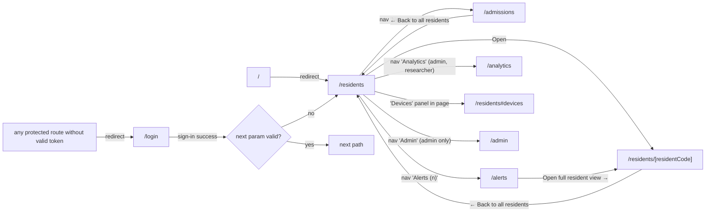
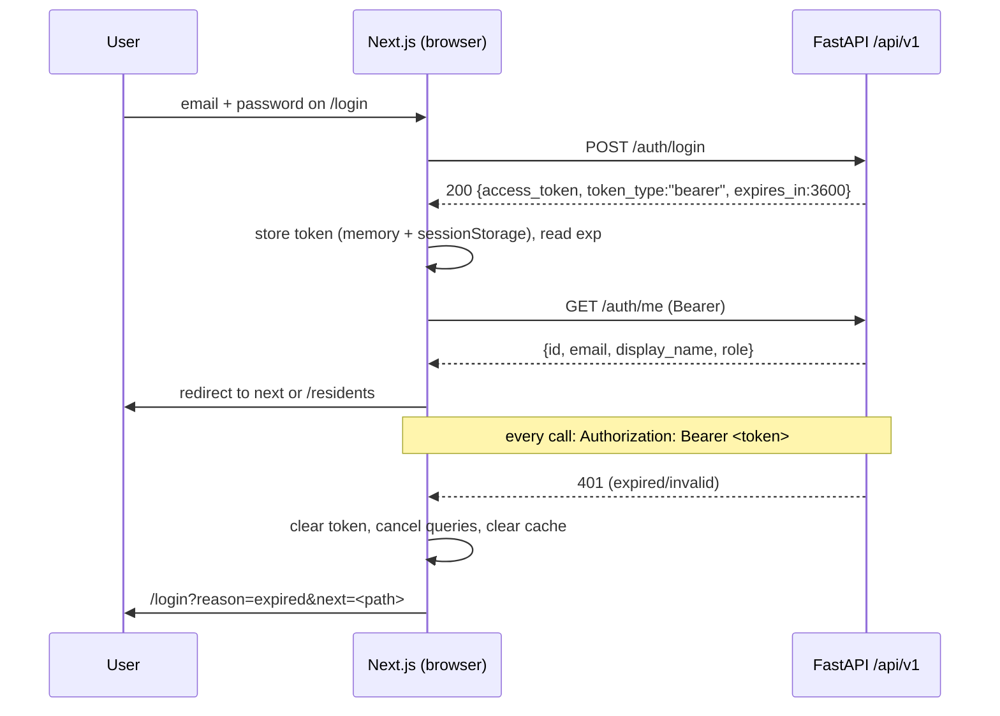

# 04 Frontend TRD

Document ID: ECHOWELL-TRD-04 · Version 0.1 (draft for review) · Date: 18 October 2026 · Owner: Team 2 · Status: Draft

## 1. Purpose

This document specifies the technical design of the EchoWell staff dashboard: a Next.js 14 (App Router) application written in TypeScript and hosted on Netlify. It defines the route map, layouts, authentication guard and token handling, the typed API client, the data-fetching and caching strategy, the component inventory with props, state management, loading/empty/error behaviour, date and number formatting, environment variables, testing, and build tooling.

The screen-level content (exact copy, element order, semantics and expected rendering with test data) is owned by TRD 11 (User Interface and UX Specification). This TRD owns *how* the frontend is built; TRD 11 owns *what* each screen shows. Where both touch the same element, the UX-xxx requirement is the content authority and the FE-xxx requirement is the implementation authority.

## 2. Scope

### In scope

- Frontend application in `frontend/` of the monorepo `EchoWellApp/echowell` (SRC-01).
- Routes `/login`, `/`, `/residents` (with Devices panel `#devices`), `/residents/[residentCode]`, `/alerts` (Alert review), `/analytics` (study-team analytics), `/admissions`, `/admin`.
- Client-side authentication state (JWT Bearer token), role-aware rendering, sign-out.
- Typed REST client for the `/api/v1` endpoints of contract section 10 (consumed, not defined, here).
- Charts (Recharts 2.x): running change tally (CUSUM), feature sparklines, facility range chart.
- Design tokens, fonts, responsive layout, accessibility implementation (WCAG 2.1 AA).
- Frontend unit/component tests (Vitest + React Testing Library), end-to-end tests (Playwright), linting and formatting.

### Out of scope

- API behaviour, request validation and authorisation enforcement (TRD 05, TRD 12, TRD 19). The frontend hides controls by role for usability only; the backend is the security boundary.
- Algorithm results (TRD 07, 08, 09). The frontend never recomputes statuses, counts, baselines, z-scores or tallies; it renders API values.
- Netlify build/deploy pipelines (TRD 15, 16), environment value management (TRD 21).
- Audio of any kind. No audio upload, playback, recording or waveform component exists (contract section 2; BR-01, BR-16).
- Push notifications, SMS or email alerts (OQ-06).
- Any LLM-based feature, summary or chat (BR-18).

## 3. References

| ID | Document | Use in this TRD |
|---|---|---|
| SRC-01 | Deployment Architecture | Next.js + React on Netlify, monorepo, AWS Amplify migration path |
| SRC-03 | Pipeline test workbook v0.1 | Exp_status_counts, Exp_scores, Exp_resident_outcomes drive E2E expectations |
| SRC-05 | Pipeline test input CSV v0.1 | Seed data for E2E environment |
| SRC-09 | Main.dc.html (Residents overview) | Layout and tokens |
| SRC-10 | Resident.dc.html (Resident detail) | Layout and tokens |
| SRC-11 | Admission.dc.html (New admissions) | Layout and tokens |
| SRC-12 | TRD_Generation_Prompt.md, "Frontend Requirements" | Mandatory views and content |
| SRC-18 | Alerts.dc.html (Alert review) | Layout and tokens of `/alerts` |
| SRC-19 | Analytics.dc.html (Analytics) | Layout and tokens of `/analytics` |
| Contract §19, §20 | Wireframe additions and reconciliation decisions R1–R17 (18 Oct 2026) | Navigation, review model, meta block, logout, CSV export |
| TRD 00 | Project Vision and Scope | BR-xx definitions |
| TRD 02 | Functional Requirements | FR-xxx requirements traced to the same BR-xx |
| TRD 05 / TRD 19 | Backend API / OpenAPI contracts | Authoritative request/response schemas |
| TRD 11 | User Interface and UX Specification | UX-xxx screen content and copy |
| TRD 12 | Security and Authentication | JWT, roles, CORS, headers |
| TRD 13 / TRD 14 | Testing strategy / Test data | Test levels, R01–R10 expectations |
| TRD 15 / TRD 16 / TRD 21 | Deployment, CI/CD, Environment configuration | Netlify build, env values |

## 4. Requirements

Priority: Must / Should / May. Verification: T = Test, I = Inspection, A = Analysis, D = Demo.

### 4.1 Technology stack and versions

| Package | Version pin | Purpose |
|---|---|---|
| Node.js | 20 LTS (`.nvmrc` = `20`) | Build and test runtime |
| next | 14.2.x | App Router framework |
| react, react-dom | 18.3.x | UI library |
| typescript | 5.x (`strict: true`) | Type safety |
| @tanstack/react-query | 5.x | Server-state fetching, caching, mutations |
| recharts | 2.x | CUSUM chart, sparklines, facility range chart |
| openapi-typescript | 7.x (dev) | Generates `lib/api-types.ts` from the committed `docs/api_reference/openapi.json` (contract §21 R22) |
| vitest | 2.x (dev) | Unit and component test runner |
| @testing-library/react, @testing-library/user-event, @testing-library/jest-dom | 16.x / 14.x / 6.x (dev) | Component tests |
| jsdom | 25.x (dev) | DOM for Vitest |
| msw | 2.x (dev) | HTTP mocking in component tests |
| @playwright/test | 1.48.x or later 1.x (dev) | End-to-end tests |
| @axe-core/playwright | 4.x (dev) | Automated accessibility checks |
| eslint | 8.x with `eslint-config-next` 14.2.x, `@typescript-eslint` 7.x, `eslint-plugin-jsx-a11y` 6.x (dev) | Linting |
| prettier | 3.x (dev) | Formatting |

Fonts are loaded with `next/font/google` (IBM Plex Sans 400/600, IBM Plex Mono 400) so that font files are self-hosted at build time and no request goes to Google at runtime.

| ID | Requirement | Priority | Trace | Verification |
|---|---|---|---|---|
| FE-001 | The frontend shall be a Next.js 14.2.x App Router application written in TypeScript 5.x with `compilerOptions.strict` set to `true`, located in `frontend/`. | Must | BR-17, SRC-01 | I |
| FE-002 | The frontend shall pin the package versions in section 4.1 in `frontend/package.json` and commit `frontend/package-lock.json`. | Must | BR-17 | I |
| FE-003 | The frontend shall use React 18.3.x and shall not depend on any UI component library; components shall be built in `frontend/components/` with CSS Modules and CSS custom properties. | Must | SRC-09, SRC-10, SRC-11 | I |
| FE-004 | The frontend shall load IBM Plex Sans (weights 400 and 600) and IBM Plex Mono (weight 400) through `next/font/google` and shall make no runtime request to `fonts.googleapis.com` or `fonts.gstatic.com`. | Must | SRC-09 | T |
| FE-005 | The frontend shall use Recharts 2.x for all charts and shall not include any other charting library. | Must | SRC-10, contract §3 | I |
| FE-006 | The frontend shall use @tanstack/react-query 5.x for all server-state reads and writes. | Must | BR-12, BR-13 | I |
| FE-007 | The frontend shall contain no component, route, API call or dependency that records, uploads, stores, plays or renders audio. | Must | BR-01, BR-16 | I |
| FE-008 | The frontend shall contain no LLM-based feature, dependency or API call. | Must | BR-18 | I |

Rationale for TanStack Query 5.x over SWR 2.x: the dashboard has write paths (staff notes, alarm reviews, review snoozes, CSV upload, pipeline run trigger, user management) whose success must refresh several dependent reads (resident header, check-in log, overview tiles, alerts). TanStack Query provides first-class `useMutation` with `onSuccess` invalidation by structured query key prefix, per-query retry predicates (no retry on 4xx), `placeholderData: keepPreviousData` for sort changes without flashing, and typed query-key factories. SWR can do these with manual `mutate` calls across keys, which is more error-prone for AI-generated code.

### 4.2 Repository layout

```
frontend/
  app/
    layout.tsx                      Root layout: <html lang="en">, fonts, <Providers>
    providers.tsx                   "use client": QueryClientProvider + AuthProvider
    page.tsx                        Redirects "/" to "/residents"
    not-found.tsx                   Global 404
    global-error.tsx                Global error boundary
    login/page.tsx                  Login screen (public)
    (protected)/
      layout.tsx                    "use client": <AuthGuard> wraps every protected route
      error.tsx                     Route-level error boundary
      residents/page.tsx            Residents overview + Devices panel (#devices)
      residents/[residentCode]/page.tsx   Resident detail
      admissions/page.tsx           New admissions (experimental)
      admin/page.tsx                Admin (role admin only)
  components/                       One folder per component: Component.tsx, Component.module.css, Component.test.tsx
  lib/
    auth.ts                         Token store (memory + sessionStorage mirror), JWT exp parsing
    AuthProvider.tsx                React context: user, role, signIn, signOut
    format.ts                       All date/time/number formatting (facility time zone)
    wording.ts                      All clinical / plain-language copy templates (PI-reviewed, OQ-12)
    queryKeys.ts                    Query-key factory
    deviceGroups.ts                 Device-range compression ("D04–D06")
    roles.ts                        Role helpers (canWriteNotes, canReviewAlarms, isAdmin, canSeeAnalytics)
    api-types.ts                    GENERATED by openapi-typescript from docs/api_reference/openapi.json (do not edit by hand)
  services/
    api.ts                          Typed API client (single module for all HTTP calls)
  styles/
    tokens.css                      Design tokens as CSS custom properties
    globals.css                     Reset, base typography, focus styles, utility classes
  middleware.ts                     Per-request CSP nonce and security headers
  tests/
    unit/                           Pure function tests (format, wording, deviceGroups, auth)
    fixtures/                       JSON API responses for the test_v0_1 data set as of 2026-10-30 15:00
    msw/handlers.ts                 MSW handlers serving fixtures
    e2e/                            Playwright specs
  next.config.js  vitest.config.ts  vitest.setup.ts  playwright.config.ts
  .eslintrc.json  .prettierrc  .nvmrc  tsconfig.json  .env.example
```

| ID | Requirement | Priority | Trace | Verification |
|---|---|---|---|---|
| FE-010 | The frontend source tree shall follow the layout in section 4.2; the existing files `frontend/package.json`, `frontend/next.config.js` and `frontend/services/api.ts` shall be filled in, not replaced by files at other paths. | Must | contract §3 | I |
| FE-011 | Every HTTP request to the backend shall be made through `frontend/services/api.ts`; no component or hook shall call `fetch` directly. | Must | BR-16 | I |
| FE-012 | `frontend/lib/api-types.ts` shall be generated by `npm run gen:api` (`openapi-typescript ../docs/api_reference/openapi.json -o lib/api-types.ts`) from the committed OpenAPI contract file that the backend produces with `python -m backend.cli export-openapi`; a CI step shall regenerate it and fail when the committed file differs (contract §21 R22). | Must | TRD 19, contract §21 R22 | T |
| FE-013 | All user-facing clinical or plain-language sentence templates (the "What this means" texts, status explanations and the review disclaimer) shall be defined only in `frontend/lib/wording.ts`. | Must | BR-18, OQ-12, SRC-10 | I |

### 4.3 Routes, layouts and navigation

| Route | File | Access | Content owner |
|---|---|---|---|
| `/login` | `app/login/page.tsx` | Public | Login (TRD 11 §4.9, UX-170–UX-176) |
| `/` | `app/page.tsx` | Public (redirect) | Redirects to `/residents` |
| `/residents` | `app/(protected)/residents/page.tsx` | admin, clinician, researcher | Residents overview + Devices panel (TRD 11 §4.3–4.4) |
| `/residents#devices` | same page, `<section id="devices">` | as above | Devices panel; header nav "Devices" links here |
| `/residents/[residentCode]` | `app/(protected)/residents/[residentCode]/page.tsx` | admin, clinician, researcher | Resident detail (TRD 11 §4.5) |
| `/admissions` | `app/(protected)/admissions/page.tsx` | admin, clinician, researcher | New admissions, experimental (TRD 11 §4.7) |
| `/admin` | `app/(protected)/admin/page.tsx` | admin | Users, pipeline runs, data upload (TRD 11 §4.10) |
| `/alerts` | `app/(protected)/alerts/page.tsx` | admin, clinician, researcher (review actions: admin, clinician) | Alert review: change-alarm queue, data-alert queue, review panel (TRD 11 §4.17) |
| `/analytics` | `app/(protected)/analytics/page.tsx` | admin, researcher | Analytics for the study team (TRD 11 §4.18) |



| ID | Requirement | Priority | Trace | Verification |
|---|---|---|---|---|
| FE-020 | The application shall implement exactly the routes in the table in section 4.3. | Must | SRC-12, contract §11 | T |
| FE-021 | A request for `/` shall redirect to `/residents` using `redirect()` from `next/navigation` in `app/page.tsx`. | Must | contract §11 | T |
| FE-022 | All routes except `/login` and `/` shall be nested in the route group `app/(protected)/` whose layout renders `<AuthGuard>`. | Must | BR-16 | I |
| FE-023 | The `/residents`, `/alerts`, `/analytics` and `/admin` pages shall render the global `AppHeader` (page title, subline, navigation links "Residents", "Alerts (<n>)", "Analytics", "New admissions" in that order) above the page content (contract §20 R2; SRC-09, SRC-18, SRC-19). | Must | SRC-09, SRC-18, SRC-19, BR-12 | T |
| FE-024 | The `AppHeader` title shall be "EchoWell" on `/residents`, "Alert review" on `/alerts`, "Analytics" on `/analytics` and "Admin" on `/admin`; the subline per page is defined in TRD 11 UX-011 and UX-017. | Must | SRC-09, SRC-18, SRC-19 | T |
| FE-025 | The `/residents/[residentCode]` and `/admissions` pages shall start with the `BackLink` "← Back to all residents" linking to `/residents` and shall not render the `AppHeader`, as in SRC-10 and SRC-11. | Must | SRC-10, SRC-11 | T |
| FE-026 | (Retired in contract §20 R2: the navigation no longer has a "Devices" link.) The Devices panel shall remain addressable as `/residents#devices`; loading that URL shall scroll to the `<section id="devices">` and move keyboard focus to its heading. | Must | SRC-09, contract §20 R2 | T |
| FE-027 | The navigation link of the current route shall carry `aria-current="page"` and the active style (2px solid ink border, font-weight 600); other links shall use 1px solid `--color-border`. | Must | SRC-09 | T |
| FE-028 | When the signed-in user's role is `admin`, the navigation shall add a fifth link "Admin" to `/admin` after "New admissions"; for other roles the link shall not render. The "Analytics" link shall render only for roles `admin` and `researcher` (clinicians have no analytics access in the MVP). | Must | contract §19, §20 R2 | T |
| FE-029 | The `AppHeader` shall show the signed-in user's display name and a button "Sign out" at the end of the navigation row. | Must | BR-16 | T |
| FE-030 | The `[residentCode]` route parameter shall be validated against `^[A-Za-z0-9_-]{1,32}$`; a value that does not match shall render the resident not-found state (TRD 11 UX state "Resident <code> was not found.") without calling the API. | Must | BR-16 | T |
| FE-031 | The `[residentCode]` value shall be passed to the API through `encodeURIComponent`. | Must | BR-16 | T |
| FE-032 | Every page shall set a document title of the form "<Page name> – EchoWell": "Residents – EchoWell", "R09 – EchoWell", "New admissions – EchoWell", "Admin – EchoWell", "Sign in – EchoWell". | Must | WCAG 2.4.2 | T |
| FE-033 | The root layout shall render a "Skip to main content" link as the first focusable element, targeting `<main id="main">`. | Must | WCAG 2.4.1 | T |
| FE-034 | A signed-in user whose role is not `admin` who navigates to `/admin` shall see the access-denied state "You do not have access to this page." with a link "Back to all residents"; no admin API call shall be made. | Must | BR-16 | T |
| FE-035 | When the API returns 403 for any call, the affected component shall render "You do not have access to this information." and shall not retry. | Must | BR-16 | T |
| FE-036 | The "Alerts (<n>)" link text shall show n = the number of change alarms with status `open` (not yet reviewed) from `GET /alerts?status=open`, refreshed with the residents query; data alerts are not counted. With the test data n = 2. | Must | SRC-18, contract §19 | T |
| FE-037 | A signed-in clinician who navigates to `/analytics` shall see the access-denied state of FE-034 and no analytics API call shall be made. | Must | contract §19 roles | T |

### 4.4 Rendering model

All protected data is fetched in the browser with the user's Bearer token. The JWT is not available to the Next.js server (it is not a cookie), so protected pages are client components (`"use client"`) inside server-rendered shells. No resident data is rendered on the server, cached at the CDN, or embedded in HTML at build time.

| ID | Requirement | Priority | Trace | Verification |
|---|---|---|---|---|
| FE-040 | Pages under `app/(protected)/` shall fetch all resident, device, admission and admin data in client components via TanStack Query; no protected data shall be fetched in server components, route handlers or at build time. | Must | BR-16 | I |
| FE-041 | The application shall be deployed as a server-capable Next.js build (on the interim host: the Netlify Next.js runtime `@netlify/plugin-nextjs`, auto-detected; on the AWS target: Amplify Hosting Next.js SSR) rather than `output: "export"`, so that `middleware.ts` (CSP nonce) and the dynamic route `/residents/[residentCode]` work. | Must | SRC-01, D-OWNER-3, TRD 15 | I |
| FE-042 | Responses of protected pages shall carry `Cache-Control: private, no-store`. | Must | BR-16 | T |
| FE-043 | `next.config.js` shall set `reactStrictMode: true`, `poweredByHeader: false`, and shall not enable `images.remotePatterns` for any domain. | Must | BR-16 | I |
| FE-044 | The frontend shall use only standard Next.js 14 features (App Router, middleware, `next/font`) and shall not depend on Netlify-specific APIs (Netlify Functions, Edge Functions, Blobs, Forms, Identity), so that it can move to AWS Amplify Hosting without significant code change. | Must | SRC-01, D-OWNER-3 | I |
| FE-045 | The TanStack Query cache shall be held in memory only and shall not be persisted to `localStorage`, `sessionStorage`, IndexedDB or the Cache API, because feature data is treated as sensitive (potentially PHI-derived) data. | Must | BR-16, D-OWNER-3 | I |

### 4.5 Authentication and authorisation

#### 4.5.1 Token storage decision

Decision: the access token returned by `POST /api/v1/auth/login` is kept **in memory** (a module-scoped variable in `lib/auth.ts`) and **mirrored to `sessionStorage`** under the key `echowell.auth` so that a page reload in the same tab keeps the user signed in. It is never written to `localStorage`, cookies, URLs, logs or analytics.

Justification:
- Contract section 10 and 12 define Bearer JWT (HS256, 60 min, no refresh token) for dashboard users. The frontend (Netlify origin) and backend (Railway origin) are different sites; an httpOnly cookie would need a cross-site `SameSite=None; Secure` cookie issued by the backend, CSRF protection and backend changes that the contract does not define. A Bearer token sent in the `Authorization` header is therefore the only mechanism consistent with the contract.
- Memory-only storage would sign the user out on every reload, which is unworkable on a dashboard that staff reload. `sessionStorage` is scoped to one tab and is cleared when the tab closes, unlike `localStorage` which persists and is shared by all tabs.
- Residual risk: script injection (XSS) could read the token. Mitigations FE-060 to FE-068 reduce this risk, and the 60-minute expiry limits the window of misuse.



| ID | Requirement | Priority | Trace | Verification |
|---|---|---|---|---|
| FE-050 | `lib/auth.ts` shall hold the access token in a module-scoped variable and mirror it to `sessionStorage["echowell.auth"]` as JSON `{ "token": string, "exp": number }`; every `sessionStorage` access shall be wrapped in `try/catch` and failures shall fall back to memory-only storage. | Must | BR-16, contract §12 | T |
| FE-051 | The frontend shall never write the access token to `localStorage`, `document.cookie`, IndexedDB, a URL, a query string, the console, or an error report. | Must | BR-16 | I, T |
| FE-052 | After a successful login the frontend shall decode the JWT payload (base64url, without signature verification) to read `exp`, and shall schedule automatic sign-out at `exp` minus 0 seconds. | Must | contract §12 | T |
| FE-053 | On startup, `AuthProvider` shall restore the token from `sessionStorage` only if `exp` is more than 30 seconds in the future; otherwise it shall delete the stored value. | Must | contract §12 | T |
| FE-054 | After restoring or receiving a token, `AuthProvider` shall call `GET /api/v1/auth/me` and expose `{ id, email, displayName, role }` through `useAuth()`; while this call is pending, `AuthGuard` shall render the page-level loading state. | Must | BR-16 | T |
| FE-055 | `AuthGuard` shall redirect to `/login?next=<current path and hash, URL-encoded>` when no valid token exists. | Must | BR-16 | T |
| FE-056 | On any API response with status 401, the API client shall clear the token (memory and `sessionStorage`), call `queryClient.cancelQueries()` and `queryClient.clear()`, and navigate to `/login?reason=expired&next=<current path>`. | Must | BR-16 | T |
| FE-057 | After sign-in, the login page shall navigate to the `next` parameter only if it starts with a single `/` and does not start with `//` or contain `://`; otherwise it shall navigate to `/residents`. | Must | BR-16 (open-redirect prevention) | T |
| FE-058 | "Sign out" shall send `POST /api/v1/auth/logout` best-effort (ignoring any error, timeout 3 s) so the backend can write the logout audit event, then clear the token and query cache and navigate to `/login`. | Must | contract §12 (audit logout) | T |
| FE-059 | Role-dependent rendering shall use `lib/roles.ts`: `canWriteNotes(role)` and `canReviewAlarms(role)` are true for `admin` and `clinician`; `isAdmin(role)` is true for `admin`; `canSeeAnalytics(role)` is true for `admin` and `researcher`. | Must | contract §10, §19 | T |

#### 4.5.2 XSS and browser-side hardening

| ID | Requirement | Priority | Trace | Verification |
|---|---|---|---|---|
| FE-060 | `middleware.ts` shall generate a per-request random nonce (16 bytes, base64) and set the response header `Content-Security-Policy: default-src 'self'; script-src 'self' 'nonce-<n>' 'strict-dynamic'; style-src 'self' 'unsafe-inline'; img-src 'self' data:; font-src 'self'; connect-src 'self' <NEXT_PUBLIC_API_BASE_URL origin>; frame-ancestors 'none'; base-uri 'self'; form-action 'self'; object-src 'none'`, and pass the nonce to Next.js through the `x-nonce` request header so framework scripts receive it. | Must | BR-16, TRD 12 | T |
| FE-061 | Responses shall carry `X-Content-Type-Options: nosniff`, `Referrer-Policy: no-referrer`, `X-Frame-Options: DENY`, `Permissions-Policy: camera=(), microphone=(), geolocation=()` and `Strict-Transport-Security: max-age=31536000; includeSubDomains` (production and staging). | Must | BR-16, contract §12 | T |
| FE-062 | The codebase shall not use `dangerouslySetInnerHTML`, `eval`, `new Function` or `innerHTML`; ESLint rule `react/no-danger` shall be set to `error`. | Must | BR-16 | I |
| FE-063 | Staff note bodies and every API-provided string shall be rendered as React text children (escaped), never as HTML or Markdown. | Must | BR-16 | T |
| FE-064 | The frontend shall load no third-party script (no analytics, tag manager, chat widget or CDN script). | Must | BR-16 | I |
| FE-065 | `npm audit --omit=dev --audit-level=high` shall pass in CI. | Must | BR-16, TRD 16 | T |
| FE-066 | The login form password field shall use `type="password"` and `autocomplete="current-password"`; the email field shall use `type="email"` and `autocomplete="username"`. | Must | BR-16 | T |
| FE-067 | Error messages shown to users shall not include stack traces, tokens or raw response bodies; they may include the API `request_id` labelled "Reference:". | Must | BR-16, TRD 17 | T |
| FE-068 | The frontend shall not display or request any personal name, date of birth, room number or other PII; residents are identified only by `resident_code`. | Must | BR-16, contract §2 | I |

### 4.6 API client (`frontend/services/api.ts`)

#### 4.6.1 Client behaviour

| ID | Requirement | Priority | Trace | Verification |
|---|---|---|---|---|
| FE-070 | `api.ts` shall build every URL as `${process.env.NEXT_PUBLIC_API_BASE_URL}/api/v1<path>`; `NEXT_PUBLIC_API_BASE_URL` shall have no trailing slash. | Must | contract §10, §13 | T |
| FE-071 | Every request shall send `Accept: application/json`, `Authorization: Bearer <token>` when a token exists, and `X-Request-ID: <crypto.randomUUID()>`. | Must | contract §10, TRD 17 | T |
| FE-072 | Every request shall be aborted after 15 seconds (`AbortController`), except CSV upload which shall be aborted after 120 seconds. | Must | NFR (TRD 03) | T |
| FE-073 | Non-2xx responses with `Content-Type: application/problem+json` shall be parsed as `{type, title, status, detail, request_id, errors}` where `type` is `urn:echowell:error:<CODE>` (UPPER_SNAKE code, catalogue in TRD 05 §4.7) and `errors[]` items are `{field, code, message}`; they shall be thrown as `ApiError` with fields `status`, `code` (the `<CODE>` suffix of `type`, or `"UNKNOWN"`), `title`, `detail`, `requestId` (from body or `X-Request-ID` header) and `errors` (default `[]`). A non-JSON error body shall produce `code: "UNKNOWN"`. | Must | contract §10, §21 R19 | T |
| FE-074 | Network failures and timeouts shall be thrown as `ApiError` with `status: 0` and `title: "Network error"`. | Must | TRD 17 | T |
| FE-079 | Forms (login, staff note, alarm review, add user, CSV upload) shall map `ApiError.errors[].field` to the matching form control and show `message` under it (linked with `aria-describedby`); errors without a matching field shall be shown above the submit button. UI logic shall branch on `ApiError.code`, never on `title` or `detail` text. | Must | contract §21 R19 | T |
| FE-075 | The client shall expose one typed function per endpoint as listed in section 4.6.2, with parameter and return types taken from `lib/api-types.ts`. | Must | TRD 19 | I |
| FE-076 | List endpoints used by the overview, devices panel and admissions page shall be called with `limit=500&offset=0`; if `total` exceeds the returned item count, the UI shall show the message defined in TRD 11 UX-041. | Must | contract §10, ASM-08 | T |

#### 4.6.2 Client functions

| Function | Method and path | Used by |
|---|---|---|
| `login(email, password)` | POST /auth/login | LoginForm |
| `logout()` | POST /auth/logout (best-effort, audited; contract §20 R4) | AppHeader |
| `getMe()` | GET /auth/me | AuthProvider |
| `getResidents({ sort })` | GET /residents?sort=alarm\|resident_id\|last_checkin&cohort=longitudinal&include_withdrawn=false&limit=500 | SummaryTiles, ResidentsTable, SortSelect, AppHeader subline |
| `getResident(code)` | GET /residents/{code} | ResidentHeader, WhatThisMeans, StaffReviewForm |
| `getCheckins(code, { from?, to? })` | GET /residents/{code}/checkins | CheckinLog |
| `getFeatures(code)` | GET /residents/{code}/features | FeatureCard, Sparkline, OtherMeasurementsCard |
| `getScores({ residentCode, epoch? })` | GET /scores?resident_code=&epoch= | CusumChart, CusumTable |
| `getAlerts({ status?, residentCode? })` | GET /alerts | AppHeader count, AlertQueue, ResidentHeader (open alarm id) |
| `getDataAlerts({ status? })` | GET /data-alerts | DataAlertQueue |
| `getAlertReviews(alertId)` | GET /alerts/{id}/reviews | ReviewHistory |
| `createAlertReview(alertId, { explanations, outcome, note? })` | POST /alerts/{id}/reviews | AlertReviewForm (on `/alerts` and in the Resident detail review dialog) |
| `snoozeAlert(alertId, { hours? })` | POST /alerts/{id}/snooze | AlertReviewForm "Remind me in 24 h" |
| `getNotes(code)` | GET /residents/{code}/notes | NotesList |
| `createNote(code, body)` | POST /residents/{code}/notes | StaffReviewForm |
| `getDevices()` | GET /devices | DevicePanel |
| `getAdmissions()` | GET /admissions | AdmissionsTable |
| `getAdmissionComparison(code)` | GET /admissions/{code}/comparison | FacilityRangeChart |
| `getReferenceRanges()` | GET /facility/reference-ranges | FacilityRangeChart (legend, method) |
| `getAnalytics()` | GET /analytics | Analytics page (kpis, daily_series, funnel, by_resident, alarm_timing or review_outcomes) |
| `downloadScoresCsv({ residentCode? })` | GET /scores with `Accept: text/csv` | Analytics "Downloads" |
| `downloadBaselinesCsv()` | GET /analytics/baselines with `Accept: text/csv` | Analytics "Downloads" |
| `listPipelineRuns()` | GET /pipeline/runs | Admin "Pipeline runs" |
| `uploadIngestCsv(file)` | POST /ingest (multipart, field `file`) | Admin "Upload data" |
| `getIngestBatch(id)` | GET /ingest/batches/{id} | Admin "Upload data" result |
| `triggerPipelineRun({ scope, profile })` | POST /pipeline/run | Admin "Pipeline runs" |
| `getPipelineRun(id)` | GET /pipeline/runs/{id} | Admin "Pipeline runs" |
| `listUsers()`, `createUser(input)`, `updateUser(id, patch)` | GET/POST/PATCH /users | Admin "Users" |
| `getHealth()` | GET /health | Admin footer "API status" |

#### 4.6.3 Response fields the frontend relies on

The authoritative schemas are in TRD 19. The frontend depends on the following fields; field names are snake_case as returned by the API, and every timestamp is an ISO 8601 UTC string while every `*_date` / `local_date` is a facility-local `YYYY-MM-DD` string.

```ts
// Common block returned by every list, detail and analytics response (contract §20 R3)
interface Meta {
  facility_name: string;        // FACILITY_NAME, e.g. "Edgewood"
  facility_tz: string;          // FACILITY_TZ, e.g. "America/Chicago"
  data_source_label: string;    // DATA_SOURCE_LABEL, e.g. "pipeline test data v0.1"
  as_of: string;                // ISO UTC as_of of the latest succeeded pipeline run (contract §21 R21), e.g. "2026-10-30T20:00:00Z"
  baseline_n: number;           // active profile baseline_n (16 in test_v0_1, 30 in production)
  cusum_h: number;              // 5.0
  pipeline_profile: "production" | "test_v0_1";
}
type DisplayStatus = "alarm_on" | "no_alarm" | "baseline_forming";
interface ResidentRow {
  resident_code: string;
  status: DisplayStatus;
  alarm_since_date: string | null;        // local date of first crossing of the open alert
  baseline_restarted_on: string | null;   // local start date of current epoch when epoch_number > 1
  baseline_progress: { n: number; N: number }; // usable sessions in current epoch / baseline_n
  current_epoch_number: number;
  device_code: string;
  device_shared: boolean;
  previous_device_code: string | null;    // set when the current device replaced another one
  last_checkin_at: string | null;         // UTC instant of latest non-duplicate record (any status)
  counts_30d: { used: number; set_aside: number; quarantined: number; missed: number };
}
interface ResidentsResponse {
  meta: Meta;
  summary: { alarm_on: number; no_alarm: number; baseline_forming: number; missed_30d: number };
  items: ResidentRow[]; total: number; limit: number; offset: number;
}
type CheckinEventType = "alarm" | "watching_started" | "baseline_complete" | "set_aside"
  | "quarantined" | "missed" | "device_silent" | "baseline_restarted";
interface CheckinEvent {
  id: string; event_type: CheckinEventType; local_date: string; occurred_at: string | null;
  reason_text: string | null;   // pipeline reason, e.g. "quality flag poor; noise above limit"
  device_code: string | null; previous_device_code: string | null;
  restart_cause: "device" | "firmware" | "software" | null;  // baseline_restarted only
  from_value: string | null; to_value: string | null;        // e.g. "fw-1.0.0" → "fw-1.1.0"
  n: number | null; N: number | null; cusum_value: number | null;
}
interface DeviceItem {
  device_code: string; active: boolean;
  residents: string[];                  // resident codes currently assigned
  shared: boolean;                      // ≥ 2 residents assigned on the as-of date
  replaced_device_code: string | null;  // this device replaced that one ("replaced D07")
  replaced_by_device_code: string | null;
  in_use_since: string | null;          // local date of current assignment start
  in_use_until: string | null;          // local date of last assignment day (inactive devices)
  last_upload_at: string | null;        // UTC instant of latest non-duplicate record
  firmware_version: string | null;
  silent_days_30d: string[];            // local dates with day_ledger status missing_device_gap on this device
  no_activity_days_30d: string[];       // local dates, while assigned, with no non-duplicate record from this device
}
interface ChangeAlarm {           // GET /alerts item
  id: string; resident_code: string; device_code: string; epoch_number: number;
  status: "open" | "acknowledged" | "closed";       // open = "Not reviewed", acknowledged = "Reviewed"
  alarm_since_date: string; open_days: number;      // open_days = as_of local date − alarm local date
  current_tally: number;                            // cusum_state.current_tally
  snoozed_until: string | null; snooze_hours: number; // snooze_hours = config alert_snooze_hours (24)
  leaning_most: string[];                           // up to 3 feature keys, mean signed z > 0, descending
}
type DataAlertKind = "baseline_stalled" | "possible_other_speaker" | "high_set_aside" | "device_silent"
  | "review_flagged_data_problem";
interface DataAlert { id: string; kind: DataAlertKind; resident_code: string | null; device_code: string | null;
  title: string; detail: string; first_detected_at: string; last_detected_at: string; status: "open" | "resolved"; }
type ReviewOutcome = "no_concern" | "known_cause" | "referred" | "data_problem";
interface AlertReview { id: string; alert_id: string; reviewer_display_name: string; explanations: string[];
  outcome: ReviewOutcome; note: string | null; created_at: string; }
type BaselinePeriod = { firstDate: string; frozenAfterDate: string; n: number }; // from GET /scores baseline_period
interface ScorePoint {
  session_id: string; local_date: string; epoch_number: number;
  composite_z: number; cusum_tally: number; alarm_state: "off" | "rings" | "on";
}
```

| ID | Requirement | Priority | Trace | Verification |
|---|---|---|---|---|
| FE-077 | The frontend shall read the facility time zone, facility name, data source label, as-of instant, `baseline_n`, `cusum_h` and `pipeline_profile` only from the `meta` block of API responses (contract §20 R3) and shall not hard-code `America/Chicago`, `16`, `30`, `5.0` or the profile in components. | Must | ASM-01, ASM-04, contract §7, §20 R3 | I, T |
| FE-078 | The frontend shall treat any additional, unknown fields in API responses as ignorable and shall treat a missing required field as an error state (TRD 11 UX error copy) rather than rendering partial data. | Must | TRD 19 | T |

### 4.7 Data fetching, caching and state management

State is split into three kinds:

| Kind | Where it lives | Examples |
|---|---|---|
| Server state | TanStack Query cache | residents, resident detail, scores, features, check-ins, notes, devices, admissions |
| Auth/session state | `AuthProvider` context + `lib/auth.ts` | token, user, role |
| URL state | `useSearchParams` | overview sort (`?sort=`), admin tab (`?tab=`) |
| Local UI state | `useState` in the component | note draft text and type, disclosure open/closed, chart-table toggle |

No global client-state library (Redux, Zustand) is used.

Query keys (`lib/queryKeys.ts`):

| Key | Function |
|---|---|
| `["me"]` | getMe |
| `["residents", { sort }]` | getResidents |
| `["resident", code]` | getResident |
| `["resident", code, "checkins"]` | getCheckins |
| `["resident", code, "features"]` | getFeatures |
| `["resident", code, "scores", epoch]` | getScores |
| `["resident", code, "notes"]` | getNotes |
| `["alerts", { status, residentCode }]` | getAlerts |
| `["data-alerts", { status }]` | getDataAlerts |
| `["alerts", id, "reviews"]` | getAlertReviews |
| `["analytics"]` | getAnalytics |
| `["devices"]` | getDevices |
| `["admissions"]` | getAdmissions |
| `["admissions", code, "comparison"]` | getAdmissionComparison |
| `["reference-ranges"]` | getReferenceRanges |
| `["admin", "users"]`, `["admin", "runs"]`, `["admin", "run", id]`, `["admin", "batch", id]` | admin functions |

| ID | Requirement | Priority | Trace | Verification |
|---|---|---|---|---|
| FE-080 | The `QueryClient` shall use defaults `staleTime: 60_000`, `gcTime: 300_000`, `refetchOnWindowFocus: true`, and a `retry` function that retries at most 2 times only when `ApiError.status` is 0 or ≥ 500, with exponential delay 1 s then 2 s. | Must | NFR (TRD 03) | T |
| FE-081 | The residents overview, devices panel and resident detail queries shall use `refetchInterval: 300_000` (5 minutes) while the document is visible. | Should | BR-12, contract §7 (pipeline after ingest) | T |
| FE-082 | The overview sort shall be held in the URL query `?sort=alarm|resident_id|last_checkin` (default `alarm` when absent or invalid) and changing it shall call `router.replace` without scrolling. | Must | SRC-12, contract §8 | T |
| FE-083 | Changing the sort shall keep the previous rows visible (`placeholderData: keepPreviousData`) until the new response arrives, and the table shall set `aria-busy="true"` during that time. | Must | SRC-09 | T |
| FE-084 | Row order on the overview shall be exactly the order of `items` returned by the API for the selected sort; the frontend shall not re-sort rows. | Must | contract §8 | T |
| FE-085 | After `createNote` succeeds, the frontend shall invalidate `["resident", code]` (prefix, which covers notes and check-ins), `["residents"]` and `["alerts"]`. | Must | BR-13 | T |
| FE-086 | After `createAlertReview` or `snoozeAlert` succeeds, the frontend shall invalidate `["alerts"]` (prefix, which covers reviews), `["data-alerts"]`, `["resident", code]`, `["residents"]` and `["analytics"]`. | Must | BR-13, contract §19 | T |
| FE-087 | The resident detail page shall issue `getResident`, `getScores`, `getFeatures`, `getCheckins` and `getNotes` in parallel; a failure of one shall render the error state only in the section that depends on it. | Must | BR-13 | T |
| FE-088 | The header subline on `/residents` shall be built from the `meta` block of the `getResidents` response. | Must | contract §11 | T |
| FE-089 | The note draft (text and type) shall be kept in component state and shall be preserved when a save fails, so the user can retry without retyping. | Must | BR-13 | T |

### 4.8 Component inventory

All components live in `frontend/components/<Name>/<Name>.tsx` with a co-located `<Name>.module.css` and `<Name>.test.tsx`. Props are listed as TypeScript. Content and copy are defined in TRD 11 (UX IDs in the last column).

| Component | Props (TypeScript) | Responsibility | UX ref |
|---|---|---|---|
| `AppHeader` | `{ meta: Meta \|" undefined; active: 'residents' \"| "admissions" \|" 'devices' \"| "admin" }` | Title "EchoWell", subline, nav, user name, Sign out | UX-010..UX-016 |
| `BackLink` | `{ href?: string /* default "/residents" */ }` | "← Back to all residents" | UX-060, UX-180 |
| `SummaryTiles` | `{ summary: ResidentsResponse["summary"] }` | Four tiles in fixed order | UX-020..UX-024 |
| `SortSelect` |" `{ value: 'alarm' \"| "resident_id" \| "last_checkin"; onChange(v): void; disabled?: boolean }` | Labelled native `<select id="sort">` | UX-030..UX-033 |
| `ResidentsTable` | `{ rows: ResidentRow[]; meta: Meta; isFetching: boolean }` | Overview table, horizontal scroll container | UX-034..UX-046 |
| `StatusBadge` | `{ status: DisplayStatus; alarmSinceDate?: string \| null; baselineRestartedOn?: string \|" null; progress?: { n: number; N: number }; size?: 'sm' \"| "lg" }` | Status text + border style + glyph | UX-036, UX-062, TRD 11 §4.3.4 |
| `DeviceCell` | `{ deviceCode: string; shared: boolean; previousDeviceCode: string \| null }` | "D02 (shared)" / "D07B (was D07)" | UX-035 |
| `DevicePanel` | `{ devices: DeviceItem[]; meta: Meta }` | Device cards, grouped card, details disclosure | UX-050..UX-058 |
| `ResidentHeader` | `{ resident: ResidentDetail; meta: Meta }` | H1 "<R> · Device <D>", baseline line, large badge | UX-061..UX-066 |
| `WhatThisMeans` | `{ resident: ResidentDetail; meta: Meta }` | Two paragraphs from `lib/wording.ts` | UX-070..UX-075 |
| `CusumChart` | `{ points: ScorePoint[]; baselinePeriod: { firstDate: string; frozenAfterDate: string; n: number } \| null; h: number; residentCode: string; tz: string }` | Running change tally chart | UX-080..UX-092 |
| `CusumTable` | `{ points: ScorePoint[]; h: number }` | Text alternative table for the chart | UX-090 |
| `FeatureCard` | `{ label: string; technicalName: string; sign: 1 \| -1; series: { localDate: string; z: number }[]; baselineForming: boolean }` | One of the 7 scored measurements with sparkline | UX-100..UX-105 |
| `Sparkline` | `{ values: number[]; ariaLabel: string; width?: number /* 120 */; height?: number /* 32 */ }` | Recharts `LineChart` without axes, zero reference line | UX-102 |
| `OtherMeasurementsCard` | `{ storedKeys: string[] /* 12 */ }` | "12 other measurements (pitch, jitter, MFCCs …)" / "stored, not scored" | UX-106..UX-107 |
| `StaffReviewForm` | `{ residentCode: string; openAlertId: string \| null; canWrite: boolean }` | Note type, note text, Save note, Mark as reviewed, OQ-05 note | UX-120..UX-133 |
| `NotesList` | `{ notes: StaffNote[]; tz: string }` | Previous notes under the form | UX-134..UX-135 |
| `CheckinLog` | `{ events: CheckinEvent[]; h: number; tz: string; residentCode: string }` | Newest-first event list + explainer line | UX-140..UX-150 |
| `AdmissionsTable` | `{ rows: AdmissionRow[]; meta: Meta; selected: string \| null; onSelect(code): void }` | New admissions table | UX-182..UX-188 |
| `FacilityRangeChart` | `{ comparison: AdmissionComparison; residentCode: string; N: number }` | One row per feature: resident dot vs grey band | UX-189..UX-194 |
| `ExperimentalBanner` | `{ children?: React.ReactNode }` | Dashed accent banner "Future / experimental study arm" | UX-181 |
| `Footer` |" `{ variant: 'overview' \"| "default" \|" 'alerts' \"| "analytics" }` | Footer statement per page variant | UX-005 |
| `AlertQueue` | `{ alarms: ChangeAlarm[]; selectedId: string \| null; onSelect(id): void; meta: Meta }` | "Change alarms · need a nurse review" list of `AlertCard`s | UX-300–UX-305 |
| `AlertCard` | `{ alarm: ChangeAlarm; selected: boolean; onSelect(): void; meta: Meta }` | "R09 · D09", review badge, "Alarm since … · open … days · tally …" | UX-301–UX-304 |
| `DataAlertQueue` | `{ alerts: DataAlert[]; meta: Meta }` | "Data alerts · go to the study team" list | UX-306–UX-309 |
| `AlertReviewPanel` | `{ alarm: ChangeAlarm; points: ScorePoint[]; baselinePeriod: BaselinePeriod \| null; reviews: AlertReview[]; canReview: boolean; meta: Meta }` | Right-hand panel: title, link, mini chart, Leaning most, form, history | UX-310–UX-322 |
| `MiniTallyChart` | `{ points: ScorePoint[]; baselinePeriod: BaselinePeriod \| null; h: number; residentCode: string }` | 90px-high variant of `CusumChart` | UX-311 |
| `LeaningMost` | `{ featureKeys: string[] }` | Plain-language, lowercased, comma-joined labels | UX-312 |
| `AlertReviewForm` | `{ alertId: string; snoozeHours: number; explanations: { code: string; label: string }[]; onSaved(): void }` | Checklist, outcome radio, note, Save review, Remind me | UX-313–UX-318, UX-136–UX-138 |
| `ReviewHistory` | `{ reviews: AlertReview[]; tz: string }` | "Previous reviews" list | UX-320 |
| `ReviewDialog` | `{ alarm: ChangeAlarm; open: boolean; onClose(): void }` | Resident detail modal wrapping `AlertReviewForm` | UX-136–UX-138 |
| `KpiTiles` | `{ kpis: AnalyticsKpis }` | Four analytics tiles | UX-351–UX-355 |
| `DailyCheckinsChart` | `{ series: { local_date: string; used: number; set_aside: number; quarantined: number; missed: number; device_silent: string[] }[]; meta: Meta }` | Stacked bars per day + legend + table alternative | UX-356–UX-361 |
| `LossFunnel` | `{ funnel: AnalyticsFunnel }` | "Where check-ins are lost" | UX-362–UX-366 |
| `UsableByResidentChart` | `{ rows: { resident_code: string; days: number; used: number; set_aside: number; quarantined: number; missed: number; usable_pct: number }[] }` | Horizontal stacked bars, lowest first | UX-367–UX-370 |
| `AlarmTimingTable` | `{ rows: { label: string; planted_change: string; change_began: string \| null; alarm_rang: string \| null; delay: string }[] }` | Test-profile panel | UX-371–UX-374 |
| `ReviewOutcomesTable` | `{ outcomes: { raised: number; reviewed: number; by_outcome: Record<ReviewOutcome, number> } }` | Production-profile panel | UX-375 |
| `SectionState` |" `{ state: 'loading' \"| "empty" \| "error"; message: string; onRetry?: () => void; requestId?: string }` | Uniform loading/empty/error rendering inside a section | UX-200..UX-206 |
| `LoginForm` | `{ next: string \|" null; reason: 'expired' \"| null }` | Email, password, Sign in | UX-170..UX-176 |
| `AdminPanel` | `{}` (reads role from `useAuth`) | Tabs Users / Pipeline runs / Upload data | UX-210..UX-216 |

| ID | Requirement | Priority | Trace | Verification |
|---|---|---|---|---|
| FE-090 | Each component in section 4.8 shall exist with the listed props interface exported from its module. | Must | BR-12, BR-13, BR-14 | I |
| FE-091 | Presentational components (`SummaryTiles`, `ResidentsTable`, `StatusBadge`, `DeviceCell`, `DevicePanel`, `ResidentHeader`, `WhatThisMeans`, `CusumChart`, `CusumTable`, `FeatureCard`, `Sparkline`, `OtherMeasurementsCard`, `CheckinLog`, `AdmissionsTable`, `FacilityRangeChart`, `ExperimentalBanner`, `Footer`) shall not call hooks that fetch data; pages shall fetch and pass data as props. | Must | testability | I |
| FE-092 | `StatusBadge` shall render the text produced by `lib/wording.ts` `statusLabel()`, and the alarm variant shall always include the "▲" glyph so that status is not conveyed by colour alone. | Must | WCAG 1.4.1, contract §11 | T |
| FE-093 | `CusumChart` shall use Recharts `ComposedChart` with: one `Bar` (`dataKey="cusum_tally"`) per scored session of the displayed epoch in time order; bar fill `--color-baseline-bar` (#BDBDB8) with 1px stroke `--color-border` (#8A8A85) when `alarm_state` is `off`; bar fill `--color-accent` (#9A4508) when `alarm_state` is `rings` or `on`; a `ReferenceLine` at `y = h` with `stroke="#9A4508"`, `strokeWidth={2}`, `strokeDasharray="6 4"` and label "alarm line 5.0" (text built from `h`, IBM Plex Mono 12px, accent colour, position `insideTopRight`); and a leading category slot "Baseline" rendered as a `ReferenceArea` with fill #BDBDB8 at opacity 0.4 labelled with the baseline date range. | Must | SRC-10, contract §11, BR-13 | T |
| FE-094 | `CusumChart` shall render a "▲" marker label above the bar whose `alarm_state` is `rings`, and the x-axis tick for that bar shall read "<Mon D> · alarm". | Must | SRC-10, BR-11 | T |
| FE-095 | `CusumChart` shall render a bar with `cusum_tally` equal to 0 as a 2px-high stub in `--color-border` so that every scored session is visible. | Should | BR-13 | T |
| FE-096 | `CusumChart` shall set its plot height to 200px, its minimum width to 700px, and shall sit inside a container with `overflow-x: auto`. | Must | SRC-10, contract §11 | T |
| FE-097 | `CusumChart` shall expose `role="img"` with an `aria-label` produced by `lib/wording.ts` `cusumSummary()` (TRD 11 UX-091), and shall be followed by a `<details>` element "Show tally as a table" containing `CusumTable`. | Must | WCAG 1.1.1, contract §11 | T |
| FE-098 | `Sparkline` shall plot signed deviations `sign × z` (so that upward always means "in the direction named by the label") as a 1.5px `--color-ink` line with a dashed zero line in `--color-rule`, without axes, grid, tooltip or animation. | Must | SRC-10, contract §6 | T |
| FE-099 | All Recharts components shall set `isAnimationActive={false}` so rendering is deterministic for tests and respects reduced-motion preferences. | Must | WCAG 2.3.3, testability | T |
| FE-100 | `FacilityRangeChart` shall render one horizontal row per feature returned by the comparison endpoint with a band from `facility_low` to `facility_high` in `--color-range-band` (#E2E2DE) and the resident's value as an 8px circle; a value outside the band shall be drawn in `--color-accent` with a "▲" glyph next to it, a value inside in `--color-ink`. | Must | SRC-11, BR-14 | T |
| FE-101 | `CheckinLog` shall render events in the order returned by the API (newest first, TRD 11 UX-141) as a `<ul>` whose items use the wording of TRD 11 UX-142. | Must | SRC-10, BR-13 | T |
| FE-102 | `DevicePanel` shall compute device-range labels such as "D01, D04–D06, D08–D10" with `lib/deviceGroups.ts` `compressDeviceCodes()`, which sorts codes naturally and joins runs of 3 or more consecutive numbers that share a prefix and have no suffix with an en dash (U+2013), and lists runs of 1 or 2 individually separated by ", ". | Must | SRC-09 | T |
| FE-103 | `Footer` shall render in IBM Plex Mono 13px `--color-text-secondary` the text of TRD 11 UX-005 for the given variant. | Must | SRC-09, SRC-10, SRC-11 | T |

### 4.9 Staff review write path

| ID | Requirement | Priority | Trace | Verification |
|---|---|---|---|---|
| FE-130 | "Save note" shall call `createNote(code, { note_type, body })`, with `alert_id` set to the resident's open alarm id when one exists; staff notes are free notes separate from alarm reviews (contract §20 R5). | Must | BR-13, contract §20 R5 | T |
| FE-131 | On Resident detail, "Mark as reviewed" (shown only when the resident has a change alarm in the current epoch) shall open a modal `ReviewDialog` (native `<dialog>`, focus moved to its heading, Escape closes, focus returned to the button) containing the same `AlertReviewForm` used on `/alerts`; saving shall call `createAlertReview(alertId, …)`. The endpoint `POST /alerts/{id}/acknowledge` does not exist and shall not be called. | Must | BR-13, contract §19, §20 R5 | T |
| FE-132 | "Save note" shall be disabled while the trimmed body is empty or longer than 2000 characters, and while a request is in flight. | Must | contract §9 (body ≤ 2000) | T |
| FE-133 | After a successful save the form shall clear the body, keep the selected note type, show the confirmation text of TRD 11 UX-130 in an `aria-live="polite"` region, and apply FE-085. | Must | BR-13 | T |
| FE-134 | The frontend shall not change the displayed alarm state, badge or chart after a review is saved; it shall render the status returned by the API after refetch (a review sets the alarm to "Reviewed" but does not reset the tally or turn the alarm off in v0.1, OQ-05). | Must | OQ-05, contract §19 | T |
| FE-135 | When `canWriteNotes(role)` is false, `StaffReviewForm` shall render the read-only message of TRD 11 UX-132 instead of the note controls and the "Mark as reviewed" button shall not render; `canReviewAlarms(role)` (admin, clinician) shall gate every review and snooze control. | Must | contract §10, §19 roles | T |
| FE-136 | `AlertReviewForm` shall contain a checkbox fieldset (explanation codes from the API/config list `review_explanations`, OQ-25), a required radio group of the 4 outcomes, an optional note (≤ 2000 characters), and the buttons "Save review" and "Remind me in <snooze_hours> h"; "Save review" without an outcome shall not call the API and shall show the error of TRD 11 UX-316. | Must | SRC-18, contract §19 | T |
| FE-137 | "Save review" shall send `{ explanations: string[] /* codes */, outcome: ReviewOutcome, note?: string }`; an empty or whitespace-only note shall be omitted. | Must | contract §19 | T |
| FE-138 | "Remind me in <h> h" shall call `snoozeAlert(id, {})` (server default `alert_snooze_hours`) and shall not create a review or change the alarm state. | Must | contract §19 | T |
| FE-139 | The `/alerts` page shall keep the selected alarm in the URL as `?alert=<alert id>`; with no valid parameter it shall select the first card of the change-alarm queue; with an empty queue the review panel shall show the empty state of TRD 11 UX-319. | Must | SRC-18 | T |

### 4.10 Loading, empty and error states

| ID | Requirement | Priority | Trace | Verification |
|---|---|---|---|---|
| FE-140 | Each data section shall render `SectionState` with `state="loading"` while its first fetch is pending; the loading element shall have `role="status"` and the section shall keep its final outer dimensions within ±20% to avoid layout jumps. | Must | WCAG 4.1.3 | T |
| FE-141 | Each data section shall render `SectionState` with `state="error"`, the copy of TRD 11 UX-203, a "Try again" button that calls `refetch()`, and "Reference: <request_id>" when a request id is known. | Must | TRD 17 | T |
| FE-142 | A 404 from `getResident` shall render the resident not-found state of TRD 11 UX-205 for the whole page and shall not render the chart, features, review or log sections. | Must | BR-13 | T |
| FE-143 | Empty states shall use the copy of TRD 11 UX-204 for each list. | Must | BR-12, BR-14 | T |
| FE-144 | When a background refetch fails while cached data exists, the page shall keep showing the cached data and shall show the inline notice "Could not refresh. Showing data as of <as-of>." until the next successful fetch. | Should | NFR | T |
| FE-145 | `app/(protected)/error.tsx` and `app/global-error.tsx` shall render "Something went wrong on this page." with a "Reload" button, and shall not render error details. | Must | TRD 17 | T |

### 4.11 Date, time and number formatting (`lib/format.ts`)

All formatting uses `Intl.DateTimeFormat("en-US", { timeZone: meta.facility_tz, ... })`. The browser's own time zone is never used. Local dates (`YYYY-MM-DD` strings such as `local_date`, `alarm_since_date`) are calendar dates in the facility time zone already and are formatted without any time-zone conversion.

| Function | Input | Output example | Rule |
|---|---|---|---|
| `formatDateTimeShort(isoUtc, tz, asOfIso)` | UTC instant | "Oct 30, 2:28 PM" | Month short name, day without leading zero, comma, `h:mm` 12-hour, space, "AM"/"PM". If the year differs from the as-of year: "Dec 30, 2025, 2:28 PM". |
| `formatAsOf(isoUtc, tz)` | UTC instant | "Oct 30, 2026, 3:00 PM CT" | Always includes year; time-zone part from `timeZoneName: "shortGeneric"` ("CT"); if the runtime returns a "GMT±h" form, fall back to `timeZoneName: "short"` ("CDT"). |
| `formatLocalDate(yyyyMmDd, asOfIso, tz)` | local date | "Oct 21" | "Mon D"; append ", YYYY" when the year differs from the as-of year. Parsed by splitting the string, never with `new Date("YYYY-MM-DD")`. |
| `formatLocalDateRange(a, b, …)` | two local dates | "Oct 1–16", "Sep 25–Oct 10", "Dec 20, 2025–Jan 5, 2026" | Same month: "Mon D–D"; different month same year: "Mon D–Mon D"; different year: full dates. En dash U+2013, no spaces. |
| `formatTally(x)` | number | "5.4", "26.8", "0.0" | One decimal, half away from zero. |
| `formatSigned(x)` | number | "+2.2", "−0.3" | One decimal; minus is U+2212. |
| `formatCounts30d(c)` | counts | "30 · 0 · 0 · 0" | used · set_aside · quarantined · missed, separator " · " (space, U+00B7, space). |

| ID | Requirement | Priority | Trace | Verification |
|---|---|---|---|---|
| FE-150 | All date and time output shall be produced by `lib/format.ts` functions in section 4.11 using `meta.facility_tz`. | Must | ASM-01, contract §7, §8 | T |
| FE-151 | `formatDateTimeShort("2026-10-30T19:28:04Z", "America/Chicago", "2026-10-30T20:00:00Z")` shall return "Oct 30, 2:28 PM". | Must | SRC-09 | T |
| FE-152 | `formatAsOf("2026-10-30T20:00:00Z", "America/Chicago")` shall return "Oct 30, 2026, 3:00 PM CT" in Node 20 and in current Chromium, Firefox and WebKit. | Must | SRC-09 | T |
| FE-153 | `formatLocalDate("2026-10-01", …)` shall return "Oct 1" regardless of the test runner's `TZ` environment variable (tests shall run with `TZ=Pacific/Kiritimati` and `TZ=America/Los_Angeles`). | Must | SRC-09 | T |
| FE-154 | Number output shall use the formats in section 4.11; tallies shall never be shown with more than one decimal in the UI. | Must | SRC-10 | T |

### 4.12 Design tokens and styling

`styles/tokens.css` defines:

```css
:root {
  --font-sans: var(--font-ibm-plex-sans), system-ui, sans-serif;
  --font-mono: var(--font-ibm-plex-mono), ui-monospace, monospace;
  --color-ink: #1F1F1E;            /* text, strong borders */
  --color-page: #F6F6F4;           /* page background */
  --color-surface: #FFFFFF;        /* cards, tables */
  --color-text-secondary: #4A4A47; /* sublines, labels, captions */
  --color-border: #8A8A85;         /* card and control borders */
  --color-rule: #C9C9C4;           /* row separators */
  --color-table-header: #EDEDEA;   /* thead background */
  --color-accent: #9A4508;         /* alarm/accent; always with glyph or text */
  --color-baseline-bar: #BDBDB8;   /* baseline period and below-line tally bars */
  --color-muted-panel: #FAFAF8;    /* "stored, not scored" card, chart placeholder bg */
  --color-range-band: #E2E2DE;     /* facility range band (SRC-11, contract §20 R13) */
  --color-used: #4A4A47;           /* analytics "Used" segments (SRC-19) */
  --color-funnel-received: #6E6E6A; /* funnel step 2 (SRC-19) */
  --color-funnel-passed: #5A5A57;  /* funnel step 3 (SRC-19); step 1 uses --color-border, step 4 --color-used */
  --content-max: 1200px;
  --page-pad-y: 32px; --page-pad-x: 24px;
  --section-gap: 24px; --card-pad: 16px; --tile-gap: 16px;
  --touch-min: 44px;
  --focus-ring: 3px solid #1F1F1E;
}
```

| ID | Requirement | Priority | Trace | Verification |
|---|---|---|---|---|
| FE-160 | Colours, fonts and spacings in components shall come only from the custom properties in `styles/tokens.css`; hex colour literals elsewhere shall fail lint (`stylelint` is not used; a Vitest test shall scan `components/**/*.module.css` for `#[0-9a-fA-F]{3,6}`). | Must | contract §11 | T |
| FE-161 | `body` shall use `--font-sans`, `--color-ink` text on `--color-page` background, margin 0; main content shall be centred with `max-width: var(--content-max)` and padding `var(--page-pad-y) var(--page-pad-x)`. | Must | SRC-09 | T |
| FE-162 | Every interactive element (link styled as button, button, select, textarea, nav link, "Open" link, disclosure summary) shall have a rendered height of at least 44px and a width of at least 44px. | Must | contract §11, WCAG 2.5.5 | T |
| FE-163 | Every focusable element shall show `outline: var(--focus-ring); outline-offset: 2px` on `:focus-visible`. | Must | WCAG 2.4.7 | T |
| FE-164 | Under `@media (prefers-reduced-motion: reduce)` the application shall use no CSS transitions or animations. | Must | WCAG 2.3.3 | T |
| FE-165 | Breakpoints shall be: ≥ 1024px desktop (wireframe layout); 640–1023px tablet; < 640px phone; layout changes per breakpoint are defined in TRD 11 section 4.12. | Must | TRD 11 | T |

### 4.13 Environment variables

| Variable | Example | Required | Use |
|---|---|---|---|
| `NEXT_PUBLIC_API_BASE_URL` | `http://localhost:8000` (local); the HTTPS origin of the Railway staging or production service (interim) or of the AWS App Runner service (target), as set in TRD 21 | Yes | API origin; also inserted in CSP `connect-src` |
| `NEXT_PUBLIC_APP_ENV` | `local` \| `staging` \| `production` \| `test` | Yes | Environment marker |

| ID | Requirement | Priority | Trace | Verification |
|---|---|---|---|---|
| FE-170 | The frontend shall read only the environment variables `NEXT_PUBLIC_API_BASE_URL` and `NEXT_PUBLIC_APP_ENV`, and `frontend/.env.example` shall list exactly these two with local values. | Must | contract §13 | I |
| FE-171 | The build shall fail with a clear message when `NEXT_PUBLIC_API_BASE_URL` is missing or is not an absolute `http(s)` URL, or when it is `http://` while `NEXT_PUBLIC_APP_ENV` is `staging` or `production`. | Must | contract §12 (HTTPS only), TRD 21 | T |
| FE-172 | When `NEXT_PUBLIC_APP_ENV` is not `production`, the page shall render a fixed text marker "Environment: <value>" in IBM Plex Mono 12px at the top of `<body>`, above the skip link target. | Should | TRD 15 | T |
| FE-173 | No secret (JWT secret, API key, database URL) shall be referenced from frontend code or from any `NEXT_PUBLIC_*` variable. | Must | BR-16, contract §12 | I |

### 4.14 Testing

| Level | Tool | Location | What |
|---|---|---|---|
| Unit | Vitest | `tests/unit/` | `format.ts`, `wording.ts`, `deviceGroups.ts`, `auth.ts` (exp parsing, storage fallback), `api.ts` (error parsing, 401 handling) |
| Component | Vitest + RTL + MSW | `components/**/<Name>.test.tsx` | Every component in 4.8 rendered with fixtures from `tests/fixtures/` |
| E2E | Playwright (Chromium, Firefox, WebKit; viewports 1280×900 and 390×844) | `tests/e2e/` | Full stack: docker-compose backend with `PIPELINE_PROFILE=test_v0_1`, SRC-05 ingested, as-of 2026-10-30 15:00 America/Chicago |
| Accessibility | @axe-core/playwright | `tests/e2e/a11y.spec.ts` | Zero `serious` or `critical` violations on every route |

Fixtures in `tests/fixtures/` are JSON responses captured from the backend running the test_v0_1 profile on SRC-05 (generated by `npm run fixtures:capture` against the local stack) and are checked in. Their content must match the expected rendering table in TRD 11 section 4.13.

| ID | Requirement | Priority | Trace | Verification |
|---|---|---|---|---|
| FE-180 | `npm run test` shall run Vitest with overall line coverage ≥ 80% for `frontend/` source (contract §20 R7), measured on `app/`, `components/`, `lib/` and `services/`. | Must | TRD 13, contract §20 R7 | T |
| FE-181 | A component test shall render `SummaryTiles` with the test fixture and assert the tile values 2, 7, 1 and 19 in the order "Alarm on", "Being watched, no alarm", "Baseline still forming", "Missed check-ins, last 30 days". | Must | SRC-09, SRC-03, BR-15 | T |
| FE-182 | A component test shall render `ResidentsTable` with the test fixture and assert, for each of R01–R10, the device cell, status badge text, last check-in text and 30-day counts listed in TRD 11 section 4.13.1. | Must | SRC-09, SRC-03, BR-15 | T |
| FE-183 | A component test shall render `CusumChart` with the R09 fixture and assert 14 bars, of which the first 4 (Oct 17–20) use the below-line fill and the last 10 (Oct 21–30) use the accent fill, the reference line at y = 5.0, and the tick "Oct 21 · alarm". | Must | SRC-10, SRC-03 | T |
| FE-184 | A component test shall render `CusumTable` for R09 and assert 14 rows whose tally values equal `Exp_scores.cusum_tally` rounded to one decimal (3.2, 2.6, 1.8, 1.6, 5.4, 8.0, 8.3, 10.7, 12.4, 15.3, 16.7, 18.8, 23.1, 26.8). | Must | SRC-03, BR-15 | T |
| FE-185 | E2E test `overview.spec.ts` shall log in as a seeded clinician, load `/residents`, and assert the tiles, the row order for each of the three sort options (TRD 11 section 4.13.2), and the Devices panel cards. | Must | SRC-09, contract §8 | T |
| FE-186 | E2E test `resident-detail.spec.ts` shall open R09, R10, R08 and R07 and assert the header, badge, baseline line and first three check-in log entries listed in TRD 11 section 4.13.3. | Must | SRC-10, BR-15 | T |
| FE-187 | E2E test `staff-review.spec.ts` shall add an "Observation" note on R09 (asserting it appears in the notes list), then click "Mark as reviewed", choose the outcome "Checked on resident, no concern", click "Save review", and assert the dialog closes, the review appears in the alert's review history, the `/alerts` card for R09 shows "Reviewed", the nav shows "Alerts (1)", and the badge still reads "▲ Alarm since Oct 21". | Must | BR-13, OQ-05, contract §20 R5 | T |
| FE-188 | E2E test `auth.spec.ts` shall assert redirect to `/login` without a token, redirect back to the `next` path after sign-in, rejection of an external `next` value, sign-out, and that a researcher sees no note form and an access-denied state on `/admin`. | Must | BR-16 | T |
| FE-189 | E2E test `admissions.spec.ts` shall assert the experimental banner text and the empty state for the test data set (no new admissions). | Must | SRC-11, BR-14 | T |
| FE-190 | E2E test `a11y.spec.ts` shall run axe on `/login`, `/residents`, `/residents/R09`, `/residents/R08`, `/admissions` and `/admin` and fail on any `serious` or `critical` violation. | Must | WCAG 2.1 AA, NFR | T |
| FE-191 | E2E test `responsive.spec.ts` shall load `/residents` and `/residents/R09` at 390×844 and assert `document.documentElement.scrollWidth <= window.innerWidth` (no page-level horizontal scroll). | Must | TRD 11 §4.12 | T |
| FE-192 | E2E test `privacy.spec.ts` shall assert that no request made by the application targets a host other than the frontend origin and `NEXT_PUBLIC_API_BASE_URL`, and that no `<audio>` or `<video>` element exists on any route. | Must | BR-01, BR-16 | T |
| FE-193 | E2E test `alerts.spec.ts` shall assert on `/alerts` with the test data: change-alarm cards "R09 · D09" / "Alarm since Oct 21 · open 9 days · tally 26.8" and "R10 · D10" / "Alarm since Oct 24 · open 6 days · tally 13.4", both "Not reviewed"; exactly the four data-alert cards of TRD 11 §4.17.6 in that order; R09 selected by default with "Leaning most" "more pauses, quieter, less voiced sound"; "Save review" without an outcome shows the required-outcome error; "Remind me in 24 h" changes the R09 badge text to the snoozed form of TRD 11 UX-303. | Must | SRC-18, contract §19 | T |
| FE-194 | E2E test `analytics.spec.ts` shall log in as a researcher and assert on `/analytics` the KPI tiles, funnel values, by-resident order and percentages, the daily chart table alternative for Oct 1, Oct 12 and Oct 22, and the alarm timing table of TRD 11 §4.18.7; and shall assert that a clinician gets the access-denied state. | Must | SRC-19, contract §19 | T |
| FE-195 | A component test shall render `AnalyticsPage` with a fixture whose `meta.pipeline_profile` is `production` and assert that `ReviewOutcomesTable` replaces `AlarmTimingTable` and that the subline omits "numbers match the pipeline answer key". | Must | SRC-19, contract §19 | T |

### 4.15 Build, lint and formatting

`frontend/package.json` scripts:

| Script | Command |
|---|---|
| `dev` | `next dev -p 3000` |
| `build` | `next build` |
| `start` | `next start -p 3000` |
| `lint` | `next lint --max-warnings 0` |
| `typecheck` | `tsc --noEmit` |
| `format` | `prettier --write .` |
| `format:check` | `prettier --check .` |
| `test` | `vitest run --coverage` |
| `test:e2e` | `playwright test` |
| `gen:api` | `openapi-typescript ../docs/api_reference/openapi.json -o lib/api-types.ts` |
| `fixtures:capture` | `node tests/fixtures/capture.mjs` |

| ID | Requirement | Priority | Trace | Verification |
|---|---|---|---|---|
| FE-200 | ESLint shall extend `next/core-web-vitals`, `plugin:@typescript-eslint/recommended` and `plugin:jsx-a11y/strict`, and shall set `react/no-danger: error`, `no-console: ["error", { allow: ["warn", "error"] }]` and `@typescript-eslint/no-explicit-any: error`. | Must | TRD 18 | I |
| FE-201 | Prettier shall use `printWidth: 100`, `singleQuote: false`, `trailingComma: "all"`, `semi: true`. | Should | TRD 18 | I |
| FE-202 | CI shall run, in order, `npm ci`, `npm run lint`, `npm run typecheck`, `npm run format:check`, `npm run test`, `npm run build`, and E2E tests on pull requests to `main`; any failure shall fail the workflow. | Must | BR-17, TRD 16 | T |
| FE-203 | `npm run build` shall complete with zero TypeScript errors and zero ESLint warnings. | Must | BR-17 | T |
| FE-204 | The first-load JavaScript of `/residents` reported by `next build` shall be ≤ 250 kB (gzip). | Should | NFR (TRD 03) | T |

### 4.16 Traceability: component → API endpoint → requirements

FR-xxx identifiers are defined in TRD 02 and trace to the same BR-xx listed here; the BR column is the shared trace parent.

| Component | API endpoint(s) | BR | UX requirements | FE requirements |
|---|---|---|---|---|
| AppHeader | GET /residents (meta), GET /alerts?status=open (count), GET /auth/me, POST /auth/logout | BR-12, BR-16 | UX-010–UX-018 | FE-023, FE-024, FE-027–FE-029, FE-036, FE-088 |
| SummaryTiles | GET /residents (summary) | BR-12, BR-06 | UX-020–UX-024 | FE-181 |
| SortSelect | GET /residents?sort= | BR-12 | UX-030–UX-033 | FE-082–FE-084 |
| ResidentsTable, StatusBadge, DeviceCell | GET /residents (items) | BR-12, BR-06, BR-03, BR-08 | UX-034–UX-046 | FE-084, FE-092, FE-182 |
| DevicePanel | GET /devices | BR-12, BR-06, BR-08 | UX-050–UX-058 | FE-102 |
| ResidentHeader | GET /residents/{code} | BR-13, BR-09, BR-08 | UX-061–UX-066 | FE-087 |
| WhatThisMeans | GET /residents/{code} | BR-13, BR-18 | UX-070–UX-075 | FE-013 |
| CusumChart, CusumTable | GET /scores?resident_code=&epoch= | BR-11, BR-13 | UX-080–UX-092 | FE-093–FE-097, FE-183, FE-184 |
| FeatureCard, Sparkline, OtherMeasurementsCard | GET /residents/{code}/features | BR-10, BR-13 | UX-100–UX-107 | FE-098 |
| StaffReviewForm, NotesList, ReviewDialog | GET/POST /residents/{code}/notes, GET /alerts, POST /alerts/{id}/reviews | BR-13, BR-16 | UX-120–UX-138 | FE-130–FE-137, FE-187 |
| AlertQueue, AlertCard | GET /alerts | BR-11, BR-13 | UX-300–UX-305 | FE-036, FE-139, FE-193 |
| DataAlertQueue | GET /data-alerts | BR-04, BR-05, BR-06, BR-12 | UX-306–UX-309 | FE-193 |
| AlertReviewPanel, MiniTallyChart, LeaningMost, AlertReviewForm, ReviewHistory | GET /scores, GET /alerts/{id}/reviews, POST /alerts/{id}/reviews, POST /alerts/{id}/snooze | BR-11, BR-13, BR-18 | UX-310–UX-322 | FE-093, FE-136–FE-139, FE-193 |
| KpiTiles, DailyCheckinsChart, LossFunnel, UsableByResidentChart, AlarmTimingTable, ReviewOutcomesTable | GET /analytics; CSV via GET /scores, GET /analytics/baselines (`Accept: text/csv`) | BR-03, BR-04, BR-05, BR-06, BR-15 | UX-350–UX-384 | FE-037, FE-194, FE-195 |
| CheckinLog | GET /residents/{code}/checkins | BR-13, BR-04, BR-05, BR-06, BR-08 | UX-140–UX-150 | FE-101 |
| ExperimentalBanner, AdmissionsTable | GET /admissions | BR-14 | UX-180–UX-188 | FE-189 |
| FacilityRangeChart | GET /admissions/{code}/comparison, GET /facility/reference-ranges | BR-14 | UX-189–UX-194 | FE-100 |
| LoginForm | POST /auth/login | BR-16 | UX-170–UX-176 | FE-050–FE-057, FE-066 |
| AdminPanel | /users, /ingest, /ingest/batches/{id}, /pipeline/run, /pipeline/runs, /pipeline/runs/{id}, /health | BR-16, BR-02, BR-15 | UX-210–UX-216 | FE-028, FE-034 |
| Footer | none | BR-01, BR-03 | UX-005 | FE-103 |

## 5. Assumptions

- ASM-01: Facility time zone is America/Chicago; the frontend still reads it from `meta.facility_tz`.
- ASM-03: Single facility (Edgewood) in the MVP; the facility name is rendered from `meta.facility_name` (FACILITY_NAME).
- ASM-04 / D-OWNER-2: Production `baseline_n` = 30 (owner decision 18 Oct 2026); the test_v0_1 profile (16) exists only for build-out and testing and is never used in production. The frontend renders N from the API, so the same build shows "of 16" on test data and "of 30" in production.
- D-OWNER-3 / D-OWNER-4: AWS (Amplify for the frontend) is the target production platform; Netlify is the interim host and carries synthetic and test data only. The frontend shall stay portable (FE-044).
- ASM-08: Fewer than 25 users and fewer than 100 residents; therefore lists are fetched in a single page of up to 500 rows and no virtualisation is used.
- Note for lead (TRD-local): the API returns a `meta` block and the fields listed in section 4.6.3 on the endpoints named there; TRD 05/19 must define them with these names.

## 6. Dependencies

| Dependency | Needed for |
|---|---|
| Backend `/api/v1` endpoints of contract section 10, schemas in TRD 19 | All data |
| Committed `docs/api_reference/openapi.json` (contract §21 R22) | `gen:api` type generation (FE-012) |
| Backend CORS allow-list containing the Netlify origin(s) (TRD 12) | Browser calls |
| Seeded users per role and SRC-05 ingested under `test_v0_1` (TRD 14) | E2E tests |
| Netlify site with `@netlify/plugin-nextjs` and environment values (TRD 15, TRD 21) | Deployment |
| PI-reviewed wording in `lib/wording.ts` (OQ-12) | Final "What this means" copy |

## 7. Acceptance Criteria

| ID | Criterion |
|---|---|
| AC-FE-01 | `npm ci && npm run lint && npm run typecheck && npm run format:check && npm run test && npm run build` exits 0 in `frontend/` on Node 20. |
| AC-FE-02 | With the local stack seeded with SRC-05 under `test_v0_1` and as-of 2026-10-30 15:00 America/Chicago, `/residents` shows tiles 2 / 7 / 1 / 19 and the rows of TRD 11 section 4.13.1 (Playwright FE-185 passes). |
| AC-FE-03 | `/residents/R09` shows "R09 · Device D09", "▲ Alarm since Oct 21", a chart with 14 bars (4 below-line, 10 accent), the dashed line labelled "alarm line 5.0", and the check-in log entries "Oct 21 · Alarm on · tally crossed 5.0", "Oct 17 · Watching started", "Oct 16 · Baseline complete (16 of 16)" (FE-183, FE-186 pass). |
| AC-FE-04 | `/residents/R08` shows "Baseline forming · 13 of 16 sessions" and no tally bars; setting `PIPELINE_PROFILE=production` and re-running shows "of 30" without any frontend change. |
| AC-FE-05 | Opening any protected route without a token redirects to `/login`; after sign-in the user returns to that route; `next=https://example.com` is ignored. |
| AC-FE-06 | Searching the built `.next/static` output for the token storage key shows only `sessionStorage` usage; no `localStorage` write of the token exists (FE-051 inspection). |
| AC-FE-07 | Response headers of `/residents` on the staging deploy include the CSP with a nonce, HSTS, `X-Frame-Options: DENY` and `Cache-Control: private, no-store`. |
| AC-FE-08 | axe reports zero serious/critical violations on all routes (FE-190) and no page-level horizontal scroll at 390px width (FE-191). |
| AC-FE-09 | No network request to any host other than the frontend origin and the API origin occurs during the E2E suite (FE-192). |
| AC-FE-10 | After saving a review for R09 via "Mark as reviewed", the R09 alert shows "Reviewed", the nav shows "Alerts (1)" and the badge still reads "▲ Alarm since Oct 21" (FE-187). |
| AC-FE-11 | `/alerts` and `/analytics` render the test-data values of TRD 11 §4.17.6 and §4.18.7 (FE-193, FE-194 pass); a clinician cannot open `/analytics`. |

## 8. Implementation Notes

- Start from `create-next-app@14.2` with TypeScript, ESLint, App Router, `src/` disabled, Tailwind disabled; then move into the layout of section 4.2. Keep `frontend/services/api.ts` as the single HTTP module.
- `"use client"` is required in `providers.tsx`, `(protected)/layout.tsx`, every page under `(protected)`, and every component that uses hooks, Recharts or event handlers. Recharts must not be imported in server components.
- Do not parse local dates with `new Date("2026-10-01")`: that is interpreted as UTC midnight and displays as Sep 30 in America/Chicago. Split the string and build the label from the parts.
- `Intl.DateTimeFormat` with `timeZoneName: "shortGeneric"` is supported in Node 20 and current browsers; still implement the fallback in FE-152 and test it by stubbing the formatter.
- Wording: `lib/wording.ts` exports a constant `CLINICAL_WORDING_APPROVED = false`. While false, `WhatThisMeans` appends " [Final clinical wording: confirm with PI]" exactly as in SRC-10. Changing it to `true` requires a PR approved by the PI or the PI's delegate (OQ-12); the PR description must quote the approved text.
- The chart's "Baseline" slot is a categorical x value `"__baseline__"` placed before the first scored date; render its tick label with the baseline date range (e.g. "Baseline Oct 1–16"). Keep it even when the epoch has many scored sessions so the baseline period is always visible.
- Grey vs accent bars follow `alarm_state` from `/scores`, not a client-side comparison with `h`: after a first crossing the alarm persists ("on") even if the tally later drops below the line, and the bars must stay accent to show persistence.
- Do not compute the overview order client-side (FE-084); the API implements the contract §8 sort rules. Test fixtures must be captured per sort value.
- MSW: register handlers for every endpoint in section 4.6.2; unhandled requests must fail the test (`onUnhandledRequest: "error"`).
- Playwright: set `timezoneId: "America/Los_Angeles"` in the browser context to prove the UI uses the facility zone, not the browser zone.
- Netlify: `netlify.toml` in `frontend/` sets `base = "frontend"`, `command = "npm run build"`, `publish = ".next"`; details in TRD 15.

## 9. Open Questions

| ID | Relevance to the frontend |
|---|---|
| OQ-05 | Whether staff review resets the tally or turns the alarm off. The UI shows the API state only and displays the open-question note. |
| OQ-06 | Alert delivery outside the dashboard; no push UI is built. |
| OQ-08 | Facility norm definition for the admissions comparison; the page is marked experimental and renders whatever ranges the API returns. |
| OQ-12 | Final clinical wording of "What this means"; held in `lib/wording.ts` behind `CLINICAL_WORDING_APPROVED`. |
| OQ-13 | Alarm-limit calibration on the larger dataset; the alarm line value is rendered from `meta.cusum_h`, never hard-coded. (Production `baseline_n` = 30 is decided, D-OWNER-2; N is still rendered from the API.) |
| OQ-18 | EWMA trend vs baseline band display; not built. |

## Revision History

| Version | Date | Change | Author |
|---|---|---|---|
| 0.1 | 18 Oct 2026 | Initial generation from TRD_Generation_Prompt.md | — |
| 0.1 (rev. c) | 18 Oct 2026 | Contract §21: problem+json error codes (R19), as_of from latest succeeded run (R21), generated types at `lib/api-types.ts` from `docs/api_reference/openapi.json` (R22); FE-079 added | — |
| 0.1 (rev. b) | 18 Oct 2026 | Contract §19/§20: added `/alerts` and `/analytics` (SRC-18, SRC-19), unified navigation (R2), `meta.pipeline_profile` (R3), logout and pipeline-run list and CSV export (R4), review model replacing acknowledge (R5), coverage gate (R7), as-of handling (R11), tokens (R13); FE-026 retired | — |
