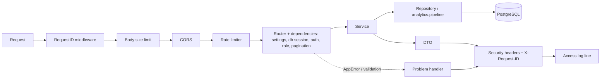

# 05 Backend API TRD

Document ID: ECHOWELL-TRD-05 · Version 0.13 (draft for review) · Date: 18 October 2026, revised 26 October 2026 · Owner: Team 2 · Status: Draft

## 1. Purpose

This document specifies the EchoWell backend HTTP service: a FastAPI application hosted on Railway that
receives acoustic feature records from Team 1 devices, stores them unaltered, triggers the deterministic
analytics pipeline, and serves the dashboard (Next.js on Netlify) with resident status, scores, alerts,
staff notes, device health and research analytics. It defines the application structure, dependency
injection, authentication dependencies, request lifecycle, per-endpoint validation, ingest semantics,
pipeline triggering, error model, pagination/sorting/filtering, CORS, rate limits, request IDs, health
check, OpenAPI exposure and performance budgets.

The exact wire contract (every field, every status code, the OpenAPI 3.1 document) is in TRD 19. This
document is the behavioural specification; TRD 19 is the schema specification. Where they overlap they
are identical; if a difference is ever found, TRD 19 wins for field names and types and this TRD wins for
behaviour.

## 2. Scope

In scope:
- FastAPI application layout under `backend/` (routers, schemas, services, repositories, models, core).
- All endpoints listed in the shared contract §10 as amended by §19 and §20 (reviews, snooze, data alerts,
  pipeline run list, CSV export, logout) under base path `/api/v1`.
- Ingest semantics for single records (`POST /sessions`) and batches (`POST /ingest`, JSON or CSV).
- Pipeline triggering: synchronous per affected resident after single ingest, background task after batch
  ingest, nightly full run, manual admin run.
- Cross-cutting HTTP behaviour: error model, request IDs, CORS, rate limiting, security headers, logging hooks.
- Operational CLI commands that the API depends on (`backend/cli.py`: create-user, create-api-key,
  revoke-api-key) and the nightly job entry point (`backend/jobs/nightly_run.py`).

Out of scope:
- The analytics algorithm itself (TRD 07, TRD 08, TRD 09); the backend only calls `analytics.pipeline`.
- Table DDL (TRD 06, TRD 20); the backend uses the tables defined in contract §9.
- Device-side capture, wake word, feature extraction and transport (Team 1; interface only, ASM-05).
- Any audio handling: no endpoint accepts, stores, returns or proxies audio (BR-01, SEC TRD 12).
- Any LLM, chat, generated summary or ML inference endpoint (BR-18).
- Push notifications (SMS/email) for alerts (OQ-06).

## 3. References

| ID | Document |
|---|---|
| SRC-01 | Deployment Architecture (FastAPI on Railway, PostgreSQL on Neon/Railway, monorepo) |
| SRC-02 | Daily Data Storage and Processing Flowcharts (raw store kept as received; 6-stage processing) |
| SRC-03 | Pipeline test workbook v0.1 (answer key used in examples and acceptance) |
| SRC-05 | Pipeline test input CSV v0.1 (exact CSV header accepted by `POST /ingest`) |
| SRC-21 | Clinical dashboard wireframe v0.2 (echowell-wireframes-v0.2.html: Resident list, Resident chart, New admissions, Study team) |
| SRC-09, SRC-10, SRC-11, SRC-18, SRC-19 | Wireframes v0.1 (Main, Resident, Admission, Alerts, Analytics): superseded by SRC-21 (TRD 24 D-108); removed from the repository |
| SRC-12 | TRD Generation Prompt |
| SRC-17 | Implement_Feature_Batches.md (Phase 10 expects GET /health, /residents, /residents/{id}, /alerts, /scores, /analytics, POST /sessions, /ingest) |
| TRD 01 | System Architecture |
| TRD 02 | Functional Requirements |
| TRD 06 / TRD 20 | Database design / PostgreSQL schema |
| TRD 07 / 08 / 09 | Analytics engine, baseline and scoring, CUSUM and alerting |
| TRD 10 | Data Ingestion and Validation |
| TRD 12 | Security and Authentication |
| TRD 17 | Logging, Monitoring and Error Handling |
| TRD 19 | API Contracts / OpenAPI Spec |
| TRD 21 | Environment Configuration |

## 4. Requirements

### 4.1 Application structure

```
backend/
  main.py                    create_app(): FastAPI instance, middleware, exception handlers, routers
  cli.py                     admin CLI: create-user, create-api-key, revoke-api-key, export-openapi, seed, … (full list TRD 15 §4.8)
  jobs/nightly_run.py        nightly pipeline entry point (Railway cron service)
  api/                       routers (thin: parse, authorise, call one service, map DTO)
    health.py                GET /health (calls health_service.get_health)
    auth.py                  /auth/login, /auth/logout, /auth/me
    config.py                GET /config/ui (operational UI configuration; API-137)
    sessions.py              POST /sessions
    ingest.py                POST /ingest, GET /ingest/batches/{id}
    residents.py             /residents, /residents/{code}, /checkins, /features, /notes
    scores.py                GET /scores
    alarms.py                /alerts, /alerts/{id}/reviews, /alerts/{id}/snooze, /data-alerts   (existing skeleton file kept)
    devices.py               GET /devices
    analytics.py             GET /analytics, GET /analytics/baselines
    pipeline.py              POST /pipeline/run, GET /pipeline/runs, GET /pipeline/runs/{id}
    admissions.py            /admissions, /admissions/{code}/comparison, /facility/reference-ranges
    users.py                 /users
    deps.py                  shared dependencies (db session, settings, auth, pagination, meta)
  schemas/                   Pydantic v2 DTOs (one module per router; names as TRD 19 components)
  services/                  orchestration and business rules (no FastAPI imports)
    ingestion.py, validation.py, pipeline_runner.py, resident_service.py, checkin_service.py,
    feature_service.py, scoring.py, alert_service.py, review_service.py, data_alert_service.py, export_service.py, note_service.py, device_service.py,
    analytics_service.py, analytics_summary.py, admission_service.py, auth_service.py, user_service.py, audit_service.py,
    health_service.py, config_service.py,
    baseline.py, cusum.py, morning_adjustment.py, speaker_screen.py  (existing skeletons: thin adapters
    that call the matching analytics/ module; they contain no algorithm logic)
  repositories/              SQLAlchemy 2.0 queries, one module per aggregate (no business rules); module names as
                             docs/design/Database_ERD.md §5 (authoritative)
  models/                    SQLAlchemy ORM models for the contract §9 tables
  core/
    config.py                Settings (pydantic-settings) reading the contract §13 env vars
    db.py                    engine, SessionLocal, advisory-lock helpers
    security.py              argon2id hashing, JWT encode/decode, API key hashing
    errors.py                AppError, error catalogue, exception handlers
    logging.py               JSON logging, request-id context var
    middleware.py            request-id, security headers, body-size limit, access log
    rate_limit.py            slowapi Limiter configuration
  alembic/                   migrations (source of truth for DDL)
```

| ID | Requirement | Priority | Trace | Verification |
|---|---|---|---|---|
| API-001 | The backend shall be a single FastAPI 0.115.x application created by `backend.main:create_app()` and served by uvicorn with `--proxy-headers --forwarded-allow-ips="*"` in the deployed start commands (TRD 15 DEP-022, DEP-040). | Must | BR-17, SRC-01 | Inspection |
| API-002 | Every endpoint shall be mounted under the base path `/api/v1`; no endpoint shall exist outside it. | Must | SRC-17, contract §10 | Test |
| API-003 | Routers in `backend/api/` shall contain no SQL and no business rules; each handler shall call exactly one service function and return a Pydantic DTO from `backend/schemas/`. | Must | BR-17 | Inspection |
| API-004 | Services in `backend/services/` shall not import `fastapi`; they shall raise `AppError` subclasses from `backend/core/errors.py` for all expected failures. | Must | BR-17 | Inspection |
| API-005 | Repositories in `backend/repositories/` shall be the only modules that build SQLAlchemy queries, with one sanctioned exception: `backend/services/analytics_summary.py` reads the test-only table `evaluation_ground_truth` directly through its own read-only engine built from DATABASE_READONLY_URL (API-136, TRD 23 §4.6); no repository maps that table. Repository module names are those of docs/design/Database_ERD.md §5. | Must | BR-17; PR #3 review (checkpoint 1 Q-5, Q-8) | Inspection |
| API-006 | Analytics computations shall be performed only by calling pure functions of the `analytics` package: `analytics.pipeline.run_pipeline` for every run, and on read the pure helpers `analytics.aggregates.build_analytics_summary` (Analytics page, API-087) and `analytics.alert_generator.leaning_most` (alerts list, API-080) (TRD 24 D-79); the backend shall not re-implement any algorithm stage. | Must | BR-15, TRD 07 | Inspection |
| API-007 | The backend shall use synchronous SQLAlchemy 2.0.x with the psycopg 3 driver (`postgresql+psycopg://`) and declare route handlers with `def` (FastAPI thread pool), not `async def`, except the health and middleware code which may be async. | Must | contract §3 | Inspection |
| API-008 | The existing skeleton files `backend/api/{alarms,analytics,health,residents,sessions}.py` and `backend/services/{baseline,cusum,ingestion,morning_adjustment,scoring,speaker_screen,validation}.py` shall be kept and filled in, not renamed. | Must | contract §3 | Inspection |

### 4.2 Dependency injection

| ID | Requirement | Priority | Trace | Verification |
|---|---|---|---|---|
| API-010 | `get_settings()` shall return a cached `Settings` instance (functools.lru_cache) built from the contract §13 environment variables. | Must | TRD 21 | Test |
| API-011 | `get_db()` shall yield one SQLAlchemy `Session` per request, commit when the handler returns without exception, roll back on any exception, and always close the session. | Must | BR-02 | Test |
| API-012 | `get_current_user()` shall decode the Bearer JWT, load the `users` row by `sub`, and reject with 401 `TOKEN_INVALID` when the user does not exist or `active` is false. | Must | BR-16, TRD 12 | Test |
| API-013 | `require_roles(*roles)` shall return a dependency that raises 403 `FORBIDDEN` when the current user's role (read from the database, not from the token) is not in `roles`. | Must | BR-16, TRD 12 | Test |
| API-014 | `get_api_key(scope)` shall hash the `X-API-Key` header with SHA-256, load the active `api_keys` row with that hash whose `scopes` contain the required scope (`ingest:write` for ingest endpoints, `pipeline:run` for `POST /pipeline/run`), and reject with 401 `API_KEY_INVALID` when the key is missing, unknown or inactive, and 403 `FORBIDDEN` when it lacks the scope. | Must | BR-16, TRD 12, contract §21 R18 | Test |
| API-015 | `get_ingest_principal()` shall accept either a valid API key (API-014) or a JWT user with role `admin`, and shall return a `Principal(actor_type, actor_id, device_id)` object used for audit and device binding. | Must | contract §10 | Test |
| API-016 | `get_pagination()` shall parse `limit` (integer 1..500, default 50) and `offset` (integer ≥ 0, default 0) and reject other values with 422 `INVALID_QUERY_PARAMETER`. | Must | contract §10 | Test |
| API-017 | Tests shall be able to override `get_db`, `get_settings` and the auth dependencies through `app.dependency_overrides` without monkeypatching modules. | Must | TRD 13 | Test |

### 4.3 Authentication endpoints and auth behaviour

| ID | Requirement | Priority | Trace | Verification |
|---|---|---|---|---|
| API-020 | `POST /api/v1/auth/login` shall accept JSON `{email, password}` and, on success, return 200 with a `Token` (`access_token`, `token_type`="bearer", `expires_in`=JWT_EXPIRES_MINUTES×60, `user`). | Must | BR-16, contract §10 | Test |
| API-021 | Login shall return 401 `INVALID_CREDENTIALS` with the same body and comparable latency for an unknown email, a wrong password and an inactive user. | Must | TRD 12 | Test |
| API-022 | Login shall update `users.last_login_at` and write audit action `auth.login.succeeded`; a failure shall write `auth.login.failed`. | Must | BR-16 | Test |
| API-023 | `GET /api/v1/auth/me` shall return the current `User` for any active user role. | Must | contract §10 | Test |
| API-024 | Requests to user endpoints without a token shall return 401 `NOT_AUTHENTICATED`; with an expired token 401 `TOKEN_EXPIRED`; with a malformed or wrongly signed token 401 `TOKEN_INVALID`. Every 401 shall carry `WWW-Authenticate: Bearer`. | Must | TRD 12 | Test |
| API-025 | `POST /api/v1/auth/logout` (auxiliary endpoint defined by this TRD) shall require a valid token, write audit action `auth.logout`, and return 204; tokens are not revoked server-side and remain valid until expiry (no refresh tokens in MVP). | Must | contract §12 | Test |

### 4.4 Ingest semantics

Ingest is specified in detail in TRD 10; the HTTP behaviour is fixed here.

```mermaid
sequenceDiagram
    participant D as Device (Team 1) / Admin
    participant R as sessions.py / ingest.py router
    participant S as services.ingestion
    participant DB as PostgreSQL
    participant P as services.pipeline_runner
    D->>R: POST /api/v1/sessions (X-API-Key)
    R->>S: ingest_single(raw_body, principal)
    S->>S: map feature names, validate IngestRecord
    alt invalid
        S->>DB: INSERT ingest_rejections (raw_body, errors)
        S-->>R: raise ValidationProblem (422)
    else valid
        S->>DB: pg_advisory_xact_lock(advisory_key('session', session_id)) (TRD 06 DB-021); SELECT existing session_id
        S->>DB: INSERT raw_sessions (payload as received, typed columns)
        S->>DB: COMMIT (raw record durable before processing)
        alt session_id seen before
            S-->>R: 200 status_after_processing=duplicate
        else first arrival
            S->>P: run_for_residents([resident + co-assigned residents], trigger=ingest)
            P->>DB: rebuild derived rows for scope (one transaction per resident, TRD 06 DB-013)
            S-->>R: 201 status_after_processing=usable|set_aside|quarantined|pending
        end
    end
```

| ID | Requirement | Priority | Trace | Verification |
|---|---|---|---|---|
| API-030 | `POST /api/v1/sessions` shall accept exactly one ingest record (contract §5 fields) as `application/json`, authenticated by `X-API-Key` with scope `ingest:write`. | Must | BR-01, contract §10 | Test |
| API-031 | The ingest handlers shall read the raw request body themselves (not through FastAPI body-model binding) so that invalid bodies can be stored verbatim in `ingest_rejections` before the 422 is returned; the OpenAPI document shall still reference the `IngestRecord` schema via `openapi_extra`. | Must | BR-02, TRD 10 | Test |
| API-032 | A call to `POST /sessions` shall create no `ingest_batches` row: the stored `raw_sessions.ingest_batch_id` (or `ingest_rejections.ingest_batch_id`) is null, provenance is kept in `raw_sessions.api_key_id` and the request log (TRD 17); single-record ingest writes no audit row (the TRD 12 §4.12 vocabulary audits only batches, `ingest.batch.received`; the triggered run writes `pipeline.run.started`/`pipeline.run.finished`) (TRD 10 ING-010; enum value `api_single` is reserved). | Must | BR-02 | Test |
| API-033 | Before validation, the ingestion service shall apply the configured feature-name mapping (TRD 10) so that renamed extractor columns (OQ-03) need no code change. | Must | contract §5, OQ-03 | Test |
| API-034 | The ingest record shall be validated with `extra="forbid"`: unknown fields, missing required fields, wrong types, non-finite numbers, `audio_quality_flag` not in {ok, poor}, `number_of_pauses` not a non-negative integer, `pause_fraction` or `voiced_fraction` outside [0, 1], `speech_duration_s` or `total_phrase_duration_s` negative, and `timestamp_utc` not matching `YYYY-MM-DD HH:MM:SS` shall each produce 422 `VALIDATION_ERROR` with one `errors[]` entry per failing field. | Must | BR-01, TRD 10 | Test |
| API-035 | A `schema_version` not in the configured supported list (v0.1: `["0.1"]`) shall produce 422 `UNSUPPORTED_SCHEMA_VERSION`. | Must | contract §5 | Test |
| API-036 | A `resident_id` that does not match any `residents.resident_code` shall produce 422 `UNKNOWN_RESIDENT`; the MVP has no auto-registration of residents. | Must | BR-16, contract §7 stage 1 | Test |
| API-037 | A `device_id` that does not match any `devices.device_code` shall produce 422 `UNKNOWN_DEVICE`; the MVP has no auto-registration of devices. Residents and devices are provisioned only by the database seed scripts (`database/seeds/`) or by an admin through those scripts. | Must | contract §7 stage 1 | Test |
| API-038 | A record for a resident with `status`=`withdrawn` shall produce 422 `RESIDENT_WITHDRAWN` with detail "resident withdrawn". | Must | contract §9, OQ-11 | Test |
| API-039 | A `session_id` that does not match `^<resident_id>-[0-9]{8}-[0-9]{2}$` for the record's own `resident_id` shall produce 422 `SESSION_ID_MISMATCH`. | Must | contract §5 | Test |
| API-040 | When the API key is bound to a device (`api_keys.device_id` not null) and the record's `device_id` differs, the request shall be refused with 403 `DEVICE_KEY_MISMATCH` and the body stored in `ingest_rejections`. | Must | TRD 12 | Test |
| API-041 | Every rejected record (API-034..API-040) shall be written to `ingest_rejections` with the exact received body in `raw_body` and the `errors` array identical to the response `errors`, and shall never be written to `raw_sessions`. | Must | BR-02, contract §7 stage 1 | Test |
| API-042 | A valid record shall be inserted into `raw_sessions` with `payload` equal to the JSON body exactly as received (after JSON parsing, before name mapping), the typed column copies, `received_at`=server UTC time and a new `arrival_seq`, and that insert shall be committed before any pipeline processing starts. | Must | BR-02, SRC-02 | Test |
| API-043 | Duplicate detection at ingest shall take the session advisory lock of TRD 06 DB-021 (b) before checking `raw_sessions` for an earlier arrival with the same `session_id`, so that two concurrent arrivals are ordered by `arrival_seq`. | Must | BR-03 | Test |
| API-044 | A valid record whose `session_id` already exists in `raw_sessions` shall still be stored in `raw_sessions` and shall return 200 with `status_after_processing`=`duplicate` and `reasons`=["session_id already received"]; the pipeline shall not be triggered for it. | Must | BR-03, contract §7 stage 1 | Test |
| API-045 | A first-arrival record shall trigger the pipeline synchronously, in the same request, for the scope {record's resident} ∪ {residents with an assignment to the record's device that is valid on the record's local date}, with `pipeline_runs.trigger`=`ingest`. | Must | contract §7 Trigger, BR-06 | Test |
| API-046 | After the synchronous run, `POST /sessions` shall return 201 with `raw_session_id`, `arrival_seq`, `session_id`, `status_after_processing` (one of usable, set_aside, quarantined), `reasons` and `pipeline_run_id`. | Must | contract §10 | Test |
| API-047 | If the synchronous pipeline run raises an exception, the raw record shall remain stored, the run shall be recorded with status `failed`, the error shall be logged with the request ID, and the response shall be 201 with `status_after_processing`=`pending` (the nightly run reprocesses it). | Must | BR-02, TRD 17 | Test |
| API-048 | `POST /api/v1/ingest` shall accept either `application/json` `{ "records": [IngestRecord, ...] }` or `multipart/form-data` with one part named `file` containing a UTF-8 CSV whose header row, after feature-name mapping, consists of exactly the 30 SRC-05 fields in any order (TRD 10 ING-031); any other content type shall return 415 `UNSUPPORTED_MEDIA_TYPE`. | Must | contract §10, SRC-05 | Test |
| API-049 | `POST /ingest` shall be authorised for API keys with scope `ingest:write` and for users with role `admin`; `ingest_batches.source` shall be `api_batch` for JSON and `csv_upload` for CSV, and `uploaded_by` shall be the admin user id when a user uploads. | Must | contract §9, §10 | Test |
| API-050 | A batch shall contain 1..5000 records and a CSV file shall be at most 5 MB; an empty batch shall return 422 `EMPTY_BATCH`, a larger one 413 `PAYLOAD_TOO_LARGE`, and a CSV header mismatch 422 `CSV_HEADER_MISMATCH`; these envelope errors create no `raw_sessions` rows. Uploading the legacy SRC-06 file (`echowell_mock_data_500.csv`, old schema) shall return 422 `CSV_HEADER_MISMATCH` and store nothing in `raw_sessions`. | Must | NFR (TRD 03), contract §20 R12 | Test |
| API-051 | Within a valid batch, each record shall be validated independently (API-034..API-040); invalid records go to `ingest_rejections` linked to the batch and valid records are inserted into `raw_sessions` in file/array order so that `arrival_seq` preserves the order of the source (needed for R04 "copy arriving last in the file"). | Must | BR-02, BR-03, SRC-03 | Test |
| API-052 | `POST /ingest` shall return 202 with `ingest_batch_id`, `accepted` (records stored in `raw_sessions`, duplicates included), `rejected` and `duplicates`; for the SRC-05 file the response shall be accepted=283, rejected=0, duplicates=2. | Must | contract §10, SRC-05 | Test |
| API-053 | After the batch transaction commits, `POST /ingest` shall schedule one pipeline run through FastAPI `BackgroundTasks` with `trigger`=`ingest` and scope = all residents that received a first-arrival record in the batch plus their co-assigned residents (API-045 rule); the 202 response shall include the `pipeline_run_id` created in status `running`. | Must | contract §7 Trigger | Test |
| API-054 | `GET /api/v1/ingest/batches/{id}` (roles admin, researcher) shall return the batch counts, source, filename, received_at, linked `pipeline_run_id` and the list of rejections (`row_number`, `session_id` if parseable, `errors`); an unknown id returns 404 `BATCH_NOT_FOUND`. | Must | contract §10 | Test |
| API-055 | A valid record whose device is known but not assigned to the resident on the record's local date shall be accepted, and the pipeline run shall add warning code `device_assignment_mismatch` (with `resident_code`, `session_id` and the device in `detail`) to `pipeline_runs.warnings`. | Should | BR-08, RSK-05 | Test |
| API-056 | Ingest responses and logs shall never echo feature values; logs record only `session_id`, `resident_id`, `device_id`, outcome and error codes. | Must | BR-16, TRD 12 | Inspection |

### 4.5 Pipeline triggering and scheduling

Decision: the nightly full run is executed by a **Railway Cron Job service** (`echowell-nightly`) that runs
`python -m backend.jobs.nightly_run` and exits, not by any in-process scheduler (no APScheduler, no
`NIGHTLY_SCHEDULER_ENABLED` flag) (contract §21 R18). On AWS (target, D-47) EventBridge Scheduler calls `POST /api/v1/pipeline/run` with a `pipeline:run` API key at 02:00
America/Chicago (TRD 15 DEP-116).
Justification: (1) the web service may sleep or restart on free/trial tiers (RSK-07), which would silently
skip in-process schedules; (2) more than one uvicorn worker or replica would run an in-process scheduler
more than once; (3) a cron service gives a separate log stream and exit code per run. Railway cron
expressions are UTC, so the job is scheduled at `0 7,8 * * *` (02:00 America/Chicago is 07:00 UTC in
CDT and 08:00 UTC in CST) and the job itself decides whether this firing is the 02:00 local one.

| ID | Requirement | Priority | Trace | Verification |
|---|---|---|---|---|
| API-060 | `backend/jobs/nightly_run.py` shall exit 0 without running when the current hour in FACILITY_TZ is not NIGHTLY_RUN_HOUR_LOCAL. | Must | contract §7 Trigger, §13 | Test |
| API-061 | The nightly job shall exit 0 without running when a `pipeline_runs` row with trigger `nightly` and status `running` or `succeeded` already exists whose `started_at` falls on the same facility-local date (TRD 15 DEP-047 is the owning row). | Must | contract §7 | Test |
| API-062 | The nightly job shall run the full pipeline (scope `all`) with trigger `nightly`, profile PIPELINE_PROFILE and as-of resolved by API-135, and shall exit non-zero when the run fails. | Must | contract §7, §21 R18 | Test |
| API-063 | Every pipeline invocation (ingest, nightly, manual) shall be executed by `services.pipeline_runner.run(scope, trigger, profile, as_of)`, which creates the `pipeline_runs` row, stores `config_snapshot` (including `as_of`), `code_version`=GIT_SHA, `counts`, `warnings`, and writes audit actions `pipeline.run.started` and `pipeline.run.finished`. | Must | contract §9, BR-15 | Test |
| API-064 | Every run, full-scope or resident-scoped, shall serialise with other runs only through the transaction-scoped per-resident advisory locks of TRD 06 DB-021 (a), taken in ascending `resident_code` order; no session-level or global advisory lock shall be used (Neon pooled endpoint, DEP-032). | Must | BR-15 | Test |
| API-065 | `POST /api/v1/pipeline/run` shall be authorised for admin users (JWT) and for API keys with scope `pipeline:run` (used by the AWS EventBridge Scheduler target), shall accept `{scope: "all" \| [resident_code, ...], profile?: "production" \| "test_v0_1", as_of?: date-time}`, start the run as a background task, and return 202 `{pipeline_run_id}`; it shall return 409 `PIPELINE_RUN_IN_PROGRESS` when a full-scope run is running. A request authenticated by an API key of scope `pipeline:run` (the scheduler) shall always run scope `all` with `trigger = nightly` and, when a nightly run with status `running` or `succeeded` already exists for the facility-local date (API-061), shall start nothing and return 202 with that run's id; admin JWT requests record `trigger = manual` (TRD 24 D-70). | Must | contract §10, §21 R18 | Test |
| API-135 | The `as_of` of every pipeline run shall be resolved in this order: explicit `as_of` in `POST /pipeline/run`; else the PIPELINE_AS_OF environment variable (the backend refuses to start when PIPELINE_AS_OF is set and APP_ENV is `production`); else the current time. The resolved value is stored in `pipeline_runs.config_snapshot.as_of`. | Must | contract §21 R21 | Test |
| API-066 | When APP_ENV is `production`, `POST /pipeline/run` with `profile`=`test_v0_1` or any `profile` different from PIPELINE_PROFILE shall return 422 `PROFILE_NOT_ALLOWED`. | Must | ASM-04, D-OWNER-2 | Test |
| API-058 | `create_app()` and `backend/jobs/nightly_run.py` shall refuse to start (log the reason and exit non-zero) when APP_ENV is `production` and PIPELINE_PROFILE is `test_v0_1`; the test_v0_1 profile (baseline_n 16) exists only for build-out and testing (owner decision D-OWNER-2). | Must | ASM-04, D-OWNER-2, TRD 21 | Test |
| API-059 | `create_app()` shall refuse to start when APP_ENV is `staging` or `production` and DATABASE_URL does not specify `sslmode=require` (or stricter `verify-full`), so that all database traffic uses TLS 1.2+ (D-OWNER-3). | Must | BR-16, D-OWNER-3, TRD 12 | Test |
| API-067 | `GET /api/v1/pipeline/runs/{id}` (admin, researcher) shall return the `PipelineRun` DTO; an unknown id returns 404 `PIPELINE_RUN_NOT_FOUND`. | Must | contract §10 | Test |
| API-128 | Pipeline rebuilds shall upsert derived rows by natural keys (epochs by (resident_id, epoch_number); alerts by (epoch_id, session_id); data_alerts by (kind, resident_id, device_id)) so that alert ids, `alert_reviews`, `snoozed_until` and `staff_notes.alert_id` links survive recomputation; the API shall never expose a surrogate id that a rebuild can change. | Must | contract §20 R15, BR-02 | Test |
| API-068 | A run that is still `running` 30 minutes after `started_at` when the next run starts shall be marked `failed` with warning code `run_abandoned` (TRD 07 ANL-052) and a non-empty `error_message` before the new run proceeds. | Should | TRD 17 | Test |
| API-069 | All read endpoints that use a reference date (30-day windows, day ledger, open days) shall use `as_of` = the `as_of` of the most recent `succeeded` pipeline run (API-135) and return it in `meta.as_of`. The 30-day window is the 30 local days ending on the as-of local date, never starting before the resident's `enrolled_on`. For the test_v0_1 data run with as-of 2026-10-30T15:00 America/Chicago the window is 2026-10-01..2026-10-30. | Must | contract §7, §20 R10, §21 R21 | Test |
| API-057 | Every list, detail and analytics response body shall include a `meta` object `{facility_name, facility_tz, data_source_label, as_of, baseline_n, cusum_h, pipeline_profile}` built by the `get_meta()` dependency from `facilities.name` (`facility_name`; the FACILITY_NAME env var is used only by `bootstrap`/`seed` to create the facility row), FACILITY_TZ, DATA_SOURCE_LABEL, the as-of rule above and the active profile's `baseline_n` and `cusum_h`. | Must | contract §20 R3 | Test |

### 4.6 Read endpoints: validation, filtering, sorting

| ID | Requirement | Priority | Trace | Verification |
|---|---|---|---|---|
| API-070 | `GET /api/v1/residents` shall accept `sort` ∈ {`alarm`, `resident_id`, `last_checkin`} (default `alarm`), `cohort` ∈ {`longitudinal`, `new_admission`} (default `longitudinal`), `include_withdrawn` boolean (default false), `limit`, `offset`; any other value returns 422 `INVALID_QUERY_PARAMETER`. | Must | BR-12, contract §8 | Test |
| API-071 | `sort=alarm` shall order rows by display status (TRD 24 D-109, amending D-17 and the contract §8 "Alarms first" rule): Changed (`status` `alarm_on`; `alarm_since` oldest first, then natural `resident_code` order), then Needs attention (`needs_attention` true, API-138), then Learning (`baseline_forming`), then Usual (`no_alarm`), each of the last three in natural `resident_code` order; for the test_v0_1 data as of 2026-10-30 the order shall be R09, R10, R03, R08, R01, R02, R04, R05, R06, R07. | Must | BR-12, SRC-21, D-109 | Test |
| API-072 | `sort=resident_id` shall use natural ascending order of `resident_code` (R2 before R10); `sort=last_checkin` shall order by most recent last check-in first with residents without any check-in last, ties broken by `resident_code`. Both sorts stay in the API although the v0.2 UI does not offer them (TRD 11 UX-030, UX-408). | Must | contract §8, D-110 | Test |
| API-073 | The residents response shall contain `summary` counts computed over all residents matching the filters (independent of `limit`/`offset`), one per display status with the precedence of API-071: `changed`, `needs_attention`, `learning`, `usual` (summing to `total`); for the test_v0_1 data the values shall be 2, 2, 0, 6. The UI shows them on the resident list's filter buttons (TRD 11 UX-401; TRD 24 D-114). | Must | BR-12, SRC-21, D-114 | Test |
| API-074 | Each overview row's `last_30_days` counts shall be `used` (usable), `set_aside`, `quarantined`, `missed` (= missing_resident + missing_device_gap) over the 30 local days ending on the as-of date; duplicates shall never be counted or returned. | Must | BR-06, BR-12 | Test |
| API-075 | `GET /api/v1/residents/{resident_code}` shall return the `ResidentDetail` DTO (status, device, shared flag, previous device, current epoch, baseline progress and freeze information, watching-since, alarm-since, open alert id, current tally, last check-in, last-30-day counts, the attention flag, `attention_reasons`, `alarm_reviewed`, `restart_cause` and `window` of API-138, the current epoch's `from_value`/`to_value`, and structured explanation facts); an unknown code returns 404 `RESIDENT_NOT_FOUND`. Withdrawn residents remain retrievable by code. `watching_since` = local date of the first scored session in the current epoch, or, before any scored session exists, the local date after the freeze session; `last_checkin_at` = timestamp of the latest non-duplicate record of any status. | Must | BR-13, SRC-21, contract §20 R9, R10 | Test |
| API-076 | The API shall return structured explanation facts (`explanation` object) and no clinical prose; the chart Summary ("Right now") and "What's happening" wording is rendered by the frontend from PI-reviewed configuration strings (TRD 04, TRD 11 UX-074, OQ-12). | Must | BR-18, OQ-12, RSK-09 | Inspection |
| API-077 | `GET /api/v1/residents/{resident_code}/checkins` shall accept optional `from` and `to` (ISO local dates, `from` ≤ `to`, span ≤ 366 days) plus pagination and return `CheckinEvent` items newest first (by local date; events on the same date in the order `alarm_on`, `watching_started`, `baseline_complete`, `baseline_restarted`, `quarantined`, `set_aside`, `device_silent`, `missed`, `checkins_started`, TRD 11 UX-141) with `event_type` ∈ {alarm_on, watching_started, baseline_complete, baseline_restarted, set_aside, quarantined, missed, device_silent, checkins_started}; `baseline_restarted` events carry `restart_cause`, `previous_device_code`, `from_value` and `to_value` derived per TRD 06 DB-065 (null on other events); exactly one `checkins_started` event per resident is derived on read (no table or database enum; TRD 24 D-113, D-114), dated the facility-local date of the resident's first non-duplicate record of the enrolment, with that record's `session_id`, `epoch_number` and `device_code` (`device_code` null on other events). For the test_v0_1 data every resident's oldest event is `checkins_started` on 2026-10-01; R07's carries `device_code` D07. | Must | BR-13, SRC-21, D-113, D-114 | Test |
| API-138 | `GET /api/v1/residents` rows and `GET /api/v1/residents/{resident_code}` shall carry, derived on read (TRD 23 §4.4.3; TRD 24 D-114): `needs_attention` = the resident has at least one `data_alerts` row with status `open` and kind `baseline_stalled` or `high_set_aside` (independent of `status`; OQ-31); `attention_reasons` = those kinds in the order baseline_stalled, high_set_aside (empty when false); `alarm_reviewed` = null when the current epoch has no non-closed alert, true when that alert's status is `acknowledged`, false when `open`; both also carry `restart_cause` (the current epoch's restart cause per TRD 06 DB-065 when `current_epoch` > 1, null when it is 1 or null); `ResidentDetail` also carries `window` (`DateWindow` `{from, to, days}`, the resident's 30-day window, for "Usable check-ins, last 30 days: <used> of <days>"). The pipeline `status` (TRD 23 §4.4.3) is unchanged. Test_v0_1 values: `needs_attention` true only for R03 (["high_set_aside"]) and R08 (["baseline_stalled"]); `alarm_reviewed` false for R09 and R10, null for the others; R07 `restart_cause` device; R08 `window` 2026-10-01 to 2026-10-30, 30 days. | Must | BR-12, BR-13, SRC-21, D-109, D-114 | Test |
| API-078 | `GET /api/v1/residents/{resident_code}/features` shall accept optional `from`/`to` (default: the 30 local days ending on as-of) and return the 7 scored features in contract §6 order with plain-language label, unit, composite sign, current-epoch baseline median and spread (null while forming) and per-session points (raw value, adjusted value, z or null), plus the list of the 12 stored-not-scored feature keys. | Must | BR-13, contract §6 | Test |
| API-079 | `GET /api/v1/scores` shall accept `resident_code`, `epoch` (integer ≥ 1, requires `resident_code`), `from`, `to`, pagination, and return `ScoreRow` items ordered by `resident_code`, `local_date`, plus `cusum_k` and `baseline_periods` (one per resident-epoch in the result) for the CUSUM chart (`cusum_h` is in `meta`). | Must | BR-10, BR-11, BR-13 | Test |
| API-129 | `GET /api/v1/scores` and `GET /api/v1/analytics/baselines` requested with `Accept: text/csv` by a researcher or admin shall return `text/csv; charset=utf-8` with `Content-Disposition: attachment; filename="echowell_<scores\|baselines>_<as-of local date>.csv"`, one header row of the DTO field names (z values flattened as `z_<feature>` columns), all rows matching the filters (pagination ignored, maximum 100,000 rows, else 413 `PAYLOAD_TOO_LARGE`), and write audit `export.csv` with the filters; a clinician requesting CSV receives 403 `FORBIDDEN`. | Must | contract §20 R4, BR-15 | Test |
| API-080 | `GET /api/v1/alerts` shall accept `status` ∈ {open, acknowledged, closed} and `resident_code`, plus pagination, ordered by `triggered_at` ascending; each `Alert` shall carry `device_code`, `current_tally` (from `cusum_state`), `open_days` (as-of local date − alert local date), `reviewed` (status acknowledged), `review_count`, `last_reviewed_at`, `snoozed_until`, `snoozed_by` and `leaning_most` (up to 3 composite feature keys with the highest mean signed z over scored sessions since the alarm, only those with mean signed z > 0, in descending order). For test data R09: open_days 9, current_tally 26.830256; R10: open_days 6, current_tally 13.418183. Consumers (v0.2, TRD 24 D-110): the "Resident list" nav badge (`total` of `status=open`), the Resident chart Summary and "Review and notes" section (`resident_code=<R>`); there is no `/alerts` page. | Must | BR-11, SRC-21 | Test |
| API-081 | `POST /api/v1/alerts/{id}/reviews` (clinician, admin) shall accept `{explanations: [code, ...] (0..5 unique codes from config list review_explanations), outcome ∈ {no_concern, known_cause, referred, data_problem} (required), note? (≤ 2000 characters)}`, insert an `alert_reviews` row, set the alert status to `acknowledged` if it was `open`, write audit `alert.reviewed`, and return 201 with the `AlertReview`; it shall not change `cusum_state`, `scores`, the alert's alarm state or the resident's display status (OQ-05). Multiple reviews per alert are allowed. | Must | BR-11, SRC-21, contract §19, §20 R5 | Test |
| API-130 | A review with outcome `data_problem` shall, in the same transaction, create or link a `data_alerts` row of kind `review_flagged_data_problem` for the alert's resident as TRD 02 FR-273 specifies, with the title and detail strings of TRD 09 CUS-040 (title "<R> · review flagged a data problem", detail "a review flagged a data problem (<Mon D>, <display name>)."; TRD 24 D-114). | Must | SRC-21, contract §19 | Test |
| API-131 | `GET /api/v1/alerts/{id}/reviews` (all user roles) shall return the alert's reviews newest first with pagination ("Previous reviews", TRD 11 UX-320). | Must | SRC-21 | Test |
| API-132 | `POST /api/v1/alerts/{id}/snooze` (clinician, admin) shall accept `{hours?: integer 1..168}` (default config `alert_snooze_hours` = 24), set `alerts.snoozed_until` = now (application clock, computed in Python, not the database `now()`; TRD 23 DME-022) + hours and `snoozed_by`, write audit `alert.snoozed`, and return 200 with the `Alert`; it shall not change alert status or alarm state. | Must | SRC-21, contract §19 | Test |
| API-082 | Reviewing or snoozing a `closed` alert shall return 409 `ALERT_CLOSED`; an unknown alert id returns 404 `ALERT_NOT_FOUND`; an explanation code not in the configured list returns 422 `VALIDATION_ERROR`. There is no `POST /alerts/{id}/acknowledge` endpoint. | Must | BR-11, contract §20 R5 | Test |
| API-083 | `GET /api/v1/residents/{resident_code}/notes` shall return staff notes newest first with pagination, excluding notes that have been superseded unless `include_superseded=true`. | Must | BR-13 | Test |
| API-084 | `POST /api/v1/residents/{resident_code}/notes` (clinician, admin) shall accept `{note_type ∈ {observation, action_taken, follow_up}, body (1..2000 characters after trimming), alert_id?, supersedes_id?}`, insert a new `staff_notes` row, write audit `note.created`, and return 201 with the `StaffNote`. Staff notes never change alert status; reviewing an alarm is done only through `POST /alerts/{id}/reviews`. | Must | BR-13, SRC-21, contract §20 R5 | Test |
| API-085 | A note `alert_id` shall belong to the same resident (else 422 `ALERT_RESIDENT_MISMATCH`) and a `supersedes_id` shall reference a note of the same resident that no other note supersedes yet (else 422 `VALIDATION_ERROR` with field `supersedes_id`; a concurrent insert rejected by `staff_notes_supersedes_uq` returns the same 422, never a 500; TRD 24 D-83). | Must | BR-13 | Test |
| API-133 | `GET /api/v1/data-alerts` (all user roles) shall accept `status` ∈ {open, resolved} (default open), `kind` ∈ {baseline_stalled, possible_other_speaker, high_set_aside, device_silent, review_flagged_data_problem} and pagination, and return `DataAlert` items ordered by kind in that enum order, then resident/device code. For the test_v0_1 data the open list shall be exactly, in this order: R08 baseline_stalled ("R08 · baseline stuck at 13 of 16" / "baseline stuck at 13 of 16. 12 missed and 5 set aside in 30 days."), R05 possible_other_speaker ("2 check-ins held back as possible other voice (Oct 8, Oct 22)."), R03 high_set_aside ("7 of 29 received check-ins set aside (noise, quality flag, too short)."), D02 device_silent ("silent all day Oct 12. Affected R02 and R03."); details are the v0.2 texts of TRD 09 §4.9, titles unchanged (TRD 24 D-114). Data alerts are computed by the pipeline (TRD 09); the API only reads them. The consumer is the Study team page "Data problems to follow up" (TRD 11 §4.18.2), which groups rows by its own kind order. | Must | SRC-21, contract §19, OQ-24, D-114 | Test |
| API-086 | `GET /api/v1/devices` shall return one `Device` item per device with assigned resident codes valid on the as-of date, `shared` flag, `replaces_device_code` / `replaced_by_device_code`, `in_use_since`, `in_use_until` (TRD 06 DB-066), `last_upload_at`, `firmware_version`, `uploaded_on_as_of_date` (true when the device has a non-duplicate record on the as-of local date; TRD 24 D-114), `silent_days_last_30` (the device's silent days, TRD 02 §4.1, TRD 06 DB-044) and `device_gap_days_last_30` (its device-gap days: local dates where the ledger recorded `missing_device_gap` for its residents). For test_v0_1 the list has 10 devices; D02 shall report residents [R02, R03], shared=true, device_gap_days_last_30=[2026-10-12]; D07 shall report active=false, in_use_until=2026-10-12, replaced_by_device_code=D07B, uploaded_on_as_of_date=false; the nine active devices report uploaded_on_as_of_date=true. Consumers: the Study team "Devices" section and the chart's Device section (TRD 11 §4.4, §4.5.8). | Must | BR-12, BR-06, SRC-21, D-114 | Test |
| API-087 | `GET /api/v1/analytics` (researcher, admin) shall return `AnalyticsResponse` with `meta`, `period`, `kpis` (checkins_received, used_for_scoring, baselines_formed, alarms_raised), `daily_series`, `funnel`, `by_resident`, and exactly one of `alarm_timing` (when PIPELINE_PROFILE is `test_v0_1`; read by `backend/services/analytics_summary.py` through the read-only engine, see API-136) or `review_outcomes` (production; counts by outcome from `alert_reviews`), plus `status_totals`, `status_counts`, `resident_outcomes` and the latest succeeded `pipeline_run` (API-069). The service builds the summary on each request by rebuilding the stage inputs (`AdjustedRecord`, `LedgerDay`, `EpochSummary`, `AlertEvent`, `DataAlert`) from the persisted rows of that run and calling `analytics.aggregates.build_analytics_summary`; it never recomputes the aggregates in SQL (TRD 07 ANL-062; TRD 24 D-79). Percentages are rounded half-up to integers. Test values: received 281 of 300 (94%), used 267 of 300 (89%), baselines formed 9 of 10, alarms raised 2 (R09, R10); funnel 300 → 281 → 269 → 267; set-aside reasons quality flag 5, noise 5, too short 3; by_resident R08 43%, R03 73%, R02 80%, R05 93%, others 100%; alarm timing R09 0 days, R10 7 days. Consumer: the Study team page (`/study`, TRD 11 §4.18; was `/analytics`, TRD 24 D-110). | Must | BR-15, SRC-21, contract §19 | Test |
| API-136 | `echowell_app` has no privilege on `evaluation_ground_truth` (contract §21 R20). The alarm-timing block of `GET /analytics` shall be read only by `backend/services/analytics_summary.py`, only when PIPELINE_PROFILE is `test_v0_1`, through a second SQLAlchemy engine built from DATABASE_READONLY_URL (login role `echowell_readonly`, `pool_size=1`, read-only transactions); no `SET ROLE` is used. All other code, including `pipeline_runner` and the `analytics/` package, uses DATABASE_URL only, and an import-boundary test fails if any other module references the read-only engine or `evaluation_ground_truth`. When PIPELINE_PROFILE is `production` the read-only engine is not created. | Must | contract §19, §21 R20, R27, SRC-02 | Test |
| API-134 | `GET /api/v1/pipeline/runs` (admin, researcher) shall list pipeline runs newest first with optional `trigger` and `status` filters and pagination. | Must | contract §20 R4 | Test |
| API-137 | `GET /api/v1/config/ui` (all user roles; TRD 19 E-32) shall return `UiConfig` with `meta`, `alert_snooze_hours` and `review_explanations` (`{code, label}` list in configured order), read from `config_parameters` of the active profile on each request (TRD 07 `OperationalConfig`); the frontend shall take the review checklist and the snooze button hours only from this endpoint (TRD 21 ENV-020: these are config keys, not env vars). | Must | SRC-21, contract §19, OQ-25 | Test (test_v0_1: 24 h and the 5 codes of contract §19) |
| API-088 | `GET /api/v1/analytics/baselines` (researcher, admin) shall return `BaselineRow` items (Exp_baselines shape) filtered by optional `resident_code` and `epoch`, ordered by resident_code, epoch, then contract §6 feature order with `composite` last. | Must | BR-09, BR-15 | Test |
| API-089 | `GET /api/v1/admissions`, `GET /api/v1/admissions/{resident_code}/comparison` and `GET /api/v1/facility/reference-ranges` shall be available to all user roles, shall set response header `X-EchoWell-Experimental: true`, and shall return empty `items` (not an error) when no new-admission residents or reference ranges exist. | Must | BR-14, SRC-21, OQ-08 | Test |
| API-090 | `GET /admissions/{resident_code}/comparison` for a resident whose cohort is not `new_admission` shall return 404 `RESIDENT_NOT_FOUND`. | Should | BR-14 | Test |
| API-091 | `GET /api/v1/users` (admin) shall list users; `POST /api/v1/users` shall create a user (`email`, `display_name`, `role`, `password`) and return 201, 409 `EMAIL_ALREADY_EXISTS` on duplicate email, 422 `PASSWORD_POLICY_VIOLATION` when the password violates TRD 12; `PATCH /api/v1/users/{id}` shall update any of `display_name`, `role`, `active`, `password`. | Must | BR-16, contract §10 | Test |
| API-092 | `PATCH /users/{id}` that would leave zero active admins shall return 409 `LAST_ADMIN` (a defensive invariant: with TRD 12 SEC-044 the calling admin always stays active, so the check is verified by a service-level test); user creation and updates shall write audit `user.created` / `user.updated` with changed field names (never the password). | Must | BR-16 | Test |
| API-093 | Date query parameters shall be ISO 8601 calendar dates interpreted in FACILITY_TZ; `from` later than `to` shall return 422 `INVALID_QUERY_PARAMETER`. | Must | contract §7 | Test |
| API-094 | All timestamps in responses shall be ISO 8601 UTC with `Z`; fields named `*_local` shall be ISO 8601 with the facility offset (e.g. `2026-10-30T14:28:04-05:00`); fields named `local_date` shall be `YYYY-MM-DD`. | Must | contract §5, §8 | Test |

### 4.7 Error model

All errors use `Content-Type: application/problem+json` and the contract §10 shape:

```json
{
  "type": "urn:echowell:error:UNKNOWN_RESIDENT",
  "title": "Unknown resident",
  "status": 422,
  "detail": "resident_id 'R11' is not enrolled.",
  "request_id": "6c1f3f5e-2b7d-4a7e-9a39-1f0d2f8a4c11",
  "errors": [
    {"field": "resident_id", "code": "unknown_resident", "message": "resident_id 'R11' is not enrolled."}
  ]
}
```

`type` is always `urn:echowell:error:<CODE>`; clients branch on the code suffix. `errors` is always present
(empty array when there is no field-level detail). Field paths in `errors[].field` are dotted
(`records.3.loudness_dbfs` for batch JSON; `row 12: loudness_dbfs` is expressed as field `rows.12.loudness_dbfs`
for CSV, row numbers 1-based excluding the header).

Error code catalogue (complete; no other codes may be emitted):

| Code | HTTP | Title | Raised when |
|---|---|---|---|
| VALIDATION_ERROR | 422 | Validation failed | body/field fails schema rules (API-034); `errors[].code` carries, on the ingest endpoints, the field-level codes of TRD 10 ING-023 (e.g. `missing_field`, `invalid_type`, `extra_forbidden`, `unknown_resident`) and, on other endpoints, the Pydantic error type (e.g. `missing`, `float_parsing`, `json_invalid`) |
| INVALID_QUERY_PARAMETER | 422 | Invalid query parameter | bad `limit`, `offset`, `sort`, enum, date or date range |
| UNSUPPORTED_SCHEMA_VERSION | 422 | Unsupported schema version | schema_version not supported |
| UNKNOWN_RESIDENT | 422 | Unknown resident | ingest resident_id not enrolled |
| UNKNOWN_DEVICE | 422 | Unknown device | ingest device_id not registered |
| RESIDENT_WITHDRAWN | 422 | Resident withdrawn | ingest for withdrawn resident |
| SESSION_ID_MISMATCH | 422 | Session ID does not match resident | session_id format/prefix wrong |
| CSV_HEADER_MISMATCH | 422 | CSV header does not match schema v0.1 | CSV header differs from SRC-05 (e.g. the legacy SRC-06 file) |
| EMPTY_BATCH | 422 | Empty batch | zero records |
| ALERT_RESIDENT_MISMATCH | 422 | Alert belongs to another resident | note alert_id for another resident |
| PASSWORD_POLICY_VIOLATION | 422 | Password does not meet policy | TRD 12 password rules |
| PROFILE_NOT_ALLOWED | 422 | Pipeline profile not allowed | API-066 (test_v0_1 or non-configured profile in production) |
| NOT_AUTHENTICATED | 401 | Authentication required | no credentials |
| INVALID_CREDENTIALS | 401 | Invalid email or password | login failure |
| TOKEN_EXPIRED | 401 | Token expired | JWT `exp` passed |
| TOKEN_INVALID | 401 | Token invalid | bad signature/claims, user inactive or missing |
| API_KEY_INVALID | 401 | API key invalid | missing/unknown/inactive key |
| FORBIDDEN | 403 | Not allowed for this role | role check fails, or API key lacks the required scope |
| DEVICE_KEY_MISMATCH | 403 | API key not valid for this device | API-040 |
| NOT_FOUND | 404 | Not found | unknown route |
| RESIDENT_NOT_FOUND | 404 | Resident not found | unknown resident_code |
| ALERT_NOT_FOUND | 404 | Alert not found | unknown alert id |
| BATCH_NOT_FOUND | 404 | Ingest batch not found | unknown batch id |
| PIPELINE_RUN_NOT_FOUND | 404 | Pipeline run not found | unknown run id |
| USER_NOT_FOUND | 404 | User not found | unknown user id |
| METHOD_NOT_ALLOWED | 405 | Method not allowed | wrong method on a known path |
| ALERT_CLOSED | 409 | Alert already closed | review or snooze of a closed alert |
| EMAIL_ALREADY_EXISTS | 409 | Email already in use | duplicate user email |
| LAST_ADMIN | 409 | Cannot remove the last admin | API-092 |
| PIPELINE_RUN_IN_PROGRESS | 409 | A full pipeline run is in progress | API-065 |
| PAYLOAD_TOO_LARGE | 413 | Payload too large | body > limits (API-050, API-104) |
| UNSUPPORTED_MEDIA_TYPE | 415 | Unsupported media type | content type not allowed |
| RATE_LIMITED | 429 | Too many requests | rate limit exceeded |
| ACCOUNT_TEMPORARILY_LOCKED | 429 | Too many failed logins | TRD 12 lockout rule |
| INTERNAL_ERROR | 500 | Internal error | unhandled exception |
| SERVICE_UNAVAILABLE | 503 | Service unavailable | database unreachable |

| ID | Requirement | Priority | Trace | Verification |
|---|---|---|---|---|
| API-095 | Every non-2xx response, including FastAPI `RequestValidationError`, Starlette `HTTPException` (404/405) and unhandled exceptions, shall be converted by handlers in `backend/core/errors.py` to the Problem shape with a code from the catalogue above. | Must | contract §10, TRD 17 | Test |
| API-096 | A 500 response shall contain `detail` "An unexpected error occurred." and the request ID, and shall never contain stack traces, SQL, file paths or exception messages. | Must | TRD 12 | Test |
| API-097 | Database connectivity errors (`sqlalchemy.exc.OperationalError`) shall map to 503 `SERVICE_UNAVAILABLE` with `Retry-After: 30`. | Must | TRD 17 | Test |
| API-098 | 429 responses shall include a `Retry-After` header in seconds. | Must | contract §12 | Test |

### 4.8 Pagination, CORS, rate limits, request IDs, headers

| ID | Requirement | Priority | Trace | Verification |
|---|---|---|---|---|
| API-100 | Every list endpoint (`/residents`, `/checkins`, `/scores`, `/alerts`, `/alerts/{id}/reviews`, `/data-alerts`, `/notes`, `/devices`, `/analytics/baselines`, `/pipeline/runs`, `/admissions`, `/facility/reference-ranges`, `/users`) shall return `{"meta": {...}, "items": [...], "total": n, "limit": l, "offset": o}` plus any endpoint-specific top-level fields defined in TRD 19. | Must | contract §10, §20 R3 | Test |
| API-101 | CORS shall be implemented with Starlette `CORSMiddleware` using `allow_origins` = the comma-separated CORS_ORIGINS list (exact origins, no wildcard) and, only when CORS_ORIGIN_REGEX is non-empty (staging; refused in production, TRD 21 ENV-012), `allow_origin_regex` = CORS_ORIGIN_REGEX for Netlify deploy previews, `allow_credentials=False`, `allow_methods=["GET","POST","PATCH","OPTIONS"]`, `allow_headers=["Authorization","Content-Type","X-Request-ID"]`, `expose_headers=["X-Request-ID","Retry-After","X-EchoWell-Experimental"]`, `max_age=600`. | Must | contract §12, TRD 12 | Test |
| API-102 | Rate limiting shall use slowapi with in-memory storage: `POST /auth/login` limited to RATE_LIMIT_LOGIN per client IP (default 5/minute; always 5/minute in staging and production, 60/minute only on the E2E stack, TRD 21 ENV-054, TRD 24 D-74); `POST /sessions` and `POST /ingest` limited to RATE_LIMIT_INGEST per API key hash or per admin user id (default 600/minute); all other authenticated endpoints limited to 300/minute per user id. | Must | contract §12, §13 | Test |
| API-103 | The client IP for rate limiting and audit shall be the left-most `X-Forwarded-For` address set by the Railway edge (uvicorn `--proxy-headers --forwarded-allow-ips="*"` in the deployed start commands, TRD 15 DEP-022 and DEP-040); locally the Compose command (DEP-012) omits these flags and it is the socket peer. | Must | TRD 12 | Inspection |
| API-104 | A request-size middleware shall reject bodies larger than 64 KB on all endpoints except `POST /ingest` (limit 5 MB) with 413 `PAYLOAD_TOO_LARGE`, checking `Content-Length` and the streamed byte count. | Must | TRD 12 | Test |
| API-105 | A request-ID middleware shall reuse an incoming `X-Request-ID` matching `^[A-Za-z0-9-]{8,64}$`, otherwise generate a UUID4, store it in a context variable used by logging and audit, and set `X-Request-ID` on every response including errors and 429s. | Must | contract §10, TRD 17 | Test |
| API-106 | A security-header middleware shall add `X-Content-Type-Options: nosniff`, `X-Frame-Options: DENY`, `Referrer-Policy: no-referrer`, `Cache-Control: no-store` to every response, and `Strict-Transport-Security: max-age=31536000; includeSubDomains` when APP_ENV is `staging` or `production`. | Must | TRD 12 | Test |
| API-107 | One structured JSON access-log line per request shall be written with `request_id`, method, route template, status, duration_ms, actor_type and actor_id, and without query values of `from`/`to` beyond dates, request bodies or credential headers. | Must | TRD 17, TRD 12 | Inspection |

### 4.9 Health check and OpenAPI exposure

| ID | Requirement | Priority | Trace | Verification |
|---|---|---|---|---|
| API-110 | `GET /api/v1/health` shall require no authentication and return 200 `{"status":"ok","database":"ok","version":GIT_SHA,"time":<UTC now>}` when `SELECT 1` succeeds within 2 seconds. | Must | contract §10, SRC-17 | Test |
| API-111 | When the database check fails or times out, `GET /health` shall return HTTP 503 with `{"status":"degraded","database":"unavailable","version":...,"time":...}` (Health shape, not Problem). | Must | TRD 15, TRD 17, contract §21 R19 | Test |
| API-112 | `GET /health` shall be exempt from rate limiting and shall not write audit rows. | Must | TRD 15 | Test |
| API-113 | The OpenAPI document shall be served unauthenticated at `/api/v1/openapi.json` in all environments; Swagger UI at `/api/v1/docs` shall be enabled when APP_ENV ∈ {local, staging, test} and disabled in `production`; ReDoc shall be disabled. | Must | contract §10 | Test |
| API-114 | The generated OpenAPI document shall declare security schemes `bearerAuth` (HTTP bearer, JWT) and `apiKeyAuth` (header `X-API-Key`) and attach them per operation as in TRD 19. | Must | TRD 19 | Test |

### 4.10 Performance budgets

Budgets apply to a warm Railway service with the database in the same region, measured server-side
(`duration_ms` in the access log), at the ASM-08 scale (< 100 residents, ≤ 120 days of data each, < 25 users).
Cold start after the service sleeps (RSK-07) is excluded and handled in TRD 15.

| ID | Requirement | Priority | Trace | Verification |
|---|---|---|---|---|
| API-120 | `GET /health` p95 latency shall be ≤ 200 ms. | Must | TRD 03 | Test |
| API-121 | Read endpoints (`GET /residents`, `/residents/{code}`, `/checkins`, `/features`, `/scores` for one resident, `/alerts`, `/data-alerts`, `/devices`, `/analytics`, `/analytics/baselines`) p95 latency shall each be ≤ 500 ms with 100 residents (scale dataset DS-08). | Must | TRD 03, contract §20 R8 | Test |
| API-122 | `POST /sessions` including the synchronous resident-scoped pipeline run shall have p95 latency ≤ 1,000 ms. | Must | TRD 03, contract §20 R8 | Test |
| API-123 | `POST /ingest` with the SRC-05 file (283 records) shall respond 202 within 2 s, and the background pipeline run shall reach `succeeded` within 30 s. | Must | TRD 03, SRC-05, contract §20 R8 | Test |
| API-124 | A full rebuild (`POST /pipeline/run {scope: "all"}`) shall complete within 30 s on the SRC-05 test input including database writes (TRD 03 NFR-006; the in-memory engine alone ≤ 5 s, NFR-005) and within 120 s on scale dataset DS-08 (100 residents, 10,800 records, generated by `tests/performance/make_load_dataset.py`). | Must | TRD 03, contract §20 R8 | Test |
| API-125 | The SQLAlchemy engine shall use `pool_size=5`, `max_overflow=5`, `pool_pre_ping=True`, `pool_recycle=300` so that the total connection count stays within free-tier Neon limits. Every engine (app, readonly, Alembic, CLI) shall be created by the one engine factory `backend/core/db.py`, which passes `connect_args={"prepare_threshold": None}` (no server-side prepared statements) in every environment: this covers the Neon pooler (PgBouncer transaction mode) and schemas recreated under a running backend (D-71 reset, TRD 24 D-73). | Must | RSK-07, TRD 22 | Inspection |

### 4.11 Request lifecycle



```mermaid
flowchart TB
    subgraph api[backend/api routers]
    end
    subgraph svc[backend/services]
    end
    subgraph repo[backend/repositories]
    end
    subgraph an[analytics/ pure package]
    end
    api --> svc --> repo --> db[(PostgreSQL)]
    svc --> an
    an -. no DB / no HTTP .- an
```

### 4.12 Endpoint summary

All paths are prefixed with `/api/v1`. "User" = any active user role (admin, clinician, researcher).
UI consumers refer to routes in TRD 04/11; functional requirement mapping is maintained in TRD 02 against
the BR IDs shown here.

| Method & path | Auth | Router file | Service | Tables read (R) / written (W) | BR | UI consumer |
|---|---|---|---|---|---|---|
| GET /health | none | health.py | health_service.get_health | R: `SELECT 1` | BR-17 | deploy smoke test, CI |
| POST /auth/login | none | auth.py | auth_service.login | R users; W users.last_login_at, audit_logs | BR-16 | `/login` |
| POST /auth/logout | user | auth.py | auth_service.logout | W audit_logs | BR-16 | header "Sign out" |
| GET /auth/me | user | auth.py | auth_service.me | R users | BR-16 | app shell (role-based nav) |
| GET /config/ui | user | config.py | config_service.ui_config | R config_parameters, facilities | BR-13 | chart "Review and notes" checklist and "Remind me in <h> hours" |
| POST /sessions | api key | sessions.py | ingestion.ingest_single, pipeline_runner.run | R residents, devices, device_assignments, api_keys; W ingest_rejections, raw_sessions, all derived tables, pipeline_runs, audit_logs (pipeline run rows only; no `ingest_batches` row and no ingest audit row, API-032) | BR-01..BR-11 | none (device) |
| POST /ingest | api key, admin | ingest.py | ingestion.ingest_batch, pipeline_runner.run (background) | as POST /sessions, plus W ingest_batches | BR-01..BR-11, BR-15 | `/admin` ingest upload |
| GET /ingest/batches/{id} | admin, researcher | ingest.py | ingestion.get_batch | R ingest_batches, ingest_rejections, pipeline_runs | BR-02 | `/admin` upload result |
| GET /residents | user | residents.py | resident_service.overview | R residents, device_assignments, devices, processed_sessions, day_ledger, epochs, baselines, alerts, cusum_state, data_alerts, pipeline_runs | BR-12 | `/residents` resident list (table, filter counts, order) |
| GET /residents/{code} | user | residents.py | resident_service.detail | as above + scores | BR-13 | `/residents/[code]` chart banner, Summary, Baseline section |
| GET /residents/{code}/checkins | user | residents.py | checkin_service.list_events | R processed_sessions, day_ledger, epochs, baselines, alerts, scores | BR-06, BR-13 | chart "Check-in log" section |
| GET /residents/{code}/features | user | residents.py | feature_service.series | R processed_sessions, raw_sessions, baselines, scores | BR-10, BR-13 | chart Voice trends "The 7 voice measurements behind the score" |
| GET /scores | user (CSV: researcher, admin) | scores.py | scoring.list_scores / export_service | R scores, processed_sessions, baselines, epochs; W audit_logs (CSV) | BR-10, BR-11 | chart Voice trends "Change score" chart, Study team "Downloads" |
| GET /alerts | user | alarms.py | alert_service.list | R alerts, cusum_state, alert_reviews, scores, residents | BR-11 | "Resident list" nav badge, chart Summary and "Review and notes" |
| POST /alerts/{id}/reviews | clinician, admin | alarms.py | review_service.create | W alert_reviews, alerts, data_alerts, audit_logs | BR-11, BR-13 | chart "Review and notes" "Save review" |
| GET /alerts/{id}/reviews | user | alarms.py | review_service.list | R alert_reviews, users | BR-11 | chart "Review and notes" "Previous reviews" |
| POST /alerts/{id}/snooze | clinician, admin | alarms.py | alert_service.snooze | W alerts, audit_logs | BR-11 | chart "Review and notes" "Remind me in 24 hours" |
| GET /data-alerts | user | alarms.py | data_alert_service.list | R data_alerts, residents, devices | BR-06, BR-12 | `/study` "Data problems to follow up" |
| GET /residents/{code}/notes | user | residents.py | note_service.list | R staff_notes, users | BR-13 | chart "Review and notes" "Staff notes" |
| POST /residents/{code}/notes | clinician, admin | residents.py | note_service.create | W staff_notes, audit_logs | BR-13 | chart "Review and notes" "Add note" |
| GET /devices | user | devices.py | device_service.panel | R devices, device_assignments, raw_sessions, day_ledger | BR-06, BR-12 | `/study#devices`, chart Device section, Summary device tile |
| GET /analytics | researcher, admin | analytics.py | analytics_summary.build (alarm timing via DATABASE_READONLY_URL engine) | R processed_sessions, day_ledger, epochs, baselines, scores, alerts, alert_reviews, evaluation_ground_truth (test_v0_1 only), pipeline_runs | BR-15 | `/study` Study team page |
| GET /analytics/baselines | researcher, admin | analytics.py | analytics_service.baselines (JSON or CSV) | R baselines, epochs, devices, residents; W audit_logs (CSV) | BR-09, BR-15 | `/study` "Downloads" |
| POST /pipeline/run | admin, api key (pipeline:run) | pipeline.py | pipeline_runner.start | W pipeline_runs and derived tables, audit_logs | BR-15 | `/admin` "Run pipeline" |
| GET /pipeline/runs | admin, researcher | pipeline.py | pipeline_runner.list | R pipeline_runs | BR-15 | `/admin` |
| GET /pipeline/runs/{id} | admin, researcher | pipeline.py | pipeline_runner.get | R pipeline_runs | BR-15 | `/admin` |
| GET /admissions | user | admissions.py | admission_service.list | R residents, processed_sessions, facility_reference_ranges, baselines | BR-14 | `/admissions` table |
| GET /admissions/{code}/comparison | user | admissions.py | admission_service.comparison | R processed_sessions, facility_reference_ranges | BR-14 | `/admissions` chart |
| GET /facility/reference-ranges | user | admissions.py | admission_service.ranges | R facility_reference_ranges | BR-14 | `/admissions` chart band |
| GET /users | admin | users.py | user_service.list | R users | BR-16 | `/admin` users |
| POST /users | admin | users.py | user_service.create | W users, audit_logs | BR-16 | `/admin` users |
| PATCH /users/{id} | admin | users.py | user_service.update | W users, audit_logs | BR-16 | `/admin` users |

Mapping to the SRC-17 Phase 10 shorthand: `GET /health`, `GET /residents`, `GET /residents/{id}` (id =
resident_code), `GET /alerts`, `GET /scores`, `GET /analytics`, `POST /sessions`, `POST /ingest` are the
`/api/v1` endpoints above.

## 5. Assumptions

- ASM-01 Facility timezone America/Chicago (all `local_*` fields and date filters).
- ASM-02 At most one session per resident per local day in v0.1.
- ASM-03 Single facility (Edgewood); endpoints are not facility-scoped in the MVP.
- ASM-04 Test profile baseline_n=16; production 30 (API-066).
- ASM-05 Records arrive via HTTPS POST from Team 1 or admin CSV upload.
- ASM-06 New epoch closes any open alert of the previous epoch (pipeline behaviour; the API only reads it).
- ASM-07 Frozen baselines are never recomputed; late arrivals flagged as pipeline warnings.
- ASM-08 < 25 users, < 100 residents, < 1 session/resident/day (sizing of rate limits, pools and budgets).
- Note for lead (TRD-local): a single Railway web replica is assumed, so in-memory rate-limit storage is
  sufficient; adding replicas requires a shared store (TRD 22).

## 6. Dependencies

- Python 3.12, FastAPI 0.115.x, Pydantic 2.x, pydantic-settings 2.x, SQLAlchemy 2.0.x, psycopg 3.x,
  Alembic 1.13.x, uvicorn, slowapi 0.1.9, PyJWT 2.x, argon2-cffi 23.x, python-multipart (CSV upload),
  tzdata/zoneinfo; pytest 8.x and httpx for tests.
- `analytics/` package (TRD 07) exposing the binding signature `analytics.pipeline.run_pipeline(records, residents, assignments, config, as_of, *, frozen_baselines=None) -> PipelineResult` (TRD 07 §4.5).
- PostgreSQL 16 schema from TRD 06/20, including the `raw_sessions` and `audit_logs` immutability triggers.
- Railway web service and Railway Cron Job service (TRD 15, TRD 22); environment variables from TRD 21.
- Seed scripts in `database/seeds/` that register residents, devices and device assignments (TRD 14).
- Owner decisions D-OWNER-2 (test_v0_1 never in production), D-OWNER-3 (AWS target) and D-OWNER-4 (interim stack synthetic/test data only; go-live on AWS only) from the shared contract §18.
- Note: the current `backend/requirements.txt` lists `psycopg2-binary`; it shall be replaced by `psycopg[binary]` 3.x (contract §21 R24).
- DATABASE_URL (role `echowell_app`) for the API and nightly job; DATABASE_MIGRATION_URL (role `echowell_migrator`) only for the closed list of TRD 20 §4.3 (Alembic and the listed operator commands; contract §21 R20); DATABASE_READONLY_URL (role `echowell_readonly`) for the alarm-timing read only (contract R27).
- `python database/seeds/load_evaluation_ground_truth.py <csv_path>` loads the DS-10 CSV fixture into `evaluation_ground_truth` (refuses when APP_ENV=production or PIPELINE_PROFILE is not test_v0_1); it is run directly, not wrapped by `backend/cli.py`, which never references that table.
- OpenAPI artefact `docs/api_reference/openapi.json` produced by `python -m backend.cli export-openapi` (TRD 19, contract §21 R22).

## 7. Acceptance Criteria

- AC-API-01: With the test_v0_1 seed loaded, `POST /api/v1/ingest` with the SRC-05 CSV as admin returns 202 with accepted=283, rejected=0, duplicates=2, and `GET /pipeline/runs/{id}` reaches `succeeded` within 30 s.
- AC-API-02: After AC-API-01 with as-of 2026-10-30T15:00 America/Chicago, `GET /residents` returns summary changed 2, needs_attention 2, learning 0, usual 6, default order R09, R10, R03, R08, R01, R02, R04, R05, R06, R07, `needs_attention` true only for R03 and R08, and `alarm_reviewed` false for R09 and R10 (API-071, API-073, API-138).
- AC-API-03: `GET /residents/R09` returns status `alarm_on`, `needs_attention` false, `alarm_reviewed` false, alarm_since 2026-10-21, baseline frozen after R09-20261016-01 with 16 of 16, watching_since 2026-10-17; `GET /residents/R09/checkins` ends (oldest) with `checkins_started` on 2026-10-01 and `GET /residents/R07/checkins` with `checkins_started` on 2026-10-01, `device_code` D07; `GET /devices` reports `uploaded_on_as_of_date` true for D02 and false for D07.
- AC-API-04: `GET /scores?resident_code=R09` returns 14 rows; the row for R09-20261021-01 has cusum_tally 5.431965 (±1e-6) and alarm_state `rings`; the row for R09-20261030-01 has cusum_tally 26.830256 and alarm_state `on`.
- AC-API-05: Posting R09-20261021-01 again to `POST /sessions` returns 200 with status_after_processing `duplicate` and creates a new `raw_sessions` row; scores are unchanged.
- AC-API-06: Posting a record with resident_id R11 returns 422 `UNKNOWN_RESIDENT`, creates one `ingest_rejections` row and no `raw_sessions` row.
- AC-API-07: Posting a record with an extra field `audio_base64` returns 422 `VALIDATION_ERROR` with errors[0].code `extra_forbidden`.
- AC-API-08: Every response in the integration test suite (including 401, 404, 422, 429, 500) carries `X-Request-ID`, and every non-2xx body validates against the `Problem` schema.
- AC-API-09: The sixth login attempt from one IP within one minute returns 429 `RATE_LIMITED` with `Retry-After`.
- AC-API-10: A clinician calling `POST /pipeline/run` receives 403 `FORBIDDEN`; an `ingest:write` API key calling `POST /pipeline/run` receives 403 `FORBIDDEN`; a `pipeline:run` key receives 202; an API key calling `GET /residents` receives 401 `NOT_AUTHENTICATED`.
- AC-API-11: Running `python -m backend.jobs.nightly_run` at 03:00 local exits 0 without creating a pipeline run; at 02:00 local it creates one run with trigger `nightly`; a second invocation the same night creates none.
- AC-API-12: `GET /api/v1/health` returns 200 with `database` "ok"; with the database stopped it returns 503 with `database` "unavailable".
- AC-API-13: The performance budgets API-120..API-124 are met in the staging load test (TRD 13).
- AC-API-14: On the test data, `GET /data-alerts` returns exactly the four alerts of API-133 and `GET /alerts?status=open` returns R09 (open_days 9, current_tally 26.830256) and R10 (open_days 6, current_tally 13.418183).
- AC-API-15: A clinician `POST /alerts/{R09 alert id}/reviews` with outcome `known_cause` returns 201; the alert becomes `acknowledged`; `GET /residents` then shows R09 with `alarm_reviewed` true and `status` still `alarm_on`; `GET /scores?resident_code=R09` is unchanged; after `POST /pipeline/run {scope:"all"}` the alert keeps its id and its review.
- AC-API-16: `GET /analytics` on the test data returns the values listed in API-087 and an `alarm_timing` block; a researcher downloading `GET /scores` with `Accept: text/csv` receives 98 data rows; a clinician receives 403.
- AC-API-17: Uploading `specs/data-samples/echowell_mock_data_500.csv` to `POST /ingest` returns 422 `CSV_HEADER_MISMATCH` and `raw_sessions` row count is unchanged.
- AC-API-18: Every list, detail and analytics response contains `meta` with `baseline_n` 16, `cusum_h` 5.0 and `pipeline_profile` "test_v0_1" in the test environment.

## 8. Implementation Notes

- Build order: `core/` (settings, db, errors, middleware) → models → repositories → `auth` → ingest
  (`sessions.py`, `ingest.py`) → pipeline_runner → read endpoints → users/admin.
- Ingest handlers: use `request: Request` and `await request.body()` inside an `async def` wrapper only for
  reading the body, then call the sync service with `run_in_threadpool`; or declare `body: dict = Body(...)`
  — but do not declare `IngestRecord` as the body parameter type, otherwise FastAPI returns 422 before the
  rejection can be stored (API-031).
- Store `payload` from the parsed JSON object (for CSV: a dict of header→cell string exactly as in the file),
  so the raw store keeps what was received (SRC-02). Typed columns are filled from the validated model.
- Commit the `raw_sessions` insert in its own transaction before calling the pipeline; the pipeline runs in a
  second transaction. A pipeline failure must never roll back a stored raw record.
- Day-ledger correctness for shared devices requires the co-assigned residents in the ingest scope (API-045);
  without it R02/R03 day 12 would be computed from stale data.
- Use `zoneinfo.ZoneInfo(settings.FACILITY_TZ)`; never use naive datetimes. Oct 30 2026 is CDT (UTC−5);
  DST ends 1 Nov 2026.
- Pydantic DTO field names are the TRD 19 names; do not alias to camelCase.
- Status codes: ingest returns 201/200/202 exactly as specified; do not return 201 for duplicates.
- Do not expose SQLAlchemy models directly in responses; always map to schemas.
- Pitfall: slowapi requires the `request: Request` parameter on limited routes.
- Pitfall: `CORSMiddleware` must be added after the request-ID middleware so that preflight responses also
  carry `X-Request-ID`.
- `backend/cli.py` (Typer or argparse): `create-user --email --display-name --role`, prompting for the password;
  `create-api-key --name [--scope ingest:write|pipeline:run]… [--device D01]` (`--scope` optional and repeatable, default `ingest:write`; TRD 12 SEC-020) printing the key once; `revoke-api-key --name`;
  `export-openapi` printing the OpenAPI JSON to stdout (redirect it to `docs/api_reference/openapi.json` to regenerate the committed contract; TRD 15 §4.8, TRD 24 D-89). These are the only ways to
  create the first admin and device keys (TRD 12).

## 9. Open Questions

- OQ-03 Final feature column names (handled by the feature-name mapping, API-033).
- OQ-04 Whether `phrase_id` remains a required field.
- OQ-05 Whether review resets the tally (API-081 keeps the tally and alarm unchanged until resolved).
- OQ-24 Data-alert thresholds (provisional defaults reproduce the wireframe).
- OQ-25 Review explanation checklist (configured list `review_explanations`).
- OQ-26 Who may review alarms and how soon (clinician and admin in MVP; no SLA enforced).
- OQ-06 Alert delivery beyond the dashboard (no push endpoints in MVP).
- OQ-07 AWS budget approval timing and account ownership (UND IT); the code is portable to AWS App Runner + RDS with no significant change (configuration only).
- OQ-23 is closed by owner decision D-OWNER-4: the interim Netlify/Railway/Neon stack holds synthetic and test data only and go-live happens on AWS only (requirement in TRD 12).
- OQ-08 Facility norm definition (admissions endpoints return empty items until defined).
- OQ-10 Late-arriving records that predate a frozen baseline (accepted; pipeline warning).
- OQ-11 Data handling on withdrawal (ingest refused; existing data kept and readable).
- OQ-12 Final chart Summary and "What's happening" wording (API returns facts only, API-076).
- OQ-31 Which data-alert kinds set `needs_attention` and whether a device without upload should (API-138; v0.1: `baseline_stalled`, `high_set_aside` only).
- OQ-15 Store-and-forward after outage (bursts of late records are accepted like any batch).

## Revision History

| Version | Date | Change | Author |
|---|---|---|---|
| 0.1 | 18 Oct 2026 | Initial generation from TRD_Generation_Prompt.md | — |
| 0.1 | 18 Oct 2026 | Cross-TRD consistency review | — |
| 0.2 | 19 Oct 2026 | Phase 1 validation fixes (F-04, F-05, F-08, F-09, F-10, F-12, F-34, F-36, F-39, F-41, F-47, F-49) | — |
| 0.3 | 19 Oct 2026 | Phase 1 round-2 fixes (R2-16, R2-24, R2-25) | — |
| 0.5 | 19 Oct 2026 | Phase 1 round-4 fixes (R4-08) | — |
| 0.6 | 19 Oct 2026 | Phase 1 round-5 fixes (R5-10) | — |
| 0.7 | 19 Oct 2026 | Phase 1 round-6 fixes (R6-01, R6-02, R6-05) | — |
| 0.9 | 19 Oct 2026 | Phase 1 round-8 minor fixes (R8-01) | — |
| 0.10 | 20 Oct 2026 | PR #2 backlog consistency fixes (API-006 and API-087 read-side analytics (D-79); API-085 supersede refusal (D-83); API-092 defensive check; §8 export-openapi prints (D-89)) | — |
| 0.11 | 20 Oct 2026 | Documentation audit fixes (DA-05: API-077 same-date event order of TRD 11 UX-141) | — |
| 0.12 | 23 Oct 2026 | PR #3 review (checkpoint 1 Q-1, Q-2, Q-5, Q-8, Q-10): `health_service.get_health` for GET /health (§4.1, §4.12); `health_service.py` and `config_service.py` added to the §4.1 service list; repository names from docs/design/Database_ERD.md §5; API-005 names the `analytics_summary.py` read of `evaluation_ground_truth` as its one exception; API-001 and API-103 use the uvicorn flags of TRD 15 DEP-022 and DEP-040 | — |
| 0.13 | 26 Oct 2026 | Wireframe v0.2 (SRC-21; TRD 24 D-108 to D-114): SRC-09/10/11/18/19 superseded; API-071 default order per D-109 (R09, R10, R03, R08, R01, R02, R04, R05, R06, R07); API-073 summary `changed`/`needs_attention`/`learning`/`usual` (2/2/0/6); API-075, API-077 (`checkins_started`), API-086 (`uploaded_on_as_of_date`), API-133 (v0.2 data-alert details) updated; new API-138 (attention flag, `alarm_reviewed`, `restart_cause`, detail `window`); endpoint summary UI consumers moved from `/alerts` and `/analytics` to the Resident list, Resident chart and Study team page; AC-API-02, -03, -15 updated | — |
