# 06 Database Design TRD

Document ID: ECHOWELL-TRD-06 · Version 0.11 (draft for review) · Date: 18 October 2026, revised 26 October 2026 · Owner: Team 2 · Status: Draft

## 1. Purpose

This document defines how EchoWell stores data in PostgreSQL 16: the layering from the immutable raw store to
processed and derived tables, how immutability is enforced, how derived data is rebuilt without disturbing frozen
baselines, how the schema is migrated, which indexes serve which API queries, expected data volumes, backups,
seeding, retention and withdrawal. It is the design rationale; the executable DDL is TRD 20 and the meaning of each
entity and column is TRD 23. The three documents use identical table names, column names and types.

The governing source fact (SRC-02, storage flowchart): "Only the raw store receives data from Team 1. Every other table
can be rebuilt from it, and the answer key never touches the analytics."

## 2. Scope

In scope:
- Logical layering and table responsibilities for the 24 tables of contract sections 9, 19 and 20 (the 21 core tables plus
  `alert_reviews`, `data_alerts` and the test-only `evaluation_ground_truth`).
- Entity-relationship model (section 4.2).
- Immutability of `raw_sessions` and `audit_logs`; append-only behaviour of `ingest_rejections`, `staff_notes`, `baselines`,
  `alert_reviews`; isolation of the evaluation answer key from the pipeline.
- Rebuild strategy, transactions and locking for the pipeline writers.
- Migration policy (Alembic as source of truth, `database/schema.sql` generated reference).
- Indexing strategy derived from the REST API query patterns of contract section 10.
- Constraints, enumerations and naming conventions (summary; exact DDL in TRD 20).
- Data volumes, backups and point-in-time recovery, encryption, seeding, retention and participant withdrawal.

Out of scope:
- The algorithms that compute derived values (TRD 07, TRD 08, TRD 09) and the ingest validation rules (TRD 10).
- Endpoint request/response formats (TRD 05, TRD 19).
- Hosting plan selection and costs (TRD 22); environment variables (TRD 21).
- Offline research analysis (mixed-effects regression) performed outside the MVP application.

## 3. References

| ID | Reference |
|---|---|
| SRC-01 | Deployment Architecture: PostgreSQL on Neon (preferred) or Railway; future AWS RDS |
| SRC-02 | Daily Data Storage and Processing Flowcharts (raw store never edited; every other table rebuildable; answer key separate) |
| SRC-03 | Pipeline test workbook v0.1 (Annotated_sessions, Exp_status_counts, Exp_resident_outcomes, Exp_baselines, Exp_scores) |
| SRC-04 | Pipeline test generator v0.1 (residents, sex, devices, D02 sharing, R07 move) |
| SRC-05 | Pipeline test input CSV v0.1 (283 arrivals) |
| SRC-21 | Clinical dashboard wireframe v0.2: Resident list, Resident chart, Study team (query patterns) |
| SRC-09 / SRC-10 / SRC-18 / SRC-19 | Wireframes v0.1 (Residents overview, Resident detail, Alert review, Analytics): superseded by SRC-21 (TRD 24 D-108); removed from the repository |
| TRD 05 / TRD 19 | Backend API, OpenAPI contracts (endpoints whose queries the indexes serve) |
| TRD 07 / 08 / 09 / 10 | Analytics engine, Baseline and Scoring, CUSUM and Alerting, Ingestion (table writers) |
| TRD 12 | Security (roles, audit actions, API keys) |
| TRD 15 / TRD 21 / TRD 22 | Deployment, Environment configuration, Hosting |
| TRD 20 | PostgreSQL Schema Definition (PGS-xxx, executable DDL) |
| TRD 23 | Data Model and Entity Definitions (DME-xxx) |
| Owner decisions D-OWNER-2, D-OWNER-3 (18 Oct 2026) | Production baseline_n = 30; feature data treated as potentially PHI-derived; AWS target, interim Neon/Railway |
| Contract §19–§21 (lead, 18 Oct 2026) | Alert review, data alerts, evaluation answer key, natural-key upserts (R15), DB roles and DATABASE_MIGRATION_URL (R20), as_of precedence (R21), performance budgets (R8) |

## 4. Requirements

### 4.1 Layering

```mermaid
flowchart LR
  T1[Team 1 device / CSV upload] -->|POST /api/v1/sessions, /api/v1/ingest| V{Schema valid?}
  V -- no --> REJ[(ingest_rejections)]
  V -- yes --> RAW[(raw_sessions<br/>IMMUTABLE)]
  REF[(reference: facilities, residents,<br/>devices, device_assignments,<br/>config_parameters)] --> P
  RAW --> P[pipeline run<br/>analytics/ pure functions]
  P --> L1[(processed layer:<br/>epochs, processed_sessions, day_ledger)]
  P --> L2[(derived layer:<br/>baselines FROZEN, scores, cusum_state,<br/>alerts, facility_reference_ranges)]
  P --> RUN[(pipeline_runs)]
  P --> DA[(data_alerts)]
  STAFF[Staff in dashboard] --> HN[(staff_notes, alert_reviews,<br/>alert snooze)]
  ALL[every privileged action] --> AUD[(audit_logs<br/>IMMUTABLE)]
  KEY[SRC-03 answer key] -. numeric expectations: tests only .-> TESTS[tests/validation]
  KEY -. planted change dates, test_v0_1 only .-> EGT[(evaluation_ground_truth<br/>no app-role access)]
  EGT -. read after the run only via DATABASE_READONLY_URL by analytics_summary.py .-> AN[Analytics alarm timing check]
```

| Layer | Tables | Written by | Mutability | Rebuildable from raw? |
|---|---|---|---|---|
| L0 Raw | `raw_sessions` | Ingestion service (TRD 10) | INSERT only (trigger + grants) | Source of truth |
| Intake log | `ingest_batches`, `ingest_rejections` | Ingestion service | `ingest_rejections` INSERT only; `ingest_batches` counts updated once at batch end | No (operational record) |
| Reference | `facilities`, `residents`, `devices`, `device_assignments`, `users`, `api_keys`, `config_parameters` | Admin CLI / admin endpoints / pipeline (cohort transition only) | INSERT, UPDATE; no DELETE by app | No (master data) |
| L1 Processed | `epochs`, `processed_sessions`, `day_ledger` | Pipeline service | Replaced per resident on each run | Yes |
| L2 Derived | `scores`, `cusum_state`, `facility_reference_ranges` | Pipeline service | Replaced per resident (ranges: per facility run) | Yes |
| L2 Derived, frozen | `baselines` | Pipeline service | INSERT only (grants) | Reproduced identically; never overwritten (ASM-07) |
| L2 Derived + human state | `alerts` | Pipeline (identity, cusum) + staff (status acknowledged via review, snooze) | Upserted by `(epoch_id, session_id)`; human fields preserved; never deleted | Identity yes; review/snooze no |
| L2 Derived + human state | `data_alerts` | Pipeline (rule kinds) + review service (`review_flagged_data_problem`) | Upserted by natural key; resolved, never deleted | Rule kinds yes (open/resolved history no) |
| Human | `staff_notes`, `alert_reviews` | Clinician/admin via API | INSERT only (note edits = new row with `supersedes_id`; reviews are a history) | No |
| Evaluation (test_v0_1 only) | `evaluation_ground_truth` | `python database/seeds/load_evaluation_ground_truth.py <csv_path>` (migrator) | Loaded from the CSV fixture DS-10, run directly (not via the CLI) | Not applicable; never read by the pipeline |
| Run log / audit | `pipeline_runs`, `audit_logs` | Pipeline / every service | `pipeline_runs` status updated once; `audit_logs` INSERT only (trigger + grants) | No |

| ID | Requirement | Priority | Trace | Verification |
|---|---|---|---|---|
| DB-001 | `raw_sessions` shall be the only table that receives record content from Team 1 devices or CSV uploads; every accepted arrival, including duplicates of an earlier `session_id`, shall be inserted as one new row before any processing. | Must | BR-01, BR-02, BR-03, SRC-02 | Test (ingest SRC-05: 283 rows in raw_sessions, 2 sharing a session_id with an earlier row) |
| DB-002 | `raw_sessions.payload` shall hold the record exactly as received: for JSON the parsed object with the sender's keys and values unchanged; for CSV a JSON object mapping each SRC-05 header name to the cell's string value. | Must | BR-02, SRC-02 | Test (round-trip: payload of each SRC-05 row equals the CSV row as strings) |
| DB-003 | The typed columns of `raw_sessions` shall be copies of the payload values converted to the TRD 20 column types; a typed column shall never contain a value that is not derivable from `payload`. | Must | BR-02 | Test (for every row, typed columns equal parsed payload values) |
| DB-004 | No row of `raw_sessions` or `audit_logs` shall be updatable or deletable by the application: the trigger `reject_mutation()` and the absence of UPDATE/DELETE/TRUNCATE grants for `echowell_app` shall each independently block it. | Must | BR-02, BR-16, SRC-02 | Test (AC-PGS-01..03 of TRD 20) |
| DB-005 | Records that fail schema validation shall be written only to `ingest_rejections` (with the raw body and the error list) and shall never be inserted into `raw_sessions`. | Must | BR-01, TRD 10 | Test (invalid record → 0 new raw rows, 1 rejection row) |
| DB-006 | Every row of `epochs`, `processed_sessions`, `day_ledger`, `scores`, `cusum_state`, `alerts` (identity and CUSUM fields) and `facility_reference_ranges` shall be computable solely from `raw_sessions`, the reference tables and the `config_parameters` profile in use. | Must | BR-02, SRC-02 | Test (DB-009) |
| DB-007 | No table shall store the SRC-03 workbook expected values (statuses, baselines, scores); they shall be read only by tests under `tests/validation/`. The only answer-key facts in the database are the planted change type and true onset date per resident in `evaluation_ground_truth`, loaded only for the `test_v0_1` profile, on which `echowell_app` has no privilege; it is loaded by `database/seeds/load_evaluation_ground_truth.py` and read after the run only by `backend/services/analytics_summary.py` through the separate connection `DATABASE_READONLY_URL` (role `echowell_readonly`); `analytics/`, the pipeline and all other code use `DATABASE_URL` and never read it. | Must | SRC-02, BR-15, contract §19, R20, R27 | Inspection (import-linter: `analytics` may not import `backend` or `tests`); Test (TRD 20 AC-PGS-14) |

### 4.2 Entity-relationship model

```mermaid
erDiagram
  facilities ||--o{ residents : "facility_id"
  facilities ||--o{ devices : "facility_id"
  facilities ||--o{ facility_reference_ranges : "facility_id"
  residents ||--o{ device_assignments : "resident_id"
  devices ||--o{ device_assignments : "device_id"
  devices ||--o{ api_keys : "device_id (optional)"
  users ||--o{ ingest_batches : "uploaded_by"
  api_keys ||--o{ ingest_batches : "api_key_id"
  api_keys ||--o{ raw_sessions : "api_key_id"
  api_keys ||--o{ ingest_rejections : "api_key_id"
  ingest_batches ||--o{ raw_sessions : "ingest_batch_id"
  ingest_batches ||--o{ ingest_rejections : "ingest_batch_id"
  residents ||--o{ raw_sessions : "resident_id"
  devices ||--o{ raw_sessions : "device_id"
  raw_sessions ||--|| processed_sessions : "raw_session_id"
  residents ||--o{ epochs : "resident_id"
  devices ||--o{ epochs : "device_id"
  epochs ||--o{ processed_sessions : "epoch_id (null for duplicates and early late arrivals)"
  residents ||--o{ processed_sessions : "resident_id"
  residents ||--o{ day_ledger : "resident_id"
  devices ||--o{ day_ledger : "device_id"
  epochs ||--o{ baselines : "epoch_id (20 rows when frozen)"
  processed_sessions ||--o| scores : "processed_session_id"
  epochs ||--o{ scores : "epoch_id"
  epochs ||--o| cusum_state : "epoch_id (PK)"
  epochs ||--o{ alerts : "epoch_id"
  residents ||--o{ alerts : "resident_id"
  users ||--o{ alerts : "acknowledged_by"
  residents ||--o{ staff_notes : "resident_id"
  alerts ||--o{ staff_notes : "alert_id (optional)"
  users ||--o{ staff_notes : "author_user_id"
  staff_notes ||--o| staff_notes : "supersedes_id"
  pipeline_runs ||--o{ processed_sessions : "pipeline_run_id"
  pipeline_runs ||--o{ epochs : "pipeline_run_id"
  pipeline_runs ||--o{ day_ledger : "pipeline_run_id"
  pipeline_runs ||--o{ baselines : "pipeline_run_id"
  pipeline_runs ||--o{ scores : "pipeline_run_id"
  pipeline_runs ||--o{ cusum_state : "pipeline_run_id"
  pipeline_runs ||--o{ alerts : "pipeline_run_id"
  pipeline_runs ||--o{ facility_reference_ranges : "pipeline_run_id"
  users ||--o{ config_parameters : "updated_by"
  users ||--o{ alerts : "snoozed_by"
  alerts ||--o{ alert_reviews : "alert_id"
  users ||--o{ alert_reviews : "reviewer_user_id"
  alert_reviews ||--o| data_alerts : "alert_review_id (data_problem outcome)"
  residents ||--o{ data_alerts : "resident_id (resident kinds)"
  devices ||--o{ data_alerts : "device_id (device_silent)"
  pipeline_runs ||--o{ data_alerts : "pipeline_run_id"

  facilities {
    uuid id PK
    text name UK
    text timezone }
  residents {
    uuid id PK
    uuid facility_id FK
    text resident_code UK
    text sex
    resident_cohort cohort
    date enrolled_on
    date admitted_on
    date withdrawn_on
    resident_status status }
  devices {
    uuid id PK
    uuid facility_id FK
    text device_code UK
    text room_label
    text firmware_version_last
    boolean active }
  device_assignments {
    uuid id PK
    uuid resident_id FK
    uuid device_id FK
    date valid_from
    date valid_to }
  raw_sessions {
    uuid id PK
    bigint arrival_seq UK
    timestamptz received_at
    uuid ingest_batch_id FK
    uuid api_key_id FK
    jsonb payload
    uuid resident_id FK
    uuid device_id FK
    text session_id
    text resident_code
    text device_code
    timestamptz timestamp_utc
    double mic_noise_level_dbfs
    text audio_quality_flag
    text extraction_software_version
    text device_firmware_version
    double speech_duration_s
    text phrase_id
    double loudness_dbfs "plus 18 more feature columns" }
  ingest_batches {
    uuid id PK
    ingest_source source
    text filename
    integer record_count
    integer accepted_count
    integer rejected_count
    integer duplicate_count
    uuid uploaded_by FK
    uuid api_key_id FK
    timestamptz received_at }
  ingest_rejections {
    uuid id PK
    uuid ingest_batch_id FK
    uuid api_key_id FK
    integer row_number
    timestamptz received_at
    jsonb raw_body
    jsonb errors }
  epochs {
    uuid id PK
    uuid resident_id FK
    integer epoch_number
    uuid device_id FK
    text device_firmware_version
    text extraction_software_version
    timestamptz started_at
    timestamptz ended_at
    uuid pipeline_run_id FK }
  processed_sessions {
    uuid id PK
    uuid raw_session_id FK
    text session_id
    uuid resident_id FK
    uuid epoch_id FK
    session_status status
    text_array reasons
    text reason_text
    timestamptz timestamp_utc
    date local_date
    time local_time
    boolean is_morning
    text screen_detail
    integer baseline_ordinal
    boolean in_baseline
    boolean late_arrival
    jsonb adjusted_features
    uuid pipeline_run_id FK }
  day_ledger {
    uuid id PK
    uuid resident_id FK
    date local_date
    day_status status
    uuid device_id FK
    text reason
    uuid pipeline_run_id FK }
  baselines {
    uuid id PK
    uuid resident_id FK
    uuid epoch_id FK
    text feature_key
    integer n_sessions
    text first_session_id
    text frozen_after_session_id
    double median
    double mad
    double robust_spread
    boolean floor_applied
    timestamptz frozen_at
    uuid pipeline_run_id FK }
  scores {
    uuid id PK
    uuid processed_session_id FK
    uuid resident_id FK
    uuid epoch_id FK
    date local_date
    boolean is_morning
    jsonb z
    double composite_raw
    double composite_z
    double cusum_tally
    alarm_state alarm_state
    uuid pipeline_run_id FK }
  cusum_state {
    uuid epoch_id PK
    uuid resident_id FK
    double current_tally
    text last_scored_session_id
    boolean alarm_on
    uuid pipeline_run_id FK }
  alerts {
    uuid id PK
    uuid resident_id FK
    uuid epoch_id FK
    text session_id
    timestamptz triggered_at
    date local_date
    double cusum_value
    alert_status status
    text closed_reason
    timestamptz closed_at
    uuid acknowledged_by FK
    timestamptz acknowledged_at
    timestamptz snoozed_until
    uuid snoozed_by FK
    uuid pipeline_run_id FK }
  alert_reviews {
    uuid id PK
    uuid alert_id FK
    uuid reviewer_user_id FK
    text_array explanations
    review_outcome outcome
    text note
    timestamptz created_at }
  data_alerts {
    uuid id PK
    data_alert_kind kind
    uuid resident_id FK
    uuid device_id FK
    uuid alert_review_id FK
    text title
    text detail
    timestamptz first_detected_at
    timestamptz last_detected_at
    data_alert_status status
    timestamptz resolved_at
    uuid pipeline_run_id FK }
  evaluation_ground_truth {
    uuid id PK
    text resident_code UK
    text planted_change
    date true_onset_date
    text source_file }
  staff_notes {
    uuid id PK
    uuid resident_id FK
    uuid alert_id FK
    uuid author_user_id FK
    note_type note_type
    text body
    boolean marked_reviewed
    uuid supersedes_id FK
    timestamptz created_at }
  facility_reference_ranges {
    uuid id PK
    uuid facility_id FK
    text feature_key
    text sex
    double low
    double high
    text method
    integer n_residents
    timestamptz computed_at
    uuid pipeline_run_id FK }
  pipeline_runs {
    uuid id PK
    pipeline_trigger trigger
    jsonb scope
    text config_profile
    jsonb config_snapshot
    text code_version
    timestamptz as_of
    timestamptz started_at
    timestamptz finished_at
    pipeline_run_status status
    jsonb counts
    jsonb warnings
    text error_message }
  config_parameters {
    text profile PK
    text key PK
    jsonb value
    text description
    uuid updated_by FK
    timestamptz updated_at }
  users {
    uuid id PK
    text email UK
    text display_name
    text password_hash
    user_role role
    boolean active
    timestamptz last_login_at }
  api_keys {
    uuid id PK
    text name
    text key_hash UK
    text_array scopes
    uuid device_id FK
    boolean active
    timestamptz created_at
    timestamptz last_used_at }
  audit_logs {
    bigint id PK
    timestamptz occurred_at
    actor_type actor_type
    text actor_id
    text action
    text entity_type
    text entity_id
    jsonb details
    inet ip
    text request_id }
```



`evaluation_ground_truth` deliberately has no foreign key to `residents`: it is an isolated copy of answer-key facts keyed
by `resident_code`. `audit_logs.actor_id` and `entity_id` are text references (UUID or bigint as text) without FKs, so audit rows survive
any later change to the referenced entity. Business keys (`session_id`, `first_session_id`,
`frozen_after_session_id`, `last_scored_session_id`, `alerts.session_id`) are the device `session_id` text, which is
stable across rebuilds, unlike `processed_sessions.id`.

### 4.3 Immutability enforcement

| ID | Requirement | Priority | Trace | Verification |
|---|---|---|---|---|
| DB-008 | `raw_sessions` and `audit_logs` shall each have the row-level UPDATE/DELETE trigger and statement-level TRUNCATE trigger of TRD 20 (PGS-018), raising SQLSTATE `EW001`. | Must | BR-02, BR-16 | Test |
| DB-009 | Role `echowell_app` shall hold only `SELECT, INSERT` on `raw_sessions`, `audit_logs`, `ingest_rejections`, `staff_notes`, `alert_reviews` and `baselines`, no `DELETE` on `alerts` or `data_alerts`, and no privilege on `evaluation_ground_truth` (contract R20). The three roles are `echowell_migrator` (schema owner, `DATABASE_MIGRATION_URL`), `echowell_app` (`DATABASE_URL`) and `echowell_readonly`. | Must | BR-02, BR-16, ASM-07, R20 | Test (`has_table_privilege('echowell_app','raw_sessions','UPDATE')` = false; same for alert_reviews, staff_notes; SELECT on evaluation_ground_truth = false) |
| DB-010 | A correction to a staff note shall be stored as a new `staff_notes` row whose `supersedes_id` points to the corrected row; the API shall show only notes that no other note supersedes, with a "edited" marker. | Must | BR-13 | Test |
| DB-011 | Every audited action of TRD 12 (login, logout, failed login, ingest batch, note created, alert reviewed, alert snoozed, pipeline run, config change, user change, resident cohort change, resident withdrawal) shall insert its `audit_logs` row in the same database transaction as the change it records. | Must | BR-16, TRD 12 | Test (forced rollback leaves neither change nor audit row) |

### 4.4 Rebuild strategy

The pipeline (TRD 07) is a pure function of (raw records, reference data, config profile, as-of time). The database
layer persists its output per resident:

```mermaid
sequenceDiagram
  participant S as backend/services/pipeline_runner
  participant DB as PostgreSQL
  participant A as analytics.pipeline (pure)
  S->>DB: INSERT pipeline_runs (status running, config_snapshot, code_version, as_of)
  S->>DB: SELECT raw_sessions ORDER BY arrival_seq (scope + device-sharing residents); residents; assignments; persisted baselines
  S->>A: run_pipeline(records, residents, assignments, config, as_of, frozen_baselines=...) (binding signature, TRD 07 §4.5)
  A-->>S: PipelineResult (epochs, processed, ledger, new baselines, scores, cusum, alert events, warnings)
  loop each resident in scope (sorted by resident_code)
    S->>DB: BEGIN; pg_advisory_xact_lock(advisory_key('resident', code)) (DB-021)
    S->>DB: DELETE scores, processed_sessions, day_ledger, cusum_state of resident
    S->>DB: UPSERT epochs by (resident_id, epoch_number)
    S->>DB: INSERT processed_sessions, day_ledger, scores, cusum_state
    S->>DB: INSERT baselines only for newly frozen epochs
    S->>DB: UPSERT alerts by (epoch_id, session_id); close per rules
    S->>DB: UPSERT data_alerts (resident kinds) by (kind, resident_id); resolve those no longer detected
    S->>DB: COMMIT (or ROLLBACK and record failure)
  end
  S->>DB: UPSERT device_silent data_alerts by (kind, device_id); resolve those no longer detected
  S->>DB: UPDATE pipeline_runs SET status, finished_at, counts, warnings
```

| ID | Requirement | Priority | Trace | Verification |
|---|---|---|---|---|
| DB-012 | Table, column, constraint, index, trigger and enum names shall follow TRD 20 section 4.9, and SQLAlchemy models shall declare every constraint and index name explicitly. | Must | TRD 20 PGS-023 | Test (`alembic check`) |
| DB-013 | The pipeline shall persist each resident's results in exactly one database transaction; on any error that transaction shall roll back, leaving the resident's previously persisted derived rows unchanged, and the run shall continue with the next resident. | Must | BR-02, TRD 07 | Test (inject failure for R05: R05 rows identical to before; other residents updated; run status `failed` with error_message naming R05) |
| DB-014 | Within a resident transaction the service shall delete that resident's `scores`, `processed_sessions`, `day_ledger` and `cusum_state` rows and insert the newly computed rows; it shall not delete `baselines`, `alerts`, `alert_reviews`, `data_alerts`, `staff_notes` or `epochs` that carry a frozen baseline (natural-key upserts, contract R15). | Must | SRC-02, ASM-07 | Test |
| DB-015 | `epochs` shall be upserted on `(resident_id, epoch_number)`, keeping the existing `id` so that `baselines`, `alerts` and `cusum_state` references stay valid; `ended_at` shall be updated when a later epoch starts. Epochs without a frozen baseline that the new computation no longer produces shall be deleted. | Must | BR-08 | Test |
| DB-016 | A frozen baseline (20 `baselines` rows for an epoch) shall never be updated or deleted by the application (`echowell_app`); the only deletion path is the operator rebuild command after an algorithm-key change, running as `echowell_migrator` (TRD 07 ANL-032, TRD 24 D-56); the pipeline shall load persisted baselines and score against them. If the recomputed values or membership of an already frozen baseline differs from the persisted `first_session_id`/`frozen_after_session_id`, the persisted baseline shall be kept and the run shall append `{"code": "baseline_mismatch", "resident_code": …, "session_id": …, "detail": "epoch <n>"}` to `pipeline_runs.warnings` (shape of TRD 23 §4.2.10; the warning code of TRD 07 ANL-037; `late_arrival` is reserved for records classified late, ANL-025, and for blocked renumbering, DB-017). | Must | ASM-07, OQ-10, BR-09 | Test (a frozen baseline whose recomputation differs: baselines unchanged, `baseline_mismatch` warning present; a late record dated inside R01's baseline window: baselines unchanged, `late_arrival` warning present) |
| DB-017 | If a late record would change the epoch numbering of an epoch that has a frozen baseline, the service shall leave all of that resident's derived rows unchanged, append a `late_arrival` warning with `"detail": "epoch renumbering blocked"`, and continue with the next resident. | Must | ASM-07, OQ-10 | Test |
| DB-018 | Alerts shall be reconciled by `(epoch_id, session_id)`: an alert the computation produces and the table lacks is inserted with status `open`; an existing alert keeps `id`, `status`, `acknowledged_by`, `acknowledged_at`, `snoozed_until`, `snoozed_by` and therefore its `alert_reviews` (contract R15); an open or acknowledged alert the computation no longer produces is set to `closed` with `closed_reason = 'superseded by rebuild'`; when a resident's new epoch starts, every non-closed alert of the earlier epochs is set to `closed` with `closed_reason = 'epoch ended'` (ASM-06); every closing UPDATE also sets `closed_at` = the run's `as_of` (TRD 20 `alerts_closed_ck`). | Must | BR-11, ASM-06, TRD 09 | Test |
| DB-036 | Data alerts shall be reconciled at the end of every run on natural keys: for rule kinds `baseline_stalled`, `possible_other_speaker`, `high_set_aside` the key is `(kind, resident_id)` and for `device_silent` `(kind, device_id)`; a detected condition with no `open` row inserts one (`first_detected_at` = `last_detected_at` = the run's `as_of`); a detected condition with an `open` row updates `title`, `detail`, `last_detected_at` and `pipeline_run_id`; an `open` rule-kind row not detected in a run whose scope covers its subject is set `resolved` with `resolved_at` = the run's `as_of`. Rows of kind `review_flagged_data_problem` are inserted only by the review service (same transaction as the `alert_reviews` row with outcome `data_problem`) and are never changed by the pipeline. | Must | Contract §19, R15, BR-12 | Test (test_v0_1 as of 2026-10-30: exactly 4 open data alerts — R08 baseline_stalled, R05 possible_other_speaker, R03 high_set_aside, D02 device_silent) |
| DB-019 | A rebuild of all residents with unchanged `raw_sessions`, reference tables and config profile shall leave every derived table identical to the previous run when compared on all columns except `id`, `created_at`, `updated_at` and `pipeline_run_id`. | Must | BR-15, SRC-02 | Test (`tests/integration/test_rebuild_idempotent.py` runs test_v0_1 twice) |
| DB-020 | Every `pipeline_runs` row shall store `config_profile`, the `config_snapshot` of TRD 07 ANL-030 (all 23 `config_parameters` keys plus `config_hash` and `as_of`), `code_version` (value of GIT_SHA, default `unknown`, TRD 21), `as_of` (precedence: explicit `as_of` in POST /api/v1/pipeline/run → `PIPELINE_AS_OF`, refused when APP_ENV=production → current time; contract R21), and on completion `counts` with the keys of TRD 23 §4.2.10 `pipeline_runs.counts` (`arrivals, usable, set_aside, quarantined, duplicate, missing_resident, missing_device_gap, late_arrival, scored, alerts_opened, excluded_after_as_of, residents`). | Must | BR-15, TRD 07 | Test (test_v0_1 counts = 283/267/12/2/2/17/2/0/98/2/0/10) |
| DB-021 | All application advisory locks shall be transaction-scoped (`pg_advisory_xact_lock`, which works over the Neon pooled endpoint) and keyed by the single helper `backend/core/db.py::advisory_key(namespace, value)` = `hashtextextended('echowell:' \|\| namespace \|\| ':' \|\| value, 0)`; no application code shall take a session-level advisory lock. Keys: (a) every per-resident pipeline transaction, for every trigger including full-scope runs, shall start with `pg_advisory_xact_lock(advisory_key('resident', resident_code))`, taken in ascending `resident_code` order when one transaction covers several residents; (b) the ingest path shall take `pg_advisory_xact_lock(advisory_key('session', session_id))` before deciding whether an arrival is a duplicate, so concurrent arrivals of one `session_id` are ordered by `arrival_seq` and only the first is reported as new; (c) the end-of-run `device_silent` data-alert transaction shall take `advisory_key('device_alerts', 'all')`; (d) the nightly job shall take `advisory_key('nightly', <facility-local date>)` in the transaction that inserts its `pipeline_runs` row. There is no global full-run lock: full-scope and resident-scoped runs serialise per resident through key (a). TRD 05, 07, 10, 15 and 17 reference this row and do not restate the keys. | Must | BR-03 | Test (two concurrent POSTs of one session_id: one 201, one 200 duplicate) |
| DB-022 | A raw record shall be committed before its pipeline run starts; a failed pipeline run shall never remove or alter the committed raw record. | Must | BR-02 | Test |
| DB-023 | `day_ledger` shall contain exactly one row per resident per local calendar day from `residents.enrolled_on` through the earlier of the run's `as_of` local date (in `facilities.timezone`) and `residents.withdrawn_on`; it shall never contain rows for later days, and missing days shall never be filled from other days. | Must | BR-06, SRC-03 | Test (test_v0_1: 300 ledger rows, 19 missing; R02 day 12 `missing_device_gap`) |
| DB-024 | A database's `pipeline_runs.config_profile` values shall all equal the environment's `PIPELINE_PROFILE`; switching a non-production database to another profile shall require a reset. `python -m backend.cli reset-test-db` (TRD 24 D-71) shall run as `echowell_migrator` (`SET ROLE echowell_migrator` after connecting with DATABASE_MIGRATION_URL), shall refuse with exit code 2 unless `APP_ENV` ∈ {`local`, `test`, `staging`} and `PIPELINE_PROFILE` = `test_v0_1`, and shall run `alembic downgrade base` followed by `alembic upgrade head`: the downgrade drops every EchoWell table, type and function (DROP fires no row or TRUNCATE trigger and removes foreign keys with the tables, so neither `reject_mutation()` nor the `allow_purge` setting is involved), and the upgrade recreates the empty schema, its triggers, the grants of TRD 20 §4.8 (each migration issues its grants, PGS-022) and the `config_parameters` seed. All rows, including users, API keys and audit rows of the test database, are removed; it then writes one `audit_logs` row `seed.reset`. `seed test_v0_1 --reset` = `reset-test-db` followed by `seed test_v0_1`. A production database shall never hold a `test_v0_1` run. | Must | D-OWNER-2, ASM-04 | Test (CLI with APP_ENV=production, or with PIPELINE_PROFILE=production, exits 2; downgrade base → upgrade head on a populated test database leaves `config_parameters` with 46 rows and `audit_logs` with exactly 1 row (`seed.reset`), every other table empty; pipeline start with profile mismatch fails) |
| DB-025 | When a resident with `cohort = 'new_admission'` gets a frozen baseline in its current epoch, the pipeline transaction shall set `residents.cohort = 'longitudinal'` and insert an `audit_logs` row with `actor_type = 'system'`, `action = 'resident.cohort_changed'`, details `{"from": "new_admission", "to": "longitudinal", "epoch_number": n}`. The transition is one-way. | Must | BR-14, SRC-12 | Test |

### 4.5 Migration policy

| ID | Requirement | Priority | Trace | Verification |
|---|---|---|---|---|
| DB-026 | Alembic migrations under `backend/alembic/versions/` shall be the only mechanism that changes the schema of staging and production; `database/schema.sql` shall be a generated reference (TRD 20 PGS-016, PGS-017). | Must | SRC-01, contract §3 | Inspection; Test |
| DB-027 | Migration files shall be named `NNNN_<snake_case_summary>.py` with a four-digit sequential revision id (`0001`, `0002`, …) and a linear history (exactly one head). | Must | TRD 18 | Test (`alembic heads` returns one revision) |
| DB-028 | Migrations shall run as `echowell_migrator`, connecting through `DATABASE_MIGRATION_URL` (Alembic `env.py` shall use `DATABASE_MIGRATION_URL`, which TRD 21 sets in every environment; locally and in CI it is `echowell_migrator_login` created by `database/roles/provision_login_roles.sql`), before the new backend version receives traffic (Railway pre-deploy command `alembic upgrade head`, never the web start command; TRD 15 DEP-040), with `SET lock_timeout = '5s'` and `SET statement_timeout = '120s'` issued in `env.py`. | Must | TRD 15 | Inspection; Test (env.py unit test) |
| DB-029 | Staging and production migrations shall be forward-only; `downgrade()` shall be implemented for every revision but executed only in local and test environments, with one exception: on staging the D-71 `reset-test-db` (`alembic downgrade base` then `alembic upgrade head`) may run, only from the re-seed step of the `deploy-staging.yml` GitHub Actions workflow that runs after merges to `main` (TRD 16 §4.4), only against the staging database and only with PIPELINE_PROFILE=`test_v0_1`; it is never executed in production (TRD 24 D-71). No downgrade drops the extensions (TRD 24 D-72). Destructive changes (drop or rename of a column or table) shall follow expand → migrate data → contract across at least two releases. | Must | BR-02 | Inspection (PR checklist) |
| DB-030 | No migration shall UPDATE or DELETE rows of `raw_sessions` or `audit_logs`; a schema change to `raw_sessions` shall be additive (new nullable column or new CHECK validated `NOT VALID` then `VALIDATE`). | Must | BR-02, SRC-02 | Inspection; Test (migration test greps for UPDATE/DELETE on those tables) |
| DB-031 | Before every production migration the deploy job shall create a Neon branch named `pre-migration-<git sha>` (on AWS RDS: a manual snapshot with the same name). | Must | BR-16, D-OWNER-3 | Inspection (deploy log) |

### 4.6 Constraints, enumerations and naming

| ID | Requirement | Priority | Trace | Verification |
|---|---|---|---|---|
| DB-032 | Database constraints shall duplicate, not replace, the application validation: every enumerated value, range and status/reason rule of TRD 20 section 4 shall be enforced by a type, CHECK, UNIQUE, EXCLUDE or FK constraint, so that a defect in application code cannot persist an invalid row. | Must | BR-02, BR-04 | Test (AC-PGS-01..13) |
| DB-033 | Every foreign key shall be `ON DELETE RESTRICT` except `scores.processed_session_id` (`ON DELETE CASCADE`), so that no reference or human-entered row disappears as a side effect. | Must | BR-02 | Test (AC-PGS-13) |
| DB-034 | Multi-valued state shall use the 15 PostgreSQL enum types of TRD 20 section 4.4; adding a label shall be done by `ALTER TYPE … ADD VALUE` in its own migration; labels shall never be renamed or removed in staging or production. | Must | contract §9 | Inspection |
| DB-035 | The schema shall contain no column for names, dates of birth, contact details, free-text addresses or audio; the only free-text columns that staff fill are `staff_notes.body` and `devices.room_label`. | Must | BR-16, contract §2 | Inspection (column list review in PR); Test (schema test asserts the column whitelist) |

Summary of key constraints (exact DDL in TRD 20):

| Rule | Constraint |
|---|---|
| One processed row per raw row | `processed_sessions_raw_session_uq` |
| One ledger row per resident-day | `day_ledger_resident_date_uq` |
| One baseline row per epoch-feature (20 per frozen epoch) | `baselines_epoch_feature_uq`, `baselines_feature_key_ck` |
| One score per processed session | `scores_processed_session_uq` |
| One current epoch per resident | `epochs_current_uq` (partial) |
| One active alert per epoch | `alerts_one_active_per_epoch_uq` (partial) |
| Alert identity stable across rebuilds (reviews, snooze survive) | `alerts_epoch_session_uq` |
| One open data alert per subject and kind | `data_alerts_open_subject_uq` (partial, NULLS NOT DISTINCT) |
| Data alert subject matches kind | `data_alerts_subject_ck`, `data_alerts_run_ck` |
| Snooze fields set together | `alerts_snooze_ck` |
| No overlapping device assignments for one resident | `device_assignments_no_overlap_ex` |
| Status ⇔ reasons | `processed_sessions_status_reason_ck`, `processed_sessions_reason_text_ck`, `day_ledger_reason_ck` |
| Duplicates have no epoch | `processed_sessions_epoch_ck` |
| Withdrawn ⇔ withdrawn_on | `residents_withdrawn_ck` |

### 4.7 Indexing strategy and query patterns

Indexes are chosen from the API queries of contract section 10 at the ASM-08 volume. UNIQUE constraints provide the
lookup indexes for `resident_code`, `device_code`, `(resident_id, local_date)` on `day_ledger`,
`(epoch_id, feature_key)` on `baselines`, `(resident_id, epoch_number)` on `epochs` and `processed_session_id` on
`scores`.

| Query pattern (endpoint) | SQL shape | Index(es) |
|---|---|---|
| Resident list: current epoch per resident (`GET /residents`) | `epochs WHERE resident_id = ANY(:ids) AND ended_at IS NULL` | `epochs_current_uq` |
| Resident list: open alarm, alarm date and `alarm_reviewed` (alert status) | `alerts WHERE resident_id = ANY(:ids) AND status <> 'closed'` | `alerts_resident_triggered_idx`, `alerts_one_active_per_epoch_uq` |
| Resident list: last check-in | `SELECT DISTINCT ON (resident_id) … FROM processed_sessions WHERE status <> 'duplicate' ORDER BY resident_id, timestamp_utc DESC` | `processed_sessions_resident_ts_idx` (partial) |
| Resident list: 30-day used/set aside/quarantined | `processed_sessions WHERE resident_id = ANY(:ids) AND local_date BETWEEN :d-29 AND :d GROUP BY resident_id, status` | `processed_sessions_resident_date_idx` (INCLUDE status, index-only) |
| Resident list: 30-day missed | `day_ledger WHERE local_date BETWEEN :d-29 AND :d AND status <> 'checked_in'` | `day_ledger_missing_idx` (partial) |
| Resident list: baseline progress n of N | `count(*) FROM processed_sessions WHERE epoch_id = :current AND status = 'usable'` | `processed_sessions_epoch_idx` |
| Resident list and chart: attention flag (`needs_attention`, TRD 23 §4.4.3; TRD 24 D-114) | `data_alerts WHERE status = 'open' AND kind IN ('baseline_stalled', 'high_set_aside') AND resident_id = ANY(:ids)` | `data_alerts_status_detected_idx` |
| Chart banner, Summary and Baseline section (`GET /residents/{code}`) | `baselines WHERE epoch_id = :e AND feature_key = 'composite'` | `baselines_epoch_feature_uq` |
| Scores series / change-score chart (`GET /scores`) | `scores WHERE epoch_id = :e ORDER BY local_date` or `WHERE resident_id = :r AND local_date BETWEEN :from AND :to` | `scores_epoch_date_idx`, `scores_resident_date_idx` |
| Check-in log (`GET /residents/{code}/checkins`) | union of `processed_sessions` (non-duplicate, non-usable), `day_ledger` (missing), `alerts`, `epochs`, `baselines` by resident and date range, plus `checkins_started` = the resident's first non-duplicate `processed_sessions` row (`ORDER BY timestamp_utc LIMIT 1`, device via `raw_sessions`; derived on read, TRD 24 D-113) | `processed_sessions_resident_date_idx`, `processed_sessions_resident_ts_idx`, `day_ledger_missing_idx`, `alerts_resident_triggered_idx` |
| Features sparklines (`GET /residents/{code}/features`) | `processed_sessions WHERE epoch_id = :e AND status = 'usable' ORDER BY timestamp_utc` + `scores` | `processed_sessions_epoch_idx` |
| Alerts list and the "Resident list" nav badge count (`GET /alerts?status=`) | `alerts WHERE status = :s ORDER BY triggered_at ASC` (TRD 19 order; the DESC index is scanned backwards); `count(*) WHERE status = 'open'` (nav counts not-yet-reviewed alarms only) | `alerts_status_triggered_idx` |
| Review history / "Previous reviews" (`GET /alerts/{id}/reviews`) | `alert_reviews WHERE alert_id = :a ORDER BY created_at DESC` | `alert_reviews_alert_created_idx` |
| Study team "Data problems to follow up" (`GET /data-alerts`) | `data_alerts WHERE status = 'open' ORDER BY last_detected_at DESC` | `data_alerts_status_detected_idx` |
| Data alert reconciliation | `data_alerts WHERE kind = :k AND resident_id = :r AND status = 'open'` | `data_alerts_open_subject_uq` |
| Study team review outcomes (production) | `alert_reviews GROUP BY outcome` | `alert_reviews_outcome_idx` |
| Study team alarm timing (test_v0_1) | `evaluation_ground_truth` (10 rows, via `DATABASE_READONLY_URL`) joined in Python with `alerts` | `evaluation_ground_truth_resident_code_uq` |
| Staff notes (`GET /residents/{code}/notes`) | `staff_notes WHERE resident_id = :r ORDER BY created_at DESC` | `staff_notes_resident_created_idx` |
| Devices (`GET /devices`; Study team "Devices", chart Device section) | assignments by device; last upload `max(timestamp_utc) FROM raw_sessions WHERE device_id = :d`; `uploaded_on_as_of_date` = `EXISTS raw_sessions WHERE device_id = :d AND timestamp_utc` within the as-of local date (a duplicate arrival repeats the timestamp of its original, so the result equals the non-duplicate rule of TRD 23 §4.4.2); silent days from `day_ledger` by `(device_id, local_date)` | `device_assignments_device_idx`, `raw_sessions_device_ts_idx`, `day_ledger_device_date_idx` |
| Ingest duplicate check (`POST /sessions`) | `EXISTS raw_sessions WHERE session_id = :s` | `raw_sessions_session_id_idx` |
| Pipeline input | `raw_sessions WHERE resident_id = :r ORDER BY timestamp_utc, arrival_seq` (arrival order recovered by arrival_seq) | `raw_sessions_resident_ts_idx` |
| Batch report (`GET /ingest/batches/{id}`) | `ingest_rejections WHERE ingest_batch_id = :b` | `ingest_rejections_batch_idx` |
| Audit review | `audit_logs WHERE entity_type = :t AND entity_id = :id` / by actor / by time | `audit_logs_entity_idx`, `audit_logs_actor_idx`, `audit_logs_occurred_idx` |

| ID | Requirement | Priority | Trace | Verification |
|---|---|---|---|---|
| DB-040 | The resident list queries (current epoch, open alerts, last check-in, 30-day counts, baseline progress, attention flag) shall be served by the indexes listed above and shall complete in ≤ 150 ms total database time on scale dataset DS-08 (100 residents, 10,800 records, `tests/performance/make_load_dataset.py`), leaving the remainder of the read-endpoint budget p95 ≤ 500 ms (contract R8). | Must | BR-12, ASM-08, R8 | Test (`tests/performance/test_overview_queries.py`) |
| DB-041 | The 30-day window shall be the 30 local calendar days ending on the as-of local date inclusive (`as_of_date − 29` … `as_of_date`), never starting before the resident's `enrolled_on` (contract R10); "used", "set aside" and "quarantined" counts shall come from `processed_sessions` by `local_date` and status, and "missed" from `day_ledger` statuses `missing_resident` + `missing_device_gap`; duplicates are never counted. | Must | BR-12, SRC-21 | Test (as of 2026-10-30: R02 24·0·0·6, R03 22·7·0·1, R08 13·5·0·12; missed sum 19) |
| DB-042 | Resident-scoped queries on `raw_sessions`, `processed_sessions`, `scores` and `day_ledger` shall not use a sequential scan on DS-08. | Should | NFR | Test (EXPLAIN in performance test asserts no `Seq Scan` on those tables) |
| DB-043 | The scores series for one epoch shall be returned in `local_date` order with `cusum_tally` and `alarm_state`, plus the baseline period derived from `baselines.first_session_id`/`frozen_after_session_id`, in ≤ 50 ms database time. | Must | BR-13 | Test |
| DB-044 | A device silent day (TRD 02 §4.1 "Silent day"; TRD 19 `silent_days_last_30`) shall be derived, not stored: device D is silent on local day d when at least one `day_ledger` row has `device_id = D` and `local_date = d`, and none of those rows has status `checked_in`. | Must | BR-12, SRC-21 | Test (as of 2026-10-30: D02 silent on 2026-10-12 only; D08 silent on R08's 12 missing days) |
| DB-045 | "Last check-in" shall be the `timestamp_utc` of the resident's latest non-duplicate `processed_sessions` row (any of usable, set_aside, quarantined), presented in facility local time. | Must | BR-12, SRC-21, R10 | Test (R09 → 2026-10-30 14:28 local) |
| DB-065 | The restart cause of an epoch shall be derived, not stored: for epoch e > 1 of a resident, compare its (`device_id`, `device_firmware_version`, `extraction_software_version`) with epoch e − 1 of the same resident; `restart_cause` is the first differing part in the order device, firmware, software, `previous_device_code` is the device of epoch e − 1, and `from_value`/`to_value` are the previous and new values of that part (device codes for `device`). Epoch 1 has no restart cause. | Must | BR-08, SRC-10 | Test (R07 epoch 2: device, D07 → D07B) |
| DB-066 | A device's `in_use_until` shall be derived, not stored: null when the device has a `device_assignments` row covering the as-of local date, otherwise the latest `valid_to` of its assignments (D07: 2026-10-12); `in_use_since` shall likewise be derived as the earliest `valid_from` of its assignments, null when it has none (D02 and D07: 2026-10-01; D07B: 2026-10-13; TRD 24 D-82). | Must | BR-08, SRC-09 | Test |
| DB-046 | New indexes shall be added only with a documented query pattern in this section and created with `CREATE INDEX CONCURRENTLY` in staging/production migrations (in an Alembic `autocommit_block`). | Should | — | Inspection |
| DB-047 | Foreign-key columns used in deletes or joins (`pipeline_run_id`, `ingest_batch_id`, `api_key_id`, `acknowledged_by`, `author_user_id`, `alert_id`, `device_id`) shall be indexed (TRD 20 section 4.7). | Should | — | Test (catalog query: every FK column is the leading column of some index) |

### 4.8 Data volumes

Basis: ASM-08 (< 100 residents, ≤ 1 session per resident per day, < 25 users), test set SRC-05 (10 residents, 30 days,
283 arrivals).

| Table | Rows per resident-year | 100 residents, 1 year | 100 residents, 5 years | Approx. row size | 5-year size incl. indexes |
|---|---|---|---|---|---|
| raw_sessions | ≤ 365 (+ duplicates) | 36,500 | 182,500 | 1.6 kB (typed + payload) | ≈ 450 MB |
| processed_sessions | = raw rows | 36,500 | 182,500 | 0.9 kB (adjusted_features jsonb) | ≈ 250 MB |
| day_ledger | 365 | 36,500 | 182,500 | 0.1 kB | ≈ 40 MB |
| scores | ≤ 335 (after baseline of 30) | 33,500 | 167,500 | 0.4 kB | ≈ 100 MB |
| baselines | 20 per epoch (≈ 1–3 epochs) | ≤ 6,000 | ≤ 30,000 | 0.2 kB | < 10 MB |
| alerts, cusum_state, epochs | < 10 | < 1,000 | < 5,000 | 0.2 kB | < 2 MB |
| alert_reviews, data_alerts | < 20 | < 2,000 | < 10,000 | 0.3 kB | < 5 MB |
| evaluation_ground_truth | — | 0 (production) | 0 | 0.1 kB | 10 rows in test_v0_1 |
| audit_logs | — | ≈ 50,000 (logins, notes, runs) | ≈ 250,000 | 0.3 kB | ≈ 100 MB |
| pipeline_runs | — | ≈ 37,000 ingest + 365 nightly | ≈ 185,000 | 1 kB (snapshot) | ≈ 200 MB |

Total ≈ 1.2 GB after 5 years at the upper bound; the 30-day test set is < 2 MB.

| ID | Requirement | Priority | Trace | Verification |
|---|---|---|---|---|
| DB-048 | The schema shall support at least 100 residents × 5 years at 1 record per resident per day without partitioning (capacity analysis above; the executable performance target is DS-08, contract R8); partitioning shall not be introduced in the MVP. | Must | ASM-08, R8 | Analysis (table above) |
| DB-049 | The nightly run shall log total database size (`pg_database_size`) in its `counts` as `db_size_bytes`, so growth can be compared with the plan's storage limit (TRD 22). | Should | RSK-07 | Test |

### 4.9 Backups, point-in-time recovery and encryption

| ID | Requirement | Priority | Trace | Verification |
|---|---|---|---|---|
| DB-050 | Backup retention, recovery point and recovery time objectives shall be those of TRD 03 NFR-024 and NFR-025 (AWS target: RDS automated backups with point-in-time recovery, ≥ 7 days retention, RPO ≤ 24 h, RTO ≤ 8 working hours; interim stack: Neon plan restore window plus weekly dump, waived per TRD 24 D-60). | Must | BR-02, BR-16, D-OWNER-3 | Inspection (plan settings recorded in TRD 22); Demo (restore drill) |
| DB-051 | A restore drill shall be run at the cadence of TRD 03 NFR-025 (interim: once before 15 Nov 2026, ahead of the 1 Dec 2026 demo; AWS: before go-live and every 6 months) exactly as TRD 15 DEP-097 defines it (the single definition, TRD 24 D-77: restore to a new Neon branch or RDS instance, schema diff test, health check, full pipeline run, row counts of `raw_sessions`, `audit_logs` and `alerts` compared with the source, R01–R10 suite); the result shall be recorded in `docs/deployment.md`. | Should | BR-02 | Demo; Inspection |
| DB-052 | All database storage and backups holding non-synthetic data shall be encrypted at rest (provider-managed encryption on Neon/Railway; RDS storage and snapshot encryption with a customer-managed KMS key on AWS). | Must | D-OWNER-3, BR-16 | Inspection |
| DB-053 | Every connection to a non-local database shall use TLS (`sslmode=require` or `verify-full`) (TRD 20 PGS-027); "non-local" means every environment whose `APP_ENV` is not `local` or `test`, i.e. `staging` and `production`, where startup refuses a URL without it (TRD 21 ENV-011; TRD 24 D-88). | Must | D-OWNER-3, BR-16 | Test |
| DB-054 | Logical exports (`pg_dump`) of a database holding non-synthetic data shall be written only to storage approved for that data (D-28; retention OQ-01) and never to GitHub Actions artifacts, the repository or personal devices. | Must | D-OWNER-3, BR-16 | Inspection |

### 4.10 Seeding

| ID | Requirement | Priority | Trace | Verification |
|---|---|---|---|---|
| DB-055 | Migration `0002_seed_config_parameters` shall insert both profiles (`production`, `test_v0_1`) with the 23 keys of TRD 20 section 4.11 (16 of contract §7 plus `data_alert_baseline_stalled_enabled` true, `data_alert_set_aside_fraction` 0.20, `data_alert_device_silent_days` 2, `alert_snooze_hours` 24, `review_explanations` list of 5 codes, contract §19/R17, plus `supported_schema_versions` ["0.1"] and `feature_name_map` identity map, TRD 10); `production.baseline_n = 30`, `test_v0_1.baseline_n = 16`. | Must | SRC-03, D-OWNER-2 | Test |
| DB-056 | `python -m backend.cli seed test_v0_1` (refused in production, DB-059) shall first load the roster CSV files of `database/seeds/test_v0_1/` (`facilities.csv`, `residents.csv`, `devices.csv`, `device_assignments.csv`; TRD 20 §4.12) through the `import-master-data` step (DB-060) and create the users and API key below, in one transaction: facility `Edgewood` (timezone America/Chicago; `meta.facility_name` is read from `facilities.name`); residents R01–R10 (cohort `longitudinal`, `enrolled_on` 2026-10-01, sex R01 F, R02 M, R03 F, R04 M, R05 F, R06 M, R07 F, R08 M, R09 F, R10 M per SRC-04); devices D01, D02, D04, D05, D06, D07, D07B, D08, D09, D10 (`firmware_version_last` fw-1.0.0; D07 `active = false`); the 11 assignments of TRD 20 section 4.12 including R02 and R03 sharing D02 from 2026-10-01 and R07 on D07 2026-10-01..2026-10-12 then D07B from 2026-10-13; users `admin@example.com` (admin), `clinician@example.com` (clinician), `researcher@example.com` (researcher); API key `test-ingest` (credentials per DB-057). The 10 `evaluation_ground_truth` rows (R09 `Sudden step` 2026-10-21, R10 `Slow drift` 2026-10-17, others `None`) are not part of the seed: they are loaded separately by `python database/seeds/load_evaluation_ground_truth.py tests/fixtures/answer_key/evaluation_ground_truth_v0_1.csv`, which refuses when APP_ENV=production or PIPELINE_PROFILE is not `test_v0_1`. | Must | SRC-04, BR-15, contract §19 | Test (counts facilities/residents/devices/assignments/users/api_keys = 1/10/10/11/3/1; `evaluation_ground_truth` = 10 only after the separate loader) |
| DB-057 | The seed command shall create or update (upsert by email, and by key name) the users `admin@example.com` (admin), `clinician@example.com` (clinician), `researcher@example.com` (researcher) and the API key `test-ingest` (scopes `ingest:write` and `pipeline:run`); the addresses use the RFC 2606 domain `example.com`, which the standard `format: email` validator (Pydantic `EmailStr`, email-validator 2.x) accepts (special-use domains such as `.test` are rejected and shall not be used); it takes the secrets from the environment variables SEED_ADMIN_PASSWORD, SEED_CLINICIAN_PASSWORD, SEED_RESEARCHER_PASSWORD and SEED_INGEST_API_KEY (TRD 21); it shall store only their argon2id / SHA-256 hashes, shall never print or log a secret, shall exit 2 without writing when any of these variables is missing or when APP_ENV is `production`, and running it twice shall leave one row per user and key (TRD 24 D-71). No credential shall be committed to the repository; the only exception is obviously fake local/CI-only placeholders following the patterns `local-dev-only-*` and `ci-only-*`: the SEED_* values and JWT_SECRET of `.env.development.example`, and the local/CI database passwords (Postgres superuser and login roles) in `docker-compose.yml`, `ci.yml` and the `.env.development.example` connection URLs (TRD 15 DEP-018, TRD 16 `ci.yml`, TRD 21); they are never valid in staging or production, and startup refuses them when APP_ENV is `staging` or `production` (TRD 21 ENV-041). | Must | BR-16, TRD 12 | Inspection; Test |
| DB-058 | After DB-056, `python -m backend.cli seed test_v0_1` shall ingest SRC-05 (`tests/fixtures/pipeline_input/EchoWell_pipeline_test_input_v0_1.csv`) through the ingestion service as one `ingest_batches` row with `source = 'seed'` and then run the pipeline with trigger `manual` (`test` is reserved for the automated validation suite, TRD 07 ANL-046) and explicit `as_of` 2026-10-30 15:00 America/Chicago (2026-10-30T20:00:00Z), as POST /api/v1/pipeline/run `{as_of}` would (contract R21), giving a fully populated test system; with `--master-only` it stops after DB-056 (roster, users, API key only). There is no `--with-input` option (TRD 24 D-68). | Must | BR-15, SRC-05 | Test (283 raw rows; counts of DB-020) |
| DB-059 | Seed commands shall exit with code 2 and write nothing when `APP_ENV=production`; on the interim Netlify/Railway/Neon stack only synthetic or test data shall ever be loaded (OQ-23 closed by D-OWNER-4 / D-28). | Must | D-OWNER-3, OQ-23 | Test |
| DB-060 | Every roster (production and the `test_v0_1` roster in `database/seeds/test_v0_1/`) shall be loaded by `python -m backend.cli import-master-data --dir D` (TRD 15 §4.8) from `facilities.csv` (`name,timezone`), `residents.csv` (`resident_code,sex,cohort,enrolled_on,admitted_on`), `devices.csv` (`device_code,room_label,active,firmware_version_last`) and `device_assignments.csv` (`resident_code,device_code,valid_from,valid_to`), as one transaction, writing one `audit_logs` row `action = 'roster.loaded'` with row counts; the file shall contain study IDs only. | Should | BR-16, ASM-03 | Test |

### 4.11 Retention and withdrawal

| ID | Requirement | Priority | Trace | Verification |
|---|---|---|---|---|
| DB-061 | The MVP shall contain no automated deletion, archiving or expiry job for any table; retention rules are pending OQ-01. | Must | OQ-01, BR-02 | Inspection |
| DB-062 | Withdrawal shall be recorded by `python -m backend.cli withdraw-resident <resident_code> --on <YYYY-MM-DD>`, setting `residents.status = 'withdrawn'` and `withdrawn_on` (one UPDATE plus an `audit_logs` row `resident.withdrawn`); existing rows of that resident shall be kept unchanged. | Must | OQ-11, contract §9 | Test |
| DB-063 | After withdrawal, ingestion shall reject the resident's records with 422 "resident withdrawn" (logged in `ingest_rejections`), the day ledger shall not extend past `withdrawn_on`, and default resident lists shall exclude the resident. | Must | OQ-11, BR-06 | Test |
| DB-064 | If the IRB directs deletion of a withdrawn resident's data (OQ-11), it shall be executed only by `python -m backend.cli purge-resident <resident_code> --confirm <resident_code>` running as `echowell_migrator` with `echowell.allow_purge = 'on'`, deleting in FK order (scores, cusum_state, data_alerts, alert_reviews, staff_notes, alerts, baselines, day_ledger, processed_sessions, epochs, raw_sessions, device_assignments, residents) in one transaction and inserting one `audit_logs` row `resident.purged` containing only the resident_code and per-table row counts; existing `audit_logs` rows are not deleted. | Should | OQ-11, BR-16 | Test (local: purge R08 leaves no R08 rows except audit_logs) |

## 5. Assumptions

- ASM-01 Facility timezone America/Chicago; stored per facility in `facilities.timezone`.
- ASM-02 At most one session per resident per local day (v0.1); not enforced by a constraint.
- ASM-03 Single facility (Edgewood) in the MVP; all reference tables carry `facility_id`.
- ASM-04 Test profile baseline_n = 16, production 30 (confirmed by D-OWNER-2; test profile never used in production).
- ASM-06 A new epoch closes open alerts of the previous epoch ("epoch ended") and restarts CUSUM.
- ASM-07 Frozen baselines are never recomputed after freeze; late arrivals are flagged.
- ASM-08 < 25 users, < 100 residents, ≤ 1 session per resident per day.
- Note for lead (TRD-local): Neon permits `CREATE ROLE`, `btree_gist` and branch creation from CI with a Neon API key
  (TRD 22); RDS PostgreSQL 16 permits the same features.

## 6. Dependencies

- TRD 20 for the DDL; TRD 23 for entity semantics; TRD 07–10 for writer behaviour.
- TRD 12 for roles, audit action vocabulary and credential hashing.
- TRD 15 / TRD 16 for the deploy step that runs migrations and the CI schema diff job.
- TRD 21 for `DATABASE_URL` (app role), `DATABASE_MIGRATION_URL` (migrator role), `DATABASE_READONLY_URL` (readonly role, R27), `APP_ENV`, `PIPELINE_PROFILE`, `PIPELINE_AS_OF`, `FACILITY_TZ`, `GIT_SHA`.
- TRD 22 for Neon/Railway/RDS plan features (PITR window, encryption, branching).
- PostgreSQL 16, Alembic 1.13.x, SQLAlchemy 2.0.x, psycopg 3.x.

## 7. Acceptance Criteria

1. AC-DB-01: After `seed test_v0_1`, `raw_sessions` has 283 rows and `processed_sessions` 283 rows with status counts usable 267, set_aside 12, quarantined 2, duplicate 2; `day_ledger` has 300 rows with 17 `missing_resident` and 2 `missing_device_gap`.
2. AC-DB-02: `baselines` has 180 rows (9 resident-epochs × 20); R08 has none; R07 epoch 1 has none; `scores` has 98 rows; `alerts` has 2 rows (R09 session R09-20261021-01, R10 session R10-20261024-01), both `open`; `data_alerts` has exactly 4 open rows (R08 baseline_stalled, R05 possible_other_speaker, R03 high_set_aside, D02 device_silent).
2a. AC-DB-02a: After a review of R09's alert (outcome `known_cause`) and a snooze, a full rebuild keeps the alert `id`, `status = acknowledged`, `snoozed_until` and the `alert_reviews` row unchanged (R15).
3. AC-DB-03: Running the full pipeline a second time changes no derived value (DB-019) and adds no baseline or alert row.
4. AC-DB-04: As `echowell_app`, UPDATE/DELETE/TRUNCATE on `raw_sessions` and `audit_logs` fail; as owner they fail with SQLSTATE EW001.
5. AC-DB-05: Resident list queries return, as of 2026-10-30 15:00 CT, the 30-day counts of DB-041 (missed sum 19), open `baseline_stalled`/`high_set_aside` data alerts for R08 and R03 only (summary changed 2, needs attention 2, learning 0, usual 6; TRD 05 API-073), and no schema change is needed for the v0.2 fields (TRD 24 D-114).
6. AC-DB-06: Inserting a late record R01-20261005-02 (timestamp 2026-10-05 12:00 local, arriving after the baseline froze) leaves all R01 `baselines` rows byte-identical and adds a `late_arrival` warning to the run.
7. AC-DB-07: `alembic upgrade head` on an empty database followed by the schema diff test passes; `alembic heads` shows one head.
8. AC-DB-08: `seed test_v0_1` and `reset-test-db` exit with code 2 and write nothing when `APP_ENV=production`, and `reset-test-db` also when `PIPELINE_PROFILE` is not `test_v0_1`; `seed test_v0_1 --reset` succeeds twice in a row on a populated staging-like database (D-71).
9. AC-DB-09: The DB-040 performance test passes on DS-08.
10. AC-DB-10: Withdrawing R08 on 2026-10-20 and re-running gives R08 ledger rows only through 2026-10-20, and a subsequent POST for R08 returns 422 "resident withdrawn".

## 8. Implementation Notes

- File paths: models in `backend/models/` (mapping in TRD 23 section 4.6), repositories in `backend/repositories/`,
  pipeline persistence in `backend/services/pipeline_runner.py`, CLI in `backend/cli.py`, migrations in
  `backend/alembic/versions/`, reference DDL in `database/schema.sql`, seed files in `database/seeds/`
  (roster CSVs `database/seeds/test_v0_1/*.csv` = TRD 20 section 4.12; ground-truth loader
  `database/seeds/load_evaluation_ground_truth.py`), schema dump script `scripts/dump_schema.sh`.
- Use SQLAlchemy 2.0 `Session` with `session.begin()` per resident; never share a session across residents.
- Bulk inserts: use `session.execute(insert(Model), list_of_dicts)` (executemany); at ≤ 365 rows per resident per year
  this is well under a second.
- Do not use `ON CONFLICT DO UPDATE` on `baselines`; insert only for epochs that have no baseline rows yet.
- Floats: keep float64 end to end (`double precision`); never round before storing. Tests compare with absolute
  tolerance 1e-6 (contract §7).
- Local dates: compute with `zoneinfo.ZoneInfo(facilities.timezone)` in Python; never with the database session time zone.
- Neon pooled host (`-pooler`) uses transaction pooling: advisory transaction locks (`pg_advisory_xact_lock`) work, but
  session-level locks and `SET` outside a transaction do not; Alembic must use the direct host.
- Pitfall: deleting `processed_sessions` cascades to `scores` (only CASCADE in the schema); `cusum_state` and `day_ledger`
  must be deleted explicitly.
- `DATABASE_URL` (app role) is used by the backend and jobs; `DATABASE_MIGRATION_URL` (migrator role) only by the closed list
  of TRD 20 §4.3 (the binding list; no other list here); backend application code (request handling, pipeline, nightly job) shall never
  read the migrator credential and Alembic never runs in the web start command (TRD 15 DEP-040, TRD 24 D-58). `DATABASE_READONLY_URL` (readonly role) is opened only by
  `backend/services/analytics_summary.py` for the Alarm timing check; the app login has no membership in `echowell_readonly`.
- Pitfall: `alerts.session_id` and baseline session references are text business keys; do not replace them with
  `processed_sessions.id`, which changes on every rebuild.
- The SRC-03 workbook is read only by `tests/validation/` with openpyxl/pandas; keep it out of any seed or fixture loaded
  into the database (DB-007).

## 9. Open Questions

- OQ-01 Data retention architecture (what, where, how long) — determines future deletion/archiving jobs.
- OQ-03 Final feature column names — renaming is a migration on `raw_sessions` columns and JSON keys.
- OQ-05 Whether staff review resets CUSUM/alarm — would allow more than one alert per epoch (index already permits it).
- OQ-07 AWS budget approval timing and account ownership (UND IT) — timing of the move from Neon to RDS.
- OQ-08 / OQ-20 Facility norm definition and sex availability — shape of `facility_reference_ranges`.
- OQ-10 Handling of late records that predate a frozen baseline (DB-016, DB-017 implement the interim rule).
- OQ-11 Data handling on withdrawal (DB-062..DB-064).
- OQ-13 Alarm-limit calibration on the larger dataset (changes `config_parameters`, not schema).
- OQ-23 (closed by D-OWNER-4 / D-28): no live PHI-derived feature data on the interim Netlify/Railway/Neon stack; DB-059 enforces it.
- OQ-24 Data-alert thresholds (config keys `data_alert_*`) — provisional values seeded.
- OQ-25 Explanation checklist (`review_explanations`) — provisional list seeded.
- OQ-26 Who may review alarms and how soon — no SLA column or job in the MVP.

## Revision History

| Version | Date | Change | Author |
|---|---|---|---|
| 0.1 | 18 Oct 2026 | Initial generation from TRD_Generation_Prompt.md | — |
| 0.1 | 18 Oct 2026 | Cross-TRD consistency review | — |
| 0.2 | 19 Oct 2026 | Phase 1 validation fixes (F-02, F-03, F-04, F-09, F-10, F-16, F-23, F-41, F-52) | — |
| 0.3 | 19 Oct 2026 | Phase 1 round-2 fixes (R2-02, R2-16, R2-17) | — |
| 0.4 | 19 Oct 2026 | Phase 1 round-3 fixes (R3-01, R3-03, R3-07, R3-10) | — |
| 0.5 | 19 Oct 2026 | Phase 1 round-4 fixes (R4-01, R4-02, R4-04, R4-07, R4-08) | — |
| 0.6 | 19 Oct 2026 | Phase 1 round-5 fixes (R5-01, R5-11) | — |
| 0.8 | 19 Oct 2026 | Phase 1 round-7 fixes (R7-04) | — |
| 0.9 | 20 Oct 2026 | PR #2 backlog consistency fixes (DB-016 baseline_mismatch; DB-051 refers to DEP-097 (D-77); DB-053 non-local (D-88); DB-066 in_use_since (D-82)) | — |
| 0.10 | 21 Oct 2026 | PR #2 review: branching (D-99) and PR structure (D-100) | — |
| 0.11 | 26 Oct 2026 | Wireframe v0.2 (SRC-21; TRD 24 D-108 to D-114): SRC-09/10/18/19 superseded; §4.7 query patterns renamed for the Resident list, Resident chart and Study team and extended with the attention-flag, `checkins_started` and `uploaded_on_as_of_date` reads (existing indexes; no table, enum or index change); DB-040 (attention flag), DB-041, DB-044, DB-045 traces and AC-DB-05 updated | — |
