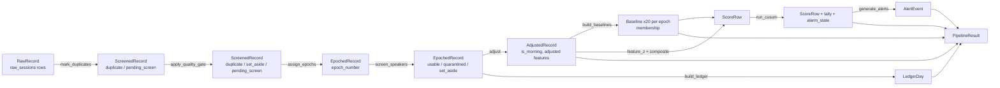
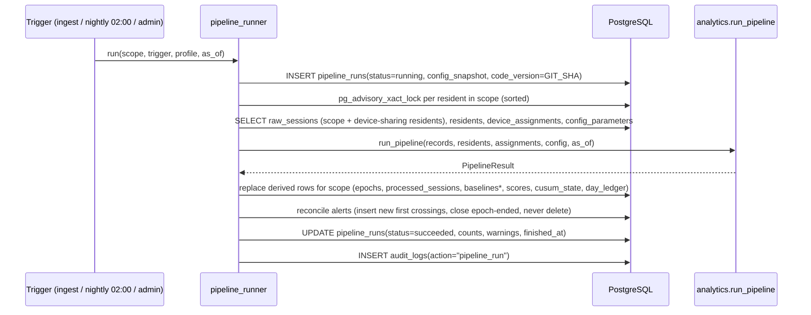

# 07 Analytics Engine TRD

Document ID: ECHOWELL-TRD-07 · Version 0.1 (draft for review) · Date: 18 October 2026 · Owner: Team 2 · Status: Draft

## 1. Purpose

This document specifies the EchoWell analytics engine: the Python package `analytics/` that turns the immutable
raw record store into every derived result (session status, epochs, morning-adjusted values, frozen baselines,
scores, CUSUM tally, alarm events, the day ledger, data-quality alerts and the Analytics page aggregates). It fixes the engine architecture, the module boundaries,
the typed data contracts between stages, the orchestrator `run_pipeline`, determinism rules, configuration
profiles, how the backend persists results, performance targets, error handling, logging and extension points.

The exact mathematics of each stage is specified in TRD 08 (baseline and scoring), TRD 09 (CUSUM and alerting)
and TRD 10 (ingest, duplicates, quality gate, day ledger). This TRD is the integration contract that binds them.
The engine SHALL reproduce the pipeline test workbook (SRC-03) exactly (BR-15).

## 2. Scope

In scope:
- Package layout and the responsibility of each module in `analytics/`.
- Typed, immutable data contracts between stages (`RawRecord`, `ScreenedRecord`, `EpochedRecord`, `AdjustedRecord`,
  `Baseline`, `ScoreRow`, `AlertEvent`, `LedgerDay`, `PipelineResult`, plus the helper types defined in section 4.4).
- The orchestrator `analytics/pipeline.py::run_pipeline(records, residents, assignments, config, as_of) -> PipelineResult`.
- Determinism and full-rebuild guarantees, late-arrival handling (ASM-07, OQ-10).
- Configuration profiles `production` and `test_v0_1` (`analytics/config.py::PipelineConfig`).
- The backend persistence service that loads inputs, calls the engine and writes derived tables.
- Triggers (after ingest, nightly 02:00 facility local time, manual), performance, error handling, logging.
- Data-alert generation (stage 11, rules in TRD 09 section 4.8) and Analytics page aggregates (stage 12: KPIs, daily
  series, funnel, by-resident shares), and the "Leaning most" computation for the Alert review page (SRC-18, SRC-19).
- Extension points: morning offset estimation (OQ-09), EWMA display (OQ-18), facility norms (BR-14, OQ-08).

Out of scope:
- Device-side feature extraction, wake word, transport (Team 1; interfaces only, TRD 10).
- HTTP endpoints and database DDL (TRD 05, TRD 06, TRD 19, TRD 20); this TRD only states what is written.
- Mixed-effects regression and any machine learning (offline research analysis, BR-18).
- Any processing of audio. The engine receives numeric features only.

## 3. References

| ID | Document |
|---|---|
| SRC-01 | Deployment Architecture (analytics engine is a module of the Python backend) |
| SRC-02 | Daily Data Storage and Processing Flowcharts (raw store is the only input; 6 processing stages; "every other table can be rebuilt"; answer key kept apart) |
| SRC-03 | Pipeline test workbook v0.1 (answer key) |
| SRC-04 | Pipeline test generator script v0.1 (reference implementation) |
| SRC-05 | Pipeline test input CSV v0.1 |
| SRC-13 | Synthetic dataset specification for Team 1 (record fields, answer key separation) |
| SRC-18 | UI wireframe: Alert review (`specs/UI-wireframe/Alerts.dc.html`) — alarm queue, data alerts, "Leaning most" |
| SRC-19 | UI wireframe: Analytics (`specs/UI-wireframe/Analytics.dc.html`) — KPIs, check-ins per day, funnel, usable share by resident |
| TRD 01 | System Architecture |
| TRD 05 / TRD 19 | Backend API / OpenAPI contracts (ingest and pipeline endpoints) |
| TRD 06 / TRD 20 / TRD 23 | Database design / PostgreSQL schema / entities |
| TRD 08 | Baseline and Scoring Algorithm Spec (BSC) |
| TRD 09 | CUSUM and Alerting Spec (CUS) |
| TRD 10 | Data Ingestion and Validation Spec (ING) |
| TRD 13 / TRD 14 | Testing strategy / test data and validation (R01–R10) |
| TRD 17 | Logging, monitoring and error handling |
| TRD 21 | Environment configuration (PIPELINE_PROFILE, FACILITY_TZ, NIGHTLY_RUN_HOUR_LOCAL) |
| TRD 24 | Risks, assumptions, open questions |

## 4. Requirements

### 4.1 Architecture and module boundaries

| ID | Requirement | Priority | Trace | Verification |
|---|---|---|---|---|
| ANL-001 | The analytics engine shall be the Python 3.12 package `analytics/` at the monorepo root, importable by the backend as `import analytics`. | Must | BR-17, SRC-01 | Inspection |
| ANL-002 | Modules in `analytics/` shall not import `sqlalchemy`, `psycopg`, `fastapi`, `httpx`, `requests`, `os.environ` readers or any `backend.*` module; a CI test shall fail if such an import exists. | Must | SRC-01, BR-02 | Test |
| ANL-003 | Every public function in `analytics/` shall be pure: its output depends only on its arguments, it performs no I/O, reads no clock, uses no randomness and does not mutate its arguments. | Must | BR-15 | Test, Inspection |
| ANL-004 | The package shall contain exactly the modules listed in section 4.2, each owning the responsibility stated there; no stage logic shall be duplicated across modules. | Must | SRC-01, TRD 01 | Inspection |
| ANL-005 | The only runtime dependencies of `analytics/` shall be the Python standard library (`dataclasses`, `datetime`, `zoneinfo`, `typing`, `math`, `hashlib`, `json`) and `numpy` 2.x. `pandas` and `openpyxl` shall be used only in tests. | Must | SRC-01 | Inspection |
| ANL-006 | Stages shall execute in this fixed order: (1) duplicate detection, (2) quality gate, (3) epoch detection, (4) speaker screen, (5) context (morning) adjustment, (6) personal baseline, (7) daily deviation score, (8) CUSUM persistence rule, (9) alert generation, (10) day ledger, (11) data alerts, (12) analytics aggregates. | Must | SRC-02, SRC-04, SRC-18, SRC-19, BR-03..BR-12 | Inspection, Test |
| ANL-007 | The engine shall be callable from the backend, from Pytest and from a command-line entry point `python -m analytics.pipeline --input <csv> --profile test_v0_1 --as-of "2026-10-30 15:00" --assignments <json> --residents <json> --out <dir>` that writes the result as JSON files; the CLI is a thin wrapper that performs file I/O outside the pure functions. | Should | BR-15, TRD 13 | Test |

### 4.2 Module responsibilities

| Module | Responsibility | Public functions (signatures are binding) | Spec owner |
|---|---|---|---|
| `config.py` | `PipelineConfig`, `FeatureSpec`, built-in profiles, config snapshot and hash | `PipelineConfig.from_mapping(values: Mapping[str, Any]) -> PipelineConfig`; `PipelineConfig.snapshot() -> dict`; `PipelineConfig.config_hash() -> str`; constants `PRODUCTION`, `TEST_V0_1`, `FEATURES: tuple[FeatureSpec, ...]` | this TRD |
| `robust_stats.py` | median, MAD, scaled spread with floor | `robust(values: Sequence[float], floor: float, mad_scale: float) -> RobustStats` | TRD 08 |
| `duplicate_detection.py` | arrival-order duplicate marking | `mark_duplicates(records: Sequence[RawRecord]) -> list[ScreenedRecord]` (records ordered by `arrival_seq`; returns duplicate rows and non-duplicate rows awaiting the gate) | TRD 10 |
| `quality_screening.py` | quality gate (set aside, all reasons) | `apply_quality_gate(rows: Sequence[ScreenedRecord], config) -> list[ScreenedRecord]` | TRD 10 |
| `epoch_detection.py` | epoch numbering per resident | `assign_epochs(rows: Sequence[ScreenedRecord]) -> list[EpochedRecord]` | TRD 08 |
| `speaker_screen.py` | possible-other-speaker quarantine | `screen_speakers(rows: Sequence[EpochedRecord], config) -> list[EpochedRecord]` | TRD 08 |
| `morning_offset.py` | local time, morning flag, adjusted values | `adjust(rows: Sequence[EpochedRecord], config) -> list[AdjustedRecord]` | TRD 08 |
| `baseline_builder.py` | baseline membership, per-feature and composite baseline, freeze | `build_baselines(rows: Sequence[AdjustedRecord], config) -> tuple[list[Baseline], dict[EpochKey, BaselineMembership]]` | TRD 08 |
| `zscore_calculator.py` | per-feature z | `feature_z(row: AdjustedRecord, baselines: Mapping[str, Baseline], config) -> dict[str, float]` | TRD 08 |
| `composite_score.py` | signed composite raw and composite z | `composite_raw(z: Mapping[str, float], config) -> float`; `composite_z(raw: float, composite_baseline: Baseline) -> float` | TRD 08 |
| `cusum_engine.py` | CUSUM tally and alarm state per scored session | `run_cusum(rows: Sequence[ScoreRow], config) -> list[ScoreRow]` (fills `cusum_tally`, `alarm_state`) | TRD 09 |
| `alert_generator.py` | alarm events, epoch-end closure facts, "Leaning most" | `generate_alerts(scores: Sequence[ScoreRow], epochs: Sequence[EpochSummary], config) -> list[AlertEvent]`; `leaning_most(scores: Sequence[ScoreRow], alert: AlertEvent, config) -> tuple[str, ...]` | TRD 09 |
| `day_ledger.py` | resident-day ledger and missing-day classification | `build_ledger(rows: Sequence[EpochedRecord], residents: Sequence[ResidentInfo], assignments: Sequence[DeviceAssignment], config, as_of: datetime) -> list[LedgerDay]` | TRD 10 |
| `data_alerts.py` | rule-based data-quality alerts (baseline_stalled, possible_other_speaker, high_set_aside, device_silent) | `generate_data_alerts(sessions: Sequence[AdjustedRecord], ledger: Sequence[LedgerDay], epochs: Sequence[EpochSummary], residents: Sequence[ResidentInfo], assignments: Sequence[DeviceAssignment], config, as_of: datetime) -> list[DataAlert]` | TRD 09 |
| `aggregates.py` | Analytics page aggregates over the 30-day window | `build_analytics_summary(sessions, ledger, epochs, alerts: Sequence[AlertEvent], data_alerts: Sequence[DataAlert], residents, config, as_of) -> AnalyticsSummary` | this TRD |
| `pipeline.py` | orchestration, late-arrival detection, as-of filter, result assembly, CLI | `run_pipeline(records, residents, assignments, config, as_of) -> PipelineResult` | this TRD |

| ID | Requirement | Priority | Trace | Verification |
|---|---|---|---|---|
| ANL-008 | Each module in the table above shall expose the listed public functions with the listed parameter and return types, and shall have a unit test file `tests/unit/analytics/test_<module>.py`. | Must | TRD 13 | Inspection, Test |
| ANL-009 | `analytics/__init__.py` shall export `run_pipeline`, `PipelineConfig`, `PRODUCTION`, `TEST_V0_1` and every dataclass in section 4.3/4.4, and define `ENGINE_VERSION = "0.1.0"`. | Must | BR-15 | Inspection |

### 4.3 Data contracts between stages

All contracts are `@dataclass(frozen=True, slots=True)` classes. They are defined in `analytics/config.py` alongside
`PipelineConfig`, because every stage module already imports `config.py`; defining them in `pipeline.py` would create
circular imports, and contract section 3 allows no additional module.

Feature values are carried as `Mapping[str, float]` keyed by the 19 canonical feature keys (TRD 10 maps external
column names to these keys before records reach the engine). Timestamps are timezone-aware `datetime` objects.



**RawRecord** (one per `raw_sessions` row, built by the backend):

| Field | Type | Notes |
|---|---|---|
| raw_session_id | str | UUID of the `raw_sessions` row (string form) |
| arrival_seq | int | `raw_sessions.arrival_seq`; defines arrival order |
| received_at | datetime (UTC) | server receive time |
| schema_version | str | "0.1" |
| session_id | str | e.g. R01-20261001-01 |
| resident_code | str | `resident_id` field of the record (e.g. R01) |
| device_code | str | `device_id` field of the record (e.g. D07B) |
| timestamp_utc | datetime (tz=UTC) | parsed from "YYYY-MM-DD HH:MM:SS" |
| mic_noise_level_dbfs | float | |
| audio_quality_flag | str | "ok" or "poor" |
| extraction_software_version | str | |
| device_firmware_version | str | |
| speech_duration_s | float | |
| phrase_id | str | |
| features | Mapping[str, float] | exactly the 19 canonical keys |

**ScreenedRecord**: `record: RawRecord`, `status: Literal["duplicate","set_aside","pending_screen"]`, `reasons: tuple[str, ...]`
(fixed order, TRD 10), `reason_text: str` (reasons joined by "; ", or "session_id already received" for duplicates, or "").

**EpochedRecord**: `record: RawRecord`, `status: Literal["duplicate","set_aside","quarantined","usable"]`,
`reasons: tuple[str, ...]`, `reason_text: str`, `epoch_number: int | None` (None only for duplicates and late arrivals that
precede the resident's first epoch), `screen_detail: str | None` (e.g. "F0 z=-7.34; composite features with |z|>=3: 3"; None when
the screen did not run), `late_arrival: bool`, `local_datetime: datetime` (FACILITY_TZ), `local_date: date`.

**AdjustedRecord**: all EpochedRecord fields plus `is_morning: bool`, `adjusted: Mapping[str, float]` (19 keys),
`baseline_ordinal: int | None` (1-based position among usable non-late sessions of the epoch), `in_baseline: bool`.

**Baseline**: `resident_code: str`, `epoch_number: int`, `device_code: str`, `feature_key: str` (19 keys or "composite"),
`n_sessions: int`, `first_session_id: str`, `frozen_after_session_id: str`, `median: float`, `mad: float`,
`robust_spread: float`, `floor_applied: bool`, `frozen_at: datetime` (= `timestamp_utc` of the frozen-after session).

**ScoreRow**: `session_id: str`, `raw_session_id: str`, `resident_code: str`, `epoch_number: int`, `local_date: date`,
`is_morning: bool`, `z: Mapping[str, float]` (7 keys `z_<feature>`), `composite_raw: float`, `composite_z: float`,
`cusum_tally: float`, `alarm_state: Literal["off","rings","on"]`, `scored_ordinal: int` (1-based within epoch).

**AlertEvent**: `resident_code: str`, `epoch_number: int`, `session_id: str` (first crossing), `triggered_at: datetime`
(= `timestamp_utc` of that session), `local_date: date`, `cusum_value: float`, `epoch_ended: bool`,
`epoch_ended_at: datetime | None` (= `started_at` of the next epoch), `leaning_most: tuple[str, ...]` (TRD 09 CUS-041).

**LedgerDay**: `resident_code: str`, `local_date: date`, `status: Literal["checked_in","missing_resident","missing_device_gap"]`,
`device_code: str | None`, `reason: str` ("" for checked_in).

**PipelineResult**: `run_config: dict` (snapshot), `config_hash: str`, `engine_version: str`, `as_of: datetime`,
`sessions: tuple[AdjustedRecord, ...]` (every input record incl. duplicates, ordered by `arrival_seq`),
`epochs: tuple[EpochSummary, ...]`, `baselines: tuple[Baseline, ...]`, `scores: tuple[ScoreRow, ...]`,
`alerts: tuple[AlertEvent, ...]`, `ledger: tuple[LedgerDay, ...]`, `data_alerts: tuple[DataAlert, ...]`,
`analytics: AnalyticsSummary`, `warnings: tuple[RunWarning, ...]`,
`counts: dict[str, int]` (keys: arrivals, usable, set_aside, quarantined, duplicate, missing_resident,
missing_device_gap, late_arrival, scored, alerts, excluded_after_as_of).

### 4.4 Helper types defined by this TRD

| Type | Fields |
|---|---|
| `FeatureSpec` | `key: str`, `unit: str`, `sign: int` (−1, 0, +1), `morning_offset: float`, `in_composite: bool` (= sign != 0), `spread_floor: float` (0.5 for number_of_pauses, else 0.0) |
| `RobustStats` | `median: float`, `mad: float`, `spread: float`, `floor_applied: bool` |
| `ResidentInfo` | `resident_code: str`, `enrolled_on: date`, `withdrawn_on: date | None`, `status: str` |
| `DeviceAssignment` | `resident_code: str`, `device_code: str`, `valid_from: date`, `valid_to: date | None` (inclusive) |
| `EpochKey` | `tuple[str, int]` = (resident_code, epoch_number) |
| `BaselineMembership` | `session_ids: tuple[str, ...]` (first N usable, time order), `formed: bool`, `usable_count: int` |
| `EpochSummary` | `resident_code`, `epoch_number`, `device_code`, `device_firmware_version`, `extraction_software_version`, `started_at: datetime`, `ended_at: datetime | None` (= started_at of next epoch), `usable_count: int`, `baseline_formed: bool`, `frozen_after_session_id: str | None`, `scored_count: int`, `watching_since: date | None` (local date of the first scored session; before any scored session, the local date after the freeze session's local date; None if not formed), `current_tally: float` (0.0 if none), `last_scored_session_id: str | None`, `alarm_on: bool`, `first_alarm_session_id: str | None` |
| `RunWarning` | `code: str`, `resident_code: str | None`, `session_id: str | None`, `detail: str` |
| `DataAlert` | `kind: Literal["baseline_stalled","possible_other_speaker","high_set_aside","device_silent"]`, `resident_code: str | None`, `device_code: str | None`, `title: str`, `detail: str`, `days: tuple[date, ...]` (affected local dates, may be empty) |
| `AnalyticsSummary` | `period_start: date`, `period_end: date`, `kpis: dict`, `daily_series: tuple[dict, ...]`, `funnel: tuple[dict, ...]`, `by_resident: tuple[dict, ...]` (shapes in section 4.13) |

| ID | Requirement | Priority | Trace | Verification |
|---|---|---|---|---|
| ANL-010 | All data contract classes in sections 4.3 and 4.4 shall be frozen dataclasses with `slots=True` and full type hints, defined in `analytics/config.py`, and stage functions shall return new instances rather than mutating inputs. | Must | BR-02 | Inspection, Test |
| ANL-011 | Every stage function shall accept and return the contract types named in section 4.2; no stage shall pass `dict` or `pandas.DataFrame` objects between stages. | Must | TRD 13 | Inspection |
| ANL-012 | `PipelineResult.sessions` shall contain exactly one `AdjustedRecord` per input `RawRecord` (including duplicates), ordered by `arrival_seq`, so that the backend can write one `processed_sessions` row per `raw_sessions` row. | Must | BR-02, SRC-02 | Test |
| ANL-013 | Feature mappings inside contracts shall always contain the 19 canonical keys of contract section 6 in that order (loudness_dbfs … mfcc4); any other key set shall raise `ContractError`. | Must | SRC-03, SRC-13 | Test |

### 4.5 Orchestrator `run_pipeline`

```python
def run_pipeline(
    records: Sequence[RawRecord],          # all raw_sessions rows in scope, any order
    residents: Sequence[ResidentInfo],     # residents in scope
    assignments: Sequence[DeviceAssignment],  # ALL assignments of the facility (sharing needs other residents)
    config: PipelineConfig,
    as_of: datetime,                       # timezone-aware; production: request/run start time; tests: fixed value
    *,
    frozen_baselines: Mapping[EpochKey, tuple[Baseline, ...]] | None = None,  # persisted baselines (20 rows per epoch)
) -> PipelineResult: ...
```

The five positional parameters are the contract signature; `frozen_baselines` is an optional keyword that lets the
backend pass persisted frozen baselines (TRD 01 ARC-043, TRD 06 DB-016). Algorithm (normative; each step is detailed in the owning TRD):

```
1  validate inputs (types, tz-aware as_of, unique arrival_seq, 19 feature keys)      -> ContractError on failure
2  recs := records sorted by arrival_seq
3  excluded := {r in recs : r.timestamp_utc > as_of}; recs := recs minus excluded      (warning per record: "after_as_of")
4  screened := apply_quality_gate(mark_duplicates(recs), config)                       TRD 10
5  late := detect_late_arrivals(screened, config)                                       section 4.6
6  epoched := screen_speakers(assign_epochs(screened, late), config)                    TRD 08
7  adjusted := adjust(epoched, config)                                                  TRD 08
8  baselines, membership := build_baselines(adjusted, config)                           TRD 08
9  for each formed (resident, epoch): for each usable, non-late session after the frozen-after
   session in timestamp order: ScoreRow(feature_z, composite_raw, composite_z)          TRD 08
10 scores := run_cusum(score rows grouped per (resident, epoch), config)                 TRD 09
11 epochs := EpochSummary per (resident, epoch)
12 alerts := generate_alerts(scores, epochs)                                            TRD 09
13 ledger := build_ledger(epoched, residents, assignments, config, as_of)               TRD 10
14 data_alerts := generate_data_alerts(adjusted, ledger, epochs, residents, assignments, config, as_of)   TRD 09
15 analytics := build_analytics_summary(adjusted, ledger, epochs, alerts, data_alerts, residents, config, as_of)
16 return PipelineResult(... counts, warnings sorted by (code, resident_code, session_id))
```

| ID | Requirement | Priority | Trace | Verification |
|---|---|---|---|---|
| ANL-014 | `run_pipeline` shall implement the 16 steps above in that order and shall return a `PipelineResult` whose contents depend only on its arguments. | Must | SRC-02, SRC-04 | Test |
| ANL-015 | `run_pipeline` shall exclude from processing every record with `timestamp_utc > as_of` and record one `RunWarning(code="after_as_of")` per excluded record; excluded records shall not appear in `sessions`, scores or the ledger of that run. | Must | BR-06 | Test |
| ANL-016 | `run_pipeline` shall process each resident independently except for the day ledger, which shall read the records and assignments of all residents sharing a device (TRD 10); a run scoped to one resident shall therefore receive the records of every resident who shared a device with that resident during the ledger window. | Must | BR-06 | Test |
| ANL-017 | For the `test_v0_1` profile, SRC-05 as input, the R01–R10 test residents (enrolled 2026-10-01), the assignments in TRD 10 section 4.9 and `as_of = 2026-10-30 15:00 America/Chicago`, `run_pipeline` shall reproduce every value in SRC-03 Annotated_sessions (status, reason, morning, epoch, in_baseline), Exp_status_counts, Exp_resident_outcomes, Exp_baselines (180 rows) and Exp_scores (98 rows) with absolute tolerance 1e-6 on numbers and exact equality on strings. | Must | BR-15, SRC-03 | Test |
| ANL-018 | `run_pipeline` shall raise `ContractError` (and produce no partial result) if any input violates the contract (naive datetime, duplicate `arrival_seq`, missing feature key, unknown resident in `assignments`, `config` not a `PipelineConfig`). | Must | TRD 17 | Test |
| ANL-019 | The engine shall not raise for data conditions that are part of normal operation: fewer than baseline_n usable sessions (baseline forming), zero usable sessions, a resident with no records, a resident with only duplicates, an empty input. These shall produce valid results (e.g. `baseline_formed = False`, ledger all missing). | Must | BR-09, SRC-03 R08 | Test |

### 4.6 Determinism, full rebuild and late arrivals

| ID | Requirement | Priority | Trace | Verification |
|---|---|---|---|---|
| ANL-020 | Two calls of `run_pipeline` with equal arguments shall return `PipelineResult` objects that are equal field by field (bitwise-equal floats), on the same platform and numpy version. | Must | BR-15, SRC-02 | Test |
| ANL-021 | All sorting shall be stable and fully keyed: records by `(timestamp_utc, arrival_seq)` within a resident, residents by `resident_code`, outputs by `(resident_code, epoch_number, timestamp_utc, arrival_seq)`. Iteration over sets or dict insertion order of unsorted sources shall not determine output. | Must | BR-15 | Inspection, Test |
| ANL-022 | All arithmetic shall be IEEE-754 float64. Medians shall be computed with `numpy.median` on a float64 array; sums of signed z shall run in the canonical feature order of contract section 6 (loudness_dbfs, total_phrase_duration_s, speech_rate_syl_per_s, articulation_rate_syl_per_s, number_of_pauses, pause_fraction, voiced_fraction). No rounding shall be applied to stored numeric results. | Must | SRC-04 | Test |
| ANL-023 | A full rebuild of all derived tables from `raw_sessions` with unchanged inputs and unchanged configuration shall reproduce identical derived results (equal under ANL-020) to the incremental results already persisted. | Must | BR-02, SRC-02 | Test |
| ANL-024 | Late arrival detection: a non-duplicate record R of resident X shall be classified `late_arrival` if (a) some non-duplicate record of X with a smaller `arrival_seq` has a later `timestamp_utc` than R (R is out of order), and (b) on the prefix P = non-duplicate, non-late records of X with `arrival_seq < R.arrival_seq`, either (b1) running stages 1–8 on P yields at least one formed baseline whose frozen-after session has `timestamp_utc > R.timestamp_utc`, or (b2) R's (device_id, device_firmware_version, extraction_software_version) key differs both from the key of the record of P immediately before R in `(timestamp_utc, arrival_seq)` order (or there is no such record) and from the key of the record of P immediately after R (inserting R would create a new epoch and renumber later epochs). Records are evaluated in `arrival_seq` order so that earlier late classifications are known. | Must | ASM-07, OQ-10, BR-08 | Test |
| ANL-025 | A `late_arrival` record shall be invisible to every other record: it shall not start or split an epoch, shall not enter any speaker-screen reference list, shall not count toward baseline membership and shall not be scored or update the CUSUM tally. It shall still pass the quality gate and speaker screen for its own status (TRD 08 BSC-040), shall count as a record for the day ledger, and shall produce `RunWarning(code="late_arrival")`. | Must | ASM-07, BR-09 | Test |
| ANL-026 | Because late-arrival classification depends only on `raw_sessions` content and `arrival_seq`, a rebuild from raw data shall reproduce the same frozen baselines that were persisted before the late record arrived (contract section 7 "Frozen baselines"). | Must | ASM-07, SRC-02 | Test |
| ANL-027 | Records that are out of order but not late (they fall after every frozen-after timestamp of the resident) shall be processed in timestamp order like any other record; their insertion may change CUSUM tallies of later scored sessions of the same epoch, which are derived values and shall be recomputed. | Must | BR-11 | Test |

### 4.7 Configuration profiles

`PipelineConfig` fields (names are binding; values per contract section 7):

| Field | Type | production | test_v0_1 |
|---|---|---|---|
| profile | str | "production" | "test_v0_1" |
| facility_tz | str (IANA) | America/Chicago | America/Chicago |
| noise_limit_dbfs | float | −40.0 | −40.0 |
| min_speech_s | float | 1.0 | 1.0 |
| baseline_n | int | 30 | 16 |
| screen_min_n | int | 5 | 5 |
| screen_f0_z | float | 4.0 | 4.0 |
| screen_other_z | float | 3.0 | 3.0 |
| screen_other_count | int | 2 | 2 |
| mad_scale | float | 1.4826 | 1.4826 |
| pause_floor | float | 0.5 | 0.5 |
| composite_floor | float | 0.1 | 0.1 |
| cusum_k | float | 0.5 | 0.5 |
| cusum_h | float | 5.0 | 5.0 |
| morning_cutoff_hour | int | 12 | 12 |
| morning_offsets | Mapping[str, float] | contract section 6 column "morning offset" (19 keys, 13 zeros) | same |
| shared_device_min_residents | int | 2 | 2 |
| features | tuple[FeatureSpec, ...] | 19 specs of contract section 6 | same |

| ID | Requirement | Priority | Trace | Verification |
|---|---|---|---|---|
| ANL-028 | `analytics/config.py` shall define `PRODUCTION` and `TEST_V0_1` as `PipelineConfig` constants with exactly the values in the table above; these constants shall also be the seed values for the `config_parameters` table (TRD 20). | Must | ASM-04, SRC-03 | Test |
| ANL-029 | `PipelineConfig.from_mapping` shall validate each value: `baseline_n` ≥ `screen_min_n` ≥ 1; `mad_scale` > 0; floors ≥ 0; `cusum_k` ≥ 0; `cusum_h` > 0; `0 ≤ morning_cutoff_hour ≤ 24`; `facility_tz` resolvable by `zoneinfo`; `morning_offsets` keys equal to the 19 feature keys; on failure it shall raise `ConfigError` naming the key. | Must | TRD 21 | Test |
| ANL-030 | `PipelineConfig.snapshot()` shall return a JSON-serialisable dict of all fields, and `config_hash()` shall return the SHA-256 hex digest of `json.dumps(snapshot, sort_keys=True, separators=(",", ":"))`; the backend shall store both in `pipeline_runs.config_snapshot` (hash under key `config_hash`). | Must | BR-15, TRD 06 | Test |
| ANL-031 | The backend shall select the profile from env var `PIPELINE_PROFILE` (`production` or `test_v0_1`) and load its rows from `config_parameters`; if a key is missing in the table, the value of the built-in constant shall be used and a warning `config_default_used` recorded; the backend shall refuse to start (and `POST /api/v1/pipeline/run` shall refuse) the `test_v0_1` profile when `APP_ENV = production` (D-OWNER-2: test_v0_1 is for build-out and testing only). | Must | TRD 21, ASM-04 | Test |
| ANL-032 | A change of any algorithm parameter in `config_parameters` shall take effect only through an admin-triggered manual run with scope `all` (`POST /api/v1/pipeline/run`), which is audit-logged with old and new config hashes and is the only run allowed to delete and recompute frozen baselines; ingest and nightly runs shall end with status `failed` and warning code `config_changed_requires_rebuild` when the active config hash differs from the hash of the latest succeeded run. | Must | ASM-07, BR-16 | Test |

### 4.8 Backend persistence service

The backend service `backend/services/pipeline_runner.py` (new orchestration module, the only caller of
`run_pipeline` in the backend) performs: load → compute → reconcile → write, inside one database transaction per run.



| ID | Requirement | Priority | Trace | Verification |
|---|---|---|---|---|
| ANL-033 | `pipeline_runner.run(scope, trigger, profile, as_of)` shall create a `pipeline_runs` row with `status = running`, `trigger` ∈ {ingest, nightly, manual, test}, `scope`, `config_profile`, `config_snapshot`, `code_version` = env `GIT_SHA` (or "unknown"), `started_at`, before loading data. | Must | TRD 06, BR-16 | Test |
| ANL-034 | The runner shall take `pg_advisory_xact_lock(hashtext('pipeline:' || resident_code))` for every resident in scope in ascending `resident_code` order, so that concurrent runs on the same resident serialise and cannot deadlock. | Must | NFR (TRD 03) | Test |
| ANL-035 | The runner shall build `RawRecord` objects from the typed columns of `raw_sessions` (never from `payload` re-parsing), converting `timestamp_utc` to an aware UTC datetime. | Must | BR-02 | Test |
| ANL-036 | For each resident in scope the runner shall replace (delete then insert, within the transaction) its rows in `processed_sessions`, `scores`, `cusum_state` and `day_ledger` with the rows derived from `PipelineResult`; `epochs` are upserted per ANL-038; `baselines`, `alerts`, `alert_reviews`, `staff_notes` and `raw_sessions` shall never be deleted by a run (TRD 06 DB-014). | Must | BR-02, SRC-02, R15 | Test |
| ANL-037 | Baselines shall be written insert-only and passed back to the engine as `frozen_baselines` on later runs: a `baselines` row set (20 rows) is inserted when an epoch's baseline forms for the first time; when `frozen_baselines` contains an epoch, the engine shall score against the persisted values, and if its recomputed values differ by more than 1e-12 or its membership (`first_session_id`, `frozen_after_session_id`, `n_sessions`) differs, it shall emit `RunWarning(code="baseline_mismatch")` (logged at ERROR) and keep the persisted rows. | Must | ASM-07, BR-09, TRD 06 DB-016 | Test |
| ANL-038 | Epoch rows shall be upserted on `(resident_id, epoch_number)`, reusing the existing `epochs.id` so that `baselines`, `alerts` and `cusum_state` foreign keys stay valid, and updating `ended_at`; epochs without a frozen baseline that the new computation no longer produces shall be deleted. If the computation would change the key of an epoch that has a frozen baseline, the runner shall leave all derived rows of that resident unchanged, record `RunWarning(code="late_arrival", detail="epoch renumbering blocked")` and continue with the next resident (TRD 06 DB-015, DB-017). | Must | BR-08, ASM-07 | Test |
| ANL-039 | Alerts shall be upserted on the natural key `(epoch_id, session_id)` and never deleted: an `AlertEvent` without a matching row creates one with `status = open`; a matching row keeps its `id`, `status`, `acknowledged_by`, `acknowledged_at`, `snoozed_until`, `snoozed_by` and its `alert_reviews`; a non-closed alert the computation no longer produces is set to `closed` with `closed_reason = 'superseded by rebuild'`; an `AlertEvent` with `epoch_ended = True` closes its alert with `closed_reason = 'epoch ended'` (TRD 09; TRD 06 DB-018). | Must | BR-11, ASM-06, R15 | Test |
| ANL-040 | On success the runner shall set `pipeline_runs.status = succeeded`, `finished_at`, `counts` (= `PipelineResult.counts`) and `warnings` (list of `{code, resident_code, session_id, detail}`), commit, and write one `audit_logs` row (actor_type `system` or the triggering user, action `pipeline_run`). | Must | BR-16 | Test |
| ANL-041 | On any exception the runner shall roll back all derived writes, then in a separate transaction set `pipeline_runs.status = failed`, `finished_at`, and `warnings` containing `{code: "exception", detail: <exception class and message>}`; previously persisted derived data shall remain unchanged. | Must | TRD 17 | Test |
| ANL-042 | Mapping of engine values to stored values: `alarm_state` "off"/"rings"/"on" ↔ workbook "off"/"RINGS (first crossing)"/"on"; `feature_key` "composite" ↔ workbook "COMPOSITE (raw signed mean of 7 z)"; `floor_applied` bool ↔ "yes"/"no"; `is_morning` bool ↔ "yes"/"no". The validation test and `GET /api/v1/analytics/baselines` shall use this mapping. | Must | SRC-03 | Test |

### 4.9 Triggers

| ID | Requirement | Priority | Trace | Verification |
|---|---|---|---|---|
| ANL-043 | After a successful single-record ingest (`POST /api/v1/sessions`) the backend shall run the pipeline synchronously for that record's resident (scope = that resident plus device-sharing residents for the ledger) with `trigger = ingest` and `as_of` = request time, before returning the response. | Must | contract §7, §20 R11, TRD 10 | Test |
| ANL-044 | After a batch ingest (`POST /api/v1/ingest`) the backend shall enqueue one background run (FastAPI `BackgroundTasks`) scoped to all residents with accepted records in the batch, with `trigger = ingest`. | Must | contract §7 | Test |
| ANL-045 | A full run (scope `all`, `trigger = nightly`) shall start daily at `NIGHTLY_RUN_HOUR_LOCAL` (default 2, i.e. 02:00) in `FACILITY_TZ`, with `as_of` = run start time; the scheduling mechanism is specified in TRD 15/17. | Must | contract §7, TRD 15 | Test |
| ANL-046 | An admin shall be able to start a run via `POST /api/v1/pipeline/run {scope, profile?, as_of?}`; `as_of` defaults to the request time and is the only way to set a fixed as-of (tests use 2026-10-30T15:00:00-05:00); in-process tests freeze the clock (time-machine); the `test` trigger value shall be used only by the automated validation suite. | Must | TRD 05 API-065, §20 R11 | Test |

### 4.10 Performance

| ID | Requirement | Priority | Trace | Verification |
|---|---|---|---|---|
| ANL-047 | `run_pipeline` on SRC-05 (283 arrivals, 10 residents) including data alerts and aggregates shall complete in ≤ 5 s on a CI runner (GitHub-hosted ubuntu-latest). | Must | TRD 03, §20 R8 | Test |
| ANL-048 | A full rebuild of the scale dataset DS-08 (100 residents, 10,800 records, generated by `tests/performance/make_load_dataset.py`) shall complete end-to-end (load + compute + write) in ≤ 120 s, and batch processing of the SRC-05 CSV in ≤ 30 s. | Must | ASM-08, TRD 03, TRD 13, §20 R8 | Test (benchmark) |
| ANL-049 | `POST /api/v1/sessions` including the synchronous single-resident run shall respond in ≤ 1,000 ms (p95) for a resident with ≤ 400 records. | Must | TRD 03, §20 R8 | Test |
| ANL-050 | Robust statistics shall be computed on numpy arrays; per-record Python loops are permitted, but no stage shall have worse than O(n log n) complexity per resident except late-arrival detection, which runs stages 1–8 once per out-of-order record. | Should | TRD 03 | Inspection |

### 4.11 Error handling and logging

| ID | Requirement | Priority | Trace | Verification |
|---|---|---|---|---|
| ANL-051 | `analytics/` shall define exactly two exception classes, `ContractError` (invalid inputs) and `ConfigError` (invalid configuration), both subclasses of `AnalyticsError(Exception)`; no other exception types shall be raised intentionally. | Must | TRD 17 | Inspection |
| ANL-052 | Data-quality findings that are not errors shall be returned as `RunWarning` objects with these codes: `after_as_of`, `late_arrival` (including detail "epoch renumbering blocked"), `zero_spread` (TRD 08), `baseline_mismatch`, `config_default_used`, `config_mismatch` (FACILITY_TZ differs from the profile's `facility_tz`, TRD 21 ENV-022), `no_device_assignment` (a missing ledger day of a resident without a covering assignment; one warning per resident per run), `alert_first_crossing_changed` (TRD 09); `config_changed_requires_rebuild` is a failure code (ANL-032). | Must | TRD 17 LOG-064 | Test |
| ANL-053 | `analytics/` shall not log; the backend runner shall emit structured JSON log events (`LOG_FORMAT=json`) `pipeline_run_started` and `pipeline_run_finished` with fields `pipeline_run_id`, `trigger`, `scope`, `profile`, `config_hash`, `duration_ms`, `counts`, `warning_count`, and one event `pipeline_warning` per warning at level WARNING (ERROR for `baseline_mismatch` and `epoch_key_changed`). | Must | TRD 17 | Test |
| ANL-054 | Logs shall not contain feature values, payloads or any field other than study IDs (resident_code, device_code, session_id) and run metadata. | Must | BR-16 | Inspection |

### 4.12 Extensibility

| ID | Requirement | Priority | Trace | Verification |
|---|---|---|---|---|
| ANL-055 | Morning offsets shall be read only from `PipelineConfig.morning_offsets`; a future estimator (OQ-09) shall be added as a separate pure function `morning_offset.estimate_offsets(rows, config) -> Mapping[str, float]` whose output is written to `config_parameters` by an admin and applied via a full rebuild; the estimator shall not run inside `run_pipeline` in v0.1. | Should | OQ-09, BR-07 | Inspection |
| ANL-056 | A future EWMA trend (OQ-18) shall be implemented as an additional output field on `ScoreRow` computed after step 10 and shall not alter `cusum_tally` or `alarm_state`; it is not implemented in v0.1. | May | OQ-18, SRC-02 | Inspection |
| ANL-057 | Facility reference ranges for the new-admission arm (BR-14, OQ-08) shall be computed by a separate pure function outside `run_pipeline` (planned module `analytics/facility_norms.py`, created only when OQ-08 is resolved) that reads adjusted values of usable sessions and writes `facility_reference_ranges`; it shall never influence any resident's own baseline, score or alarm. | May | BR-14, OQ-08 | Inspection |
| ANL-058 | Adding a feature to the composite or changing a sign shall require only a change of `features` in the config (and a full rebuild), not a code change. | Should | OQ-03, RSK-02 | Test |

### 4.13 Data alerts and analytics aggregates (stages 11–12)

Window: the period is the 30 facility-local days ending on the local date of `as_of`, starting no earlier than each
resident's `enrolled_on` (contract §20 R10); for SRC-05 with as_of 2026-10-30 15:00 America/Chicago it is Oct 1–30, 2026.
"Received" = non-duplicate records (any status, including late arrivals) with local date in the period. "Expected" =
Σ over active residents of the days they were enrolled in the period. Percentages are rounded half-up to an integer:
`pct(n, d) = (200·n + d) // (2·d)` (integer arithmetic, no float rounding).

`AnalyticsSummary` shapes (returned unchanged by `GET /api/v1/analytics`, TRD 05):

| Part | Shape | SRC-05 expected value |
|---|---|---|
| `kpis.checkins_received` | `{value: n, expected: d, percent: pct}` | 281 of 300, 94% |
| `kpis.used_for_scoring` | `{value: usable, expected: d, percent}` (usable = status usable, incl. baseline sessions) | 267 of 300, 89% |
| `kpis.baselines_formed` | `{value, total, forming: [codes], restarts: {code: n}, note}`; value = active residents whose current epoch has a formed baseline; restarts = current epoch number − 1 where > 0; note = "<forming codes> still forming; <code> restarted once\|<n> times" | 9 of 10, note "R08 still forming; R07 restarted once" |
| `kpis.alarms_raised` | `{value, residents: [codes], not_reviewed: n, note}`; alerts (not superseded) whose `local_date` is in the period; note = codes joined ", " + " · " + review phrase ("both not yet reviewed" when 2 of 2 open; "not yet reviewed" for 1 of 1; "all not yet reviewed" for > 2; "<k> not yet reviewed" when 0 < k < n; "all reviewed" when k = 0) | 2, "R09, R10 · both not yet reviewed" |
| `daily_series[]` | one item per local day: `{local_date, used, set_aside, quarantined, missed, annotation}`; missed = missing_resident + missing_device_gap ledger rows; duplicates excluded; annotation = "<Mon D> · <device> silent" for days of a device_silent data alert, else null | Oct 12: used 8, missed 2, annotation "Oct 12 · D02 silent"; Σ of all segments over 30 days = 300 |
| `funnel[]` | 4 steps `{step, value, note}`: expected ("<n> residents × <days> days"); received ("<missed> missed · <dup> duplicate copies removed"); passed_quality = received − set_aside ("<s> set aside: quality flag <a>, noise <b>, too short <c> (<m> had two reasons)", each reason occurrence counted); used = passed_quality − quarantined ("<q> quarantined as possible other speaker") | 300 → 281 ("19 missed · 2 duplicate copies removed") → 269 ("12 set aside: quality flag 5, noise 5, too short 3 (1 had two reasons)") → 267 ("2 quarantined as possible other speaker") |
| `by_resident[]` | `{resident_code, used_days, set_aside_or_quarantined_days, missed_days, days, percent}`; percent = pct(days with ≥ 1 usable record, days enrolled in period); sorted by percent ascending, then resident_code | R08 43, R03 73, R02 80, R05 93, R01/R04/R06/R07/R09/R10 100 |

| ID | Requirement | Priority | Trace | Verification |
|---|---|---|---|---|
| ANL-059 | Stage 11 shall compute data alerts with `analytics/data_alerts.py::generate_data_alerts` using exactly the rules, texts, suppression and ordering of TRD 09 section 4.8, recomputed on every run. | Must | SRC-18, §19, TRD 09 | Test |
| ANL-060 | The runner shall upsert `data_alerts` on the natural key `(kind, resident_id, device_id)`: a new alert is inserted with `status = open`, `first_detected_at` = `last_detected_at` = run time; a re-detected alert updates `title`, `detail`, `last_detected_at`, `pipeline_run_id` and reopens if resolved; an open rule-based alert no longer produced is set to `resolved`; alerts of kind `review_flagged_data_problem` (created by reviews, TRD 09) are never modified by the pipeline. | Must | §19, R15 | Test |
| ANL-061 | Stage 12 shall compute `AnalyticsSummary` with `analytics/aggregates.py::build_analytics_summary` using the window, definitions and shapes of this section. | Must | SRC-19, §19 | Test |
| ANL-062 | All aggregate counts shall be derived from the same `PipelineResult` (sessions, ledger, epochs, alerts) so that they equal the status counts of the pipeline (SRC-03 Exp_status_counts) without separate SQL recomputation. | Must | BR-15, SRC-19 | Test |
| ANL-063 | Percentages shall use the integer half-up formula `pct(n, d)`; for d = 0 the percent shall be null. | Must | SRC-19 | Test |
| ANL-064 | The engine shall never read `evaluation_ground_truth` or any answer-key data; the "Alarm timing check" panel is assembled by the backend after the run from `alerts` and `evaluation_ground_truth` (TRD 09 CUS-047). | Must | SRC-02, §19 | Inspection |
| ANL-065 | `alerts_raised.not_reviewed` shall be computed by the backend from persisted alert status (`open` = not reviewed) at response time, because reviews are human state that the pure engine does not receive; the engine supplies the alert list. | Must | §19 | Test |

Verification performed for this TRD (independent implementation of these rules on SRC-05, as_of 2026-10-30 15:00
America/Chicago): KPIs 281/300 = 94%, 267/300 = 89%, baselines 9 of 10 (R08 forming, R07 restarted once), alarms 2
(R09, R10); funnel 300 → 281 → 269 → 267 with set-aside reason counts quality flag 5, noise 5, too short 3, one record
with two reasons; by-resident R08 43%, R03 73%, R02 80%, R05 93%, all others 100%; daily series totals 300 with
Oct 12 = 8 used + 2 missed. All values equal SRC-19.

## 5. Assumptions

- ASM-01 Facility timezone America/Chicago.
- ASM-02 At most one session per resident per local day in v0.1; the engine does not rely on it (multiple sessions per day are processed in timestamp order).
- ASM-03 Single facility in MVP; `run_pipeline` operates on one facility's residents and assignments.
- ASM-04 Test profile baseline_n = 16; production 30.
- ASM-06 New epoch closes any open alert of the previous epoch and restarts CUSUM.
- ASM-07 Frozen baselines are never recomputed after freeze; late arrivals are flagged.
- ASM-08 < 100 residents, < 25 users, < 1 session per resident per day (sizes the performance targets).
- Note for lead (TRD-local): `analytics/aggregates.py` is a module not listed in contract §3 (added for §19 aggregates);
  `frozen_baselines` is an optional keyword argument added to the contract signature to match TRD 01/06.
- Note for lead (TRD-local): the late-arrival rule ANL-024..ANL-026 is defined here so that a rebuild from `raw_sessions`
  alone reproduces frozen baselines; it is the MVP default until OQ-10 is answered.

## 6. Dependencies

- TRD 08, TRD 09, TRD 10 for stage algorithms; TRD 06/20 for tables `raw_sessions`, `processed_sessions`, `epochs`,
  `baselines`, `scores`, `cusum_state`, `alerts`, `day_ledger`, `pipeline_runs`, `config_parameters`, `audit_logs`.
- numpy 2.x, Python 3.12 `zoneinfo` with system tzdata (the backend image shall install the `tzdata` package so
  `America/Chicago` resolves on slim images).
- Backend env vars: `PIPELINE_PROFILE`, `FACILITY_TZ`, `NIGHTLY_RUN_HOUR_LOCAL`, `GIT_SHA`, `LOG_FORMAT`, `LOG_LEVEL` (TRD 21).
- Test fixtures: SRC-03 workbook and SRC-05 CSV copied to `tests/fixtures/` (TRD 14); the workbook is read only by tests.

## 7. Acceptance Criteria

- AC-ANL-01: `pytest tests/validation` runs `run_pipeline` on SRC-05 with profile `test_v0_1`, as_of 2026-10-30 15:00 America/Chicago, and all comparisons with SRC-03 (Annotated_sessions 302 rows, Exp_status_counts, Exp_resident_outcomes 11 rows, Exp_baselines 180 rows, Exp_scores 98 rows) pass with tolerance 1e-6 and exact strings.
- AC-ANL-02: `run_pipeline` called twice on the same inputs returns equal results; shuffling the input list order (keeping `arrival_seq` values) returns an equal result.
- AC-ANL-03: Removing the two R04 duplicate arrivals (arrival_seq 89 and 283) from the input changes nothing in R04's baselines, scores or ledger.
- AC-ANL-04: A static import check fails the build if any module under `analytics/` imports a database, HTTP or `backend` module.
- AC-ANL-05: A late-arrival fixture (R01 day 10 record re-sent with a new session_id `R01-20261010-02` and `timestamp_utc` 2026-10-10 19:00:00 after all other R01 records) yields warning `late_arrival`, unchanged R01 baselines, unchanged R01 scores, and status `usable` with `in_baseline = false` for the late record.
- AC-ANL-06: A full rebuild after the incremental ingest of SRC-05 one record at a time (283 single POSTs in arrival order) produces derived tables identical to a single batch run.
- AC-ANL-07: The engine completes on SRC-05 in ≤ 5 s in CI and the DS-08 full rebuild in ≤ 120 s.
- AC-ANL-08: A run with a deliberately failing write (fault injection) leaves previously persisted derived tables unchanged and the run row `failed` with an `exception` warning.
- AC-ANL-09: The `pipeline_runs` row of every run contains `config_snapshot` with `config_hash`, `code_version`, `counts` and `warnings`.
- AC-ANL-10: On SRC-05 the `AnalyticsSummary` equals every expected value in the section 4.13 table, and `data_alerts` equals exactly the four alerts of TRD 09 section 4.8 in that order.
- AC-ANL-11: A full rebuild with an R09 alert that has a saved review and a snooze keeps the alert id, its `alert_reviews` rows, `status = acknowledged` and `snoozed_until` (natural-key upsert, R15).
- AC-ANL-12: Starting the backend with `APP_ENV=production` and `PIPELINE_PROFILE=test_v0_1` fails with a configuration error.

## 8. Implementation Notes

- Fill the existing empty files `analytics/{duplicate_detection,quality_screening,epoch_detection,morning_offset,baseline_builder,zscore_calculator,composite_score,cusum_engine,alert_generator}.py` and create `analytics/{__init__,config,robust_stats,speaker_screen,day_ledger,data_alerts,aggregates,pipeline}.py`. Do not add other modules.
- Keep the engine free of pandas: SRC-04 uses pandas only to write the workbook. Use `numpy.median(np.asarray(values, dtype=np.float64))`.
- Parse `timestamp_utc` with `datetime.strptime(s, "%Y-%m-%d %H:%M:%S").replace(tzinfo=timezone.utc)`; convert with `astimezone(ZoneInfo(config.facility_tz))`. Never derive the morning flag or the local date from the UTC hour or UTC date (a variant that uses the UTC hour mis-classifies all 10 R06 morning sessions and fails 31 workbook rows).
- Python's `sorted` is stable; still always sort by an explicit `(timestamp_utc, arrival_seq)` key.
- The workbook stores floats; compare with `math.isclose(a, b, rel_tol=0, abs_tol=1e-6)`.
- `backend/services/{baseline,cusum,scoring,speaker_screen,morning_adjustment}.py` shall be thin read services for API queries over persisted results; they shall not reimplement any analytics formula.
- Late-arrival detection is the only place that reruns stages on a prefix; in the SRC-05 fixture no record is out of order except the R04 duplicate (which is a duplicate, not a late arrival), so the fast path is exercised in validation and the slow path in a dedicated unit test.
- Do not read the answer key (workbook) anywhere outside `tests/` (SRC-02 "the answer key never touches the analytics").

## 9. Open Questions

- OQ-05 Whether staff review resets the tally or alarm (affects alert reconciliation; v0.1: no reset).
- OQ-09 Morning offset estimation method (extension point ANL-055).
- OQ-10 Handling of late-arriving records that predate a frozen baseline (MVP default ANL-024..ANL-027).
- OQ-13 Production baseline length and alarm limit calibration (config values only; no code change).
- OQ-18 EWMA trend display (extension point ANL-056).
- OQ-08 Facility norm definition (extension point ANL-057).
- OQ-24 Data-alert thresholds (provisional defaults reproduce SRC-18).

## Revision History

| Version | Date | Change | Author |
|---|---|---|---|
| 0.1 | 18 Oct 2026 | Initial generation from TRD_Generation_Prompt.md | — |
