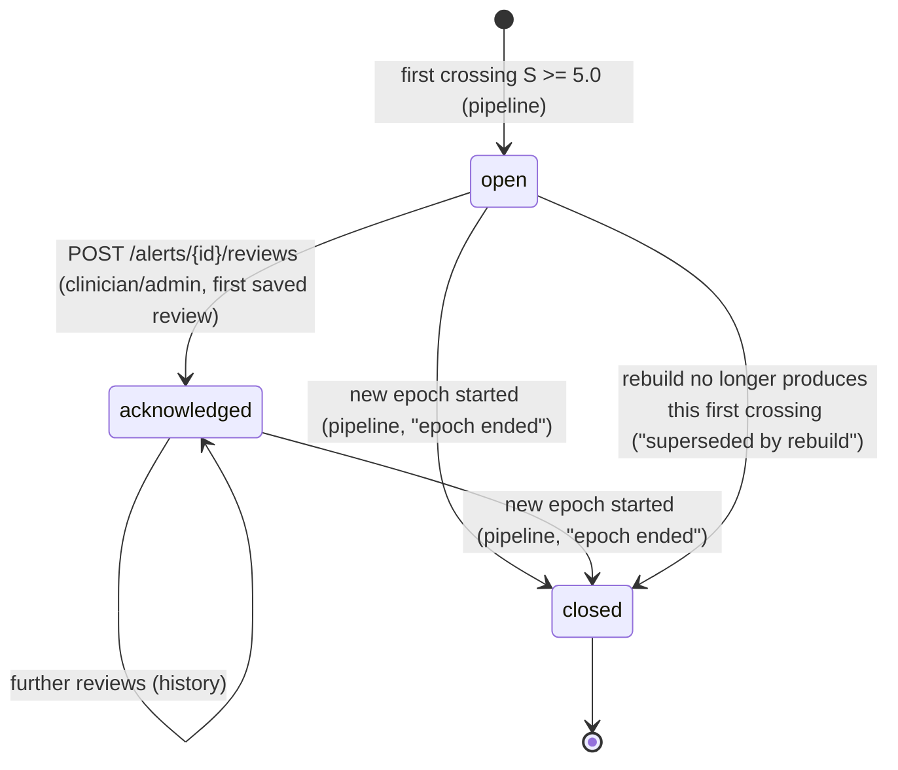

# 09 CUSUM and Alerting Spec

Document ID: ECHOWELL-TRD-09 · Version 0.9 (draft for review) · Date: 18 October 2026, revised 26 October 2026 · Owner: Team 2 · Status: Draft

## 1. Purpose

This document specifies the EchoWell persistence rule and alerting: the one-sided upper CUSUM ("running change tally")
over composite z, the alarm threshold, which sessions update the tally, the alarm states written per scored session,
the alert record and its lifecycle, closure when an epoch ends, how alerts are surfaced in the dashboard, the known
false-alarm behaviour of the v0.1 settings and the plan to calibrate them. It also specifies the alarm review logic
used by the Resident chart's "Review and notes" section (wireframe v0.2, SRC-21; the v0.1 Alert review page is retired,
TRD 24 D-110): alarm reviews and snooze, the "Leaning most" summary, and the rule-based data alerts that go to
the study team (Study team page "Data problems to follow up"), plus the after-the-run "Alarm timing check" against evaluation ground truth. The alarm is a flag "for clinician review"
(SRC-02): it detects a persistent change against the resident's own frozen baseline; it is a prompt to check in, not a
diagnosis (BR-11, BR-18).

## 2. Scope

In scope: `analytics/cusum_engine.py`, `analytics/alert_generator.py`, the `scores.cusum_tally` / `scores.alarm_state`
values, the `cusum_state` and `alerts` tables' derived content and lifecycle, alert acknowledgement semantics, UI surfacing
rules for alarms, the R09/R10 reference tables, the calibration plan (OQ-13), alarm reviews (`alert_reviews`) and
snooze, "Leaning most", data alerts (`data_alerts`, `analytics/data_alerts.py`), the alarm timing check
(`evaluation_ground_truth`, test_v0_1 only).

Out of scope: the computation of `composite_z` (TRD 08); push notification channels (SMS, email, pager) — not in MVP (OQ-06);
clinician reset of the tally (OQ-05); EWMA trend display (OQ-18); clinical interpretation wording (OQ-12, TRD 11).

## 3. References

| ID | Document |
|---|---|
| SRC-02 | Flowcharts: stage 6 "Persistence rule: CUSUM tally builds across sessions"; "tally crosses limit → Flag for clinician review; EWMA trend shown against baseline band"; "A single odd day never raises a flag" |
| SRC-03 | Workbook: Parameters (CUSUM, alarm), Exp_scores (cusum_tally, alarm), Exp_resident_outcomes (first_alarm_session), README note 5 (false alarms) |
| SRC-04 | Generator script, CUSUM loop |
| SRC-21 | Clinical dashboard wireframe v0.2 (`specs/UI-wireframe/echowell-wireframes-v0.2.html`): Resident list (status pill "Changed", nav badge), Resident chart (Summary "Leaning most", Review and notes, Voice trends change-score chart with "Alarm line: 5"), Study team (data problems, alarm timing check) |
| SRC-09 / SRC-10 / SRC-18 / SRC-19 | Wireframes v0.1 (Main, Resident, Alerts, Analytics): superseded by SRC-21 (TRD 24 D-108); removed from the repository |
| SRC-13 | Dataset specification §5 (Team 1 50-resident, 120-day dataset with inserted changes and separate answer key) |
| TRD 07 | Analytics engine (persistence, reconciliation ANL-039) |
| TRD 08 | Baseline and scoring (composite_z) |
| TRD 05 / TRD 11 | API and UI (alerts endpoints, badges, chart) |
| TRD 24 | RSK-03, RSK-04, OQ-05, OQ-06, OQ-13, OQ-18, OQ-31; D-108 to D-114 (wireframe v0.2) |

## 4. Requirements

### 4.1 CUSUM definition (`analytics/cusum_engine.py`)

For each resident-epoch with a formed baseline, let z_1, z_2, …, z_m be the `composite_z` values of its scored sessions
in time order (TRD 08 BSC-036). With reference value k = `cusum_k` = 0.5 and decision limit h = `cusum_h` = 5.0:

```
S_0 = 0
S_i = max(0, S_{i-1} + z_i - k)            i = 1..m
ring_index = smallest i with S_i >= h      (none if no such i)
alarm_state_i = "off"   if ring_index is none or i < ring_index
              = "rings" if i == ring_index
              = "on"    if i > ring_index
```

```
run_cusum(score_rows, config):
    for each (resident, epoch) group, rows in time order:
        S = 0.0; rung = False
        for row in rows:
            S = max(0.0, S + row.composite_z - config.cusum_k)
            if not rung and S >= config.cusum_h: state = "rings"; rung = True
            elif rung: state = "on"
            else: state = "off"
            emit row with cusum_tally = S, alarm_state = state
```

| ID | Requirement | Priority | Trace | Verification |
|---|---|---|---|---|
| CUS-001 | The tally shall be the one-sided upper CUSUM `S_i = max(0, S_{i−1} + composite_z_i − k)` with `S_0 = 0`, computed in float64 without rounding. | Must | BR-11, SRC-03 Parameters | Test |
| CUS-002 | `k` shall be read from `cusum_k` (0.5) and `h` from `cusum_h` (5.0) in `PipelineConfig`; both profiles use these values in v0.1. | Must | SRC-03 Parameters, contract §7 | Test |
| CUS-003 | The tally shall start at 0 with the first scored session of an epoch, i.e. the first usable session after the session the baseline froze on; baseline sessions shall not update the tally. | Must | SRC-03 Parameters "CUSUM", SRC-04 | Test |
| CUS-004 | Only scored sessions shall update the tally; set-aside, quarantined, duplicate and late-arrival records and missing days (missing_resident, missing_device_gap) shall leave it unchanged (no decay, no zero insertion). | Must | BR-06, BR-11, SRC-03 Parameters | Test |
| CUS-005 | Each epoch shall have its own tally; when a new epoch begins the tally of the new epoch starts at 0 after its own baseline freezes, and no value is carried over. | Must | BR-08, ASM-06 | Test |
| CUS-006 | The alarm condition shall be `S_i ≥ h` (inclusive). | Must | SRC-03 Parameters "alarm" | Test |
| CUS-007 | Each scored session shall carry `alarm_state` "off" before the first crossing, "rings" on the first crossing, and "on" for every later scored session of the same epoch regardless of whether S later falls below h. | Must | SRC-03 Exp_scores "alarm", contract §7 step 8 | Test |
| CUS-008 | The engine shall not reset the tally or the alarm state for any reason other than a new epoch; a saved review (`alert_reviews`, status `acknowledged`) or a snooze shall never reset or change `cusum_tally` or `alarm_state` in v0.1 (OQ-05). | Must | OQ-05, SRC-03 README | Test |
| CUS-009 | `cusum_state` shall hold, per epoch, `current_tally` (S of the last scored session, 0.0 if none), `last_scored_session_id`, `alarm_on` (true if a crossing occurred in the epoch) and `updated_at`. | Must | TRD 06 | Test |
| CUS-010 | Because the tally is a pure function of the ordered composite_z sequence, a rebuild shall reproduce every `cusum_tally` and `alarm_state` exactly (TRD 07 ANL-023). | Must | SRC-02 | Test |

### 4.2 Alert generation (`analytics/alert_generator.py`)

| ID | Requirement | Priority | Trace | Verification |
|---|---|---|---|---|
| CUS-011 | `generate_alerts` shall emit exactly one `AlertEvent` per resident-epoch whose scores contain a session with `alarm_state = "rings"`, with `session_id` of that session, `triggered_at` = its `timestamp_utc`, `local_date` = its local date, and `cusum_value` = its `cusum_tally`. | Must | BR-11, contract §7 step 9 | Test |
| CUS-012 | `AlertEvent.epoch_ended` shall be true and `epoch_ended_at` = the next epoch's `started_at` when the resident has a later epoch; otherwise false and null. | Must | ASM-06 | Test |
| CUS-013 | No alert shall be generated for an epoch without a formed baseline, or for any single session whose composite_z is high while the tally stays below h (SRC-02 "a single odd day never raises a flag"). | Must | BR-11, SRC-02 | Test |

### 4.3 Alert record and lifecycle

Alert table fields (TRD 06; derived fields set by the pipeline, review fields set by staff):

| Field | Type | Set by | Value |
|---|---|---|---|
| id | uuid | pipeline (insert) | gen_random_uuid() |
| resident_id | uuid FK residents | pipeline | resident of the epoch |
| epoch_id | uuid FK epochs | pipeline | epoch of the first crossing |
| session_id | text | pipeline | first-crossing session (e.g. R09-20261021-01) |
| triggered_at | timestamptz | pipeline | `timestamp_utc` of that session |
| local_date | date | pipeline | facility-local date of that session ("Changed from their usual since <Mon D>", "Alarm started") |
| cusum_value | double precision | pipeline | tally at first crossing (e.g. 5.431965) |
| status | enum(open, acknowledged, closed) | pipeline / staff | initial `open` |
| closed_reason | text null | pipeline / admin | "epoch ended", "superseded by rebuild" (pipeline) or "admin" (reserved) |
| acknowledged_by | uuid FK users null | staff | user who marked reviewed |
| acknowledged_at | timestamptz null | staff | time of the first saved review |
| snoozed_until | timestamptz null | staff | "Remind me in 24 hours" (CUS-039) |
| snoozed_by | uuid FK users null | staff | user who snoozed |
| created_at / updated_at | timestamptz | system | |



| ID | Requirement | Priority | Trace | Verification |
|---|---|---|---|---|
| CUS-014 | The persistence service shall upsert alerts on the natural key `(epoch_id, session_id)` (contract §20 R15): an `AlertEvent` without a matching row inserts one with `status = open`; at most one non-closed alert shall exist per epoch. | Must | contract §7 step 9, R15, TRD 06 DB-018 | Test |
| CUS-015 | An existing alert shall never be deleted and its `session_id`, `triggered_at`, `local_date` and `cusum_value` shall never be rewritten; its reviews and snooze survive every rebuild. If a rebuild produces a different first crossing for the epoch (possible only after an out-of-order post-freeze record, TRD 07 ANL-027) or none, the existing non-closed alert shall be set to `closed` with `closed_reason = 'superseded by rebuild'`, a new alert is inserted for the new first crossing (if any), and `RunWarning(code="alert_first_crossing_changed")` is recorded. | Must | BR-02, ASM-07, R15 | Test |
| CUS-016 | `POST /api/v1/alerts/{id}/reviews` (roles clinician, admin; body `{explanations: [code, ...], outcome, note?}`) shall insert one `alert_reviews` row (`alert_id`, `reviewer_user_id`, `explanations` text[], `outcome`, `note` ≤ 2000 chars, `created_at`), set the alert `status = acknowledged` (and `acknowledged_by`/`acknowledged_at` on the first review), write `audit_logs` (action `alert.reviewed`, TRD 12 §4.12), and shall not change the tally, `alarm_state`, `cusum_state.alarm_on` or the resident's display status (OQ-05). A review of a closed alert returns 409 `ALERT_CLOSED`; `POST /api/v1/alerts/{id}/acknowledge` does not exist (contract §20 R5). | Must | OQ-05, BR-16, SRC-21 | Test |
| CUS-017 | Multiple reviews per alert shall be allowed and kept as history (`GET /api/v1/alerts/{id}/reviews`, newest first; "Previous reviews" in the Resident chart's "Review and notes" section, TRD 11 UX-320); the review form exists only in that section (single review model; the v0.1 "Mark as reviewed" dialog is retired, TRD 24 D-110); staff notes remain a separate free-note feature and do not change alert status. | Must | SRC-21, R5, D-110 | Test |
| CUS-018 | When a resident has an epoch newer than an alert's epoch, the persistence service shall set that alert's `status = closed` and `closed_reason = "epoch ended"` (if not already closed), and write an `audit_logs` row (actor_type `system`, action `alert.closed`, TRD 12 §4.12); closure time is `closed_at`, set to the run's `as_of` in the same UPDATE (required by TRD 20 `alerts_closed_ck`). | Must | ASM-06, contract §7 step 8 | Test |
| CUS-019 | The value `closed_reason = 'admin'` is reserved; the v0.1 API has no endpoint that closes an alert manually, so manual closure is not implemented in the MVP (OQ-05). | Must | OQ-05, TRD 20 | Inspection |
| CUS-020 | A resident's `status` shall be `alarm_on` when an alert of the resident's current epoch has status `open` or `acknowledged` (acknowledgement does not turn the alarm off in v0.1); the UI shows it as the "▲ Changed" pill and "Changed from their usual since <Mon D>" using the alert's `local_date` (TRD 11 §4.3.4, §4.3.6; TRD 24 D-109). The attention flag (`needs_attention`, TRD 23 §4.4.3) never overrides `alarm_on`. | Must | SRC-21, contract §8, D-109 | Test |
| CUS-021 | After an epoch ends, the resident's `status` shall follow the new epoch (`baseline_forming` until its baseline forms, then `no_alarm`, shown as "Usual. Baseline restarted <Mon D> after a new device." or the firmware/software variant, or `alarm_on` if the new epoch alarms). | Must | BR-08, contract §8, SRC-21 | Test |

### 4.4 Surfacing in the dashboard (no push)

| ID | Requirement | Priority | Trace | Verification |
|---|---|---|---|---|
| CUS-022 | Alerts shall be surfaced only inside the authenticated dashboard: the red count badge on the "Resident list" navigation link (n = change alarms with status `open`, i.e. not yet reviewed; data alerts not counted; TRD 11 UX-018), the "Review and notes" section badge of the resident's chart (UX-411), the "▲ Changed" status pill and the Changed-first order of the resident list (`sort=alarm`, TRD 24 D-109), the chart Summary ("Alarm started", "Leaning most"), the change-score chart on Voice trends and the check-in log event `alarm_on`; the system shall not send SMS, email or push notifications in the MVP (OQ-06). | Must | OQ-06, SRC-21, D-110 | Inspection, Demo |
| CUS-023 | The change-score chart (UI name for the CUSUM tally, TRD 24 D-113; the "Change score" panel of the Resident chart's Voice trends section, TRD 11 §4.5.3; the v0.1 Alert review mini chart is retired, D-110) shall draw one bar per scored session of the current epoch with height `cusum_tally`, coloured by `alarm_state` (`--c-aside` while `off`, `--red` when `rings`/`on`), a leading grey slot labelled "Baseline <Mon D>–<Mon D>", a dashed red line at `cusum_h` labelled "Alarm line: <h>" ("Alarm line: 5"), a "▲" marker on the first crossing, and the intro line stating that missed, set-aside and held-back check-ins leave it unchanged (TRD 11 UX-080 to UX-091; contract §20 R1). | Must | BR-13, SRC-21, R1, D-111 | Demo, Test |
| CUS-024 | `GET /api/v1/scores` shall return per scored session `session_id`, `local_date`, `is_morning`, the 7 `z_*` values, `composite_raw`, `composite_z`, `cusum_tally`, `alarm_state`, plus the epoch's `frozen_after_session_id` and baseline session dates so the chart can draw the baseline period. | Must | TRD 05, SRC-03 Exp_scores | Test |
| CUS-025 | `GET /api/v1/alerts?status=&resident_code=` shall list alerts with all fields of section 4.3 and the resident_code; the list shall be ordered by `triggered_at` ascending. | Must | TRD 05 | Test |
| CUS-026 | All alarm wording shall describe detection of a change and a prompt to check in ("Changed", "Alarm on. Change score crossed <h>.", "change score"); it shall never state a diagnosis or severity; the chart Summary ("Right now") text comes from a PI-reviewed configuration string (OQ-12, TRD 11 UX-074). | Must | BR-18, RSK-09, OQ-12, D-113 | Inspection |

### 4.5 Reference tables (SRC-03 Exp_scores, profile test_v0_1)

R09, step change of 1.5 SD from day 21 (true onset 2026-10-21). Baseline frozen after R09-20261016-01; composite baseline
median 0.038219, spread 0.533378.

| # | session_id | local_date | composite_z | tally S | alarm_state |
|---|---|---|---|---|---|
| 1 | R09-20261017-01 | 2026-10-17 | 3.745474 | 3.245474 | off |
| 2 | R09-20261018-01 | 2026-10-18 | −0.135711 | 2.609763 | off |
| 3 | R09-20261019-01 | 2026-10-19 | −0.336702 | 1.773061 | off |
| 4 | R09-20261020-01 | 2026-10-20 | 0.370597 | 1.643658 | off |
| 5 | R09-20261021-01 | 2026-10-21 | 4.288307 | 5.431965 | rings ("RINGS (first crossing)") |
| 6 | R09-20261022-01 | 2026-10-22 | 3.027292 | 7.959257 | on |
| 7 | R09-20261023-01 | 2026-10-23 | 0.830709 | 8.289966 | on |
| 8 | R09-20261024-01 | 2026-10-24 | 2.924838 | 10.714804 | on |
| 9 | R09-20261025-01 | 2026-10-25 | 2.226203 | 12.441007 | on |
| 10 | R09-20261026-01 | 2026-10-26 | 3.329651 | 15.270658 | on |
| 11 | R09-20261027-01 | 2026-10-27 | 1.935308 | 16.705966 | on |
| 12 | R09-20261028-01 | 2026-10-28 | 2.555900 | 18.761866 | on |
| 13 | R09-20261029-01 | 2026-10-29 | 4.864836 | 23.126702 | on |
| 14 | R09-20261030-01 | 2026-10-30 | 4.203554 | 26.830256 | on |

Arithmetic of the first crossing: S_4 = 1.643658; S_5 = max(0, 1.643658 + 4.288307 − 0.5) = 5.431965 ≥ 5.0 → rings.
Session 1 (composite_z 3.745) shows why a single odd day does not ring: S_1 = 3.245 < 5.0 and decays over the next three
sessions. Resulting alert: resident R09, epoch 1, session_id R09-20261021-01, local_date 2026-10-21, cusum_value 5.431965,
status open; resident list "▲ Changed" with "Changed from their usual since Oct 21. Not reviewed yet."

R10, gradual drift from day 17 reaching 2.0 SD on day 30 (true onset 2026-10-17). Baseline frozen after R10-20261016-01
(composite median 0.036981, spread 1.148259); the baseline is not changed by the drift (TRD 08 BSC-030).

| # | session_id | local_date | composite_z | tally S | alarm_state |
|---|---|---|---|---|---|
| 1 | R10-20261017-01 | 2026-10-17 | 0.683927 | 0.183927 | off |
| 2 | R10-20261018-01 | 2026-10-18 | 0.965072 | 0.648998 | off |
| 3 | R10-20261019-01 | 2026-10-19 | 0.853750 | 1.002749 | off |
| 4 | R10-20261020-01 | 2026-10-20 | 0.854863 | 1.357612 | off |
| 5 | R10-20261021-01 | 2026-10-21 | 1.502208 | 2.359820 | off |
| 6 | R10-20261022-01 | 2026-10-22 | 1.910743 | 3.770563 | off |
| 7 | R10-20261023-01 | 2026-10-23 | 1.115968 | 4.386532 | off |
| 8 | R10-20261024-01 | 2026-10-24 | 2.085518 | 5.972050 | rings ("RINGS (first crossing)") |
| 9 | R10-20261025-01 | 2026-10-25 | 1.004072 | 6.476122 | on |
| 10 | R10-20261026-01 | 2026-10-26 | 1.006980 | 6.983102 | on |
| 11 | R10-20261027-01 | 2026-10-27 | 2.664262 | 9.147364 | on |
| 12 | R10-20261028-01 | 2026-10-28 | 2.168771 | 10.816135 | on |
| 13 | R10-20261029-01 | 2026-10-29 | 2.252973 | 12.569108 | on |
| 14 | R10-20261030-01 | 2026-10-30 | 1.349075 | 13.418183 | on |

R10 rings 7 days after the true onset. No other test resident rings: maximum tallies R01 0.333, R02 0.443, R03 2.203,
R04 0.611, R05 4.006, R06 1.178, R07 (epoch 2) 0.000. Exp_scores contains 81 "off", 2 "RINGS (first crossing)" and 15 "on" rows.

| ID | Requirement | Priority | Trace | Verification |
|---|---|---|---|---|
| CUS-027 | On SRC-05 with profile test_v0_1 the engine shall reproduce every `cusum_tally` in Exp_scores within 1e-6 and every alarm string exactly (after the mapping off/rings/on ↔ "off"/"RINGS (first crossing)"/"on"), including the R09 and R10 tables above. | Must | BR-15, SRC-03 | Test |
| CUS-028 | On SRC-05 the persisted `alerts` table shall contain exactly two rows: R09 (R09-20261021-01, 2026-10-21, 5.431965) and R10 (R10-20261024-01, 2026-10-24, 5.972050), both `open`; Exp_resident_outcomes `first_alarm_session` shall be "none" for every other formed resident-epoch. | Must | SRC-03 Exp_resident_outcomes | Test |

### 4.6 False-alarm caveat and calibration plan

The v0.1 settings (k = 0.5, h = 5.0, N = 16) test arithmetic, not detection performance (SRC-03 README note 5). The
SRC-04 fixture seed 20261004 was chosen so that the eight residents without an inserted change do not alarm; across 100
other seeds, 10% of those no-change residents raised a false alarm within 14 scored sessions with a 16-session baseline
(RSK-03). Independent replication for this TRD (SRC-04 run with seeds 1–100, scratch output only): 61 of 600
no-change resident-epochs with at least 6 scored sessions (R01–R06) alarmed = 10.2% (R01 14, R02 7, R03 8, R04 8, R05 13,
R06 11; R07 epoch 2 with 2 scored sessions 0 of 100), consistent with the README figure. Textbook CUSUM run lengths assume independent, correctly scaled inputs; a 16-session robust baseline estimates
the composite centre and spread with large error, so the realised false-alarm rate is far higher. This is the concrete
reason the production baseline is 30 sessions and h must be calibrated (OQ-13). In the fixture, R05 reaches 4.006 without
an inserted change, 0.994 below the alarm line.

| ID | Requirement | Priority | Trace | Verification |
|---|---|---|---|---|
| CUS-029 | The dashboard and documentation shall not present v0.1 alarm rates as validated detection performance; the Study team page data (`GET /api/v1/analytics`) shall include, in its `meta` block (TRD 19 `Meta`, D-32), the active `cusum_h`, `baseline_n` and config profile so researchers can see which settings produced an alarm; `cusum_k` is not a response field (it is 0.5 in both profiles, OQ-13) and is reported with every setting in the calibration report (CUS-034). | Must | RSK-03, RSK-04, BR-18 | Inspection, Test |
| CUS-030 | Calibration shall be performed on Team 1's synthetic dataset (50 residents, ≥ 120 days, about 20% with an inserted 1–2 SD step or 2–3-week drift, 10–30% missing sessions, about 5% poor-quality sessions, 2–3 device moves, answer key in a separate file; SRC-13 §5), ingested by CSV upload through `POST /api/v1/ingest` into an isolated calibration database (a dedicated database of the local docker-compose stack, never staging, whose fixed PIPELINE_AS_OF and `test_v0_1` profile serve the answer key, and never production; TRD 14 TDV-090; TRD 24 D-75). | Must | OQ-13, SRC-13 | Analysis |
| CUS-031 | The calibration shall evaluate the grid `baseline_n` ∈ {16, 20, 30, 45, 60}, `cusum_k` ∈ {0.25, 0.5, 0.75, 1.0}, `cusum_h` ∈ {3, 4, 5, 6, 7, 8, 10} by running `run_pipeline` (CLI, TRD 07 ANL-007) once per combination with all other parameters at production values; `baseline_n` values other than the production 30 are evaluated for the report only and may be applied only with the owner's approval (TRD 24 D-01, RSK-03). | Must | OQ-13 | Analysis |
| CUS-032 | For each combination the calibration shall report: (a) false-alarm proportion = share of no-change residents with ≥ 1 alert, plus alerts raised before the true onset in change residents; (b) false alerts per 100 scored sessions; (c) detection proportion = share of change residents whose first alert falls on or after the true onset and within 30 days of it; (d) detection delay in scored sessions and in days (median and interquartile range); (e) share of residents whose baseline never forms. | Must | OQ-13, SRC-13 | Analysis |
| CUS-033 | The answer key shall be read only by the calibration evaluation code after the pipeline run, never by `analytics/` or the backend (SRC-02 "the answer key never touches the analytics"). | Must | SRC-02, SRC-13 §5 | Inspection |
| CUS-034 | The selection rule shall be: among combinations whose false-alarm proportion is ≤ the target set by the PI (TRD 24 OQ-27; until it is set, no combination is selected and production values stay unchanged), choose the highest detection proportion, then the shortest median delay; the chosen values shall be written to `config_parameters` profile `production` with `python -m backend.cli set-config` (one call per key, with the calibration report as reason) and then applied by `python -m backend.cli rebuild --profile production --confirm REBUILD` (TRD 15 §4.8, TRD 07 ANL-032, TRD 24 D-69), and the calibration report (grid results, chosen values, dataset version, code_version) shall be stored in `docs/reports/CALIBRATION_REPORT.md` with machine-readable results in `docs/reports/calibration_results.json`. | Must | OQ-13, BR-15, R6 | Inspection |
| CUS-035 | The SRC-03 validation (profile test_v0_1) shall remain unchanged by calibration; calibrated values apply only to the `production` profile. | Must | BR-15, ASM-04 | Test |


### 4.7 EWMA display (deferred)

| ID | Requirement | Priority | Trace | Verification |
|---|---|---|---|---|
| CUS-036 | The EWMA trend against a baseline band shown in the final box of SRC-02 shall not be implemented in v0.1 (it is absent from the SRC-21 wireframe); if added later (OQ-18) it shall be display-only and shall not influence alarms (TRD 07 ANL-056). | Must | OQ-18, SRC-02 | Inspection |


### 4.8 Alarm review logic (Resident chart "Review and notes", SRC-21)

The v0.1 Alert review page (`/alerts`) and its alarm queue are retired (TRD 24 D-110): Changed residents sort first on the
resident list (`sort=alarm`), the "Resident list" nav badge counts unreviewed alarms, the review form, reminder and review
history are in the chart's "Review and notes" section, and the alarm facts and "Leaning most" are in the chart Summary.
The alert facts the UI uses are unchanged and come from `GET /api/v1/alerts?resident_code=<R>`: d = `open_days` = (local
date of as_of − alert `local_date`) in days (Summary "Open": "<d> days"), t = `current_tally` = `cusum_state.current_tally`
of the epoch (Summary tile "Change score <t>", 1 decimal, half-up), review state `status` (`open` = "Not reviewed",
`acknowledged` = "Reviewed"). SRC-05 expected: R09 alarm Oct 21, open 9 days, change score 26.8, not reviewed; R10 alarm
Oct 24, open 6 days, change score 13.4, not reviewed.

"Leaning most" (`alert_generator.leaning_most`): over the scored sessions of the alert's epoch with `local_date` ≥ the
alert's `local_date` (the ringing session included) up to as_of, compute for each of the 7 composite features the mean of
the signed z (`s_f × z_f`); keep features with mean > 0; sort by mean descending, ties by canonical feature order; take
the first 3; render each as the §6 plain-language label with the parenthetical removed, lowercased, joined ", ".

| Alert | sessions | mean signed z (loudness, phrase dur., speech rate, artic. rate, pauses, pause frac., voiced frac.) | Leaning most |
|---|---|---|---|
| R09 (since Oct 21) | 10 | 2.133, 1.952, 0.753, 1.453, 2.158, 0.997, 2.092 | "more pauses, quieter, less voiced sound" |
| R10 (since Oct 24) | 7 | 1.441, 1.248, 2.196, 3.418, 3.429, 1.405, 1.511 | "more pauses, slower while talking, fewer syllables per second" |

| ID | Requirement | Priority | Trace | Verification |
|---|---|---|---|---|
| CUS-037 | (Retired by TRD 24 D-110: there is no alarm queue; the alert facts above are returned by `GET /api/v1/alerts` (CUS-025, CUS-041) and rendered in the chart Summary, TRD 11 UX-076.) | — | D-110 | — |
| CUS-038 | The review form ("Review and notes" section, TRD 11 §4.17.2) shall offer the explanation checklist from config key `review_explanations` (codes and labels: cold_cough_sore_throat "Cold, cough or sore throat"; dental_dentures "Dental problem or dentures out"; medication_change "New or changed medication"; poor_sleep_unusual_day "Poor sleep or unusual day"; room_device_moved "Room or device moved"; multi-select, optional; provisional, OQ-25) and a required single outcome: no_concern "Checked on resident, no concern"; known_cause "Explained by a known cause"; referred "Referred to nurse or provider"; data_problem "Looks like a data problem: send to study team" (UI legend "What did you find?", D-113). Unknown codes return 422. | Must | SRC-21, OQ-25 | Test |
| CUS-039 | `POST /api/v1/alerts/{id}/snooze {hours?}` (clinician, admin) shall set `snoozed_until` = now (application clock, TRD 23 DME-022) + hours (default config `alert_snooze_hours` = 24) and `snoozed_by`; the "Review and notes" section then shows "Reminder set for <Mon D, h:mm AM/PM>." (TRD 11 UX-317); snoozing shall not change alert status, tally, alarm state or the nav badge count, and is audit-logged (action `alert.snoozed`, TRD 12 §4.12). | Must | SRC-21, §19 | Test |
| CUS-040 | A review with outcome `data_problem` shall create or link a `data_alerts` row of kind `review_flagged_data_problem` as TRD 02 FR-273 specifies, with title "<R> · review flagged a data problem" and detail "a review flagged a data problem (<Mon D>, <display name>)." (date = facility-local date of the review, display name = reviewer; section 4.9; TRD 11 §4.18.2; TRD 24 D-114); the pipeline never creates, modifies or resolves this kind (TRD 07 ANL-060). | Must | SRC-21, §19, D-114 | Test |
| CUS-041 | "Leaning most" shall be computed as defined above and returned with each alarm on `GET /api/v1/alerts`; it shall be absent (empty list) when no feature has a positive mean (the chart Summary then reads "Leaning most: no single measurement stands out.", TRD 11 UX-312). | Must | SRC-21, §19, D-92 | Test |
| CUS-042 | Who may review and the required review time are not enforced in the MVP (roles clinician and admin may review; no SLA; OQ-26); the review panel shall carry the open-questions note of TRD 11 UX-321 and the chart Summary the note "It is a prompt to check in, not a diagnosis." (UX-072); the data bar states that no audio is stored or played (UX-400). | Must | OQ-26, BR-18, SRC-21 | Inspection |

### 4.9 Data alerts (`analytics/data_alerts.py`, SRC-21)

Data alerts are data-quality findings for the study team, not health alarms; they are listed on the Study team page under
"Data problems to follow up" as "**<code>:** <detail>" with the code in bold, and the `title` is the code link's accessible
name (TRD 11 §4.18.2). Open `baseline_stalled` and `high_set_aside` alerts also set the resident's attention flag
(`needs_attention`, the yellow "Needs attention" status; TRD 23 §4.4.3, TRD 24 D-109; which data problems count is OQ-31);
the other kinds never change a resident's status. They are recomputed on every run over the
30-day window of TRD 07 section 4.13 (local days ending on the as_of local date, not before enrolment). Thresholds are
`config_parameters` keys with equal values in both profiles (provisional, OQ-24): `data_alert_baseline_stalled_enabled`
= true, `data_alert_set_aside_fraction` = 0.20, `data_alert_device_silent_days` = 2; the minimum of 10 received records for high_set_aside is a fixed rule constant (contract §19), not a config key (TRD 20 §4.11).

Titles are unchanged from v0.1; the `detail` strings follow wireframe v0.2 (TRD 24 D-114) and are written without the
leading code, starting in lower case (the UI prefixes "**<code>:** ").

| Kind | Rule (per resident or device, window = last 30 local days) | Title / detail |
|---|---|---|
| baseline_stalled | resident's current epoch has no formed baseline AND (as_of local date − current epoch start local date) + 1 ≥ `baseline_n` days | "<R> · baseline stuck at <n> of <N>" / "baseline stuck at <n> of <N>. <missed> missed and <set_aside> set aside in 30 days." (n = usable in current epoch; missed = missing_resident + missing_device_gap ledger days) |
| possible_other_speaker | ≥ 1 quarantined record in the window | "<R> · possible other speaker" / "<q> check-ins held back as possible other voice (<Mon D>, <Mon D>)." ("1 check-in held back as possible other voice (<Mon D>)." when q = 1; all dates in ascending order joined ", ") |
| high_set_aside | received ≥ 10 AND set_aside / received ≥ `data_alert_set_aside_fraction`, and the resident has no baseline_stalled alert (suppression) | "<R> · many check-ins set aside" / "<s> of <received> received check-ins set aside (<kinds>)." with kinds in the fixed order noise, quality flag, too short, listing only kinds that occur |
| device_silent | a device-day is silent when the device has ≥ 1 resident assigned that day (TRD 10 ING-045) and every such resident's ledger day is missing; it is flagged when the device is shared that day (≥ 2 residents) or it belongs to a run of ≥ `data_alert_device_silent_days` consecutive silent days of a single-resident device | one alert per device: "<D> · device silent all day" (1 flagged day) or "<D> · device silent on <k> days" / "silent all day <Mon D>. Affected <R list>." (1 flagged day) or "silent on <k> days (<Mon D>, <Mon D>, …). Affected <R list>." (k ≥ 2 flagged days); R list = residents assigned on the flagged days, natural order, joined ", " with " and " before the last ("Affected R02 and R03.", "Affected R08.", "Affected R01, R02 and R03.") |
| review_flagged_data_problem | created or linked by a review with outcome `data_problem` (CUS-040), never by the rules | "<R> · review flagged a data problem" / "a review flagged a data problem (<Mon D>, <display name>)." |

Each resident appears at most once per kind and each device at most once. Output order (pipeline and API): kind in
`data_alert_kind` enum order (baseline_stalled, possible_other_speaker, high_set_aside, device_silent,
review_flagged_data_problem), then resident_code or device_code. The Study team page groups the rows for display by the
kind order of TRD 11 UX-307 (baseline_stalled, high_set_aside, possible_other_speaker, device_silent,
review_flagged_data_problem: the "Staff can help" kinds first); this is a presentation order and needs no API change.

Verification performed for this TRD (independent implementation on SRC-05, as_of 2026-10-30 15:00): exactly four alerts —
"R08 · baseline stuck at 13 of 16" / "baseline stuck at 13 of 16. 12 missed and 5 set aside in 30 days."; "R05 · possible
other speaker" / "2 check-ins held back as possible other voice (Oct 8, Oct 22)."; "R03 · many check-ins set aside" /
"7 of 29 received check-ins set aside (noise, quality flag, too short)." (7/29 = 0.241); "D02 · device silent all day" /
"silent all day Oct 12. Affected R02 and R03." The resulting attention flags are R08 (`baseline_stalled`) and R03
(`high_set_aside`); R05's and D02's alerts do not change any resident's status (TRD 24 D-109). Non-triggers checked: R08 set-aside 5/18 =
0.278 is suppressed by baseline_stalled; R02 (24 received, 0 set aside, 6 missed) and all other residents have no data
alert; D08's 12 silent days are never consecutive, so no device_silent alert for D08; no other device has a silent day.

| ID | Requirement | Priority | Trace | Verification |
|---|---|---|---|---|
| CUS-043 | `generate_data_alerts` shall implement the four rules, texts, suppression and ordering of this section exactly. | Must | SRC-21, §19, D-114 | Test |
| CUS-044 | On SRC-05 (test_v0_1, as_of 2026-10-30 15:00 America/Chicago) the engine shall produce exactly the four data alerts listed above, with those titles and details, in the output order (R08, R05, R03, D02), and no other. | Must | SRC-21, BR-15 | Test |
| CUS-045 | `GET /api/v1/data-alerts?status=open` shall list data alerts (kind, resident_code, device_code, title, detail, first_detected_at, last_detected_at, status) in the output order of this section, with the v0.2 `detail` strings (TRD 24 D-114); data alerts shall never appear in the alarm nav badge, the "Review and notes" badge or alarm counts, never use the "▲" glyph or red, and never set `status` = `alarm_on`; only open `baseline_stalled` and `high_set_aside` alerts set the resident's `needs_attention` flag (TRD 23 §4.4.3). | Must | SRC-21, §19, D-109, D-114 | Test |
| CUS-046 | Data-alert thresholds shall be read from `config_parameters` only (as `PipelineConfig.operational`, TRD 07 §4.7); changing them shall need no code change and shall not require a full rebuild, because they are operational keys excluded from the config hash (TRD 24 D-56) and data alerts are recomputed every run. | Must | OQ-24 | Test |

### 4.10 Alarm timing check and review outcomes (Study team page, SRC-21)

| ID | Requirement | Priority | Trace | Verification |
|---|---|---|---|---|
| CUS-047 | In profile test_v0_1 only, `backend/services/analytics_summary.py` (reading `evaluation_ground_truth` solely through `DATABASE_READONLY_URL`, role `echowell_readonly`, contract §21 R27) shall compare persisted alerts with `evaluation_ground_truth` (resident_code, planted_change, true_onset_date, source_file) AFTER the pipeline run and return `alarm_timing` rows: Resident, Planted change, Change began, Alarm rang (alert local_date or "No alarm"), Delay (alarm − onset in days); residents without a planted change are summarised as one row "Other <n>" with "None — No alarm Correct" when none of them has an alert (else listing them as false alarms). SRC-05 expected: R09 Sudden step Oct 21 → Oct 21, 0 days; R10 Slow drift Oct 17 → Oct 24, 7 days; Other 8 None — No alarm, Correct. | Must | SRC-21, SRC-02, BR-15 | Test |
| CUS-048 | `evaluation_ground_truth` shall be loaded only by `database/seeds/load_evaluation_ground_truth.py` in profile test_v0_1; the pipeline (engine and runner) connects only through `DATABASE_URL` (role `echowell_app`, no SELECT on that table), so it can neither read it nor let it influence any derived table (SRC-02 "the answer key never touches the analytics"; contract §21 R20, R27). | Must | SRC-02, SRC-13 §5, §21 R20, R27 | Inspection, Test |
| CUS-049 | In profile production the Study team alarm timing panel shall be replaced by `review_outcomes` ("Alarms and review outcomes", TRD 11 UX-375): alarms raised in the period, number reviewed, and counts by review outcome from `alert_reviews` (latest review per alert). | Must | SRC-21, §19 | Test |

## 5. Assumptions

- ASM-04 Test N = 16; production N = 30.
- ASM-06 A new epoch closes any open alert of the previous epoch with reason "epoch ended" and restarts the CUSUM.
- ASM-07 Frozen baselines are never recomputed; therefore the tally reference never drifts.
- ASM-08 Small team of dashboard users; in-dashboard surfacing is sufficient for the MVP.
- Note for lead (TRD-local): contract section 8 says `alarm_on` = "open alert in current epoch"; this TRD reads "open" as
  "not closed" (status `open` or `acknowledged`), because a saved review does not reset the alarm (§19, OQ-05).
- Note for lead (TRD-local): the fixed minimum of 10 received records for high_set_aside (not a config key), the device_silent multi-day title, the singular
  held-back detail text and the nav badge count definition (unreviewed change alarms) are defined here.

## 6. Dependencies

- TRD 08 for `composite_z` in time order per epoch; TRD 07 for persistence and reconciliation; TRD 06/20 for `scores`,
  `cusum_state`, `alerts`, `staff_notes`, `audit_logs`; TRD 05 for alert and score endpoints; TRD 11 for the change-score chart, status pills and badges.
- Team 1 synthetic dataset and answer key for calibration (SRC-13).

## 7. Acceptance Criteria

- AC-CUS-01: All 98 Exp_scores tallies match within 1e-6 and all alarm states match exactly after mapping.
- AC-CUS-02: R09 first alarm R09-20261021-01 with cusum_value 5.431965 (±1e-6); R10 first alarm R10-20261024-01 with 5.972050.
- AC-CUS-03: Exactly two alert rows exist after processing SRC-05; both `open`.
- AC-CUS-04: Unit test: composite_z sequence [6.0, −10.0, 0.0] yields tallies [5.5, 0.0, 0.0] and states [rings, on, on].
- AC-CUS-05: Unit test: inserting set-aside, quarantined and duplicate records and missing days between scored sessions leaves every tally unchanged.
- AC-CUS-06: Saving a review of the R09 alert (outcome known_cause, explanations [poor_sleep_unusual_day]) creates one `alert_reviews` row, sets status `acknowledged` (Summary "Reviewed", `alarm_reviewed` true), writes an audit row, and the resident still has `status` `alarm_on` (pill "Changed") with unchanged tallies; a second review adds a second row.
- AC-CUS-09: The four SRC-05 data alerts (titles and v0.2 details of section 4.9) and the two alarms' facts (section 4.8) are produced exactly; "Leaning most" for R09 is "more pauses, quieter, less voiced sound".
- AC-CUS-10: Snoozing the R10 alert sets `snoozed_until` 24 h ahead and leaves status, tally and alarm state unchanged.
- AC-CUS-11: The alarm timing check on SRC-05 returns R09 0 days, R10 7 days, Other 8 correct; a static check confirms no module under `analytics/` references `evaluation_ground_truth`, and role `echowell_app` cannot SELECT it.
- AC-CUS-07: Unit/integration test: a resident with an open alert in epoch 1 who gets a record with a new device starts epoch 2; the epoch 1 alert becomes `closed` with `closed_reason = "epoch ended"`, epoch 2 tally starts at 0 after its baseline forms, and the resident has `status` `baseline_forming` (pill "Learning").
- AC-CUS-08: No code path sends email, SMS or push messages (inspection of dependencies and code).

## 8. Implementation Notes

- Implement the tally with a plain Python float loop; do not vectorise with cumulative sums (the `max(0, ·)` makes it path dependent).
- Keep "rings" as a state of the score row, not of the alert; the alert row is created from the "rings" row.
- `alarm_state` stays "on" after the first crossing even if S drops below h; do not recompute it from S alone.
- Store `cusum_value` unrounded; the UI may show 3 decimals ("5.432").
- Use a unique index on `alerts(epoch_id)` to make alert insertion idempotent under concurrent runs.
- Treat the R05 near-miss (max 4.006) as a regression signal: if a code change raises R05 above 5.0, the change is wrong.

## 9. Open Questions

- OQ-05 Does staff review reset the CUSUM tally or turn the alarm off?
- OQ-06 Alert delivery: who is told, how and how fast (in-dashboard only in MVP).
- OQ-12 Final clinical wording of the chart Summary ("Right now") and the resident-list note.
- OQ-31 Which data problems turn a resident to "Needs attention" (interim: open `baseline_stalled` or `high_set_aside`), and when a device counts as offline.
- OQ-13 Alarm limit calibration (production baseline_n = 30 is decided, D-01) on Team 1's 50-resident/120-day dataset.
- OQ-18 EWMA trend versus baseline band display.
- OQ-24 Data-alert thresholds (study team).
- OQ-25 Explanation checklist list (clinical team).
- OQ-26 Who may review alarms and how soon.

## Revision History

| Version | Date | Change | Author |
|---|---|---|---|
| 0.1 | 18 Oct 2026 | Initial generation from TRD_Generation_Prompt.md | — |
| 0.1 | 18 Oct 2026 | Cross-TRD consistency review | — |
| 0.2 | 19 Oct 2026 | Phase 1 validation fixes (F-01, F-03, F-08, F-25) | — |
| 0.3 | 19 Oct 2026 | Phase 1 round-2 fixes (R2-03, R2-17) | — |
| 0.7 | 19 Oct 2026 | Phase 1 round-6 fixes (R6-05) | — |
| 0.8 | 20 Oct 2026 | PR #2 backlog consistency fixes (CUS-029 fields per TRD 19; CUS-030 calibration database (D-75); CUS-031 baseline_n owner approval (D-01); CUS-034 target OQ-27) | — |
| 0.9 | 26 Oct 2026 | Wireframe v0.2 (SRC-21; TRD 24 D-108 to D-114): SRC-09/10/18/19 superseded; §4.8 alarm review logic moves to the Resident chart (CUS-037 retired; CUS-017, CUS-022, CUS-023, CUS-039, CUS-042 redirected to the "Review and notes" section, the "Resident list" nav badge, the Voice trends change-score chart and the Study team page); §4.9 data-alert `detail` strings follow the v0.2 wording (titles unchanged; CUS-040, CUS-043 to CUS-045) and open `baseline_stalled`/`high_set_aside` alerts set the attention flag (D-109, OQ-31); CUS-020, CUS-021, CUS-026 use the Changed/Learning/Usual pills and "change score" wording | — |
