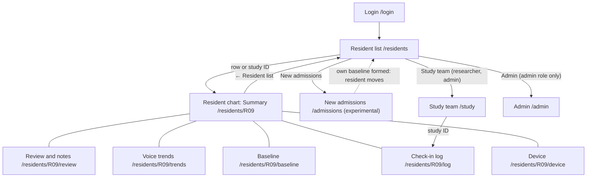

# 11 User Interface and UX Specification

Document ID: ECHOWELL-TRD-11 · Version 0.13 (draft for review) · Date: 18 October 2026, revised 26 October 2026 · Owner: Team 2 · Status: Draft

## 1. Purpose

This document specifies, screen by screen, what the EchoWell staff dashboard shows and how it behaves: every element, its exact copy, field formats, ordering, status pills, count semantics, chart semantics, wording rules, accessibility and responsive behaviour. It turns the clinical dashboard wireframe v0.2 (SRC-21, which supersedes the five v0.1 wireframes SRC-09, SRC-10, SRC-11, SRC-18 and SRC-19; TRD 24 D-108) and the "Frontend Requirements" of the TRD Generation Prompt (SRC-12) into testable UX-xxx requirements, and it fixes the expected rendering of the pipeline test data set (SRC-03, SRC-05) as of 30 October 2026, 3:00 PM America/Chicago.

Wireframe v0.2 follows the layout staff know from electronic health records: pick a resident from a list, open their chart, see the current status first, then go into detail only if needed. Requirement IDs of version 0.12 are kept where the requirement survives (with updated text); requirements of removed screen elements are marked "Retired" with the decision that retired them; new requirements use UX-400 onward.

TRD 04 (Frontend) defines how these screens are built (components, API client, state); this document is the authority for content and behaviour.

## 2. Scope

### In scope

- Resident list (`/residents`): filter buttons, residents table with one status and a one-line reason, status legend.
- Resident chart (`/residents/[residentCode]` and its sections): banner, section navigation, Summary, Review and notes (alarm review form, reminder, previous reviews, staff notes), Voice trends (change score chart, the 7 scored measurements, the "12 other measurements" card), Baseline, Check-in log, Device.
- New admissions (`/admissions`), marked as future/experimental.
- Study team (`/study`): KPI tiles, data problems to follow up, check-ins per day, where check-ins are lost, usable check-ins by resident, alarm timing check, devices, downloads.
- Login (`/login`) and a minimal Admin page (`/admin`), which wireframe v0.2 does not draw and which keep their v0.12 content in the v0.2 visual style (TRD 24 D-111).
- App bar, data bar, loading/empty/error states, plain-language and clinical wording rules, accessibility (WCAG 2.1 AA), responsive behaviour, design tokens.
- Wireframe → requirement traceability and expected rendering with the test data.

### Out of scope

- Computation of any status, count, baseline, score, change score or data alert (TRD 07, 08, 09). The UI renders API values only; mapping the API status and attention flag to the four display statuses is presentation (section 4.3.4).
- API schemas (TRD 05, TRD 19), security enforcement (TRD 12).
- EWMA trend display or baseline band charts (OQ-18), alert delivery outside the dashboard (OQ-06).
- Any audio element, any LLM feature, any diagnosis or severity output (BR-01, BR-18).
- The wireframe's "Show wireframe notes" toggle and its notes styling (a wireframe tool, not a product feature); open questions that the product must show are listed explicitly below (RAQ-018).

## 3. References

| ID | Document |
|---|---|
| SRC-03 | Pipeline test workbook v0.1 (Exp_status_counts, Exp_resident_outcomes, Exp_scores, Annotated_sessions) |
| SRC-05 | Pipeline test input CSV v0.1 |
| SRC-21 | specs/UI-wireframe/echowell-wireframes-v0.2.html — clinical dashboard wireframe v0.2 (Resident list, Resident chart with Summary, Review and notes, Voice trends, Baseline, Check-in log and Device, New admissions, Study team), with its notes in specs/UI-wireframe/WIREFRAMES.md |
| SRC-09, SRC-10, SRC-11, SRC-18, SRC-19 | Wireframes v0.1 (Main, Resident, Admission, Alerts, Analytics): superseded by SRC-21 on 26 Oct 2026 and removed from the repository (TRD 24 D-108); still in Git history |
| SRC-12 | specs/prompts/TRD_Generation_Prompt.md — "Frontend Requirements" |
| Contract §19–§21 | Wireframes v0.1 additions, reconciliation decisions R1–R27 (18 Oct 2026) |
| SRC-02 | Daily Data Storage and Processing Flowcharts (alerts are flags for clinician review) |
| TRD 00 | BR-01..BR-18 |
| TRD 02 | Functional requirements (FR-xxx) tracing to the same BR-xx |
| TRD 04 | Frontend TRD (FE-xxx; components, formatting functions, tokens) |
| TRD 05 / 19 | API behaviour and schemas |
| TRD 08 / 09 | Baseline, scoring, CUSUM, alert and data-alert rules |
| TRD 13 / 14 | Testing strategy, test data and expected results |
| TRD 24 | OQ / ASM / RSK register; D-108 to D-114 (wireframe v0.2) |

## 4. Requirements

Priority: Must / Should / May. Verification: T = Test, I = Inspection, A = Analysis, D = Demo. In copy strings, `<R>` is a resident code (e.g. R09), `<D>` a device code, `<Mon D>` a facility-local date formatted per TRD 04 `formatLocalDate` (e.g. "Oct 21"), `<N>` the API value `baseline_n`, `<h>` the API value `cusum_h` formatted without trailing zeros ("5", "4.5"). Typographic characters are exact: "·" is U+00B7 with one space on each side, "▲" is U+25B2, "●" is U+25CF, "○" is U+25CB, "←" is U+2190, "–" is U+2013, "—" is U+2014, "…" is U+2026, "’" is U+2019, "“" and "”" are U+201C and U+201D, "×" is U+00D7.

### 4.0 Screen map

### 4.1 Global conventions

| ID | Requirement | Priority | Trace | Verification |
|---|---|---|---|---|
| UX-001 | The UI shall identify residents only by their study ID (`resident_code`, e.g. "R09") and shall show no name, photo, room or other personal data (room numbers: OQ-32). | Must | BR-16, contract §2 | I |
| UX-002 | All dates and times shall be shown in the facility time zone delivered by the API (`meta.facility_tz`, America/Chicago per ASM-01), never in the viewer's browser time zone. | Must | ASM-01, contract §7 | T |
| UX-003 | Date-time values shall use the format "Oct 30, 2:28 PM"; date-only values "Oct 21"; date ranges "Oct 1–16"; the year shall be added only when it differs from the year of the as-of date, except in the data bar and Study team period line, which always show it ("Oct 1–30, 2026") (formats defined in TRD 04 section 4.11). | Must | SRC-21 | T |
| UX-004 | Status, alarm and outside-range information shall never be conveyed by colour alone: every status pill shall carry its glyph ("▲" Changed, "!" Needs attention, "●" Usual, "○" Learning), its text label and a border in its colour; alarm bars and the alarm line shall also be identified by the "▲" marker, the "Alarm line" label and the chart's data table. | Must | WCAG 1.4.1, contract §11, SRC-21 | T |
| UX-005 | (Retired by TRD 24 D-110: the v0.1 page footers are replaced by the data bar of UX-400; the "Duplicate records are removed quietly and not shown." note moves to the check-in log, UX-148, and the Study team line "Counts only. No audio, no names." to UX-350.) | — | D-110 | — |
| UX-006 | No page shall contain an audio player, recording control, waveform, spectrogram or any link to audio. | Must | BR-01, BR-16 | I, T |
| UX-007 | The UI shall show N (baseline length), h (alarm line) and the facility time zone from API values; the same build shall show "13 of 16" on the test_v0_1 profile and "of 30" on the production profile. | Must | ASM-04, D-OWNER-2, contract §7 | T |
| UX-008 | Change score values (the CUSUM tally) shall be shown with one decimal ("5.4", "26.8"). | Must | SRC-21 | T |
| UX-009 | The UI shall offer no control to edit, recompute, reset or delete a resident's baseline, score, change score, alarm or any received record. | Must | BR-02, BR-09, OQ-05 | I |

### 4.2 App bar and data bar (every signed-in page)

Wireframe SRC-21: a dark app bar (`--chrome`) with, on the left, "EchoWell" (20px, weight 700) and the facility line (14px, `--chrome-muted`); on the right, the main navigation; below it the yellow data bar.

| ID | Requirement | Priority | Trace | Verification |
|---|---|---|---|---|
| UX-010 | The app bar (`role="banner"`) shall show the brand text "EchoWell" (20px, weight 700, `--chrome-ink`); each page shall have exactly one `<h1>` in its main content: "Residents in the study" on `/residents`, the resident code on the chart, "New admissions" on `/admissions`, "Study team: how the system is working" on `/study`, "Admin" on `/admin`, "EchoWell" on `/login`. | Must | SRC-21 | T |
| UX-011 | Next to the brand the app bar shall show the facility line "<FACILITY_NAME>, Assisted living" (14px, `--chrome-muted`), e.g. "Edgewood, Assisted living". | Must | SRC-21, contract §11 | T |
| UX-012 | The facility name shall be rendered from `meta.facility_name` (`facilities.name`, seeded from FACILITY_NAME) and shall never be hard-coded; the UI shall never display the word "Edge4Care" as a facility name. | Must | contract §2, RSK-10 | T |
| UX-013 | The main navigation (`<nav aria-label="Main">`, right-aligned, wrapping) shall contain, in order, the links "Resident list" (`/residents`), "New admissions" (`/admissions`) and "Study team" (`/study`), each padding 8px 12px, radius 4px, weight 600, 15px, `--chrome-ink`; the link of the current page (the chart counts as "Resident list") shall have `aria-current="page"` and a background of white at 16% opacity. | Must | SRC-21 | T |
| UX-014 | For users with role `admin` the navigation shall show a fourth link "Admin" (`/admin`) after "Study team"; it shall not be shown to other roles. | Must | contract §10, D-111 | T |
| UX-015 | After the navigation the app bar shall show the signed-in user's display name (14px, `--chrome-muted`) and a button "Sign out" (min-height 44px, `--chrome-ink` text, 1px solid `--chrome-muted` border). | Must | BR-16, D-111 | T |
| UX-016 | (Retired by contract §20 R2 and TRD 24 D-110: there is no Devices link; devices are shown on the Study team page, UX-050, and in each chart's Device section, UX-430.) | — | D-110 | — |
| UX-017 | The Study team page shall show, under its `<h1>`, the line "Counts only. No audio, no names." (14px, `--muted`) and the period line "<data source label>, <period> · numbers match the pipeline answer key", where the clause " · numbers match the pipeline answer key" appears only when `meta.pipeline_profile` is `test_v0_1` and `<period>` is the 30-day window as a date range with year (test data: "pipeline test data v0.1, Oct 1–30, 2026 · numbers match the pipeline answer key"). | Must | SRC-21, contract §19 | T |
| UX-018 | When the number of change alarms not yet reviewed (alert status `open`) is greater than 0, the "Resident list" link shall be followed by a red count badge (`--red` background, white text, 13px, radius 999px) showing that number, and the link's accessible name shall be "Resident list, <n> alarms not reviewed" ("1 alarm not reviewed"); data alerts are not counted (test data: badge "2"; after one review "1"). While the count is loading or when its request fails, the link shall show no badge and stay usable (TRD 24 D-97). The "Study team" link shall be shown only to roles `admin` and `researcher`. | Must | SRC-21, contract §19 | T |
| UX-400 | Directly below the app bar every page (including `/login`) shall show the data bar (`--yellow-bg` background, `--yellow` text, 14px, weight 600, 1px solid `--yellow-edge` bottom border, padding 6px 20px). When `meta.pipeline_profile` is `test_v0_1` it shall read "Test data only (<data source label>, <period>). No real residents. No audio is stored or played anywhere in EchoWell." (test data: "Test data only (pipeline test data v0.1, Oct 1–30, 2026). No real residents. No audio is stored or played anywhere in EchoWell."); otherwise "No audio is stored or played anywhere in EchoWell." On `/login`, before `meta` is available, it shall read "No audio is stored or played anywhere in EchoWell." | Must | SRC-21, BR-01, BR-03, D-OWNER-4 | T |

### 4.3 Resident list (`/residents`)

Layout (SRC-21): one panel with a header row (`<h1>` "Residents in the study" 22px on the left, filter buttons on the right) → residents table → status legend; under the panel the prompt note (UX-407). Page max width 1240px, padding 20px.

#### 4.3.1 Summary tiles (retired)

| ID | Requirement | Priority | Trace | Verification |
|---|---|---|---|---|
| UX-020 | (Retired by TRD 24 D-110: wireframe v0.2 has no summary tiles on the resident list; the status counts appear on the filter buttons, UX-401, and the system counts on the Study team page, UX-351.) | — | D-110 | — |
| UX-021 | (Retired by D-110, with UX-020.) | — | D-110 | — |
| UX-022 | (Retired by D-110, with UX-020.) | — | D-110 | — |
| UX-023 | (Retired by D-110; replaced by UX-402.) | — | D-110 | — |
| UX-024 | (Retired by D-110, with UX-020.) | — | D-110 | — |

#### 4.3.2 Filter buttons and order

| ID | Requirement | Priority | Trace | Verification |
|---|---|---|---|---|
| UX-030 | (Retired by TRD 24 D-110: the "Sort by" select is replaced by the filter buttons of UX-401; the API sorts stay available to other clients.) | — | D-110 | — |
| UX-031 | (Retired by D-110, with UX-030.) | — | D-110 | — |
| UX-032 | (Retired by D-110; filter announcements: UX-403.) | — | D-110 | — |
| UX-033 | (Retired by D-110; filter in the URL: UX-404.) | — | D-110 | — |
| UX-401 | The header row shall contain a group (`role="group"`, accessible name "Show") of toggle buttons (15px, padding 6px 12px, radius 999px, 1px solid `--rule`; pressed: `--chrome` background and border, `--chrome-ink` text, `aria-pressed="true"`) in the order "All (<n>)", "Changed (<n>)", "Needs attention (<n>)", "Learning (<n>)", "Usual (<n>)", where "Learning (<n>)" is shown only when at least one listed resident is Learning; n comes from the API `summary` (TRD 19 `OverviewSummary`: total, `changed`, `needs_attention`, `learning`, `usual`). "All" is pressed by default. | Must | SRC-21, TRD 24 D-109 | T |
| UX-402 | Pressing a filter shall show only the rows with that display status (section 4.3.4), keep their order, and leave all counts unchanged; the four status counts shall sum to the number of rows under "All". With no matching rows the table shall show one row "No residents with this status." | Must | SRC-21, BR-12 | T |
| UX-403 | Changing the filter shall not reload the page, shall keep keyboard focus on the pressed button and shall announce "Showing <label> residents" ("Showing all residents") in a polite live region. | Must | WCAG 4.1.3 | T |
| UX-404 | The filter shall be kept in the URL (`?show=all`, `changed`, `needs_attention`, `learning`, `usual`; default `all`) so that reload, back navigation and the chart's back link (UX-060) show the same filter. | Must | SRC-21 | T |
| UX-408 | Rows shall be in the order returned by the API default sort (`sort=alarm`, TRD 05 API-071 as amended by TRD 24 D-109): Changed (alarm date oldest first, then natural resident code), then Needs attention, then Learning, then Usual (each by natural resident code). The UI shall not reorder rows. | Must | SRC-21, D-109 (amends D-17) | T |

#### 4.3.3 Residents table

Columns (SRC-21, exact header text): "Status" · "Resident" · "What's happening" · "Last check-in".

| ID | Requirement | Priority | Trace | Verification |
|---|---|---|---|---|
| UX-034 | The table shall list every enrolled, non-withdrawn resident of the longitudinal cohort (one row per resident) with the four columns above; header cells 14px, weight 600, `--muted`, background `--surface-2`; body cells padding 12px 18px with a 1px solid `--rule` bottom border; a Changed row shall have a 5px `--red` left border on its first cell and a Needs-attention row a 5px `--yellow-edge` left border. | Must | SRC-21, SRC-12, BR-12 | T |
| UX-035 | (Retired by TRD 24 D-110: the device column moves to the chart banner, UX-063.) | — | D-110 | — |
| UX-036 | The Status cell shall show a `StatusPill` with the display status of section 4.3.4. | Must | SRC-21, SRC-12, D-109 | T |
| UX-037 | The Resident cell shall show the study ID in weight 700 as a link to `/residents/<R>` whose accessible name is "Open chart for <R>". | Must | SRC-21 | T |
| UX-038 | The "Last check-in" cell (`--muted`) shall show the facility-local date-time of the resident's most recent non-duplicate record of any status (usable, set aside or held back) in the format "Oct 30, 2:28 PM", or "No check-ins yet" when none exists. | Must | SRC-21, contract §8 | T |
| UX-039 | (Retired by TRD 24 D-110: the last-30-day counts move to the chart banner, UX-063, and the Check-in log section, UX-140.) | — | D-110 | — |
| UX-040 | The whole row shall open the resident's chart Summary when clicked (pointer convenience); keyboard and screen-reader users reach the chart through the study-ID link of UX-037, so the row itself is not a separate tab stop. | Must | SRC-21 | T |
| UX-041 | When the API reports more residents than it returned, a line "Showing <returned> of <total> residents." shall appear under the table. | Must | ASM-08 | T |
| UX-042 | The table shall sit in a container with `overflow-x: auto`, keyboard-focusable with the accessible name "Residents table", and the table shall have `min-width: 640px`, so that on narrow screens the table scrolls inside its container while the page does not. | Must | SRC-21, contract §11 | T |
| UX-043 | The table shall have a visually hidden `<caption>` "Residents in the study, <filter label>" (e.g. "Residents in the study, all") and `scope="col"` on header cells. | Must | WCAG 1.3.1 | T |
| UX-044 | Duplicate records shall never appear in any count, row or log. | Must | BR-03 | T |
| UX-045 | Withdrawn residents shall not be listed or counted on the resident list. | Must | contract §9 | T |
| UX-046 | A new-admission resident shall appear on the resident list only after the API reports their own baseline as formed (cohort transition, section 4.7), and shall then not appear on the New admissions page. | Must | SRC-12, BR-14 | T |
| UX-405 | The "What's happening" cell shall show one sentence from the templates of section 4.3.6, filled with API values. | Must | SRC-21, D-109 | T |
| UX-406 | Under the table the panel shall show the status legend: for each of the four statuses its pill followed by its meaning text (section 4.3.4), 14px, `--muted`, wrapping. | Must | SRC-21 | T |
| UX-407 | Under the panel the note "A status is a prompt to check on someone, not a diagnosis. [Final clinical wording: confirm with PI]" (14px, `--muted`) shall appear; the bracketed part stays until OQ-12 is closed. | Must | SRC-21, BR-18, OQ-12, RAQ-018 | T |

#### 4.3.4 Display statuses (status pills)

| Display status | Pill label | Glyph | Colours (text / background / border) | Meaning text (legend) | Rule (first match; TRD 24 D-109) |
|---|---|---|---|---|---|
| Changed | "Changed" | ▲ | `--red` / `--red-bg` / `--red` | "Their voice has moved away from their own usual. Check on them." | API `status` = `alarm_on` |
| Needs attention | "Needs attention" | ! | `--yellow` / `--yellow-bg` / `--yellow-edge` | "Not enough good check-ins to judge. Check the device or the routine." | API `needs_attention` = true (open data alert `baseline_stalled` or `high_set_aside` for the resident; OQ-31) |
| Learning | "Learning" | ○ | `--grey` / `--grey-bg` / `--grey` | "Still collecting the first <N> check-ins to learn their usual." | API `status` = `baseline_forming` |
| Usual | "Usual" | ● | `--green` / `--green-bg` / `--green` | "Within their own usual range." | API `status` = `no_alarm` |

Pill: inline-flex, gap 6px, padding 3px 10px, radius 999px, 14px, weight 700, 1px border, glyph 12px before the label (the glyph is decorative: `aria-hidden="true"`, the label carries the meaning). Large pill (chart banner): 18px, padding 6px 16px.

Status rules (contract §8, TRD 23 §4.4.3): `alarm_on` = an open or acknowledged alert exists in the current epoch; `baseline_forming` = the current epoch has fewer than N usable sessions; `no_alarm` otherwise. The attention flag is computed by the API from open data alerts (TRD 09 §4.9). An alarm stays on after the first crossing even when the change score later falls below the line (no reset in pipeline v0.1, OQ-05). A new epoch closes the old epoch's alert ("epoch ended", ASM-06), so a resident with a restarted baseline shows the status of the new epoch.

#### 4.3.5 Last-30-days count semantics

| Count | UI label | Definition | Source |
|---|---|---|---|
| used | "Used" | usable sessions (passed ingest, quality gate and speaker screen) with local date in the window | processed_sessions status `usable` |
| set aside | "Set aside (noise, poor quality or too short)" | sessions that failed the quality gate in the window | status `set_aside` |
| quarantined | "Held back (possible other voice)" | sessions that failed the speaker screen in the window | status `quarantined` |
| missed | "Missed" | resident-days in the window with no record: `missing_resident` + `missing_device_gap` | day_ledger |
| (not shown) | — | duplicates | never shown, never counted |

Window: the 30 facility-local calendar days ending on the as-of date (inclusive), starting no earlier than the resident's enrolment date. With test data (enrolment Oct 1, as-of Oct 30) the window is Oct 1–30.

| ID | Requirement | Priority | Trace | Verification |
|---|---|---|---|---|
| UX-047 | Missed days shall be shown as counted by the day ledger and shall never be backfilled, imputed, carried forward or hidden; a missed day shall never be shown as a check-in. | Must | BR-06, SRC-12 | T |
| UX-048 | The four counts for each resident shall equal the API values, which for the test data equal SRC-03 Exp_status_counts (missed = missing_resident + missing_device_gap). | Must | BR-15, SRC-03 | T |

#### 4.3.6 "What's happening" templates

| Situation | Template | Test data |
|---|---|---|
| Changed, alarm not reviewed | "Changed from their usual since <alarm Mon D>. Not reviewed yet." | R09 "Changed from their usual since Oct 21. Not reviewed yet."; R10 "… since Oct 24. Not reviewed yet." |
| Changed, alarm reviewed (`alarm_reviewed` true) | "Changed from their usual since <alarm Mon D>. Reviewed." | — |
| Needs attention, `baseline_stalled` | "Missing many check-ins. Baseline stuck at <n> of <N>." | R08 "Missing many check-ins. Baseline stuck at 13 of 16." |
| Needs attention, `high_set_aside` | "<k> check-ins too noisy or too short to use." (k = set-aside count in the last 30 days) | R03 "7 check-ins too noisy or too short to use." |
| Needs attention, both | the two sentences above, `baseline_stalled` first, joined by one space | — |
| Learning | "Learning their usual: <n> of <N> check-ins so far." | — |
| Usual, current epoch 1 | "Within their usual range." | R01, R02, R04, R05, R06 |
| Usual, current epoch > 1 | "Usual. Baseline restarted <Mon D> after a new device." (cause firmware: "… after a firmware change."; software: "… after a software change.") | R07 "Usual. Baseline restarted Oct 13 after a new device." |

### 4.4 Devices section (Study team page, `/study#devices`)

Moved from the v0.1 overview to the Study team page (TRD 24 D-110). SRC-21: a panel headed "Devices" with one row per group, each row a status tag column (`● Online` in `--green` or `○ No upload today` in `--muted`, 14px, weight 700) and a text column.

| Row kind | When | Text |
|---|---|---|
| Shared device | device assigned to ≥ 2 residents on the as-of date | "**<D>** (shared by <R> and <R>): last upload <date-time>." + silent text |
| Replacement device | device replaced another device within the last 30 days | "**<D>** (<R>): in use since <Mon D>, replacing <old D>. Last upload <date-time>." |
| Device needing attention | active device with no upload on the as-of date, or with device-gap days in the last 30 days, or with a firmware version different from the most common one | "**<D>** (<R list>): last upload <date-time>." + silent text + " Firmware <version>." when it differs |
| Grouped devices | all remaining active devices (uploaded on the as-of date, not shared, not replaced, no device-gap days), one row per firmware version | "**<compressed device list>:** all uploaded <as-of Mon D>. Firmware <version>." |

Silent text: none → nothing; 1–3 days → " Silent all day <Mon D>[, <Mon D>…]."; more than 3 days → " Silent all day on <k> days (latest <Mon D>)." It lists the device's device-gap days (TRD 02 §4.1; API `device_gap_days_last_30`). Three or more resident codes are written "R01, R02 and R03".

| ID | Requirement | Priority | Trace | Verification |
|---|---|---|---|---|
| UX-050 | The Study team page shall contain a section with `id="devices"` and heading "Devices" (after the alarm timing section) showing rows per the table above in the order: grouped, shared, replacement, needing attention; within a kind by natural device-code order. The tag shall read "● Online" when the API reports `uploaded_on_as_of_date` true for the row's devices, otherwise "○ No upload today". | Must | SRC-21, SRC-12, BR-12 | T |
| UX-051 | Each shared device row shall name the device and all residents assigned to it (e.g. "D02 (shared by R02 and R03): …"). | Must | SRC-21, SRC-12 | T |
| UX-052 | Device silent periods shall be shown on the device's row using the silent text rule above (e.g. "Silent all day Oct 12."). | Must | SRC-21, SRC-12, BR-06 | T |
| UX-053 | A replacement device row shall show the replacement date and the previous device (e.g. "D07B (R07): in use since Oct 13, replacing D07. Last upload Oct 30, 2:52 PM."); the retired device shall not get its own row. | Must | SRC-21, BR-08 | T |
| UX-054 | Remaining devices shall be grouped in one row per firmware version whose device list is in natural order, joining runs of 3 or more consecutive numbers with " to " (e.g. "D01, D04 to D06, D08 to D10"). | Must | SRC-21 | T |
| UX-055 | Below the rows, a disclosure (`
`) "Show all devices (<count>)" shall reveal a table with columns "Device", "Residents", "In use", "Last upload", "Firmware", "Days with no device activity (last 30 days)" (from `silent_days_last_30`), "Silent days (shared device)" (from `device_gap_days_last_30`), one row per device including inactive ones (kept from v0.1, TRD 24 D-111). | Must | SRC-12, BR-12, D-111 | T |
| UX-056 | "Days with no device activity (last 30 days)" shall show the number of local days in the window on which the device was assigned to at least one resident and received no non-duplicate record, followed by up to 3 dates (e.g. "1 (Oct 12)") or "0". | Must | SRC-12, RSK-05 | T |
| UX-057 | The "In use" cell shall read "Since <Mon D>" for active devices and "<Mon D>–<Mon D> · replaced by <D>" for retired devices (e.g. "Oct 1–12 · replaced by D07B"), from `in_use_since`, `in_use_until` and `replaced_by_device_code` (TRD 19 `Device`). | Must | SRC-12, BR-08 | T |
| UX-058 | The Devices section content shall be verifiable against the pipeline test data (SRC-05): for the as-of date 2026-10-30 it shall render exactly the rows and table of section 4.13.4. | Must | SRC-12, BR-15 | T |

### 4.5 Resident chart (`/residents/[residentCode]`)

Layout (SRC-21): back link → banner (panel) → two-column grid (200px section navigation | section content; gap 16px, top-aligned; one column below 760px, UX-241). Each section's content is a stack of panels (`--surface`, 1px `--rule` border, radius 6px, padding 16px 18px, gap 16px); panel headings `<h2>` 20px.

#### 4.5.1 Back link, banner and section navigation

| ID | Requirement | Priority | Trace | Verification |
|---|---|---|---|---|
| UX-060 | The page shall start with the link "← Resident list" (weight 600, no underline, min-height 44px) to `/residents`, preserving the list's last `?show=` value. | Must | SRC-21 | T |
| UX-061 | The banner (`<section aria-label="Resident">`) shall show the resident code as the page `<h1>` (26px, weight 700). | Must | SRC-21 | T |
| UX-062 | The banner shall show at its right end the large status pill (section 4.3.4). | Must | SRC-21 | T |
| UX-063 | The banner shall show a description list (`<dl>`; term 13px `--muted`, value weight 600) with: "Device" — the current device code, followed by " (replaced <previous device>)" when the API returns `previous_device_code`, or " (shared with <other resident codes>)" when the device is shared (e.g. "D07B (replaced D07)", "D02 (shared with R03)", "D09"); "Last check-in" — as UX-038; "Usable check-ins, last 30 days" — "<used> of <days in window>" (e.g. "30 of 30", "13 of 30"); "Baseline" — "Complete" when the current epoch's baseline is frozen, otherwise "<n> of <N>". | Must | SRC-21, SRC-12, BR-08, BR-09 | T |
| UX-064 | (Moved to the Baseline section: UX-422.) | — | D-110 | — |
| UX-065 | When the current epoch number is greater than 1, the Summary lead text (section 4.5.2.1), the Baseline section (UX-421) and the Voice trends chart (UX-092) shall state the restart, so that the resident is visibly compared only with the new epoch's baseline. | Must | BR-08, SRC-12 | T |
| UX-066 | Baseline dates and the frozen state shall not change after freeze across reloads and later check-ins of the same epoch (the UI renders `first_session_date` and `frozen_after_date` from the API and no other source). | Must | BR-09, SRC-12 | T |
| UX-410 | A section navigation (`<nav aria-label="Resident chart">`, in a panel) shall list the links "Summary" (`/residents/<R>`), "Review and notes" (`/review`), "Voice trends" (`/trends`), "Baseline" (`/baseline`), "Check-in log" (`/log`), "Device" (`/device`) in that order (weight 600, padding 10px 12px, min-height 44px); the current section's link shall have `aria-current="page"`, `--chrome` background and `--chrome-ink` text. Each section has its own URL so it can be bookmarked and the browser back button works. | Must | SRC-21 | T |
| UX-411 | When the resident has a change alarm that is not reviewed (alert status `open`), the "Review and notes" link shall end with a red count badge "1" and its accessible name shall be "Review and notes, alarm not reviewed". | Must | SRC-21 | T |
| UX-412 | An unknown resident code shall show "Resident <code> was not found." with the back link, and no banner or sections (see also UX-205). | Must | BR-13 | T |

#### 4.5.2 Summary section ("Right now" and "More detail")

| ID | Requirement | Priority | Trace | Verification |
|---|---|---|---|---|
| UX-070 | The Summary section shall start with a panel headed "Right now" with a 6px left border in the status colour (`--red`, `--yellow-edge`, `--grey`, `--green`), containing the lead paragraph (20px, weight 600, max 62 characters per line) and, depending on the status, the facts and buttons of UX-076 to UX-078. | Must | SRC-21 | T |
| UX-071 | The lead paragraph shall use the template for the resident's situation from section 4.5.2.1, filled with API values. | Must | SRC-21, BR-13 | T |
| UX-072 | The "Right now" panel shall end with the note paragraph (14px, `--muted`) "This compares <R> only with <R>. It is a prompt to check in, not a diagnosis." (Learning: "Once the baseline is complete, <R> will be compared only with <R>. A change is a prompt to check in, not a diagnosis."). | Must | BR-18, contract §2, D-111 | T |
| UX-073 | Until the PI approves the final wording (OQ-12), the note paragraph shall end with " [Final clinical wording: confirm with PI]". | Must | SRC-21, OQ-12, RAQ-018 | T |
| UX-074 | All texts of the Summary, the "What's happening" column and the status legend shall come from the single PI-reviewed wording configuration (`frontend/lib/wording.ts`, TRD 04 FE-013), so a wording change needs no component change. | Must | OQ-12, contract §11 | I |
| UX-075 | The Summary shall not state or imply a diagnosis, condition, severity or cause (rules in section 4.6). | Must | BR-18, RSK-09 | T, I |
| UX-076 | For a Changed resident, the panel shall show three facts (value 18px weight 700 above a 13px `--muted` label): "<alarm Mon D>" / "Alarm started"; "<d> days" / "Open" (d = as-of local date − alarm local date; "1 day"; "opened today" for 0); "Not reviewed" or "Reviewed" / "Review status"; then the line "Leaning most: <labels>" (UX-312); then the buttons "Review this alert" (primary, link to `/residents/<R>/review`) and "See what changed" (secondary, link to `/residents/<R>/trends`). | Must | SRC-21, contract §19 | T |
| UX-077 | For a Needs-attention resident, the panel shall show the secondary buttons "See missed and set-aside check-ins" (to `/residents/<R>/log`) and "Check the device" (to `/residents/<R>/device`). | Must | SRC-21 | T |
| UX-078 | Below the "Right now" panel a heading "More detail" (h2) shall head four link tiles (grid, min tile width 200px, gap 12px; label 13px `--muted`, value 18px weight 700, "Open" 14px link colour): "Voice trends" — "Change score <tally>" (Changed), "Not scored yet" (no frozen baseline), otherwise "No change"; "Baseline" — "<n> of <N> check-ins"; "Check-ins, last 30 days" — "<used> used, <missed> missed"; "Device" — "<D> online" or "<D> no upload today" (`uploaded_on_as_of_date`). Each tile links to its section. | Must | SRC-21 | T |

##### 4.5.2.1 Lead paragraph templates

| Situation | Template |
|---|---|
| Changed, current change score ≥ h | "<R>’s voice has moved away from their own usual pattern, steadily and long enough to set off the alarm on <alarm Mon D>. It is still changed." (SRC-21 verbatim for R09) |
| Changed, current change score < h | "<R>’s voice moved away from their own usual pattern, steadily and long enough to set off the alarm on <alarm Mon D>. The change score is now below the alarm line, but the alarm stays on: in this version alarms are not switched off automatically." |
| Needs attention | the "What's happening" sentence (section 4.3.6) + " EchoWell can’t judge their voice well until more good check-ins come in." |
| Learning | "EchoWell is still learning <R>’s usual pattern: <n> of <N> usable check-ins so far. Nothing is scored and no alarm can ring until the baseline is complete." |
| Usual, scored sessions exist | "<R>’s voice is within their own usual range. Nothing to do." |
| Usual, no scored session yet | "<R>’s baseline is complete. Comparing starts with the next usable check-in." |
| any, current epoch > 1 (appended sentence) | " The baseline restarted on <Mon D> because <cause text>; <R> is now compared only with the new baseline." where cause text is "the device changed (<D>, was <old D>)", "the device firmware changed" or "the extraction software changed". |

#### 4.5.3 Voice trends section: "Change score" (CUSUM chart)

Semantics: the change score is the one-sided upper CUSUM tally of the composite score of each scored session in the current epoch, computed by the pipeline (TRD 09). It starts at 0 with the first scored session after the baseline froze, builds up when check-ins keep leaning away from the resident's usual, and the alarm rings at the first session whose tally is ≥ h (5). Set-aside, held-back, duplicate and missed days do not change it.

| ID | Requirement | Priority | Trace | Verification |
|---|---|---|---|---|
| UX-080 | The Voice trends section shall start with a panel headed "Change score" (h2) and the line "Goes up when check-ins keep leaning away from <R>’s usual. The alarm turns on at <h>. Missed, set-aside and held-back check-ins leave it unchanged." (14px, `--muted`). | Must | SRC-21, SRC-12 | T |
| UX-081 | The chart shall show one vertical bar per scored session of the current epoch, in time order, with bar height equal to the API `cusum_tally`. | Must | SRC-21, SRC-12, BR-11 | T |
| UX-082 | The chart shall make the baseline period visible as a leading slot (fill `--grey-bg`, full plot height) labelled "Baseline <first date>–<frozen-after date>" (e.g. "Baseline Oct 1–16"), placed before the first scored bar (kept although not drawn in SRC-21, because SRC-12 requires the chart to show the baseline period; TRD 24 D-111). | Must | SRC-12, contract §11, BR-09, D-111 | T |
| UX-083 | Bars of sessions whose `alarm_state` is `off` shall be filled `--c-aside`; bars whose `alarm_state` is `rings` or `on` shall be filled `--red`, so that alarm persistence after the first crossing is visible even if a later value falls below the line (the bar colour follows `alarm_state`, not a comparison of the value with h; TRD 24 D-03, D-111). | Must | SRC-21, SRC-12, contract §11 | T |
| UX-084 | A dashed horizontal line (2px, dash 6/4, `--red`) shall mark the alarm threshold at y = h, labelled "Alarm line: <h>" ("Alarm line: 5", 12px, `--red`) at its left end above the line. | Must | SRC-21, SRC-12, contract §7 | T |
| UX-085 | The bar of the first crossing (`alarm_state` = `rings`) shall carry a "▲" marker above it, and its x-axis label shall read "<Mon D> · alarm" (e.g. "Oct 21 · alarm"). | Must | SRC-12 | T |
| UX-086 | The x-axis shall label at least the first scored date, the alarm date (if any) and the last scored date (12px, `--muted`), e.g. "Oct 17", "Oct 21 · alarm", "Oct 30"; other dates may be labelled when space allows (minimum 48px between labels). Each bar shall have a tooltip "<Mon D>: <value>". | Must | SRC-21 | T |
| UX-087 | The y-axis shall start at 0 and its maximum shall be the larger of 1.2 × h and 1.05 × the largest value, with ticks every 10 units when the maximum exceeds 20 and every 5 units otherwise, labelled 12px `--muted`. | Should | SRC-21 | T |
| UX-088 | (Retired by TRD 24 D-110: the caption about unchanged days is part of the intro line of UX-080.) | — | D-110 | — |
| UX-089 | When the resident's baseline is forming, the chart area shall be replaced by the text "No change score yet. Scoring starts after the baseline is complete (<n> of <N> usable check-ins so far)." | Must | SRC-12, BR-09 | T |
| UX-090 | A disclosure "Show change score as a table" below the chart shall reveal a table with columns "Date", "Change score", "Alarm" listing every point shown in the chart, where "Alarm" reads "—" (`off`), "▲ Alarm rings (first crossing)" (`rings`) or "▲ Alarm on" (`on`). | Must | WCAG 1.1.1, contract §11 | T |
| UX-091 | The chart shall have a text alternative (`role="img"` `aria-label`) of the form "Change score for <R> from <first Mon D> to <last Mon D>. Baseline <range>. Alarm line <h>. <Crossed the alarm line on <Mon D>; \| Below the alarm line throughout;> now <value>." e.g. "Change score for R09 from Oct 17 to Oct 30. Baseline Oct 1–16. Alarm line 5. Crossed the alarm line on Oct 21; now 26.8." | Must | WCAG 1.1.1 | T |
| UX-092 | When the current epoch is greater than 1, a line above the chart (14px, `--muted`) shall read "Showing the current device period since <Mon D>. Earlier periods are not scored against this baseline." | Must | BR-08 | T |

#### 4.5.4 Voice trends section: "The 7 voice measurements behind the score"

| # | Card label (ink) | Technical name in parentheses (14px, `--muted`) |
|---|---|---|
| 1 | Quieter | (loudness) |
| 2 | Slower to say the phrase | (phrase duration) |
| 3 | Fewer syllables per second | (speech rate) |
| 4 | Slower while talking | (articulation rate) |
| 5 | More pauses | (number of pauses) |
| 6 | More time in pauses | (pause fraction) |
| 7 | Less voiced sound | (voiced fraction) |
| 8 | "12 other measurements (pitch, jitter, MFCCs and others)" | right side: "Stored, not scored" |

| ID | Requirement | Priority | Trace | Verification |
|---|---|---|---|---|
| UX-100 | A second panel shall have the heading "The 7 voice measurements behind the score" and the intro line "Each is compared with <R>’s own baseline. The score rises when the voice is:" (14px, `--muted`). | Must | SRC-21, SRC-12 | T |
| UX-101 | The panel shall show exactly 7 measurement cards in the order and with the labels of the table above, in a grid (min card width 300px, gap 10px), each card with padding 10px 12px, label on the left and sparkline on the right. | Must | SRC-21, SRC-12, BR-10 | T |
| UX-102 | Each card's sparkline (110 × 28px) shall plot the signed deviation (sign × z, so upward always means "more in the direction of the label") of the scored sessions of the current epoch, with a dashed zero line representing the resident's own frozen baseline. | Must | SRC-21, contract §6 | T |
| UX-103 | Each sparkline shall have an accessible name "<label> (<technical name>): latest <signed value> compared with own baseline over <k> scored check-ins", e.g. "Quieter (loudness): latest +2.2 compared with own baseline over 14 scored check-ins". | Must | WCAG 1.1.1 | T |
| UX-104 | When the baseline is forming, each card shall show the text "Not scored yet" (12px, `--muted`) instead of a sparkline and the card border shall be 1px dashed `--rule`; otherwise 1px solid `--rule`. | Must | SRC-21, BR-09 | T |
| UX-105 | The cards shall show no diagnosis, threshold or per-measurement alarm; individual measurement deviations shall not be labelled "abnormal" or coloured red. | Must | BR-18, BR-11 | I |
| UX-106 | An eighth card (background `--surface-2`) shall read "12 other measurements (pitch, jitter, MFCCs and others)" on the left and "Stored, not scored" (14px, `--muted`) on the right; the number shall be the count of stored-not-scored keys from the API (12). | Must | SRC-21, SRC-12 | T |
| UX-107 | The 12 stored-not-scored measurements shall not be listed, plotted or included in any score summary. | Must | SRC-12, contract §6 | T |
| UX-108 | Below the cards a caption (12px, `--muted`) shall read "Measurement names are placeholders until Team 1 confirms the openSMILE output names. Morning check-ins are adjusted before comparing." | Must | SRC-21, OQ-03, BR-07 | T |

#### 4.5.5 Review and notes section: staff notes

The "Review and notes" section shows, in order, the alarm review panel (section 4.17; only when the resident is Changed) and the "Staff notes" panel. The v0.1 "Mark as reviewed" button and review dialog are retired, because the review form is on the same section (TRD 24 D-110).

| ID | Requirement | Priority | Trace | Verification |
|---|---|---|---|---|
| UX-120 | The "Staff notes" panel shall follow the alarm review panel (or be the only panel when the resident is not Changed). | Must | SRC-21 | T |
| UX-121 | The panel shall contain, in order: heading "Staff notes" (h2); a select labelled "Type of note" with options "Observation", "Action taken", "Follow-up" (default "Observation"; kept from v0.1 because SRC-12 and BR-13 require the three note types, TRD 24 D-111); a textarea (3 rows, vertical resize, padding 10px, accessible name "New note") with placeholder "Add a note"; a character counter "<count> / 2000"; the secondary button "Add note"; then the list of UX-134. | Must | SRC-21, SRC-12, contract §9, §11, D-111 | T |
| UX-122 | Primary buttons ("Review this alert", "Save review", "Sign in") shall be min-height 44px, padding 0 20px, weight 700, radius 4px, `--chrome` background and border, `--chrome-ink` text; secondary buttons ("Add note", "Remind me in <h> hours", "See what changed", …) shall be min-height 44px with `--surface` background, ink text and a 1px solid `--rule` border. | Must | SRC-21 | T |
| UX-123 | "Add note" shall store a free staff note with the chosen type (separate from alarm reviews); a note never marks an alarm as reviewed (contract §20 R5). | Must | BR-13, contract §20 R5 | T |
| UX-124 | "Add note" shall be disabled while the note is empty (after trimming) or longer than 2000 characters; when the user attempts to save an empty note the message "Write a short note before saving." shall appear under the textarea and be associated via `aria-describedby`. | Must | contract §9 | T |
| UX-125 | (Moved: the open-questions note is part of the alarm review panel, UX-321.) | — | D-110 | — |
| UX-126 | After a review or note is saved, the status pill, chart and alarm wording shall remain as returned by the API (alarm unchanged in v0.1). | Must | OQ-05 | T |
| UX-127 | (Withdrawn by TRD 24 D-102; still withdrawn: previous reviews are listed in the alarm review panel, UX-320, not in the notes panel.) | — | D-102 | — |
| UX-128 | The note text shall be stored and shown exactly as typed (plain text, line breaks preserved); no formatting or links shall be rendered from it. | Must | BR-16 | T |
| UX-129 | The UI shall not offer editing or deleting of saved notes (notes are append-only). | Must | contract §9 | I |
| UX-130 | After a successful "Add note", a polite status message shall read "Note saved."; the textarea shall be cleared and the note type kept. | Must | BR-13 | T |
| UX-131 | When a save fails, the message "Could not save the note. Your text is kept — try again." shall appear and the typed text shall remain. | Must | BR-13 | T |
| UX-132 | For users with role `researcher`, the form controls shall be replaced by "Only clinicians and admins can add notes." while previous notes remain visible. | Must | contract §10 | T |
| UX-133 | Notes shall document observations, actions taken and follow-up activity through the three note types; the type shall be shown with every saved note. | Must | SRC-12, BR-13 | T |
| UX-134 | Under the form, a list headed "Previous notes" (h3, 16px) shall show the resident's notes newest first, each as "<Mon D, h:mm AM/PM> · <Type> · <display name>" followed by the note text; with no notes the panel shall read "No notes yet. Add what you saw or did, for example “Resident has a cold; nurse notified.”" (`--muted`) instead of the list. | Must | SRC-21, SRC-12, BR-13 | T |
| UX-135 | The notes list shall show at most 10 notes initially and a button "Show all notes (<count>)" when more exist. | Should | BR-13 | T |
| UX-136 | (Retired by TRD 24 D-110: no review dialog; the review form is in the same section, section 4.17.) | — | D-110 | — |
| UX-137 | (Retired by D-110, with UX-136; saving: UX-318.) | — | D-110 | — |
| UX-138 | (Retired by D-110, with UX-136; roles: UX-322.) | — | D-110 | — |

#### 4.5.6 Check-in log section

| Event type | Line text (date column "<Mon D>", then the text) | Example |
|---|---|---|
| alarm_on | "Alarm on. Change score crossed <h>." | "Oct 21" "Alarm on. Change score crossed 5." |
| watching_started | "Comparing with baseline started." | "Oct 17" "Comparing with baseline started." |
| baseline_complete | "Baseline complete (<N> of <N>)." | "Oct 16" "Baseline complete (16 of 16)." |
| baseline_restarted (device) | "New device <D>. Baseline restarted." | "Oct 13" "New device D07B. Baseline restarted." |
| baseline_restarted (firmware) | "Device firmware changed (<from> to <to>). Baseline restarted." | — |
| baseline_restarted (software) | "Extraction software changed (<from> to <to>). Baseline restarted." | — |
| set_aside | "Check-in set aside: <pipeline reasons>." | "Oct 18" "Check-in set aside: quality flag poor; noise above limit." |
| quarantined | "Check-in held back: possible other voice." | "Oct 22" "Check-in held back: possible other voice." |
| missed (`missing_resident`) | "Check-in missed." | "Oct 27" "Check-in missed." |
| device_silent (`missing_device_gap`) | "Shared device <D> silent all day. Check-in missed." | "Oct 12" "Shared device D02 silent all day. Check-in missed." |
| checkins_started | "Check-ins started." or, when the first record came from a device other than the current one, "Check-ins started on <D>." (TRD 24 D-113) | "Oct 1" "Check-ins started on D07." (R07) |

| ID | Requirement | Priority | Trace | Verification |
|---|---|---|---|---|
| UX-140 | The Check-in log section shall start with a panel headed "Check-ins, last 30 days" showing the four counts of section 4.3.5 as tiles (grid, min width 150px; number 24px weight 700 above its label), followed by a panel headed "Events" with one row per event (grid: 80px `--muted` date column, text column; 1px solid `--rule` bottom border, padding 10px 0). | Must | SRC-21 | T |
| UX-141 | Events shall be ordered newest local date first; events on the same date shall be ordered alarm_on, watching_started, baseline_complete, baseline_restarted, quarantined, set_aside, device_silent, missed, checkins_started. | Must | SRC-21 | T |
| UX-142 | Each event shall use the line text of the table above (event types are TRD 19 `CheckinEventType` values; the baseline_restarted variant is chosen by `restart_cause`, with `<old D>` = `previous_device_code` and `<from>`/`<to>` = `from_value`/`to_value`, TRD 06 DB-065); set-aside reasons shall be the pipeline's reason text verbatim, in the pipeline's fixed order (quality flag, noise, speech duration) joined by "; ". | Must | SRC-21, SRC-12, BR-04, contract §7 | T |
| UX-143 | The log shall include alarms, set-asides, hold-backs, missed days (resident and device-gap), baseline restarts, baseline complete, comparing started and check-ins started. | Must | SRC-12, BR-13 | T |
| UX-144 | Ordinary usable check-ins and duplicates shall not appear as log lines. | Must | BR-03, SRC-21 | T |
| UX-145 | The held-back line shall not show the screen statistics (F0 z, feature counts); it shall show only "possible other voice". | Must | BR-18, RSK-01 | T |
| UX-146 | The log shall initially show events of the last 30 days ending on the as-of date and a button "Show earlier entries" that loads the previous 30 days when earlier events exist. | Must | BR-13 | T |
| UX-147 | Log lines shall not use colour to convey their type; each line's text names its type. | Must | UX-004 | T |
| UX-148 | Below the events a caption (14px, `--muted`) shall read "Duplicate records are removed quietly and not shown." | Must | SRC-21, BR-03 | T |
| UX-149 | When the resident has no events, the Events panel shall read "Nothing to report yet." followed by the caption of UX-148. | Must | BR-13 | T |
| UX-150 | Missed days in the log shall be exactly the ledger's missed days; the UI shall never fill them with a value, a previous check-in or an estimate. | Must | BR-06, SRC-12 | T |

#### 4.5.7 Baseline section

| ID | Requirement | Priority | Trace | Verification |
|---|---|---|---|---|
| UX-420 | The Baseline section shall show a panel headed "Baseline: <R>’s usual" (h2). | Must | SRC-21 | T |
| UX-421 | The first paragraph shall describe the baseline with the templates of section 4.5.7.1, filled with API values (`first_session_date`, `frozen_after_date`, first scored date, `current_epoch`, `restart_cause`, counts). | Must | SRC-21, SRC-12, BR-09, BR-08 | T |
| UX-422 | A progress meter (native `<progress>`, max = N, value = n, height 14px, full width, accessible name "<n> of <N> usable check-ins") shall follow, with the caption "<n> of <N> usable check-ins" (14px, `--muted`). | Must | SRC-21, SRC-12, BR-09 | T |
| UX-423 | The panel shall end with the explanation (14px, `--muted`) "The baseline is built from the first <N> usable check-ins, then frozen so slow changes still show up. It restarts if the resident gets a new device or the device or extraction software changes." | Must | SRC-21, BR-08, BR-09 | T |

##### 4.5.7.1 Baseline text templates

| Situation | Template | Example |
|---|---|---|
| Frozen, scored sessions exist | "First <N> usable check-ins, <first date>–<frozen-after date>, then frozen. Compared with it since <first scored date>." | "First 16 usable check-ins, Oct 1–16, then frozen. Compared with it since Oct 17." |
| Frozen, no scored session yet | "First <N> usable check-ins, <range>, then frozen. Comparing starts with the next usable check-in." | — |
| Forming | "Still forming: <n> of <N> usable check-ins so far." + when missed or set-aside check-ins occurred in the current epoch: " <m> missed and <s> set-aside check-ins have slowed it down." | "Still forming: 13 of 16 usable check-ins so far. 12 missed and 5 set-aside check-ins have slowed it down." |
| Restart prefix (epoch > 1), cause device | "Restarted <Mon D> when the device was replaced (<old D> to <D>), so readings from the old device are not mixed in. " | "Restarted Oct 13 when the device was replaced (D07 to D07B), so readings from the old device are not mixed in. First 16 usable check-ins, Oct 13–28, then frozen. Compared with it since Oct 29." |
| Restart prefix, cause firmware | "Restarted <Mon D> when the device firmware changed (<from> to <to>), so earlier readings are not mixed in. " | — |
| Restart prefix, cause software | "Restarted <Mon D> when the extraction software changed (<from> to <to>), so earlier readings are not mixed in. " | — |

#### 4.5.8 Device section

| ID | Requirement | Priority | Trace | Verification |
|---|---|---|---|---|
| UX-430 | The Device section shall show a panel headed "Device <D>" (current device) with four facts (value 18px weight 700 above a 13px `--muted` label): "● Online" in `--green` when the API reports `uploaded_on_as_of_date` true, otherwise "○ No upload today" in `--muted` / "Status"; "<last upload date-time>" / "Last upload"; "<firmware version>" / "Firmware"; "This resident only" or "Shared with <other resident codes>" / "Used by". | Must | SRC-21, BR-12 | T |
| UX-431 | Below the facts, a heading "History" (h3) shall list the device events of the last 30 days newest first (grid like UX-140): each device-gap day "Silent all day. Affected <R> and <R>."; a replacement "Replaced <old D> with <D>. Baseline restarted."; a firmware change "Firmware changed (<from> to <to>). Baseline restarted."; with none, "No problems in the last 30 days." | Must | SRC-21, BR-06, BR-08 | T |
| UX-432 | The panel shall end with the caption (14px, `--muted`) "Audio never leaves the device. Only voice measurements are uploaded." | Must | SRC-21, BR-01 | T |
| UX-433 | Whether a device that stops uploading shall turn its residents to Needs attention, and after how many silent days, is OQ-31; until it is answered the Device section only reports the upload state and does not change the resident's status. | Must | SRC-21, OQ-31 | T |

### 4.6 Plain-language and clinical wording rules

| ID | Requirement | Priority | Trace | Verification |
|---|---|---|---|---|
| UX-160 | The UI shall describe results as detecting a change from the resident's own usual pattern ("moved away from their own usual pattern", "Changed from their usual"), never as measuring, quantifying or grading anything. | Must | BR-18, contract §2 | I |
| UX-161 | Rendered UI text shall not contain the words or stems "diagnos" (except in the fixed phrase "not a diagnosis"), "depress", "severity", "severe", "disorder", "illness", "abnormal", "risk score", "mood", "patient". | Must | BR-18, RSK-09, contract §2 | T |
| UX-162 | Every alarm explanation shall state that it is "a prompt to check in, not a diagnosis" (Summary note, UX-072); the resident list states that "A status is a prompt to check on someone, not a diagnosis." (UX-407). | Must | SRC-21, BR-18 | T |
| UX-163 | Measurement labels shall use the plain-language labels of section 4.5.4 with the technical name in parentheses; numeric z-scores and composite values shall not appear outside the chart table and sparkline accessible names. | Must | SRC-21, SRC-12 | T |
| UX-164 | Final clinical wording is owned by the PI (OQ-12); until approved every Summary note and the resident-list note shall carry "[Final clinical wording: confirm with PI]" (UX-073, UX-407). | Must | OQ-12 | T |
| UX-165 | Text shall use sentence case, the second person only in instructions ("Write a short note before saving."), and no exclamation marks (the "!" pill glyph is a shape, not punctuation). | Should | SRC-21 | I |
| UX-166 | The facility shall be named only by `meta.facility_name`; the strings "Edge4Care" and "[Facility name]" shall not appear in rendered UI. | Must | RSK-10, contract §2 | T |
| UX-167 | UI words differ from internal codes as follows (TRD 24 D-113); API and database codes are unchanged: `quarantined` → "held back (possible other voice)"; CUSUM tally → "change score"; `watching_started` / "watched since" → "Comparing with baseline started" / "compared with it since"; review outcome → "What did you find?"; display statuses → "Changed", "Needs attention", "Learning", "Usual". | Must | SRC-21, D-113 | I |

### 4.7 New admissions (`/admissions`) — future / experimental

SRC-21 order: open-question note → panel (header "New admissions" + intro, admissions table) → comparison panel for the selected resident.

| ID | Requirement | Priority | Trace | Verification |
|---|---|---|---|---|
| UX-180 | (Retired by TRD 24 D-110: the page is reached from the main navigation and has no back link.) | — | D-110 | — |
| UX-181 | At the top, a note (1px dashed `--yellow-edge` border, `--yellow-bg` background, `--yellow` text, 14px, padding 8px 12px, radius 6px) shall read "Future / experimental. Not in pipeline test v0.1: the test data has no admission group or facility range yet. Open question for Shaba and the PI." The second and third sentences shall remain until OQ-08 is closed. | Must | SRC-21, SRC-12, contract §11, BR-14, OQ-08, RAQ-018 | T |
| UX-182 | The panel shall start with the `<h1>` "New admissions" (22px) and the line "New residents don’t have their own baseline yet, so their first check-ins are compared with the facility’s usual range." (`--muted`). | Must | SRC-21 | T |
| UX-183 | The table shall have the columns "Status", "Resident", "Admitted", "Compared with facility range", "Own baseline" (and an action column, visually hidden header "Actions"), header styles of UX-034, `min-width: 640px` inside a horizontally scrolling container. | Must | SRC-21, contract §11 | T |
| UX-184 | "Resident" shall show the study ID (weight 700); "Admitted" the admission date "<Mon D>". | Must | SRC-21 | T |
| UX-185 | "Status" shall show a pill and "Compared with facility range" the matching text: `outside_range` → red "Changed" pill and "Outside facility range"; `within_range` → green "Usual" pill and "Within facility range"; `not_enough_checkins` → grey "Learning" pill and "Not enough check-ins yet"; `range_not_available` → grey "Learning" pill and "Facility range not available yet" (TRD 02 FR-202, TRD 19 `ComparisonStatus`; pill mapping is question 4 of the v0.2 review, TRD 24 D-109). | Must | SRC-21, UX-004 | T |
| UX-186 | "Own baseline" shall read "<n> of <N>" where n is the resident's usable check-ins towards their own baseline and N is `baseline_n` from the API. | Must | SRC-21, OQ-08 | T |
| UX-187 | Each row shall contain a secondary button "Show comparison" (min-height 44px) that selects the resident for the comparison panel; the selected row shall have `aria-selected="true"` and a 5px `--chrome` left border on its first cell. | Must | SRC-21 | T |
| UX-188 | The page shall list only residents of the new-admission cohort whose own baseline has not formed; when their baseline forms they shall leave this page and appear on the resident list, where they are compared with their own baseline only. | Must | SRC-12, BR-14 | T |
| UX-189 | The comparison panel shall have the heading "<R> compared with facility range" (h2) and a chart with one row per measurement: a band (`--grey-bg`) from the facility range low to high and the resident's value as a dot; a dot outside the band shall be `--red` with "▲", a dot inside ink. | Must | SRC-21, BR-14 | T |
| UX-190 | The chart shall have the caption "Grey band = usual range across current residents" (12px, `--muted`). | Must | SRC-21 | T |
| UX-191 | Measurement rows shall use the plain-language labels of section 4.5.4 when the measurement is one of the 7 scored measurements and the API label otherwise. | Must | SRC-21 | T |
| UX-192 | Under the chart the sentence "After <N> usable check-ins, the resident moves to the resident list and is compared with their own baseline instead." (14px, `--muted`) shall appear, with N from the API. | Must | SRC-21, SRC-12 | T |
| UX-193 | The comparison chart shall have a text alternative table (disclosure "Show comparison as a table") with columns "Measurement", "Resident value", "Facility range", "Outside range" ("▲ Yes" / "No"). | Must | WCAG 1.1.1 | T |
| UX-194 | When no new admissions exist, the table area shall read "No new admissions. The pipeline test data v0.1 has no admission group." when `meta.pipeline_profile` is `test_v0_1`, otherwise "No new admissions."; the comparison panel shall then read "Select a resident to see the comparison." | Must | SRC-21, BR-14 | T |
| UX-195 | The facility range method, number of residents and computation date returned by the API shall be shown under the chart as "Range from <n_residents> current residents, computed <Mon D> (method: <method>)." | Should | OQ-08, RSK-13 | T |

### 4.8 Status, baseline and count definitions used on screens

| UI term | Meaning | Rule source |
|---|---|---|
| Changed / Alarm started <date> | open or acknowledged alert in current epoch; date = first crossing (tally ≥ h) | contract §7 step 8–9, §8; D-109 |
| Needs attention | the resident has an open `baseline_stalled` or `high_set_aside` data alert and no alarm | TRD 09 §4.9; D-109; OQ-31 |
| Learning | fewer than N usable sessions in current epoch (and not Needs attention) | contract §7 step 6; D-109 |
| Usual | baseline formed in current epoch, no open alert, no attention flag | contract §8; D-109 |
| Baseline (then frozen) | first N usable sessions of the epoch; never updated afterwards | BR-09, ASM-07 |
| Baseline restarted | a new epoch began (device, firmware or extraction software changed); count restarts at 0, change score restarts at 0 | BR-08, ASM-06 |
| Compared with it since / Comparing with baseline started | local date of the first scored session of the current epoch; before any scored session exists, the local date after the freeze session | contract §20 R9 |
| Change score | CUSUM tally of the current epoch | TRD 09; D-113 |
| Used | usable session | contract §4 |
| Set aside | failed quality gate; never scored, never in baseline | BR-04 |
| Held back (possible other voice) | `quarantined`: failed the speaker screen; never scored, never in baseline | BR-05; D-113 |
| Missed | resident-day with no record (missing_resident or missing_device_gap) | BR-06 |
| Shared device silent | missing_device_gap: shared device, no resident on it had a record that day | BR-06 |
| Online / No upload today | the device has / has no non-duplicate record on the as-of local date | D-114 |
| Last check-in | most recent non-duplicate record, any status (local time) | contract §20 R10 |

### 4.9 Login (`/login`)

Not drawn in SRC-21; kept from v0.12 in the v0.2 style (TRD 24 D-111). The page shows the app bar with the brand only (no facility line, no navigation) and the data bar.

| ID | Requirement | Priority | Trace | Verification |
|---|---|---|---|---|
| UX-170 | The login page shall show, centred in a panel (max width 400px, padding 24px), the heading "EchoWell" (26px, weight 700), the line "Sign in to see voice check-ins" (`--muted`), fields "Email" and "Password", and the button "Sign in" (primary style of UX-122, full width). | Must | BR-16, D-111 | T |
| UX-171 | Wrong credentials shall show "Email or password is incorrect." above the button in an `role="alert"` region, without revealing which field was wrong. | Must | BR-16 | T |
| UX-172 | A 429 response shall show "Too many sign-in attempts. Wait one minute and try again." | Must | contract §12 | T |
| UX-173 | When redirected after expiry (`reason=expired`), the page shall show "Your session has ended. Please sign in again." | Must | contract §12 | T |
| UX-174 | While signing in, the button shall read "Signing in…" and be disabled. | Must | BR-16 | T |
| UX-175 | The login page shall show the data bar of UX-400. | Must | BR-01 | T |
| UX-176 | The login page shall not offer self-registration or password reset; it shall show the line "Accounts are created by the EchoWell admin." (14px, `--muted`). | Must | contract §10 (users: admin) | T |

### 4.10 Admin (`/admin`, role admin)

Not drawn in SRC-21; kept from v0.12 in the v0.2 style (TRD 24 D-111).

| ID | Requirement | Priority | Trace | Verification |
|---|---|---|---|---|
| UX-210 | The Admin page shall show the app bar, the data bar, the `<h1>` "Admin" and three tabs (ARIA tabs pattern, arrow-key navigation): "Users", "Pipeline runs", "Upload data"; the selected tab shall be kept in `?tab=`. | Must | contract §11 | T |
| UX-211 | "Users" shall list users with columns "Email", "Display name", "Role", "Active", "Last sign-in", and provide a form "Add user" (Email, Display name, Role select "Admin"/"Clinician"/"Researcher", Temporary password) and per-row "Deactivate"/"Reactivate" buttons with a confirmation dialog "Deactivate <email>? They will not be able to sign in." | Must | contract §10, §12 | T |
| UX-212 | "Pipeline runs" shall list recent runs from GET /pipeline/runs (columns "Started", "Finished", "Trigger", "Profile", "Status", "As of", "Counts") newest first, and provide a button "Run pipeline now" with a profile select whose only option is the environment's active profile `meta.pipeline_profile` (TRD 06 DB-024, TRD 05 API-066; TRD 24 D-96); a started run shall be shown with its status refreshed every 5 seconds until it is "succeeded" or "failed". | Must | contract §7, §10, §20 R4 | T |
| UX-213 | "Upload data" shall provide a file input accepting `.csv` labelled "CSV file (pipeline input format v0.1)" and a button "Upload", then show "Accepted <a> · Rejected <r> · Duplicates <d>" and a table of rejections with columns "Row", "Errors". | Must | BR-01, contract §10 | T |
| UX-217 | When an upload is rejected as a whole (for example the legacy SRC-06 file, 422 schema mismatch, contract §20 R12), the Upload tab shall show "The file was not accepted: <detail>. Nothing was stored." and list `errors[]` messages. | Must | contract §20 R12, §21 R19 | T |
| UX-219 | When no pipeline run with trigger `nightly` and status `succeeded` started within the previous 26 hours (read at page load from GET /pipeline/runs with `trigger=nightly`, `status=succeeded`, `limit=1`), the Admin page shall show above the tabs the banner "Nightly run missing for <Mon D>", where the date is the most recent facility-local date (`meta.facility_tz`) whose 02:00 has passed (TRD 17 LOG-111; TRD 24 D-96). | Must | TRD 17 LOG-111, RSK-05 | T |
| UX-218 | The Admin page shall not offer creation or editing of residents, devices, device assignments or API keys (managed by CLI and seed files in the MVP, contract §20 R4). | Must | contract §20 R4 | I |
| UX-214 | The Upload tab shall state "Only synthetic or test data may be uploaded to this environment." in every environment of the interim Netlify/Railway/Neon stack (local, staging and interim production); removing the line requires a reviewed code change made only after the AWS hosting is approved for live data. | Must | D-OWNER-3, D-OWNER-4 | T |
| UX-215 | Users without the admin role shall see "You do not have access to this page." and the link "← Resident list". | Must | BR-16 | T |
| UX-216 | The Admin page shall show at its end "API status: ok · version <version>" when GET /health returns 200, "API status: degraded (database unavailable) · version <version>" when it returns 503 with status "degraded", and "API status: unavailable" when unreachable (14px, `--muted`). | Should | TRD 17, contract §21 R19 | T |

### 4.11 Loading, empty and error states

| ID | Requirement | Priority | Trace | Verification |
|---|---|---|---|---|
| UX-200 | While a panel loads for the first time it shall show, inside the panel frame, the text "Loading <panel name>…" (14px, `--muted`) with `role="status"`; tiles and banner facts shall show "—" as values. | Must | WCAG 4.1.3 | T |
| UX-201 | While the resident list refreshes, the previous rows shall stay visible; changing the filter needs no request. | Must | SRC-21 | T |
| UX-202 | Panels that fail independently shall not blank other panels of the page. | Must | BR-13 | T |
| UX-203 | A failed panel shall show "Could not load <panel name>. Check your connection and try again.", a "Try again" button, and "Reference: <request_id>" (12px, `--muted`, monospace system font) when available. | Must | TRD 17 | T |
| UX-207 | Field-level API errors (`errors[]` items `{field, code, message}`, contract §21 R19) shall be shown under the matching form field; other API errors shall be shown above the submit button. | Must | contract §21 R19 | T |
| UX-204 | Empty states: resident list "No residents are enrolled yet."; filter with no rows UX-402; Study team devices "No devices are registered yet."; data problems UX-306/UX-309; check-in log UX-149; notes UX-134; admissions UX-194; measurement cards for a resident with no scored session "Not scored yet" (UX-104). | Must | BR-12, BR-13, BR-14 | T |
| UX-205 | An unknown resident code shall show "Resident <code> was not found." with the back link, and no other panels (UX-412). | Must | BR-13 | T |
| UX-206 | When cached data is shown after a failed refresh, the notice "Could not refresh. Showing data as of <as-of>." shall appear at the top of the page. | Should | NFR | T |

### 4.12 Responsive behaviour

| ID | Requirement | Priority | Trace | Verification |
|---|---|---|---|---|
| UX-240 | At widths ≥ 1024px the layout shall match SRC-21: the chart's section navigation as a 200px left column beside the content, the "More detail" tiles in one row of four, the measurement cards in two columns, the Study team's "Where check-ins are lost" and "Usable check-ins by resident" side by side. | Must | SRC-21 | T |
| UX-241 | Below 760px the chart's section navigation shall become a single horizontally scrolling row of links above the content (links do not wrap), and the banner's status pill shall move below the facts. | Must | SRC-21 | T |
| UX-242 | Below 640px tiles, measurement cards, count tiles and the Study team columns shall stack in 1 column, the app bar navigation shall wrap below the brand, and the page padding shall become 12px. | Must | SRC-21 | T |
| UX-243 | At every width ≥ 320px the page shall not scroll horizontally; only the residents table (min 640px), the admissions table (min 640px), the change-score chart (min 520px), the check-ins-per-day chart (min 560px) and the alarm timing table may scroll horizontally inside their own containers, which shall be keyboard-focusable (`tabindex="0"`) with an accessible name. | Must | contract §11, WCAG 1.4.10 | T |
| UX-244 | Text shall remain readable and functional at 200% browser zoom without loss of content. | Must | WCAG 1.4.4 | T |
| UX-245 | The header row of the resident list and the banner shall wrap (flex-wrap) so that the filter buttons and the status pill move below the heading on narrow screens. | Must | SRC-21 | T |
| UX-246 | (Retired by TRD 24 D-110: the Alert review page no longer exists; Study team stacking is UX-242.) | — | D-110 | — |

### 4.13 Expected rendering with test data (as of Oct 30, 2026, 3:00 PM CT)

Conditions: PIPELINE_PROFILE `test_v0_1` (N = 16, h = 5.0), SRC-05 ingested, pipeline run with `as_of` 2026-10-30 15:00 America/Chicago via POST /api/v1/pipeline/run (contract §21 R21), FACILITY_TZ America/Chicago, DATA_SOURCE_LABEL "pipeline test data v0.1", as-of 2026-10-30 15:00 local. Values derive from SRC-03 (Exp_status_counts, Exp_resident_outcomes, Exp_scores) and SRC-05 timestamps.

#### 4.13.1 Resident list rows

Data bar: "Test data only (pipeline test data v0.1, Oct 1–30, 2026). No real residents. No audio is stored or played anywhere in EchoWell." Nav: "Resident list" with badge "2". Filters: "All (10)", "Changed (2)", "Needs attention (2)", "Usual (6)" (no Learning button).

| Order | Status pill | Resident | What's happening | Last check-in |
|---|---|---|---|---|
| 1 | ▲ Changed | R09 | Changed from their usual since Oct 21. Not reviewed yet. | Oct 30, 2:28 PM |
| 2 | ▲ Changed | R10 | Changed from their usual since Oct 24. Not reviewed yet. | Oct 30, 2:39 PM |
| 3 | ! Needs attention | R03 | 7 check-ins too noisy or too short to use. | Oct 30, 2:19 PM |
| 4 | ! Needs attention | R08 | Missing many check-ins. Baseline stuck at 13 of 16. | Oct 30, 2:28 PM |
| 5 | ● Usual | R01 | Within their usual range. | Oct 30, 2:07 PM |
| 6 | ● Usual | R02 | Within their usual range. | Oct 30, 2:55 PM |
| 7 | ● Usual | R04 | Within their usual range. | Oct 30, 2:17 PM |
| 8 | ● Usual | R05 | Within their usual range. | Oct 30, 2:40 PM |
| 9 | ● Usual | R06 | Within their usual range. | Oct 30, 2:38 PM |
| 10 | ● Usual | R07 | Usual. Baseline restarted Oct 13 after a new device. | Oct 30, 2:52 PM |

R04's two duplicate arrivals are not shown anywhere (its "used" stays 30).

#### 4.13.2 Filter results

| Filter | Rows |
|---|---|
| All | R09, R10, R03, R08, R01, R02, R04, R05, R06, R07 |
| Changed | R09, R10 |
| Needs attention | R03, R08 |
| Usual | R01, R02, R04, R05, R06, R07 |

#### 4.13.3 Resident chart (banner, Summary, Baseline, log)

| Resident | Banner (Device · Last check-in · Usable · Baseline · pill) | Baseline section text | Newest log lines |
|---|---|---|---|
| R09 | D09 · Oct 30, 2:28 PM · 30 of 30 · Complete · ▲ Changed | First 16 usable check-ins, Oct 1–16, then frozen. Compared with it since Oct 17. | Oct 21 Alarm on. Change score crossed 5. / Oct 17 Comparing with baseline started. / Oct 16 Baseline complete (16 of 16). |
| R10 | D10 · Oct 30, 2:39 PM · 30 of 30 · Complete · ▲ Changed | … Oct 1–16, then frozen. Compared with it since Oct 17. | Oct 24 Alarm on. Change score crossed 5. / Oct 17 Comparing with baseline started. / Oct 16 Baseline complete (16 of 16). |
| R08 | D08 · Oct 30, 2:28 PM · 13 of 30 · 13 of 16 · ! Needs attention | Still forming: 13 of 16 usable check-ins so far. 12 missed and 5 set-aside check-ins have slowed it down. | Oct 29 Check-in set aside: speech too short. / Oct 27 Check-in missed. / Oct 25 Check-in set aside: quality flag poor. |
| R07 | D07B (replaced D07) · Oct 30, 2:52 PM · 30 of 30 · Complete · ● Usual | Restarted Oct 13 when the device was replaced (D07 to D07B), so readings from the old device are not mixed in. First 16 usable check-ins, Oct 13–28, then frozen. Compared with it since Oct 29. | Oct 29 Comparing with baseline started. / Oct 28 Baseline complete (16 of 16). / Oct 13 New device D07B. Baseline restarted. |
| R05 | D05 · Oct 30, 2:40 PM · 28 of 30 · Complete · ● Usual | … Oct 1–17, then frozen. Compared with it since Oct 18. | Oct 22 Check-in held back: possible other voice. / Oct 18 Comparing with baseline started. / Oct 17 Baseline complete (16 of 16). |
| R03 | D02 (shared with R02) · Oct 30, 2:19 PM · 22 of 30 · Complete · ! Needs attention | … Oct 1–23, then frozen. Compared with it since Oct 24. | Oct 26 Check-in set aside: speech too short. / Oct 24 Comparing with baseline started. / Oct 23 Baseline complete (16 of 16). |
| R02 | D02 (shared with R03) · Oct 30, 2:55 PM · 24 of 30 · Complete · ● Usual | … Oct 1–21, then frozen. Compared with it since Oct 22. | Oct 23 Check-in missed. / Oct 22 Comparing with baseline started. / Oct 21 Baseline complete (16 of 16). |
| R01, R04, R06 | D0x · … · 30 of 30 · Complete · ● Usual | … Oct 1–16, then frozen. Compared with it since Oct 17. | Oct 17 Comparing with baseline started. / Oct 16 Baseline complete (16 of 16). |

Oldest log lines: every resident "Oct 1 Check-ins started." except R07 "Oct 1 Check-ins started on D07.". Further expected log lines: R03 "Oct 18 Check-in set aside: quality flag poor; noise above limit.", "Oct 12 Shared device D02 silent all day. Check-in missed."; R02 "Oct 12 Shared device D02 silent all day. Check-in missed."; R05 "Oct 8 Check-in held back: possible other voice." Check-in counts (Used / Set aside / Held back / Missed): R08 13 / 5 / 0 / 12; R03 22 / 7 / 0 / 1; R05 28 / 0 / 2 / 0; R02 24 / 0 / 0 / 6; all others 30 / 0 / 0 / 0.

Summary R09: lead "R09’s voice has moved away from their own usual pattern, steadily and long enough to set off the alarm on Oct 21. It is still changed."; facts "Oct 21" Alarm started, "9 days" Open, "Not reviewed" Review status; "Leaning most: more pauses, quieter, less voiced sound"; tiles "Change score 26.8", "16 of 16 check-ins", "30 used, 0 missed", "D09 online". R10: alarm Oct 24, "6 days", "Leaning most: more pauses, slower while talking, fewer syllables per second", "Change score 13.4". R08: lead "Missing many check-ins. Baseline stuck at 13 of 16. EchoWell can’t judge their voice well until more good check-ins come in."; tiles "Not scored yet", "13 of 16 check-ins", "13 used, 12 missed", "D08 online". R03: lead "7 check-ins too noisy or too short to use. EchoWell can’t judge their voice well until more good check-ins come in."; tiles "No change", "16 of 16 check-ins", "22 used, 1 missed", "D02 online". R07: lead "R07’s voice is within their own usual range. Nothing to do. The baseline restarted on Oct 13 because the device changed (D07B, was D07); R07 is now compared only with the new baseline."

Voice trends R09: baseline slot "Baseline Oct 1–16"; 14 bars Oct 17–30 with values 3.2, 2.6, 1.8, 1.6 (`--c-aside`, `off`), 5.4 (`--red`, ▲, "Oct 21 · alarm"), 8.0, 8.3, 10.7, 12.4, 15.3, 16.7, 18.8, 23.1, 26.8 (`--red`, `on`). R10: 14 bars; Oct 17–23 `off` (0.2, 0.6, 1.0, 1.4, 2.4, 3.8, 4.4); Oct 24 `rings` ▲ 6.0; Oct 25–30 `on` (6.5, 7.0, 9.1, 10.8, 12.6, 13.4). R07: line "Showing the current device period since Oct 13…", baseline slot "Baseline Oct 13–28", 2 bars (Oct 29, Oct 30) with value 0.0 drawn as stubs. R08: no chart; text "No change score yet. Scoring starts after the baseline is complete (13 of 16 usable check-ins so far)."; all 7 cards "Not scored yet". (The bar values of SRC-21 are approximate; these values from SRC-03 are binding.)

Device section R03: "Device D02"; "● Online"; "Oct 30, 2:55 PM" (the device's last upload is its latest record from any resident on it); firmware "fw-1.0.0"; "Shared with R02"; History "Oct 12 Silent all day. Affected R02 and R03." R07: "Device D07B"; "● Online"; "Oct 30, 2:52 PM"; "fw-1.0.0"; "This resident only"; History "Oct 13 Replaced D07 with D07B. Baseline restarted." Others: "No problems in the last 30 days."

#### 4.13.4 Study team devices section

| Tag | Row |
|---|---|
| ● Online | **D01, D04 to D06, D08 to D10:** all uploaded Oct 30. Firmware fw-1.0.0. |
| ● Online | **D02** (shared by R02 and R03): last upload Oct 30, 2:55 PM. Silent all day Oct 12. |
| ● Online | **D07B** (R07): in use since Oct 13, replacing D07. Last upload Oct 30, 2:52 PM. |

"Show all devices (10)" table: D01 R01 · D02 R02, R03 (no activity 1 (Oct 12), silent 1 (Oct 12)) · D04 R04 · D05 R05 · D06 R06 · D07 R07 "Oct 1–12 · replaced by D07B", last upload Oct 12, 2:14 PM · D07B R07 "Since Oct 13" · D08 R08 (no activity 12) · D09 R09 · D10 R10; all firmware fw-1.0.0; all other activity and silent counts 0.

#### 4.13.5 New admissions

Note as UX-181; table empty state "No new admissions. The pipeline test data v0.1 has no admission group."; comparison panel "Select a resident to see the comparison."

| ID | Requirement | Priority | Trace | Verification |
|---|---|---|---|---|
| UX-260 | With the conditions of section 4.13, the resident list shall render exactly the data bar, badge, filter labels and rows of section 4.13.1. | Must | BR-15, SRC-03, SRC-21 | T |
| UX-261 | With the conditions of section 4.13, each filter shall show the rows of section 4.13.2. | Must | SRC-21, D-109 | T |
| UX-262 | With the conditions of section 4.13, the chart sections shall render the banners, Summary texts, Baseline texts, log lines, counts, charts and Device sections of section 4.13.3. | Must | BR-15, SRC-03, SRC-21 | T |
| UX-263 | With the conditions of section 4.13, the Study team Devices section shall render section 4.13.4. | Must | SRC-21, SRC-05 | T |
| UX-264 | With the conditions of section 4.13, the New admissions page shall render section 4.13.5. | Must | SRC-21 | T |

### 4.14 Accessibility (WCAG 2.1 AA)

| ID | Requirement | Priority | Trace | Verification |
|---|---|---|---|---|
| UX-220 | All pages shall meet WCAG 2.1 level AA in both the light and the dark colour scheme; automated axe checks shall report no serious or critical violations. | Must | contract §11, BR-16 | T |
| UX-221 | All functionality shall be operable by keyboard alone in a logical order (app bar, main content top to bottom, section navigation before section content); there shall be no keyboard trap. | Must | WCAG 2.1.1, 2.4.3 | T |
| UX-222 | Every focusable element shall show a visible focus indicator (3px solid `--link` outline, 2px offset). | Must | WCAG 2.4.7, SRC-21 | T |
| UX-223 | Every interactive target shall be at least 44 × 44 CSS px, except inline links within text. | Must | contract §11 | T |
| UX-224 | Text contrast shall be ≥ 4.5:1 and non-text UI and chart graphics ≥ 3:1 against their background in both colour schemes; the token pairs of section 4.15 shall be checked (A) and any pair below the limit shall be adjusted before checkpoint 7 is approved. | Must | WCAG 1.4.3, 1.4.11 | A, T |
| UX-225 | Each chart (change score, sparkline, check-ins per day, facility range) shall have a text alternative: an accessible name summarising it and, for the change score, check-ins-per-day and facility range charts, a data table (UX-090, UX-359, UX-193). | Must | WCAG 1.1.1, contract §11 | T |
| UX-226 | Headings shall form a correct outline: one `<h1>` per page, panels `<h2>`, sub-lists `<h3>`. | Must | WCAG 1.3.1 | T |
| UX-227 | Form fields shall have visible `<label>`s (or `<legend>` for groups) bound by `for`/`id`; error and help texts shall be linked with `aria-describedby`. | Must | WCAG 3.3.2 | T |
| UX-228 | Status messages (filtering, saving, reminders, errors) shall be announced via `aria-live` regions without moving focus. | Must | WCAG 4.1.3 | T |
| UX-229 | Pages shall declare `lang="en"` and unique titles "<Page> – EchoWell" ("Resident list", "<R> · <Section>" e.g. "R09 · Summary", "New admissions", "Study team", "Admin", "Sign in"). | Must | WCAG 3.1.1, 2.4.2 | T |
| UX-230 | Animations shall be absent (charts render without animation; `prefers-reduced-motion` respected). | Must | WCAG 2.3.3 | T |

### 4.15 Design tokens

Fixed by SRC-21 (TRD 24 D-112) and implemented in TRD 04 section 4.12 as CSS custom properties. The dark values apply under `prefers-color-scheme: dark`.

| Token | Light | Dark | Used for |
|---|---|---|---|
| Font | "Source Sans 3" 400/600/700 (self-hosted), fallback Segoe UI, Helvetica, Arial, sans-serif | same | All text; tabular numerals |
| `--chrome` | #1F3A52 | #0F2233 | App bar, primary button, pressed filter, current section link |
| `--chrome-ink` | #FFFFFF | #EAF1F7 | Text on chrome |
| `--chrome-muted` | #B9CADB | #8EA6BC | Facility line, user name |
| `--canvas` | #EDF1F4 | #121A21 | Page background |
| `--surface` | #FFFFFF | #1A242D | Panels, cards, tables, secondary buttons |
| `--surface-2` | #F6F8FA | #202C36 | Table header, row hover, stored-not-scored card |
| `--ink` | #17232E | #E6EDF3 | Text |
| `--muted` | #556677 | #9DB0C0 | Secondary text, labels, captions |
| `--rule` | #C8D2DB | #33424F | Borders, separators |
| `--link` | #1D5F99 | #7DB8EC | Links, focus ring |
| `--red` / `--red-bg` | #B3261E / #FCE9E7 | #FF8A80 / #3A1D1B | Changed pill, alarm bars, alarm line, count badges |
| `--yellow` / `--yellow-bg` / `--yellow-edge` | #7A5000 / #FFF3D1 / #D9A22B | #F2C35B / #352A10 / #A87F22 | Needs attention pill, data bar, admissions note |
| `--green` / `--green-bg` | #22694A / #E3F3EA | #7FD3A6 / #16301F | Usual pill, "● Online" |
| `--grey` / `--grey-bg` | #5C6B78 / #EEF1F4 | #A7B4C0 / #26313B | Learning pill, meters, baseline slot, facility range band |
| `--c-used` | #1D5F99 | #5CA3E0 | "Used" segments and meters |
| `--c-aside` | #9FB0BF | #5E7080 | "Set aside" segments; change-score bars before the alarm |
| `--c-quar` | #C98A1A | #E0A740 | "Held back" segments |
| missed | transparent with 1px dashed `--muted` | same | "Missed" segments and legend swatch |
| Sizes | h1 22px (list, admissions, Study team) / 26px (chart code); h2 20px; h3 16px; body 16px; labels 14–15px; captions 12–13px; fact values 18px; count values 24px | | |
| Spacing | max width 1240px; page padding 20px; panel padding 16px 18px; panel radius 6px; gap 16px; touch min 44px | | |

| ID | Requirement | Priority | Trace | Verification |
|---|---|---|---|---|
| UX-250 | The UI shall use only the tokens of section 4.15 for colour, type and spacing, in both colour schemes. | Must | SRC-21, D-112 | I |
| UX-251 | The UI shall use no icons other than the text glyphs "▲", "!", "●", "○" and "←". | Must | SRC-21 | I |
| UX-252 | The font shall be served from the application's own origin (no request to a font service at runtime). | Must | BR-16, TRD 04 | T |
| UX-253 | The UI shall follow the operating system's colour-scheme preference (light or dark) with the token values above. | Should | SRC-21, D-112 | T |

### 4.16 Wireframe → requirement traceability

| Wireframe element (SRC-21) | Requirements |
|---|---|
| App bar "EchoWell", "[Facility name], Assisted living", nav "Resident list" (badge) / "New admissions" / "Study team" | UX-010–UX-015, UX-018 |
| Yellow test-data bar | UX-400 |
| "Residents in the study" + filter buttons "All (10) / Changed (2) / Needs attention (2) / Usual (6)" | UX-401–UX-404, UX-261 |
| Table "Status · Resident · What's happening · Last check-in", rows sorted Changed first | UX-034–UX-046, UX-405, UX-408, UX-260 |
| Pills Changed / Needs attention / Usual / Learning with ▲ ! ● ○ | section 4.3.4, UX-004, UX-036 |
| Legend with meanings | UX-406 |
| Note "A status is a prompt to check on someone, not a diagnosis…" | UX-407, UX-162 |
| Note on room numbers and sorting by room | OQ-32, UX-001 |
| "← Resident list", banner (code, Device, Last check-in, Usable check-ins, Baseline, pill) | UX-060–UX-063 |
| Chart navigation (Summary, Review and notes (badge), Voice trends, Baseline, Check-in log, Device) | UX-410, UX-411 |
| Summary "Right now", facts, "Review this alert" / "See what changed", yellow buttons | UX-070–UX-077, section 4.5.2.1 |
| Summary "More detail" tiles | UX-078 |
| Note "Show the 2 or 3 measurements leaning most…" | UX-312 (answered by TRD 24 D-92, D-111) |
| "Review alert: changed since …", "Anything that could explain it?", "What did you find?", Note, "Save review", "Remind me in 24 hours", open-question notes | UX-313–UX-322 |
| "Staff notes", empty text, "Add a note", "Add note" | UX-120–UX-135 |
| "Change score" chart, "Alarm line: 5", intro line, bar-height note | UX-080–UX-092 |
| "The 7 voice measurements behind the score", 7 cards, "12 other measurements … Stored, not scored", placeholder note | UX-100–UX-108 |
| "Baseline: R09's usual", text, meter, explanation | UX-420–UX-423 |
| "Check-ins, last 30 days" counts, "Events", "Duplicate records are removed quietly and not shown." | UX-140–UX-150 |
| "Device D09", Online, Last upload, Firmware, Used by, History, offline question, "Audio never leaves the device…" | UX-430–UX-433, OQ-31 |
| New admissions note, header, table, comparison chart and sentence | UX-181–UX-195 |
| Study team header "Study team: how the system is working", "Counts only. No audio, no names." | UX-010, UX-017, UX-350 |
| KPI tiles 94% / 89% / 9 of 10 / 2 | UX-351–UX-355, UX-380 |
| "Data problems to follow up" with "Staff can help" / "Study team" tags | UX-306–UX-309, UX-331 |
| "Check-ins per day" stacked chart and legend, "Oct 12: D02 silent" | UX-356–UX-361, UX-381 |
| "Where check-ins are lost" 300 → 281 → 269 → 267 | UX-362–UX-366, UX-382 |
| "Usable check-ins by resident" R08 43% … R10 100% | UX-367–UX-370, UX-383 |
| "Alarm timing check" table and note | UX-371–UX-376, UX-384 |
| "Devices" rows | UX-050–UX-058, UX-263 |

Not drawn in SRC-21 and kept (TRD 24 D-111): Login (UX-170–UX-176), Admin (UX-210–UX-219), Sign out (UX-015), note types and previous notes (UX-121, UX-134), previous reviews (UX-320), the baseline slot and data table of the change-score chart (UX-082, UX-090), "Show all devices" (UX-055), Downloads (UX-377).

Prompt (SRC-12) coverage: resident overview with status and missed check-ins (UX-034–UX-048, UX-063, UX-140), sort/filter controls (UX-401–UX-408), statuses (section 4.3.4), 30-day counts and missing days (UX-140, UX-047, UX-048), device monitoring panel (UX-050–UX-058, UX-430–UX-433), CUSUM chart with alarm line showing baseline period, score progression, alarm triggers and persistence (UX-081–UX-085), 7 scored measurements in plain language and 12 stored (UX-100–UX-108), baseline status/progress/freeze (UX-420–UX-423, UX-066), check-in log (UX-140–UX-150), staff review (UX-120–UX-135, UX-313–UX-322), New admissions experimental with facility comparison and transition (UX-181–UX-195).

### 4.17 Alarm review (Resident chart, "Review and notes" section)

The v0.1 Alert review page (`/alerts`, SRC-18) is retired (TRD 24 D-110). Its alarm queue is replaced by the resident list (Changed residents sort first, UX-408) and the nav badge (UX-018); its review form, reminder and review history move to the "Review and notes" section of each resident's chart (this section); its data-alert queue moves to the Study team page (section 4.18.2); "Leaning most" moves to the chart Summary (UX-312). Roles: all signed-in roles may view; only `clinician` and `admin` may save reviews or set reminders (OQ-26).

#### 4.17.1 Change-alarm queue (retired)

| ID | Requirement | Priority | Trace | Verification |
|---|---|---|---|---|
| UX-300 | (Retired by TRD 24 D-110: no alarm queue page; Changed residents sort first on the resident list, UX-408.) | — | D-110 | — |
| UX-301 | (Retired by D-110, with UX-300.) | — | D-110 | — |
| UX-302 | (Retired by D-110; alarm facts: UX-076.) | — | D-110 | — |
| UX-303 | (Retired by D-110; review state: UX-076, UX-405; reminder state: UX-317.) | — | D-110 | — |
| UX-304 | (Retired by D-110, with UX-300.) | — | D-110 | — |
| UX-305 | (Retired by D-110, with UX-300.) | — | D-110 | — |

#### 4.17.2 Review panel

| ID | Requirement | Priority | Trace | Verification |
|---|---|---|---|---|
| UX-310 | When the resident is Changed, the "Review and notes" section shall start with a panel headed "Review alert: changed since <alarm Mon D>" (h2), reviewing the non-closed alert of the current epoch. | Must | SRC-21 | T |
| UX-311 | (Retired by TRD 24 D-110: the mini chart is replaced by the full change-score chart on Voice trends, reached by "See what changed", UX-076.) | — | D-110 | — |
| UX-312 | The chart Summary of a Changed resident (UX-076) shall show the line "Leaning most: <labels>" listing up to 3 of the 7 scored measurements from the alert's `leaning_most` (mean signed z since the alarm date greater than 0, highest first, ties in the §4.5.4 order), as their plain-language labels in lower case joined by ", " (e.g. "more pauses, quieter, less voiced sound"); with none it shall read "Leaning most: no single measurement stands out." | Must | SRC-21, contract §19, BR-18, D-92 | T |
| UX-313 | A fieldset with legend "Anything that could explain it?" (weight 700, 1px `--rule` border, radius 6px, padding 12px 14px) shall list one checkbox per configured explanation, in the order returned by GET /api/v1/config/ui `review_explanations` (provisional list, OQ-25): "Cold, cough or sore throat", "Dental problem or dentures out", "New or changed medication", "Poor sleep or unusual day", "Room or device moved"; a hint line (13px, `--muted`) shall read "Provisional list — to be confirmed with the clinical team (OQ-25)." Any number may be checked. | Must | SRC-21, contract §19, OQ-25 | T |
| UX-314 | A fieldset with legend "What did you find?" shall offer exactly one required radio choice among "Checked on resident, no concern", "Explained by a known cause", "Referred to nurse or provider", "Looks like a data problem: send to study team"; no option is preselected. | Must | SRC-21, contract §19 | T |
| UX-315 | A textarea labelled "Note" (3 rows, optional, at most 2000 characters, counter "<count> / 2000") with placeholder "What you saw or did" shall follow. | Must | SRC-21, contract §19 | T |
| UX-316 | The primary button "Save review" shall save the review; without a choice under "What did you find?" it shall not save and shall show "Choose what you found." linked to that fieldset and move focus to the first radio. | Must | SRC-21, contract §19 | T |
| UX-317 | The secondary button "Remind me in <h> hours" (h = configured snooze hours, 24) shall set a reminder and announce "Reminder set for <Mon D, h:mm AM/PM>. The alarm stays on."; it shall not save a review. While a reminder is active the panel shall show the line "Reminder set for <Mon D, h:mm AM/PM>." under the buttons. A reminder never changes the alarm. | Must | SRC-21, contract §19 | T |
| UX-318 | After "Save review" succeeds, the form shall reset, the message "Review saved." (outcome data problem: "Review saved and sent to the study team as a data problem.") shall be announced politely, the Summary review status and the list's "What's happening" text shall read "Reviewed", the nav and section badges shall decrease, and the alarm state, change score and status pill shall stay as returned by the API (no reset, OQ-05). | Must | SRC-21, contract §19, OQ-05 | T |
| UX-319 | (Retired by D-110: the panel is shown only for a Changed resident and always reviews that resident's alarm.) | — | D-110 | — |
| UX-320 | Under the buttons, a list headed "Previous reviews" (h3) shall show the alarm's reviews newest first as "<Mon D, h:mm AM/PM> · <display name> · <outcome label>", followed by "Possible explanations: <labels joined by ', '>" when any were checked and the note text; with none it shall read "Not reviewed yet." Several reviews per alarm are allowed (kept from v0.1, TRD 24 D-111). | Must | contract §19, D-111 | T |
| UX-321 | The panel shall end with the note (13px, `--muted`) "Open questions (OQ-05, OQ-26): Does a saved review reset the change score or turn the alarm off? Who may review? How soon must an alarm be reviewed? Pipeline v0.1 keeps alarms on." | Must | SRC-21, OQ-05, OQ-26, RAQ-018 | T |
| UX-322 | For the researcher role, the checklist, choices, note and buttons shall be replaced by "Only clinicians and admins can review alarms."; "Previous reviews" stays visible. | Must | contract §19 | T |

#### 4.17.3 Review wording rules

The outcome and explanation labels are shown exactly as listed; stored values are the codes of contract §19 (`no_concern`, `known_cause`, `referred`, `data_problem`; `cold_cough_sore_throat`, `dental_dentures`, `medication_change`, `poor_sleep_unusual_day`, `room_device_moved`). Labels shown for codes not in the current configured list (after a list change) are the API-supplied labels.

#### 4.17.4 Accessibility of the review panel

| ID | Requirement | Priority | Trace | Verification |
|---|---|---|---|---|
| UX-323 | (Retired by D-110: no card selection.) | — | D-110 | — |
| UX-324 | Checkbox and radio controls shall each have a 44px-high clickable label row. | Must | contract §11 | T |

#### 4.17.5 Expected rendering with test data (as of Oct 30, 2026)

| Element | Expected |
|---|---|
| Nav | "Resident list" with badge "2"; chart nav of R09 and R10: "Review and notes" with badge "1" |
| R09 review panel | "Review alert: changed since Oct 21"; five explanation checkboxes; four choices; "Save review"; "Remind me in 24 hours"; "Previous reviews": "Not reviewed yet." |
| R10 review panel | "Review alert: changed since Oct 24"; as R09 |
| Other residents | no review panel; "Staff notes" only |

| ID | Requirement | Priority | Trace | Verification |
|---|---|---|---|---|
| UX-330 | With the test conditions of section 4.13, the review panels and badges shall render exactly the values of section 4.17.5, and after a review of R09 the nav badge shall read "1", R09's section badge shall disappear and R09's pill shall still read "Changed". | Must | SRC-21, SRC-03, BR-15 | T |
| UX-331 | With the test conditions of section 4.13, the Study team "Data problems to follow up" list shall contain exactly the four rows of section 4.18.8 in that order (R03 is listed as high_set_aside; R08 is not, because baseline_stalled suppresses it). | Must | SRC-21, contract §19 | T |

### 4.18 Study team (`/study`)

Purpose: counts and data problems for the study team. Roles: `researcher`, `admin` (clinicians: access-denied state). Period: the 30 facility-local days ending on the as-of date. Layout (SRC-21): header panel (`<h1>`, UX-017 lines) → 4 KPI tiles → "Data problems to follow up" → "Check-ins per day" (full width) → two columns "Where check-ins are lost" | "Usable check-ins by resident" → "Alarm timing check" (test profile) or "Alarms and review outcomes" (production profile) → "Devices" (section 4.4) → "Downloads". No resident names, notes or audio appear on this page.

#### 4.18.1 KPI tiles

| ID | Requirement | Priority | Trace | Verification |
|---|---|---|---|---|
| UX-350 | The page shall be available to `researcher` and `admin` only; other roles shall see "You do not have access to this page." and "← Resident list". The header panel shall show the `<h1>` and the lines of UX-017. | Must | SRC-21, contract §19 | T |
| UX-351 | Four tiles (grid, min width 200px, gap 12px; label 13px `--muted`, value 18px weight 700, note 14px `--muted`) shall appear in the order "Check-ins received", "Used for scoring", "Baselines formed", "Alarms raised". | Must | SRC-21 | T |
| UX-352 | "Check-ins received" shall show value "
%" and note "<received> of <expected> expected", where received = non-duplicate records in the period and expected = sum over active residents of days enrolled in the period; "Used for scoring" shall show "
%" and "<usable> of <expected> expected". | Must | SRC-21, contract §19 | T |
| UX-353 | Percentages shall be rounded half-up to whole numbers. | Must | contract §19 | T |
| UX-354 | "Baselines formed" shall show "<formed> of <active residents>" and a note listing forming residents ("R08 still forming"; several: "R03, R08 still forming") and restarts ("; R07 restarted once", "twice", "<k> times"); with nothing to note: "All baselines formed". | Must | SRC-21, contract §19 | T |
| UX-355 | "Alarms raised" shall show the number of alarms first raised in the period and a note "<codes>; <review state>" where review state is "not reviewed yet" (1 alarm), "neither reviewed yet" (2), "none reviewed yet" (≥ 3), "<k> not reviewed yet" (some), "reviewed" / "both reviewed" / "all reviewed" (none outstanding); with 0 alarms the note reads "none in this period". | Must | SRC-21, contract §19 | T |

#### 4.18.2 "Data problems to follow up"

Data problems are data-quality signals, not health alarms: they never use the "▲" glyph or red. Rows come from GET /api/v1/data-alerts (status open); the `detail` text is produced by the backend (TRD 09 §4.9, CUS-040; TRD 24 D-114).

| Kind | Tag | Row text ("**<code>:** <detail>") | Rule (contract §19, last 30 days, thresholds provisional OQ-24) |
|---|---|---|---|
| baseline_stalled | "Staff can help" | "**<R>:** baseline stuck at <n> of <N>. <missed> missed and <set aside> set aside in 30 days." | baseline forming and days in the current epoch, counted inclusively, ≥ N (TRD 09 §4.9) |
| high_set_aside | "Staff can help" | "**<R>:** <set aside> of <received> received check-ins set aside (<kinds>)." with kinds in the fixed order noise, quality flag, too short, listing only kinds that occurred | set aside / received ≥ 0.20 and received ≥ 10; suppressed when baseline_stalled is listed for the resident |
| possible_other_speaker | "Study team" | "**<R>:** <k> check-ins held back as possible other voice (<Mon D>, <Mon D>)." (k = 1: "1 check-in held back as possible other voice (<Mon D>).") | ≥ 1 quarantined session |
| device_silent | "Study team" | "**<D>:** silent all day <Mon D>. Affected <R> and <R>." (k ≥ 2 flagged days: "silent on <k> days (<Mon D>, …). Affected …"; one resident: "Affected <R>."; three or more: "Affected R01, R02 and R03.") | shared device with no record from any resident that day, or ≥ 2 consecutive silent days on a single-resident device |
| review_flagged_data_problem | "Study team" | "**<R>:** a review flagged a data problem (<Mon D>, <display name>)." | a saved review with outcome `data_problem` |

| ID | Requirement | Priority | Trace | Verification |
|---|---|---|---|---|
| UX-306 | After the KPI tiles a panel headed "Data problems to follow up" shall list one row per open data alert (grid: 110px tag column, text column; 1px `--rule` separators): the tag (14px, weight 700; "Staff can help" in `--yellow`, "Study team" in `--muted`) and the row text of the table above. | Must | SRC-21, contract §19, D-110 | T |
| UX-307 | Rows shall be ordered by kind in the table's order, then by resident or device code. | Must | SRC-21 | T |
| UX-308 | The bold code shall be a link: a resident code to `/residents/<R>/log`, a device code to `/study#devices`; the link's accessible name shall be the API `title` (e.g. "R08 · baseline stuck at 13 of 16"). | Must | SRC-21, BR-12 | T |
| UX-309 | With no open data alerts the panel shall read "No data problems in the last 30 days." | Must | SRC-21 | T |

#### 4.18.3 "Check-ins per day"

| ID | Requirement | Priority | Trace | Verification |
|---|---|---|---|---|
| UX-356 | A panel "Check-ins per day" shall show, under the heading, a legend in the order Used (`--c-used`), Set aside (`--c-aside`), Held back (other voice) (`--c-quar`), Missed (dashed outline), each a 12px swatch with its text label (14px, `--muted`). | Must | SRC-21 | T |
| UX-357 | The chart shall show one stacked bar per local day of the period (plot height about 160px, min width 560px in a scrolling container), stacked bottom to top Used, Set aside, Held back, Missed, each segment proportional to the number of residents with that day status; duplicates shall be excluded. | Must | SRC-21, BR-03, BR-06 | T |
| UX-358 | The x-axis shall label the first day, every day with a device-silent gap as "<Mon D>: <D> silent" (several devices: "<Mon D>: D02, D05 silent"), and the last day (12px, `--muted`); each bar shall have the tooltip "<Mon D>: <u> used, <a> set aside, <q> held back, <m> missed". | Must | SRC-21 | T |
| UX-359 | A disclosure "Show daily counts as a table" shall reveal columns "Date", "Used", "Set aside", "Held back", "Missed", "Note" (device-silent text). | Must | WCAG 1.1.1 | T |
| UX-360 | The chart shall have an accessible name "Check-ins per day, <period>: <used> used, <set aside> set aside, <held back> held back, <missed> missed." | Must | WCAG 1.1.1 | T |
| UX-361 | The Held-back colour is a data category, not an alarm; the "▲" glyph shall not be used in Study team charts. | Must | UX-004 | I |

#### 4.18.4 "Where check-ins are lost"

| ID | Requirement | Priority | Trace | Verification |
|---|---|---|---|---|
| UX-362 | The panel shall show four rows (grid: 170px label, meter, 44px right-aligned bold value; meter height 14px, filled width proportional to Expected) labelled "Expected", "Received", "Passed quality checks", "Same speaker, used", each followed by a 14px `--muted` note. | Must | SRC-21 | T |
| UX-363 | The Expected note shall read "<residents> residents × <days> days" when every resident was enrolled for the whole period, otherwise "sum of days enrolled across <residents> residents". | Must | SRC-21 | T |
| UX-364 | The Received note shall read "<missed> missed; <duplicates> duplicate copies removed" ("1 duplicate copy removed" for 1). | Must | SRC-21, BR-03, BR-06 | T |
| UX-365 | The Passed-quality-checks note shall read "<set aside> set aside: quality flag <a>, noise <b>, too short <c>", counting each reason occurrence, followed by " (<k> had two reasons)" or " (<k> had more than one reason)" when some sessions had several. | Must | SRC-21, BR-04 | T |
| UX-366 | The Same-speaker note shall read "<held back> held back as possible other voice". | Must | SRC-21, BR-05 | T |

#### 4.18.5 "Usable check-ins by resident"

| ID | Requirement | Priority | Trace | Verification |
|---|---|---|---|---|
| UX-367 | The panel shall show the subtitle "Share of <days> days, lowest first" and one row per active resident (grid: 44px bold code link, meter, 48px right-aligned percentage). | Must | SRC-21 | T |
| UX-368 | Each meter shall be filled (`--c-used`) with the used share of the resident's days enrolled in the period; each code shall link to `/residents/<R>/log`. | Must | SRC-21, BR-06 | T |
| UX-369 | The percentage shall be used ÷ days enrolled in the period, rounded half-up; rows shall be ordered by percentage ascending, ties by natural resident-code order. | Must | SRC-21, contract §19 | T |
| UX-370 | Each row shall have the accessible name "<R>: <used> of <days> days usable (
%); <set aside> set aside; <held back> held back; <missed> missed." | Must | WCAG 1.1.1 | T |

#### 4.18.6 "Alarm timing check" (test profile) / "Alarms and review outcomes" (production)

| ID | Requirement | Priority | Trace | Verification |
|---|---|---|---|---|
| UX-371 | When `meta.pipeline_profile` is `test_v0_1`, a panel headed "Alarm timing check" with the line "Test data only, where the true change date is known." (14px, `--muted`) shall show a table (in a scrolling container) with columns "Resident", "Planted change", "Change began", "Alarm rang", "Delay". | Must | SRC-21, contract §19 | T |
| UX-372 | The table shall have one row per resident with a planted change (resident-code order), then one row "Other <k>" with "None", "None", "No alarm" and "Correct" when none of them alarmed (otherwise "<n> alarms" and "<n> false alarms"). | Must | SRC-21 | T |
| UX-373 | "Delay" shall be "<d> days" ("1 day") from change began to alarm rang; a planted change without alarm shall show "No alarm" and "Missed"; an alarm that rang before the change began shall show its date under "Alarm rang" and "False alarm" under "Delay" (API `result` `false_alarm`, `delay_days` null; TRD 24 D-81). | Must | SRC-21 | T |
| UX-374 | Under the table a caption (12px, `--muted`) shall read "With real residents the true change date is unknown, so this panel becomes: alarms raised, alarms reviewed, and review outcomes." | Must | SRC-21 | T |
| UX-375 | When `meta.pipeline_profile` is `production`, the panel shall instead be headed "Alarms and review outcomes" with a two-column table ("", "Count") and rows "Alarms raised", "Reviewed", "Checked on resident, no concern", "Explained by a known cause", "Referred to nurse or provider", "Looks like a data problem: send to study team" for the period. | Must | SRC-21, contract §19 | T |
| UX-376 | The timing data comes from evaluation data the pipeline never reads; the UI shall label it "test data only" and shall never show it in the production profile. | Must | SRC-02, contract §19 | T |
| UX-377 | A "Downloads" panel at the end of the page shall offer "Scores (CSV)" and "Baselines (CSV)" buttons that download the CSV exports of GET /scores and GET /analytics/baselines (kept from v0.1, TRD 24 D-111). | Should | contract §20 R4, D-111 | T |

#### 4.18.7 Study team wording

Counts only. The page shall not use alarm wording other than "Alarms raised", "Alarm timing check" and "Alarm rang", shall not rank residents by health state, and the by-resident chart describes data completeness, not health.

#### 4.18.8 Expected rendering with test data (period Oct 1–30, 2026)

| Element | Expected |
|---|---|
| Header lines | "Counts only. No audio, no names." / "pipeline test data v0.1, Oct 1–30, 2026 · numbers match the pipeline answer key" |
| Tiles | "Check-ins received" 94% / "281 of 300 expected"; "Used for scoring" 89% / "267 of 300 expected"; "Baselines formed" "9 of 10" / "R08 still forming; R07 restarted once"; "Alarms raised" 2 / "R09, R10; neither reviewed yet" |
| Data problems | Staff can help — **R08:** baseline stuck at 13 of 16. 12 missed and 5 set aside in 30 days. / Staff can help — **R03:** 7 of 29 received check-ins set aside (noise, quality flag, too short). / Study team — **R05:** 2 check-ins held back as possible other voice (Oct 8, Oct 22). / Study team — **D02:** silent all day Oct 12. Affected R02 and R03. |
| Daily chart | 30 bars, each totalling 10 residents; totals used 267, set aside 12, held back 2, missed 19; e.g. Oct 1: 10 used; Oct 8: 8 used, 1 held back, 1 missed; Oct 12: 8 used, 2 missed; Oct 22: 8 used, 1 set aside, 1 held back; x labels "Oct 1", "Oct 12: D02 silent", "Oct 30" |
| Where check-ins are lost | Expected 300 ("10 residents × 30 days") → Received 281 ("19 missed; 2 duplicate copies removed") → Passed quality checks 269 ("12 set aside: quality flag 5, noise 5, too short 3 (1 had two reasons)") → Same speaker, used 267 ("2 held back as possible other voice"); meter widths 100%, 93.7%, 89.7%, 89.0% |
| By resident | R08 43%, R03 73%, R02 80%, R05 93%, R01 100%, R04 100%, R06 100%, R07 100%, R09 100%, R10 100% |
| Alarm timing | R09 · Sudden step · Oct 21 · Oct 21 · 0 days; R10 · Slow drift · Oct 17 · Oct 24 · 7 days; Other 8 · None · None · No alarm · Correct |
| Devices | section 4.13.4 |

| ID | Requirement | Priority | Trace | Verification |
|---|---|---|---|---|
| UX-380 | With the test conditions of section 4.13, the KPI tiles shall render the values of section 4.18.8. | Must | SRC-21, SRC-03, BR-15 | T |
| UX-381 | With the test conditions of section 4.13, the daily chart and its table shall render the values of section 4.18.8. | Must | SRC-21, SRC-03 | T |
| UX-382 | With the test conditions of section 4.13, the "Where check-ins are lost" panel shall render the values of section 4.18.8. | Must | SRC-21, SRC-03 | T |
| UX-383 | With the test conditions of section 4.13, the by-resident rows shall render in the order and with the percentages of section 4.18.8. | Must | SRC-21, SRC-03 | T |
| UX-384 | With the test conditions of section 4.13, the alarm timing table shall render the rows of section 4.18.8. | Must | SRC-21, SRC-03 | T |

## 5. Assumptions

- ASM-01: facility time zone America/Chicago (rendered from the API).
- ASM-02: at most one session per resident per local day, so the count "<n> of <N> usable check-ins" never exceeds the number of days with a usable record.
- ASM-03: one facility (Edgewood); facility name from `meta.facility_name` (`facilities.name`).
- ASM-04 / D-OWNER-2: production N = 30; the test profile N = 16 is used only for build-out and testing. Screens render N from the API.
- ASM-06: a new epoch closes the previous epoch's open alert and restarts the change score, so the pill reflects the current epoch only.
- ASM-08: fewer than 100 residents, so the resident list shows all rows without paging.
- Note for lead (TRD-local definitions): "Last check-in" = most recent non-duplicate record of any status; "Days with no device activity" = days while assigned with no non-duplicate record from the device; "(replaced <D>)" follows the single rule of TRD 23 §4.4.1 and is rendered whenever the API returns `previous_device_code`; the replacement row applies when the replacement happened within the last 30 days; "Online" = a non-duplicate record from the device on the as-of local date (D-114; the offline rule for status is OQ-31).

## 6. Dependencies

| Dependency | For |
|---|---|
| GET /residents (meta, summary `changed`/`needs_attention`/`learning`/`usual`, rows incl. `needs_attention`, `attention_reasons`, `alarm_reviewed`, last_30_days, previous_device_code) | Resident list, nav badge fallback |
| GET /residents/{code}, /checkins (incl. `checkins_started`), /features, /notes; GET /scores; GET /alerts | Resident chart |
| POST /residents/{code}/notes (free staff notes) | Staff notes |
| GET /alerts, GET/POST /alerts/{id}/reviews, POST /alerts/{id}/snooze, GET /config/ui (review checklist, snooze hours) | Nav badge, chart review panel, Summary "Leaning most" |
| GET /devices (`uploaded_on_as_of_date`, silent_days_last_30, device_gap_days_last_30, in_use_until, replaces/replaced_by_device_code, firmware, last upload) | Chart Device section, Study team Devices |
| GET /data-alerts | Study team "Data problems to follow up" |
| GET /analytics (kpis, daily_series, funnel, by_resident, alarm_timing or review_outcomes); CSV via GET /scores and GET /analytics/baselines | Study team |
| GET /pipeline/runs; POST /pipeline/run with `as_of` | Admin; test conditions of §4.13 |
| GET /admissions, /admissions/{code}/comparison, /facility/reference-ranges | New admissions |
| PI wording approval (OQ-12) | Final Summary and list note copy |
| TRD 14 seeded test environment | Section 4.13 checks |

## 7. Acceptance Criteria

| ID | Criterion |
|---|---|
| AC-UX-01 | On the test environment (section 4.13), `/residents` shows the data bar, the nav badge "2", the filters "All (10)", "Changed (2)", "Needs attention (2)", "Usual (6)" and the ten rows of section 4.13.1 in that order with exactly those pills, texts and last check-ins. |
| AC-UX-02 | Pressing each filter shows exactly the rows of section 4.13.2, and the URL contains the matching `?show=` value. |
| AC-UX-03 | The Study team Devices section shows the three rows of section 4.13.4, and "Show all devices (10)" lists 10 devices with D08 showing 12 days with no device activity. |
| AC-UX-04 | `/residents/R09` shows the banner, the Summary of section 4.13.3 with "Leaning most" and the two buttons; `/residents/R09/trends` shows a chart with a "Baseline Oct 1–16" slot, 4 grey + 10 red bars, "▲" on Oct 21, dashed "Alarm line: 5", 7 measurement cards plus the "12 other measurements" card; `/residents/R09/log` shows the counts and the three newest log lines of section 4.13.3. |
| AC-UX-05 | `/residents/R08` shows the "Needs attention" pill, Baseline "13 of 16", the two yellow buttons; `/residents/R08/trends` shows no bars and "Not scored yet" on all 7 cards; `/residents/R07/baseline` shows the restart text and `/residents/R07/log` the line "Oct 13 New device D07B. Baseline restarted." |
| AC-UX-06 | A clinician can add a note of each type (the note appears with its type and "Note saved." is announced, UX-130) and, separately, save a review of R09 in its "Review and notes" section ("Review saved." is announced, UX-318); a note never marks the alarm reviewed (UX-123, contract R5); after the review R09's pill still reads "Changed" and its list text ends "Reviewed.". A researcher sees "Only clinicians and admins can add notes." and "Only clinicians and admins can review alarms." |
| AC-UX-07 | `/admissions` shows the note of UX-181 and the empty state of UX-194. |
| AC-UX-08 | No rendered page contains the words listed in UX-161 (except "not a diagnosis"), "Edge4Care" or "[Facility name]". |
| AC-UX-09 | axe reports no serious/critical violations in light and dark schemes; keyboard-only navigation reaches every control with visible focus; at each tested width (320, 360, 375 and 390px; TRD 04 FE-191) there is no page-level horizontal scroll and the chart section navigation is a scrolling row. |
| AC-UX-11 | On the test environment, the R09 and R10 review panels render section 4.17.5; after a review of R09 the nav badge reads "1", R09's "Review and notes" badge is gone and R09's pill still reads "Changed". |
| AC-UX-12 | A researcher sees `/study` exactly as section 4.18.8; a clinician gets "You do not have access to this page." and no "Study team" link; with the production profile the timing panel is replaced by the review outcomes panel. |
| AC-UX-10 | Switching the backend to the production profile (N = 30) changes "of 16" to "of 30" on all screens without a frontend change, and the data bar loses its "Test data only" sentence. |

## 8. Implementation Notes

- Copy is exact: copy strings from this document into `frontend/lib/wording.ts` and test them with exact string matches, including "·" (U+00B7), "▲", "●", "○", "–", "’" and "“ ”".
- The bar colour depends on `alarm_state`, not on comparing the value with h in the browser; persistence after a first crossing must show even if the change score later falls below the line.
- The baseline period is added to the change-score chart as a leading slot so that it is visible without inventing values for baseline sessions (they have none).
- The four display statuses are a presentation mapping of `status` and `needs_attention` (section 4.3.4); the browser computes no data-alert rule.
- Do not show R04's duplicates anywhere; do not show R07's retired device D07 as a Study team device row; do show D07 in the "Show all devices" table.
- Missed days are never drawn as zero-height bars in the change-score chart; they simply have no bar (the chart has one bar per scored session).
- "Last check-in" counts set-aside and held-back records (a check-in was received), but not duplicates.
- The resident list order must come from the API; the UI test for section 4.13.1 runs against the real backend in E2E and against captured fixtures in component tests.
- Keep the wireframe's bracketed placeholders and wireframe notes out of the product: "[Facility name]" becomes FACILITY_NAME, "[Date baseline finished]" becomes the API date, "trend" boxes become sparklines; the only bracketed text that remains is "[Final clinical wording: confirm with PI]" (until OQ-12 closes); open-question notes stay only where this document lists them (UX-181, UX-313 hint, UX-321, UX-407, UX-433).
- The wireframe's bar heights are approximate (its own note); section 4.13 values are binding.

## 9. Open Questions

| ID | Effect on the UI |
|---|---|
| OQ-03 | Measurement names are placeholders; caption UX-108 stays until closed. |
| OQ-05 | Review does not reset the change score or alarm in v0.1; note UX-321 stays until closed. |
| OQ-06 | No notification UI beyond the dashboard. |
| OQ-08 | Facility norm definition, minimum check-ins and N days for the admissions arm; note UX-181 stays until closed. |
| OQ-12 | Final clinical wording; markers UX-073 and UX-407 stay until closed. |
| OQ-13 | Alarm-limit calibration; the alarm line value is rendered from the API. |
| OQ-18 | EWMA trend / baseline band display is not built. |
| OQ-24 | Data-alert thresholds are provisional defaults; copy templates do not change if thresholds change. |
| OQ-25 | The explanation checklist is provisional and comes from the configured list; the hint line of UX-313 stays until closed. |
| OQ-26 | Who may review alarms and how soon; the MVP allows clinicians and admins and enforces no review time. |
| OQ-31 | Which data problems turn a resident to Needs attention, and when a device counts as offline; interim: `baseline_stalled` and `high_set_aside` only, the Device section shows "No upload today" without changing the status (UX-433). |
| OQ-32 | Room numbers and sorting by room on the resident list; until answered no room data is shown (UX-001). |

## Revision History

| Version | Date | Change | Author |
|---|---|---|---|
| 0.1 | 18 Oct 2026 | Initial generation from TRD_Generation_Prompt.md | — |
| 0.1 (rev. b) | 18 Oct 2026 | Contract §19–§21: Alert review (§4.17) and Analytics (§4.18) from SRC-18/19; unified navigation (R2, UX-016 retired); review model (R5: UX-121–UX-127, UX-130, UX-136–UX-138); watched-since/last check-in (R9, R10); admin runs list, legacy rejection, CLI-managed entities (R4, R12); problem+json field errors and degraded health (R19); as-of (R21); tokens (R13) | — |
| 0.1 | 18 Oct 2026 | Cross-TRD consistency review | — |
| 0.2 | 19 Oct 2026 | Phase 1 validation fixes (F-09, F-10, F-11, F-12, F-24, F-25, F-28, F-37) | — |
| 0.9 | 19 Oct 2026 | Phase 1 round-8 minor fixes (R8-01) | — |
| 0.10 | 20 Oct 2026 | PR #2 backlog consistency fixes (UX-018 count fallback (D-97); UX-212 profile select and UX-219 nightly banner (D-96); UX-373 false alarm (D-81); device_silent titles; (was) rule; AC-UX-09 widths (D-78)) | — |
| 0.11 | 20 Oct 2026 | Documentation audit fixes (DA-10: UX-186, UX-192 and §8 note count usable check-ins, not days) | — |
| 0.12 | 23 Oct 2026 | PR #3 review (checkpoint 1 Q-6): UX-127 latest-review line withdrawn from Resident detail, which follows the SRC-10 wireframe (D-102); §9 OQ-05 note | — |
| 0.13 | 26 Oct 2026 | Wireframe v0.2 (SRC-21) replaces SRC-09/10/11/18/19 (TRD 24 D-108 to D-114): Resident list with four display statuses and filters; Resident chart with Summary, Review and notes, Voice trends, Baseline, Check-in log and Device sections; Alert review page retired (review form, reminder and previous reviews moved to the chart, data alerts to Study team); Analytics renamed Study team, with Devices and data problems; v0.2 tokens (Source Sans 3, light and dark); UI wording changes; retired IDs kept as "Retired"; new UX-400–UX-433; OQ-31, OQ-32 | — |
