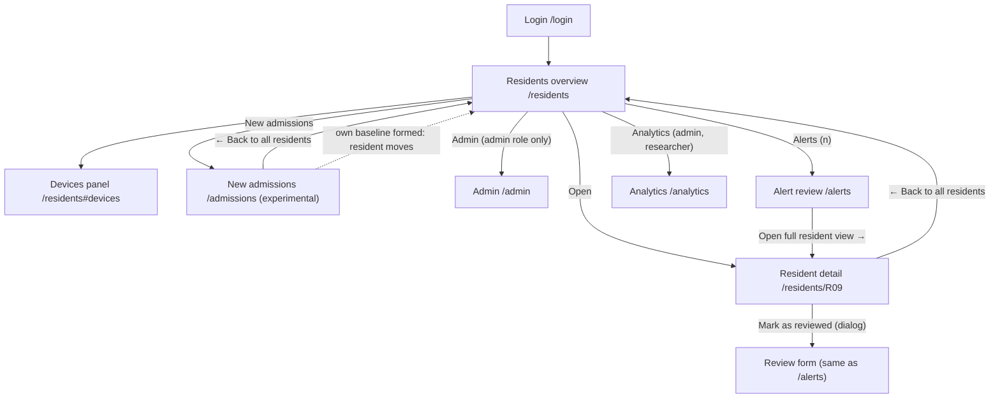

# 11 User Interface and UX Specification

Document ID: ECHOWELL-TRD-11 · Version 0.2 (draft for review) · Date: 18 October 2026 · Owner: Team 2 · Status: Draft

## 1. Purpose

This document specifies, screen by screen, what the EchoWell staff dashboard shows and how it behaves: every element, its exact copy, field formats, sort behaviour, status badges, count semantics, chart semantics, wording rules, accessibility and responsive behaviour. It turns the three official wireframes (SRC-09, SRC-10, SRC-11) and the "Frontend Requirements" of the TRD Generation Prompt (SRC-12) into testable UX-xxx requirements, and it fixes the expected rendering of the pipeline test data set (SRC-03, SRC-05) as of 30 October 2026, 3:00 PM America/Chicago.

TRD 04 (Frontend) defines how these screens are built (components, API client, state); this document is the authority for content and behaviour.

## 2. Scope

### In scope

- Residents overview (`/residents`), including the Devices panel (`/residents#devices`).
- Resident detail (`/residents/[residentCode]`): header and baseline information, "What this means", running change tally chart, the 7 scored measurements, the "12 other measurements" card, staff review, check-in log.
- New admissions (`/admissions`), marked as future/experimental.
- Alert review (`/alerts`, SRC-18) and Analytics (`/analytics`, SRC-19), in MVP scope per contract §19.
- Login (`/login`) and a minimal Admin page (`/admin`).
- Global header, footer, loading/empty/error states, plain-language and clinical wording rules, accessibility (WCAG 2.1 AA), responsive behaviour, design tokens.
- Wireframe → requirement traceability and expected rendering with the test data.

### Out of scope

- Computation of any status, count, baseline, score or tally (TRD 07, 08, 09). The UI renders API values only.
- API schemas (TRD 05, TRD 19), security enforcement (TRD 12).
- EWMA trend display or baseline band charts (OQ-18), alert delivery outside the dashboard (OQ-06).
- Any audio element, any LLM feature, any diagnosis or severity output (BR-01, BR-18).

## 3. References

| ID | Document |
|---|---|
| SRC-03 | Pipeline test workbook v0.1 (Exp_status_counts, Exp_resident_outcomes, Exp_scores, Annotated_sessions) |
| SRC-05 | Pipeline test input CSV v0.1 |
| SRC-09 | specs/UI-wireframe/Main.dc.html — Residents overview |
| SRC-10 | specs/UI-wireframe/Resident.dc.html — Resident detail (R09 alarm) |
| SRC-11 | specs/UI-wireframe/Admission.dc.html — New admission check |
| SRC-12 | specs/prompts/TRD_Generation_Prompt.md — "Frontend Requirements" |
| SRC-18 | specs/UI-wireframe/Alerts.dc.html — Alert review (charge nurse or clinical lead) |
| SRC-19 | specs/UI-wireframe/Analytics.dc.html — Analytics (study team) |
| Contract §19–§21 | New wireframes, reconciliation decisions R1–R27 (18 Oct 2026) |
| SRC-02 | Daily Data Storage and Processing Flowcharts (alerts are flags for clinician review) |
| TRD 00 | BR-01..BR-18 |
| TRD 02 | Functional requirements (FR-xxx) tracing to the same BR-xx |
| TRD 04 | Frontend TRD (FE-xxx; components, formatting functions, tokens) |
| TRD 05 / 19 | API behaviour and schemas |
| TRD 08 / 09 | Baseline, scoring, CUSUM and alert rules |
| TRD 13 / 14 | Testing strategy, test data and expected results |
| TRD 24 | OQ / ASM / RSK register |

## 4. Requirements

Priority: Must / Should / May. Verification: T = Test, I = Inspection, A = Analysis, D = Demo. In copy strings, `<R>` is a resident code (e.g. R09), `<D>` a device code, `<Mon D>` a facility-local date formatted per TRD 04 `formatLocalDate` (e.g. "Oct 21"), `<N>` the API value `baseline_n`, `<h>` the API value `cusum_h` formatted with one decimal ("5.0"). Typographic characters are exact: "·" is U+00B7 with one space on each side, "▲" is U+25B2, "←" is U+2190, "–" is U+2013, "…" is U+2026, "’" is U+2019.

### 4.0 Screen map

### 4.1 Global conventions

| ID | Requirement | Priority | Trace | Verification |
|---|---|---|---|---|
| UX-001 | The UI shall identify residents only by their study ID (`resident_code`, e.g. "R09") and shall show no name, photo, room or other personal data. | Must | BR-16, contract §2 | I |
| UX-002 | All dates and times shall be shown in the facility time zone delivered by the API (`meta.facility_tz`, America/Chicago per ASM-01), never in the viewer's browser time zone. | Must | ASM-01, contract §7 | T |
| UX-003 | Date-time values shall use the format "Oct 30, 2:28 PM"; date-only values "Oct 21"; date ranges "Oct 1–16"; the year shall be added only when it differs from the year of the as-of date (formats defined in TRD 04 section 4.11). | Must | SRC-09, SRC-10 | T |
| UX-004 | Status, alarm and outside-range information shall never be conveyed by colour alone: every accent-coloured status shall also carry the "▲" glyph and a text label, and status variants shall also differ by border style (2px solid accent / 1px solid / 1px dashed). | Must | WCAG 1.4.1, contract §11 | T |
| UX-005 | Every page shall end with a footer in IBM Plex Mono 13px, colour `--color-text-secondary`. Default text (Resident detail, New admissions, Login, Admin): "No audio is stored or played here — only extracted voice measurements."; Residents overview: "No audio is stored or played here — only extracted voice measurements. Duplicate records are removed quietly and not shown."; Alert review: "An alarm is a prompt to check in, not a diagnosis. No audio is stored or played here."; Analytics: "Counts only — no audio, no resident names." | Must | SRC-09, SRC-10, SRC-11, SRC-18, SRC-19, BR-01, BR-03 | T |
| UX-006 | No page shall contain an audio player, recording control, waveform, spectrogram or any link to audio. | Must | BR-01, BR-16 | I, T |
| UX-007 | The UI shall show N (baseline length), h (alarm line) and the facility time zone from API values; the same build shall show "13 of 16" on the test_v0_1 profile and "of 30" on the production profile. | Must | ASM-04, D-OWNER-2, contract §7 | T |
| UX-008 | Numbers of the running change tally shall be shown with one decimal ("5.4", "26.8"). | Must | SRC-10 | T |
| UX-009 | The UI shall offer no control to edit, recompute, reset or delete a resident's baseline, score, tally, alarm or any received record. | Must | BR-02, BR-09, OQ-05 | I |

### 4.2 Global header (Residents overview, Alert review, Analytics, Admin)

Wireframe SRC-09 header: a row with, on the left, "EchoWell" (28px, weight 600) above a subline (15px, `--color-text-secondary`); on the right, three navigation buttons; a 2px solid ink bottom border with 16px padding below.

| ID | Requirement | Priority | Trace | Verification |
|---|---|---|---|---|
| UX-010 | The header (`role="banner"`) shall show a 28px, weight-600 page title: "EchoWell" on `/residents`, "Alert review" on `/alerts`, "Analytics" on `/analytics`, "Admin" on `/admin`; on `/residents` the page `<h1>` shall be the visually hidden text "Residents", on the other pages the title itself shall be the `<h1>`. | Must | SRC-09, SRC-18, SRC-19, contract §20 R2 | T |
| UX-011 | The Residents overview subline shall read "Voice check-ins · <FACILITY_NAME> · Showing <data source label> as of <as-of>", e.g. with test data "Voice check-ins · Edgewood · Showing pipeline test data v0.1 as of Oct 30, 2026, 3:00 PM CT", where `<as-of>` is `meta.as_of` (the as-of of the latest succeeded pipeline run, contract §21 R21) in the format "Mon D, YYYY, h:mm AM/PM TZ". | Must | SRC-09, contract §11, §13, §21 R21 | T |
| UX-012 | The facility name shall be rendered from `meta.facility_name` (`facilities.name`, seeded from FACILITY_NAME) and shall never be hard-coded; the UI shall never display the word "Edge4Care" as a facility name. | Must | contract §2, RSK-10 | T |
| UX-013 | The navigation (on `/residents`, `/alerts`, `/analytics`, `/admin`) shall contain, in order, the links "Residents" (`/residents`), "Alerts (<n>)" (`/alerts`), "Analytics" (`/analytics`) and "New admissions" (`/admissions`), each with padding 12px 16px on a white background; the link for the current page shall have a 2px solid ink border and weight 600, the others a 1px solid `--color-border` border. | Must | SRC-09, SRC-18, SRC-19, contract §20 R2 | T |
| UX-014 | For users with role `admin` the navigation shall show a fifth link "Admin" (`/admin`) after "New admissions"; it shall not be shown to other roles. | Must | contract §10, §20 R2 | T |
| UX-015 | The header shall show the signed-in user's display name in 14px `--color-text-secondary` and a button "Sign out" (min-height 44px, 1px solid `--color-border`). | Must | BR-16 | T |
| UX-016 | (Retired by contract §20 R2: the navigation has no "Devices" link.) Opening `/residents#devices` shall scroll to the Devices panel and move keyboard focus to its heading "Devices". | Must | SRC-09, contract §20 R2 | T |
| UX-017 | The Alert review subline shall read "For the charge nurse or clinical lead · <data source label> as of <Mon D, YYYY>" (test data: "For the charge nurse or clinical lead · pipeline test data v0.1 as of Oct 30, 2026"); the Analytics subline shall read "For the study team · <data source label>, <period> · numbers match the pipeline answer key", where the clause " · numbers match the pipeline answer key" appears only when `meta.pipeline_profile` is `test_v0_1` and `<period>` is the 30-day window as a date range with year (test data: "For the study team · pipeline test data v0.1, Oct 1–30, 2026 · numbers match the pipeline answer key"). | Must | SRC-18, SRC-19, contract §19 | T |
| UX-018 | In "Alerts (<n>)", n shall be the number of change alarms not yet reviewed (alert status `open`); data alerts are not counted (test data: "Alerts (2)"; after one review "Alerts (1)"). The "Analytics" link shall be shown only to roles `admin` and `researcher`. | Must | SRC-18, contract §19 | T |

### 4.3 Residents overview (`/residents`)

Layout order (SRC-09): header → summary tiles → "Residents" table section → "Devices" section → footer; vertical gap 24px; max width 1200px; page padding 32px 24px.

#### 4.3.1 Summary tiles

| Order | Label (14px, secondary) | Value (32px, weight 600) | API field | Test-data value |
|---|---|---|---|---|
| 1 | "Alarm on" | count of residents with status `alarm_on` | `summary.alarm_on` | 2 |
| 2 | "Being watched, no alarm" | count with status `no_alarm` | `summary.no_alarm` | 7 |
| 3 | "Baseline still forming" | count with status `baseline_forming` | `summary.baseline_forming` | 1 |
| 4 | "Missed check-ins, last 30 days" | sum of `missed` (missing_resident + missing_device_gap) over listed residents | `summary.missed_last_30_days` | 19 |

| ID | Requirement | Priority | Trace | Verification |
|---|---|---|---|---|
| UX-020 | The overview shall show four summary tiles in one row (desktop) in the order, labels and values of the table in section 4.3.1, each tile white with padding 16px and gap 8px between label and value. | Must | SRC-09, BR-12 | T |
| UX-021 | When `summary.alarm_on` is greater than 0, the "Alarm on" tile shall have a 2px solid `--color-accent` border and its value shall be in `--color-accent`; when it is 0 the tile shall use the 1px solid `--color-border` border and ink value. | Must | SRC-09, UX-004 | T |
| UX-022 | Tiles 2–4 shall have a 1px solid `--color-border` border and ink values. | Must | SRC-09 | T |
| UX-023 | The tile counts shall cover exactly the residents listed in the table (cohort longitudinal, not withdrawn), so the first three tiles sum to the number of rows. | Must | contract §8, BR-12 | T |
| UX-024 | Tiles shall be static text, not links or buttons. | Must | SRC-09 | I |

#### 4.3.2 Sort control

| Option label | URL / API value | Rule (contract §8) |
|---|---|---|
| "Alarms first" (default) | `alarm` | Group order alarm_on → baseline_forming → no_alarm. Alarm group: alarm date ascending (oldest alarm first), then resident code. Forming group: resident code. No-alarm group: residents whose current epoch > 1 first, then (set aside + quarantined + missed in last 30 days) descending, then resident code ascending. |
| "Resident ID" | `resident_id` | Resident code ascending, natural sort (R2 < R10). |
| "Last check-in" | `last_checkin` | Most recent last check-in first; residents with no check-in last (then resident code). |

| ID | Requirement | Priority | Trace | Verification |
|---|---|---|---|---|
| UX-030 | The Residents section header shall show the heading "Residents" (20px) on the left and, on the right, the label "Sort by" (14px, secondary) bound to a native select (`id="sort"`, min-height 44px, padding 0 12px, 1px solid `--color-border`). | Must | SRC-09, SRC-12 | T |
| UX-031 | The select shall offer exactly the options "Alarms first", "Resident ID", "Last check-in" in that order, with "Alarms first" selected by default. | Must | SRC-09, SRC-12, contract §8 | T |
| UX-032 | Changing the option shall reorder the rows according to the rules in section 4.3.2 without a full page reload, keep keyboard focus on the select, and announce "Sorted by <option label>" in a polite live region. | Must | contract §8, WCAG 4.1.3 | T |
| UX-033 | The chosen sort shall be kept in the URL (`?sort=`) so that reload, back navigation and shared links show the same order. | Must | SRC-12 | T |

#### 4.3.3 Residents table

Columns (SRC-09, exact header text): "Resident" · "Device" · "Status" · "Last check-in (local)" · "Last 30 days: used · set aside · quarantined · missed" · (action column without visible header).

| ID | Requirement | Priority | Trace | Verification |
|---|---|---|---|---|
| UX-034 | The table shall list every enrolled, non-withdrawn resident of the longitudinal cohort (one row per resident) with the six columns above, header row background `--color-table-header`, cell padding 12px 16px, font 15px, and a 1px solid `--color-rule` top border on every body row. | Must | SRC-09, SRC-12, BR-12 | T |
| UX-035 | The Device cell shall show the current device code; when the device is shared it shall append " (shared)" and when the current device replaced another device it shall append " (was <previous device>)"; the appended text shall be in `--color-text-secondary` (e.g. "D02 (shared)", "D07B (was D07)"). | Must | SRC-09, BR-08 | T |
| UX-036 | The Status cell shall show a `StatusBadge` (inline-block, padding 4px 10px) whose text and style follow the table in section 4.3.4. | Must | SRC-09, SRC-12, contract §8 | T |
| UX-037 | For an `alarm_on` resident the Resident cell text shall be weight 600. | Must | SRC-09 | T |
| UX-038 | The "Last check-in (local)" cell shall show the facility-local date-time of the resident's most recent non-duplicate record of any status (usable, set aside or quarantined) in the format "Oct 30, 2:28 PM", or "No check-ins yet" when none exists. | Must | SRC-09, contract §8 | T |
| UX-039 | The last-30-days cell shall show four integers in the order used · set aside · quarantined · missed, separated by " · " (e.g. "13 · 5 · 0 · 12"), with the semantics of section 4.3.5. | Must | SRC-09, SRC-12, BR-06 | T |
| UX-040 | The action cell shall contain a link "Open" (padding 10px 14px, min-height 44px, 1px solid ink border) to `/residents/<R>` whose accessible name is "Open <R>". | Must | SRC-09 | T |
| UX-041 | When the API reports more residents than it returned, a line "Showing <returned> of <total> residents." shall appear under the table. | Must | ASM-08 | T |
| UX-042 | The table shall sit in a container with `overflow-x: auto` and the table shall have `min-width: 900px`, so that below 900px of available width the table scrolls horizontally inside its container while the page does not. | Must | SRC-09, contract §11 | T |
| UX-043 | The table shall have a visually hidden `<caption>` "Residents, sorted by <option label>" and `scope="col"` on header cells; the action column header shall have the visually hidden text "Actions". | Must | WCAG 1.3.1 | T |
| UX-044 | Duplicate records shall never appear in any count, row or log on the overview. | Must | BR-03, SRC-09 | T |
| UX-045 | Withdrawn residents shall not be listed or counted on the overview. | Must | contract §9 | T |
| UX-046 | A new-admission resident shall appear on the overview only after the API reports their own baseline as formed (cohort transition, section 4.7), and shall then not appear on the New admissions page. | Must | SRC-12, BR-14 | T |

#### 4.3.4 Status badges

| Status code | Badge text | Style | Example (test data) |
|---|---|---|---|
| `alarm_on` | "▲ Alarm since <Mon D>" (date = local date of the first crossing of the open alert) | 2px solid `--color-accent`, text `--color-accent`, weight 600 | "▲ Alarm since Oct 21" |
| `no_alarm`, current epoch = 1 | "No alarm" | 1px solid `--color-border`, ink text | "No alarm" |
| `no_alarm`, current epoch > 1 | "No alarm · baseline restarted <Mon D>" (date = local start date of the current epoch) | 1px solid `--color-border` | "No alarm · baseline restarted Oct 13" |
| `baseline_forming` | "Baseline forming · <n> of <N> sessions" (n = usable sessions in current epoch, N = `baseline_n`) | 1px dashed `--color-border` | "Baseline forming · 13 of 16 sessions" |
| `alarm_on`, current epoch > 1 | "▲ Alarm since <Mon D>" (the restart is shown on the detail page) | as alarm_on | — |
| `baseline_forming`, current epoch > 1 | "Baseline forming · <n> of <N> sessions · restarted <Mon D>" | 1px dashed `--color-border` | — |

Status rules (contract §8): `alarm_on` = an open alert exists in the current epoch; `no_alarm` = baseline formed in the current epoch and no open alert ("Being watched, no alarm"); `baseline_forming` = current epoch has fewer than N usable sessions. An alarm stays on after the first crossing even when the tally later falls below the line (no reset in pipeline v0.1, OQ-05). A new epoch closes the old epoch's alert ("epoch ended", ASM-06), so a resident with a restarted baseline shows the status of the new epoch.

#### 4.3.5 Last-30-days count semantics

| Count | Definition | Source |
|---|---|---|
| used | usable sessions (passed ingest, quality gate and speaker screen) with local date in the window | processed_sessions status `usable` |
| set aside | sessions that failed the quality gate in the window | status `set_aside` |
| quarantined | sessions that failed the speaker screen in the window | status `quarantined` |
| missed | resident-days in the window with no record: `missing_resident` + `missing_device_gap` | day_ledger |
| (not shown) | duplicates | never shown, never counted |

Window: the 30 facility-local calendar days ending on the as-of date (inclusive), starting no earlier than the resident's enrolment date. With test data (enrolment Oct 1, as-of Oct 30) the window is Oct 1–30.

| ID | Requirement | Priority | Trace | Verification |
|---|---|---|---|---|
| UX-047 | Missed days shall be shown as counted by the day ledger and shall never be backfilled, imputed, carried forward or hidden; a missed day shall never be shown as a check-in. | Must | BR-06, SRC-12 | T |
| UX-048 | The four counts for each resident shall equal the API values, which for the test data equal SRC-03 Exp_status_counts (missed = missing_resident + missing_device_gap). | Must | BR-15, SRC-03 | T |

### 4.4 Devices panel (`/residents#devices`)

SRC-09: a white section with heading "Devices" (20px) and a 3-column grid of cards (gap 12px, card padding 12px, 1px border). Card line 1: weight 600; line 2: 14px secondary.

| Card kind | When | Line 1 | Line 2 | Border |
|---|---|---|---|---|
| Shared device | device assigned to ≥ 2 residents on the as-of date | "<D> · shared by <R>, <R>" | "Last upload <date-time>" + silent text (below) | 1px solid `--color-border` |
| Replacement device | device replaced another device within the last 30 days | "<D> · <R>" | "In use since <Mon D> (replaced <old D>) · last upload <date-time>" | 1px solid `--color-border` |
| Device needing attention | active device with no upload on the as-of date, or with device-gap days in the last 30 days, or with a firmware version different from the most common one | "<D> · <R list>" | "Last upload <date-time>" + " · no upload on <as-of Mon D>" when applicable + silent text + " · firmware <version>" when it differs | 1px solid `--color-border` |
| Grouped devices | all remaining active devices (uploaded on the as-of date, not shared, not replaced, no device-gap days), one card per firmware version | compressed device list, e.g. "D01, D04–D06, D08–D10" | "All uploaded on <as-of Mon D> · firmware <version>" | 1px dashed `--color-border` |

Silent text: none → nothing; 1–3 days → " · silent all day <Mon D>[, <Mon D>…]"; more than 3 days → " · silent all day on <k> days (latest <Mon D>)". The silent text lists the device's device-gap days (TRD 02 §4.1; API `device_gap_days_last_30`): days in the last 30 days on which the day ledger recorded `missing_device_gap` for this device (shared device, no resident on it had a record). A single-resident device's silent days (`silent_days_last_30`) are not shown in the card text; they appear in the UX-055 table.

| ID | Requirement | Priority | Trace | Verification |
|---|---|---|---|---|
| UX-050 | The Devices panel shall be a section with `id="devices"` and heading "Devices" placed after the Residents table, showing cards per the table above in the order: shared, replacement, needing attention, grouped; within a kind by natural device-code order. | Must | SRC-09, SRC-12, BR-12 | T |
| UX-051 | Each shared device card shall name the device and all residents assigned to it, showing the sharing relationship (e.g. "D02 · shared by R02, R03"). | Must | SRC-09, SRC-12 | T |
| UX-052 | Device silent periods shall be shown on the device's card using the silent text rule above (e.g. "silent all day Oct 12"). | Must | SRC-09, SRC-12, BR-06 | T |
| UX-053 | A replacement device card shall show the replacement date and the previous device (e.g. "In use since Oct 13 (replaced D07) · last upload Oct 30, 2:52 PM"); the retired device shall not get its own card. | Must | SRC-09, BR-08 | T |
| UX-054 | Remaining devices shall be grouped in one dashed card per firmware version whose title lists device codes in natural order, joining runs of 3 or more consecutive numbers with an en dash (e.g. "D01, D04–D06, D08–D10"). | Must | SRC-09 | T |
| UX-055 | Below the cards, a disclosure (`
`) "Show all devices (<count>)" shall reveal a table with columns "Device", "Residents", "In use", "Last upload", "Firmware", "Days with no device activity (last 30 days)" (from `silent_days_last_30`), "Silent days (shared device)" (from `device_gap_days_last_30`), one row per device including inactive ones. | Must | SRC-12, BR-12 | T |
| UX-056 | "Days with no device activity (last 30 days)" shall show the number of local days in the window on which the device was assigned to at least one resident and received no non-duplicate record, followed by up to 3 dates (e.g. "1 (Oct 12)") or "0". | Must | SRC-12, RSK-05 | T |
| UX-057 | The "In use" cell shall read "Since <Mon D>" for active devices and "<Mon D>–<Mon D> · replaced by <D>" for retired devices (e.g. "Oct 1–12 · replaced by D07B"), from `in_use_since`, `in_use_until` and `replaced_by_device_code` (TRD 19 `Device`). | Must | SRC-09, BR-08 | T |
| UX-058 | The device panel content shall be verifiable against the pipeline test data (SRC-05): for the as-of date 2026-10-30 it shall render exactly the cards and table rows in section 4.13.4. | Must | SRC-12, BR-15 | T |

### 4.5 Resident detail (`/residents/[residentCode]`)

Layout order (SRC-10): Back link → header → "What this means" → "Running change tally" → "The 7 measurements behind the score" → two-column row ("Staff review" | "Check-in log") → footer. Sections are white cards with 1px `--color-border` border, padding 16px, vertical gap 24px; section headings 20px.

#### 4.5.1 Back link and header (baseline information)

| ID | Requirement | Priority | Trace | Verification |
|---|---|---|---|---|
| UX-060 | The page shall start with the link "← Back to all residents" (padding 10px 14px, min-height 44px, 1px `--color-border` border, white) to `/residents`, preserving the overview's last `?sort=` value. | Must | SRC-10 | T |
| UX-061 | The header `<h1>` (28px) shall read "<R> · Device <D>" with the current device (e.g. "R09 · Device D09", "R07 · Device D07B"). | Must | SRC-10 | T |
| UX-062 | The header shall show on the right a large status badge (padding 12px 16px, 18px, weight 600) with the same text and style rules as section 4.3.4. | Must | SRC-10 | T |
| UX-063 | Below the `<h1>` a baseline line (15px, secondary) shall show baseline status, progress and freeze state with the templates in section 4.5.1.1. | Must | SRC-10, SRC-12, BR-09 | T |
| UX-064 | When the baseline is forming, the header shall additionally show a native `<progress>` element (max = N, value = n, width 200px) with accessible name "Baseline progress: <n> of <N> usable check-ins". | Should | SRC-12, BR-09 | T |
| UX-065 | When the current epoch number is greater than 1, the baseline line shall append the restart text of section 4.5.1.1, so that the resident is visibly compared only with the new epoch's baseline. | Must | BR-08, SRC-12 | T |
| UX-066 | Baseline dates and the frozen state shall not change after freeze across reloads and later check-ins of the same epoch (the UI renders `first_session_date` and `frozen_after_date` from the API and no other source). | Must | BR-09, SRC-12 | T |

##### 4.5.1.1 Baseline line templates

| Situation | Template | Example |
|---|---|---|
| Frozen, scored sessions exist | "Baseline: first <N> usable check-ins, <first date>–<frozen-after date> (then frozen) · watched since <first scored date>" | "Baseline: first 16 usable check-ins, Oct 1–16 (then frozen) · watched since Oct 17" |
| Frozen, no scored session yet | "Baseline: first <N> usable check-ins, <range> (then frozen) · watched since <local date after the freeze session>" (contract §20 R9) | — |
| Forming | "Baseline: forming · <n> of <N> usable check-ins so far (frozen when <N> are reached)" | "Baseline: forming · 13 of 16 usable check-ins so far (frozen when 16 are reached)" |
| Restart suffix (epoch > 1), cause device | " · restarted <Mon D> (new device <D>, was <old D>)" | " · restarted Oct 13 (new device D07B, was D07)" |
| Restart suffix, cause firmware | " · restarted <Mon D> (device firmware changed to <version>)" | — |
| Restart suffix, cause software | " · restarted <Mon D> (extraction software changed to <version>)" | — |

#### 4.5.2 "What this means"

| ID | Requirement | Priority | Trace | Verification |
|---|---|---|---|---|
| UX-070 | The section shall have the heading "What this means" and two paragraphs: a main paragraph (16px, line-height 1.5) and a note paragraph (14px, secondary). | Must | SRC-10 | T |
| UX-071 | The main paragraph shall use the template for the resident's situation from the table in section 4.5.2.1, filled with API values. | Must | SRC-10, BR-13 | T |
| UX-072 | The note paragraph shall read "This compares <R> only with <R>. It is a prompt to check in, not a diagnosis." (baseline forming: "Once the baseline is complete, <R> will be compared only with <R>. An alarm is a prompt to check in, not a diagnosis."). | Must | SRC-10, BR-18, contract §2 | T |
| UX-073 | Until the PI approves the final wording (OQ-12), the note paragraph shall end with " [Final clinical wording: confirm with PI]". | Must | SRC-10, OQ-12 | T |
| UX-074 | All texts of this section shall come from the single PI-reviewed wording configuration (`frontend/lib/wording.ts`, TRD 04 FE-013), so a wording change needs no component change. | Must | OQ-12, contract §11 | I |
| UX-075 | The section shall not state or imply a diagnosis, condition, severity or cause (rules in section 4.6). | Must | BR-18, RSK-09 | T, I |

##### 4.5.2.1 Main paragraph templates

| Situation | Template |
|---|---|
| alarm_on, current tally ≥ h | "<R>’s voice has moved away from their own usual pattern, steadily enough and for long enough to cross the alarm line on <alarm Mon D>. It is still above the line." (SRC-10 verbatim for R09) |
| alarm_on, current tally < h | "<R>’s voice moved away from their own usual pattern, steadily enough and for long enough to cross the alarm line on <alarm Mon D>. The tally is now below the line, but the alarm stays on: in this version alarms are not switched off automatically." |
| no_alarm, scored sessions exist | "<R>’s voice has stayed close to their own usual pattern. The running change tally is below the alarm line." |
| no_alarm, no scored session yet | "<R>’s baseline is complete. Watching starts with the next usable check-in." |
| baseline_forming | "EchoWell is still learning <R>’s usual pattern: <n> of <N> usable check-ins so far. Nothing is scored and no alarm can ring until the baseline is complete." |
| any, current epoch > 1 (appended sentence) | " The baseline restarted on <Mon D> because <cause text>; <R> is now compared only with the new baseline." where cause text is "the device changed (<D>, was <old D>)", "the device firmware changed" or "the extraction software changed". |

#### 4.5.3 "Running change tally" (CUSUM chart)

Semantics: the tally is the one-sided upper CUSUM of the composite score of each scored session in the current epoch, computed by the pipeline (TRD 09). It starts at 0 with the first scored session after the baseline froze, builds up when check-ins keep leaning in the same direction, and the alarm rings at the first session whose tally is ≥ h (5.0). Set-aside, quarantined, duplicate and missed days do not change the tally.

| ID | Requirement | Priority | Trace | Verification |
|---|---|---|---|---|
| UX-080 | The section shall have the heading "Running change tally" (20px) and, on the same row right-aligned, the subtitle "Builds up when check-ins keep leaning the same way; alarm at <h>" (14px, secondary), e.g. "…; alarm at 5.0". | Must | SRC-10, SRC-12 | T |
| UX-081 | The chart shall show one vertical bar per scored session of the current epoch, in time order, with bar height equal to the API `cusum_tally`. | Must | SRC-10, SRC-12, BR-11 | T |
| UX-082 | The chart shall make the baseline period visible as a leading grey slot (fill `--color-baseline-bar` #BDBDB8 at 40% opacity, full plot height) labelled "Baseline <first date>–<frozen-after date>" (e.g. "Baseline Oct 1–16"), placed before the first scored bar. | Must | SRC-12, contract §11, BR-09 | T |
| UX-083 | Bars of sessions whose `alarm_state` is `off` shall be filled `--color-baseline-bar` (#BDBDB8) with a 1px `--color-border` outline; bars whose `alarm_state` is `rings` or `on` shall be filled `--color-accent` (#9A4508), so that alarm persistence after the first crossing is visible. | Must | SRC-10, SRC-12, contract §11 | T |
| UX-084 | A dashed horizontal line (2px, dash 6/4, `--color-accent`) shall mark the alarm threshold at y = h, labelled "alarm line <h>" ("alarm line 5.0") in IBM Plex Mono 12px accent at its right end. | Must | SRC-10, SRC-12, contract §7 | T |
| UX-085 | The bar of the first crossing (`alarm_state` = `rings`) shall carry a "▲" marker above it, and its x-axis label shall read "<Mon D> · alarm" (e.g. "Oct 21 · alarm"). | Must | SRC-10, SRC-12 | T |
| UX-086 | The x-axis shall label at least the first scored date, the alarm date (if any) and the last scored date (13px, secondary), e.g. "Oct 17", "Oct 21 · alarm", "Oct 30"; other dates may be labelled when space allows (minimum 48px between labels). | Must | SRC-10 | T |
| UX-087 | The y-axis shall start at 0 and its maximum shall be the larger of 1.2 × h and 1.05 × the largest tally, with ticks every 5 units labelled in IBM Plex Mono 12px. | Should | SRC-10 | T |
| UX-088 | Below the chart a caption in IBM Plex Mono 12px secondary shall read "Set-aside, quarantined and missed days leave the tally unchanged." | Must | SRC-10, contract §11 | T |
| UX-089 | When the resident's baseline is forming, the chart area shall be replaced by the text "No tally yet. The tally starts after the baseline is complete (<n> of <N> usable check-ins so far)." | Must | SRC-12, BR-09 | T |
| UX-090 | A disclosure "Show tally as a table" below the chart shall reveal a table with columns "Date", "Tally", "Alarm" listing every point shown in the chart, where "Alarm" reads "—" (`off`), "▲ Alarm rings (first crossing)" (`rings`) or "▲ Alarm on" (`on`). | Must | WCAG 1.1.1, contract §11 | T |
| UX-091 | The chart shall have a text alternative (`role="img"` `aria-label`) of the form "Running change tally for <R> from <first Mon D> to <last Mon D>. Baseline <range>. Alarm line <h>. <Crossed the alarm line on <Mon D>; | Below the alarm line throughout;> now <tally>." e.g. "Running change tally for R09 from Oct 17 to Oct 30. Baseline Oct 1–16. Alarm line 5.0. Crossed the alarm line on Oct 21; now 26.8." | Must | WCAG 1.1.1 | T |
| UX-092 | When the current epoch is greater than 1, a line above the chart (14px secondary) shall read "Showing the current device period since <Mon D>. Earlier periods are not scored against this baseline." | Must | BR-08 | T |

#### 4.5.4 "The 7 measurements behind the score"

| # | Card label (ink) | Technical name in parentheses (secondary) |
|---|---|---|
| 1 | Quieter | (loudness) |
| 2 | Slower to say the phrase | (phrase duration) |
| 3 | Fewer syllables per second | (speech rate) |
| 4 | Slower while talking | (articulation rate) |
| 5 | More pauses | (number of pauses) |
| 6 | More time in pauses | (pause fraction) |
| 7 | Less voiced sound | (voiced fraction) |
| 8 | "12 other measurements (pitch, jitter, MFCCs …)" | right side: "stored, not scored" |

| ID | Requirement | Priority | Trace | Verification |
|---|---|---|---|---|
| UX-100 | The section shall have the heading "The 7 measurements behind the score" and the intro line "Each is compared with <R>’s own baseline. The score rises when the voice is:" (14px, secondary). | Must | SRC-10, SRC-12 | T |
| UX-101 | The section shall show exactly 7 feature cards in the order and with the labels of the table above, in a 2-column grid (gap 12px), each card with padding 12px, label on the left and sparkline on the right. | Must | SRC-10, SRC-12, BR-10 | T |
| UX-102 | Each feature card's sparkline (120 × 32px) shall plot the signed deviation (sign × z, so upward always means "more in the direction of the label") of the scored sessions of the current epoch, with a dashed zero line representing the resident's own frozen baseline. | Must | SRC-10, contract §6 | T |
| UX-103 | Each sparkline shall have an accessible name "<label> (<technical name>): latest <signed value> compared with own baseline over <k> scored check-ins", e.g. "Quieter (loudness): latest +2.2 compared with own baseline over 14 scored check-ins". | Must | WCAG 1.1.1 | T |
| UX-104 | When the baseline is forming, each card shall show the text "Not scored yet" instead of a sparkline and the card border shall be 1px dashed; otherwise the border shall be 1px solid `--color-border`. | Must | SRC-10, BR-09 | T |
| UX-105 | The cards shall show no diagnosis, threshold or per-feature alarm; individual feature deviations shall not be labelled "abnormal" or coloured accent. | Must | BR-18, BR-11 | I |
| UX-106 | An eighth card (background `--color-muted-panel`, 1px solid `--color-rule`) shall read "12 other measurements (pitch, jitter, MFCCs …)" on the left and "stored, not scored" (secondary) on the right; the number shall be the count of stored-not-scored keys from the API (12). | Must | SRC-10, SRC-12 | T |
| UX-107 | The 12 stored-not-scored measurements shall not be listed, plotted or included in any score summary on this page. | Must | SRC-12, contract §6 | T |
| UX-108 | Below the cards a caption (IBM Plex Mono 12px, secondary) shall read "Column names are placeholders until Team 1 confirms extractor output names. Morning check-ins are adjusted before comparing." | Must | SRC-10, OQ-03, BR-07 | T |

#### 4.5.5 "Staff review"

| ID | Requirement | Priority | Trace | Verification |
|---|---|---|---|---|
| UX-120 | The "Staff review" section shall be the left column of a 2-column row (gap 16px) next to "Check-in log". | Must | SRC-10 | T |
| UX-121 | The section shall contain, in order: heading "Staff review"; a select labelled "Type of note" with options "Observation", "Action taken", "Follow-up" (default "Observation"); a textarea labelled "Note (what staff saw or did)" (3 rows, vertical resize, padding 10px) with placeholder text "e.g. “Resident has a cold; nurse notified.”"; a character counter "<count> / 2000"; the buttons "Mark as reviewed" (only when the resident has a change alarm in the current epoch) and "Save note"; and the open-question note. | Must | SRC-10, SRC-12, contract §9, §11, §20 R5 | T |
| UX-122 | "Mark as reviewed" shall be the primary button (min-height 44px, padding 0 18px, 2px solid ink border, weight 600); "Save note" shall be secondary (min-height 44px, 1px solid `--color-border`). | Must | SRC-10 | T |
| UX-123 | "Save note" shall store a free staff note with the chosen type (separate from alarm reviews); "Mark as reviewed" shall open the alarm review dialog of UX-136 and shall not save the note text (contract §20 R5). | Must | BR-13, contract §20 R5 | T |
| UX-124 | "Save note" shall be disabled while the note is empty (after trimming) or longer than 2000 characters; when the user attempts to save an empty note the message "Write a short note before saving." shall appear under the textarea and be associated via `aria-describedby`. | Must | contract §9 | T |
| UX-125 | The open-question note (13px, secondary) shall read "Open question (OQ-05): does review reset the tally or turn the alarm off? Not in pipeline v0.1 — a saved review marks the alarm as reviewed only; the alarm and the tally stay as they are." | Must | SRC-10, OQ-05 | T |
| UX-126 | After a review is saved, the status badge, chart and alarm wording shall remain as returned by the API (alarm unchanged in v0.1). | Must | OQ-05 | T |
| UX-127 | When the change alarm has at least one saved review, a line under the heading shall read "Reviewed by <display name>, <Mon D, h:mm AM/PM> · <outcome label>. The alarm stays on (open question OQ-05)." using the latest review. | Must | BR-13, OQ-05, contract §19 | T |
| UX-128 | The note text shall be stored and shown exactly as typed (plain text, line breaks preserved); no formatting or links shall be rendered from it. | Must | BR-16 | T |
| UX-129 | The UI shall not offer editing or deleting of saved notes (notes are append-only). | Must | contract §9 | I |
| UX-130 | After a successful "Save note", a polite status message shall read "Note saved."; the textarea shall be cleared and the note type kept. | Must | BR-13 | T |
| UX-131 | When a save fails, the message "Could not save the note. Your text is kept — try again." shall appear and the typed text shall remain. | Must | BR-13 | T |
| UX-132 | For users with role `researcher`, the form controls shall be replaced by "Only clinicians and admins can add notes." while previous notes remain visible. | Must | contract §10 | T |
| UX-133 | Notes shall document observations, actions taken and follow-up activity through the three note types; the type shall be shown with every saved note. | Must | SRC-12, BR-13 | T |
| UX-134 | Under the form, a list headed "Previous notes" (h3, 16px) shall show the resident's notes newest first, each as "<Mon D, h:mm AM/PM> · <Type> · <display name>" followed by the note text; with no notes it shall read "No notes yet." | Must | SRC-12, BR-13 | T |
| UX-135 | The notes list shall show at most 10 notes initially and a button "Show all notes (<count>)" when more exist. | Should | BR-13 | T |
| UX-136 | "Mark as reviewed" shall open a modal dialog titled "Review alarm · <R> · alarm since <Mon D>" containing exactly the review form of the Alert review page (UX-313–UX-318) and a "Cancel" button; Escape and "Cancel" close it without saving and return focus to "Mark as reviewed". | Must | contract §19, §20 R5, WCAG 2.4.3 | T |
| UX-137 | Saving in the dialog shall create an alarm review (same record as on `/alerts`), close the dialog, and announce "Review saved." (or the data-problem variant of UX-318). | Must | contract §19 | T |
| UX-138 | For users without the clinician or admin role, "Mark as reviewed" shall not be shown. | Must | contract §19 (OQ-26) | T |

#### 4.5.6 "Check-in log"

| Event type | Line text | Example |
|---|---|---|
| alarm_on | "<Mon D> · Alarm on · tally crossed <h>" | "Oct 21 · Alarm on · tally crossed 5.0" |
| watching_started | "<Mon D> · Watching started" | "Oct 17 · Watching started" |
| baseline_complete | "<Mon D> · Baseline complete (<N> of <N>)" | "Oct 16 · Baseline complete (16 of 16)" |
| baseline_restarted (device) | "<Mon D> · Baseline restarted · new device <D> (was <old D>)" | "Oct 13 · Baseline restarted · new device D07B (was D07)" |
| baseline_restarted (firmware) | "<Mon D> · Baseline restarted · device firmware changed (<from> to <to>)" | — |
| baseline_restarted (software) | "<Mon D> · Baseline restarted · extraction software changed (<from> to <to>)" | — |
| set_aside | "<Mon D> · Set aside · <pipeline reasons>" | "Oct 18 · Set aside · quality flag poor; noise above limit" |
| quarantined | "<Mon D> · Quarantined · possible other speaker" | "Oct 22 · Quarantined · possible other speaker" |
| missed (`missing_resident`) | "<Mon D> · Missed · no check-in received" | "Oct 27 · Missed · no check-in received" |
| device_silent (`missing_device_gap`) | "<Mon D> · Device silent · no record from any resident on shared device <D>" | "Oct 12 · Device silent · no record from any resident on shared device D02" |

| ID | Requirement | Priority | Trace | Verification |
|---|---|---|---|---|
| UX-140 | The "Check-in log" section shall be the right column of the review row, with heading "Check-in log" and one line per event (15px, 1px solid `--color-rule` bottom border, padding-bottom 8px). | Must | SRC-10 | T |
| UX-141 | Events shall be ordered newest local date first; events on the same date shall be ordered alarm, watching_started, baseline_complete, baseline_restarted, quarantined, set_aside, device_silent, missed. | Must | SRC-10 | T |
| UX-142 | Each event shall use the line text of the table above (event types are TRD 19 `CheckinEventType` values; the baseline_restarted variant is chosen by `restart_cause`, with `<old D>` = `previous_device_code` and `<from>`/`<to>` = `from_value`/`to_value`, TRD 06 DB-065); set-aside reasons shall be the pipeline's reason text verbatim, in the pipeline's fixed order (quality flag, noise, speech duration) joined by "; ". | Must | SRC-10, SRC-12, BR-04, contract §7 | T |
| UX-143 | The log shall include alarms, set-asides, quarantines, missed days (resident and device-gap) and baseline restarts, as well as baseline complete and watching started. | Must | SRC-12, BR-13 | T |
| UX-144 | Ordinary usable check-ins and duplicates shall not appear as log lines. | Must | BR-03, SRC-10 | T |
| UX-145 | The quarantined line shall not show the screen statistics (F0 z, feature counts); it shall show only "possible other speaker". | Must | BR-18, RSK-01 | T |
| UX-146 | The log shall initially show events of the last 30 days ending on the as-of date and a button "Show earlier entries" that loads the previous 30 days when earlier events exist. | Must | BR-13 | T |
| UX-147 | Alarm and quarantine/set-aside lines shall not use colour; the alarm line shall begin its status text with "Alarm on" and no line shall rely on colour to convey its type. | Must | UX-004 | T |
| UX-148 | Below the events a legend line (14px, secondary) shall read "Other residents’ logs can also show: set aside (noise, quality flag, too short) · quarantined (possible other speaker) · missed · device silent · baseline restarted (new device)". | Must | SRC-10 | T |
| UX-149 | When the resident has no events, the log shall read "Nothing to report yet." followed by the legend line. | Must | BR-13 | T |
| UX-150 | Missed days in the log shall be exactly the ledger's missed days; the UI shall never fill them with a value, a previous check-in or an estimate. | Must | BR-06, SRC-12 | T |

### 4.6 Plain-language and clinical wording rules

| ID | Requirement | Priority | Trace | Verification |
|---|---|---|---|---|
| UX-160 | The UI shall describe results as detecting a change from the resident's own usual pattern ("moved away from their own usual pattern", "detects a change"), never as measuring, quantifying or grading anything. | Must | BR-18, contract §2 | I |
| UX-161 | Rendered UI text shall not contain the words or stems "diagnos" (except in the fixed phrase "not a diagnosis"), "depress", "severity", "severe", "disorder", "illness", "abnormal", "risk score", "mood", "patient". | Must | BR-18, RSK-09, contract §2 | T |
| UX-162 | Every alarm explanation shall state that it is "a prompt to check in, not a diagnosis". | Must | SRC-10, BR-18 | T |
| UX-163 | Feature labels shall use the plain-language labels of section 4.5.4 with the technical name in parentheses; numeric z-scores and composite values shall not appear outside the chart table and sparkline accessible names. | Must | SRC-10, SRC-12 | T |
| UX-164 | Final clinical wording is owned by the PI (OQ-12); until approved every "What this means" note shall carry "[Final clinical wording: confirm with PI]" (UX-073). | Must | OQ-12 | T |
| UX-165 | Text shall use sentence case, the second person only in instructions ("Write a short note before saving."), and no exclamation marks. | Should | SRC-09, SRC-10 | I |
| UX-166 | The facility shall be named only by `meta.facility_name`; the strings "Edge4Care" and "[Facility name]" shall not appear in rendered UI. | Must | RSK-10, contract §2 | T |

### 4.7 New admissions (`/admissions`) — future / experimental

SRC-11 order: Back link → experimental banner → header ("New admissions" + intro) → admissions table → comparison section for the selected resident → footer.

| ID | Requirement | Priority | Trace | Verification |
|---|---|---|---|---|
| UX-180 | The page shall start with the link "← Back to all residents" (same style as UX-060). | Must | SRC-11 | T |
| UX-181 | Directly below, a banner (2px dashed `--color-accent` border, white, padding 12px 16px, 15px, weight 600, accent text) shall read, line 1: "▲ Future / experimental study arm"; line 2: "Not in pipeline test v0.1 — the test data has no admission arm or facility norm yet. Open question for Shaba and the PI." The second line shall remain until OQ-08 is closed. | Must | SRC-11, SRC-12, contract §11, BR-14, OQ-08 | T |
| UX-182 | The header shall show `<h1>` "New admissions" (28px) and the line "New residents don’t have their own baseline yet, so their first check-ins are compared with the facility’s usual range." (15px, secondary), with a 2px solid ink bottom border. | Must | SRC-11 | T |
| UX-183 | The table shall have the columns "Resident", "Admitted", "Check-ins so far", "Compared with facility range", "Own baseline", header background `--color-table-header`, `min-width: 760px` inside a horizontally scrolling container. | Must | SRC-11, contract §11 | T |
| UX-184 | "Resident" shall show the study ID; "Admitted" the admission date "<Mon D>"; "Check-ins so far" the number of usable check-ins since admission. | Must | SRC-11 | T |
| UX-185 | "Compared with facility range" shall show a badge: "▲ Outside facility range" (2px solid accent, accent text, weight 600) when at least one feature value is outside the facility range; "Within facility range" (1px solid `--color-border`) when all are within; "Not enough check-ins yet" (1px dashed `--color-border`) when the API reports too few check-ins to compare (`not_enough_checkins`); "Facility range not available yet" (1px dashed `--color-border`) when the API reports `range_not_available` (TRD 02 FR-202, TRD 19 `ComparisonStatus`). | Must | SRC-11, UX-004 | T |
| UX-186 | "Own baseline" shall read "<n> of <N> days" where n is the resident's usable check-ins towards their own baseline and N is `baseline_n` from the API. | Must | SRC-11, OQ-08 | T |
| UX-187 | Each row shall contain a button "Show comparison" (min-height 44px) that selects the resident for the comparison section; the selected row shall have `aria-selected="true"` and a 2px ink left border. | Must | SRC-11 | T |
| UX-188 | The page shall list only residents of the new-admission cohort whose own baseline has not formed; when their baseline forms they shall leave this page and appear on the Residents overview, where they are compared with their own baseline only. | Must | SRC-12, BR-14 | T |
| UX-189 | The comparison section shall have the heading "<R> compared with facility range" and a chart with one row per feature: a grey band (`--color-range-band` #E2E2DE) from the facility range low to high and the resident's value as a dot; a dot outside the band shall be accent with "▲", a dot inside ink. | Must | SRC-11, BR-14 | T |
| UX-190 | The chart shall have the caption "grey band = usual range across current residents" (IBM Plex Mono 12px, secondary). | Must | SRC-11 | T |
| UX-191 | Feature rows shall use the plain-language labels of section 4.5.4 when the feature is one of the 7 scored measurements and the API label otherwise. | Must | SRC-10, SRC-11 | T |
| UX-192 | Under the chart the sentence "Once <N> days of check-ins are collected, this resident moves to the main list and is compared with their own baseline instead." (14px, secondary) shall appear, with N from the API. | Must | SRC-11, SRC-12 | T |
| UX-193 | The comparison chart shall have a text alternative table (disclosure "Show comparison as a table") with columns "Measurement", "Resident value", "Facility range", "Outside range" ("▲ Yes" / "No"). | Must | WCAG 1.1.1 | T |
| UX-194 | When no new admissions exist, the table area shall read "No new admissions. The pipeline test data v0.1 has no admission arm." when the data source is the test data, otherwise "No new admissions."; the comparison section shall then read "Select a resident to see the comparison." | Must | SRC-11, BR-14 | T |
| UX-195 | The facility range method, number of residents and computation date returned by the API shall be shown under the chart as "Range from <n_residents> current residents, computed <Mon D> (method: <method>)." | Should | OQ-08, RSK-13 | T |

### 4.8 Status, baseline and count definitions used on screens

| UI term | Meaning | Rule source |
|---|---|---|
| Alarm on / ▲ Alarm since <date> | open alert in current epoch; date = first crossing (tally ≥ h) | contract §7 step 8–9, §8 |
| Being watched, no alarm / No alarm | baseline formed in current epoch, no open alert | contract §8 |
| Baseline forming · n of N | fewer than N usable sessions in current epoch | contract §7 step 6 |
| Baseline (then frozen) | first N usable sessions of the epoch; never updated afterwards | BR-09, ASM-07 |
| Baseline restarted | a new epoch began (device, firmware or extraction software changed); count restarts at 0, tally restarts at 0 | BR-08, ASM-06 |
| Watched since | local date of the first scored session of the current epoch; before any scored session exists, the local date after the freeze session | contract §20 R9 |
| Used | usable session | contract §4 |
| Set aside | failed quality gate; never scored, never in baseline | BR-04 |
| Quarantined | possible other speaker; never scored, never in baseline | BR-05 |
| Missed | resident-day with no record (missing_resident or missing_device_gap) | BR-06 |
| Device silent | missing_device_gap: shared device, no resident on it had a record that day | BR-06 |
| Last check-in | most recent non-duplicate record, any status (local time) | contract §20 R10 |

### 4.9 Login (`/login`)

| ID | Requirement | Priority | Trace | Verification |
|---|---|---|---|---|
| UX-170 | The login page shall show, centred in a white card (max width 400px, padding 24px, 1px `--color-border`), the heading "EchoWell" (28px, weight 600), the line "Sign in to see voice check-ins" (15px, secondary), fields "Email" and "Password", and the button "Sign in" (primary style of UX-122, full width). | Must | BR-16 | T |
| UX-171 | Wrong credentials shall show "Email or password is incorrect." above the button in an `role="alert"` region, without revealing which field was wrong. | Must | BR-16 | T |
| UX-172 | A 429 response shall show "Too many sign-in attempts. Wait one minute and try again." | Must | contract §12 | T |
| UX-173 | When redirected after expiry (`reason=expired`), the page shall show "Your session has ended. Please sign in again." | Must | contract §12 | T |
| UX-174 | While signing in, the button shall read "Signing in…" and be disabled. | Must | BR-16 | T |
| UX-175 | The login page shall show the standard footer of UX-005. | Must | BR-01 | T |
| UX-176 | The login page shall not offer self-registration or password reset; it shall show the line "Accounts are created by the EchoWell admin." (14px, secondary). | Must | contract §10 (users: admin) | T |

### 4.10 Admin (`/admin`, role admin)

| ID | Requirement | Priority | Trace | Verification |
|---|---|---|---|---|
| UX-210 | The Admin page shall show the global header and three tabs (ARIA tabs pattern, arrow-key navigation): "Users", "Pipeline runs", "Upload data"; the selected tab shall be kept in `?tab=`. | Must | contract §11 | T |
| UX-211 | "Users" shall list users with columns "Email", "Display name", "Role", "Active", "Last sign-in", and provide a form "Add user" (Email, Display name, Role select "Admin"/"Clinician"/"Researcher", Temporary password) and per-row "Deactivate"/"Reactivate" buttons with a confirmation dialog "Deactivate <email>? They will not be able to sign in." | Must | contract §10, §12 | T |
| UX-212 | "Pipeline runs" shall list recent runs from GET /pipeline/runs (columns "Started", "Finished", "Trigger", "Profile", "Status", "As of", "Counts") newest first, and provide a button "Run pipeline now" with a profile select whose options are those allowed by the backend for the environment; a started run shall be shown with its status refreshed every 5 seconds until it is "succeeded" or "failed". | Must | contract §7, §10, §20 R4 | T |
| UX-213 | "Upload data" shall provide a file input accepting `.csv` labelled "CSV file (pipeline input format v0.1)" and a button "Upload", then show "Accepted <a> · Rejected <r> · Duplicates <d>" and a table of rejections with columns "Row", "Errors". | Must | BR-01, contract §10 | T |
| UX-217 | When an upload is rejected as a whole (for example the legacy SRC-06 file, 422 schema mismatch, contract §20 R12), the Upload tab shall show "The file was not accepted: <detail>. Nothing was stored." and list `errors[]` messages. | Must | contract §20 R12, §21 R19 | T |
| UX-218 | The Admin page shall not offer creation or editing of residents, devices, device assignments or API keys (managed by CLI and seed files in the MVP, contract §20 R4). | Must | contract §20 R4 | I |
| UX-214 | The Upload tab shall state "Only synthetic or test data may be uploaded to this environment." in every environment of the interim Netlify/Railway/Neon stack (local, staging and interim production); removing the line requires a reviewed code change made only after the AWS hosting is approved for live data. | Must | D-OWNER-3, D-OWNER-4 | T |
| UX-215 | Users without the admin role shall see "You do not have access to this page." and the link "Back to all residents". | Must | BR-16 | T |
| UX-216 | The Admin page footer area shall show "API status: ok · version <version>" when GET /health returns 200, "API status: degraded (database unavailable) · version <version>" when it returns 503 with status "degraded", and "API status: unavailable" when unreachable. | Should | TRD 17, contract §21 R19 | T |

### 4.11 Loading, empty and error states

| ID | Requirement | Priority | Trace | Verification |
|---|---|---|---|---|
| UX-200 | While a section loads for the first time it shall show, inside the section frame, the text "Loading <section name>…" (14px, secondary) with `role="status"`; tiles shall show "—" as values. | Must | WCAG 4.1.3 | T |
| UX-201 | While the overview refreshes after a sort change, the previous rows shall stay visible. | Must | SRC-09 | T |
| UX-202 | Sections that fail independently shall not blank other sections of the page. | Must | BR-13 | T |
| UX-203 | A failed section shall show "Could not load <section name>. Check your connection and try again.", a "Try again" button, and "Reference: <request_id>" in IBM Plex Mono 12px when available. | Must | TRD 17 | T |
| UX-207 | Field-level API errors (`errors[]` items `{field, code, message}`, contract §21 R19) shall be shown under the matching form field; other API errors shall be shown above the submit button. | Must | contract §21 R19 | T |
| UX-204 | Empty states: overview table "No residents are enrolled yet."; devices "No devices are registered yet."; check-in log UX-149; notes UX-134; admissions UX-194; feature section for a resident with no scored session "Not scored yet" per card (UX-104). | Must | BR-12, BR-13, BR-14 | T |
| UX-205 | An unknown resident code shall show "Resident <code> was not found." with the Back link, and no other sections. | Must | BR-13 | T |
| UX-206 | When cached data is shown after a failed refresh, the notice "Could not refresh. Showing data as of <as-of>." shall appear at the top of the page. | Should | NFR | T |

### 4.12 Responsive behaviour

| ID | Requirement | Priority | Trace | Verification |
|---|---|---|---|---|
| UX-240 | At widths ≥ 1024px the layout shall match the wireframes: 4 tiles in a row, devices grid of 3 columns, feature grid of 2 columns, staff review and check-in log side by side. | Must | SRC-09, SRC-10, SRC-11 | T |
| UX-241 | At 640–1023px tiles shall form a 2 × 2 grid, the devices grid 2 columns, the feature grid 2 columns, and staff review and check-in log shall stack (review first). | Must | SRC-09, SRC-10 | T |
| UX-242 | Below 640px tiles shall stack in 1 column, the devices and feature grids 1 column, the header navigation shall wrap below the title, and the page padding shall become 16px 12px. | Must | SRC-09 | T |
| UX-243 | At every width ≥ 320px the page shall not scroll horizontally; only the residents table (min 900px), the admissions table (min 760px) and the tally chart (min 700px) may scroll horizontally inside their own containers, which shall be keyboard-focusable (`tabindex="0"`) with an accessible name. | Must | contract §11, WCAG 1.4.10 | T |
| UX-244 | Text shall remain readable and functional at 200% browser zoom without loss of content. | Must | WCAG 1.4.4 | T |
| UX-245 | The heading row of the residents section and of the tally section shall wrap (flex-wrap) so that "Sort by" and the chart subtitle move below the heading on narrow screens. | Must | SRC-09, SRC-10 | T |
| UX-246 | Below 1024px the Alert review page shall stack its columns (queues first, review panel second) and the Analytics page shall stack the funnel and by-resident sections; the daily chart (min 760px) and timing table (min 640px) shall scroll inside their own containers. | Must | SRC-18, SRC-19 | T |

### 4.13 Expected rendering with test data (as of Oct 30, 2026, 3:00 PM CT)

Conditions: PIPELINE_PROFILE `test_v0_1` (N = 16, h = 5.0), SRC-05 ingested, pipeline run with `as_of` 2026-10-30 15:00 America/Chicago via POST /api/v1/pipeline/run (contract §21 R21), FACILITY_TZ America/Chicago, DATA_SOURCE_LABEL "pipeline test data v0.1", as-of 2026-10-30 15:00 local. Values derive from SRC-03 (Exp_status_counts, Exp_resident_outcomes, Exp_scores) and SRC-05 timestamps.

#### 4.13.1 Overview rows

Tiles: "Alarm on" 2 · "Being watched, no alarm" 7 · "Baseline still forming" 1 · "Missed check-ins, last 30 days" 19 (R02 6 + R03 1 + R08 12).

| Resident | Device cell | Status badge | Last check-in (local) | Last 30 days |
|---|---|---|---|---|
| **R09** | D09 | ▲ Alarm since Oct 21 | Oct 30, 2:28 PM | 30 · 0 · 0 · 0 |
| **R10** | D10 | ▲ Alarm since Oct 24 | Oct 30, 2:39 PM | 30 · 0 · 0 · 0 |
| R08 | D08 | Baseline forming · 13 of 16 sessions | Oct 30, 2:28 PM | 13 · 5 · 0 · 12 |
| R07 | D07B (was D07) | No alarm · baseline restarted Oct 13 | Oct 30, 2:52 PM | 30 · 0 · 0 · 0 |
| R05 | D05 | No alarm | Oct 30, 2:40 PM | 28 · 0 · 2 · 0 |
| R03 | D02 (shared) | No alarm | Oct 30, 2:19 PM | 22 · 7 · 0 · 1 |
| R02 | D02 (shared) | No alarm | Oct 30, 2:55 PM | 24 · 0 · 0 · 6 |
| R01 | D01 | No alarm | Oct 30, 2:07 PM | 30 · 0 · 0 · 0 |
| R04 | D04 | No alarm | Oct 30, 2:17 PM | 30 · 0 · 0 · 0 |
| R06 | D06 | No alarm | Oct 30, 2:38 PM | 30 · 0 · 0 · 0 |

(Rows listed in wireframe order; actual order follows 4.13.2.) R04's two duplicate arrivals are not shown anywhere (its "used" stays 30).

#### 4.13.2 Row order per sort option

| Sort | Expected order |
|---|---|
| Alarms first | R09, R10, R08, R07, R03, R02, R05, R01, R04, R06 |
| Resident ID | R01, R02, R03, R04, R05, R06, R07, R08, R09, R10 |
| Last check-in | R02 (2:55), R07 (2:52), R05 (2:40), R10 (2:39), R06 (2:38), R08 (2:28:26), R09 (2:28:04), R03 (2:19), R04 (2:17), R01 (2:07) |

Note: SRC-09 shows R05 before R03 and R02 in the no-alarm group. Contract §8 rule (set aside + quarantined + missed descending: R03 = 8, R02 = 6, R05 = 2) is binding and yields R03, R02, R05; the wireframe order is illustrative.

#### 4.13.3 Resident detail (header, baseline line, first log lines)

| Resident | Header | Badge | Baseline line | Newest log lines |
|---|---|---|---|---|
| R09 | R09 · Device D09 | ▲ Alarm since Oct 21 | Baseline: first 16 usable check-ins, Oct 1–16 (then frozen) · watched since Oct 17 | Oct 21 · Alarm on · tally crossed 5.0 / Oct 17 · Watching started / Oct 16 · Baseline complete (16 of 16) |
| R10 | R10 · Device D10 | ▲ Alarm since Oct 24 | Baseline: first 16 usable check-ins, Oct 1–16 (then frozen) · watched since Oct 17 | Oct 24 · Alarm on · tally crossed 5.0 / Oct 17 · Watching started / Oct 16 · Baseline complete (16 of 16) |
| R08 | R08 · Device D08 | Baseline forming · 13 of 16 sessions | Baseline: forming · 13 of 16 usable check-ins so far (frozen when 16 are reached) | Oct 29 · Set aside · speech too short / Oct 27 · Missed · no check-in received / Oct 25 · Set aside · quality flag poor |
| R07 | R07 · Device D07B | No alarm · baseline restarted Oct 13 | Baseline: first 16 usable check-ins, Oct 13–28 (then frozen) · watched since Oct 29 · restarted Oct 13 (new device D07B, was D07) | Oct 29 · Watching started / Oct 28 · Baseline complete (16 of 16) / Oct 13 · Baseline restarted · new device D07B (was D07) |
| R05 | R05 · Device D05 | No alarm | …Oct 1–17 (then frozen) · watched since Oct 18 | Oct 22 · Quarantined · possible other speaker / Oct 18 · Watching started / Oct 17 · Baseline complete (16 of 16) |
| R03 | R03 · Device D02 | No alarm | …Oct 1–23 (then frozen) · watched since Oct 24 | Oct 26 · Set aside · speech too short / Oct 24 · Watching started / Oct 23 · Baseline complete (16 of 16) |
| R02 | R02 · Device D02 | No alarm | …Oct 1–21 (then frozen) · watched since Oct 22 | Oct 23 · Missed · no check-in received / Oct 22 · Watching started / Oct 21 · Baseline complete (16 of 16) |
| R01, R04, R06 | R0x · Device D0x | No alarm | …Oct 1–16 (then frozen) · watched since Oct 17 | Oct 17 · Watching started / Oct 16 · Baseline complete (16 of 16) |

Further expected log lines: R03 "Oct 18 · Set aside · quality flag poor; noise above limit", "Oct 12 · Device silent · no record from any resident on shared device D02"; R02 "Oct 12 · Device silent · no record from any resident on shared device D02"; R05 "Oct 8 · Quarantined · possible other speaker".

R09 tally chart: baseline slot "Baseline Oct 1–16"; 14 bars Oct 17–30 with tallies 3.2, 2.6, 1.8, 1.6 (grey, `off`), 5.4 (accent, ▲, "Oct 21 · alarm"), 8.0, 8.3, 10.7, 12.4, 15.3, 16.7, 18.8, 23.1, 26.8 (accent, `on`); "What this means": "R09’s voice has moved away from their own usual pattern, steadily enough and for long enough to cross the alarm line on Oct 21. It is still above the line."
R10 tally chart: 14 bars; Oct 17–23 grey (0.2, 0.6, 1.0, 1.4, 2.4, 3.8, 4.4); Oct 24 accent ▲ 6.0; Oct 25–30 accent (6.5, 7.0, 9.1, 10.8, 12.6, 13.4).
R07 tally chart: line "Showing the current device period since Oct 13…", baseline slot "Baseline Oct 13–28", 2 bars (Oct 29, Oct 30) with tally 0.0 drawn as stubs.
R08: no chart; text "No tally yet. The tally starts after the baseline is complete (13 of 16 usable check-ins so far)."; all 7 feature cards "Not scored yet".

#### 4.13.4 Devices panel

| Card | Line 1 | Line 2 |
|---|---|---|
| Shared | D02 · shared by R02, R03 | Last upload Oct 30, 2:55 PM · silent all day Oct 12 |
| Replacement | D07B · R07 | In use since Oct 13 (replaced D07) · last upload Oct 30, 2:52 PM |
| Grouped (dashed) | D01, D04–D06, D08–D10 | All uploaded on Oct 30 · firmware fw-1.0.0 |

"Show all devices (10)" table: D01 R01 · D02 R02, R03 (no activity 1 (Oct 12), silent 1 (Oct 12)) · D04 R04 · D05 R05 · D06 R06 · D07 R07 "Oct 1–12 · replaced by D07B", last upload Oct 12, 2:14 PM · D07B R07 "Since Oct 13" · D08 R08 (no activity 12) · D09 R09 · D10 R10; all firmware fw-1.0.0; all other activity and silent counts 0.

#### 4.13.5 New admissions

Banner as UX-181; table empty state "No new admissions. The pipeline test data v0.1 has no admission arm."; comparison section "Select a resident to see the comparison."

| ID | Requirement | Priority | Trace | Verification |
|---|---|---|---|---|
| UX-260 | With the conditions of section 4.13, the overview shall render exactly the tiles and row contents of section 4.13.1. | Must | BR-15, SRC-03, SRC-09 | T |
| UX-261 | With the conditions of section 4.13, each sort option shall produce the order of section 4.13.2. | Must | contract §8 | T |
| UX-262 | With the conditions of section 4.13, the detail pages shall render the headers, badges, baseline lines, log lines and charts of section 4.13.3. | Must | BR-15, SRC-03, SRC-10 | T |
| UX-263 | With the conditions of section 4.13, the Devices panel shall render section 4.13.4. | Must | SRC-09, SRC-05 | T |
| UX-264 | With the conditions of section 4.13, the New admissions page shall render section 4.13.5. | Must | SRC-11 | T |

### 4.14 Accessibility (WCAG 2.1 AA)

| ID | Requirement | Priority | Trace | Verification |
|---|---|---|---|---|
| UX-220 | All pages shall meet WCAG 2.1 level AA; automated axe checks shall report no serious or critical violations. | Must | contract §11, BR-16 | T |
| UX-221 | All functionality shall be operable by keyboard alone in a logical order (header, main content top to bottom, left column before right column); there shall be no keyboard trap. | Must | WCAG 2.1.1, 2.4.3 | T |
| UX-222 | Every focusable element shall show a visible focus indicator (3px solid ink outline, 2px offset). | Must | WCAG 2.4.7 | T |
| UX-223 | Every interactive target shall be at least 44 × 44 CSS px. | Must | contract §11 | T |
| UX-224 | Text contrast shall be ≥ 4.5:1 (ink #1F1F1E, secondary #4A4A47 and accent #9A4508 on #FFFFFF and #F6F6F4 meet this) and non-text UI and chart graphics ≥ 3:1 (grey bars are therefore outlined with #8A8A85). | Must | WCAG 1.4.3, 1.4.11 | A, T |
| UX-225 | Each chart (tally, sparkline, facility range) shall have a text alternative: an accessible name summarising it and, for the tally and facility range charts, a data table (UX-090, UX-193). | Must | WCAG 1.1.1, contract §11 | T |
| UX-226 | Headings shall form a correct outline: one `<h1>` per page, sections `<h2>`, sub-lists `<h3>`. | Must | WCAG 1.3.1 | T |
| UX-227 | Form fields shall have visible `<label>`s bound by `for`/`id`; error and help texts shall be linked with `aria-describedby`. | Must | WCAG 3.3.2 | T |
| UX-228 | Status messages (sorting, saving, errors) shall be announced via `aria-live` regions without moving focus. | Must | WCAG 4.1.3 | T |
| UX-229 | Pages shall declare `lang="en"` and unique titles "<Page> – EchoWell". | Must | WCAG 3.1.1, 2.4.2 | T |
| UX-230 | Animations shall be absent (charts render without animation). | Must | WCAG 2.3.3 | T |

### 4.15 Design tokens

The token values are fixed by contract §11 and implemented in TRD 04 section 4.12.

| Token | Value | Used for |
|---|---|---|
| Font body | IBM Plex Sans 400/600 | All text |
| Font mono | IBM Plex Mono 400 | Footer, captions, chart labels, request references |
| ink | #1F1F1E | Text, strong borders, active nav, primary button |
| page background | #F6F6F4 | Page |
| surface | #FFFFFF | Sections, cards, tables, nav buttons |
| secondary text | #4A4A47 | Sublines, labels, captions |
| border | #8A8A85 | Cards, controls, neutral badges (solid/dashed) |
| rule | #C9C9C4 | Table row and log separators |
| table header | #EDEDEA | `<thead>` |
| accent | #9A4508 | Alarm badge/tile/bars, alarm line, outside-range — always with ▲ or text |
| baseline/below-line bars | #BDBDB8 | Baseline slot, tally bars before alarm |
| muted panel | #FAFAF8 | "stored, not scored" card, chart placeholder |
| range band | #E2E2DE | Facility range band (SRC-11, contract §20 R13) |
| used (analytics) | #4A4A47 | "Used" segments in analytics charts (SRC-19) |
| funnel shades | #8A8A85, #6E6E6A, #5A5A57, #4A4A47 | Funnel steps 1–4 (SRC-19) |
| missed (analytics) | #FFFFFF with 1px dashed #8A8A85 | "Missed" segments and legend swatch (SRC-19) |
| Sizes | h1 28px; h2 20px; body 15–16px; labels 14px; footer 13px; captions 12px; tile values 32px | |
| Spacing | max width 1200px; page padding 32px 24px; section gap 24px; card padding 16px; inner card 12px; touch min 44px | |

| ID | Requirement | Priority | Trace | Verification |
|---|---|---|---|---|
| UX-250 | The UI shall use only the tokens of section 4.15 for colour, type and spacing. | Must | contract §11 | I |
| UX-251 | The UI shall use no icons other than the text glyphs "▲" and "←". | Must | SRC-09, SRC-10, SRC-11 | I |

### 4.16 Wireframe → requirement traceability

| Wireframe element | Source | Requirements |
|---|---|---|
| Header "EchoWell", subline, nav Residents / New admissions / Devices | SRC-09 | UX-010–UX-016 |
| Tiles Alarm on 2 / Being watched 7 / Baseline still forming 1 / Missed 19 | SRC-09 | UX-020–UX-024, UX-260 |
| "Residents" + "Sort by" select (Alarms first, Resident ID, Last check-in) | SRC-09, SRC-12 | UX-030–UX-033, UX-261 |
| Table columns and rows R09…R06 | SRC-09 | UX-034–UX-048, UX-260 |
| Badges "▲ Alarm since Oct 21", "Baseline forming · 13 of 16 sessions", "No alarm · baseline restarted Oct 13", "No alarm" | SRC-09 | UX-036, section 4.3.4 |
| "D07B (was D07)", "D02 (shared)" | SRC-09 | UX-035 |
| "Open" links | SRC-09 | UX-040 |
| Devices cards D02 / D07B / grouped | SRC-09 | UX-050–UX-058, UX-263 |
| Footer (overview variant) | SRC-09 | UX-005 |
| "← Back to all residents" | SRC-10, SRC-11 | UX-060, UX-180 |
| "R09 · Device D09", baseline line, "▲ Alarm since Oct 21" | SRC-10 | UX-061–UX-066 |
| "What this means" + "[Final clinical wording: confirm with PI]" | SRC-10 | UX-070–UX-075, UX-160–UX-164 |
| "Running change tally", subtitle, bars, dashed "alarm line 5.0", "Oct 17 / Oct 21 · alarm / Oct 30", caption | SRC-10 | UX-080–UX-092 |
| "The 7 measurements behind the score", 7 cards, "12 other measurements … stored, not scored", caption | SRC-10 | UX-100–UX-108 |
| "Staff review" label, textarea, "Mark as reviewed", open-question note | SRC-10 | UX-120–UX-135 |
| "Check-in log" entries and legend | SRC-10 | UX-140–UX-150 |
| Experimental banner | SRC-11 | UX-181 |
| "New admissions" header and intro | SRC-11 | UX-182 |
| Admissions table and badges | SRC-11 | UX-183–UX-188 |
| "[Study ID] compared with facility range" chart, caption, transition sentence | SRC-11 | UX-189–UX-195 |
| Footer (default) | SRC-10, SRC-11 | UX-005 |
| Alert review header "Alert review", subline, nav "Residents / Alerts (2) / Analytics" | SRC-18 | UX-010, UX-013, UX-017, UX-018 |
| "Change alarms · need a nurse review" cards R09, R10 with "Not reviewed" | SRC-18 | UX-300–UX-305, UX-330 |
| "Data alerts · go to the study team" cards R08, R05, R03, D02 | SRC-18 | UX-306–UX-309, UX-331 |
| "R09 · alarm since Oct 21" + "Open full resident view →" | SRC-18 | UX-310 |
| Mini chart "Change tally since watching began (alarm line 5.0)", Oct 17–Oct 30 | SRC-18 | UX-311 |
| "Leaning most" | SRC-18 | UX-312 |
| "Anything that could explain it?" checklist | SRC-18 | UX-313 |
| "Review outcome" radio | SRC-18 | UX-314 |
| "Note", "Save review", "Remind me in [24 h]" | SRC-18 | UX-315–UX-318 |
| Open-questions note | SRC-18 | UX-321 |
| Footer (alert review) | SRC-18 | UX-005 |
| Analytics header, subline, nav | SRC-19 | UX-010, UX-013, UX-017 |
| KPI tiles 94% / 89% / 9 of 10 / 2 | SRC-19 | UX-351–UX-355, UX-380 |
| "Check-ins per day" stacked chart and legend, "Oct 12 · D02 silent" | SRC-19 | UX-356–UX-361, UX-381 |
| "Where check-ins are lost" funnel 300 → 281 → 269 → 267 | SRC-19 | UX-362–UX-366, UX-382 |
| "Usable check-ins by resident" R08 43% … R10 100% | SRC-19 | UX-367–UX-370, UX-383 |
| "Alarm timing check · test data only…" table and caption | SRC-19 | UX-371–UX-375, UX-384 |
| Footer (analytics) | SRC-19 | UX-005 |

Prompt (SRC-12) coverage: Residents overview (UX-020–UX-048), sort controls (UX-030–UX-033), statuses Alarm On / No Alarm / Baseline Still Forming (section 4.3.4), 30-day counts and missing days (UX-039, UX-047, UX-048), Device Monitoring Panel (UX-050–UX-058), CUSUM chart with alarm line 5.0 showing baseline period, score progression, alarm triggers and persistence (UX-081–UX-085), 7 scored features in plain language and 12 stored (UX-100–UX-108), baseline status/progress/freeze (UX-063–UX-066), check-in log (UX-140–UX-150), staff review (UX-120–UX-135), New admissions experimental with facility comparison and transition (UX-180–UX-195).

### 4.17 Alert review (`/alerts`) — SRC-18

Purpose: one place for the charge nurse or clinical lead to review change alarms, and for the study team to see data-quality alerts. Roles: all signed-in roles may view; only `clinician` and `admin` may save reviews or set reminders (OQ-26). Layout (SRC-18): global header → two-column grid (left 5fr: two queue sections stacked; right 7fr: review panel; gap 24px, top-aligned) → footer "An alarm is a prompt to check in, not a diagnosis. No audio is stored or played here."

#### 4.17.1 Change-alarm queue

| ID | Requirement | Priority | Trace | Verification |
|---|---|---|---|---|
| UX-300 | The left column shall start with a white section (1px `--color-border`) headed "Change alarms · need a nurse review" (18px, padding 14px 16px, 1px `--color-rule` bottom border). | Must | SRC-18, BR-13 | T |
| UX-301 | The queue shall contain one card per change alarm that is on in a resident's current epoch (alert status `open` or `acknowledged`), ordered as TRD 02 FR-261 defines: not reviewed and not snoozed, then snoozed, then reviewed; within each group alarm date ascending, then resident code. Closed alerts (epoch ended) shall not be listed. | Must | SRC-18, contract §19, ASM-06 | T |
| UX-302 | Each card (padding 12px 16px, 1px `--color-rule` top border) shall show line 1 (weight 600) "<R> · <D>" with the review badge right-aligned, and line 2 (14px, secondary) "Alarm since <Mon D> · open <d> days · tally <tally>", where d = as-of local date − alarm local date ("open 1 day" for 1, "opened today" for 0) and tally = current tally with one decimal. | Must | SRC-18, contract §19 | T |
| UX-303 | The review badge shall read "Not reviewed" (accent text, weight 600) for status `open` without an active reminder; "Not reviewed · reminder <Mon D, h:mm AM/PM>" (secondary text, weight 400) while `snoozed_until` is in the future; "Reviewed" (secondary text) for status `acknowledged`. A reminder never changes the alarm itself. | Must | SRC-18, contract §19 | T |
| UX-304 | Each card shall be a button (full card, min-height 44px) that selects the alarm for the review panel and sets `?alert=<id>`; the selected card shall have a 2px solid ink left border and `aria-current="true"`. With no selection in the URL, the first card shall be selected. | Must | SRC-18 | T |
| UX-305 | With no change alarms, the section shall read "No change alarms right now." | Must | SRC-18 | T |

#### 4.17.2 Data-alert queue

Data alerts are data-quality signals for the study team, not health alarms: they never use the "▲" glyph or accent colour.

| Kind | Title (line 1) | Detail (line 2) | Rule (contract §19, last 30 days, thresholds provisional OQ-24) |
|---|---|---|---|
| baseline_stalled | "<R> · baseline stuck at <n> of <N>" | "<missed> missed and <set aside> set aside in 30 days" | baseline forming and days in the current epoch, counted inclusively ((as-of − epoch start) + 1), ≥ N (TRD 09 §4.9) |
| possible_other_speaker | "<R> · possible other speaker" | "<k> check-ins quarantined: <Mon D>, <Mon D>" (k = 1: "1 check-in quarantined: <Mon D>") | ≥ 1 quarantined session |
| high_set_aside | "<R> · many check-ins set aside" | "<set aside> of <received> received: <reason kinds>" with kinds in the fixed order noise, quality flag, too short, listing only kinds that occurred | set aside / received ≥ 0.20 and received ≥ 10; suppressed when baseline_stalled is listed for the resident |
| device_silent | "<D> · device silent all day" | "<Mon D>[, <Mon D>] · affects <R> and <R>" (one resident: "affects <R>"; three or more: "affects R01, R02 and R03") | shared device with no record from any resident that day, or ≥ 2 consecutive silent days on a single-resident device |
| review_flagged_data_problem | "<R> · review flagged a data problem" | "Reviewed <Mon D> by <display name>" | a saved review with outcome `data_problem` |

| ID | Requirement | Priority | Trace | Verification |
|---|---|---|---|---|
| UX-306 | Below the change-alarm queue a second section (same style as UX-300) headed "Data alerts · go to the study team" shall list one card per open data alert with line 1 (weight 600) the title and line 2 (14px, secondary) the detail of the table above, as returned by the API. | Must | SRC-18, contract §19 | T |
| UX-307 | Data-alert cards shall be ordered by kind in the table's order, then by resident or device code. | Must | SRC-18 | T |
| UX-308 | A resident data-alert card shall link to `/residents/<R>` and a device data-alert card to `/residents#devices`; the link's accessible name shall be the title. | Must | SRC-18, BR-12 | T |
| UX-309 | With no open data alerts the section shall read "No data alerts in the last 30 days." | Must | SRC-18 | T |

#### 4.17.3 Review panel

| ID | Requirement | Priority | Trace | Verification |
|---|---|---|---|---|
| UX-310 | The right column shall be a white section with a 2px solid ink border, padding 20px and gap 18px, starting with a row containing the heading "<R> · alarm since <Mon D>" (h2) and the link "Open full resident view →" (15px) to `/residents/<R>`. | Must | SRC-18 | T |
| UX-311 | Below, the label "Change tally since watching began (alarm line <h>)" shall head a mini tally chart (plot height 90px) that follows contract §20 R1 exactly like UX-081–UX-085: a leading grey slot labelled "Baseline <Mon D>–<Mon D>", one bar per scored session of the current epoch, #BDBDB8 with #8A8A85 outline while `off`, #9A4508 when `rings`/`on`, dashed accent line at h; x labels show the first and last scored dates ("Oct 17", "Oct 30"); the chart has an accessible name in the form of UX-091. | Must | SRC-18, contract §20 R1 | T |
| UX-312 | A block "Leaning most" (label weight 600) shall list up to 3 of the 7 scored measurements whose mean signed z since the alarm date is greater than 0, highest first (ties in the §4.5.4 order), as their plain-language labels in lower case joined by ", " (e.g. "more pauses, quieter, less voiced sound"); with none it shall read "No single measurement stands out." | Must | SRC-18, contract §19, BR-18 | T |
| UX-313 | A fieldset with legend "Anything that could explain it?" (weight 600, 1px `--color-rule` border, padding 14px) shall list one checkbox per configured explanation, in the order returned by GET /api/v1/config/ui `review_explanations` (provisional list, OQ-25): "Cold, cough or sore throat", "Dental problem or dentures out", "New or changed medication", "Poor sleep or unusual day", "Room or device moved"; a hint line (13px, secondary) shall read "Provisional list — to be confirmed with the clinical team (OQ-25)." Any number may be checked. | Must | SRC-18, contract §19, OQ-25 | T |
| UX-314 | A fieldset with legend "Review outcome" shall offer exactly one required radio choice among "Checked on resident, no concern", "Explained by a known cause", "Referred to nurse or provider", "Looks like a data problem: send to study team"; no option is preselected. | Must | SRC-18, contract §19 | T |
| UX-315 | A textarea labelled "Note" (3 rows, optional, at most 2000 characters, counter "<count> / 2000") with placeholder "What you saw or did" shall follow. | Must | SRC-18, contract §19 | T |
| UX-316 | The button "Save review" (min-height 44px, padding 0 20px, weight 600, ink background, white text, 2px ink border) shall save the review; without an outcome it shall not save and shall show "Choose a review outcome." linked to the outcome fieldset and move focus to the first radio. | Must | SRC-18, contract §19 | T |
| UX-317 | The button "Remind me in <h> h" (h = configured snooze hours, 24; secondary style, 1px `--color-border`) shall set a reminder and announce "Reminder set for <Mon D, h:mm AM/PM>. The alarm stays on."; it shall not save a review. | Must | SRC-18, contract §19 | T |
| UX-318 | After "Save review" succeeds, the form shall reset, the message "Review saved." (outcome data problem: "Review saved and sent to the study team as a data alert.") shall be announced politely, the card badge shall read "Reviewed", and the alarm state, tally and badge on other pages shall stay as returned by the API (no reset, OQ-05). | Must | SRC-18, contract §19, OQ-05 | T |
| UX-319 | When no alarm is selected the panel shall read "Select an alarm to review."; when the queue is empty it shall read "No change alarms to review." | Must | SRC-18 | T |
| UX-320 | Under the buttons, a list headed "Previous reviews" (h3) shall show the alarm's reviews newest first as "<Mon D, h:mm AM/PM> · <display name> · <outcome label>", followed by "Possible explanations: <labels joined by ', '>" when any were checked and the note text; with none it shall read "Not reviewed yet." Several reviews per alarm are allowed. | Must | contract §19 | T |
| UX-321 | The panel shall end with the note (13px, secondary) "Open questions (OQ-05, OQ-26): Does a saved review reset the tally or turn the alarm off? Who may review? How soon must an alarm be reviewed? Pipeline v0.1 keeps alarms on." | Must | SRC-18, OQ-05, OQ-26 | T |
| UX-322 | For the researcher role, the checklist, outcome, note and buttons shall be replaced by "Only clinicians and admins can review alarms."; the chart, "Leaning most" and "Previous reviews" stay visible. | Must | contract §19 | T |

#### 4.17.4 Review wording rules

The outcome and explanation labels are shown exactly as listed; stored values are the codes of contract §19 (`no_concern`, `known_cause`, `referred`, `data_problem`; `cold_cough_sore_throat`, `dental_dentures`, `medication_change`, `poor_sleep_unusual_day`, `room_device_moved`). Labels shown for codes not in the current configured list (after a list change) are the API-supplied labels.

#### 4.17.5 Accessibility of the Alert review page

| ID | Requirement | Priority | Trace | Verification |
|---|---|---|---|---|
| UX-323 | Selecting a card shall not move focus; the review panel shall be an `aria-live="polite"` region announcing "Reviewing <R>, alarm since <Mon D>." on selection change. | Must | WCAG 4.1.3 | T |
| UX-324 | Checkbox and radio controls shall each have a 44px-high clickable label row. | Must | contract §11 | T |

#### 4.17.6 Expected rendering with test data (as of Oct 30, 2026)

| Element | Expected |
|---|---|
| Nav | "Residents" · "Alerts (2)" (current) · "Analytics" (researcher/admin) · "New admissions" |
| Subline | "For the charge nurse or clinical lead · pipeline test data v0.1 as of Oct 30, 2026" |
| Change alarm 1 | "R09 · D09" · "Not reviewed" / "Alarm since Oct 21 · open 9 days · tally 26.8" |
| Change alarm 2 | "R10 · D10" · "Not reviewed" / "Alarm since Oct 24 · open 6 days · tally 13.4" |
| Data alert 1 | "R08 · baseline stuck at 13 of 16" / "12 missed and 5 set aside in 30 days" |
| Data alert 2 | "R05 · possible other speaker" / "2 check-ins quarantined: Oct 8, Oct 22" |
| Data alert 3 | "R03 · many check-ins set aside" / "7 of 29 received: noise, quality flag, too short" |
| Data alert 4 | "D02 · device silent all day" / "Oct 12 · affects R02 and R03" |
| Panel (R09 selected) | "R09 · alarm since Oct 21"; mini chart "Baseline Oct 1–16" + 14 bars (Oct 17–20 grey; Oct 21–30 accent), x labels "Oct 17", "Oct 30"; "Leaning most": "more pauses, quieter, less voiced sound"; "Not reviewed yet." |
| Panel (R10 selected) | "R10 · alarm since Oct 24"; 14 bars (Oct 17–23 grey; Oct 24–30 accent); "Leaning most": "more pauses, slower while talking, fewer syllables per second" |

| ID | Requirement | Priority | Trace | Verification |
|---|---|---|---|---|
| UX-330 | With the test conditions of section 4.13, the change-alarm queue and review panel shall render exactly the values of section 4.17.6. | Must | SRC-18, SRC-03, BR-15 | T |
| UX-331 | With the test conditions of section 4.13, the data-alert queue shall contain exactly the four cards of section 4.17.6 in that order (R03 is listed as high_set_aside; R08 is not, because baseline_stalled suppresses it). | Must | SRC-18, contract §19 | T |

### 4.18 Analytics (`/analytics`) — SRC-19

Purpose: counts for the study team. Roles: `researcher`, `admin` (clinicians: access-denied state). Period: the 30 facility-local days ending on the as-of date. Layout (SRC-19): global header → 4 KPI tiles → "Check-ins per day" (full width) → two columns "Where check-ins are lost" | "Usable check-ins by resident" → "Alarm timing check" (test profile) or "Alarms and review outcomes" (production profile) → footer "Counts only — no audio, no resident names." No resident names, notes or audio appear on this page.

#### 4.18.1 KPI tiles

| ID | Requirement | Priority | Trace | Verification |
|---|---|---|---|---|
| UX-350 | The page shall be available to `researcher` and `admin` only; other roles shall see "You do not have access to this page." and "Back to all residents". | Must | contract §19 | T |
| UX-351 | Four tiles (white, 1px `--color-border`, padding 16px, gap 6px; label 14px secondary, value 30px weight 600, note 13px secondary) shall appear in the order "Check-ins received", "Used for scoring", "Baselines formed", "Alarms raised". | Must | SRC-19 | T |
| UX-352 | "Check-ins received" shall show value "
%" and note "<received> of <expected> expected", where received = non-duplicate records in the period and expected = sum over active residents of days enrolled in the period; "Used for scoring" shall show "
%" and "<usable> of <expected> expected". | Must | SRC-19, contract §19 | T |
| UX-353 | Percentages shall be rounded half-up to whole numbers. | Must | contract §19 | T |
| UX-354 | "Baselines formed" shall show "<formed> of <active residents>" and a note listing forming residents ("R08 still forming"; several: "R03, R08 still forming") and restarts ("; R07 restarted once", "twice", "<k> times"); with nothing to note: "All baselines formed". | Must | SRC-19, contract §19 | T |
| UX-355 | "Alarms raised" shall show the number of alarms first raised in the period and a note "<codes> · <review state>" where review state is "not yet reviewed" (1 alarm), "both not yet reviewed" (2), "none reviewed yet" (≥ 3), "<k> not yet reviewed" (some), "reviewed" / "both reviewed" / "all reviewed" (none outstanding); with 0 alarms the note reads "none in this period". | Must | SRC-19, contract §19 | T |

#### 4.18.2 "Check-ins per day"

| ID | Requirement | Priority | Trace | Verification |
|---|---|---|---|---|
| UX-356 | A section "Check-ins per day" shall show, right of the heading, a legend in the order Used (#4A4A47), Set aside (#BDBDB8), Quarantined (#9A4508), Missed (white with 1px dashed #8A8A85), each a 14px swatch with its text label. | Must | SRC-19 | T |
| UX-357 | The chart shall show one stacked bar per local day of the period (plot height 160px, gap 4px, min width 760px in a scrolling container), stacked bottom to top Used, Set aside, Quarantined, Missed, each segment proportional to the number of residents with that day status; duplicates shall be excluded. | Must | SRC-19, BR-03, BR-06 | T |
| UX-358 | The x-axis shall label the first day, every day with a device-silent gap as "<Mon D> · <D> silent" (several devices: "<Mon D> · D02, D05 silent"), and the last day (13px, secondary). | Must | SRC-19 | T |
| UX-359 | A disclosure "Show daily counts as a table" shall reveal columns "Date", "Used", "Set aside", "Quarantined", "Missed", "Note" (device-silent text). | Must | WCAG 1.1.1 | T |
| UX-360 | The chart shall have an accessible name "Check-ins per day, <period>: <used> used, <set aside> set aside, <quarantined> quarantined, <missed> missed." | Must | WCAG 1.1.1 | T |
| UX-361 | The Quarantined colour is a data category, not an alarm; the "▲" glyph shall not be used in analytics charts. | Must | UX-004 | I |

#### 4.18.3 "Where check-ins are lost"

| ID | Requirement | Priority | Trace | Verification |
|---|---|---|---|---|
| UX-362 | The funnel shall show four rows (grid: 200px label, bar, 60px right-aligned bold value; bar height 26px, width proportional to Expected) labelled "Expected check-ins", "Received", "Passed quality checks", "Same speaker, used", with bar colours #8A8A85, #6E6E6A, #5A5A57, #4A4A47, each followed by a 13px secondary note. | Must | SRC-19 | T |
| UX-363 | The Expected note shall read "<residents> residents × <days> days" when every resident was enrolled for the whole period, otherwise "sum of days enrolled across <residents> residents". | Must | SRC-19 | T |
| UX-364 | The Received note shall read "<missed> missed · <duplicates> duplicate copies removed" ("1 duplicate copy removed" for 1). | Must | SRC-19, BR-03, BR-06 | T |
| UX-365 | The Passed-quality-checks note shall read "<set aside> set aside: quality flag <a>, noise <b>, too short <c>", counting each reason occurrence, followed by " (<k> had two reasons)" or " (<k> had more than one reason)" when some sessions had several. | Must | SRC-19, BR-04 | T |
| UX-366 | The Same-speaker note shall read "<quarantined> quarantined as possible other speaker". | Must | SRC-19, BR-05 | T |

#### 4.18.4 "Usable check-ins by resident"

| ID | Requirement | Priority | Trace | Verification |
|---|---|---|---|---|
| UX-367 | The section shall show the subtitle "Share of <days> days, lowest first" and one row per active resident (grid: 48px bold code, 20px-high bar with 1px `--color-rule` border, 56px right-aligned percentage). | Must | SRC-19 | T |
| UX-368 | Each bar shall be stacked left to right: used (#4A4A47), set aside (#BDBDB8), quarantined (#9A4508), with the missed share left unfilled; widths are shares of the resident's days enrolled in the period. | Must | SRC-19, BR-06 | T |
| UX-369 | The percentage shall be used ÷ days enrolled in the period, rounded half-up; rows shall be ordered by percentage ascending, ties by natural resident-code order. | Must | SRC-19, contract §19 | T |
| UX-370 | Each row shall have the accessible name "<R>: <used> of <days> days usable (
%); <set aside> set aside; <quarantined> quarantined; <missed> missed." | Must | WCAG 1.1.1 | T |

#### 4.18.5 "Alarm timing check" (test profile) / "Alarms and review outcomes" (production)

| ID | Requirement | Priority | Trace | Verification |
|---|---|---|---|---|
| UX-371 | When `meta.pipeline_profile` is `test_v0_1`, a section headed "Alarm timing check" with the inline secondary text "· test data only, where the true change date is known" shall show a table (min width 640px) with columns "Resident", "Planted change", "Change began", "Alarm rang", "Delay". | Must | SRC-19, contract §19 | T |
| UX-372 | The table shall have one row per resident with a planted change (resident-code order), then one row "Other <k>" with "None", "—", "No alarm" and "Correct" when none of them alarmed (otherwise "<n> alarms" and "<n> false alarms"). | Must | SRC-19 | T |
| UX-373 | "Delay" shall be "<d> days" ("1 day") from change began to alarm rang; a planted change without alarm shall show "No alarm" and "Missed". | Must | SRC-19 | T |
| UX-374 | Under the table a caption (IBM Plex Mono 12px, secondary) shall read "With real residents the true change date is unknown, so this panel becomes: alarms raised, reviewed, and the review outcomes." | Must | SRC-19 | T |
| UX-375 | When `meta.pipeline_profile` is `production`, the section shall instead be headed "Alarms and review outcomes" with a two-column table ("", "Count") and rows "Alarms raised", "Reviewed", "Checked on resident, no concern", "Explained by a known cause", "Referred to nurse or provider", "Looks like a data problem: send to study team" for the period. | Must | SRC-19, contract §19 | T |
| UX-376 | The timing data comes from evaluation data the pipeline never reads; the UI shall label it "test data only" and shall never show it in the production profile. | Must | SRC-02, contract §19 | T |
| UX-377 | A "Downloads" row at the end of the page shall offer "Scores (CSV)" and "Baselines (CSV)" buttons that download the CSV exports of GET /scores and GET /analytics/baselines. | Should | contract §20 R4 | T |

#### 4.18.6 Analytics wording

Counts only. The page shall not use alarm wording other than "Alarms raised", shall not rank residents by health state, and the by-resident chart describes data completeness, not health.

#### 4.18.7 Expected rendering with test data (period Oct 1–30, 2026)

| Element | Expected |
|---|---|
| Subline | "For the study team · pipeline test data v0.1, Oct 1–30, 2026 · numbers match the pipeline answer key" |
| Tiles | "Check-ins received" 94% / "281 of 300 expected"; "Used for scoring" 89% / "267 of 300 expected"; "Baselines formed" "9 of 10" / "R08 still forming; R07 restarted once"; "Alarms raised" 2 / "R09, R10 · both not yet reviewed" |
| Daily chart | 30 bars, each totalling 10 residents; totals used 267, set aside 12, quarantined 2, missed 19; e.g. Oct 1: 10 used; Oct 8: 8 used, 1 quarantined, 1 missed; Oct 12: 8 used, 2 missed; Oct 22: 8 used, 1 set aside, 1 quarantined; x labels "Oct 1", "Oct 12 · D02 silent", "Oct 30" |
| Funnel | Expected check-ins 300 ("10 residents × 30 days") → Received 281 ("19 missed · 2 duplicate copies removed") → Passed quality checks 269 ("12 set aside: quality flag 5, noise 5, too short 3 (1 had two reasons)") → Same speaker, used 267 ("2 quarantined as possible other speaker"); bar widths 100%, 93.7%, 89.7%, 89.0% |
| By resident | R08 43%, R03 73%, R02 80%, R05 93%, R01 100%, R04 100%, R06 100%, R07 100%, R09 100%, R10 100%; R08 bar 43.3% used, 16.7% set aside, 40% unfilled; R05 93.3% used, 6.7% quarantined |
| Alarm timing | R09 · Sudden step · Oct 21 · Oct 21 · 0 days; R10 · Slow drift · Oct 17 · Oct 24 · 7 days; Other 8 · None · — · No alarm · Correct |

| ID | Requirement | Priority | Trace | Verification |
|---|---|---|---|---|
| UX-380 | With the test conditions of section 4.13, the KPI tiles shall render the values of section 4.18.7. | Must | SRC-19, SRC-03, BR-15 | T |
| UX-381 | With the test conditions of section 4.13, the daily chart and its table shall render the values of section 4.18.7. | Must | SRC-19, SRC-03 | T |
| UX-382 | With the test conditions of section 4.13, the funnel shall render the values of section 4.18.7. | Must | SRC-19, SRC-03 | T |
| UX-383 | With the test conditions of section 4.13, the by-resident rows shall render in the order and with the percentages of section 4.18.7. | Must | SRC-19, SRC-03 | T |
| UX-384 | With the test conditions of section 4.13, the alarm timing table shall render the rows of section 4.18.7. | Must | SRC-19, SRC-03 | T |

## 5. Assumptions

- ASM-01: facility time zone America/Chicago (rendered from the API).
- ASM-02: at most one session per resident per local day, so "n of N days" on the admissions page equals usable check-ins.
- ASM-03: one facility (Edgewood); facility name from `meta.facility_name` (`facilities.name`).
- ASM-04 / D-OWNER-2: production N = 30; the test profile N = 16 is used only for build-out and testing. Screens render N from the API.
- ASM-06: a new epoch closes the previous epoch's open alert and restarts the tally, so the badge reflects the current epoch only.
- ASM-08: fewer than 100 residents, so the overview shows all rows without paging.
- Note for lead (TRD-local definitions): "Last check-in" = most recent non-duplicate record of any status; "Days with no device activity" = days while assigned with no non-duplicate record from the device; "(was <D>)" and the replacement card apply when the replacement happened within the last 30 days.

## 6. Dependencies

| Dependency | For |
|---|---|
| GET /residents (meta, summary, rows incl. last_30_days, previous_device_code) | Overview |
| GET /devices (silent_days_last_30, device_gap_days_last_30, in_use_until, replaces/replaced_by_device_code, firmware, last upload) | Devices panel |
| GET /residents/{code}, /checkins, /features, /notes; GET /scores; GET /alerts | Resident detail |
| POST /residents/{code}/notes (free staff notes) | Staff review |
| GET /alerts, GET /data-alerts, GET/POST /alerts/{id}/reviews, POST /alerts/{id}/snooze, GET /config/ui (review checklist, snooze hours) | Alert review, Resident detail review dialog |
| GET /analytics (kpis, daily_series, funnel, by_resident, alarm_timing or review_outcomes); CSV via GET /scores and GET /analytics/baselines | Analytics |
| GET /pipeline/runs; POST /pipeline/run with `as_of` | Admin; test conditions of §4.13 |
| GET /admissions, /admissions/{code}/comparison, /facility/reference-ranges | New admissions |
| PI wording approval (OQ-12) | Final "What this means" copy |
| TRD 14 seeded test environment | Section 4.13 checks |

## 7. Acceptance Criteria

| ID | Criterion |
|---|---|
| AC-UX-01 | On the test environment (section 4.13), `/residents` shows tiles 2 / 7 / 1 / 19 and the ten rows of section 4.13.1 with exactly those device, badge, last check-in and count texts. |
| AC-UX-02 | Selecting each sort option yields exactly the orders of section 4.13.2, and the URL contains the matching `?sort=` value. |
| AC-UX-03 | The Devices panel shows the three cards of section 4.13.4, and "Show all devices (10)" lists 10 devices with D08 showing 12 days with no device activity. |
| AC-UX-04 | `/residents/R09` shows header, badge, baseline line, "What this means" text, a chart with a "Baseline Oct 1–16" slot, 4 grey + 10 accent bars, "▲" on Oct 21, dashed "alarm line 5.0", caption, 7 feature cards plus the "12 other measurements" card, and the three log lines of section 4.13.3. |
| AC-UX-05 | `/residents/R08` shows "Baseline forming · 13 of 16 sessions", the forming baseline line, no chart bars, and "Not scored yet" on all 7 cards; `/residents/R07` shows the restart suffix and the "Oct 13 · Baseline restarted · new device D07B (was D07)" log line. |
| AC-UX-06 | A clinician can save a note of each type (the note appears with its type and "Note saved." is announced, UX-130) and, separately, save a review of R09 through "Mark as reviewed" ("Review saved." is announced, UX-137); a note never marks the alarm reviewed (UX-123, contract R5), and the badge still reads "▲ Alarm since Oct 21". A researcher sees "Only clinicians and admins can add notes." |
| AC-UX-07 | `/admissions` shows the experimental banner text of UX-181 and the empty state of UX-194. |
| AC-UX-08 | No rendered page contains the words listed in UX-161 (except "not a diagnosis"), "Edge4Care" or "[Facility name]". |
| AC-UX-09 | axe reports no serious/critical violations; keyboard-only navigation reaches every control with visible focus; at 390px width there is no page-level horizontal scroll. |
| AC-UX-11 | On the test environment, `/alerts` renders exactly section 4.17.6 and the nav reads "Alerts (2)"; after a review of R09 the card shows "Reviewed", the nav "Alerts (1)", and R09's badge still reads "▲ Alarm since Oct 21". |
| AC-UX-12 | A researcher sees `/analytics` exactly as section 4.18.7; a clinician gets "You do not have access to this page."; with the production profile the timing panel is replaced by the review outcomes panel. |
| AC-UX-10 | Switching the backend to the production profile (N = 30) changes "of 16" to "of 30" on all screens without a frontend change. |

## 8. Implementation Notes

- Copy is exact: copy strings from this document into `frontend/lib/wording.ts` and test them with exact string matches, including "·" (U+00B7), "▲", "–" and "’".
- The bar colour depends on `alarm_state`, not on comparing the tally with h in the browser; persistence after a first crossing must show even if the tally later falls below the line.
- The wireframe chart (SRC-10) draws pre-alarm scored bars grey and alarm bars accent; the baseline period is added as a leading grey slot so that it is visible without inventing tally values for baseline sessions (they have none).
- Do not show R04's duplicates anywhere; do not show R07's retired device D07 as a card; do show D07 in the "Show all devices" table.
- Missed days are never drawn as zero-height bars in the tally chart; they simply have no bar (the chart has one bar per scored session).
- "Last check-in" counts set-aside and quarantined records (a check-in was received), but not duplicates.
- The overview order must come from the API; the UI test for section 4.13.2 runs against the real backend in E2E and against captured fixtures in component tests.
- Keep the wireframes' bracketed placeholders out of the product: "[Facility name]" becomes FACILITY_NAME, "[sparkline]" becomes a chart, "[Study ID]" becomes the resident code; the only bracketed text that remains is "[Final clinical wording: confirm with PI]" (until OQ-12 closes).

## 9. Open Questions

| ID | Effect on the UI |
|---|---|
| OQ-03 | Feature names are placeholders; caption UX-108 stays until closed. |
| OQ-05 | Review does not reset the tally or alarm in v0.1; note UX-125 and UX-127 stay until closed. |
| OQ-06 | No notification UI beyond the dashboard. |
| OQ-08 | Facility norm definition, minimum check-ins and N days for the admissions arm; banner line 2 (UX-181) stays until closed. |
| OQ-12 | Final clinical wording; marker UX-073 stays until closed. |
| OQ-13 | Alarm-limit calibration; the alarm line value is rendered from the API. |
| OQ-18 | EWMA trend / baseline band display is not built. |
| OQ-24 | Data-alert thresholds are provisional defaults reproducing SRC-18; copy templates do not change if thresholds change. |
| OQ-25 | The explanation checklist is provisional and comes from the configured list; the hint line of UX-313 stays until closed. |
| OQ-26 | Who may review alarms and how soon; the MVP allows clinicians and admins and enforces no review time. |

## Revision History

| Version | Date | Change | Author |
|---|---|---|---|
| 0.1 | 18 Oct 2026 | Initial generation from TRD_Generation_Prompt.md | — |
| 0.1 (rev. b) | 18 Oct 2026 | Contract §19–§21: Alert review (§4.17) and Analytics (§4.18) from SRC-18/19; unified navigation (R2, UX-016 retired); review model (R5: UX-121–UX-127, UX-130, UX-136–UX-138); watched-since/last check-in (R9, R10); admin runs list, legacy rejection, CLI-managed entities (R4, R12); problem+json field errors and degraded health (R19); as-of (R21); tokens (R13) | — |
| 0.1 | 18 Oct 2026 | Cross-TRD consistency review | — |
| 0.2 | 19 Oct 2026 | Phase 1 validation fixes (F-09, F-10, F-11, F-12, F-24, F-25, F-28, F-37) | — |
