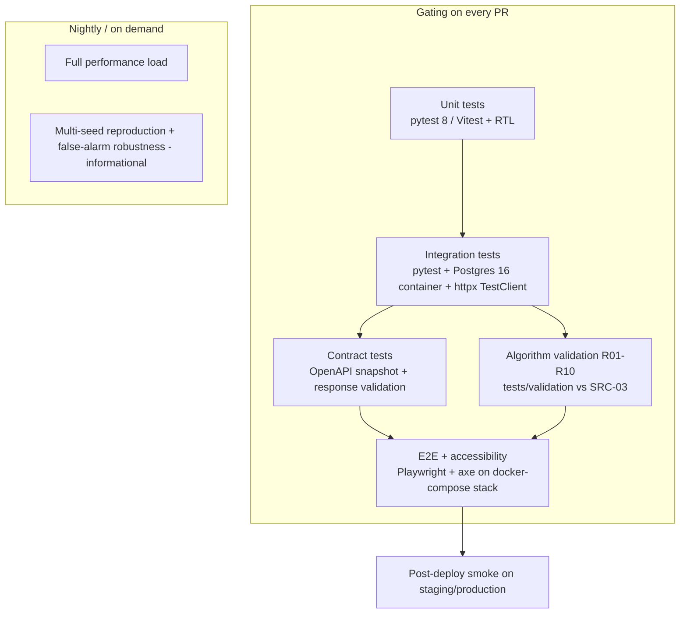

# 13 Testing Strategy and Acceptance Criteria

Document ID: ECHOWELL-TRD-13 · Version 0.7 (draft for review) · Date: 18 October 2026 · Owner: Team 2 · Status: Draft

## 1. Purpose

This document defines how EchoWell is tested and when it is accepted. It fixes the test levels, tools,
directory layout, the catalogue of unit tests per analytics module, the integration, contract, regression,
algorithm-validation, frontend, end-to-end (E2E), accessibility, performance and security test suites, the
coverage gates, the CI gating rule, defect handling, the system-level MVP acceptance criteria and the
end-of-semester demo acceptance criteria.

The test data, the R01–R10 validation matrix with exact expected values, the comparison method and the
validation report format are specified in TRD 14 (Test Data and Validation Spec). This document says
which suites exist and when they must pass; TRD 14 says what the validation suite compares.

## 2. Scope

In scope:
- Automated tests for `analytics/`, `backend/`, `database/` migrations, `frontend/` and the deployed system.
- Algorithm validation against the pipeline test workbook v0.1 (SRC-03), invoked from this strategy and specified in TRD 14.
- Gating rules in GitHub Actions (job definitions are owned by TRD 16).
- MVP acceptance (system level) and demo acceptance (SRC-15 demo tracker steps 4 and 5).

Out of scope:
- Device-side tests (wake word, audio capture, on-device feature extraction, raw audio deletion): Team 1 (SRC-14). EchoWell tests only the ingest interface.
- Detection-performance claims (sensitivity, specificity). The v0.1 alarms test arithmetic, not detection performance (SRC-03 README note 5). Detection evaluation on Team 1's 50-resident, 120-day dataset is informational until OQ-13 closes (TRD 14 §4.12).
- Clinical validation, offline mixed-effects research analysis, usability studies with staff.
- Load beyond the ASM-08 scale (< 25 users, < 100 residents, < 1 session per resident per day).

## 3. References

| ID | Document | Use in this TRD |
|---|---|---|
| SRC-01 | Deployment Architecture | Tool stack: Pytest, Vitest + React Testing Library, Playwright, GitHub Actions |
| SRC-02 | Daily Data Storage and Processing Flowcharts | Stage order; raw store immutable; rebuild from raw |
| SRC-03 | Pipeline test workbook v0.1 | Answer key; golden files |
| SRC-04 | Generator script v0.1 (seed 20261004) | Regeneration of golden files; reference rules |
| SRC-05 | Pipeline test input CSV v0.1 | Pipeline input fixture |
| SRC-06 | Legacy mock data (old schema) | Negative ingest fixture only |
| SRC-09, SRC-10, SRC-11 | UI wireframes (Residents overview, Resident detail, New admissions) | E2E scenarios |
| SRC-18, SRC-19 | UI wireframes Alert review (`specs/UI-wireframe/Alerts.dc.html`) and Analytics (`specs/UI-wireframe/Analytics.dc.html`) | Review-workflow, data-alert and analytics tests; E2E scenarios |
| SRC-12 | TRD Generation Prompt | "unit, integration, regression, and algorithm-validation specifications" |
| SRC-15 | Team 1 + Team 2 meeting agenda, 17 Oct 2026 | Demo tracker steps 4 and 5 |
| SRC-17 | Later-stage build prompts | Phase 12 "Pass R01-R10 Validation Tests", ALGORITHM_VALIDATION_REPORT.md, Phase 13 component/page/API/E2E tests |

Related TRDs: 02 (FR), 03 (NFR), 04 (Frontend), 05 (Backend API), 06 (Database), 07 (Analytics Engine),
08 (Baseline and Scoring), 09 (CUSUM and Alerting), 10 (Ingestion and Validation), 11 (UI/UX), 12 (Security),
14 (Test Data and Validation), 15 (Deployment), 16 (CI/CD), 17 (Logging), 19 (OpenAPI), 20 (PostgreSQL Schema), 24 (Risks/OQ).

## 4. Requirements

### 4.1 Test levels and tooling



| Level | Approx. share of test count | Tool (pinned major) | Runs against |
|---|---|---|---|
| Unit (analytics, backend services, schemas, frontend components) | ≥ 70 % | pytest 8.x, pytest-cov 5.x; Vitest 2.x + React Testing Library 16.x + jsdom | In-process, no DB, no network |
| Integration (DB, API, ingest → pipeline → API) | ≈ 20 % | pytest 8.x, httpx (FastAPI `TestClient`), testcontainers-python 4.x with image `postgres:16` | Real PostgreSQL 16 |
| Contract | 1 file per router | pytest + `openapi-core` 0.19.x | Generated `/api/v1/openapi.json` |
| Algorithm validation | 10 cases + global checks | pytest + pandas 2.2.x + openpyxl 3.1.x (tests only) | `analytics` package (Tier A) and full stack (Tier B), TRD 14 |
| E2E | ≈ 5 % | Playwright 1.4x (Chromium; Firefox and WebKit nightly) | docker-compose stack seeded with DS-01 (TRD 14) |
| Accessibility | every route | `@axe-core/playwright` 4.x | E2E stack |
| Performance | small set | pytest + `time.perf_counter`; Playwright tracing; Lighthouse CI 0.14.x (Should) | Local Postgres container / staging |
| Security | auth matrix + rate limit + DB grants | pytest + httpx | Integration stack |

| ID | Requirement | Priority | Trace | Verification |
|---|---|---|---|---|
| TST-001 | Backend and analytics tests shall run with pytest 8.x on Python 3.12, with pytest-cov for coverage and httpx-based FastAPI `TestClient` for API calls. | Must | SRC-01, BR-17 | Inspection |
| TST-002 | Integration tests shall run against PostgreSQL 16 started by testcontainers-python (image `postgres:16`); when `DATABASE_URL` is set and `APP_ENV=test`, the suite shall use that database instead (CI service container or docker-compose). SQLite shall not be used for any test that exercises SQL. | Must | SRC-01, TRD 06 | Inspection |
| TST-003 | Frontend unit, component and page tests shall use Vitest with React Testing Library and jsdom, located under `frontend/tests/`. | Must | SRC-01, SRC-17 | Inspection |
| TST-004 | E2E tests shall use Playwright, located under `frontend/tests/e2e/` with `frontend/playwright.config.ts`, and shall run against the docker-compose `demo` profile stack (postgres:16, backend :8000, `frontend-prod` :3001; TRD 16 CIC-030), with `globalSetup` `frontend/tests/e2e/global-setup.ts` (D-73) and a second config `frontend/playwright.isolated.config.ts` without `globalSetup` for the `@isolated` run. | Must | SRC-01, SRC-17 | Inspection |
| TST-005 | Unit and integration tests (all pytest suites and Vitest) shall be deterministic: no dependence on wall-clock time (clock frozen or injected), on network access outside the test stack, or on test execution order. E2E scenarios may depend on the documented TRD 24 D-73 order and on the current time only where stated (E2E-15, TST-187, E2E-19). | Must | BR-15 | Test (`pytest -p randomly` in the nightly `nightly-validation` job, TRD 16 CIC-037) |
| TST-006 | Pytest markers `unit`, `integration`, `contract`, `validation`, `security`, `performance`, `slow` shall be registered in `pyproject.toml` with `--strict-markers`; every test module shall carry exactly one level marker. | Must | TRD 16 | Inspection |
| TST-007 | Tests shall never require or read audio files; no fixture in the repository shall have an audio media type (`.wav`, `.mp3`, `.flac`, `.ogg`, `.m4a`). | Must | BR-16, SRC-14 Part B | Test (repository scan test) |

### 4.2 Test directory layout and conventions

```
tests/
  conftest.py                     shared fixtures: config profiles, frozen clock, DB session, API client, auth helpers,
                                  autouse limiter reset (empties the in-memory slowapi storage before every test, TRD 24 D-74)
  unit/
    analytics/                    test_<module>.py, one per analytics module (§4.3)
    backend/                      services/, schemas/, core/ (config, security, logging), repositories/ (mocked session)
  integration/
    db/                           migrations, constraints, triggers, grants
    api/                          one file per router: test_health.py, test_auth.py, test_sessions.py, test_ingest.py,
                                  test_residents.py, test_scores.py, test_alerts.py, test_notes.py, test_devices.py,
                                  test_analytics.py, test_pipeline.py, test_admissions.py, test_users.py
    pipeline/                     ingest -> pipeline -> API flows, rebuild, nightly trigger
  contract/                       test_openapi_contract.py, test_response_schemas.py (contract file: docs/api_reference/openapi.json)
  validation/                     conftest.py (answer-key loader), comparator.py, report.py,
                                  test_r01_clean_control.py ... test_r10_gradual_drift.py, test_global_checks.py,
                                  test_invariance.py, test_answer_key_integrity.py, robustness.py (informational)
  security/                       test_auth_matrix.py, test_rate_limits.py, test_tokens.py, test_api_keys.py, test_no_audio.py
  performance/                    test_pipeline_runtime.py, test_api_latency.py, make_load_dataset.py
  smoke/                          post-deploy smoke tests, pytest marker `smoke` (TRD 15 §4.11, TRD 16)
  fixtures/
    pipeline_input/               EchoWell_pipeline_test_input_v0_1.csv (copy of SRC-05; the ONLY pipeline input fixture)
    answer_key/                   EchoWell_pipeline_test_v0_1.xlsx (copy of SRC-03), evaluation_ground_truth_v0_1.csv (DS-10, TRD 14), SHA256SUMS
    legacy/                       echowell_mock_data_500.csv (copy of SRC-06; negative fixture)
    seeds/demo_overlay/           facilities.csv (Edgewood), residents.csv (R11,F,longitudinal,2026-10-01,), devices.csv (D11,,true,fw-1.0.0),
                                  device_assignments.csv (R11,D11,2026-10-01,) in the TRD 06 DB-060 format, loaded by
                                  `python -m backend.cli import-master-data --dir tests/fixtures/seeds/demo_overlay` (E2E-15, TST-187);
                                  the R01–R10 roster is read from database/seeds/test_v0_1/ (TRD 14 DS-07)
frontend/
  tests/
    unit/                         lib/ helpers (formatters, sort rules, date formatting)
    components/                   one test file per component
    pages/                        one test file per route, API mocked with MSW 2.x
    e2e/                          Playwright specs E2E-01 .. E2E-21 (§4.10), a11y.spec.ts
```

| ID | Requirement | Priority | Trace | Verification |
|---|---|---|---|---|
| TST-010 | The test tree shall follow the layout in §4.2; a test file shall be named `test_<subject>.py` (Python) or `<Subject>.test.tsx` / `<subject>.spec.ts` (frontend/E2E). | Must | SRC-17 Phase 8 | Inspection |
| TST-011 | Each analytics module listed in the contract layout (`duplicate_detection`, `quality_screening`, `speaker_screen`, `epoch_detection`, `morning_offset`, `baseline_builder`, `zscore_calculator`, `composite_score`, `cusum_engine`, `alert_generator`, `day_ledger`, `robust_stats`, `data_alerts`, `aggregates`, `pipeline`, `config`; the module list of TRD 07 §4.2) shall have a matching `tests/unit/analytics/test_<module>.py`. | Must | TRD 07 | Test (meta-test lists modules and asserts files exist) |
| TST-012 | Test function names shall include the test-case ID from §4.3 or TRD 14 where one exists (e.g. `test_rob_03_even_count_median`, `test_vc_r09_first_alarm`). | Should | Traceability | Inspection |
| TST-013 | Every Must requirement in TRDs 02, 04, 05, 07–12 shall be referenced by at least one test via a `@pytest.mark.req("<ID>")` marker (Python) or a `// req: <ID>` comment (frontend), or be listed with its inspection evidence in `docs/reports/traceability_inspections.md`; a script `tests/trace_report.py` shall list requirement IDs without a test or inspection and CI shall publish the report (TRD 03 NFR-111). | Must | SRC-17 audit phases | Analysis |

### 4.3 Unit test catalogue — analytics

All analytics unit tests call pure functions with in-memory inputs, use the `test_v0_1` profile unless stated, and
compare floats with absolute tolerance 1e-9 (unit level; the 1e-6 tolerance applies to workbook comparisons, TRD 14).

| ID | Requirement | Priority | Trace | Verification |
|---|---|---|---|---|
| TST-020 | Every case in Table 4.3-A shall be implemented as an automated unit test and shall pass. | Must | BR-03..BR-11, TRD 07–09 | Test |
| TST-021 | Analytics unit tests shall not import `backend`, SQLAlchemy, httpx, or read any file except through fixtures passed as arguments. | Must | Contract §3 (pure package) | Test (import-linter contract) |
| TST-022 | Property-based tests (Hypothesis 6.x) shall check: `robust_spread ≥ floor`; CUSUM tally ≥ 0 for every input; quality gate output independent of feature values; pipeline output identical for two runs on the same input. | Should | BR-15 | Test |

Table 4.3-A Analytics unit test cases (inputs are literal; expected values are exact).

| Case | Module | Input | Expected |
|---|---|---|---|
| ROB-01 | robust_stats | `[3.0, 1.0, 2.0]` | median 2.0, MAD 1.0, spread 1.4826 |
| ROB-02 | robust_stats | `[1.0, 2.0, 3.0, 4.0]` | median 2.5 (mean of two middle values), MAD 1.0, spread 1.4826 |
| ROB-03 | robust_stats | 16 values, even count (R01 loudness baseline values from SRC-03 Annotated_sessions days 1–16) | median −29.925, MAD 2.165, spread 3.209829 (±1e-6) |
| ROB-04 | robust_stats | `[1, 1, 1, 2]`, floor 0.5 | median 1.0, MAD 0.0, spread 0.5, floor_applied true |
| ROB-05 | robust_stats | `[0.0, 1.0, 2.0]`, floor 0.5 | spread 1.4826, floor_applied false |
| ROB-06 | robust_stats | `[5.0, 5.0, 5.0]`, floor 0 | spread 0.0 (caller rule: z = 0 when spread is 0) |
| DUP-01 | duplicate_detection | arrivals A(session_id S), B(S) identical | A kept; B status `duplicate`, reason "session_id already received" |
| DUP-02 | duplicate_detection | arrivals A(S), B(S) with different feature values | A kept unchanged; B `duplicate` (dedupe key is session_id only) |
| DUP-03 | duplicate_detection | A(S1), B(S2), C(S1) arriving last | C `duplicate`; A, B not duplicates |
| DUP-04 | duplicate_detection | three copies of S | 1 kept, 2 duplicates |
| QG-01 | quality_screening | flag ok, noise −50.0, speech 2.5 | `pending_screen`, no reasons |
| QG-02 | quality_screening | noise exactly −40.0 | not set aside (rule is noise > limit) |
| QG-03 | quality_screening | noise −39.9 | `set_aside`, "noise above limit" |
| QG-04 | quality_screening | speech exactly 1.0 | not set aside (rule is speech < min) |
| QG-05 | quality_screening | speech 0.99 | `set_aside`, "speech too short" |
| QG-06 | quality_screening | flag poor, noise −30.0, speech 0.5 | `set_aside`, reason text exactly "quality flag poor; noise above limit; speech too short", reasons array in that order |
| QG-07 | quality_screening | flag poor, noise −30.0 (R03 day 18 shape) | "quality flag poor; noise above limit" |
| EP-01 | epoch_detection | 3 records same key | all epoch 1 |
| EP-02 | epoch_detection | device_id changes D07 → D07B at record 13 | records 1–12 epoch 1, 13+ epoch 2 |
| EP-03 | epoch_detection | firmware change only (fw-1.0.0 → fw-1.0.1) | new epoch |
| EP-04 | epoch_detection | extraction_software_version change only | new epoch |
| EP-05 | epoch_detection | set-aside record carries the new key | new epoch starts at the set-aside record |
| EP-06 | epoch_detection | records given out of timestamp order | sorted by timestamp_utc before epoch assignment |
| EP-07 | epoch_detection | duplicate record with a different key | ignored (duplicates get no epoch) |
| SCR-01 | speaker_screen | 4 prior usable sessions | screen not run; session `usable` |
| SCR-02 | speaker_screen | 5 prior usable sessions, normal values | screen runs; `usable`; screen_detail "F0 z=<2dp>; composite features with \|z\|>=3: <n>" |
| SCR-03 | speaker_screen | \|z_F0\| = 4.0 exactly and exactly 2 composite features with \|z\| = 3.0 | `quarantined` (both thresholds inclusive) |
| SCR-04 | speaker_screen | \|z_F0\| = 4.5 and 1 composite feature \|z\| ≥ 3 | `usable` |
| SCR-05 | speaker_screen | \|z_F0\| = 3.99 and 7 composite features \|z\| ≥ 3 | `usable` |
| SCR-06 | speaker_screen | 20 prior usable sessions | reference uses only the first 16 (`baseline_n`) prior usable sessions of the epoch |
| SCR-07 | speaker_screen | prior sessions with identical number_of_pauses | pause spread floored at 0.5; F0 spread 0 → z_F0 = 0 |
| SCR-08 | speaker_screen | quarantined session | not appended to the prior list |
| SCR-09 | speaker_screen | morning session | screen uses RAW values, not adjusted |
| SCR-10 | speaker_screen | R05 day 8 inputs from SRC-05 with its 7 prior usable sessions | reason "possible other speaker (F0 z=-8.61; composite features with \|z\|>=3: 4)" |
| MO-01 | morning_offset | `2026-10-01 16:59:59` UTC | local 11:59:59 CDT → morning |
| MO-02 | morning_offset | `2026-10-01 17:00:00` UTC | local 12:00:00 → not morning |
| MO-03 | morning_offset | `2026-11-01 17:59:59` UTC (after DST end) | local 11:59:59 CST → morning |
| MO-04 | morning_offset | `2026-11-01 18:00:00` UTC | local 12:00:00 CST → not morning |
| MO-05 | morning_offset | R06 day 1 raw: loudness −25.42, phrase 4.01, rate 4.14, artic 4.52, pauses 2, pause_frac 0.126, voiced 0.595 | adjusted −23.92, 3.91, 4.26, 4.62, 2, 0.116, 0.615 (±1e-9) |
| MO-06 | morning_offset | afternoon session | adjusted == raw for all 19 features |
| MO-07 | morning_offset | 12 stored-not-scored features on a morning session | unchanged (offset 0) |
| BL-01 | baseline_builder | 15 usable sessions | baseline_formed false, "n of N" = 15 of 16, no exception |
| BL-02 | baseline_builder | 16 usable sessions | frozen; frozen_after = 16th session_id; n_sessions 16 |
| BL-03 | baseline_builder | 20 usable sessions | uses first 16 by timestamp; sessions 17–20 do not change any statistic |
| BL-04 | baseline_builder | set-aside and quarantined sessions interleaved | excluded from membership and ordinal |
| BL-05 | baseline_builder | 19 features + composite | 20 rows; composite floor 0.1; pause floor 0.5; other floors 0 |
| BL-06 | baseline_builder | baseline built from adjusted values | morning sessions enter with adjusted values |
| BL-07 | baseline_builder | `production` profile | baseline_n = 30 |
| Z-01 | zscore_calculator | adj −27.0, median −29.925, spread 3.209829 | z = 0.9112635 ±1e-6 (unsigned, = (adj − median)/spread) |
| Z-02 | zscore_calculator | 7 composite features | returns 7 unsigned z keyed `z_<feature>`; 12 stored features not scored |
| CMP-01 | composite_score | unsigned z all +1.0 | signed = sign × z → composite_raw = (−1+1−1−1+1+1−1)/7 = −1/7 |
| CMP-02 | composite_score | composite_raw 0.5, comp median 0.0, MAD 0.0 | spread floored 0.1 → composite_z 5.0 |
| CMP-03 | composite_score | R09 first scored session R09-20261017-01 | composite_raw 2.035972, composite_z 3.745474 (±1e-6) |
| CUS-01 | cusum_engine | z = [3.0, 3.0] | tally [2.5, 5.0]; second session rings (≥ h inclusive) |
| CUS-02 | cusum_engine | z = [−10.0] | tally 0.0 (clamped) |
| CUS-03 | cusum_engine | z = [6.0, −20.0, 6.0] | tally [5.5, 0.0, 5.5]; alarm_state [rings, on, on]; exactly one alarm event |
| CUS-04 | cusum_engine | R09 composite_z series (TRD 14 §4.7.9) | tally series equal to Exp_scores ±1e-6; rings at the 5th scored session |
| CUS-05 | cusum_engine | set-aside, quarantined, duplicate and missing days between scored sessions | tally unchanged by them |
| CUS-06 | cusum_engine | new epoch | tally restarts at 0 |
| CUS-07 | cusum_engine | z = [0.5] × 10 | tally stays 0.0 (k = 0.5) |
| AL-01 | alert_generator | first crossing | one alert: resident, epoch, session_id, triggered_at, cusum_value, status open |
| AL-02 | alert_generator | tally drops below h then recrosses in same epoch | no second alert (CUS-03) |
| AL-03 | alert_generator | new epoch while alert open | old alert closed, closed_reason "epoch ended" (ASM-06) |
| AL-04 | alert_generator | rebuild after a review was saved | alert matched by natural key (epoch_id, session_id); its reviews, status acknowledged and snoozed_until survive (contract R15) |
| DL-01 | day_ledger | resident with record on a day | `checked_in` |
| DL-02 | day_ledger | no record, own device | `missing_resident`, reason "no record received" |
| DL-03 | day_ledger | no record, shared device D02 (R02, R03), neither has a record | both `missing_device_gap`, reason "all residents on shared device D02 have no record" |
| DL-04 | day_ledger | no record, shared device, other resident has a record | `missing_resident` |
| DL-05 | day_ledger | record `2026-10-02 04:30:00` UTC | counts for local date 2026-10-01 |
| DL-06 | day_ledger | only a duplicate arrival on a day | duplicate does not count; first copy's day counts |
| DL-07 | day_ledger | set-aside or quarantined record on a day | `checked_in` (a record exists) |
| DL-08 | day_ledger | days before enrolled_on and after as-of | no rows |
| DL-09 | day_ledger | no backfill | missing day never gets values; a later record on another day does not alter it |
| PIP-01 | pipeline | SRC-05 full input, `test_v0_1` | equals answer key (delegates to TRD 14 VC suite in Tier A) |
| PIP-02 | pipeline | same input twice | byte-identical serialized output |
| PIP-03 | pipeline | stage order | duplicate → quality → epoch → screen → context → baseline → score → CUSUM → alert → ledger (SRC-02) |
| PIP-04 | pipeline | late record that predates a frozen baseline | frozen baseline unchanged; warning `late_arrival` (ASM-07) |
| PIP-05 | pipeline | `run_pipeline` signature and inputs | no parameter, input object or module import carries evaluation ground truth (true onset, planted change) |
| CFG-01 | config | load `test_v0_1` | all values equal TRD 14 Table 4.5-E (Parameters) |
| CFG-02 | config | load `production` | baseline_n 30, all other keys as contract §7 |
| CFG-03 | config | unknown key or wrong type | `ConfigError` naming the key (TRD 07 ANL-029) |
| CFG-04 | config | snapshot | snapshot dict round-trips to JSON and back unchanged |
| CFG-05 | config | both profiles | data_alert_set_aside_fraction 0.20, data_alert_device_silent_days 2, data_alert_baseline_stalled_enabled true, alert_snooze_hours 24, review_explanations = [cold_cough_sore_throat, dental_dentures, medication_change, poor_sleep_unusual_day, room_device_moved] |
| CFG-06 | backend core config | `APP_ENV=production` with `PIPELINE_PROFILE=test_v0_1` | startup refused with a configuration error naming both variables (D-OWNER-2) |

Table 4.3-B Data-alert and analytics-summary unit cases (contract §19; window = 30 local days ending on as_of).

| Case | Module | Input | Expected |
|---|---|---|---|
| DA-01 | data alerts: baseline_stalled | resident baseline_forming, 30 days in the current epoch (inclusive count (as_of − start) + 1 = 29 + 1), baseline_n 16 | one alert "R08 · baseline stuck at 13 of 16", detail "12 missed and 5 set aside in 30 days" (R08 inputs) |
| DA-02 | baseline_stalled | baseline_forming, epoch started 14 days before as_of, so the inclusive count (as_of − start) + 1 = 15 < baseline_n 16 (TRD 09 §4.9); boundary companion: started 15 days before as_of gives 16 ≥ 16 and one alert | no alert (one alert in the boundary companion) |
| DA-03 | possible_other_speaker | 2 quarantined sessions on Oct 8 and Oct 22 | one alert "R05 · possible other speaker", detail "2 check-ins quarantined: Oct 8, Oct 22" |
| DA-04 | high_set_aside | 7 set aside of 29 received (0.241 ≥ 0.20, received ≥ 10), reasons noise, quality flag, too short | one alert "R03 · many check-ins set aside", detail "7 of 29 received: noise, quality flag, too short" (reason kinds in that fixed order) |
| DA-05 | high_set_aside | 2 set aside of 9 received | no alert (received < 10) |
| DA-06 | suppression | resident qualifies for baseline_stalled and high_set_aside (R08: 5 of 18 = 0.28) | only baseline_stalled |
| DA-07 | device_silent | shared device D02, no record from R02 or R03 on Oct 12 | one alert "D02 · device silent all day", detail "Oct 12 · affects R02 and R03" |
| DA-08 | device_silent | single-resident device with isolated missed days (R08 pattern: no two consecutive) | no device_silent alert |
| DA-09 | device_silent | single-resident device with 2 consecutive silent days | one device_silent alert |
| DA-10 | device_silent | device with no assigned resident on the day (D07 after 2026-10-12) | no alert |
| DA-11 | data alerts | same condition on two consecutive runs | one open row; last_detected_at updated; condition gone → status resolved |
| DA-12 | review_flagged_data_problem | review saved with outcome data_problem | one data alert of kind review_flagged_data_problem linked to the alert's resident |
| AN-01 | analytics KPIs | DS-01 outputs | received 281 of 300 → "94%"; used 267 of 300 → "89%" (half-up rounding: 93.67→94, 89.0→89) |
| AN-02 | rounding | 0.5 boundary (e.g. 1 of 8 = 12.5 %) | "13%" (half-up, not banker's rounding) |
| AN-03 | funnel | DS-01 outputs | 300 → 281 → 269 → 267; reason occurrences quality flag 5, noise 5, too short 3; 1 session with two reasons |
| AN-04 | by resident | DS-01 outputs | R08 43, R03 73, R02 80, R05 93, then R01, R04, R06, R07, R09, R10 at 100 (ties by resident code) |
| AN-05 | baselines formed | DS-01 outputs | "9 of 10"; note "R08 still forming; R07 restarted once" |
| AN-06 | alarm timing | ground truth R09 Sudden step 2026-10-21, R10 Slow drift 2026-10-17; alerts R09 2026-10-21, R10 2026-10-24 | delays 0 days and 7 days; other 8 "No alarm" "Correct" |
| AN-07 | alarm timing | profile production | alarm_timing absent; review_outcomes counts by outcome present |
| AN-08 | leaning most | R09 scored sessions from the alarm session (Oct 21) to Oct 30 | "more pauses, quieter, less voiced sound" (top 3 mean signed z, only features with mean > 0) |

### 4.4 Unit tests — backend

| ID | Requirement | Priority | Trace | Verification |
|---|---|---|---|---|
| TST-030 | Pydantic ingest schema tests shall cover: each required field missing → error naming the field; wrong type; `audio_quality_flag` outside {ok, poor}; `schema_version` not in supported list; `number_of_pauses` negative or non-integer; `timestamp_utc` not "YYYY-MM-DD HH:MM:SS". | Must | BR-01, TRD 10 | Test |
| TST-031 | Feature-name mapping tests shall show that renaming an input column through configuration (no code change) yields identical pipeline output on SRC-05. | Must | OQ-03, RSK-02 | Test |
| TST-032 | Security core tests shall cover argon2id hash/verify, JWT issue/verify/expiry at 60 min, API key SHA-256 hashing, and role checks. | Must | BR-16, TRD 12 | Test |
| TST-033 | Display-status service tests shall cover `alarm_on`, `no_alarm` (with and without " · baseline restarted <Mon D>") and `baseline_forming` ("Baseline forming · n of N sessions") and all three sort options with tie rules from contract §8. | Must | BR-12, TRD 11 | Test |
| TST-034 | Error-handler tests shall assert `Content-Type: application/problem+json`, bodies `{type, title, status, detail, request_id, errors}` with `type` = `urn:echowell:error:<CODE>` (UPPER_SNAKE code from the TRD 05 §4.7 catalogue) and `errors[]` items `{field, code, message}`, and an `X-Request-ID` header on every response including errors (contract R19). | Must | TRD 05, TRD 17 | Test |

### 4.5 Integration tests

| ID | Requirement | Priority | Trace | Verification |
|---|---|---|---|---|
| TST-040 | Alembic `upgrade head` as `echowell_migrator` on an empty PostgreSQL 16 database provisioned by `database/roles/provision_login_roles.sql` (extensions and roles, TRD 24 D-72) shall succeed, and `downgrade base` followed by `upgrade head` shall succeed. | Must | TRD 06, TRD 20 | Test |
| TST-041 | Connected as `echowell_app` (DATABASE_URL), UPDATE or DELETE on `raw_sessions`, `audit_logs`, `alert_reviews` and `staff_notes` shall raise a PostgreSQL error and leave the row unchanged; SELECT on `evaluation_ground_truth` shall raise `permission denied`. Connected as `echowell_readonly`, SELECT on `evaluation_ground_truth` shall succeed and any INSERT/UPDATE/DELETE shall fail. Migrations shall run as `echowell_migrator` via DATABASE_MIGRATION_URL (contract R20). | Must | BR-02, BR-16, contract R20 | Test |
| TST-042 | Unique constraints shall be verified: `residents.resident_code`, `epochs(resident_id, epoch_number)`, `baselines(epoch_id, feature_key)`, `day_ledger(resident_id, local_date)`, `processed_sessions.raw_session_id`, `raw_sessions.arrival_seq`. | Must | TRD 20 | Test |
| TST-043 | `POST /api/v1/sessions` with a valid SRC-05 record shall return 201 and create exactly one `raw_sessions` row whose `payload` equals the request body exactly. | Must | BR-01, BR-02 | Test |
| TST-037 | When the synchronous pipeline raises (fault injected), `POST /api/v1/sessions` shall still return 201 with `status_after_processing: "pending"` and the raw row stored; the next run processes it (contract R23). | Must | contract R23, BR-02 | Test |
| TST-038 | as_of precedence (contract R21): an explicit `as_of` in `POST /api/v1/pipeline/run` wins; otherwise `PIPELINE_AS_OF` env is used; otherwise the current time. Startup with `PIPELINE_AS_OF` set and `APP_ENV=production` shall be refused. Read endpoints shall report the `as_of` of the latest succeeded run in `meta.as_of`. | Must | contract R11, R21 | Test |
| TST-044 | A repeat `POST /api/v1/sessions` with the same session_id shall return 200 with status `duplicate`, store a second `raw_sessions` row, and leave all derived results for that resident unchanged. | Must | BR-03 | Test |
| TST-045 | An invalid record shall return 422, create one `ingest_rejections` row, and create no `raw_sessions` row. | Must | BR-01, TRD 10 | Test |
| TST-046 | Uploading SRC-05 as multipart CSV to `POST /api/v1/ingest` shall return 202 with `accepted` 283, `rejected` 0, `duplicates` 2. | Must | BR-01, BR-03 | Test |
| TST-047 | Uploading SRC-06 (legacy mock, old schema) to `POST /api/v1/ingest` shall be rejected with 422 identifying the header mismatch, and shall create no `raw_sessions` rows. | Must | TRD 10, TRD 14 TDV-005 | Test |
| TST-048 | The ingest → pipeline → API flow on SRC-05 with profile `test_v0_1` shall reproduce the answer key through the API (TRD 14 Tier B). | Must | BR-15 | Test |
| TST-049 | Ingesting SRC-05 one record at a time through `POST /api/v1/sessions` in arrival order (synchronous per-resident pipeline; in-process `TestClient` with the clock frozen by `time-machine` at 2026-10-30 15:00 America/Chicago) shall yield derived tables equal to a single batch ingest plus full run with the same as-of. | Must | BR-15, contract §7 Trigger | Test |
| TST-050 | Two consecutive full rebuilds (`POST /api/v1/pipeline/run`, scope all) with unchanged inputs and config shall produce identical derived tables, compared on all columns except surrogate ids, `pipeline_run_id` and timestamps of the run itself. | Must | SRC-02, contract §7 | Test |
| TST-051 | Every pipeline run shall create a `pipeline_runs` row with `config_profile`, `config_snapshot` equal to the loaded profile, `code_version` equal to `GIT_SHA`, status `succeeded`, and counts equal to the status totals. | Must | TRD 07, TRD 17 | Test |
| TST-052 | `python -m backend.jobs.nightly_run` (invoked by cron `0 7,8 * * *` UTC, contract R18) shall be tested with an injected clock: it starts a full run only when facility-local time is 02:xx and no `pipeline_runs` row with trigger `nightly` and status `running` or `succeeded` has `started_at` on that facility-local date (the single dedupe condition of TRD 05 API-061 / TRD 15 DEP-047); in CDT (07:xx UTC = 02:xx local) the 08:xx invocation exits without a run, and in CST (08:xx UTC = 02:xx local) the 07:xx invocation exits without a run; a second invocation the same night never starts a second run. | Must | contract §7 Trigger | Test |
| TST-053 | Audit log rows shall be written for login, failed login, logout (`POST /api/v1/auth/logout`), ingest batch, note created, alert review saved, alert snoozed, pipeline run, config change (`config.changed`, written by `python -m backend.cli set-config` with old value, new value and reason; TRD 15 §4.8) and user change. | Must | BR-16, TRD 12 | Test |
| TST-054 | `GET /api/v1/health` shall return 200 `{status, database, version, time}` with database "ok" when the DB is up, and 503 with `status` "degraded" when the DB check fails (DB container stopped) (contract R19). | Must | TRD 05, TRD 17 | Test |
| TST-055 | A withdrawn resident (status withdrawn) shall cause `POST /api/v1/sessions` to return 422 with detail "resident withdrawn" and shall be hidden from `GET /api/v1/residents` unless `include_withdrawn=true`. | Must | contract §9, OQ-11 | Test |
| TST-056 | `POST /api/v1/alerts/{id}/reviews` by a clinician with `{explanations: ["cold_cough_sore_throat"], outcome: "known_cause", note: "..."}` shall return 201, create one `alert_reviews` row, and set the alert status to `acknowledged`; `cusum_state.current_tally`, every `scores.cusum_tally`, `scores.alarm_state` and `cusum_state.alarm_on` shall be unchanged (R09 tally stays 26.830256 ±1e-6; OQ-05). | Must | contract §19, R5, OQ-05 | Test |
| TST-057 | A second review on the same alert shall create a second `alert_reviews` row; `GET /api/v1/alerts/{id}/reviews` shall return both, newest first. | Must | contract §19 | Test |
| TST-058 | A review without `outcome`, with an outcome outside {no_concern, known_cause, referred, data_problem}, with an explanation code outside the configured `review_explanations`, or with a note longer than 2000 characters shall return 422 and create no row. | Must | contract §19 | Test |
| TST-059 | A review with outcome `data_problem` shall create (or link to an open) data alert of kind `review_flagged_data_problem` for that resident. | Must | contract §19 | Test |
| TST-065 | `POST /api/v1/alerts/{id}/snooze` with no body shall set `alerts.snoozed_until` = now + 24 h (`alert_snooze_hours`) and `snoozed_by` = caller, with the application clock frozen by `time-machine` (the API computes now in Python, not with the database `now()`, TRD 23 DME-022); with `{hours: 4}` it shall be now + 4 h; status, tally and alarm state shall be unchanged; the integration test `tests/integration/test_alert_snooze.py` asserts the stored and returned `snoozed_until` exactly, and after `time-machine` moves the application clock 24 h + 1 s forward asserts that `snoozed_until` < now (the API exposes only `snoozed_until`); the return of the "Not reviewed" emphasis is a client-side comparison tested by TRD 04 FE-205 (Vitest, fake timers); E2E-19 does not advance any clock. | Must | contract §19 | Test |
| TST-066 | `POST /api/v1/alerts/{id}/acknowledge` shall not exist (404 or 405). | Must | contract R5 | Test |
| TST-067 | A full rebuild after a review and a snooze shall keep the alert row (natural key epoch_id, session_id), its reviews, status `acknowledged` and `snoozed_until`. | Must | contract R15 | Test |
| TST-068 | `evaluation_ground_truth` shall never be read by the pipeline: (a) a static test fails on any reference to `evaluation_ground_truth` in `analytics/` or in the backend pipeline service/repository modules (only the analytics summary read path, using the `echowell_readonly` connection, may reference it; the `echowell_app` role has no SELECT on it, TST-041); (b) Tier A and Tier B pipeline outputs shall be identical with the table empty and with it loaded; (c) loading ground truth shall be refused when the active profile is `production`. Detail in TRD 14 TDV-100..TDV-104. | Must | contract §19, SRC-02 | Test |
| TST-069 | `POST /api/v1/auth/logout` shall return 204 and write an audit row; `GET /api/v1/pipeline/runs` shall list runs newest first. | Must | contract R4 | Test |
| TST-079 | `GET /api/v1/analytics/baselines` and `GET /api/v1/scores` with `Accept: text/csv` shall return `text/csv` whose header row equals the JSON field names and whose rows equal the JSON items. | Must | contract R4 | Test |

### 4.6 Contract tests (OpenAPI)

| ID | Requirement | Priority | Trace | Verification |
|---|---|---|---|---|
| TST-060 | `tests/contract/test_openapi_contract.py` shall compare the schema generated by `python -m backend.cli export-openapi` with the committed contract file `docs/api_reference/openapi.json`; any difference shall fail the CI contract check until the file is regenerated and committed in the same PR. | Must | TRD 19, contract R22 | Test |
| TST-061 | Every response produced in `tests/integration/api/` shall be validated against the OpenAPI schema for its path, method and status code using `openapi-core`. | Must | TRD 19, SRC-17 Phase 10 | Test |
| TST-062 | Every path in contract §10 as amended by §19 and R4 (including `/alerts/{id}/reviews`, `/alerts/{id}/snooze`, `/data-alerts`, `/auth/logout`, `/pipeline/runs`; excluding `/alerts/{id}/acknowledge`) shall exist in the OpenAPI document with the documented method, and no other path under `/api/v1` shall exist. | Must | TRD 05, TRD 19 | Test |
| TST-063 | Frontend types in `frontend/lib/api-types.ts` shall be generated from `docs/api_reference/openapi.json` with openapi-typescript; CI shall regenerate them and fail on any diff, and `tsc --noEmit` shall pass. | Must | TRD 04, contract R22 | Test |
| TST-064 | Every list, detail and analytics response shall contain `meta` with `facility_name`, `facility_tz`, `data_source_label`, `as_of`, `baseline_n`, `cusum_h`, `pipeline_profile`. | Must | contract R3 | Test |

### 4.7 Regression policy and golden files

| ID | Requirement | Priority | Trace | Verification |
|---|---|---|---|---|
| TST-070 | The golden files shall be the SRC-03 workbook and the SRC-05 input CSV, stored as `tests/fixtures/answer_key/EchoWell_pipeline_test_v0_1.xlsx` and `tests/fixtures/pipeline_input/EchoWell_pipeline_test_input_v0_1.csv`, with SHA-256 digests in `tests/fixtures/answer_key/SHA256SUMS`. | Must | SRC-03, SRC-05, BR-15 | Inspection |
| TST-071 | A test shall assert that the fixture copies are byte-identical to `specs/business-requirements/EchoWell_pipeline_test_v0_1.xlsx` and `specs/data-samples/EchoWell_pipeline_test_input_v0_1.csv` and match `SHA256SUMS`. | Must | BR-15 | Test |
| TST-072 | Golden files shall never be edited by hand. Any change to expected results shall be made by changing the generator (SRC-04) or its parameters, regenerating with `python specs/algorithm/generate_pipeline_test_v0_1.py <outdir> [seed]` (TRD 14 §4.3), and committing the regenerated CSV, workbook, fixture copies and `SHA256SUMS` together in one PR labelled `answer-key-change`. | Must | SRC-03 README, SRC-04 | Inspection |
| TST-073 | A PR labelled `answer-key-change` shall include the output of `python -m tests.validation.diff_answer_key <old.xlsx> <new.xlsx>` (per-sheet added, removed and changed cells) in its description and shall be approved by the algorithm lead before merge. | Must | Contract §13 team workflow | Inspection |
| TST-074 | A change in pipeline output that is not accompanied by an `answer-key-change` PR shall be treated as a regression: the validation suite fails and the PR shall not merge. | Must | BR-15 | Test |
| TST-075 | Every defect fixed in analytics or ingest shall add a regression test that fails before the fix and passes after it. | Must | Quality | Inspection |

### 4.8 Algorithm validation (R01–R10)

| ID | Requirement | Priority | Trace | Verification |
|---|---|---|---|---|
| TST-080 | The validation suite `tests/validation/` shall implement every validation case VC-R01 to VC-R10 and VC-G01 to VC-G12 of TRD 14 and all of them shall pass on every PR. | Must | BR-15, SRC-03, SRC-17 Phase 12 | Test |
| TST-081 | The validation suite shall run in two tiers: Tier A calls `analytics.pipeline` directly on the input CSV; Tier B ingests the CSV through the API into PostgreSQL, runs the pipeline and reads results back through the API and DB (TRD 14 §4.4). Both tiers shall pass. | Must | BR-15 | Test |
| TST-082 | The validation run shall write `docs/reports/ALGORITHM_VALIDATION_REPORT.md` and `docs/reports/validation_results.json` in the format of TRD 14 §4.10 and CI shall upload both as build artifacts. | Must | SRC-17 Phase 12 | Inspection |
| TST-083 | No validation test shall be skipped, marked xfail or retried; a skipped validation test shall fail the job (`--strict` with a conftest hook rejecting skip/xfail under `tests/validation/`). | Must | BR-15 | Test |
| TST-084 | The false-alarm robustness check (TRD 14 §4.11) shall run nightly and on demand (job `nightly-validation`, TRD 16 CIC-037), shall be reported, and shall not gate merges. | Should | SRC-03 README note 5, RSK-03 | Inspection |

### 4.9 Frontend component and page tests

| ID | Requirement | Priority | Trace | Verification |
|---|---|---|---|---|
| TST-090 | Component tests shall exist for these components of the TRD 04 §4.8 inventory (names are binding): StatusBadge, SummaryTiles, ResidentsTable (with SortSelect), DevicePanel, CusumChart and CusumTable (text-table alternative), FeatureCard (×7) and OtherMeasurementsCard, CheckinLog, StaffReviewForm, ResidentHeader (baseline line), AppHeader (subline), Footer, AdmissionsTable, ExperimentalBanner, SectionState (loading, empty and error states); Alert review: AlertCard, AlertQueue, DataAlertQueue, AlertReviewPanel (MiniTallyChart, LeaningMost), AlertReviewForm (explanations, required outcome, note, Save review, Remind me in 24 h); Analytics: KpiTiles, DailyCheckinsChart, LossFunnel, UsableByResidentChart, AlarmTimingTable / ReviewOutcomesTable. | Must | BR-12, BR-13, BR-14, TRD 04, SRC-18, SRC-19 | Test |
| TST-091 | StatusBadge tests shall assert the text "▲ Alarm since Oct 21" for an alarm since 2026-10-21, "No alarm · baseline restarted Oct 13" for an epoch-2 resident, and "Baseline forming · 13 of 16 sessions"; each badge shall convey state by text and glyph, not colour alone. | Must | contract §8, §11 | Test |
| TST-092 | ResidentsTable tests shall assert the three sort orders on the DS-07 fixture rows exactly as listed in TRD 14 §4.9. | Must | contract §8 | Test |
| TST-093 | CusumChart tests (contract R1) shall assert: one bar per scored session with height = cusum_tally; bars with alarm_state off use `#BDBDB8` with a 1px `#8A8A85` outline; bars with alarm_state rings or on use `#9A4508`; a leading grey slot labelled "Baseline <Mon D>–<Mon D>" (R09: "Baseline Oct 1–16"); a dashed line at cusum_h labelled "alarm line 5.0"; an x label containing "· alarm" on the first-crossing date; caption "Set-aside, quarantined and missed days leave the tally unchanged."; an accessible table with one row per bar. | Must | BR-13, SRC-10 | Test |
| TST-094 | Page tests (MSW-mocked API) shall cover for each route `/login`, `/residents`, `/residents/[residentCode]`, `/alerts`, `/analytics`, `/admissions`, `/admin`: loading state, populated state, empty state, API error state (RFC 7807 body shown as a readable message with request id), and 401 → redirect to `/login`. | Must | SRC-17 Phase 13 | Test |
| TST-095 | A test shall assert that production builds contain no mock data: MSW handlers and fixture JSON are imported only from `frontend/tests/` and `frontend/tests/e2e/`. | Must | SRC-17 Phase 13 "No mock values in production builds" | Test |
| TST-096 | The "What this means" text shall be read from the configuration string (OQ-12) and the test shall assert the marker "[Final clinical wording: confirm with PI]" is shown while that string is unapproved. | Must | OQ-12, BR-18 | Test |
| TST-097 | Text tests shall assert that no page contains the words "diagnos" (except in "not a diagnosis"), "severity", or "measures" in a clinical claim, and that the resident detail page contains "It is a prompt to check in, not a diagnosis.". | Must | BR-18 | Test |

### 4.10 End-to-end scenarios

All E2E scenarios except the `@isolated` ones (E2E-15, TST-187, E2E-19; §8) run on the docker-compose stack loaded with
dataset DS-07 (SRC-05 ingested with profile `test_v0_1`, as-of 2026-10-30 15:00 America/Chicago, TRD 14 §4.9), reset and
re-seeded by the Playwright `globalSetup` at the start of each browser project (TRD 24 D-73), and log in as a seeded user.
Scenarios that save a review, a note or a snooze are tagged `@mutating` and run after all read-only scenarios of the
project as one serial group; the group and its order are defined once in TRD 24 D-73 (E2E-18; E2E-09 = TRD 04 FE-187;
the FE-193 snooze step on R10). Only the login scenarios (E2E-01, E2E-02, FE-188) log in through the form; every other
scenario reuses the per-role session that `globalSetup` stores (TRD 24 D-74).

| ID | Requirement | Priority | Trace | Verification |
|---|---|---|---|---|
| TST-100 | Every E2E scenario in Table 4.10-A shall be implemented in `frontend/tests/e2e/` and pass in Chromium on every PR, and the main-run scenarios also in Firefox and WebKit nightly; the `@isolated` scenarios (E2E-15, TST-187, E2E-19) run in Chromium only, on `echowell_demo` (TRD 16 CIC-030). Within each browser project the main database is reset and re-seeded first, read-only scenarios run before the `@mutating` group of TRD 24 D-73 (`frontend/tests/e2e/mutating.spec.ts`, serial, in this order: E2E-18; E2E-09, implemented by TRD 04 FE-187; the FE-193 snooze step on R10), so CIC-032 and every "Alerts (2)" / "Not reviewed" / "both not yet reviewed" assertion sees the pristine seed (TRD 24 D-73). | Must | SRC-09/10/11, SRC-17 | Test |
| TST-101 | Playwright shall run with `retries: 1` in CI and `retries: 0` locally; a scenario that passes only on retry shall be reported as flaky (§4.16). | Must | Quality | Inspection |

Table 4.10-A E2E scenarios. "Log in as clinician / researcher / admin" means using the per-role session stored by `globalSetup` (TRD 24 D-74; only E2E-01, E2E-02 and FE-188 submit the login form) of the seeded users `clinician@example.com`, `researcher@example.com` and `admin@example.com` with the per-job SEED_CLINICIAN_PASSWORD, SEED_RESEARCHER_PASSWORD and SEED_ADMIN_PASSWORD (TRD 06 DB-057, TRD 16 CIC-034, TRD 24 D-71).

| Scenario | Steps | Expected |
|---|---|---|
| E2E-01 Login | Open `/`; log in as clinician | Redirect to `/residents`; header nav "Residents", "Alerts (2)", "Analytics", "New admissions" (contract §19, R2); subline "Voice check-ins · <FACILITY_NAME> · Showing pipeline test data v0.1 as of Oct 30, 2026, 3:00 PM CT" |
| E2E-02 Bad login | Wrong password | Error message; no token stored; audit row "failed login" |
| E2E-03 Overview tiles | `/residents` | Tiles: Alarm on 2; Being watched, no alarm 7; Baseline still forming 1; Missed check-ins, last 30 days 19 |
| E2E-04 Overview rows, default sort | `/residents` (Alarms first) | 10 rows in the order and with the values of TRD 14 Table 4.9-B |
| E2E-05 Sort by Resident ID | Choose "Resident ID" | R01 … R10 ascending |
| E2E-06 Sort by Last check-in | Choose "Last check-in" | R02, R07, R05, R10, R06, R08, R09, R03, R04, R01 |
| E2E-07 Devices panel | Open `/residents#devices` | Devices panel in view; "D02 · shared by R02, R03", "silent all day Oct 12", last upload Oct 30, 2:55 PM; "D07B · R07", "In use since Oct 13 (replaced D07)", last upload Oct 30, 2:52 PM |
| E2E-08 Resident detail R09 | Open R09 | Header "R09 · Device D09"; "Baseline: first 16 usable check-ins, Oct 1–16 (then frozen) · watched since Oct 17"; badge "▲ Alarm since Oct 21"; no global nav, "← Back to all residents" link (R2); chart with leading slot "Baseline Oct 1–16" and 14 scored bars (Oct 17–20 grey, Oct 21–30 accent), label "alarm line 5.0", x label "Oct 21 · alarm"; 7 measurement cards with contract §6 labels; card "12 other measurements (pitch, jitter, MFCCs …)" "stored, not scored"; check-in log has "Oct 21 · Alarm on · tally crossed 5.0", "Oct 17 · Watching started", "Oct 16 · Baseline complete (16 of 16)" |
| E2E-09 Staff note and review from detail | `@mutating`, 2nd in the D-73 group (implemented by TRD 04 FE-187): on R09 add a staff note type "observation" with body "Resident has a cold; nurse notified."; then click "Mark as reviewed", which opens the review form; choose "Cold, cough or sore throat" and outcome "Explained by a known cause"; Save review | Note listed with author and time; alert status acknowledged; badge still "▲ Alarm since Oct 21"; tally values unchanged (OQ-05, R5) |
| E2E-10 Device move R07 | Open R07 | Badge "No alarm · baseline restarted Oct 13"; check-in log contains baseline restarted (new device) on Oct 13 and baseline complete on Oct 28; chart shows epoch 2 only with 2 scored bars |
| E2E-11 Baseline forming R08 | Open R08 | Badge "Baseline forming · 13 of 16 sessions"; chart empty state (no scored sessions); log shows 12 missed days and 5 set-aside entries; no error banner |
| E2E-12 Set-aside reasons R03 | Open R03 | Log entry Oct 18 set aside "quality flag poor; noise above limit"; Oct 12 missed with device-gap wording (device silent) |
| E2E-13 New admissions | Open `/admissions` | Banner "Future / experimental study arm"; empty state (no new-admission residents in DS-07) |
| E2E-14 Role restriction | Log in as clinician; open `/admin` | The access-denied state "You do not have access to this page." with the link "Back to all residents" (no redirect, no admin API call; TRD 04 FE-034, TRD 11 UX-215); no "Admin" link in the navigation (UX-014) |
| E2E-15 New check-in appears (demo path) | `@isolated`: on the isolated database `echowell_demo` (TRD 16 CIC-030, §8) seeded with `seed test_v0_1 --master-only` plus the overlay roster `tests/fixtures/seeds/demo_overlay/` (CSV files loaded with `python -m backend.cli import-master-data --dir tests/fixtures/seeds/demo_overlay`; resident R11, sex F, device D11, enrolled 2026-10-01; PIPELINE_AS_OF empty, so as-of = current time), POST one valid record for R11 with `timestamp_utc` = the current UTC time (seconds precision) and the fresh session ID `R11-<facility-local date of that time, YYYYMMDD>-01` via API key; reload `/residents` | New row R11 with last check-in = the facility-local time of the posted timestamp, status "Baseline forming · 1 of 16 sessions" and 30-day used count 1; R11 has no frozen baseline, so its tally chart shows no bar and its check-in log lists no event for the usable check-in (TRD 11 UX-144, TRD 24 D-67); rows R01–R10 unchanged by the POST |
| E2E-17 Alert review queues | Log in as clinician; open `/alerts` | Nav "Alerts (2)"; change-alarm cards in order "R09 · D09" "Not reviewed" "Alarm since Oct 21 · open 9 days · tally 26.8" and "R10 · D10" "Not reviewed" "Alarm since Oct 24 · open 6 days · tally 13.4"; data alerts exactly the 4 of TRD 14 Table 4.9-D |
| E2E-18 Save review | `@mutating`, 1st in the D-73 group: select R09; panel title "R09 · alarm since Oct 21", "Leaning most" "more pauses, quieter, less voiced sound"; click Save review without an outcome, then choose "Checked on resident, no concern" and Save review | First attempt: validation message, nothing saved; second: R09 card badge "Reviewed"; nav "Alerts (1)" (nav counts only not-yet-reviewed alarms; the alarm itself stays on); tally 26.8 unchanged; footer "An alarm is a prompt to check in, not a diagnosis. No audio is stored or played here." |
| E2E-19 Snooze | `@isolated`, on `echowell_demo` after E2E-15 and TST-187: as admin POST the SRC-05 CSV to `/api/v1/ingest` and wait for the batch, then `POST /api/v1/pipeline/run` with `as_of` 2026-10-30T15:00:00-05:00 (§8); open `/alerts`, select R10; click "Remind me in 24 h" (no clock is advanced) | R10 card shows the snoozed state and loses the "Not reviewed" emphasis; status unchanged; `GET /api/v1/alerts` returns R10 with `snoozed_until` = the time of the click + 24 h ± 2 min. Snooze expiry is covered by TST-065 (stored value, `time-machine`) and TRD 04 FE-205 (UI regrouping, Vitest fake timers) |
| E2E-20 Analytics | Log in as researcher; open `/analytics` | Values of TRD 14 Table 4.9-E: tiles 94% / 89% / 9 of 10 / 2; funnel 300 → 281 → 269 → 267; by-resident order and percentages; alarm timing R09 0 days, R10 7 days, Other 8 Correct; footer "Counts only — no audio, no resident names." |
| E2E-21 Analytics and review roles | Clinician opens `/analytics`; researcher opens `/alerts` and tries Save review | Clinician: no access (nav item hidden, page shows access denied); researcher: the checklist, outcome, note and buttons are replaced by "Only clinicians and admins can review alarms." (TRD 11 UX-322) and a direct `POST /alerts/{id}/reviews` returns 403 |
| E2E-16 Phone width | Viewport 375×812 on `/residents` and `/residents/R09` | No horizontal page scroll; table scrolls within its container; touch targets ≥ 44 px |

### 4.11 Accessibility tests

| ID | Requirement | Priority | Trace | Verification |
|---|---|---|---|---|
| TST-110 | `frontend/tests/e2e/a11y.spec.ts` (the single accessibility route list, referenced by TRD 00 SC-07, TRD 03 NFR-060/AC-NFR-04 and TRD 04 FE-190) shall run axe (tags `wcag2a`, `wcag2aa`, `wcag21a`, `wcag21aa`) on `/login`, `/residents`, `/residents/R09`, `/residents/R08`, `/alerts`, `/analytics`, `/admissions` and `/admin`; zero violations of impact "serious" or "critical" shall be allowed. | Must | contract §11 (WCAG 2.1 AA), BR-12, BR-13 | Test |
| TST-111 | A keyboard-only test shall reach and operate the sort control, every "Open" link, the note textarea, the note type select, "Mark as reviewed", the alarm queue cards, the explanation checkboxes, the outcome radio group, "Save review" and "Remind me in 24 h", with visible focus. | Must | WCAG 2.1 AA | Test |
| TST-112 | The CUSUM chart shall expose a text table alternative reachable by screen reader (role `table`, caption naming the resident) — asserted by RTL and by axe. | Must | contract §11 | Test |
| TST-113 | Colour-contrast of all text tokens on their backgrounds shall be ≥ 4.5:1 (normal text) as checked by axe on the rendered pages. | Must | WCAG 2.1 AA | Test |

### 4.12 Performance tests

Budgets below are the canonical budgets of contract R8 (also stated in TRD 03).

| ID | Requirement | Priority | Trace | Verification |
|---|---|---|---|---|
| TST-120 | A full `test_v0_1` pipeline run of `analytics.pipeline` on SRC-05 (283 arrivals) shall complete in ≤ 5 s on a GitHub-hosted `ubuntu-latest` runner (gating on PR). | Must | TRD 03, TRD 07 | Test |
| TST-121 | `POST /api/v1/sessions` including the synchronous per-resident pipeline shall have p95 ≤ 1,000 ms over 200 sequential requests for a resident with 120 days of history (local Postgres container). | Must | TRD 03 | Test |
| TST-122 | `GET /api/v1/residents`, `GET /api/v1/residents/{resident_code}`, `GET /api/v1/scores`, `GET /api/v1/alerts`, `GET /api/v1/data-alerts` and `GET /api/v1/analytics` shall each have p95 ≤ 500 ms over 100 requests on the load dataset DS-08 (100 residents × 120 days, 10,800 records, TRD 14). | Must | TRD 03, ASM-08 | Test |
| TST-123 | A full rebuild on DS-08 (100 residents, 10,800 records, generated by `tests/performance/make_load_dataset.py`) shall complete in ≤ 120 s. | Must | TRD 03, contract R8 | Test (nightly) |
| TST-124 | `POST /api/v1/ingest` with SRC-05 as CSV shall return 202 in ≤ 2 s and the background processing shall finish in ≤ 30 s. | Must | TRD 03, TRD 10 | Test |
| TST-125 | Lighthouse CI (desktop preset) on `/residents` of the seeded Compose `demo` stack built from the PR (TRD 16 CIC-116) shall report Performance ≥ 80 and LCP ≤ 2.5 s. | Should | TRD 03, TRD 04 | Test |
| TST-126 | PR runs shall execute TST-120, TST-121 (50 requests) and TST-124; the full TST-121/122/123 budgets shall run nightly. | Must | TRD 16 | Inspection |

### 4.13 Security tests

| ID | Requirement | Priority | Trace | Verification |
|---|---|---|---|---|
| TST-130 | `tests/security/test_auth_matrix.py` shall call every endpoint in contract §10 with each caller in Table 4.13-A and assert the listed status code. | Must | BR-16, TRD 12 | Test |
| TST-131 | On an app instance created with RATE_LIMIT_LOGIN=5/minute and RATE_LIMIT_INGEST=600/minute set explicitly (the autouse limiter reset of §4.2 runs first), the 6th login attempt within 60 s from one IP shall return 429; the 601st `POST /api/v1/sessions` within 60 s with one API key shall return 429 (RATE_LIMIT_INGEST=600/minute). | Must | contract §12 | Test |
| TST-132 | Expired JWT (61 min), JWT with altered signature, JWT signed with `alg: none`, revoked (inactive) API key, and API key without scope `ingest:write` shall each be rejected (401, 401, 401, 401, 403). | Must | TRD 12 | Test |
| TST-133 | The OpenAPI document shall contain no path or schema property containing "audio" except the field `audio_quality_flag`, and no request body content type `audio/*`; a request with `Content-Type: audio/wav` to any endpoint shall return 415 or 422 and store nothing. | Must | BR-01, BR-16, SRC-14 Part B | Test |
| TST-134 | A CORS preflight from an origin not in `CORS_ORIGINS` shall receive no `Access-Control-Allow-Origin` header; from an allowed origin it shall echo that origin. | Must | contract §12 | Test |
| TST-135 | Staging and production smoke tests shall assert `Strict-Transport-Security` on API responses and that `http://` requests are redirected to `https://`. | Must | contract §12, TRD 15 | Test |
| TST-136 | A dependency audit (`pip-audit` and `npm audit --audit-level=high`) and a secret scan (gitleaks 8.x) shall run on every PR (TRD 16 `security-audit`, CIC-115); any high or critical finding fails the build unless an exception with expiry date is recorded in `SECURITY_EXCEPTIONS.md`. | Should | TRD 12, TRD 16 | Test |
| TST-137 | A test shall assert that API responses and logs for SRC-05 ingestion contain no field other than study IDs to identify a person (no name, date of birth, room number fields). | Must | BR-16 | Test |

Table 4.13-A Authorization matrix (contract §10 as amended by §19 and R4; expected HTTP status; "anon" = no credentials; "key" = valid API key with
`ingest:write` and no JWT; success codes are those of contract §10).

| Endpoint | anon | key | admin | clinician | researcher |
|---|---|---|---|---|---|
| GET /api/v1/health | 200 | 200 | 200 | 200 | 200 |
| GET /api/v1/auth/me | 401 | 401 | 200 | 200 | 200 |
| POST /api/v1/auth/logout | 401 | 401 | 204 | 204 | 204 |
| POST /api/v1/sessions | 401 | 201 | 401 | 401 | 401 |
| POST /api/v1/ingest | 401 | 202 | 202 | 403 | 403 |
| GET /api/v1/ingest/batches/{id} | 401 | 401 | 200 | 403 | 200 |
| GET /api/v1/residents, /residents/{code}, /checkins, /features, /notes; GET /scores (JSON), /alerts, /alerts/{id}/reviews, /data-alerts, /devices, /admissions, /admissions/{code}/comparison, /facility/reference-ranges | 401 | 401 | 200 | 200 | 200 |
| GET /api/v1/scores with `Accept: text/csv` | 401 | 401 | 200 | 403 | 200 |
| POST /api/v1/alerts/{id}/reviews | 401 | 401 | 201 | 201 | 403 |
| POST /api/v1/alerts/{id}/snooze | 401 | 401 | 200 | 200 | 403 |
| POST /api/v1/residents/{code}/notes | 401 | 401 | 201 | 201 | 403 |
| GET /api/v1/analytics, /analytics/baselines | 401 | 401 | 200 | 403 | 200 |
| POST /api/v1/pipeline/run | 401 | 403 (ingest:write only); 202 with a key of scope `pipeline:run` (contract R18) | 202 | 403 | 403 |
| GET /api/v1/pipeline/runs, /pipeline/runs/{id} | 401 | 401 | 200 | 403 | 200 |
| GET, POST, PATCH /api/v1/users | 401 | 401 | 200 / 201 / 200 | 403 | 403 |

### 4.14 Coverage gates

| ID | Requirement | Priority | Trace | Verification |
|---|---|---|---|---|
| TST-140 | Line coverage of `analytics/` measured by unit + validation tests shall be ≥ 95 % (`--cov=analytics --cov-fail-under=95`). | Must | BR-15 | Test |
| TST-141 | Line coverage of `backend/` measured by unit + integration + contract + security tests shall be ≥ 85 %. | Must | TRD 05 | Test |
| TST-142 | Line coverage of `frontend/` (app/, components/, lib/, services/) measured by Vitest (v8 provider) shall be ≥ 80 %, configured as `coverage.thresholds.lines: 80`. | Must | TRD 04 | Test |
| TST-143 | Branch coverage of `analytics/` should be ≥ 90 %; it is reported on every PR and gates only after the first release. | Should | Quality | Analysis |
| TST-144 | Coverage exclusions shall be limited to `if __name__ == "__main__":`, `TYPE_CHECKING` blocks and generated Alembic revision headers; each exclusion pragma shall carry a reason comment. | Must | Quality | Inspection |

### 4.15 CI gating

| ID | Requirement | Priority | Trace | Verification |
|---|---|---|---|---|
| TST-150 | On every pull request to `main` or `staging`, the following shall run and all shall pass before merge: lint and type checks (ruff, mypy, eslint, tsc), analytics and backend unit tests, integration tests, contract tests, validation suite (Tier A and Tier B), security tests, frontend unit/component/page tests, E2E (Chromium), accessibility, PR-scope performance tests, coverage gates. Job names and wiring are defined in TRD 16; each item shall be a required status check under branch protection (TRD 16 CIC-070: `repo-hygiene`, `backend-lint`, `backend-test`, `openapi-contract`, `frontend`, `security-audit`, `docker-build`, `playwright`). | Must | BR-17, contract §13 | Inspection |
| TST-151 | Nightly (08:00 UTC, `e2e.yml` schedule per TRD 16) on `main`: full E2E in Chromium, Firefox and WebKit; full performance budgets; random-order pytest run and multi-seed reproduction and false-alarm robustness (TRD 14 §4.11) in the job `nightly-validation` (TRD 16 CIC-037). Failures open a GitHub issue labelled `ci-failure` (TRD 16 CIC-033). | Should | TRD 16 | Inspection |
| TST-152 | After each deploy, a smoke suite shall run: on staging (TRD 15 DEP-080) `GET /api/v1/health` = 200 with database "ok", login with the staging smoke user, `GET /api/v1/residents` = 200, frontend `/login` renders, and HSTS (TST-135); on production only the unauthenticated, read-only checks of TRD 15 DEP-081 (no login: the smoke user never exists in production, TRD 21). A failed production smoke shall trigger the rollback procedure of TRD 15. | Must | TRD 15, SRC-17 Phase 14B | Test |
| TST-153 | Merges shall be blocked if any test was skipped without a `reason=` that names a requirement or OQ ID. | Must | Quality | Test (conftest hook) |

### 4.16 Defect handling

| Severity | Definition | Examples | Handling |
|---|---|---|---|
| S1 Blocker | Wrong research result, data loss or security breach | Any VC-Rxx/VC-Gxx mismatch; raw record altered; audio accepted; auth bypass | Blocks merge and release; fixed before any other work in the batch; root cause recorded in ALGORITHM_VALIDATION_REPORT.md (validation) or the issue |
| S2 Major | A Must requirement fails with no workaround | Overview counts wrong; alarm badge missing; health check false | Blocks release; fix in current batch |
| S3 Minor | A Should requirement fails or a workaround exists; flaky test | Sort tie order; Lighthouse below target | Fix within the next batch |
| S4 Cosmetic | Visual deviation without wrong information | Spacing, wording that is not clinical | Backlog |

| ID | Requirement | Priority | Trace | Verification |
|---|---|---|---|---|
| TST-160 | Defects shall be GitHub issues labelled `defect` and `sev:S1`…`sev:S4`, referencing the failing test ID and requirement ID. | Must | TRD 18 | Inspection |
| TST-161 | A test that passes only on retry twice within 7 days shall be logged as an S3 defect; validation tests shall never be retried or quarantined (TST-083). | Must | Quality | Inspection |
| TST-162 | An S1 validation defect shall be resolved by fixing the code, never by editing golden files; changing expected results follows TST-072/TST-073 only. | Must | BR-15 | Inspection |

### 4.17 MVP acceptance (system level)

| ID | Requirement | Priority | Trace | Verification |
|---|---|---|---|---|
| TST-170 | The MVP shall be accepted only when every criterion in Table 4.17-A passes on the release candidate commit, with evidence attached to the release PR. | Must | BR-01..BR-18 | Demo, Test |

Table 4.17-A MVP acceptance criteria.

| AC ID | Criterion (pass/fail) | Trace | Evidence |
|---|---|---|---|
| MVP-01 | All 10 validation cases VC-R01…VC-R10 and global checks VC-G01…VC-G12 pass in Tier A and Tier B | BR-15, BR-03..BR-11 | ALGORITHM_VALIDATION_REPORT.md "Overall: PASS" |
| MVP-02 | A valid record POSTed with an API key is stored unaltered in raw_sessions and processed within the request | BR-01, BR-02 | TST-043, TST-049 |
| MVP-03 | Duplicate, set-aside, quarantined and missing days are visible in the API and UI with the exact reason strings | BR-03..BR-06 | VC-R02..VC-R05, E2E-11, E2E-12 |
| MVP-04 | Residents overview shows tiles 2/7/1/19 and the DS-07 rows for the test fixture | BR-12 | E2E-03, E2E-04 |
| MVP-05 | Resident detail shows tally chart with alarm line 5.0, 7 plain-language measurements, baseline info, check-in log, staff review | BR-13 | E2E-08..E2E-10 |
| MVP-06 | New admissions page exists, is labelled experimental, and does not affect the longitudinal pipeline | BR-14 | E2E-13 |
| MVP-07 | Auth matrix, rate limits, audit trail, HTTPS and no-audio checks pass | BR-16 | TST-130..TST-137, TST-053 |
| MVP-08 | Frontend on Netlify, backend on Railway, PostgreSQL on Neon or Railway, deployed by GitHub Actions; health endpoint 200 in staging and production | BR-17 | TST-152, DEPLOYMENT_REPORT.md |
| MVP-09 | No LLM dependency in `backend/`, `analytics/`, `frontend/` lockfiles; no ML library on the pipeline path; UI wording passes TST-097 | BR-18 | Lockfile scan test, TST-097 |
| MVP-10 | Coverage gates TST-140..TST-142 met; all PR-gating suites green | Quality | CI run |
| MVP-11 | Accessibility: zero serious/critical axe violations | contract §11 | TST-110 |
| MVP-12 | A full rebuild reproduces identical results and keeps reviews, notes and snoozes | SRC-02, BR-02, R15 | TST-050, TST-067 |
| MVP-13 | Alert review page shows the 2 change alarms and the 4 data alerts of the fixture; saving a review sets Reviewed without changing the tally | BR-11, BR-13, SRC-18 | E2E-17, E2E-18, TST-056 |
| MVP-14 | Analytics page reproduces the DS-07 figures (94%, 89%, 9 of 10, 2; funnel 300/281/269/267; by-resident; alarm timing 0 and 7 days) and the pipeline never reads evaluation ground truth | BR-15, SRC-19 | E2E-20, TST-068 |
| MVP-15 | Interim stack (Netlify/Railway/Neon) holds synthetic and test data only; `PIPELINE_PROFILE=test_v0_1` is refused when `APP_ENV=production` | D-OWNER-2, D-OWNER-4 | CFG-06, deployment checklist |

### 4.18 Demo acceptance (SRC-15 tracker steps 4 and 5)

| ID | Requirement | Priority | Trace | Verification |
|---|---|---|---|---|
| TST-180 | Demo step 4 ("Pipeline passes the test set answer key, then processes a real record") shall be accepted when (a) the validation suite reports PASS for all VC cases on the commit deployed to the demo environment, and (b) one feature record produced by Team 1's device from a team-member speaker registered under a demo study ID (no real resident data on the interim stack, D-OWNER-4) is received by `POST /api/v1/sessions` in the demo environment, returns 201, appears unaltered in raw_sessions and has a processed status (usable, set_aside or quarantined) with reasons. | Must | SRC-15, BR-15, BR-01 | Demo |
| TST-181 | Demo step 5 ("The new check-in shows up on the dashboard") shall be accepted when, after the step 4 POST, reloading `/residents` shows the demo resident's "Last check-in" equal to the record's local time and its 30-day "used" count increased by 1, and, when that resident's baseline is frozen, the Resident detail tally chart has one more bar for that session, within 60 s of the POST (demo with possible cold starts; the 5 s target of NFR-011 is verified automatically by TST-187) (usable check-ins are not check-in log events, TRD 11 UX-144; TRD 24 D-67). | Must | SRC-15, BR-12, BR-13 | Demo |
| TST-182 | The step 4 answer-key run shall use profile `test_v0_1` on an isolated database (local docker-compose or a disposable Neon branch) seeded only with DS-01; the real record shall be processed with profile `production` in the demo environment. Test fixture data and real records shall never share one database. | Must | TRD 14 TDV-007, TRD 15, D-OWNER-4 | Inspection |
| TST-183 | If the cloud deployment is not ready by 5 Nov 2026, the demo may run on the local docker-compose stack with the same steps and criteria (RSK-12). | Should | RSK-12, OQ-07 | Demo |
| TST-184 | The demo resident shall show "Baseline forming · 1 of 30 sessions" after its first usable record under the `production` profile (or the correct n if more records exist) and no alarm. | Should | BR-09, contract §8 | Demo |
| TST-185 | An integration test shall load a synthetic new-admission resident `N01` (cohort `new_admission`, own device, test_v0_1 profile) with 15 usable records, assert it is listed by `GET /api/v1/admissions` and absent from `GET /api/v1/residents`, then ingest a 16th usable record and assert that, in the same pipeline transaction, `residents.cohort` becomes `longitudinal` with one `audit_logs` row `resident.cohort_changed` (TRD 06 DB-025), N01 leaves `/admissions` and appears in `/residents` with status "No alarm" (TRD 02 FR-205). | Must | BR-14, FR-205, DB-025 | Test |
| TST-186 | A test shall load fixture `facility_reference_ranges` rows for the 7 scored features and a new-admission resident with enough check-ins, and assert that `GET /api/v1/admissions` returns `comparison_status` `outside_range` when at least one feature median is outside its range and `within_range` otherwise, that `GET /api/v1/admissions/{code}/comparison` returns the per-feature `low`, `high`, `resident_value` and `outside_range`, and that the `FacilityRangeChart` component renders the band and dot for each feature (TRD 02 FR-202–FR-204, TRD 11 UX-185–UX-194). | Should | BR-14, FR-202, FR-203 | Test |
| TST-188 | A login test (`tests/integration/test_seed_logins.py`) shall run `seed test_v0_1` and then `POST /api/v1/auth/login` as each seeded user `admin@example.com`, `clinician@example.com` and `researcher@example.com` with its SEED_* password and assert 200 with the matching `role`; the same e-mail strings shall validate against the TRD 19 `LoginRequest` model (`format: email`) without any validator override (TRD 06 DB-057, TRD 24 D-71). | Must | BR-16, TRD 19 | Test |
| TST-187 | An automated latency test in the E2E job (warm Compose stack, `@isolated` on the database `echowell_demo`, TRD 16 `e2e.yml`, CIC-030) shall POST one further valid record for R11 with `timestamp_utc` = the current UTC time and the fresh session ID `R11-<facility-local date>-02` (PIPELINE_AS_OF empty on `echowell_demo`, so the ingest-triggered run uses the current time and includes it) with the seeded API key (as in E2E-15) and measure the time from the 201 response until a reload of `/residents` shows the resident's new "Last check-in" and increased 30-day "used" count; it shall fail above 5 s (TRD 03 NFR-011, TRD 00 SC-03). The demo acceptance TST-181 keeps its 60 s limit because it includes cold starts and manual steps. | Must | NFR-011, SC-03, BR-13 | Test |

## 5. Assumptions

- ASM-01 Facility timezone America/Chicago; all date expectations in tests use it.
- ASM-02 At most one session per resident per local day in v0.1 test data.
- ASM-04 Validation uses `test_v0_1` (baseline_n 16); production uses 30.
- ASM-06 New epoch closes open alert and restarts CUSUM (tested in AL-03, CUS-06).
- ASM-07 Frozen baselines never recomputed (PIP-04).
- ASM-08 Scale for performance tests (< 25 users, < 100 residents, < 1 session/resident/day).
- Note for lead (TRD-local): GitHub-hosted runners can start Docker containers (testcontainers and docker-compose in CI).

## 6. Dependencies

- TRD 14 for datasets, expected values, comparator and report format.
- TRD 07/08/09/10 for function signatures under test; TRD 05/19 for endpoints and the OpenAPI document; TRD 04/11 for component names, labels and routes; TRD 12 for roles, tokens and rate limits; TRD 16 for CI job wiring; TRD 15 for environments and rollback.
- Tools: pytest 8.x, pytest-cov 5.x, pytest-randomly 3.x (nightly random order, TRD 16 CIC-037), httpx, testcontainers-python 4.x, openpyxl 3.1.x, pandas 2.2.x, openapi-core 0.19.x, Hypothesis 6.x, Vitest 2.x, React Testing Library 16.x, MSW 2.x, Playwright 1.4x, @axe-core/playwright 4.x, Lighthouse CI 0.14.x, pip-audit, gitleaks 8.x.
- Team 1 for one real feature record for the demo (SRC-15 step 3).

## 7. Acceptance Criteria

- AC-TST-01 `pytest -m unit tests/unit` passes and every case of Table 4.3-A exists by ID.
- AC-TST-02 `pytest -m integration` passes against PostgreSQL 16 including TST-041 (raw store immutability) and TST-049/TST-050 (incremental and rebuild equivalence).
- AC-TST-03 `pytest -m validation` passes Tier A and Tier B with zero skips and produces `docs/reports/ALGORITHM_VALIDATION_REPORT.md` with "Overall: PASS".
- AC-TST-04 Contract tests pass, `docs/api_reference/openapi.json` equals the generated schema and `frontend/lib/api-types.ts` is up to date.
- AC-TST-05 Every endpoint/caller cell of Table 4.13-A returns the listed status.
- AC-TST-06 Coverage: analytics ≥ 95 %, backend ≥ 85 %, frontend ≥ 80 % lines.
- AC-TST-07 E2E-01…E2E-21 pass in Chromium; axe reports zero serious/critical violations on all listed routes.
- AC-TST-08 PR-scope performance budgets TST-120, TST-121 (50 requests) and TST-124 are met.
- AC-TST-09 All suites in TST-150 are required checks on `main`; a PR with one failing suite cannot be merged.
- AC-TST-10 MVP-01…MVP-15 pass on the release candidate.
- AC-TST-12 Review-workflow tests TST-056…TST-067 pass: a saved review sets `acknowledged`, leaves every tally and alarm state unchanged, snooze sets `snoozed_until` only, and only clinician/admin may review or snooze.
- AC-TST-13 TST-068 passes: pipeline outputs are identical with and without `evaluation_ground_truth` loaded.
- AC-TST-11 Demo steps 4 and 5 pass per TST-180 and TST-181.

## 8. Implementation Notes

- Freeze time with `time-machine` for in-process Python tests and Playwright's `page.clock` only for client-side formatting; the server-side "as of" of the UI fixture is set by an admin `POST /api/v1/pipeline/run` with `as_of` 2026-10-30T15:00:00-05:00 (TRD 14 TDV-061, TRD 05 API-069). Ingest-triggered runs use the R21 as-of (PIPELINE_AS_OF when set, otherwise the current time) and exclude later-dated records (TRD 07 ANL-015), so every test that loads DS-01 into a running stack ends with that explicit run.
- The answer key is read only in `tests/validation/conftest.py` via `pandas.read_excel(..., engine="openpyxl")`; read every sheet with `dtype=object` then cast per TRD 14 Table 4.5-A so that strings such as `"none"` and session IDs are not coerced.
- `Exp_scores` `z_*` columns are unsigned z values; compare them to stored unsigned z, not to signed z (TRD 14 §4.5).
- Keep validation fixtures out of any path the backend reads at runtime; a test greps `analytics/` and `backend/` for `answer_key`, `Exp_` and `EchoWell_pipeline_test_v0_1.xlsx` and fails on a hit (TRD 14 TDV-010).
- Use one session-scoped Postgres container per test run and wrap each integration test in a transaction rolled back at teardown; tests that need committed data (Tier B validation, rebuild) use a dedicated database created from a template.
- For E2E on CI, start `docker compose up -d --wait`, load DS-07 with `docker compose exec -T backend python -m backend.cli seed test_v0_1` (TRD 15 §4.8, TRD 06 DB-058) and the ground truth with `python database/seeds/load_evaluation_ground_truth.py tests/fixtures/answer_key/evaluation_ground_truth_v0_1.csv`, then run Playwright (as TRD 16 `e2e.yml`) once per browser project: `globalSetup` (`frontend/tests/e2e/global-setup.ts`) runs `docker compose exec -T backend python -m backend.cli seed test_v0_1 --reset` and the DS-10 loader, restarts the backend (`docker compose restart backend`, empty connection pool and login limiter) and logs in once per role into `frontend/tests/e2e/.auth/` (TRD 24 D-74; the stack runs with RATE_LIMIT_LOGIN=`60/minute`), the read-only scenarios run, then the `@mutating` group of TRD 24 D-73 (`frontend/tests/e2e/mutating.spec.ts`, serial, in this order: E2E-18; E2E-09, implemented by TRD 04 FE-187; the FE-193 snooze step on R10) runs. The scenarios that need their own roster or the current time (E2E-15, TST-187, E2E-19) are tagged `@isolated`, excluded from the main run and run last, serially in Chromium, against a second database `echowell_demo` in the same Postgres service (TRD 16 CIC-030): created by `CREATE DATABASE`, provisioned by `provision_login_roles.sql` as superuser (extensions and roles, TRD 24 D-72), migrated by the backend start command, run with PIPELINE_AS_OF empty (as-of = current time; E2E-15 and TST-187 post R11 records stamped with the current UTC time and fresh session IDs) and seeded with `seed test_v0_1 --master-only` plus `import-master-data --dir tests/fixtures/seeds/demo_overlay`, using `frontend/playwright.isolated.config.ts` (no `globalSetup`); every read-only main-run scenario therefore sees exactly the `test_v0_1` seed that E2E-01/E2E-03/E2E-04/E2E-17/E2E-20 assert (10 residents, tiles 2 / 7 / 1 / 19, "Alerts (2)").
- Do not commit Playwright traces or screenshots; upload them as CI artifacts on failure only.

## 9. Open Questions

- OQ-05 Whether staff review resets the tally: E2E-09 asserts no reset (v0.1 behaviour) and must change if OQ-05 closes otherwise.
- OQ-03 Final feature column names: TST-031 guards the mapping.
- OQ-07 Cloud/AWS status: affects where demo step 4/5 run (TST-183).
- OQ-12 Final clinical wording: TST-096.
- OQ-13 Alarm-limit calibration on the larger dataset (production baseline_n = 30 decided, D-01): detection-performance metrics stay informational until closed.
- OQ-14 Speaker verification: no test of a confidence field until Team 1 defines it.
- OQ-24 Data-alert thresholds: DA-01…DA-12 encode the provisional defaults (0.20, 10 received, 2 silent days).
- OQ-25 Review explanation list: tests read the configured list, not literals in components.
- OQ-26 Who may review and how soon: role tests assume clinician and admin; no review-time SLA is tested.

## Revision History

| Version | Date | Change | Author |
|---|---|---|---|
| 0.1 | 18 Oct 2026 | Initial generation from TRD_Generation_Prompt.md | — |
| 0.1 | 18 Oct 2026 | Cross-TRD consistency review | — |
| 0.2 | 19 Oct 2026 | Phase 1 validation fixes (F-19, F-20, F-24, F-40, F-50, F-52) | — |
| 0.3 | 19 Oct 2026 | Phase 1 round-2 fixes (R2-01, R2-02, R2-03, R2-09, R2-10, R2-14, R2-22, R2-26) | — |
| 0.4 | 19 Oct 2026 | Phase 1 round-3 fixes (R3-06, R3-07, R3-08) | — |
| 0.5 | 19 Oct 2026 | Phase 1 round-4 fixes (R4-02, R4-05) | — |
| 0.6 | 19 Oct 2026 | Phase 1 round-5 fixes (R5-01, R5-02, R5-03, R5-04, R5-05) | — |
| 0.7 | 19 Oct 2026 | Phase 1 round-6 fixes (R6-01, R6-03, R6-04, R6-05, R6-07) | — |
