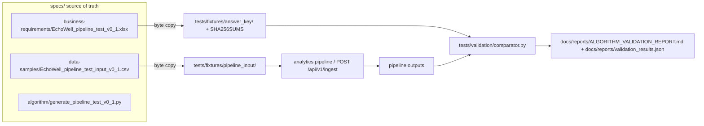
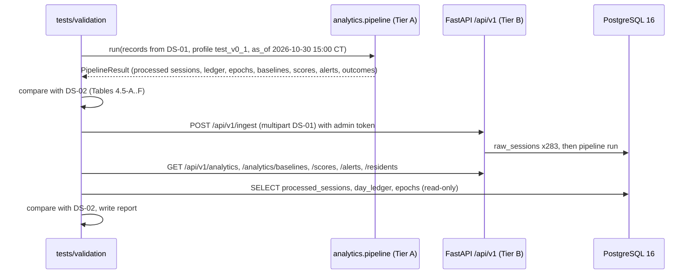
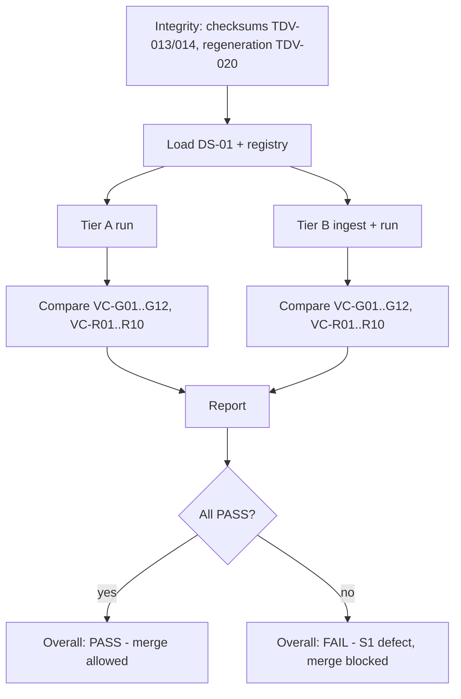

# 14 Test Data and Validation Spec

Document ID: ECHOWELL-TRD-14 · Version 0.1 (draft for review) · Date: 18 October 2026 · Owner: Team 2 · Status: Draft

## 1. Purpose

This document specifies the datasets EchoWell is tested with and exactly how the pipeline is validated against
the pipeline test workbook v0.1 (SRC-03). It defines the dataset catalogue, the answer-key separation rule, how to
regenerate the golden files, the comparison method and tolerances, the mapping of every workbook column to a system
output, the global checks, the R01–R10 validation matrix with the expected values extracted from the workbook, the
UI fixture, the format of `ALGORITHM_VALIDATION_REPORT.md`, and the informational false-alarm robustness check.

Passing this validation is business requirement BR-15 ("Reproduce the pipeline test workbook answer key exactly
(R01–R10)") and the first half of demo tracker step 4 (SRC-15).

## 2. Scope

In scope:
- Datasets DS-01 to DS-09 (§4.1), their storage, provenance and permitted use.
- The validation harness in `tests/validation/` (two tiers), its comparator and report.
- Expected values for the `test_v0_1` profile (SRC-03, SRC-04, SRC-05).
- The UI fixture used by frontend page tests and E2E tests (as of 2026-10-30 15:00 America/Chicago), including the Alert review and Analytics pages.
- The evaluation ground truth (`evaluation_ground_truth`) used only by the Analytics alarm-timing panel, and the rule that the pipeline never reads it.

Out of scope:
- Test levels, tooling, CI gating and coverage (TRD 13).
- Detection-performance acceptance thresholds (OQ-13); detection metrics are informational only (§4.11, §4.12).
- Generating Team 1's 50-resident dataset (Team 1 owns the generator, SRC-13).

## 3. References

| ID | Document | Use in this TRD |
|---|---|---|
| SRC-03 | Pipeline test workbook v0.1 `specs/business-requirements/EchoWell_pipeline_test_v0_1.xlsx` | Answer key (README, Parameters, Test_plan, Data_dictionary, Annotated_sessions, Exp_status_counts, Exp_resident_outcomes, Exp_baselines, Exp_morning_offset, Exp_scores) |
| SRC-04 | Generator `specs/algorithm/generate_pipeline_test_v0_1.py` | Reference rules; regeneration (seed 20261004) |
| SRC-05 | Input CSV `specs/data-samples/EchoWell_pipeline_test_input_v0_1.csv` | The only pipeline input for validation (283 arrivals) |
| SRC-06 | Legacy mock `specs/data-samples/echowell_mock_data_500.csv` | Old schema; negative ingest fixture only |
| SRC-09, SRC-10 | Wireframes Main, Resident | UI fixture reference numbers |
| SRC-18, SRC-19 | Wireframes Alert review (`specs/UI-wireframe/Alerts.dc.html`), Analytics (`specs/UI-wireframe/Analytics.dc.html`) | Alert-review and analytics fixture numbers |
| SRC-13 | Synthetic dataset specification for Team 1, E4C-TEAM2-SYNDATA v0.1 | Future 50-resident, 120-day dataset (§4.12) |
| SRC-15 | Meeting agenda 17 Oct 2026 | Demo step 4; DAIC-WOZ/E-DAIC access agreements |
| SRC-17 | Implement_Feature_Batches.md Phase 12 | "Validate R01–R10", ALGORITHM_VALIDATION_REPORT.md |

Related TRDs: 07 (Analytics Engine), 08 (Baseline and Scoring), 09 (CUSUM and Alerting), 10 (Ingestion and Validation),
05/19 (API), 06/20 (Database), 11 (UI/UX), 13 (Testing Strategy), 16 (CI/CD), 21 (Environment Configuration), 24 (Risks/OQ).

## 4. Requirements

### 4.1 Dataset catalogue

| DS ID | Dataset | Source / location | Size | Permitted use | Gating |
|---|---|---|---|---|---|
| DS-01 | Pipeline test input v0.1 | SRC-05; fixture copy `tests/fixtures/pipeline_input/EchoWell_pipeline_test_input_v0_1.csv` | 283 arrivals (281 unique session_ids + 2 duplicates), 10 residents, 30 local days 2026-10-01..2026-10-30, 30 columns | Validation input (Tier A and B), UI fixture, E2E, integration tests | Yes |
| DS-02 | Answer key workbook v0.1 | SRC-03; fixture copy `tests/fixtures/answer_key/EchoWell_pipeline_test_v0_1.xlsx` | 10 sheets; Annotated_sessions 302 rows, Exp_status_counts 10, Exp_resident_outcomes 11, Exp_baselines 180, Exp_morning_offset 19, Exp_scores 98 | Read only by `tests/validation/` | Yes |
| DS-03 | Generator script v0.1 | SRC-04 `specs/algorithm/generate_pipeline_test_v0_1.py`, default seed 20261004 | 495 lines | Regenerating DS-01 and DS-02; multi-seed robustness (§4.11) | Integrity test yes; robustness no |
| DS-04 | Team 1 synthetic dataset (future) | Team 1, per SRC-13 §5–6 | 50 residents, ≥ 120 days each, separate answer key file | Detection evaluation, morning-offset estimation (OQ-09), alarm calibration (OQ-13) | No (informational until OQ-13 closes) |
| DS-05 | Legacy mock data | SRC-06; fixture copy `tests/fixtures/legacy/echowell_mock_data_500.csv` | 500 rows, OLD schema (`entry_id, resident_id (int), datetime, health_wifi, health_ping, health_mic_noise, device_id, speech_len, speech_feature_1..3`) | Negative ingest test only (TST-047) | Yes (as negative test) |
| DS-06 | DAIC-WOZ / E-DAIC public corpora | External, under each corpus's access agreement | n/a | Development and pipeline exercise only, offline | Never |
| DS-07 | UI fixture | DS-01 ingested with profile `test_v0_1` plus registry `tests/fixtures/seeds/pipeline_test_v0_1_registry.json`, clock 2026-10-30 15:00 America/Chicago | as DS-01 | Frontend page tests, E2E, wireframe checks | Yes |
| DS-08 | Performance load dataset | Generated by `tests/performance/make_load_dataset.py --seed 20261004` | 100 residents × 120 days = 12,000 resident-days, 10 % dropped → 10,800 records | Performance tests only (TST-121..TST-123); no correctness claims | PR subset yes |
| DS-09 | Demo device record | One feature record produced by Team 1's device from a team-member speaker registered under a demo study ID (SRC-15 step 3); no real resident data on the interim stack (D-OWNER-4) | 1+ records | Demo step 4 second half (TRD 13 TST-180) | Demo only |
| DS-10 | Evaluation ground truth v0.1 | `tests/fixtures/answer_key/evaluation_ground_truth_v0_1.csv`, derived from SRC-03 Test_plan (and SRC-04 inserted changes); columns `resident_code, planted_change, true_onset_date, source_file` | 10 rows | Loaded into table `evaluation_ground_truth` only under profile `test_v0_1`, for the Analytics alarm-timing panel; never a pipeline input | Yes (TDV-100..TDV-104) |

| ID | Requirement | Priority | Trace | Verification |
|---|---|---|---|---|
| TDV-001 | DS-01 shall be the only input to the validation pipeline run; the harness shall not pass any other file, column or parameter derived from DS-02 to the pipeline. | Must | SRC-03 README "Files", BR-15 | Test |
| TDV-002 | DS-01 shall be ingested exactly as stored (byte-identical file), in file order, which is the arrival order (`arrival_order` 1..283). | Must | SRC-05, BR-02 | Test |
| TDV-003 | Validation shall run with config profile `test_v0_1` whose values equal the SRC-03 Parameters sheet and contract §7 (Table 4.5-E). | Must | SRC-03 Parameters, ASM-04 | Test (VC-G08) |
| TDV-004 | DS-04 shall be accepted for evaluation only with its answer key delivered as a separate file (not a column of the main dataset), stored under `tests/fixtures/answer_key/team1_v1/`. | Must | SRC-13 §5 | Inspection |
| TDV-005 | DS-05 shall not be used for validation, development fixtures or seeding; it shall be used only to prove that `POST /api/v1/ingest` rejects an old-schema file with 422 (schema mismatch) and stores nothing (contract R12). No mapping from `speech_feature_1..3` to v0.1 features shall be implemented. | Must | SRC-06, contract §1 | Test |
| TDV-006 | DS-06 (DAIC-WOZ, E-DAIC) shall be used only for development and pipeline exercise, never as study ground truth, never committed to the repository, never loaded into staging or production databases, and never used in CI. Their audio shall never be sent to any EchoWell cloud component; only features extracted offline by the developer may be used, on a local machine, under a signed access agreement. | Must | contract §2, SRC-15 item 3, BR-16 | Inspection |
| TDV-007 | Test fixture data (DS-01, DS-07, DS-08) and real records (DS-09) shall never be stored in the same database. | Must | BR-16 | Inspection |
| TDV-008 | DS-08 shall be generated deterministically from seed 20261004, with resident codes `L001`..`L100`, devices `LD001`..`LD100`, start date 2026-06-01, one record per resident-day in 14:00–15:00 local, 10 % of resident-days dropped, 5 % with `mic_noise_level_dbfs` −32.0, feature values drawn as in SRC-04 `make_values`; it shall not be committed (generated at test time). | Should | TRD 13 §4.12, ASM-08 | Test |

### 4.2 Fixture storage and answer-key separation



| ID | Requirement | Priority | Trace | Verification |
|---|---|---|---|---|
| TDV-010 | The answer key (DS-02 and any future answer key) shall never be placed in a pipeline input folder; it shall live only in `specs/business-requirements/` and `tests/fixtures/answer_key/`. A test shall fail if any `.xlsx` file or any file name containing `answer_key` or `Exp_` exists under `tests/fixtures/pipeline_input/`. | Must | SRC-03 README, SRC-13 §5 | Test |
| TDV-011 | Only code under `tests/` shall read `tests/fixtures/answer_key/`. A test shall scan `analytics/`, `backend/`, `frontend/app`, `frontend/components`, `frontend/lib`, `frontend/services` and `database/` and fail on any occurrence of `answer_key`, `Exp_`, `EchoWell_pipeline_test_v0_1.xlsx` or `openpyxl`. The ground-truth loader (`backend/cli` command `load-ground-truth`) reads only the DS-10 CSV path given on its command line. | Must | SRC-03 README, contract §3 (openpyxl tests only) | Test |
| TDV-012 | `tests/fixtures/pipeline_input/` shall contain only `EchoWell_pipeline_test_input_v0_1.csv`; DS-10 shall live in `tests/fixtures/answer_key/`. | Must | SRC-03 README | Test |
| TDV-013 | `tests/fixtures/answer_key/SHA256SUMS` shall list the SHA-256 of the fixture workbook and the fixture CSV; at baseline v0.1 these are `ddbc03ea6fef37388d2f0265902096cc0fe28559d36cb2855f63ec51ec482257` (workbook) and `78e77faad423f305dfb83429ccd21978f089e843c181b5d244a5d7d4f5fabe28` (CSV). | Must | BR-15 | Test |
| TDV-014 | The fixture copies shall be byte-identical to the `specs/` files (TRD 13 TST-071). | Must | BR-15 | Test |
| TDV-015 | The harness shall open the workbook read-only (`openpyxl` `read_only=True` via pandas) and never write to it. | Must | BR-15 | Inspection |
| TDV-016 | The UI fixture (DS-07) and frontend MSW fixtures shall be produced from pipeline output (API responses), never from workbook values. Frontend MSW JSON shall be recorded by `python -m tests.validation.record_ui_fixtures` from the DS-07 API into `frontend/tests/fixtures/ds07/` and committed; a test shall re-record and diff them. | Must | BR-15, SRC-17 Phase 13 ("Real data only") | Test |

### 4.3 Regenerating the golden files

The generator writes both the input CSV and the workbook into one output directory, so regeneration always happens
in a scratch directory and the two files are then copied to their separate homes.

Procedure (Python 3.12 with numpy 2.x, pandas 2.2.x, openpyxl 3.1.x):

```bash
mkdir -p /tmp/ew_regen
python specs/algorithm/generate_pipeline_test_v0_1.py /tmp/ew_regen            # seed 20261004 (default)
python specs/algorithm/generate_pipeline_test_v0_1.py /tmp/ew_regen 20261004   # same, explicit
# outputs: /tmp/ew_regen/EchoWell_pipeline_test_input_v0_1.csv and /tmp/ew_regen/EchoWell_pipeline_test_v0_1.xlsx
cp /tmp/ew_regen/EchoWell_pipeline_test_input_v0_1.csv specs/data-samples/
cp /tmp/ew_regen/EchoWell_pipeline_test_v0_1.xlsx      specs/business-requirements/
cp specs/data-samples/EchoWell_pipeline_test_input_v0_1.csv        tests/fixtures/pipeline_input/
cp specs/business-requirements/EchoWell_pipeline_test_v0_1.xlsx    tests/fixtures/answer_key/
(cd tests/fixtures && sha256sum answer_key/EchoWell_pipeline_test_v0_1.xlsx pipeline_input/EchoWell_pipeline_test_input_v0_1.csv > answer_key/SHA256SUMS)
```

Argument rules (from SRC-04): argv[1] is the output directory (default "."), which must already exist; argv[2] is the
seed (default 20261004). The script prints "Wrote input CSV and workbook to <outdir>".

| ID | Requirement | Priority | Trace | Verification |
|---|---|---|---|---|
| TDV-020 | `test_answer_key_integrity.py` shall run the generator with seed 20261004 into a temporary directory and assert (a) the regenerated CSV is byte-identical to DS-01 and (b) every sheet of the regenerated workbook equals the corresponding DS-02 sheet cell by cell (strings exact, floats within 1e-12). Byte equality of the `.xlsx` is not required (the zip container embeds a timestamp). | Must | SRC-04, BR-15 | Test |
| TDV-021 | Golden files shall only change through the procedure above in a PR labelled `answer-key-change` (TRD 13 TST-072, TST-073). | Must | SRC-03 README "Change one and the answers change; rerun the script" | Inspection |
| TDV-022 | A change to the `test_v0_1` profile values in `config_parameters` without a matching regeneration shall fail VC-G08. | Must | BR-15 | Test |
| TDV-023 | `python -m tests.validation.diff_answer_key <old.xlsx> <new.xlsx>` shall print, per sheet, row count before/after and every changed cell as `sheet!key.column: old -> new`. | Should | TRD 13 TST-073 | Test |
| TDV-024 | The generator script shall not be imported by any test (it executes on import); it shall be run as a subprocess with `python -I`. | Must | SRC-04 | Inspection |

### 4.4 Validation harness and comparison method



| ID | Requirement | Priority | Trace | Verification |
|---|---|---|---|---|
| TDV-030 | Tier A shall run `analytics.pipeline` in-process on the DS-01 records with profile `test_v0_1`, facility timezone America/Chicago, enrollment start 2026-10-01 for R01–R10 and as-of 2026-10-30 15:00 America/Chicago, with the device assignments of §4.9, and compare its result with DS-02. | Must | BR-15 | Test |
| TDV-031 | Tier B shall start from an empty migrated PostgreSQL 16 database, load the registry of §4.9, upload DS-01 through `POST /api/v1/ingest` (multipart CSV, admin token), wait for the batch's pipeline run to finish, then call `POST /api/v1/pipeline/run` with `{"scope": "all", "profile": "test_v0_1", "as_of": "2026-10-30T15:00:00-05:00"}`, wait until that run is `succeeded` (timeout 60 s), and compare API responses and database rows with DS-02. The explicit as-of run is required because ingest-triggered runs use the request time as as-of and exclude records after it (TRD 07 ANL-015, ANL-043). | Must | BR-15, BR-01 | Test |
| TDV-032 | Floating-point values (median, MAD, robust_spread, z, composite_raw, composite_z, cusum_tally, adjusted and raw feature values) shall be computed in float64 and compared with absolute tolerance 1e-6: pass iff `abs(actual − expected) ≤ 1e-6`. NaN or missing actual where a number is expected fails. | Must | contract §7 | Test |
| TDV-033 | Strings (statuses, reasons, session_ids, device_ids, alarm labels, feature keys after mapping) shall compare exactly (case-sensitive, no trimming other than the workbook-blank rule in TDV-035). | Must | contract §7 | Test |
| TDV-034 | Integers and counts (epoch, n_sessions, usable_in_epoch, scored_sessions, status counts, row counts) and booleans (morning, floor_applied, baseline_formed) shall compare exactly. | Must | contract §7 | Test |
| TDV-035 | A blank workbook cell (read as NaN) shall equal a system `null` or empty string; the workbook string `"none"` in `first_alarm_session` shall equal a system `null` (no alarm). | Must | SRC-03 Exp_resident_outcomes | Test |
| TDV-036 | Row matching shall use natural keys, never row order: Annotated_sessions by (resident_id, day, arrival_order); Exp_status_counts by resident_id; Exp_resident_outcomes by (resident_id, epoch); Exp_baselines by (resident_id, epoch, feature); Exp_morning_offset by feature; Exp_scores by session_id. Missing or extra rows on either side fail. | Must | BR-15 | Test |
| TDV-037 | Every mismatch shall be recorded with sheet, key, column, expected, actual and absolute difference, and assigned to the pipeline stage of Table 4.5-G; the harness shall continue after a mismatch so that all mismatches are reported in one run. | Must | SRC-17 Phase 12 "Root Cause Analysis" | Test |
| TDV-038 | The harness shall use the workbook's full stored precision (float64 as read), not the 3–4 decimal display formats in the workbook. | Must | SRC-04 (number formats are display only) | Test |

### 4.5 Mapping of workbook columns to system outputs

Feature-key mapping: workbook feature names equal system `feature_key`s (placeholder names, OQ-03), except
`"COMPOSITE (raw signed mean of 7 z)"` → `composite`. If the configurable feature-name mapping renames input columns,
the comparator applies the same mapping.

Alarm mapping: `off` → `off`; `RINGS (first crossing)` → `rings`; `on` → `on` (`scores.alarm_state`).

Table 4.5-A Annotated_sessions (302 rows: 281 first arrivals + 2 duplicate copies + 19 missing resident-days).

| Workbook column | System output (Tier B DB / API) | Tier A field | Compare |
|---|---|---|---|
| resident_id | `residents.resident_code` | resident_id | exact |
| test_case, error_mode_tested | not compared (descriptive) | — | — |
| day | `local_date − 2026-10-01 + 1` (processed_sessions.local_date or day_ledger.local_date) | local_date | exact |
| local_time | records: `processed_sessions.local_date` + `local_time` formatted `YYYY-MM-DD HH:MM` (truncated, not rounded); missing rows: `day_ledger.local_date` formatted `YYYY-MM-DD` | local timestamp | exact |
| arrival_order | records: rank of `raw_sessions.arrival_seq` within the validation load (1..283); missing rows: "no record" ↔ no raw_sessions row | arrival index | exact |
| expected_status | records: `processed_sessions.status`; missing rows: `day_ledger.status` | status | exact |
| expected_reason | records: `processed_sessions.reason_text`; missing rows: `day_ledger.reason` | reason | exact (blank ↔ null/"") |
| expected_morning | `processed_sessions.is_morning` ("yes"/"no"; blank for missing rows) | is_morning | exact |
| expected_epoch | `epochs.epoch_number` via `processed_sessions.epoch_id` (blank ↔ null for duplicates and missing rows) | epoch | exact |
| in_baseline | `baseline_candidate` := status `usable` AND `processed_sessions.baseline_ordinal ≤ baseline_n` | same derivation | exact |
| schema_version … mfcc4 (record columns) | `raw_sessions` typed columns and `payload` | input record | strings exact; floats 1e-6 |

Note on `in_baseline`: SRC-04 sets it to "yes" for the first 16 usable sessions of an epoch even when the epoch never
reaches 16 (R07 epoch 1 days 1–12; R08 13 sessions). The comparison therefore uses `baseline_candidate`, which is the
same rule as `processed_sessions.in_baseline` in TRD 08 (BSC-026: `baseline_ordinal ≤ N`); the comparator checks both
`baseline_candidate` and the stored `in_baseline` against the workbook for all 302 rows. For epochs without a formed
baseline no `baselines` rows shall exist.

Table 4.5-B Exp_status_counts (10 rows) → `GET /api/v1/analytics` per-resident status counts; Tier B also recomputes
from `processed_sessions` (usable, set_aside, quarantined, duplicate) and `day_ledger` (missing_resident,
missing_device_gap). Columns: resident_id, duplicate, missing_device_gap, missing_resident, quarantined, set_aside, usable — all exact.

Table 4.5-C Exp_resident_outcomes (11 rows; R07 has 2) → `GET /api/v1/analytics` per-resident outcome table.

| Workbook column | System field | Compare |
|---|---|---|
| resident_id, epoch, device_id | resident_code, epoch_number, device_code of the epoch | exact |
| usable_in_epoch | count of usable sessions in the epoch | exact |
| baseline_formed | "yes"/"no" ↔ boolean | exact |
| baseline_frozen_after | session_id of the 16th usable session (`baselines.frozen_after_session_id`) | exact; when baseline_formed = no, no baselines rows, no scores rows, no alerts shall exist for the epoch |
| scored_sessions | count of `scores` rows in the epoch | exact (only when formed) |
| first_alarm_session | session_id of the epoch's alert (`alerts.session_id`) | exact; "none" ↔ null |
| note | outcome `note`: "Too few usable sessions: baseline pending, nothing scored" when not formed, empty otherwise | exact |

Table 4.5-D Exp_baselines (180 rows = 9 formed resident-epochs × (19 features + composite)) → `GET /api/v1/analytics/baselines` and `baselines` table.

| Workbook column | System field | Compare |
|---|---|---|
| resident_id, epoch, device_id | resident_code, epoch_number, device_code | exact |
| feature | feature_key (composite mapping above) | exact |
| n_sessions | n_sessions | exact (16) |
| first_session | session_id of `first_session_id` | exact |
| baseline_frozen_after | session_id of `frozen_after_session_id` | exact |
| median, mad, robust_spread | median, mad, robust_spread | 1e-6 |
| floor_applied | floor_applied ("yes"/"no" ↔ boolean) | exact |

Table 4.5-E Parameters sheet and Exp_morning_offset → config profile `test_v0_1` (`config_parameters`, and the
`config_snapshot` of the validation `pipeline_runs` row).

| Workbook item | Config key | Expected value |
|---|---|---|
| facility_tz | facility_tz | America/Chicago |
| morning rule | morning_cutoff_hour | 12 |
| noise limit | noise_limit_dbfs | −40.0 |
| minimum speech duration | min_speech_s | 1.0 |
| baseline length (test only) | baseline_n | 16 |
| baseline spread | mad_scale | 1.4826 |
| spread floor, number_of_pauses | pause_floor | 0.5 |
| composite z floor | composite_floor | 0.1 |
| speaker screen reference / rule | screen_min_n, screen_f0_z, screen_other_z, screen_other_count | 5, 4.0, 3.0, 2 |
| CUSUM | cusum_k | 0.5 |
| alarm | cusum_h | 5.0 |
| missing_device_gap | shared_device_min_residents | 2 |
| Exp_morning_offset (19 rows) | morning_offsets | loudness_dbfs −1.50; total_phrase_duration_s 0.10; speech_rate_syl_per_s −0.12; articulation_rate_syl_per_s −0.10; number_of_pauses 0.00; pause_fraction 0.01; voiced_fraction −0.02; the 12 other features 0.00 (compare 1e-6) |

Table 4.5-F Exp_scores (98 rows) → `GET /api/v1/scores?resident_code=<R>` and `scores` table.

| Workbook column | System field | Compare |
|---|---|---|
| session_id | processed session's session_id | exact |
| resident_id, epoch | resident_code, epoch_number | exact |
| local_date | local_date (`YYYY-MM-DD`) | exact |
| morning | is_morning | exact |
| z_loudness_dbfs … z_voiced_fraction (7) | `scores.z` keys `z_<feature>`: UNSIGNED z = (adjusted − median)/robust_spread | 1e-6 |
| composite_raw | composite_raw (mean of the 7 signed z) | 1e-6 |
| composite_z | composite_z | 1e-6 |
| cusum_tally | cusum_tally | 1e-6 |
| alarm | alarm_state (mapping above) | exact |

Table 4.5-G Stage attribution of mismatches (for the report's "first failing stage").

| Stage (SRC-02 order) | Checks attributed |
|---|---|
| 1 Duplicate detection / ingest | raw row count, arrival ranks, status `duplicate` |
| 2 Quality gate | status `set_aside`, set-aside reasons |
| 3 Epoch detection | expected_epoch, Exp_resident_outcomes epoch rows, epochs table |
| 4 Speaker screen | status `quarantined`, quarantine reasons |
| 5 Context adjustment | expected_morning, Exp_scores.morning, Exp_morning_offset, R06 adjusted values |
| 6 Personal baseline | in_baseline, Exp_baselines, baseline_formed, frozen_after |
| 7 Daily deviation score | z_*, composite_raw, composite_z, scored_sessions |
| 8 CUSUM | cusum_tally, alarm |
| 9 Alert generation | alerts rows, first_alarm_session |
| 10 Day ledger | missing_resident, missing_device_gap, reasons |

| ID | Requirement | Priority | Trace | Verification |
|---|---|---|---|---|
| TDV-040 | The comparator shall implement Tables 4.5-A to 4.5-F as declarative mapping tables in `tests/validation/comparator.py`; an API field rename in TRD 19 shall require changing only that mapping. | Must | BR-15 | Inspection |
| TDV-041 | `scores.z` shall be compared as unsigned z; signed z is not a workbook column. | Must | SRC-04 (row["z_"+n] = zr[n]) | Test |
| TDV-042 | The composite baseline row shall be matched by `feature_key = 'composite'` ↔ workbook `"COMPOSITE (raw signed mean of 7 z)"`. | Must | SRC-03 Exp_baselines | Test |

### 4.6 Global checks

| VC ID | Check | Expected (from DS-02) | Sheet / source |
|---|---|---|---|
| VC-G01 | Status totals over all 302 Annotated_sessions rows | usable 267, set_aside 12, quarantined 2, duplicate 2, missing_resident 17, missing_device_gap 2 (sum 302 = 300 resident-days + 2 duplicate copies) | Annotated_sessions.expected_status |
| VC-G02 | Row-by-row Annotated_sessions comparison | all 302 rows match Table 4.5-A | Annotated_sessions |
| VC-G03 | Per-resident status counts | 10 rows of §4.7 | Exp_status_counts |
| VC-G04 | Resident outcomes | 11 rows (R07 epochs 1 and 2) | Exp_resident_outcomes |
| VC-G05 | Baselines | exactly 180 rows: 9 resident-epochs (R01–R06, R07 epoch 2, R09, R10) × 20; floor_applied "yes" on exactly 8 rows, all `number_of_pauses` (R01, R02, R03, R04, R05, R06, R07 epoch 2, R10; median 1.0 or 2.0, MAD 0.0, spread 0.5); R09 `number_of_pauses` not floored (MAD 0.5, spread 0.7413); no `baselines` rows for R07 epoch 1 or R08 | Exp_baselines |
| VC-G06 | Scores | exactly 98 rows: R01 14, R02 8, R03 6, R04 14, R05 12, R06 14, R07 2, R08 0, R09 14, R10 14; alarm values: off 81, on 15, RINGS 2 | Exp_scores |
| VC-G07 | Morning offsets | 19 values of Table 4.5-E | Exp_morning_offset |
| VC-G08 | Parameters | config snapshot of the run equals Table 4.5-E | Parameters |
| VC-G09 | Day ledger | 300 rows (10 residents × 30 days, 2026-10-01..2026-10-30): checked_in 281, missing_resident 17, missing_device_gap 2; no ledger row carries feature values (never imputed) | Annotated_sessions missing rows; generator rules |
| VC-G10 | Alerts | exactly 2 alerts, both status `open`: R09 epoch 1, session R09-20261021-01, triggered_at 2026-10-21 19:07:50 UTC, local_date 2026-10-21, cusum_value 5.431965 (±1e-6); R10 epoch 1, session R10-20261024-01, triggered_at 2026-10-24 19:25:37 UTC, local_date 2026-10-24, cusum_value 5.972050 (±1e-6). `cusum_state`: R09 current_tally 26.830256, R10 13.418183, alarm_on true for both; all other formed epochs alarm_on false | Exp_scores, Exp_resident_outcomes |
| VC-G11 | Raw store fidelity (Tier B) | 283 `raw_sessions` rows; each `payload` equals its DS-01 row (all 30 fields, values as received); 0 `ingest_rejections`; batch response accepted 283, rejected 0, duplicates 2 | DS-01 |
| VC-G12 | Determinism and rebuild | two Tier A runs give identical serialized results; in Tier B a full rebuild (`POST /api/v1/pipeline/run` scope all, profile test_v0_1) leaves every compared value unchanged | SRC-02, contract §7 |

| ID | Requirement | Priority | Trace | Verification |
|---|---|---|---|---|
| TDV-050 | VC-G01 to VC-G12 shall be implemented in `tests/validation/test_global_checks.py` and shall pass in both tiers (VC-G11 Tier B only). | Must | BR-15, BR-02 | Test |

### 4.7 R01–R10 validation matrix

Each case is one file `tests/validation/test_rNN_<name>.py`. A case passes only if every listed check passes in Tier
A and Tier B. Days are local days of October 2026 (day 1 = 2026-10-01). Session IDs follow `<R>-<YYYYMMDD>-01`.
Numeric values below are shown rounded to 6 decimals for reading; the comparison uses the workbook's full precision
(TDV-038).

Table 4.7-A Summary of expected results (Exp_status_counts and Exp_resident_outcomes).

| VC ID | Res | Case | usable | set_aside | quarantined | duplicate | missing_resident | missing_device_gap | Epoch(s) | Baseline frozen after | Scored | First alarm |
|---|---|---|---|---|---|---|---|---|---|---|---|---|
| VC-R01 | R01 | Clean control | 30 | 0 | 0 | 0 | 0 | 0 | 1 (D01) | R01-20261016-01 | 14 | none |
| VC-R02 | R02 | Missing days | 24 | 0 | 0 | 0 | 5 | 1 | 1 (D02) | R02-20261021-01 | 8 | none |
| VC-R03 | R03 | Set-aside sessions | 22 | 7 | 0 | 0 | 0 | 1 | 1 (D02) | R03-20261023-01 | 6 | none |
| VC-R04 | R04 | Duplicate records | 30 | 0 | 0 | 2 | 0 | 0 | 1 (D04) | R04-20261016-01 | 14 | none |
| VC-R05 | R05 | Possible other speaker | 28 | 0 | 2 | 0 | 0 | 0 | 1 (D05) | R05-20261017-01 | 12 | none |
| VC-R06 | R06 | Morning effect | 30 | 0 | 0 | 0 | 0 | 0 | 1 (D06) | R06-20261016-01 | 14 | none |
| VC-R07 | R07 | Device move | 30 | 0 | 0 | 0 | 0 | 0 | 1 (D07, 12 usable, not formed); 2 (D07B, 18 usable) | epoch 2: R07-20261028-01 | epoch 2: 2 | none |
| VC-R08 | R08 | Too few sessions | 13 | 5 | 0 | 0 | 12 | 0 | 1 (D08, not formed) | — (baseline pending) | 0 (no scores rows) | none |
| VC-R09 | R09 | Step change | 30 | 0 | 0 | 0 | 0 | 0 | 1 (D09) | R09-20261016-01 | 14 | R09-20261021-01 |
| VC-R10 | R10 | Gradual drift | 30 | 0 | 0 | 0 | 0 | 0 | 1 (D10) | R10-20261016-01 | 14 | R10-20261024-01 |

Table 4.7-B Expected baselines per formed resident-epoch (Exp_baselines; three of 20 rows shown per epoch; all 20 are compared).

| Resident | Epoch | Device | n | first_session | frozen_after | loudness_dbfs median / MAD / spread | number_of_pauses median / MAD / spread (floor_applied) | composite median / MAD / spread |
|---|---|---|---|---|---|---|---|---|
| R01 | 1 | D01 | 16 | R01-20261001-01 | R01-20261016-01 | −29.925000 / 2.165000 / 3.209829 | 1.0 / 0.0 / 0.5000 (yes) | 0.028903 / 0.502091 / 0.744399 |
| R02 | 1 | D02 | 16 | R02-20261001-01 | R02-20261021-01 | −21.680000 / 2.310000 / 3.424806 | 1.0 / 0.0 / 0.5000 (yes) | −0.048600 / 0.485046 / 0.719129 |
| R03 | 1 | D02 | 16 | R03-20261001-01 | R03-20261023-01 | −19.455000 / 1.480000 / 2.194248 | 1.0 / 0.0 / 0.5000 (yes) | 0.136523 / 0.300351 / 0.445300 |
| R04 | 1 | D04 | 16 | R04-20261001-01 | R04-20261016-01 | −30.260000 / 2.515000 / 3.728739 | 2.0 / 0.0 / 0.5000 (yes) | −0.203264 / 0.454754 / 0.674218 |
| R05 | 1 | D05 | 16 | R05-20261001-01 | R05-20261017-01 | −29.890000 / 1.370000 / 2.031162 | 1.0 / 0.0 / 0.5000 (yes) | 0.023350 / 0.548623 / 0.813389 |
| R06 | 1 | D06 | 16 | R06-20261001-01 | R06-20261016-01 | −22.420000 / 1.335000 / 1.979271 | 2.0 / 0.0 / 0.5000 (yes) | 0.104254 / 0.412002 / 0.610834 |
| R07 | 2 | D07B | 16 | R07-20261013-01 | R07-20261028-01 | −18.485000 / 1.640000 / 2.431464 | 1.0 / 0.0 / 0.5000 (yes) | −0.055460 / 0.673013 / 0.997808 |
| R09 | 1 | D09 | 16 | R09-20261001-01 | R09-20261016-01 | −22.405000 / 1.450000 / 2.149770 | 1.0 / 0.5 / 0.7413 (no) | 0.038219 / 0.359758 / 0.533378 |
| R10 | 1 | D10 | 16 | R10-20261001-01 | R10-20261016-01 | −25.615000 / 1.985000 / 2.942961 | 1.0 / 0.0 / 0.5000 (yes) | 0.036981 / 0.774490 / 1.148259 |

Table 4.7-C Expected scored sessions per resident-epoch (Exp_scores).

| Resident | First scored | Last scored | Scored | Max cusum_tally | Final cusum_tally (2026-10-30) |
|---|---|---|---|---|---|
| R01 | R01-20261017-01 | R01-20261030-01 | 14 | 0.333077 | 0.333077 |
| R02 | R02-20261022-01 | R02-20261030-01 | 8 | 0.442793 | 0.000000 |
| R03 | R03-20261024-01 | R03-20261030-01 | 6 | 2.202944 | 0.000000 |
| R04 | R04-20261017-01 | R04-20261030-01 | 14 | 0.611018 | 0.000000 |
| R05 | R05-20261018-01 | R05-20261030-01 | 12 | 4.005975 | 2.219853 |
| R06 | R06-20261017-01 | R06-20261030-01 | 14 | 1.177629 | 0.000000 |
| R07 (epoch 2) | R07-20261029-01 | R07-20261030-01 | 2 | 0.000000 | 0.000000 |
| R09 | R09-20261017-01 | R09-20261030-01 | 14 | 26.830256 | 26.830256 |
| R10 | R10-20261017-01 | R10-20261030-01 | 14 | 13.418183 | 13.418183 |

#### 4.7.1 VC-R01 Clean control (R01, F, D01)

- Input characteristics: 30 records, days 1–30, 14:00–15:00 local, no faults.
- Expected: all 30 `usable`, epoch 1, no reasons, not morning. Baseline candidates days 1–16; frozen after R01-20261016-01; scored days 17–30 (14); no alarm; max tally 0.333077; ledger 30 `checked_in`.
- Compare: Annotated_sessions (30 rows), Exp_status_counts R01, Exp_resident_outcomes R01, Exp_baselines R01 (20 rows: medians and MADs, even-count median), Exp_scores R01 (14 rows).

#### 4.7.2 VC-R02 Missing days (R02, M, D02 shared with R03)

- Input characteristics: 24 records; no record on days 4, 9, 10, 12, 17, 23.
- Expected statuses by day: days 4, 9, 10, 17, 23 → `missing_resident`, reason "no record received"; day 12 → `missing_device_gap`, reason "all residents on shared device D02 have no record" (R03 also has no record on 2026-10-12); other 24 days `usable`.
- Baseline candidates: days 1, 2, 3, 5, 6, 7, 8, 11, 13, 14, 15, 16, 18, 19, 20, 21; frozen after R02-20261021-01. Scored days 22, 24, 25, 26, 27, 28, 29, 30 (8); day 23 missing leaves the tally unchanged. No alarm.
- Rule checks: no ledger row or scores row exists for a missing day with values; nothing carried forward (the scored session after day 23 uses its own values only).
- Compare: Annotated_sessions R02 (30 rows incl. 6 missing), Exp_status_counts, Exp_resident_outcomes, Exp_baselines R02, Exp_scores R02.

#### 4.7.3 VC-R03 Set-aside sessions (R03, F, D02 shared with R02)

- Input characteristics: 29 records; 7 faulty; no record on day 12.
- Expected statuses and reasons by day (exact strings):

| Day | session_id | Input fault | Status | Reason |
|---|---|---|---|---|
| 3 | R03-20261003-01 | noise −32.0, flag ok | set_aside | noise above limit |
| 7 | R03-20261007-01 | flag poor, noise −51.4 | set_aside | quality flag poor |
| 10 | R03-20261010-01 | speech 0.62 s | set_aside | speech too short |
| 12 | (no record) | D02 silent for R02 and R03 | missing_device_gap | all residents on shared device D02 have no record |
| 14 | R03-20261014-01 | noise −32.0 | set_aside | noise above limit |
| 18 | R03-20261018-01 | flag poor and noise −30.0 | set_aside | quality flag poor; noise above limit |
| 22 | R03-20261022-01 | flag poor, noise −54.9 | set_aside | quality flag poor |
| 26 | R03-20261026-01 | speech 0.62 s | set_aside | speech too short |

- Set-aside records are epoch 1, not morning, not baseline candidates, never scored. Usable 22. Baseline candidates days 1, 2, 4, 5, 6, 8, 9, 11, 13, 15, 16, 17, 19, 20, 21, 23; frozen after R03-20261023-01. Scored days 24, 25, 27, 28, 29, 30 (6). No alarm (max tally 2.202944).
- Compare: Annotated_sessions R03, Exp_status_counts, Exp_resident_outcomes, Exp_baselines R03, Exp_scores R03.

#### 4.7.4 VC-R04 Duplicate records (R04, M, D04)

- Input characteristics: 32 arrivals for 30 session_ids. R04-20261005-01 arrives at arrival_order 88 and again at 89 (adjacent copy); R04-20261018-01 arrives at 102 and again at 283 (last line of the file).
- Expected: arrivals 89 and 283 → `duplicate`, reason "session_id already received", no epoch, not baseline candidates; first arrivals 88 and 102 kept as `usable`. 30 usable; frozen after R04-20261016-01; 14 scored; no alarm.
- Invariance check VC-R04-INV: run Tier A on DS-01 with arrival_order 89 and 283 removed; every R04 output (statuses of the 30 kept sessions, epochs, baselines, scores, tally, outcome) shall be identical (exact equality) to the full run. Tier B: both duplicate arrivals exist in `raw_sessions` (raw store keeps every accepted arrival) and in `processed_sessions` with status `duplicate`.
- Compare: Annotated_sessions R04 (32 rows), Exp_status_counts, Exp_resident_outcomes, Exp_baselines R04, Exp_scores R04.

#### 4.7.5 VC-R05 Possible other speaker (R05, F, D05)

- Input characteristics: 30 records; days 8 and 22 carry male-range F0 and much faster, shorter speech.
- Expected: day 8 (before freeze, screened against 7 prior usable sessions) → `quarantined`, reason "possible other speaker (F0 z=-8.61; composite features with |z|>=3: 4)"; day 22 (after freeze) → `quarantined`, reason "possible other speaker (F0 z=-7.34; composite features with |z|>=3: 3)". Neither enters the baseline or scores.
- Baseline candidates days 1–7 and 9–17; frozen after R05-20261017-01 (one day later than R01). Scored days 18–21 and 23–30 (12). No alarm (max tally 4.005975).
- Compare: Annotated_sessions R05, Exp_status_counts, Exp_resident_outcomes, Exp_baselines R05, Exp_scores R05.

#### 4.7.6 VC-R06 Morning effect (R06, M, D06)

- Input characteristics: 30 records; days 1, 4, 7, 10, 13, 16, 19, 22, 25, 28 recorded 09:00–10:00 local (14:xx UTC); other days 14:00–15:00 local (19:xx UTC).
- Expected: those 10 sessions `is_morning` = yes (classified from local time, not UTC hour), the other 20 = no. Adjusted value = raw − configured offset (Table 4.5-E) for morning sessions; afternoon sessions unchanged. Example: day 1 (R06-20261001-01) raw loudness −25.42 → adjusted −23.92; phrase duration 4.01 → 3.91; speech rate 4.14 → 4.26; articulation rate 4.52 → 4.62; number_of_pauses 2 → 2; pause_fraction 0.126 → 0.116; voiced_fraction 0.595 → 0.615.
- 6 morning sessions in the baseline (days 1, 4, 7, 10, 13, 16) and 4 morning scored sessions (R06-20261019-01, R06-20261022-01, R06-20261025-01, R06-20261028-01, `morning` = True in Exp_scores). Frozen after R06-20261016-01; 14 scored; no alarm (max tally 1.177629).
- Sensitivity check VC-R06-MUT (Should): with all morning offsets set to 0, the Exp_baselines R06 comparison shall fail for loudness_dbfs (proves the test detects a missing adjustment). This mutation run is excluded from the PASS/FAIL total.
- Compare: Annotated_sessions R06 (expected_morning), Exp_morning_offset, Exp_baselines R06, Exp_scores R06 (morning, z).

#### 4.7.7 VC-R07 Device move (R07, F, D07 then D07B)

- Input characteristics: 30 records; days 1–12 on D07, days 13–30 on D07B (fw-1.0.0, openSMILE 3.0.2 unchanged); D07B adds loudness +3.0 dB, HNR +1.5 dB, alpha ratio +2.0 dB.
- Expected epochs: epoch 1 = (D07, fw-1.0.0, openSMILE 3.0.2) from R07-20261001-01 (2026-10-01 19:17:43 UTC) to R07-20261012-01; epoch 2 = (D07B, fw-1.0.0, openSMILE 3.0.2) starting at R07-20261013-01 (2026-10-13 19:00:20 UTC). All 30 `usable`.
- Epoch 1: 12 usable, baseline_formed no, note "Too few usable sessions: baseline pending, nothing scored", no baselines/scores/alerts rows. Epoch 2: count restarts at 0; baseline candidates days 13–28; frozen after R07-20261028-01; scored R07-20261029-01 and R07-20261030-01 (both tally 0.000000); no alarm. CUSUM for epoch 2 starts at 0.
- Display (DS-07): "No alarm · baseline restarted Oct 13"; device column "D07B (was D07)".
- Compare: Annotated_sessions R07 (expected_epoch), Exp_resident_outcomes (2 rows), Exp_baselines R07 epoch 2, Exp_scores R07.

#### 4.7.8 VC-R08 Too few sessions (R08, M, D08)

- Input characteristics: 18 records; no record on days 2, 4, 6, 8, 11, 13, 15, 17, 19, 21, 24, 27.
- Expected set-asides: day 5 "noise above limit" (−33.0); day 9 "quality flag poor"; day 20 "noise above limit" (−33.0); day 25 "quality flag poor"; day 29 "speech too short" (0.58 s). The 12 no-record days → `missing_resident`, "no record received". Usable 13 (days 1, 3, 7, 10, 12, 14, 16, 18, 22, 23, 26, 28, 30).
- Expected outcome: baseline_formed no; no baselines, scores or alerts rows; pipeline run status `succeeded` with no error for R08; outcome note "Too few usable sessions: baseline pending, nothing scored"; display status `baseline_forming` "Baseline forming · 13 of 16 sessions".
- Compare: Annotated_sessions R08, Exp_status_counts, Exp_resident_outcomes R08.

#### 4.7.9 VC-R09 Step change (R09, F, D09)

- Input characteristics: 30 records; all seven composite features shifted 1.5 within-person SD toward depression from day 21 (true onset).
- Expected: 30 usable; baseline frozen after R09-20261016-01 (before the change); first alarm at R09-20261021-01 (the onset day) with tally 5.431965; alarm stays `on` through day 30; one alert.

| # | session_id | composite_raw | composite_z | cusum_tally | alarm |
|---|---|---|---|---|---|
| 1 | R09-20261017-01 | 2.035972 | 3.745474 | 3.245474 | off |
| 2 | R09-20261018-01 | −0.034166 | −0.135711 | 2.609763 | off |
| 3 | R09-20261019-01 | −0.141370 | −0.336702 | 1.773061 | off |
| 4 | R09-20261020-01 | 0.235887 | 0.370597 | 1.643658 | off |
| 5 | R09-20261021-01 | 2.325508 | 4.288307 | 5.431965 | RINGS (first crossing) |
| 6 | R09-20261022-01 | 1.652910 | 3.027292 | 7.959257 | on |
| 7 | R09-20261023-01 | 0.481301 | 0.830709 | 8.289966 | on |
| 8 | R09-20261024-01 | 1.598263 | 2.924838 | 10.714804 | on |
| 9 | R09-20261025-01 | 1.225627 | 2.226203 | 12.441007 | on |
| 10 | R09-20261026-01 | 1.814181 | 3.329651 | 15.270658 | on |
| 11 | R09-20261027-01 | 1.070469 | 1.935308 | 16.705966 | on |
| 12 | R09-20261028-01 | 1.401480 | 2.555900 | 18.761866 | on |
| 13 | R09-20261029-01 | 2.633015 | 4.864836 | 23.126702 | on |
| 14 | R09-20261030-01 | 2.280302 | 4.203554 | 26.830256 | on |

- Note: the first scored session (day 17) has composite_z 3.745474 but does not alarm; this confirms a single odd day does not ring (BR-11).
- Compare: Exp_resident_outcomes R09, Exp_baselines R09, Exp_scores R09 (14 rows, all columns), alerts (VC-G10).

#### 4.7.10 VC-R10 Gradual drift (R10, M, D10)

- Input characteristics: 30 records; composite features drift toward depression from day 17 (true onset), shift = 2.0 × (day − 16)/14 SD, reaching 2.0 SD on day 30.
- Expected: 30 usable; baseline frozen after R10-20261016-01 and unchanged by the drift; first alarm R10-20261024-01 (day 24, 7 days after onset) with tally 5.972050; alarm `on` through day 30; one alert.

| # | session_id | composite_raw | composite_z | cusum_tally | alarm |
|---|---|---|---|---|---|
| 1 | R10-20261017-01 | 0.822306 | 0.683927 | 0.183927 | off |
| 2 | R10-20261018-01 | 1.145133 | 0.965072 | 0.648998 | off |
| 3 | R10-20261019-01 | 1.017307 | 0.853750 | 1.002749 | off |
| 4 | R10-20261020-01 | 1.018585 | 0.854863 | 1.357612 | off |
| 5 | R10-20261021-01 | 1.761905 | 1.502208 | 2.359820 | off |
| 6 | R10-20261022-01 | 2.231009 | 1.910743 | 3.770563 | off |
| 7 | R10-20261023-01 | 1.318402 | 1.115968 | 4.386532 | off |
| 8 | R10-20261024-01 | 2.431695 | 2.085518 | 5.972050 | RINGS (first crossing) |
| 9 | R10-20261025-01 | 1.189916 | 1.004072 | 6.476122 | on |
| 10 | R10-20261026-01 | 1.193254 | 1.006980 | 6.983102 | on |
| 11 | R10-20261027-01 | 3.096243 | 2.664262 | 9.147364 | on |
| 12 | R10-20261028-01 | 2.527292 | 2.168771 | 10.816135 | on |
| 13 | R10-20261029-01 | 2.623978 | 2.252973 | 12.569108 | on |
| 14 | R10-20261030-01 | 1.586069 | 1.349075 | 13.418183 | on |

- Frozen-baseline check VC-R10-FRZ: (a) Exp_baselines R10 rows match; (b) Tier A run on DS-01 truncated to R10 records with local date ≤ 2026-10-16 yields R10 baseline rows identical (exact equality) to the full run; (c) Tier B incremental (in-process `TestClient`, clock frozen with `time-machine` at each record's timestamp + 1 minute): after ingesting R10 days 1–16 one record at a time the persisted R10 `baselines` rows (values and `frozen_at`) are recorded, and after ingesting days 17–30 they are unchanged.
- Compare: Exp_resident_outcomes R10, Exp_baselines R10, Exp_scores R10, alerts (VC-G10).

| ID | Requirement | Priority | Trace | Verification |
|---|---|---|---|---|
| TDV-051 | VC-R01 shall pass as specified in §4.7.1. | Must | BR-09, BR-10, BR-15 | Test |
| TDV-052 | VC-R02 shall pass as specified in §4.7.2. | Must | BR-06, BR-15 | Test |
| TDV-053 | VC-R03 shall pass as specified in §4.7.3. | Must | BR-04, BR-06, BR-15 | Test |
| TDV-054 | VC-R04 including VC-R04-INV shall pass as specified in §4.7.4. | Must | BR-02, BR-03, BR-15 | Test |
| TDV-055 | VC-R05 shall pass as specified in §4.7.5. | Must | BR-05, BR-15 | Test |
| TDV-056 | VC-R06 shall pass as specified in §4.7.6; VC-R06-MUT should be run. | Must | BR-07, BR-15 | Test |
| TDV-057 | VC-R07 shall pass as specified in §4.7.7. | Must | BR-08, BR-15 | Test |
| TDV-058 | VC-R08 shall pass as specified in §4.7.8. | Must | BR-09, BR-15 | Test |
| TDV-059 | VC-R09 shall pass as specified in §4.7.9. | Must | BR-11, BR-15 | Test |
| TDV-060 | VC-R10 including VC-R10-FRZ shall pass as specified in §4.7.10. | Must | BR-09, BR-11, BR-15 | Test |

### 4.8 Validation sequence



### 4.9 UI fixture rules (DS-07)

Registry `tests/fixtures/seeds/pipeline_test_v0_1_registry.json` (loaded before ingest; resident and device must be known for ingest to accept a record):

| Resident | Sex | Cohort | enrolled_on | Device assignments |
|---|---|---|---|---|
| R01 | F | longitudinal | 2026-10-01 | D01 from 2026-10-01 |
| R02 | M | longitudinal | 2026-10-01 | D02 from 2026-10-01 (shared) |
| R03 | F | longitudinal | 2026-10-01 | D02 from 2026-10-01 (shared) |
| R04 | M | longitudinal | 2026-10-01 | D04 from 2026-10-01 |
| R05 | F | longitudinal | 2026-10-01 | D05 from 2026-10-01 |
| R06 | M | longitudinal | 2026-10-01 | D06 from 2026-10-01 |
| R07 | F | longitudinal | 2026-10-01 | D07 2026-10-01..2026-10-12; D07B from 2026-10-13 |
| R08 | M | longitudinal | 2026-10-01 | D08 from 2026-10-01 |
| R09 | F | longitudinal | 2026-10-01 | D09 from 2026-10-01 |
| R10 | M | longitudinal | 2026-10-01 | D10 from 2026-10-01 |

Devices: D01, D02, D04, D05, D06, D07, D07B, D08, D09, D10 (there is no D03). Users: one each of admin, clinician,
researcher with test-only passwords from the test environment, never reused in staging or production.

Table 4.9-B Expected Residents overview (as of 2026-10-30 15:00 America/Chicago; "Last 30 days" = local dates 2026-10-01..2026-10-30 inclusive; default sort "Alarms first").

| Order | Resident | Device | Status badge | Last check-in (local) | used · set aside · quarantined · missed |
|---|---|---|---|---|---|
| 1 | R09 | D09 | ▲ Alarm since Oct 21 | Oct 30, 2:28 PM | 30 · 0 · 0 · 0 |
| 2 | R10 | D10 | ▲ Alarm since Oct 24 | Oct 30, 2:39 PM | 30 · 0 · 0 · 0 |
| 3 | R08 | D08 | Baseline forming · 13 of 16 sessions | Oct 30, 2:28 PM | 13 · 5 · 0 · 12 |
| 4 | R07 | D07B (was D07) | No alarm · baseline restarted Oct 13 | Oct 30, 2:52 PM | 30 · 0 · 0 · 0 |
| 5 | R03 | D02 (shared) | No alarm | Oct 30, 2:19 PM | 22 · 7 · 0 · 1 |
| 6 | R02 | D02 (shared) | No alarm | Oct 30, 2:55 PM | 24 · 0 · 0 · 6 |
| 7 | R05 | D05 | No alarm | Oct 30, 2:40 PM | 28 · 0 · 2 · 0 |
| 8 | R01 | D01 | No alarm | Oct 30, 2:07 PM | 30 · 0 · 0 · 0 |
| 9 | R04 | D04 | No alarm | Oct 30, 2:17 PM | 30 · 0 · 0 · 0 |
| 10 | R06 | D06 | No alarm | Oct 30, 2:38 PM | 30 · 0 · 0 · 0 |

Tiles: Alarm on 2 (R09, R10); Being watched, no alarm 7 (R01–R07); Baseline still forming 1 (R08); Missed check-ins,
last 30 days 19 (R02 6 + R03 1 + R08 12). Duplicates (R04: 2) are never shown.

Devices panel: "D02 · shared by R02, R03" with last upload Oct 30, 2:55 PM and "silent all day Oct 12"; "D07B · R07" in
use since Oct 13 (replaced D07), last upload Oct 30, 2:52 PM; D01, D04–D06, D08–D10 all uploaded on Oct 30, firmware fw-1.0.0.

Resident detail R09: header "R09 · Device D09"; "Baseline: first 16 usable check-ins, Oct 1–16 (then frozen) · watched
since Oct 17"; badge "▲ Alarm since Oct 21"; no global nav, "← Back to all residents" (contract R2); chart (contract R1) with a leading grey slot
labelled "Baseline Oct 1–Oct 16" and 14 scored bars (Oct 17–30) with heights equal to the cusum_tally values in §4.7.9,
bars 1–4 (Oct 17–20, alarm_state off) `#BDBDB8` with `#8A8A85` outline and bars 5–14 (Oct 21–30, rings/on) `#9A4508`; check-in log includes "Oct 21 · Alarm on · tally crossed 5.0",
"Oct 17 · Watching started", "Oct 16 · Baseline complete (16 of 16)".

| ID | Requirement | Priority | Trace | Verification |
|---|---|---|---|---|
| TDV-061 | The DS-07 "as of" shall be set without any clock override in the running services: after loading DS-01, an admin call `POST /api/v1/pipeline/run` with `as_of` `2026-10-30T15:00:00-05:00` and profile `test_v0_1` makes every read endpoint use that as-of (TRD 05 API-069; contract R11/R21 precedence: explicit `as_of` → `PIPELINE_AS_OF` env, refused when `APP_ENV=production` → current time); `DATA_SOURCE_LABEL` is "pipeline test data v0.1". In-process tests (Tier A, integration tests using `TestClient`) shall instead freeze the clock with `time-machine` at the needed instant (e.g. each record's timestamp + 1 minute for incremental ingestion). | Must | contract §7 (test as-of), §13 | Test |
| TDV-062 | With DS-07 loaded, `GET /api/v1/residents` (default sort) shall return the rows and order of Table 4.9-B and tiles 2 / 7 / 1 / 19. | Must | BR-12, SRC-09 | Test |
| TDV-063 | The "Alarms first" order shall follow contract §8 and R16 (R09, R10, R08, R07, R03, R02, R05, R01, R04, R06), which places R03 and R02 (8 and 6 non-used events) before R05 (2); the SRC-09 wireframe shows R05 before R03 and R02 and is illustrative only. | Must | contract §8 | Test |
| TDV-064 | "Last 30 days" counts shall cover the as-of local date and the 29 preceding local dates; "missed" = missing_resident + missing_device_gap; duplicates are excluded. | Must | contract §8, BR-06 | Test |
| TDV-065 | Last check-in shall be the local time of the latest non-duplicate record of any status, formatted "Mon D, h:mm AM/PM". | Must | contract §8 | Test |
| TDV-066 | The devices panel and R09 detail values shall match the text above. | Must | BR-12, BR-13, SRC-10 | Test |

#### 4.9.1 Alert review fixture (SRC-18, contract §19)

Table 4.9-C Change alarms (queue 1, ordered by alarm date ascending). Open days = as-of local date − alarm local date;
tally = `cusum_state.current_tally` rounded half-up to 1 decimal.

| Card | Badge (before any review) | Line | Source values |
|---|---|---|---|
| R09 · D09 | Not reviewed | Alarm since Oct 21 · open 9 days · tally 26.8 | alarm local date 2026-10-21 (Exp_scores RINGS row); 2026-10-30 − 2026-10-21 = 9; current tally 26.830256 |
| R10 · D10 | Not reviewed | Alarm since Oct 24 · open 6 days · tally 13.4 | alarm local date 2026-10-24; 2026-10-30 − 2026-10-24 = 6; current tally 13.418183 |

Nav label "Alerts (2)" (open change alarms; data alerts not counted).

Table 4.9-D Data alerts (queue 2) — exactly these 4 open rows, no others.

| Kind | Title | Detail | Derivation from DS-01 (window 2026-10-01..2026-10-30) |
|---|---|---|---|
| baseline_stalled | R08 · baseline stuck at 13 of 16 | 12 missed and 5 set aside in 30 days | R08 baseline_forming; epoch 1 started 2026-10-01, 29 days ≥ 16; usable 13, missing_resident 12, set_aside 5 (Exp_status_counts) |
| possible_other_speaker | R05 · possible other speaker | 2 check-ins quarantined: Oct 8, Oct 22 | R05-20261008-01 and R05-20261022-01 quarantined (Annotated_sessions) |
| high_set_aside | R03 · many check-ins set aside | 7 of 29 received: noise, quality flag, too short | R03 received 29 (30 days − 1 device-gap day), set aside 7; 7/29 = 0.241 ≥ 0.20; reasons include noise (days 3, 14, 18), quality flag (7, 18, 22), too short (10, 26) |
| device_silent | D02 · device silent all day | Oct 12 · affects R02 and R03 | the only day with missing_device_gap (R02 and R03 on 2026-10-12) |

Non-alerts that the fixture must prove: R08 is not listed as high_set_aside although 5/18 = 0.28 (suppressed by
baseline_stalled); D08 has no device_silent alert (R08's 12 missed days are never 2 consecutive); D02 on Oct 9–10 is not
silent (R03 has records; R02's missed days are missing_resident); D07 after 2026-10-12 has no assigned resident; R07 is not
baseline_stalled (its current epoch formed on 2026-10-28).

Review panel for R09: title "R09 · alarm since Oct 21"; link "Open full resident view →"; mini chart "Change tally since
watching began (alarm line 5.0)" with 14 bars Oct 17 → Oct 30 (heights §4.7.9); "Leaning most" = "more pauses, quieter, less
voiced sound" (mean signed z over the 10 scored sessions R09-20261021-01..R09-20261030-01: number_of_pauses 2.158370,
loudness_dbfs 2.132786, voiced_fraction 2.092490; next total_phrase_duration_s 1.952056). For R10 (7 sessions from
R10-20261024-01): "more pauses, slower while talking, fewer syllables per second" (3.428571, 3.418338, 2.195898).
Footer "An alarm is a prompt to check in, not a diagnosis. No audio is stored or played here."

#### 4.9.2 Analytics fixture (SRC-19, contract §19)

Table 4.9-E Analytics page expected values (profile `test_v0_1`, period Oct 1–30, 2026; percentages rounded half-up).

| Element | Expected | Derivation (DS-02) |
|---|---|---|
| Subline | "For the study team · pipeline test data v0.1, Oct 1–30, 2026 · numbers match the pipeline answer key" (last clause only in test_v0_1) | DATA_SOURCE_LABEL, period |
| Tile Check-ins received | 94% · "281 of 300 expected" | non-duplicate records 283 − 2 = 281; expected 10 residents × 30 days = 300; 93.67 % → 94 % |
| Tile Used for scoring | 89% · "267 of 300 expected" | usable 267; 89.0 % |
| Tile Baselines formed | "9 of 10" · "R08 still forming; R07 restarted once" | current-epoch frozen baselines R01–R06, R07 (epoch 2), R09, R10 |
| Tile Alarms raised | 2 · "R09, R10 · both not yet reviewed" | 2 open alerts, 0 reviews |
| Check-ins per day | 30 stacked bars; per day used/set aside/quarantined/missed sums: used 267, set aside 12, quarantined 2, missed 19; day 12 = 8/0/0/2 annotated "Oct 12 · D02 silent"; day 1 = 10/0/0/0; day 30 = 10/0/0/0; duplicates excluded | Annotated_sessions by day |
| Funnel | Expected 300 "10 residents × 30 days" → Received 281 "19 missed · 2 duplicate copies removed" → Passed quality checks 269 "12 set aside: quality flag 5, noise 5, too short 3 (1 had two reasons)" → Same speaker, used 267 "2 quarantined as possible other speaker" | reason occurrences: R03 flag days 7, 18, 22 + R08 days 9, 25 = 5; noise R03 days 3, 14, 18 + R08 days 5, 20 = 5; short R03 days 10, 26 + R08 day 29 = 3; R03 day 18 has two reasons |
| Usable by resident (lowest first) | R08 43% (13/30), R03 73% (22/30), R02 80% (24/30), R05 93% (28/30), R01 100%, R04 100%, R06 100%, R07 100%, R09 100%, R10 100% | Exp_status_counts usable / 30 |
| Alarm timing (test_v0_1 only) | R09 · Sudden step · Oct 21 · Oct 21 · 0 days; R10 · Slow drift · Oct 17 · Oct 24 · 7 days; Other 8 · None · — · No alarm · Correct | DS-10 onset dates vs alerts.local_date (Exp_resident_outcomes first_alarm_session) |
| Footer | "Counts only — no audio, no resident names." | |

Per-day check-ins (used/set aside/quarantined/missed), days 1–30: 1 10/0/0/0; 2 9/0/0/1; 3 9/1/0/0; 4 8/0/0/2; 5 9/1/0/0;
6 9/0/0/1; 7 9/1/0/0; 8 8/0/1/1; 9 8/1/0/1; 10 8/1/0/1; 11 9/0/0/1; 12 8/0/0/2; 13 9/0/0/1; 14 9/1/0/0; 15 9/0/0/1;
16 10/0/0/0; 17 8/0/0/2; 18 9/1/0/0; 19 9/0/0/1; 20 9/1/0/0; 21 9/0/0/1; 22 8/1/1/0; 23 9/0/0/1; 24 9/0/0/1; 25 9/1/0/0;
26 9/1/0/0; 27 9/0/0/1; 28 10/0/0/0; 29 9/1/0/0; 30 10/0/0/0.

| ID | Requirement | Priority | Trace | Verification |
|---|---|---|---|---|
| TDV-067 | With DS-07 loaded, `GET /api/v1/alerts?status=open` shall return the 2 change alarms of Table 4.9-C (session, alarm date, open days 9 and 6, current tally 26.830256 and 13.418183 ±1e-6) and the Alert review page shall render them as in Table 4.9-C. | Must | BR-11, SRC-18 | Test |
| TDV-068 | With DS-07 loaded, `GET /api/v1/data-alerts?status=open` shall return exactly the 4 rows of Table 4.9-D (kind, resident or device, title, detail exact) and none of the listed non-alerts. | Must | BR-06, SRC-18, OQ-24 | Test |
| TDV-069 | The R09 and R10 "Leaning most" strings shall equal §4.9.1. | Should | SRC-18 | Test |
| TDV-074 | With DS-07 and DS-10 loaded, `GET /api/v1/analytics` (researcher) shall return kpis, daily_series, funnel, by_resident and alarm_timing equal to Table 4.9-E and the per-day list (integers exact; percentages as integers after half-up rounding). | Must | BR-15, SRC-19 | Test |
| TDV-075 | Every Analytics figure in Table 4.9-E shall also be recomputed by the validation harness from DS-02 (Annotated_sessions, Exp_status_counts, Exp_resident_outcomes) and compared with the API, so that the page "matches the pipeline answer key". | Must | SRC-19 subline | Test |
| TDV-076 | After a review is saved on R09 (TRD 13 TST-056), the R09 card badge shall be "Reviewed", the R10 badge "Not reviewed", "Alerts (2)" unchanged, the "Alarms raised" tile note shall no longer say "both not yet reviewed" (exact wording per TRD 11), and all tallies shall be unchanged. | Should | contract §19, OQ-05 | Test |

### 4.9.3 Evaluation ground truth isolation

DS-10 content (exact):

| resident_code | planted_change | true_onset_date | source_file |
|---|---|---|---|
| R01–R08 (8 rows) | None | (null) | EchoWell_pipeline_test_v0_1.xlsx |
| R09 | Sudden step | 2026-10-21 | EchoWell_pipeline_test_v0_1.xlsx |
| R10 | Slow drift | 2026-10-17 | EchoWell_pipeline_test_v0_1.xlsx |

| ID | Requirement | Priority | Trace | Verification |
|---|---|---|---|---|
| TDV-100 | DS-10 shall agree with SRC-03 Test_plan (R09 step from day 21, R10 drift from day 17, no inserted change for R01–R08); a test shall check this. | Must | SRC-03 Test_plan | Test |
| TDV-101 | The pipeline shall never read `evaluation_ground_truth`: a static scan of `analytics/` and of the backend pipeline runner, its repositories and the ingest service shall fail on any reference to `evaluation_ground_truth`, `true_onset` or `planted_change`; only the analytics summary read service may reference the table, and it reads it through the `echowell_readonly` connection; the `echowell_app` role used by the pipeline has no SELECT privilege on it (contract R20), verified by an integration test that runs the pipeline under `echowell_app` and asserts that a direct SELECT raises `permission denied`. | Must | contract §19, SRC-02 "answer key never touches the analytics" | Test |
| TDV-102 | Tier A and Tier B outputs (all compared values plus alerts and data alerts) shall be identical with `evaluation_ground_truth` empty and with DS-10 loaded; the Tier B check loads DS-10 between two full runs and compares. | Must | contract §19 | Test |
| TDV-103 | `python -m backend.cli load-ground-truth <csv>` shall refuse (non-zero exit, no rows written) when the active profile is `production`; with `test_v0_1` it shall replace the table contents. | Must | contract §19, D-OWNER-2 | Test |
| TDV-104 | Under profile `production`, `GET /api/v1/analytics` shall omit `alarm_timing` and return `review_outcomes` (counts by outcome from `alert_reviews`), and the page shall show the review-outcomes panel. | Must | contract §19 | Test |

### 4.10 Validation report format

`tests/validation/report.py` writes `docs/reports/ALGORITHM_VALIDATION_REPORT.md` and `docs/reports/validation_results.json`
(contract R6) after every validation run (local or CI).

Markdown structure (sections in this order):

```
# ALGORITHM_VALIDATION_REPORT
Generated: <ISO 8601 UTC> · Git SHA: <sha> · Profile: test_v0_1 · Config snapshot SHA-256: <hash>
Input: EchoWell_pipeline_test_input_v0_1.csv (SHA-256 <hash>) · Answer key: EchoWell_pipeline_test_v0_1.xlsx (SHA-256 <hash>)
Tolerance: abs 1e-6 (float64); strings, integers, booleans exact
Overall: PASS | FAIL (<n> of 22 cases failed)

## 1. Summary
| Case | Title | Tier A | Tier B | Checks | Mismatches | First failing stage |
(22 rows: VC-R01..VC-R10, VC-G01..VC-G12)

## 2. Passed cases
(list of case IDs)

## 3. Failed cases
### <Case ID> <Title>
| Sheet | Key | Column | Expected | Actual | Abs diff | Stage |
(first 50 mismatches; full list in validation_results.json)

## 4. Root cause analysis
(per failed case: stage from Table 4.5-G, suspected module, evidence - written by the engineer in the PR)

## 5. Recommended fixes
(per failed case)

## 6. Supplementary checks
VC-R04-INV, VC-R10-FRZ, VC-R06-MUT results

## 7. Informational: false-alarm robustness (not gating)
Latest nightly run: seeds, residents, false alarms, rate, per-resident counts
```

`validation_results.json` schema:

```json
{
  "generated_at": "2026-10-30T20:00:00Z",
  "git_sha": "string",
  "profile": "test_v0_1",
  "config_snapshot_sha256": "string",
  "inputs": {"csv_sha256": "string", "workbook_sha256": "string"},
  "tolerance_abs": 1e-6,
  "overall": "PASS",
  "cases": [
    {"id": "VC-R09", "title": "Step change", "tier_a": "PASS", "tier_b": "PASS", "checks": 0, "mismatches": [
      {"sheet": "Exp_scores", "key": "R09-20261021-01", "column": "cusum_tally",
       "expected": 5.431965, "actual": 5.431965, "abs_diff": 0.0, "stage": 8}
    ]}
  ],
  "supplementary": {"VC-R04-INV": "PASS", "VC-R10-FRZ": "PASS", "VC-R06-MUT": "PASS"},
  "robustness": null
}
```

| ID | Requirement | Priority | Trace | Verification |
|---|---|---|---|---|
| TDV-070 | The report shall contain the sections and fields above; "Overall: PASS" only when all 22 cases pass in both tiers and VC-R04-INV and VC-R10-FRZ pass. | Must | SRC-17 Phase 12 | Test |
| TDV-071 | `checks` shall equal the number of individual value comparisons performed for the case; a case with 0 checks shall be FAIL. | Must | BR-15 | Test |
| TDV-072 | Sections 4 and 5 shall be completed by the engineer in the PR for every failed case before requesting review. | Must | SRC-17 Phase 12 | Inspection |
| TDV-073 | The report shall be regenerated by every CI run and uploaded as an artifact; the committed copies in `docs/reports/` shall be refreshed in each batch PR that touches `analytics/`. | Should | TRD 16 | Inspection |

### 4.11 Informational false-alarm robustness check (not gating)

SRC-03 README note 5: "The fixture seed was chosen so the eight residents with no inserted change do not alarm.
Across 100 other seeds, 10% of those no-change residents raised a false alarm within 14 scored sessions using a
16-session baseline."

| ID | Requirement | Priority | Trace | Verification |
|---|---|---|---|---|
| TDV-080 | `tests/validation/robustness.py` shall, for each seed in 1..100, run the generator (`python -I generate_pipeline_test_v0_1.py <tmpdir> <seed>`), run the Tier A pipeline on the generated CSV with profile `test_v0_1`, and record for R01–R08 (the eight no-change residents) whether any alarm rang. | Should | SRC-03 README note 5, RSK-03 | Test |
| TDV-081 | The check shall report false-alarm count, rate = count / 800, and per-resident counts in report section 7 and in `validation_results.json.robustness`; a rate near 10 % is expected. The result shall never fail a build. | Should | RSK-03, OQ-13 | Inspection |
| TDV-082 | For each seed the same run shall also compare the pipeline output with that seed's generated answer key (multi-seed reproduction); a mismatch there is an S2 defect logged by the nightly job (it shows a rule difference that seed 20261004 does not exercise). | Should | BR-15, SRC-04 | Test |
| TDV-083 | The robustness check shall run nightly and on manual dispatch only (TRD 13 TST-151). | Should | TRD 16 | Inspection |

### 4.12 Team 1 50-resident, 120-day dataset (future, DS-04)

Expected characteristics per SRC-13 §5: 50 residents; ≥ 120 days per resident; one session per day in a fixed window;
per-resident means drawn once; session-to-session variation about 3–5 % (F0, rate measures), 10–15 % (loudness),
20–30 % (jitter, shimmer); inserted change for about 20 % of residents (1–2 within-person SD, step or 2–3 week drift)
with true onset dates in a separate answer key file; 10–30 % sessions dropped (higher for changed residents); about
5 % high-noise sessions with degraded features; slightly worse morning values; 2 or 3 residents moved to a different
device; F0 drawn by sex; records with the §6 fields of SRC-13 (schema_version, session_id, resident_id, device_id,
timestamp_utc, mic noise, quality flag, extraction software version, firmware version, speech duration, features).

| ID | Requirement | Priority | Trace | Verification |
|---|---|---|---|---|
| TDV-090 | On receipt, DS-04 shall be ingested through `POST /api/v1/ingest` into an isolated database; every rejection shall be listed with its reason in an intake report, and the dataset shall not be used until rejections are 0 or explained by Team 1. | Must | SRC-13 §6, BR-01 | Test |
| TDV-091 | The DS-04 evaluation shall run under profiles `production` (baseline_n 30) and `test_v0_1`, and report per changed resident: alarm yes/no and delay in days from true onset to first alarm; per unchanged resident: false alarm yes/no; plus epoch count for moved residents. | Should | SRC-13 §5, OQ-13 | Analysis |
| TDV-092 | DS-04 results shall be informational and shall not gate CI until OQ-13 defines acceptance thresholds. | Must | OQ-13 | Inspection |
| TDV-093 | Morning-offset estimation (OQ-09) shall be evaluated on DS-04 offline; configured offsets remain in force until OQ-09 closes. | Should | SRC-03 README note 3, OQ-09 | Analysis |

## 5. Assumptions

- ASM-01 America/Chicago; in the test window (2026-10-01..2026-10-30) local time is UTC−5 (CDT); DST ends 2026-11-01, outside the window.
- ASM-02 One session per resident per local day in DS-01 (session_id suffix -01).
- ASM-04 `test_v0_1` baseline_n 16.
- ASM-06 New epoch restarts CUSUM (R07 epoch 2 starts at 0).
- ASM-07 Frozen baselines never recomputed (VC-R10-FRZ).
- Contract R11: production as-of = request time; tests set it with `POST /api/v1/pipeline/run {as_of}` or freeze the clock in-process.
- Note for lead (TRD-local): the R07 device move date (2026-10-13) is pre-registered in the DS-07 registry as a device assignment; epoch detection itself uses only the record's device/firmware/software fields.

## 6. Dependencies

- SRC-03, SRC-04, SRC-05 as committed (checksums TDV-013).
- TRD 07/08/09 for `analytics.pipeline` result structure; TRD 05/19 for API fields mapped in §4.5; TRD 06/20 for table columns; TRD 21 for `APP_ENV` and `DATA_SOURCE_LABEL`; TRD 05 API-065/API-069 for the `as_of` run parameter; TRD 16 for CI artifact upload and nightly schedule; TRD 13 for the suites that run this spec.
- Python packages for tests: numpy 2.x, pandas 2.2.x, openpyxl 3.1.x.
- Team 1 for DS-04 and DS-09.

## 7. Acceptance Criteria

- AC-TDV-01 VC-R01…VC-R10 pass in Tier A and Tier B with the values of §4.7 (BR-15).
- AC-TDV-02 VC-G01…VC-G12 pass: totals 267/12/2/2/17/2, 98 Exp_scores rows, 180 Exp_baselines rows, 2 alerts, 300 ledger rows, 283 raw rows.
- AC-TDV-03 VC-R04-INV and VC-R10-FRZ pass.
- AC-TDV-04 Integrity: checksums match TDV-013; regeneration with seed 20261004 reproduces DS-01 byte-for-byte and DS-02 cell-for-cell.
- AC-TDV-05 Separation: TDV-010, TDV-011 and TDV-012 scans pass.
- AC-TDV-06 `docs/reports/ALGORITHM_VALIDATION_REPORT.md` shows "Overall: PASS" for the release candidate.
- AC-TDV-07 DS-07 overview returns tiles 2/7/1/19 and Table 4.9-B rows in order.
- AC-TDV-08 The legacy file DS-05 is rejected with 422 and nothing is stored.
- AC-TDV-09 The robustness check produces a report section without affecting build status.
- AC-TDV-10 With DS-07 loaded, Alert review shows R09 (open 9 days, tally 26.8) and R10 (open 6 days, tally 13.4) and exactly the 4 data alerts of Table 4.9-D.
- AC-TDV-11 Analytics returns 281/300 = 94 %, 267/300 = 89 %, 9 of 10 baselines, 2 alarms, funnel 300 → 281 → 269 → 267 (flag 5, noise 5, short 3), by-resident R08 43 %, R03 73 %, R02 80 %, R05 93 %, others 100 %, alarm timing R09 0 days, R10 7 days.
- AC-TDV-12 TDV-101…TDV-103 pass: pipeline outputs are identical with and without ground truth loaded.

## 8. Implementation Notes

- Read sheets with `pd.read_excel(path, sheet_name=None, dtype=object, engine="openpyxl")`, then cast numeric columns with `astype("float64")`; this keeps `session_id`, `"none"` and `"RINGS (first crossing)"` as strings and avoids `epoch` becoming float through NaN (in Annotated_sessions `expected_epoch` is float with NaN for duplicates and missing days — cast non-null values to int).
- Annotated_sessions `day` is 1..30; derive the local date as `date(2026, 10, 1) + timedelta(days=day − 1)`.
- Workbook boolean-like columns use "yes"/"no" strings except `Exp_scores.morning`, which is a real boolean.
- The two duplicate rows in Annotated_sessions share `(resident_id, day)` with their originals; always include `arrival_order` in the key.
- The generator computes the speaker screen with the reference `prior[:baseline_n]` (first 16 prior usable sessions of the epoch), not a rolling window; reproduce exactly.
- Morning classification uses the local hour (`zoneinfo.ZoneInfo("America/Chicago")`), never the UTC hour: R06 morning sessions are 14:xx UTC, which a UTC-hour rule would misclassify.
- `local_time` in Annotated_sessions is truncated to minutes (`strftime("%Y-%m-%d %H:%M")`); do not round.
- For Tier B, wait on `GET /api/v1/pipeline/runs/{id}` until `status` is `succeeded`; never sleep a fixed time.
- Keep `docs/reports/ALGORITHM_VALIDATION_REPORT.md` free of resident data other than study IDs and synthetic values.

## 9. Open Questions

- OQ-03 Final feature column names: comparator mapping must follow the configurable feature-name mapping.
- OQ-09 Morning offset estimation: evaluated only on DS-04.
- OQ-10 Late-arriving records before a frozen baseline: DS-01 contains none that predate a frozen baseline (the late R04 copy is a duplicate); a dedicated unit test covers it (TRD 13 PIP-04).
- OQ-13 Production baseline length and alarm calibration: DS-04 metrics informational until closed.
- OQ-14 Speaker verification output: not in DS-01; no validation case until defined.
- OQ-15 Store-and-forward: gaps in DS-01/DS-04 are treated as missing data.
- OQ-24 Data-alert thresholds (0.20 set-aside fraction, 10 received, 2 silent days): Table 4.9-D is the expected output of the provisional defaults.
- OQ-26 Who may review: TDV-076 assumes clinician/admin reviewers.

## Revision History

| Version | Date | Change | Author |
|---|---|---|---|
| 0.1 | 18 Oct 2026 | Initial generation from TRD_Generation_Prompt.md | — |
