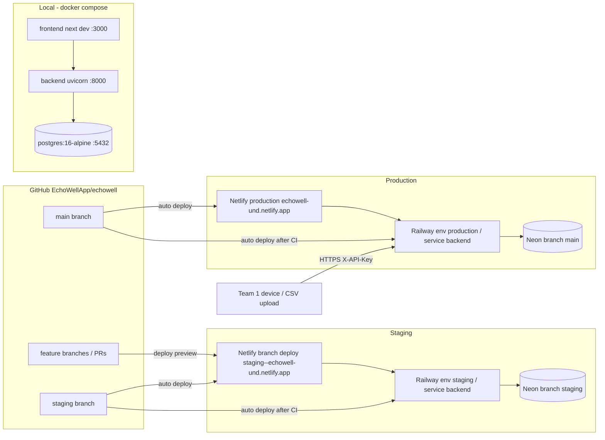
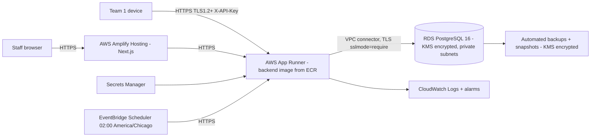

# 15 Deployment and DevOps Specification

Document ID: ECHOWELL-TRD-15 · Version 0.1 (draft for review) · Date: 18 October 2026 · Owner: Team 2 · Status: Draft

## 1. Purpose

This document specifies how EchoWell is built, configured, deployed, migrated, seeded, verified, backed up and
rolled back in its three environments: **local**, **staging** and **production**. Per the owner decision of
18 Oct 2026 (D-OWNER-3), **AWS is the target production platform** (Amplify, App Runner, RDS PostgreSQL with KMS
encryption, Secrets Manager, CloudWatch, under an AWS Business Associate Addendum), and **Netlify + Railway + Neon is
the current interim platform** used until the AWS budget is approved (OQ-07). Both are specified here: §4.1–4.15
describe the current interim stack, §4.16 the AWS target. The interim stack holds synthetic and test data only;
EchoWell goes live with real resident data only on AWS after budget approval (D-OWNER-4; OQ-23 closed; RSK-14). It turns the hosting decision in
the Deployment Architecture (SRC-01) into step-by-step procedures that an engineer or AI coding agent can follow
without further clarification, and it defines the deployment configuration files that Phase 14A (SRC-17) must
generate (`netlify.toml`, `railway.toml`, Dockerfiles, `docker-compose.yml`, environment templates) and the
procedures Phase 14B must execute.

## 2. Scope

**In scope**

- Local development stack with Docker Compose (PostgreSQL 16, FastAPI backend, Next.js frontend).
- Current interim staging and production on Netlify (frontend), Railway (backend + analytics engine) and Neon (PostgreSQL 16).
- Target AWS production (Amplify, App Runner, RDS PostgreSQL 16 + KMS, Secrets Manager, CloudWatch, BAA) and the cut-over procedure.
- Data-sensitivity rules: live feature data is treated as potentially PHI-derived (encryption in transit and at rest).
- Database migrations on deploy (Alembic), seeding rules, bootstrap of the first admin user.
- Post-deploy smoke tests, rollback, backups and restore (Neon point-in-time restore; RDS automated backups on AWS).
- Cost and free-tier constraints, demo fallback to a local server (RSK-12).

**Out of scope**

- CI workflow content (TRD 16), logging and alerting design (TRD 17), every environment variable definition
  (TRD 21), vendor plan details (TRD 22), security controls beyond deployment hardening (TRD 12).
- Team 1 device provisioning, wake word, feature extraction and transport (interface only, ASM-05, OQ-07).
- Custom domain names (no UND domain decision exists; OQ-07). Platform default domains are used.

## 3. References

| ID | Reference |
|---|---|
| SRC-01 | specs/architecture/Deployment_Architecture.md (hosting decision; GitHub → Netlify, GitHub → Railway; Neon or Railway PostgreSQL; future AWS) |
| SRC-02 | Daily data storage and processing flowcharts (raw store immutable; every other table can be rebuilt) |
| SRC-03 / SRC-05 | Pipeline test workbook and input CSV v0.1 (the `test_v0_1` seed) |
| SRC-15 / SRC-16 | Meeting agenda 17 Oct 2026 (demo goal) and Gantt plan (presentations 1 Dec and 8 Dec 2026) |
| SRC-17 | specs/prompts/Implement_Feature_Batches.md, Phases 14A and 14B |
| D-OWNER-3 | Owner decision 18 Oct 2026: AWS is the target production platform; Netlify + Railway + Neon is the current interim stack; interim stack holds synthetic/test data only (RSK-14) |
| D-OWNER-4 | Owner decision 18 Oct 2026: OQ-23 closed — no real resident data on the interim stack; go-live only on AWS after budget approval |
| TRD 01 | System Architecture |
| TRD 06 / TRD 20 | Database design / PostgreSQL schema (Alembic is source of truth; DB roles) |
| TRD 12 | Security and Authentication (secrets, DB roles, HTTPS) |
| TRD 14 | Test Data and Validation (content of the `test_v0_1` seed) |
| TRD 16 | CI/CD Pipeline (workflows that call the procedures below) |
| TRD 17 | Logging, Monitoring and Error Handling (health check, uptime check) |
| TRD 21 | Environment Configuration (variable names, validation, templates) |
| TRD 22 | Third-Party Services and Hosting (plans, regions, limits, account ownership) |

## 4. Requirements

### 4.1 Environment topology



| Aspect | local | staging | production |
|---|---|---|---|
| Git source | working tree | `staging` branch | `main` branch |
| Frontend | `next dev` on :3000 (container) | Netlify branch deploy of `staging` + deploy previews of PRs | Netlify production deploy of `main` |
| Backend | uvicorn :8000 with `--reload` (container) | Railway project `echowell`, environment `staging`, service `backend` | Railway project `echowell`, environment `production`, service `backend` |
| Database | `postgres:16-alpine` container, volume `pgdata` | Neon project `echowell`, branch `staging` | Neon project `echowell`, branch `main` |
| APP_ENV | `local` | `staging` | `production` |
| PIPELINE_PROFILE | `test_v0_1` | `test_v0_1` | `production` |
| Seed data | `test_v0_1` allowed | `test_v0_1` allowed | never |
| Data | synthetic only | synthetic only (+ demo check-ins of synthetic demo resident) | interim stack: synthetic and team test check-ins only (D-OWNER-4); AWS target (go-live): live study feature data (study IDs only, no audio) |

| ID | Requirement | Priority | Trace | Verification |
|---|---|---|---|---|
| DEP-001 | The system shall be deployable to exactly three named environments: `local`, `staging`, `production`, identified at runtime by APP_ENV. | Must | BR-17, SRC-01, TRD 21 | Inspection |
| DEP-002 | The production frontend shall be deployed from the `main` branch to Netlify by the Netlify GitHub integration. | Must | BR-17, SRC-01 | Demo |
| DEP-003 | The production backend (FastAPI with the `analytics/` package) shall be deployed from the `main` branch to the Railway `production` environment by the Railway GitHub integration. | Must | BR-17, SRC-01 | Demo |
| DEP-004 | The staging frontend and backend shall be deployed from the `staging` branch to the Netlify branch deploy and the Railway `staging` environment respectively. | Must | BR-17, contract §13 | Demo |
| DEP-005 | Production shall use the Neon project `echowell` default branch `main`; staging shall use the Neon child branch `staging` of the same project; no environment shall share a database with another. | Must | BR-16, SRC-01 | Inspection |
| DEP-006 | Each environment shall have its own JWT_SECRET, its own API keys and its own user accounts; a credential issued in one environment shall be rejected in every other environment. | Must | BR-16, TRD 12 | Test |
| DEP-007 | Production shall contain no synthetic seed data from `test_v0_1`; staging and local shall contain only synthetic data and shall never contain study data. | Must | BR-16, SRC-03 | Inspection |
| DEP-008 | No real resident data shall ever be ingested into or stored on the interim Netlify/Railway/Neon stack (local, staging or interim production); only synthetic data and test check-ins recorded by team members under demo study IDs (prefix `T`, e.g. `T01`) are allowed. | Must | BR-16, D-OWNER-3, D-OWNER-4, RSK-14 | Inspection |
| DEP-118 | EchoWell shall go live (first real resident data accepted) only on the AWS target platform (§4.16), after AWS budget approval and completion of DEP-112 to DEP-114 and DEP-117. | Must | D-OWNER-3, D-OWNER-4, OQ-07 | Inspection |
| DEP-009 | Live resident feature data shall be treated as potentially PHI-derived: every hop shall use TLS 1.2 or higher (browser → Netlify/Amplify, browser/device → Railway/App Runner, backend → PostgreSQL with `sslmode=require`), and all database storage, backups and snapshots shall be encrypted at rest (provider-managed encryption on Neon/Railway; KMS customer-managed key on AWS). | Must | BR-16, D-OWNER-3, TRD 12 | Inspection |

### 4.2 Local environment (Docker Compose)

| ID | Requirement | Priority | Trace | Verification |
|---|---|---|---|---|
| DEP-010 | `docker-compose.yml` at the repository root shall define services `db` (image `postgres:16-alpine`), `backend` (built from `backend/Dockerfile`, port 8000) and `frontend` (Node 20, `next dev`, port 3000). | Must | SRC-01, SRC-17 Phase 14A | Inspection |
| DEP-011 | The `db` service shall persist data in the named volume `pgdata`, expose port 5432 on 127.0.0.1 only, and define a healthcheck `pg_isready -U echowell -d echowell` every 5 s with 10 retries. | Must | SRC-01 | Test |
| DEP-012 | The `backend` service shall start only after `db` is healthy (`depends_on: condition: service_healthy`) and shall run `alembic upgrade head` before starting uvicorn. | Must | TRD 06 | Test |
| DEP-013 | The `backend` service shall bind-mount `backend/` and `analytics/` and run uvicorn with `--reload` so source edits take effect without rebuild. | Should | SRC-01 | Demo |
| DEP-014 | `docker compose up` from a clean clone with `.env` copied from `.env.development.example` shall make `http://localhost:8000/api/v1/health` return HTTP 200 with `database: "ok"` within 180 s on a machine with Docker 24+. | Must | BR-17 | Test |
| DEP-015 | The local test data shall be loaded by `docker compose exec backend python -m backend.cli seed test_v0_1`, which shall load the `test_v0_1` dataset defined in TRD 14 and run the pipeline with profile `test_v0_1` and as-of `2026-10-30T15:00:00-05:00` (America/Chicago). | Must | BR-15, SRC-03, SRC-05 | Test |
| DEP-016 | After DEP-015, the Residents overview at `http://localhost:3000/residents` shall show summary tiles 2 / 7 / 1 / 19 (Alarm on / Being watched, no alarm / Baseline still forming / Missed check-ins last 30 days). | Must | BR-12, BR-15, SRC-09 | Test (E2E) |
| DEP-017 | A `demo` Compose profile shall add the service `frontend-prod`, built from `frontend/Dockerfile` (`next build` then `next start`), on port 3001, for E2E tests (TRD 16) and the demo fallback (DEP-090). | Must | RSK-12, SRC-17 | Test |
| DEP-018 | The Compose file shall not contain any secret other than local development defaults that are also present in `.env.development.example` (e.g. Postgres password `echowell`); production secrets shall never be referenced. | Must | BR-16, TRD 12 | Inspection |

Local setup procedure (to be reproduced verbatim in `docs/deployment.md` and `DEPLOYMENT_CONFIGURATION_GUIDE.md`):

1. Install Docker Desktop 4.x (or Docker Engine 24+ with Compose v2), Git, and optionally Node.js 20 LTS and Python 3.12 for running tools outside containers.
2. `git clone https://github.com/EchoWellApp/echowell.git && cd echowell`
3. `cp .env.development.example .env` (values in TRD 21 §4.6). Do not edit `JWT_SECRET` for local use unless sharing the stack on a network.
4. `docker compose up --build -d`
5. Wait until `docker compose ps` shows `db` healthy and `curl -s http://localhost:8000/api/v1/health` returns `"status":"ok"`.
6. `docker compose exec backend python -m backend.cli seed test_v0_1`
7. `docker compose exec backend python -m backend.cli create-user --email admin@local.test --role admin` (password prompted; local only).
8. Open `http://localhost:3000`, sign in, confirm tiles 2 / 7 / 1 / 19.
9. Reset: `docker compose down -v` deletes the `pgdata` volume; repeat from step 4.

Compose outline (Phase 14A generates the real file from this):

```yaml
name: echowell
services:
  db:
    image: postgres:16-alpine
    environment:
      POSTGRES_USER: echowell
      POSTGRES_PASSWORD: echowell
      POSTGRES_DB: echowell
    ports: ["127.0.0.1:5432:5432"]
    volumes: ["pgdata:/var/lib/postgresql/data"]
    healthcheck:
      test: ["CMD-SHELL", "pg_isready -U echowell -d echowell"]
      interval: 5s
      retries: 10
  backend:
    build: { context: ., dockerfile: backend/Dockerfile }
    env_file: .env
    environment:
      DATABASE_URL: postgresql+psycopg://echowell:echowell@db:5432/echowell
      PORT: "8000"
    command: sh -c "alembic upgrade head && uvicorn backend.main:app --host 0.0.0.0 --port 8000 --reload"
    ports: ["127.0.0.1:8000:8000"]
    volumes: ["./backend:/app/backend", "./analytics:/app/analytics"]
    depends_on: { db: { condition: service_healthy } }
  frontend:
    image: node:20-alpine
    working_dir: /app
    env_file: .env
    environment:
      NEXT_PUBLIC_API_BASE_URL: http://localhost:8000/api/v1
    command: sh -c "npm ci && npm run dev -- --hostname 0.0.0.0 --port 3000"
    ports: ["127.0.0.1:3000:3000"]
    volumes: ["./frontend:/app", "frontend_node_modules:/app/node_modules"]
    depends_on: [backend]
  frontend-prod:
    profiles: ["demo"]
    build:
      context: frontend
      args: { NEXT_PUBLIC_API_BASE_URL: "http://localhost:8000/api/v1", NEXT_PUBLIC_APP_ENV: local }
    ports: ["127.0.0.1:3001:3000"]
    depends_on: [backend]
volumes:
  pgdata: {}
  frontend_node_modules: {}
```

### 4.3 Container images

| ID | Requirement | Priority | Trace | Verification |
|---|---|---|---|---|
| DEP-020 | `backend/Dockerfile` shall build from `python:3.12-slim` with the repository root as build context, copy `backend/`, `analytics/` and `alembic.ini`, and install only `backend/requirements.txt` (runtime pins). | Must | SRC-01, TRD 01 | Inspection |
| DEP-021 | The backend image shall run as a non-root user (UID 10001) and shall not contain `.env` files, tests, `specs/` or `frontend/` (enforced by a root `.dockerignore`). | Must | BR-16, TRD 12 | Test (CI inspects image) |
| DEP-022 | The backend image default command shall be `sh -c "alembic upgrade head && uvicorn backend.main:app --host 0.0.0.0 --port ${PORT:-8000}"` so the same image runs on Railway, Docker Compose and AWS App Runner. | Must | SRC-01 Future AWS | Test |
| DEP-023 | `frontend/Dockerfile` shall be a multi-stage `node:20-alpine` build (`npm ci`, `npm run build`, `next start -p 3000`) that takes NEXT_PUBLIC_API_BASE_URL and NEXT_PUBLIC_APP_ENV as build arguments; it is used for local demo and E2E only, never for Netlify. | Must | SRC-17 Phase 14A, RSK-12 | Test |
| DEP-024 | `alembic.ini` shall live at the repository root with `script_location = backend/alembic`, so `alembic upgrade head` works from the repository root in every environment. | Must | contract §3, TRD 06 | Test |

### 4.4 Database provisioning (Neon)

Procedure (performed once by the DevOps owner; results recorded in `docs/deployment.md`, never secrets):

1. Sign in to Neon with the team-owned account (TRD 22, TPS ownership rules).
2. Create project `echowell`, PostgreSQL version **16**, region **AWS US East 1 (N. Virginia)** (`aws-us-east-1`), database name `echowell`.
3. The default branch is renamed or confirmed as `main` (production).
4. Create roles: `echowell_owner` (owner of schema; used by Alembic only) and `echowell_app` (runtime). Grants for `echowell_app` are created by the Alembic migration defined in TRD 20 (SELECT/INSERT on `raw_sessions` and `audit_logs`; no UPDATE/DELETE).
5. Create child branch `staging` from `main` immediately after step 4 (empty schema).
6. Copy four connection strings from the Neon console: for each branch, the **pooled** string for `echowell_app` (host contains `-pooler`) and the **direct** string for `echowell_owner`. Store them only in Railway variables (DEP-033).
7. Set compute autosuspend to the plan default (5 min) for `staging`; for `main` keep the default as well (cost, TRD 22) and accept cold starts (RSK-07).

| ID | Requirement | Priority | Trace | Verification |
|---|---|---|---|---|
| DEP-030 | The production and staging databases shall run PostgreSQL major version 16. | Must | contract §3 | Inspection (`SELECT version()`) |
| DEP-031 | The Neon project shall be created in region `aws-us-east-1`; no EchoWell data shall be stored outside the United States. | Must | BR-16, TRD 22 | Inspection |
| DEP-032 | The runtime backend shall connect with role `echowell_app` through the Neon pooled endpoint; Alembic shall connect with role `echowell_owner` through the direct (non-pooled) endpoint supplied in DATABASE_MIGRATION_URL (TRD 21). | Must | BR-16, TRD 12, TRD 21 | Test |
| DEP-033 | Database connection strings shall be stored only in Railway service variables and, for staging re-seeding only, in the GitHub Actions secret `STAGING_DATABASE_URL`; the production connection string shall never be stored in GitHub. | Must | BR-16, TRD 12, TRD 16 | Inspection |
| DEP-034 | All connections to Neon shall use TLS (`sslmode=require` in the connection string). | Must | BR-16, TRD 12 | Test |
| DEP-035 | Railway PostgreSQL 16 may replace Neon for either environment only if Neon is unavailable to the team; the switch shall require only a change of DATABASE_URL and DATABASE_MIGRATION_URL followed by `pg_dump`/`pg_restore` of the data. | May | SRC-01 | Analysis |

### 4.5 Backend service (Railway)

Procedure:

1. In Railway (team-owned account, TRD 22) create project `echowell` with two environments: `production` (default) and `staging`.
2. Add service `backend` from GitHub repo `EchoWellApp/echowell`. Settings per environment:
   - Source branch: `main` (production) / `staging` (staging).
   - Root directory: repository root (`/`); config-as-code file: `/railway.toml`.
   - Builder: Dockerfile, path `backend/Dockerfile`.
   - Start command (from `railway.toml`): `alembic upgrade head && uvicorn backend.main:app --host 0.0.0.0 --port $PORT`.
   - Healthcheck path `/api/v1/health`, timeout 120 s.
   - Watch paths: `backend/**`, `analytics/**`, `alembic.ini`, `railway.toml` (other changes do not redeploy the backend).
   - "Wait for CI" enabled (deploy only after GitHub checks of the commit pass, TRD 16).
   - Replicas: 1. Serverless / app sleeping: **disabled** (the in-process nightly run at 02:00 facility local time needs a running process).
   - Region: US East (Virginia).
   - Restart policy: on failure, max 3 retries.
3. Generate a Railway public domain per environment (`echowell-backend-production.up.railway.app`, `echowell-backend-staging.up.railway.app`; if taken, the generated name is recorded in `docs/deployment.md` and in GitHub Actions variables `PRODUCTION_API_BASE_URL` / `STAGING_API_BASE_URL`).
4. Set variables per TRD 21 §4.7 matrix. `GIT_SHA` is set to the Railway reference `${{RAILWAY_GIT_COMMIT_SHA}}`. `PORT` is injected by Railway.
5. Deploy; verify `GET https://<backend-domain>/api/v1/health` returns 200 and `version` equals the deployed commit SHA.

`railway.toml` outline:

```toml
[build]
builder = "DOCKERFILE"
dockerfilePath = "backend/Dockerfile"
watchPatterns = ["backend/**", "analytics/**", "alembic.ini", "railway.toml"]

[deploy]
startCommand = "sh -c 'alembic upgrade head && uvicorn backend.main:app --host 0.0.0.0 --port $PORT'"
healthcheckPath = "/api/v1/health"
healthcheckTimeout = 120
restartPolicyType = "ON_FAILURE"
restartPolicyMaxRetries = 3
numReplicas = 1
```

| ID | Requirement | Priority | Trace | Verification |
|---|---|---|---|---|
| DEP-040 | The Railway start command shall be `alembic upgrade head && uvicorn backend.main:app --host 0.0.0.0 --port $PORT`. | Must | contract task, TRD 06 | Inspection |
| DEP-041 | The Railway healthcheck path shall be `/api/v1/health`; a deployment whose healthcheck does not return 200 within 120 s shall not receive traffic (Railway keeps the previous deployment active). | Must | TRD 17 | Demo |
| DEP-042 | The backend service shall run exactly 1 replica with app sleeping disabled in both staging and production. | Must | RSK-07, contract §7 trigger | Inspection |
| DEP-043 | Railway "Wait for CI" shall be enabled so that a commit is deployed only after its required GitHub checks (TRD 16) pass. | Must | BR-17, TRD 16 | Demo |
| DEP-044 | The Railway configuration shall be stored as code in `/railway.toml`; dashboard-only settings (branch, variables, domain, region, sleeping) shall be listed in `docs/deployment.md`. | Must | SRC-17 Phase 14A | Inspection |
| DEP-045 | The backend shall serve only HTTPS through the Railway edge; HTTP requests shall be redirected by the platform, and the backend shall send `Strict-Transport-Security: max-age=31536000` in staging and production. | Must | BR-16, TRD 12 | Test |

### 4.6 Frontend site (Netlify)

Procedure:

1. In Netlify (team-owned team, TRD 22) "Add new site → Import from Git" → `EchoWellApp/echowell`.
2. Site name `echowell-und` (if taken, record the actual name in `docs/deployment.md`).
3. Build settings (also in `/netlify.toml`): base directory `frontend/`, build command `npm run build`, publish directory `.next`, Node version 20, plugin `@netlify/plugin-nextjs`.
4. Production branch `main`. Branch deploys: `staging` only. Deploy previews: on for pull requests.
5. Environment variables per deploy context (TRD 21 §4.7): `NEXT_PUBLIC_API_BASE_URL` (production → production backend; branch-deploy `staging` and deploy-preview → staging backend), `NEXT_PUBLIC_APP_ENV` (`production` / `staging` / `staging`).
6. Trigger a deploy, open the site, confirm the login page renders and the browser network tab shows calls only to the backend domain of the matching environment.

`netlify.toml` outline (repository root):

```toml
[build]
  base    = "frontend"
  command = "npm run build"
  publish = ".next"
  ignore  = "git diff --quiet $CACHED_COMMIT_REF $COMMIT_REF -- . ../netlify.toml"

[build.environment]
  NODE_VERSION = "20"
  NEXT_TELEMETRY_DISABLED = "1"

[[plugins]]
  package = "@netlify/plugin-nextjs"

[context.production.environment]
  NEXT_PUBLIC_APP_ENV = "production"
[context.branch-deploy.environment]
  NEXT_PUBLIC_APP_ENV = "staging"
[context.deploy-preview.environment]
  NEXT_PUBLIC_APP_ENV = "staging"

[[headers]]
  for = "/*"
  [headers.values]
    Strict-Transport-Security = "max-age=31536000"
    X-Content-Type-Options = "nosniff"
    Referrer-Policy = "no-referrer"
    X-Frame-Options = "DENY"
```

| ID | Requirement | Priority | Trace | Verification |
|---|---|---|---|---|
| DEP-050 | The Netlify site shall use base directory `frontend/`, build command `npm run build`, Node 20 and the `@netlify/plugin-nextjs` plugin. | Must | SRC-01, contract task | Inspection |
| DEP-051 | NEXT_PUBLIC_API_BASE_URL shall be set per Netlify deploy context so that production builds call only the production backend and branch/preview builds call only the staging backend. | Must | BR-16, TRD 21 | Test |
| DEP-052 | Netlify shall skip a build when no file under `frontend/` and no `netlify.toml` changed between commits (ignore command), to conserve build minutes. | Should | RSK-07, TRD 22 | Demo |
| DEP-053 | The frontend shall send the security headers listed in the `netlify.toml` outline on every response. | Must | BR-16, TRD 12 | Test |
| DEP-054 | Netlify deploy previews shall never be configured with the production backend URL. | Must | BR-16 | Inspection |

### 4.7 Migrations on deploy

| ID | Requirement | Priority | Trace | Verification |
|---|---|---|---|---|
| DEP-060 | Database schema changes shall be applied only by Alembic (`alembic upgrade head`) as part of the backend start command; no manual DDL shall be run against staging or production. | Must | TRD 06, TRD 20 | Inspection |
| DEP-061 | Every migration merged to `main` shall be backward compatible with the previous release (expand/contract: add columns/tables first, remove in a later release), so that the previous backend deployment keeps working if the new deployment fails its healthcheck. | Must | DEP-041 | Inspection (PR review) |
| DEP-062 | Every migration shall be applied to the Neon `staging` branch (via a `staging` deploy) and pass the staging smoke tests before the same migration is merged to `main`. | Must | BR-17 | Inspection |
| DEP-063 | Before a release that contains a migration is merged to `main`, the DevOps owner shall create a Neon branch `pre-<short-sha>` from `main` as a restore point and delete it after 7 days if unused. | Must | BR-02 | Inspection |
| DEP-064 | Alembic shall use a PostgreSQL advisory lock (key `0x45434857`, "ECHW") during upgrade so two concurrent starts cannot apply migrations twice. | Should | TRD 06 | Test |
| DEP-065 | If `alembic upgrade head` fails, the process shall exit non-zero so the Railway deployment fails and the previous deployment stays live. | Must | DEP-041 | Test |

### 4.8 Seeding and bootstrap rules

The backend provides a CLI module `backend/cli.py` (invoked as `python -m backend.cli <command>`):

| Command | Effect | Allowed APP_ENV |
|---|---|---|
| `bootstrap` | Idempotent: creates the facility row from FACILITY_NAME and FACILITY_TZ if missing; inserts missing `config_parameters` rows for profiles `production` and `test_v0_1` from `analytics/config.py` defaults (never overwrites existing rows). | all |
| `create-user --email E --role R` | Creates a user; password read from an interactive prompt (`getpass`) or from stdin with `--password-stdin`. | all |
| `create-api-key --name N [--device D] [--scope S]` | Creates an API key (default scope `ingest:write`); prints the key once. | all |
| `deactivate-api-key --name N` | Sets `api_keys.active = false` (audited). | all |
| `import-master-data --dir D` | Idempotent upsert of residents, devices and device assignments from CSV files `residents.csv`, `devices.csv`, `device_assignments.csv` in directory D (format in TRD 14/TRD 06); master data has no API endpoints in the MVP (contract R4). | all |
| `withdraw-resident --code R --date YYYY-MM-DD` | Sets resident status `withdrawn` (audited). | all |
| `seed test_v0_1 [--reset]` | Imports `database/seeds/test_v0_1/` master data (as `import-master-data`), loads `evaluation_ground_truth` from the answer key (never read by the pipeline), then loads the `test_v0_1` dataset (TRD 14) through the ingest service with `ingest_batches.source = seed` and runs the pipeline with profile `test_v0_1` and as-of `2026-10-30T15:00:00-05:00`; `--reset` truncates all tables except `users`, `api_keys`, `audit_logs` and `config_parameters` first. | local, staging, test |
| `run-pipeline --scope all [--profile P]` | Runs the full pipeline and records a `pipeline_runs` row with trigger `manual`. | all |
| `export-openapi` | Prints the OpenAPI JSON (used by CI, TRD 16). | all |

| ID | Requirement | Priority | Trace | Verification |
|---|---|---|---|---|
| DEP-070 | `python -m backend.cli seed` shall exit with code 2 and message "seeding is not allowed in production" without touching the database when APP_ENV is `production`. | Must | BR-16, DEP-007 | Test |
| DEP-071 | `seed --reset` shall refuse to run unless APP_ENV is `local`, `staging` or `test`, and shall write an `audit_logs` row (actor_type system, action `seed_reset`). | Must | BR-16 | Test |
| DEP-072 | `bootstrap` shall be idempotent: running it twice shall leave the database identical to running it once. | Must | TRD 06 | Test |
| DEP-073 | Production shall contain only the facility row, `config_parameters`, users, API keys and data received from devices or CSV upload of study data; no row with `ingest_batches.source = seed` shall exist in production. | Must | DEP-007 | Test (SQL check in smoke test) |
| DEP-074 | Staging shall be re-seeded with `seed test_v0_1 --reset` after every deploy that contains a migration or a change under `analytics/`, so that staging always reflects the answer key. | Should | BR-15 | Demo |
| DEP-075 | The first production admin user shall be created with `railway run --environment production python -m backend.cli create-user --email <admin email> --role admin` from a team member's workstation; the password shall be entered interactively and never written to a file, shell history or chat. | Must | BR-16, TRD 12 | Inspection |

### 4.9 Step-by-step: staging release

1. Open a PR from `feat/...` (or `fix/...`) to `staging`; CI (TRD 16) must be green; Netlify posts a deploy preview pointing to the staging backend.
2. Merge the PR into `staging`.
3. Railway `staging` waits for CI, builds `backend/Dockerfile`, runs `alembic upgrade head`, starts uvicorn, passes the healthcheck.
4. Netlify builds the `staging` branch deploy.
5. GitHub Actions `deploy-staging.yml` (TRD 16) waits until `GET /api/v1/health` reports `version` = merged SHA, re-seeds if DEP-074 applies, and runs the staging smoke tests (DEP-080).
6. Algorithm lead reviews the staging dashboard (tiles 2 / 7 / 1 / 19, R09 detail with alarm) before a `staging → main` PR is opened.

### 4.10 Step-by-step: production release

1. Open a PR `staging → main` titled `release: vX.Y.Z` (TRD 18 versioning). CI must be green; 1 approval required.
2. If the release contains a migration, create Neon restore branch `pre-<short-sha>` from `main` (DEP-063).
3. Merge. Netlify publishes `main`; Railway `production` waits for CI, migrates, starts, passes healthcheck.
4. `deploy-production.yml` waits for `version` = merged SHA, runs production smoke tests (DEP-081), then creates the Git tag `vX.Y.Z` and a GitHub Release.
5. If smoke tests fail, follow the rollback procedure (4.12) within 30 minutes.

### 4.11 Post-deploy smoke tests

Smoke tests live in `tests/smoke/` (pytest marker `smoke`) and read their targets from SMOKE_API_BASE_URL, SMOKE_FRONTEND_URL, SMOKE_EXPECTED_SHA and, for staging only, SMOKE_USER_EMAIL / SMOKE_USER_PASSWORD (TRD 21 §4.5).

| ID | Requirement | Priority | Trace | Verification |
|---|---|---|---|---|
| DEP-080 | Staging smoke tests shall verify: (a) health 200 with `database: "ok"` and `version` = expected SHA; (b) frontend `/login` returns 200; (c) login with the staging smoke user succeeds; (d) `GET /api/v1/residents` summary tiles equal 2 / 7 / 1 / 19; (e) `GET /api/v1/residents/R09` reports `alarm_on` with alarm since Oct 21; (f) `GET /api/v1/alerts` lists open alarms R09 and R10 and `GET /api/v1/data-alerts` lists exactly R08 baseline stuck, R05 possible other speaker, R03 many set aside, D02 silent Oct 12; (g) `GET /api/v1/analytics` reports 281 of 300 received and 267 of 300 used; (h) a CORS preflight from the staging frontend origin is allowed and one from `https://example.org` is refused. | Must | BR-12, BR-15, TRD 12 | Test |
| DEP-081 | Production smoke tests shall be unauthenticated and read-only: (a) health 200, `database: "ok"`, `version` = expected SHA; (b) frontend `/login` returns 200 over HTTPS; (c) `GET /api/v1/residents` without token returns 401 with an RFC 7807 body; (d) `POST /api/v1/sessions` without API key returns 401; (e) HSTS header present on both origins; (f) `GET /api/v1/audio` returns 404. | Must | BR-16, TRD 12, TRD 17 | Test |
| DEP-082 | A smoke test run shall finish within 5 minutes, including the wait for the new version (polling every 15 s, timeout 15 min counted separately). | Should | TRD 16 | Test |
| DEP-083 | After a production deploy, a team member shall complete a manual authenticated check (log in, open Residents, open one resident, sign out) and record the result in the GitHub Release notes. | Should | BR-12 | Demo |

### 4.12 Rollback

| Failure | Action | Time target |
|---|---|---|
| Frontend broken, backend fine | Netlify → Deploys → select last good deploy → "Publish deploy". Then revert the commit on `main` by PR. | 5 min |
| Backend fails healthcheck | Nothing to do immediately; Railway keeps the previous deployment. Fix forward by PR. | 0 min |
| Backend healthy but functionally broken, no migration | Railway → Deployments → previous deployment → "Redeploy". Revert commit on `main` by PR. | 10 min |
| Backend broken after an additive migration | Redeploy previous backend (schema is backward compatible, DEP-061). Do not run `alembic downgrade` in production. | 10 min |
| Data damaged by a migration or bug | Stop ingestion (deactivate API keys with `python -m backend.cli deactivate-api-key`), restore Neon `main` from `pre-<short-sha>` branch or PITR timestamp (4.13), redeploy the matching backend, re-run `run-pipeline --scope all`, re-activate keys. Record incident in GitHub issue labelled `incident`. | 60 min |

| ID | Requirement | Priority | Trace | Verification |
|---|---|---|---|---|
| DEP-085 | Every production deploy shall be reversible to the previous frontend and backend version within 10 minutes without a code change, using the platform "publish/redeploy previous" actions. | Must | NFR (TRD 03) | Demo (rehearsed once before 15 Nov 2026) |
| DEP-086 | `alembic downgrade` shall not be executed against production; schema rollback in production shall be done only by restoring a Neon branch or PITR point. | Must | BR-02 | Inspection |
| DEP-087 | After any restore, the full pipeline shall be re-run (`run-pipeline --scope all`) because all derived tables are rebuildable from `raw_sessions` (SRC-02), and the rebuild shall reproduce previously frozen baselines (ASM-07). | Must | BR-02, BR-09, SRC-02 | Test |

### 4.13 Backups and restore

| ID | Requirement | Priority | Trace | Verification |
|---|---|---|---|---|
| DEP-095 | Production data shall be protected by Neon point-in-time restore for at least the history window of the chosen Neon plan (TRD 22); the window in force shall be recorded in `docs/deployment.md`. | Must | BR-02, TRD 22 | Inspection |
| DEP-096 | A logical backup `pg_dump --format=custom --no-owner` of the production database shall be taken weekly (Mondays) and before every release containing a migration, by the data steward from a UND-managed workstation, encrypted at rest, and stored only on storage approved for the study's research data (OQ-01). On AWS, RDS automated backups and manual snapshots (KMS-encrypted) replace this procedure. | Must | BR-02, BR-16, OQ-01, D-OWNER-3 | Inspection |
| DEP-097 | A restore drill (restore the latest dump into a new Neon branch `restore-drill`, run `run-pipeline --scope all`, compare row counts of `raw_sessions` and `alerts`) shall be performed once before 15 Nov 2026 and then monthly. | Should | BR-02 | Demo |
| DEP-098 | Backups and dumps shall never be committed to the repository or uploaded as GitHub Actions artifacts. | Must | BR-16, TRD 18 | Inspection |

PITR restore procedure: Neon console → project `echowell` → branch `main` → "Restore" → choose timestamp (UTC) → restore creates a backup branch of the pre-restore state automatically → verify with `SELECT max(received_at) FROM raw_sessions` → redeploy the backend version that matches the restored schema → `run-pipeline --scope all`.

### 4.14 Demo fallback to local server (RSK-12)

| ID | Requirement | Priority | Trace | Verification |
|---|---|---|---|---|
| DEP-090 | If production is not passing DEP-081 by **5 Nov 2026**, the end-of-semester demo shall run on a team laptop using `docker compose --profile demo up -d db backend frontend-prod` with the same commit that is on `main`. | Must | RSK-12, SRC-15 | Demo |
| DEP-091 | The fallback laptop shall reach the dashboard at `http://localhost:3001` and accept device posts at `http://<laptop LAN IP>:8000/api/v1/sessions`; the backend port shall be bound to the LAN interface only for the duration of the demo. | Must | RSK-12, ASM-05 | Demo |
| DEP-092 | The fallback shall be rehearsed end-to-end (device or `curl` post → pipeline → dashboard) at least once before 15 Nov 2026, and the rehearsal steps shall be written in `docs/deployment.md`. | Must | RSK-12 | Demo |
| DEP-093 | The demo shall show the device → cloud path against production (single real or demo check-in, baseline forming) and the full dashboard behaviour (R01–R10, R09 alarm) against staging; it shall never load `test_v0_1` data into production to make the demo richer. | Should | DEP-007, SRC-15 | Demo |

### 4.15 Cost and free-tier notes (current interim stack)

| ID | Requirement | Priority | Trace | Verification |
|---|---|---|---|---|
| DEP-100 | The MVP shall run on free or entry plans: Netlify Free, Railway Hobby (usage-based, about USD 5 per month per environment for one small always-on service), Neon Free; the expected total is at most USD 15 per month until OQ-07 is resolved. | Should | RSK-07, OQ-07, TRD 22 | Analysis |
| DEP-101 | Usage of each platform (Netlify build minutes, Railway usage dollars, Neon compute hours and storage) shall be checked weekly by the DevOps owner and recorded in the weekly team status. | Should | RSK-07 | Inspection |
| DEP-102 | If Neon Free compute hours would be exhausted before month end, the uptime check interval (TRD 17) shall be relaxed first, and staging compute shall be suspended second, before any production setting is changed. | Should | RSK-07 | Analysis |

### 4.16 Target production platform: AWS

AWS is the target production platform (D-OWNER-3, SRC-01 "Future AWS Migration"). Cut-over happens when the AWS
budget is approved (OQ-07) and the AWS Business Associate Addendum (BAA) has been accepted for the account. Live
resident data is loaded only on AWS (D-OWNER-4); go-live happens on AWS and nowhere else.



Target configuration (region `us-east-1`, AWS account owned by UND per OQ-07):

| Component | Setting |
|---|---|
| Account | UND-owned AWS account (or UND-managed organization member account); AWS BAA accepted in AWS Artifact before any live data; root account MFA; IAM Identity Center users for team members; CloudTrail enabled in all regions with log bucket encrypted (SSE-KMS). |
| Frontend | AWS Amplify Hosting app connected to `EchoWellApp/echowell`, app root `frontend`, build `npm ci && npm run build`, Node 20; branches `main` → production, `staging` → staging; environment variables NEXT_PUBLIC_API_BASE_URL, NEXT_PUBLIC_APP_ENV. |
| Backend | Amazon ECR repository `echowell-backend` (scan on push, KMS encryption); App Runner service `echowell-backend-production` from the same `backend/Dockerfile` image, port 8000, health check HTTP `/api/v1/health`, 1 vCPU / 2 GB, min 1 / max 1 instance, VPC connector to the private subnets of the RDS VPC. |
| Database | Amazon RDS for PostgreSQL 16, `db.t4g.micro` (staging) / `db.t4g.small` (production), storage encrypted with KMS customer-managed key `alias/echowell-rds`, not publicly accessible, private subnets in 2 AZs, parameter `rds.force_ssl = 1`, automated backups 14 days, deletion protection on. |
| Secrets | AWS Secrets Manager secrets `echowell/production/DATABASE_URL`, `echowell/production/DATABASE_MIGRATION_URL`, `echowell/production/JWT_SECRET`, `echowell/production/SENTRY_DSN` (KMS key `alias/echowell-secrets`), injected into App Runner as environment variables with the same names (TRD 21). |
| Logs and monitoring | CloudWatch Logs (App Runner application + service logs, JSON format unchanged, TRD 17), retention 90 days, KMS-encrypted; CloudWatch alarms on health check failures, 5xx rate and RDS CPU/storage; SNS topic to the DevOps owner's email. |
| Nightly run | EventBridge Scheduler rule `cron(0 2 * * ? *)` with time zone America/Chicago invoking an authenticated `POST /api/v1/pipeline/run`, because App Runner throttles CPU between requests and cannot host the in-process scheduler. |
| Network | Only App Runner (HTTPS) and Amplify (HTTPS) are public; the RDS security group allows 5432 only from the App Runner VPC connector security group. |

Mapping from the current interim stack:

| Current | AWS target (SRC-01) | Change required |
|---|---|---|
| Netlify site (`frontend/`, `@netlify/plugin-nextjs`) | AWS Amplify Hosting (Next.js SSR) | New Amplify app with base `frontend/`, build `npm run build`; same NEXT_PUBLIC_* variables. No code change. |
| Railway service `backend` (`backend/Dockerfile`) | AWS App Runner from ECR image | Push the same image to ECR; App Runner port 8000 via PORT; health path `/api/v1/health`; nightly run via EventBridge (DEP-116). |
| Neon PostgreSQL 16 | Amazon RDS for PostgreSQL 16 (KMS) | Fresh schema via Alembic (DEP-117); recreate roles `echowell_owner` / `echowell_app`; update DATABASE_URL and DATABASE_MIGRATION_URL. |
| Railway / Netlify variables | AWS Secrets Manager + App Runner env | Same variable names (TRD 21). |
| Railway logs | CloudWatch Logs | JSON log format unchanged (TRD 17). |
| GitHub Actions deploy verification | GitHub Actions with AWS OIDC role | Smoke tests unchanged; URLs change in Actions variables. |

| ID | Requirement | Priority | Trace | Verification |
|---|---|---|---|---|
| DEP-110 | No application code shall depend on a Netlify-, Railway- or Neon-specific SDK or API; platform specifics shall be confined to `netlify.toml`, `railway.toml` and environment variables. | Must | SRC-01 Future AWS | Inspection |
| DEP-111 | The backend shall read its listening port only from PORT (default 8000) and its database only from DATABASE_URL / DATABASE_MIGRATION_URL, so the same image runs on Railway, Compose and App Runner. | Must | SRC-01 | Test |
| DEP-112 | The AWS production database shall be an RDS for PostgreSQL 16 instance with storage encryption using a KMS customer-managed key, `rds.force_ssl = 1`, no public access, automated backups of at least 14 days and deletion protection enabled. | Must | D-OWNER-3, BR-16 | Inspection |
| DEP-113 | All AWS production secrets shall be held in AWS Secrets Manager (KMS-encrypted) and injected as environment variables with the names defined in TRD 21; no secret shall be stored in Amplify build settings or in the image. | Must | D-OWNER-3, TRD 12, TRD 21 | Inspection |
| DEP-114 | The AWS BAA shall be accepted for the account, and every AWS service on the live-data path (Amplify, App Runner, ECR, RDS, KMS, Secrets Manager, CloudWatch, EventBridge, SNS) shall be confirmed against the AWS HIPAA Eligible Services Reference before live data is loaded; a service not listed shall be replaced or removed from the live-data path. | Must | D-OWNER-3, D-OWNER-4, RSK-14 | Inspection |
| DEP-115 | Application logs on AWS shall go to CloudWatch Logs with 90-day retention and KMS encryption; CloudWatch alarms shall notify the DevOps owner on health check failure and on a 5xx rate above 5 % over 10 minutes. | Must | D-OWNER-3, TRD 17 | Demo |
| DEP-116 | On AWS the nightly pipeline run shall be triggered by EventBridge Scheduler at 02:00 America/Chicago calling `POST /api/v1/pipeline/run` with an `X-API-Key` of scope `pipeline:run` (proposed scope; TRD 12 and TRD 05 to accept it alongside admin JWT), and the in-process scheduler shall be disabled with NIGHTLY_SCHEDULER_ENABLED=false (TRD 21). | Must | contract §7 trigger, SRC-01 | Test |
| DEP-117 | Cut-over from the interim stack to AWS shall follow: (1) provision AWS per the target table; (2) deploy the same `main` commit to Amplify and App Runner; (3) run `alembic upgrade head` against RDS; (4) run `bootstrap` and create users and API keys anew (credentials are not migrated); (5) run DEP-081 smoke tests against the AWS URLs; (6) re-point Team 1 devices to the App Runner URL; (7) keep the interim stack read-only for 14 days, then delete the Neon project and the Railway services. Because the interim stack holds only synthetic/test data (DEP-008), no data is migrated; AWS starts empty and receives the first real resident data. | Must | SRC-01, D-OWNER-3 | Demo |

## 5. Assumptions

- ASM-03 Single facility (Edgewood) in MVP; one Neon project and one Railway project serve it.
- ASM-05 Records arrive via HTTPS POST from Team 1 or CSV upload; transport is Team 1's.
- ASM-07 Frozen baselines are never recomputed after freeze; restore + rebuild relies on this.
- RSK-14 Interim hosting providers may not offer a BAA / HIPAA-eligible plan on the tiers used; mitigated by DEP-008 (synthetic/test data only) and the ready AWS path (§4.16).
- ASM-08 Fewer than 25 users and 100 residents: one backend replica and the smallest Neon compute are sufficient.
- Note for lead (TRD-local): the `test_v0_1` seed uses a fixed pipeline as-of `2026-10-30T15:00:00-05:00` via PIPELINE_AS_OF (TRD 21) so staging tiles remain 2 / 7 / 1 / 19 after Oct 30.

## 6. Dependencies

- Team-owned accounts on GitHub (org EchoWellApp), Netlify, Railway and Neon (TRD 22; funding OQ-07).
- Backend CLI (`backend/cli.py`) and `/api/v1/health` (TRD 05, TRD 17).
- Alembic migrations including DB roles and grants (TRD 06, TRD 20).
- `test_v0_1` seed files (TRD 14).
- CI workflows `ci.yml`, `deploy-staging.yml`, `deploy-production.yml` (TRD 16).
- Environment variables and templates (TRD 21).

## 7. Acceptance Criteria

- AC-DEP-01 From a clean clone, steps 1–8 of the local procedure produce a dashboard with tiles 2 / 7 / 1 / 19 and R09 "Alarm on" in under 15 minutes.
- AC-DEP-02 `docker compose exec backend python -m backend.cli seed test_v0_1` with APP_ENV=production exits with code 2 and leaves `raw_sessions` row count unchanged.
- AC-DEP-03 A merge to `staging` results, without manual steps, in a Railway staging deployment whose health `version` equals the merge SHA and a Netlify branch deploy, followed by a green `deploy-staging.yml` run.
- AC-DEP-04 A merge to `main` results in production health `version` equal to the merge SHA and a green `deploy-production.yml` run that created tag `vX.Y.Z`.
- AC-DEP-05 Production `raw_sessions` contains zero rows linked to `ingest_batches.source = 'seed'`.
- AC-DEP-06 A deliberately failing healthcheck deployment on staging leaves the previous deployment serving requests (verified by `version`).
- AC-DEP-07 Rollback rehearsal: previous frontend and backend restored within 10 minutes (DEP-085).
- AC-DEP-08 Restore drill completed and documented once before 15 Nov 2026 with matching `raw_sessions` and `alerts` row counts.
- AC-DEP-09 Demo fallback rehearsal documented before 15 Nov 2026; a `curl` POST to the laptop appears on the dashboard after pipeline processing.
- AC-DEP-11 The first real resident record is ingested on AWS only, after a completed cut-over (DEP-117) with DEP-112 to DEP-114 verified; the interim Neon project contains no resident_code outside `R01`–`R10` (test seed) and `T`-prefixed demo IDs.
- AC-DEP-10 `grep -r` over `netlify.toml`, `railway.toml`, `docker-compose.yml` and the Dockerfiles finds no production secret and no hostname containing `neon.tech`.

## 8. Implementation Notes

- Paths to create in Phase 14A: `/netlify.toml`, `/railway.toml`, `/backend/Dockerfile`, `/frontend/Dockerfile`, `/.dockerignore`, `/docker-compose.yml` (replace the current stub `version: "3"`; the top-level `version` key is obsolete in Compose v2 and must be removed), `/alembic.ini`, `/backend/cli.py`, `/tests/smoke/`, `/.env.example`, `/.env.development.example`, `/.env.production.example`, `/docs/deployment.md`, `/DEPLOYMENT_CONFIGURATION_GUIDE.md`.
- The backend must be started from the repository root (module path `backend.main:app`, and `analytics` imported as a top-level package). In the Dockerfile set `WORKDIR /app` and copy `backend/` to `/app/backend`, `analytics/` to `/app/analytics`; add `ENV PYTHONPATH=/app`.
- psycopg 3 behind the Neon pooler (PgBouncer transaction mode) requires disabling server-side prepared statements: pass `connect_args={"prepare_threshold": None}` to `create_engine`. Alembic uses the direct endpoint, so it is unaffected.
- Normalize `postgres://` and `postgresql://` URLs to `postgresql+psycopg://` in settings (TRD 21) because Neon and Railway hand out the former.
- `backend/requirements.txt` currently lists `psycopg2-binary`; replace with `psycopg[binary]==3.2.*` to match the contract pin (psycopg 3.x).
- Railway's `$PORT` must be expanded by a shell; keep the `sh -c '...'` wrapper in `railway.toml`.
- Netlify's `ignore` command runs inside the base directory, therefore paths are relative to `frontend/`.
- Never put `NEXT_PUBLIC_API_BASE_URL` for production in `netlify.toml` (it differs per context and is configured in the Netlify UI); `NEXT_PUBLIC_APP_ENV` is safe in `netlify.toml`.
- The nightly run scheduler must take a PostgreSQL advisory lock before running so that an overlapping redeploy (old and new container briefly alive) cannot start two nightly runs.

## 9. Open Questions

- OQ-01 Data retention architecture — determines where weekly dumps may be stored and for how long (DEP-096).
- OQ-07 AWS budget approval timing and account ownership (UND IT) — determines when §4.16 is executed, plan upgrades on the interim stack and the custom domain.
- OQ-15 Store-and-forward after network outage — a backend outage during a deploy loses device posts unless Team 1 retries; deploys to production should avoid the 08:00–20:00 facility-local window until OQ-15 is closed.
- OQ-17 Edgewood site access windows — affects when a device can be re-pointed to the fallback laptop (DEP-091).

## Revision History

| Version | Date | Description | Author |
|---|---|---|---|
| 0.1 | 18 Oct 2026 | Initial generation from TRD_Generation_Prompt.md | — |
