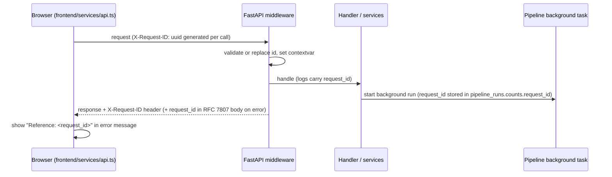
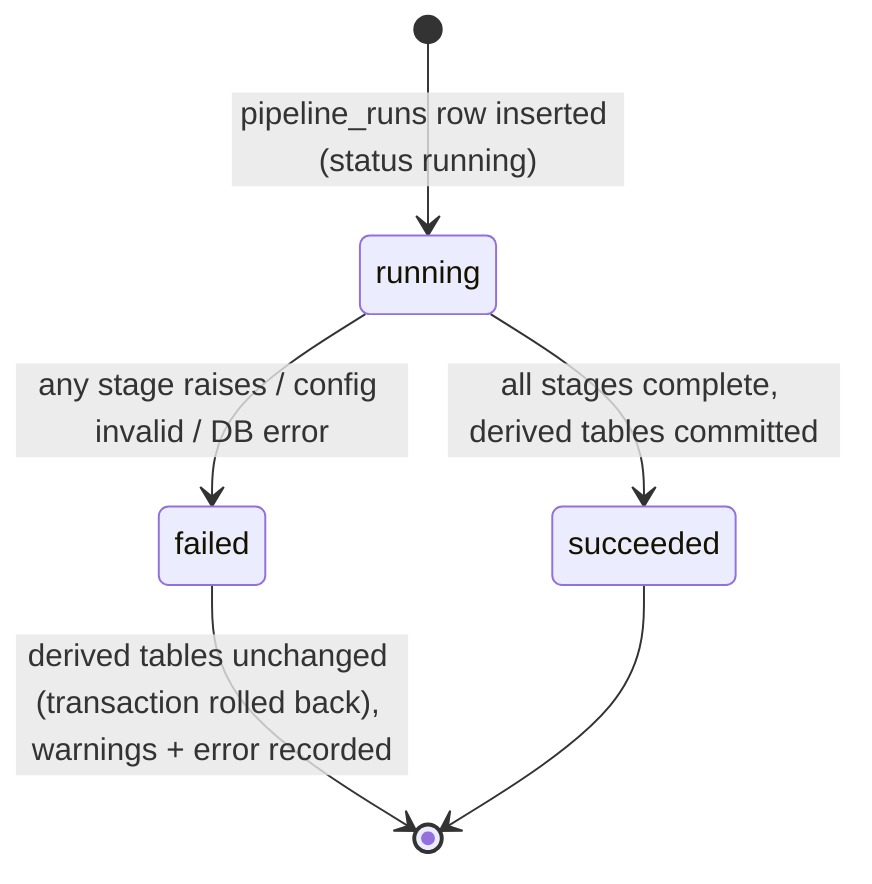

# 17 Logging, Monitoring and Error Handling

Document ID: ECHOWELL-TRD-17 · Version 0.1 (draft for review) · Date: 18 October 2026 · Owner: Team 2 · Status: Draft

## 1. Purpose

This document specifies how EchoWell records what it does (structured application logs, pipeline run records,
audit logs), how failures are classified and handled in each layer (ingest, analytics pipeline, API, frontend), and
how the running system is monitored and how the team is alerted to operational problems. It ensures that every
problem is visible to an operator, that no failure silently corrupts or hides research data, and that logs never
contain secrets, personal data or audio.

## 2. Scope

**In scope**

- Backend structured JSON logging (format, fields, levels, redaction, request ID propagation).
- Error taxonomy and handling per layer: ingest, pipeline stages, API (RFC 7807), frontend error boundaries.
- `pipeline_runs` records as the operational record of analytics runs; distinction between audit logs and app logs.
- Monitoring on the current interim stack (Railway metrics/logs, Netlify deploy logs, optional Sentry, uptime check)
  and on the AWS target (CloudWatch).
- Operational alerts: pipeline failure, nightly run missing, uptime failure; device silence shown in the dashboard.
- Log retention on free tiers.

**Out of scope**

- Clinical alerts (CUSUM alarms) and data alerts (`data_alerts`, contract §19) — TRD 09 / TRD 02; they are research flags shown on `/alerts`, not operational alerts.
- The audit log schema and the list of audited actions — TRD 06/TRD 12 (summarised here only for the distinction).
- Push notification of clinical alarms by SMS/e-mail (OQ-06; not in MVP).

## 3. References

| ID | Reference |
|---|---|
| SRC-01 | Deployment Architecture (Railway, Netlify, future AWS "monitoring and observability") |
| SRC-02 | Flowcharts: raw store kept as received; derived tables rebuildable; flags "for clinician review" |
| SRC-03 / SRC-04 | Reason strings and status semantics (set aside, quarantined, duplicate, missing) |
| D-OWNER-3 | Live feature data treated as potentially PHI-derived; no PII in logs; AWS target with CloudWatch |
| TRD 05 / TRD 19 | Backend API and OpenAPI contracts (error response schema) |
| TRD 07 | Analytics engine (pipeline stages and warnings) |
| TRD 10 | Data ingestion and validation (ingest_rejections) |
| TRD 12 | Security (audit events, secrets) |
| TRD 15 | Deployment (healthcheck, AWS CloudWatch alarms) |
| TRD 16 | CI/CD (`uptime.yml`, CI failure issues) |
| TRD 21 | Environment configuration (LOG_LEVEL, LOG_FORMAT, SENTRY_DSN, GIT_SHA) |

## 4. Requirements

### 4.1 Log record format

Each backend log line is one JSON object on stdout, UTF-8, no embedded newlines. Field set:

| Field | Type | Presence | Description / example |
|---|---|---|---|
| `ts` | string | always | UTC ISO 8601 with milliseconds and `Z`: `2026-10-30T20:28:01.123Z` |
| `level` | string | always | `DEBUG`, `INFO`, `WARNING`, `ERROR`, `CRITICAL` |
| `logger` | string | always | Python logger name: `echowell.api`, `echowell.ingest`, `echowell.pipeline`, `echowell.auth`, `echowell.jobs`, `echowell.db`, `uvicorn.error` |
| `msg` | string | always | Short constant event message, snake_case event name first: `request_completed`, `ingest_record_rejected` |
| `event` | string | always | Same snake_case event name as the start of `msg` (machine filter key) |
| `env` | string | always | APP_ENV |
| `version` | string | always | GIT_SHA |
| `request_id` | string | in request context | X-Request-ID value |
| `actor` | string | when authenticated | `user:<uuid>`, `api_key:<uuid>`, `system` |
| `user_id` | string | when a user is authenticated | users.id UUID (never e-mail) |
| `route` | string | request logs | route template, e.g. `/api/v1/residents/{resident_code}` |
| `method` | string | request logs | `GET` |
| `status` | int | request logs | HTTP status |
| `duration_ms` | number | request logs, pipeline stage logs | elapsed milliseconds, 1 decimal |
| `pipeline_run_id` | string | pipeline context | pipeline_runs.id |
| `resident_code` | string | when one resident is concerned | study ID, e.g. `R09` |
| `session_id` | string | ingest/pipeline per record | e.g. `R09-20261021-01` |
| `ingest_batch_id` | string | batch ingest | ingest_batches.id |
| `error_code` | string | errors | code from §4.6 |
| `exc_type`, `exc_message`, `stack` | string | ERROR with exception | stack only when LOG_LEVEL=DEBUG or level ≥ ERROR |

Example:

```json
{"ts":"2026-10-30T20:28:01.123Z","level":"INFO","logger":"echowell.api","msg":"request_completed","event":"request_completed","env":"staging","version":"3f9c2ab","request_id":"6b1e0f9c-6a43-4d61-9a2e-3d0f7f0e2a11","actor":"user:2c7d...","user_id":"2c7d...","route":"/api/v1/residents/{resident_code}","method":"GET","status":200,"duration_ms":41.7,"resident_code":"R09"}
```

| ID | Requirement | Priority | Trace | Verification |
|---|---|---|---|---|
| LOG-001 | When LOG_FORMAT=`json`, the backend shall write every log record as a single-line JSON object to stdout containing at least `ts`, `level`, `logger`, `msg`, `event`, `env`, `version`. | Must | TRD 21, SRC-01 | Test |
| LOG-002 | When LOG_FORMAT=`console`, the backend shall write human-readable lines (`ts level logger event key=value…`); `console` shall be rejected at startup when APP_ENV is `staging` or `production` (TRD 21). | Must | TRD 21 | Test |
| LOG-003 | Logging shall be configured once in `backend/core/logging.py` using the Python standard library `logging` with a custom JSON formatter; uvicorn access and error loggers shall be routed through the same formatter, and the uvicorn default access log shall be disabled in favour of LOG-010. | Must | TRD 01 | Inspection |
| LOG-004 | Context fields (`request_id`, `actor`, `user_id`, `pipeline_run_id`, `resident_code`) shall be carried in `contextvars` and added to every record emitted inside that context without being passed explicitly. | Must | — | Test |
| LOG-005 | Timestamps in logs shall be UTC; facility-local time shall never be used in logs. | Must | contract §9 | Test |
| LOG-006 | The `analytics/` package shall not log or import `logging` handlers; it shall return warnings and per-record reasons as data, which the backend service layer logs and persists. | Must | contract §3 (pure functions), TRD 07 | Inspection |

### 4.2 Log levels

| Level | Use | Examples |
|---|---|---|
| DEBUG | Developer detail; disabled in staging/production by default | SQL timing, stage input counts per resident |
| INFO | Normal significant events | `request_completed`, `ingest_batch_completed`, `pipeline_run_succeeded`, `user_login_succeeded`, `nightly_run_started` |
| WARNING | Expected but notable conditions; no operator action required immediately | `ingest_record_rejected`, `request_rate_limited`, `user_login_failed`, `pipeline_late_arrival`, `config_mismatch`, 4xx responses other than 401/404 |
| ERROR | A request or run failed; operator should look | `pipeline_run_failed`, `unhandled_exception`, `database_unavailable`, `nightly_run_missing` |
| CRITICAL | The service cannot operate | `startup_config_invalid`, `migration_failed` |

| ID | Requirement | Priority | Trace | Verification |
|---|---|---|---|---|
| LOG-010 | Every HTTP request shall produce exactly one `request_completed` record at INFO (status < 400), WARNING (400–499 except 401 and 404, which are INFO) or ERROR (≥ 500), with `route`, `method`, `status`, `duration_ms`. | Must | — | Test |
| LOG-011 | `GET /api/v1/health` requests that return 200 shall be logged at DEBUG only, so uptime checks do not flood the logs. | Should | RSK-07 | Test |
| LOG-012 | The default LOG_LEVEL shall be `INFO` in all environments; `DEBUG` shall be permitted in staging and production only for a time-boxed investigation of at most 24 hours. | Should | TRD 21 | Inspection |

### 4.3 What is never logged

| ID | Requirement | Priority | Trace | Verification |
|---|---|---|---|---|
| LOG-020 | Logs shall never contain passwords, password hashes, JWTs, API keys or their hashes, `Authorization`, `X-API-Key` or `Cookie` header values, JWT_SECRET, DATABASE_URL/DATABASE_MIGRATION_URL, SENTRY_DSN or any other secret. | Must | BR-16, TRD 12 | Test |
| LOG-021 | Logs shall never contain request or response bodies; ingest logs shall contain only identifiers (`session_id`, `resident_code`, `device_id`, `ingest_batch_id`, `arrival_seq`) and validation error locations/messages, never feature values. | Must | BR-16, D-OWNER-3 | Test |
| LOG-022 | Logs shall never contain e-mail addresses, names, staff note bodies or any personal data; users are identified by `user_id` UUID only, residents by study ID only. | Must | BR-16, contract §12 | Test |
| LOG-023 | A redaction filter shall replace the value of any log field whose key matches (case-insensitive) `password|secret|token|authorization|api_key|apikey|cookie|dsn|database_url|body|note` with `"[REDACTED]"` before formatting. | Must | BR-16 | Test |
| LOG-024 | A redaction filter shall replace any substring of `msg` or `exc_message` matching a connection URL with credentials (`\w+://[^:\s]+:[^@\s]+@`) or a bearer token (`Bearer\s+\S+`) with `[REDACTED]`. | Must | BR-16 | Test |
| LOG-025 | The system shall never log audio or audio-derived waveforms; no audio exists in EchoWell (contract §2). | Must | BR-01, contract §2 | Inspection |

### 4.4 Request ID propagation



| ID | Requirement | Priority | Trace | Verification |
|---|---|---|---|---|
| LOG-030 | The backend shall accept an incoming `X-Request-ID` header only if it matches `^[A-Za-z0-9-]{8,64}$`; otherwise it shall generate a UUID4. | Must | contract §10 | Test |
| LOG-031 | Every HTTP response, including errors and 404s, shall carry the `X-Request-ID` header with the request's ID. | Must | contract §10 | Test |
| LOG-032 | The frontend API client (`frontend/services/api.ts`) shall send a new UUID `X-Request-ID` with every request and include the response's ID in any displayed error ("Reference: <id>"). | Must | TRD 04 | Test |
| LOG-033 | `audit_logs.request_id` shall be set to the current request ID for every audit row written during a request. | Must | contract §9, TRD 12 | Test |
| LOG-034 | A pipeline run started by a request shall log with both the originating `request_id` and its own `pipeline_run_id`; nightly and CLI runs shall have `request_id` absent and `actor` = `system`. | Must | — | Test |
| LOG-035 | CORS configuration shall expose the `X-Request-ID` response header (`Access-Control-Expose-Headers`) so the browser client can read it. | Must | TRD 12 | Test |

### 4.5 Error taxonomy

Codes are UPPER_SNAKE (contract R19; full catalogue in TRD 05 §4.7).

| Code | HTTP | Layer | Meaning | Log level |
|---|---|---|---|---|
| `VALIDATION_ERROR` | 422 | API/ingest | Request or record failed schema/type/enum validation | WARNING |
| `UNKNOWN_RESIDENT` | 422 | ingest | resident_id not enrolled | WARNING |
| `UNKNOWN_DEVICE` | 422 | ingest | device_id not registered | WARNING |
| `RESIDENT_WITHDRAWN` | 422 | ingest | resident status withdrawn | WARNING |
| `UNSUPPORTED_SCHEMA_VERSION` | 422 | ingest | schema_version not in supported list | WARNING |
| `AUTHENTICATION_REQUIRED` | 401 | API | Missing/invalid/expired token or API key | INFO |
| `FORBIDDEN` | 403 | API | Role or scope insufficient | WARNING |
| `NOT_FOUND` | 404 | API | Resource or route does not exist | INFO |
| `CONFLICT` | 409 | API | State conflict (e.g. user e-mail exists, pipeline run already running for scope) | WARNING |
| `PAYLOAD_TOO_LARGE` | 413 | API | Batch above limit (TRD 10) | WARNING |
| `RATE_LIMITED` | 429 | API | Rate limit exceeded (RATE_LIMIT_LOGIN / RATE_LIMIT_INGEST) | WARNING |
| `DATABASE_UNAVAILABLE` | 503 | API | DB connection failed or timed out | ERROR |
| `INTERNAL_ERROR` | 500 | API | Unhandled exception | ERROR |
| `PIPELINE_STAGE_FAILED` | — (run record) | pipeline | A stage raised an exception | ERROR |
| `PIPELINE_CONFIG_INVALID` | — (run record) | pipeline | Config profile missing or invalid | ERROR |

RFC 7807-style body (contract §10):

```json
{
  "type": "urn:echowell:error:VALIDATION_ERROR",
  "title": "Validation error",
  "status": 422,
  "detail": "1 field failed validation",
  "request_id": "6b1e0f9c-6a43-4d61-9a2e-3d0f7f0e2a11",
  "errors": [{"field": "mic_noise_level_dbfs", "code": "invalid_type", "message": "Input should be a valid number"}]
}
```

| ID | Requirement | Priority | Trace | Verification |
|---|---|---|---|---|
| LOG-040 | Every non-2xx API response shall have `Content-Type: application/problem+json` and the body fields `type`, `title`, `status`, `detail`, `request_id`, and `errors` (array, empty when not applicable). | Must | contract §10, TRD 05, TRD 19 | Test |
| LOG-041 | `type` shall be `urn:echowell:error:<CODE>` where `<CODE>` is an UPPER_SNAKE code from the catalogue in TRD 05 §4.7 (the codes in §4.5 are the subset this TRD relies on); `title` shall be the fixed English title for that code; each `errors[]` item shall be `{field, code, message}`. | Must | contract R19, TRD 05, TRD 19 | Test |
| LOG-042 | 500 responses shall never include stack traces, exception messages, SQL or file paths; `detail` shall be "An unexpected error occurred. Quote the reference when reporting it." | Must | BR-16, TRD 12 | Test |
| LOG-043 | Pydantic/FastAPI `RequestValidationError` shall be converted to `VALIDATION_ERROR` with `errors[]` items `{field (dotted location without the leading body/query segment), code (UPPER_SNAKE of the pydantic error type), message}` but without the `input` value (no echo of submitted data). | Must | BR-16, LOG-021 | Test |
| LOG-044 | Exception handlers shall be registered in `backend/core/errors.py` for `HTTPException`, `RequestValidationError`, a domain base class `EchoWellError(code, status, detail)`, SQLAlchemy `OperationalError` (→ `DATABASE_UNAVAILABLE`) and `Exception` (→ `INTERNAL_ERROR`). | Must | TRD 05 | Inspection |

### 4.6 Error handling per layer

#### 4.6.1 Ingest

| ID | Requirement | Priority | Trace | Verification |
|---|---|---|---|---|
| LOG-050 | A schema-invalid record shall be rejected with 422, written to `ingest_rejections` (raw_body, errors), logged once at WARNING `ingest_record_rejected` with `session_id` (if parseable), `resident_code` (if parseable) and error locations, and never written to `raw_sessions`. | Must | BR-01, contract §7 stage 1, TRD 10 | Test |
| LOG-051 | A duplicate arrival shall be stored in `raw_sessions`, return 200 with status `duplicate`, and be logged at INFO `ingest_duplicate` with `session_id`; it shall not be logged as an error. | Must | BR-03 | Test |
| LOG-052 | If the database is unavailable during ingest, the API shall return 503 `DATABASE_UNAVAILABLE` with header `Retry-After: 60`, and no partial record shall be persisted (single transaction per record; per batch, accepted rows commit together). | Must | BR-02, OQ-15 | Test |
| LOG-053 | A batch ingest shall log one INFO `ingest_batch_completed` with `ingest_batch_id`, `accepted`, `rejected`, `duplicates`, `duration_ms`. | Must | TRD 10 | Test |
| LOG-054 | A failure of the post-ingest pipeline run shall not undo or fail the ingest: the record stays in `raw_sessions`, the API returns 201 with `status_after_processing: "pending"`, and the failure is handled per §4.6.2. | Must | BR-02, SRC-02 | Test |

#### 4.6.2 Pipeline stage failures



| ID | Requirement | Priority | Trace | Verification |
|---|---|---|---|---|
| LOG-060 | Every pipeline run (trigger `ingest`, `nightly`, `manual`, `test`) shall insert a `pipeline_runs` row with status `running`, `config_profile`, `config_snapshot`, `code_version` (GIT_SHA) and `started_at` before the first stage executes, in its own committed transaction. | Must | contract §9, TRD 07 | Test |
| LOG-061 | The derived-table writes of a run shall be committed in one transaction; if any stage raises, the transaction shall be rolled back so derived tables keep their previous consistent state. | Must | BR-02, SRC-02 | Test |
| LOG-062 | On failure the run row shall be updated to status `failed` with `finished_at` and `warnings` containing an object `{"code":"PIPELINE_STAGE_FAILED","stage":"<stage name>","resident_code":"<code or null>","exc_type":"<type>","message":"<sanitised message>"}`; one ERROR `pipeline_run_failed` log shall be written with `pipeline_run_id`. | Must | TRD 07 | Test |
| LOG-063 | Stage names in warnings and logs shall be exactly: `duplicate_detection`, `quality_gate`, `epoch_detection`, `speaker_screen`, `context_adjustment`, `baseline`, `scoring`, `cusum`, `alerts`, `day_ledger`. | Must | contract §7 | Inspection |
| LOG-064 | Non-fatal conditions shall be recorded in `pipeline_runs.warnings` without failing the run, each as `{"code": ..., "resident_code": ..., "session_id": ..., "detail": ...}`, with codes at least `late_arrival` (ASM-07), `config_mismatch`, and `no_device_assignment`. | Must | ASM-07, OQ-10 | Test |
| LOG-065 | On success the run row shall be updated to status `succeeded` with `finished_at` and `counts` = `{usable, set_aside, quarantined, duplicate, missing_resident, missing_device_gap, scored, alerts_opened, residents}` and one INFO `pipeline_run_succeeded` log with the same counts and `duration_ms`. | Must | contract §9, BR-15 | Test |
| LOG-066 | A `pipeline_runs` row left in status `running` for more than 30 minutes (process crash) shall be marked `failed` with warning code `run_abandoned` by the next run or at startup. | Must | — | Test |
| LOG-067 | A failed run shall never be retried automatically more than once; the single retry shall occur at the next ingest or nightly trigger, and repeated failure shall be visible on the admin page (`/admin`, pipeline runs list). | Should | TRD 04 | Test |

#### 4.6.3 API layer

| ID | Requirement | Priority | Trace | Verification |
|---|---|---|---|---|
| LOG-070 | An unhandled exception in a request shall be logged once at ERROR `unhandled_exception` with `exc_type`, sanitised `exc_message`, `stack`, `request_id`, and reported to Sentry when SENTRY_DSN is set. | Must | — | Test |
| LOG-071 | `GET /api/v1/health` shall return 200 `{status:"ok", database:"ok", version, time}` when `SELECT 1` succeeds within 3 s, and 503 `{status:"degraded", database:"unavailable", version, time}` otherwise; it shall not require authentication and shall not reveal any other configuration. | Must | contract §10, TRD 15 DEP-041 | Test |
| LOG-072 | Startup shall fail fast (exit code 1, CRITICAL `startup_config_invalid` listing invalid variable names but not values) when settings validation fails (TRD 21). | Must | TRD 21 | Test |

#### 4.6.4 Frontend

| ID | Requirement | Priority | Trace | Verification |
|---|---|---|---|---|
| LOG-080 | The frontend shall define `app/error.tsx` (route-segment error boundary) and `app/global-error.tsx`; each shall show "Something went wrong loading this page." with a "Try again" button (calls `reset()`) and the request reference when available, without technical details. | Must | TRD 04, TRD 11 | Test |
| LOG-081 | The API client shall map 401 to a redirect to `/login?next=<path>`, 403 to an inline "You do not have permission to view this." message, 404 to the route's not-found page, 429 to "Too many attempts. Wait a minute and try again.", 503 to "The service is temporarily unavailable. Try again in a minute." and other errors to the error boundary. | Must | TRD 04, TRD 12 | Test |
| LOG-082 | The frontend shall not send telemetry, logs or errors to any third-party service; browser console logging in production builds shall be limited to `console.error` for caught errors without response bodies. | Must | BR-16, TRD 22 | Inspection |
| LOG-083 | Data panels (residents table, chart, check-in log, device panel, alert queues and review panel on `/alerts`, KPI tiles and charts on `/analytics`) shall each render their own loading, empty and error state so one failing request does not blank the whole page. | Must | SRC-17 Phase 13, TRD 11 | Test |

### 4.7 Audit logs vs application logs

| Aspect | `audit_logs` table | Application logs |
|---|---|---|
| Purpose | Accountability: who did what to research data/config | Operations and debugging |
| Storage | PostgreSQL, append-only (no UPDATE/DELETE grant) | stdout → Railway logs (interim) / CloudWatch (AWS) |
| Content | actor_type, actor_id, action, entity_type, entity_id, details (IDs, no secrets), ip, request_id | events of §4.1 |
| Retention | Until OQ-01 is resolved, never deleted | Platform retention (§4.10) |
| Read by | Admin/researcher via DB queries; investigations | DevOps owner |
| Events | login, logout, failed login, ingest batch, note created, alert review saved, alert snoozed, pipeline run, config change, user change, seed reset (contract §12; TRD 15 DEP-071) | all requests and operations |

| ID | Requirement | Priority | Trace | Verification |
|---|---|---|---|---|
| LOG-090 | Audit events shall be written to `audit_logs` in the same database transaction as the action they record; failure to write the audit row shall fail the action. | Must | BR-16, TRD 12 | Test |
| LOG-091 | Application logs shall not be used as the audit trail, and audit rows shall not be deleted or rotated by any log retention setting. | Must | BR-16, OQ-01 | Inspection |
| LOG-092 | Each audit write shall also emit one INFO application log `audit_event` with `action`, `entity_type`, `entity_id` (no `details`). | Should | — | Test |

### 4.8 Monitoring

Current interim stack:

| Signal | Source | Who looks | Frequency |
|---|---|---|---|
| Service CPU/memory/restarts, deploy status | Railway service metrics and deployments view | DevOps owner | daily during build block, weekly after |
| Application logs | Railway log explorer (filter `@level:ERROR`, `@event:pipeline_run_failed`) | DevOps owner | daily |
| Frontend build/deploy | Netlify deploys view + GitHub commit status | PR author | per deploy |
| Uptime | `uptime.yml` every 30 min (TRD 16 CIC-060) | issue watchers | continuous |
| Exceptions (optional) | Sentry project `echowell-backend` when SENTRY_DSN set | DevOps owner | e-mail per new issue |
| Pipeline health | `/admin` pipeline runs list, `GET /api/v1/pipeline/runs/{id}` | admin | daily |
| Database | Neon console (compute hours, storage, connections) | DevOps owner | weekly |

AWS target: CloudWatch Logs + CloudWatch alarms (TRD 15 DEP-115); Sentry remains optional.

| ID | Requirement | Priority | Trace | Verification |
|---|---|---|---|---|
| LOG-100 | When SENTRY_DSN is non-empty, the backend shall initialise `sentry-sdk` with `environment`=APP_ENV, `release`=GIT_SHA, `send_default_pii=False`, `traces_sample_rate=0`, `max_request_body_size="never"`, and a `before_send` hook that applies the LOG-023/LOG-024 redaction and drops request headers, cookies and query strings. | Should | BR-16, TRD 22 | Test |
| LOG-101 | When SENTRY_DSN is empty, no Sentry code path shall make network calls. | Must | TRD 22 | Test |
| LOG-102 | Sentry shall be enabled only for staging and production of the interim stack and shall receive only synthetic-data events there (D-OWNER-4); before AWS go-live, Sentry use shall be re-approved or disabled for production (TPS rules, TRD 22). | Must | D-OWNER-3, D-OWNER-4, TRD 22 | Inspection |
| LOG-103 | The uptime check shall call `GET /api/v1/health` of production and staging and production `/login` every 30 minutes and treat any non-200 response or a response slower than 30 s as a failure (TRD 16 CIC-060). | Should | RSK-05, RSK-07 | Demo |

### 4.9 Operational alerts

| Alert | Detection | Channel | Severity |
|---|---|---|---|
| Uptime failure | `uptime.yml` two consecutive failures | GitHub issue `incident` (notifies watchers by e-mail) | high |
| Pipeline run failed | `pipeline_runs.status = failed` | ERROR log + Sentry (if enabled) + red banner on `/admin` | high |
| Nightly run missing | nightly job's non-running firing, and `/admin` read-time check: no `pipeline_runs` row with trigger `nightly`, status `succeeded`, `started_at` within the last 26 h | ERROR log `nightly_run_missing` + Sentry + `/admin` banner | high |
| Deployment failed | Railway/Netlify deploy failure, `deploy-*.yml` failure | GitHub commit status, workflow failure e-mail | medium |
| CI failure on main | `ci.yml` / `e2e.yml` failure on `main` | `ci-failure` issue (TRD 16 CIC-033) | medium |
| Data alerts (baseline_stalled, possible_other_speaker, high_set_aside, device_silent, review_flagged_data_problem) | rule-based, recomputed each pipeline run into `data_alerts` (contract §19) | **Dashboard only**: `/alerts` queue "Data alerts · go to the study team", device panel, check-in log — not pushed (OQ-06, OQ-24) | informational (data quality, not health) |

| ID | Requirement | Priority | Trace | Verification |
|---|---|---|---|---|
| LOG-110 | The nightly pipeline run shall be executed by the Railway Cron Job service `nightly` (`python -m backend.jobs.nightly_run`, schedule `0 7,8 * * *` UTC), which runs only at facility-local hour NIGHTLY_RUN_HOUR_LOCAL (default 2) and only once per local date, holding a PostgreSQL advisory lock; the backend web process shall contain no scheduler. | Must | contract §7 trigger, TRD 15 DEP-042, TRD 21 | Test |
| LOG-111 | Each firing of `backend.jobs.nightly_run` that does not start a run shall check the most recent facility-local date whose 02:00 hour has passed and log ERROR `nightly_run_missing` (and report to Sentry when enabled) if no succeeded nightly run exists for it; independently, `/admin` shall show the banner "Nightly run missing for <date>" whenever no succeeded nightly run started within the previous 26 hours (computed at read time). | Must | RSK-05 | Test |
| LOG-112 | The `/admin` page shall show the latest 20 `pipeline_runs` (trigger, status, started/finished local time, counts, warning count) and a banner while the most recent run of any trigger is `failed`. | Must | TRD 04 | Test |
| LOG-113 | Device silence and the other data alerts shall be shown only in the dashboard (`/alerts` data-alert queue, device panel, check-in log); the system shall not send e-mail, SMS or push notifications for data alerts or for clinical alarms in the MVP. | Must | BR-12, OQ-06, OQ-24, RSK-05 | Inspection |
| LOG-115 | Data alerts (`data_alerts`) are research data-quality flags for the study team and shall not be logged as operational errors; a pipeline run shall log one INFO `data_alerts_updated` with counts per kind (open, resolved). | Must | contract §19 | Test |
| LOG-114 | Operational alert notifications shall reach at least two team members (the DevOps owner and the algorithm lead) by watching the repository's issues with label `incident`. | Should | RSK-05 | Inspection |

### 4.10 Log retention

| Platform | Retention (indicative, confirm per plan at account setup, TRD 22) | Action |
|---|---|---|
| Railway Hobby | about 7 days of logs | Sufficient for interim stack (synthetic data only) |
| Netlify Free | build logs per deploy; function logs short-lived | Frontend is static/SSR without app logs of value |
| GitHub Actions | 30 days for artifacts (as configured), 90 days for run logs (default) | — |
| Sentry Developer (free) | 30 days of events | Optional |
| AWS CloudWatch | 90 days configured (TRD 15 DEP-115) | target |

| ID | Requirement | Priority | Trace | Verification |
|---|---|---|---|---|
| LOG-120 | Application logs shall not be exported to any additional log store on the interim stack; retention is the platform default listed above. | Must | BR-16, TRD 22 | Inspection |
| LOG-121 | On the AWS target, application log groups shall have 90-day retention and KMS encryption. | Must | D-OWNER-3, TRD 15 DEP-115 | Inspection |
| LOG-122 | Logs needed beyond platform retention for an incident shall be summarised (IDs and timestamps only) in the incident GitHub issue, never copied in raw form. | Should | BR-16 | Inspection |

## 5. Assumptions

- ASM-08 Small user base and data volume: one log line per request plus one per ingest/pipeline event stays well within platform log quotas.
- ASM-05 Records arrive via HTTPS POST or CSV upload; device-side logs are Team 1's.
- D-OWNER-4 Interim stack holds synthetic/test data only; logs there therefore contain no real resident identifiers.

## 6. Dependencies

- `backend/core/logging.py`, `backend/core/errors.py`, `backend/core/middleware.py` (request ID), `backend/services/pipeline_runner.py` (run lifecycle), nightly job `backend/jobs/nightly_run.py` run by the Railway Cron Job service (TRD 15 DEP-046).
- `sentry-sdk[fastapi]` 2.x as an optional runtime dependency (imported only when SENTRY_DSN is set).
- `pipeline_runs`, `audit_logs`, `ingest_rejections` tables (TRD 06/20).
- `uptime.yml` and `ci-failure` issue automation (TRD 16).
- Admin page (TRD 04) for run list and banners.

## 7. Acceptance Criteria

- AC-LOG-01 With LOG_FORMAT=json, every line emitted during the integration test suite parses as JSON and contains `ts`, `level`, `logger`, `msg`, `event`, `env`, `version`.
- AC-LOG-02 A login request with password `Secret-123!` and a subsequent authorised request produce logs in which neither `Secret-123!`, the JWT, nor the e-mail address appears (grep over captured logs returns 0 matches).
- AC-LOG-03 An ingest POST with an API key produces logs in which neither the key nor any feature value appears; a malformed record yields one `ingest_record_rejected` WARNING and one `ingest_rejections` row.
- AC-LOG-04 A request with `X-Request-ID: abcd1234-test` returns the same header; a request with `X-Request-ID: bad id!` returns a generated UUID; a 422 body's `request_id` equals the header.
- AC-LOG-05 Injecting an exception into the `cusum` stage (test double) leaves `scores`, `cusum_state` and `alerts` unchanged, sets the run to `failed` with a warning whose `stage` is `cusum`, and the ingest that triggered it still returns 201.
- AC-LOG-06 A `pipeline_runs` row artificially left `running` with `started_at` 31 minutes ago is marked `failed` with `run_abandoned` on the next run.
- AC-LOG-07 With no nightly run in the past 26 hours, a non-running firing of `backend.jobs.nightly_run` logs `nightly_run_missing` and `/admin` shows the banner.
- AC-LOG-08 A forced 500 returns `application/problem+json` with `type` `urn:echowell:error:INTERNAL_ERROR`, no stack trace and a `request_id`.
- AC-LOG-09 With SENTRY_DSN empty, a network-isolated test shows no outbound connection attempts during a forced 500.
- AC-LOG-10 Stopping the database makes `/api/v1/health` return 503 with `database: "unavailable"` within 5 s.

## 8. Implementation Notes

- Use `logging.config.dictConfig` in `backend/core/logging.py`; set `uvicorn.access` to `propagate=False` and level WARNING, and emit `request_completed` from a pure ASGI middleware (not `BaseHTTPMiddleware`, which breaks contextvars for background tasks in some Starlette versions).
- Put the request-ID middleware outermost so even CORS preflight and 404 responses carry the header.
- For background pipeline runs (batch ingest), copy the contextvars with `contextvars.copy_context()` or pass `request_id` explicitly to the task.
- `pipeline_runs` status updates must use a separate session/transaction from the derived-table transaction; otherwise the `failed` status is rolled back together with the derived data.
- Sanitise exception messages (LOG-024) before storing them in `pipeline_runs.warnings` — they are visible to researchers.
- Do not add logging calls in `analytics/`; tests assert the package does not import `logging` handlers (a simple AST check in `tests/unit/test_analytics_purity.py`).
- The UTC schedule `0 7,8 * * *` covers 02:00 America/Chicago in both CDT (07:00 UTC) and CST (08:00 UTC); the job decides with `datetime.now(ZoneInfo(FACILITY_TZ)).hour == NIGHTLY_RUN_HOUR_LOCAL`. If FACILITY_TZ or NIGHTLY_RUN_HOUR_LOCAL changes, the cron schedule must be updated to cover the new local hour in both DST states.

## 9. Open Questions

- OQ-01 Data retention architecture — governs audit log retention and any long-term log archiving.
- OQ-06 Alert delivery: who is told, how, how fast — until resolved, clinical alarms and device silence are dashboard-only.
- OQ-10 Late-arriving records — logged as `late_arrival` warnings until resolved.
- OQ-15 Store-and-forward — device posts during a 503 are lost unless Team 1 retries; `Retry-After` is provided.

## Revision History

| Version | Date | Description | Author |
|---|---|---|---|
| 0.1 | 18 Oct 2026 | Initial generation from TRD_Generation_Prompt.md | — |
