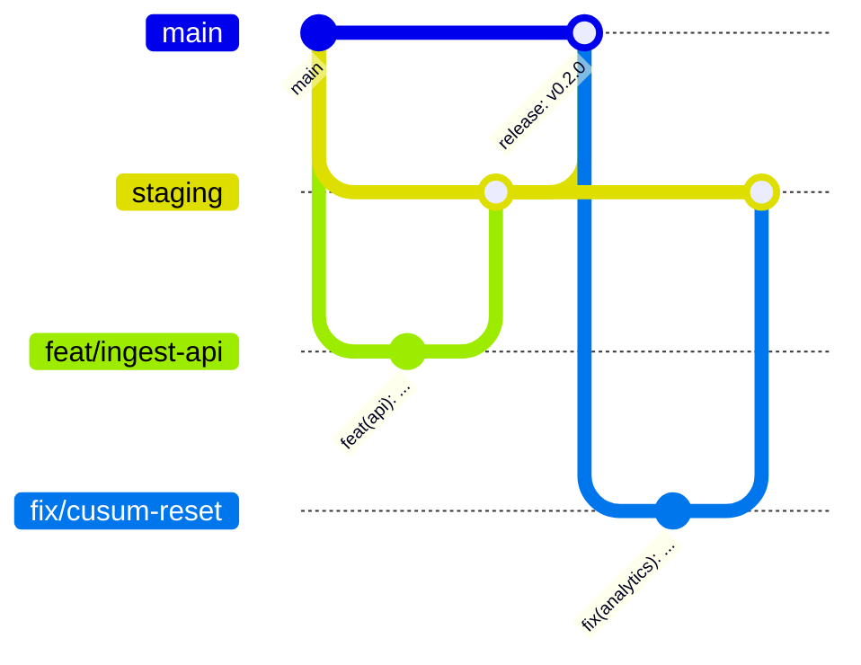

# 18 GitHub Repository Standards

Document ID: ECHOWELL-TRD-18 · Version 0.9 (draft for review) · Date: 18 October 2026 · Owner: Team 2 · Status: Draft

## 1. Purpose

This document defines how the EchoWell monorepo `EchoWellApp/echowell` is organised and governed: directory layout,
branching, commit and pull request conventions, review rules, code style and static analysis, documentation
standards, versioning, labels, secrets hygiene, file and licence policy, `.gitignore` content and dependency
updates. Its goal is that humans and AI coding agents produce consistent, reviewable, reproducible changes, and that
nothing that must not be public (secrets, research data, audio, third-party-licensed documents) ever enters the
public repository.

## 2. Scope

**In scope**

- Repository layout, branches and protection, Conventional Commits, PR process and template, CODEOWNERS.
- Code style and static analysis configuration for Python (ruff, mypy) and TypeScript (ESLint, Prettier, `tsc`).
- Documentation standards (TRDs as source of truth), versioning and tags, issue labels.
- Secrets hygiene, large-file and audio policy, third-party-licensed documents, `.gitignore`, Dependabot.

**Out of scope**

- CI workflow implementation (TRD 16), deployment procedures (TRD 15), security controls of the application (TRD 12).

## 3. References

| ID | Reference |
|---|---|
| SRC-01 | Deployment Architecture — single GitHub monorepo |
| SRC-07 | Preprint (linked only: https://preprints.jmir.org/preprint/113062, DOI 10.2196/preprints.113062; see `specs/business-requirements/REFERENCES.md`) |
| SRC-12 | TRD Generation Prompt — "Do not create additional TRD files", traceability, no placeholders |
| SRC-17 | Implement_Feature_Batches.md — batch phases 7–15 |
| D-OWNER-1 | Owner decision 18 Oct 2026: preprint PDF removed for licence reasons; third-party-licensed documents are linked, not committed |
| TRD 12 | Security and Authentication |
| TRD 15 | Deployment and DevOps |
| TRD 16 | CI/CD Pipeline (required checks, hygiene checks) |
| TRD 25 | AI Agent Build Instructions |

## 4. Requirements

### 4.1 Repository layout

```
echowell/
├── .github/
│   ├── workflows/            ci.yml, e2e.yml, deploy-staging.yml, deploy-production.yml, uptime.yml (TRD 16)
│   ├── ISSUE_TEMPLATE/       bug_report.yml, feature_request.yml, config.yml
│   ├── pull_request_template.md
│   ├── CODEOWNERS
│   └── dependabot.yml
├── frontend/                 Next.js app (app/, components/, lib/, services/api.ts, tests/)
├── backend/                  FastAPI app: main.py, cli.py, api/, models/, schemas/, services/, repositories/, core/, alembic/,
│                             Dockerfile, requirements.txt, requirements-dev.txt
├── analytics/                pure-Python engine (contract §3 module list)
├── database/                 schema.sql (generated reference DDL), seeds/, roles/provision_login_roles.sql (local/CI)
├── tests/                    unit/, integration/, contract/, security/, validation/, performance/, smoke/, fixtures/ (TRD 13 §4.2)
├── docs/                     architecture.md, algorithm.md, api_reference.md, database_design.md, deployment.md,
│                             team_workflow.md, api_reference/openapi.json, design/, reports/
├── specs/                    requirement sources, TRD/, prompts/, TEMPLATES/
├── alembic.ini  pyproject.toml  netlify.toml  railway.toml  docker-compose.yml  .dockerignore
├── .env.example  .env.development.example  .env.production.example
├── .editorconfig  .gitignore  .gitattributes  README.md  LICENSE (see GIT-090)
```

| ID | Requirement | Priority | Trace | Verification |
|---|---|---|---|---|
| GIT-001 | All EchoWell code, configuration, tests and documentation shall live in the single repository `EchoWellApp/echowell` with the top-level layout above. | Must | BR-17, SRC-01, contract §3 | Inspection |
| GIT-002 | New top-level directories shall not be added without updating this TRD and TRD 01 in the same PR. | Must | contract §3 | Inspection |
| GIT-003 | The existing skeleton files listed in contract §3 shall be kept and filled in rather than renamed or deleted. | Must | contract §3 | Inspection |
| GIT-004 | Exactly 26 TRD files `specs/TRD/00_…` to `specs/TRD/25_…` shall exist; no TRD file shall be added or renamed. | Must | SRC-12 rule 1 | Inspection |

### 4.2 Branching and protection



| Branch | Purpose | Deploys to | Protection |
|---|---|---|---|
| `main` | Production line; always releasable | production (TRD 15) | PR required, 1 approving review (CODEOWNERS where applicable), required checks (TRD 16 CIC-070), up-to-date before merge, no force push, no deletion, linear history, conversation resolution required |
| `staging` | Integration and staging deploys | staging | Same as `main` |
| `feat/<short-kebab>` | New feature / prompt batch | Netlify deploy preview only | none |
| `fix/<short-kebab>` | Bug fix | deploy preview | none |
| `docs/<short-kebab>` | Documentation / TRD changes | deploy preview | none |
| `chore/<short-kebab>` | Tooling, dependencies, CI | deploy preview | none |
| `hotfix/<short-kebab>` | Urgent production fix branched from `main` | — | none |

| ID | Requirement | Priority | Trace | Verification |
|---|---|---|---|---|
| GIT-010 | `main` and `staging` shall be protected with: pull request required, at least 1 approving review, dismissal of stale approvals on new commits, CODEOWNERS review required, required status checks of TRD 16 CIC-070, branch up to date, conversation resolution, no force pushes and no deletion; administrators shall not bypass. "Require linear history" shall be enabled on `staging` only; `main` does not require linear history because `release:` PRs from `staging` and the GIT-013 back-merge of `main` into `staging` use merge commits (GIT-014); `main` history stays readable because every other PR is squash-merged. | Must | contract §13, TRD 16 | Inspection |
| GIT-011 | Working branches shall be named `feat/`, `fix/`, `docs/`, `chore/` or `hotfix/` followed by a lowercase kebab-case description of at most 40 characters. | Must | contract §13 | Inspection |
| GIT-012 | Feature, fix, docs and chore branches shall target `staging`; only `release:` PRs from `staging` and `hotfix/` PRs shall target `main`. | Must | TRD 15 §4.9–4.10 | Inspection |
| GIT-013 | After a `hotfix/` merge to `main`, `main` shall be merged back into `staging` within 1 working day. | Must | TRD 15 | Inspection |
| GIT-014 | PRs shall be merged with "Squash and merge" (feature/fix/docs/chore/hotfix) or "Create a merge commit" (`release:` PRs from `staging`), so that `main` history reads as Conventional Commits; "Rebase and merge" shall be disabled. | Should | GIT-020 | Inspection |
| GIT-015 | Merged working branches shall be deleted automatically ("Automatically delete head branches" enabled). | Should | — | Inspection |

### 4.3 Commits

| ID | Requirement | Priority | Trace | Verification |
|---|---|---|---|---|
| GIT-020 | Commit messages that land on `staging` or `main` (squash titles and merge titles) shall follow Conventional Commits 1.0.0: `<type>(<optional scope>)!: <description>` with type in `feat`, `fix`, `docs`, `chore`, `refactor`, `test`, `ci`, `build`, `perf`, `release`. | Must | contract §13, TRD 16 CIC-022 | Test |
| GIT-021 | Scopes shall be one of `frontend`, `api`, `analytics`, `db`, `ingest`, `auth`, `ci`, `deploy`, `trd`, `deps`, `tests`, `docs`. | Should | — | Inspection |
| GIT-022 | A breaking change to the API contract (TRD 19) or the database schema that requires a non-additive migration shall be marked with `!` and a `BREAKING CHANGE:` footer. | Must | TRD 15 DEP-061 | Inspection |
| GIT-023 | Commits created with AI assistance shall carry the attribution trailers required by the tool used (e.g. `Co-Authored-By:`), and the PR template shall record which prompt batch produced the change. | Should | SRC-17 | Inspection |
| GIT-024 | Commits shall reference the requirement IDs they implement in the body (e.g. `Implements: ING-004, ING-005`). | Should | SRC-12 rule 3 | Inspection |

### 4.4 Pull request process

| ID | Requirement | Priority | Trace | Verification |
|---|---|---|---|---|
| GIT-030 | Each prompt batch of SRC-17 (Phases 7–15, and each sub-batch an agent is asked to perform) shall be delivered as exactly one PR. | Must | contract §13, SRC-17 | Inspection |
| GIT-031 | The next prompt batch shall not start until the previous batch's PR is merged into `staging` after review by the algorithm lead. | Must | contract §13 | Inspection |
| GIT-032 | Any PR that changes `analytics/`, `tests/validation/`, `database/seeds/`, `backend/alembic/` or `specs/TRD/0[7-9]_*`/`14_*` shall be approved by the algorithm lead (enforced by CODEOWNERS). | Must | BR-15, BR-18 | Inspection |
| GIT-033 | PR descriptions shall follow `.github/pull_request_template.md` (below); a PR with an empty "Requirements implemented" or "Testing" section shall not be approved. | Must | SRC-12 | Inspection |
| GIT-034 | PRs should change at most 1,500 lines excluding generated files (`docs/api_reference/openapi.json`, lockfiles, migrations autogenerate output); larger batches shall be split into sub-batches with a stated order. | Should | — | Inspection |
| GIT-035 | Draft PRs shall be used for incomplete work; CI runs on drafts but review is requested only when ready. | Should | — | Inspection |
| GIT-036 | Reviewers shall respond within 1 working day during the build block (19 Oct–15 Nov 2026). | Should | RSK-12 | Inspection |

PR template (`.github/pull_request_template.md`):

```markdown
## Summary
<!-- What changes and why, in 2-5 sentences -->

## Prompt batch
<!-- e.g. Phase 11 Analytics Engine, sub-batch 2 of 3; or "n/a (manual change)" -->

## Requirements implemented
<!-- TRD requirement IDs, e.g. ANL-010, BSC-004; BR-xx where relevant -->

## Changes
- [ ] Backend / API   - [ ] Analytics   - [ ] Database migration   - [ ] Frontend
- [ ] CI/CD / deploy  - [ ] Docs / TRD

## Testing
<!-- Tests added/updated; validation suite R01-R10 result; manual checks -->

## Data and privacy checklist
- [ ] No secrets, .env files, tokens or connection strings added
- [ ] No audio files, no real resident data, no personal data (study IDs only)
- [ ] No third-party-licensed document committed (link it in REFERENCES.md instead)
- [ ] Logs added do not include bodies, feature values or personal data (TRD 17)

## Migration and rollback
<!-- Additive? Backward compatible with previous release? (TRD 15 DEP-061) -->

## Screenshots (frontend changes)

## Open questions touched
<!-- OQ-xx IDs, if any -->
```

CODEOWNERS (`.github/CODEOWNERS`), using GitHub teams that the organisation owner creates in `EchoWellApp`:

```
*                              @EchoWellApp/team2-maintainers
/analytics/                    @EchoWellApp/team2-algorithm
/tests/validation/             @EchoWellApp/team2-algorithm
/database/seeds/               @EchoWellApp/team2-algorithm
/backend/alembic/              @EchoWellApp/team2-algorithm @EchoWellApp/team2-maintainers
/specs/                        @EchoWellApp/team2-maintainers
/specs/TRD/07_*                @EchoWellApp/team2-algorithm
/specs/TRD/08_*                @EchoWellApp/team2-algorithm
/specs/TRD/09_*                @EchoWellApp/team2-algorithm
/specs/TRD/14_*                @EchoWellApp/team2-algorithm
/.github/                      @EchoWellApp/team2-devops
/netlify.toml /railway.toml    @EchoWellApp/team2-devops
/docker-compose.yml            @EchoWellApp/team2-devops
```

| ID | Requirement | Priority | Trace | Verification |
|---|---|---|---|---|
| GIT-037 | The organisation shall create GitHub teams `team2-maintainers`, `team2-algorithm` (contains the algorithm lead) and `team2-devops`, each with at least 2 members where team size allows, and `.github/CODEOWNERS` shall use them as above. | Must | GIT-032 | Inspection |

### 4.5 Code style and static analysis

| Area | Tool and configuration |
|---|---|
| Python lint | ruff 0.6.x+, `pyproject.toml` `[tool.ruff]`: `target-version = "py312"`, `line-length = 100`, `select = ["E","F","W","I","B","UP","N","S","SIM","RUF","PT","DTZ"]`, `per-file-ignores = {"tests/**" = ["S101"]}` |
| Python format | `ruff format` (Black-compatible), double quotes, line length 100 |
| Python types | mypy 1.11+; `[tool.mypy]` `python_version = "3.12"`, `strict = true` for `analytics.*`; `disallow_untyped_defs = true`, `warn_unused_ignores = true` for `backend.*`; plugin `pydantic.mypy` |
| TypeScript | `tsconfig.json` `"strict": true`, `"noUncheckedIndexedAccess": true`, `"noImplicitOverride": true` |
| JS/TS lint | ESLint 8.x with `next/core-web-vitals`, `@typescript-eslint/recommended`, `jsx-a11y/strict` (TRD 04 FE-200), `eslint-config-prettier`; `--max-warnings=0` |
| JS/TS format | Prettier 3.x: `printWidth 100`, `singleQuote false`, `trailingComma "all"`, `semi true` (TRD 04 FE-201) |
| Editor | `.editorconfig`: UTF-8, LF, final newline, 2 spaces (TS/JSON/YAML/MD), 4 spaces (Python) |
| Line endings | `.gitattributes`: `* text=auto eol=lf`; `*.xlsx *.pdf *.docx *.png binary` |

| ID | Requirement | Priority | Trace | Verification |
|---|---|---|---|---|
| GIT-040 | Python code shall pass `ruff check` and `ruff format --check` with the configuration above (enforced by CI). | Must | TRD 16 CIC-011 | Test |
| GIT-041 | `analytics/` shall pass `mypy --strict`; `backend/` shall pass mypy with `disallow_untyped_defs`. | Must | TRD 16 CIC-011 | Test |
| GIT-042 | TypeScript shall compile with `strict: true` and zero errors; ESLint shall report zero warnings; Prettier shall report no differences (`npm run format:check` = `prettier --check .`, its own CI step, TRD 16 CIC-017). | Must | TRD 16 CIC-017 | Test |
| GIT-043 | `# type: ignore`, `# noqa` and `eslint-disable` comments shall name the specific rule and carry a reason comment on the same line. | Should | — | Inspection |
| GIT-044 | Python modules, functions and variables shall use snake_case; classes PascalCase; TypeScript components PascalCase files (`ResidentTable.tsx`), hooks `useX`, other files camelCase; database identifiers snake_case (TRD 06). | Must | contract §9 | Inspection |
| GIT-045 | A pre-commit configuration (`.pre-commit-config.yaml`) running ruff, ruff-format, prettier and a check for audio extensions and `.env` files should be provided for local use; CI remains the authority. | Should | TRD 16 | Inspection |

### 4.6 Documentation standards

| ID | Requirement | Priority | Trace | Verification |
|---|---|---|---|---|
| GIT-050 | The TRDs in `specs/TRD/` shall be the source of truth for behaviour; where code and a TRD disagree, the code is the defect unless a PR changes the TRD. | Must | SRC-12 | Inspection |
| GIT-051 | Any change to a TRD shall be made by PR (`docs(trd): ...`), shall update the TRD's Revision History row (version, date, description, author), and shall be approved by a CODEOWNER of that file. | Must | SRC-12 | Inspection |
| GIT-052 | Every TRD shall keep the structure Purpose, Scope, References, Requirements, Assumptions, Dependencies, Acceptance Criteria, Implementation Notes, Open Questions, Revision History. | Must | SRC-12 | Inspection |
| GIT-053 | Open questions, assumptions and risks shall be registered only in TRD 24 with their fixed IDs (OQ-xx, ASM-xx, RSK-xx) and cited elsewhere by ID; requirement texts shall not contain "TBD", "TODO" or placeholders. | Must | SRC-12 rule 4 | Inspection |
| GIT-054 | `docs/` shall contain generated/derived design documentation (SRC-17 Phase 7) and operational guides (`docs/deployment.md`); `docs/` documents shall cite the TRD requirement IDs they elaborate and shall not contradict a TRD. | Must | SRC-17 | Inspection |
| GIT-055 | Diagrams shall be written in Mermaid inside Markdown; binary diagram files are allowed only under `specs/` and `docs/design/` and only alongside a Mermaid or text equivalent. | Should | SRC-17 Phase 7 | Inspection |
| GIT-056 | `README.md` shall state the project purpose in one paragraph, the statement "EchoWell is a research system, not a medical device; it detects a change and prompts a check-in, it does not diagnose", the local quick start (TRD 15 §4.2) and links to `specs/TRD/` and `docs/`. | Must | BR-18, RSK-09 | Inspection |

### 4.7 Versioning and releases

| ID | Requirement | Priority | Trace | Verification |
|---|---|---|---|---|
| GIT-060 | Releases shall use Semantic Versioning tags `vMAJOR.MINOR.PATCH` with MAJOR = 0 during the MVP (`v0.x.y`). | Must | contract task | Inspection |
| GIT-061 | MINOR shall increase for each release to production that adds features or migrations; PATCH for fix-only releases. | Must | — | Inspection |
| GIT-062 | The first production release that passes R01–R10 on staging and the production smoke tests shall be `v0.1.0`; the build used for the end-of-semester demo shall be a tagged release. | Must | BR-15, SRC-15 | Inspection |
| GIT-063 | Tags shall be created only by `deploy-production.yml` (TRD 16 CIC-052); manual tags shall not be pushed. Tag protection rules shall restrict `v*` tag creation to repository administrators and GitHub Actions. | Must | TRD 16 | Inspection |
| GIT-064 | The backend reports its version as GIT_SHA (TRD 21); the release tag maps to that SHA through the GitHub Release. | Must | TRD 17 LOG-071 | Inspection |

### 4.8 Issues and labels

| Label | Meaning |
|---|---|
| `type:feature`, `type:bug`, `type:docs`, `type:chore`, `type:question` | issue type |
| `area:frontend`, `area:api`, `area:analytics`, `area:db`, `area:ingest`, `area:auth`, `area:ci`, `area:deploy`, `area:trd` | component |
| `batch:phase-07` … `batch:phase-15` | prompt batch (SRC-17) |
| `priority:must`, `priority:should`, `priority:may` | mirrors requirement priority |
| `open-question` | tracks an OQ-xx; title starts with the ID, e.g. `OQ-05 Does staff review reset the tally?` |
| `risk` | tracks an RSK-xx |
| `incident` | production/staging outage or data incident (TRD 15, TRD 17) |
| `ci-failure` | automated: failed workflow on `main` (TRD 16) |
| `security` | security issue — use private GitHub Security Advisory instead when exploitable |
| `dependencies` | Dependabot PRs |
| `run-e2e` | PR label that triggers `e2e.yml` (TRD 16) |
| `blocked`, `good-first-issue` | workflow helpers |

| ID | Requirement | Priority | Trace | Verification |
|---|---|---|---|---|
| GIT-070 | The labels above shall exist in the repository (created via `gh label create` script in `docs/team_workflow.md`). | Should | — | Inspection |
| GIT-071 | Each open question OQ-01 to OQ-26 that is still open shall have exactly one GitHub issue labelled `open-question` whose title starts with its ID; closing the issue requires a TRD 24 update PR. | Should | TRD 24 | Inspection |
| GIT-072 | Issue templates `bug_report.yml` (fields: what happened, expected, steps, environment, request reference) and `feature_request.yml` (fields: requirement IDs, user need, acceptance) shall exist; blank issues shall be disabled. | Should | — | Inspection |
| GIT-073 | Issues and PRs shall never contain secrets, real resident data, staff names linked to residents, or log extracts beyond IDs and timestamps. | Must | BR-16, TRD 17 LOG-122 | Inspection |

### 4.9 Secrets hygiene

| ID | Requirement | Priority | Trace | Verification |
|---|---|---|---|---|
| GIT-080 | No secret (password, token, API key, JWT secret, database URL with credentials, Sentry DSN) shall be committed in any file, including tests, examples and docs; templates (`.env*.example`) shall contain empty values or obviously local-only values for secrets. | Must | BR-16, contract §12 | Test (secret scanning) |
| GIT-081 | GitHub secret scanning and push protection shall be enabled on the repository where the plan allows it (available for the public repository; TRD 12 SEC-053). | Should | BR-16, TRD 12 SEC-053 | Inspection |
| GIT-082 | If a secret is committed, it shall be revoked and rotated within 1 hour of discovery, regardless of whether the commit is removed; the incident shall be recorded in an `incident` issue without the secret value. | Must | BR-16, TRD 12 | Inspection |
| GIT-083 | Test fixtures shall use generated credentials (e.g. `openssl rand`) or values obviously marked test-only (`e2e-Password-1`) that are never valid on staging or production. | Must | TRD 16 CIC-034 | Inspection |
| GIT-084 | GitHub Actions secrets shall be limited to the list in TRD 16 §4.9. | Must | TRD 16 CIC-090 | Inspection |

### 4.10 Files, data, licences and visibility

| ID | Requirement | Priority | Trace | Verification |
|---|---|---|---|---|
| GIT-090 | The repository is public. Before adding a `LICENSE` file, the owner shall choose the licence for EchoWell code; until then no `LICENSE` file is added and all rights are reserved by the authors/UND. | Must | OQ-07 | Inspection |
| GIT-091 | Audio files shall never be committed, in any directory, under any name (enforced by TRD 16 CIC-020 extensions list). | Must | BR-01, contract §2 | Test |
| GIT-092 | Real resident data, study data exports, database dumps and production logs shall never be committed; only synthetic data (SRC-05, SRC-06 and generated test data) is allowed in `specs/data-samples/`, `database/seeds/` and `tests/fixtures/`. | Must | BR-16, D-OWNER-4 | Inspection |
| GIT-093 | Third-party-licensed documents (journal preprints and articles, standards, vendor manuals, datasets under restrictive licences such as DAIC-WOZ/E-DAIC) shall not be committed; they shall be cited by URL/DOI in `specs/business-requirements/REFERENCES.md`. | Must | D-OWNER-1 | Inspection |
| GIT-094 | SRC-07 (JMIR preprint 113062) shall be referenced only by its link https://preprints.jmir.org/preprint/113062 (DOI 10.2196/preprints.113062) as listed in `REFERENCES.md`; no TRD or document shall reference a repository path for it. | Must | D-OWNER-1 | Inspection |
| GIT-095 | Binary specification files authored by the team (`.xlsx`, `.pdf`, `.docx`) are allowed only under `specs/` and shall be at most 10 MB each; elsewhere binaries are limited to frontend static assets (`.svg`, `.png`, `.ico`) of at most 1 MB each. | Must | TRD 16 CIC-021 | Test |
| GIT-096 | Git LFS shall not be used. | Must | — | Inspection |
| GIT-097 | Fonts shall not be committed; IBM Plex is self-hosted through `next/font` at build time (TRD 22). | Should | TRD 22 | Inspection |

### 4.11 `.gitignore`

The current `.gitignore` (`__pycache__/`, `.env`, `node_modules/`) shall be replaced by at least:

```gitignore
# Python
__pycache__/
*.py[cod]
.venv/
venv/
.mypy_cache/
.ruff_cache/
.pytest_cache/
.coverage
coverage.xml
htmlcov/
build/
*.egg-info/
# Node / Next.js
node_modules/
frontend/.next/
frontend/out/
frontend/coverage/
frontend/playwright-report/
frontend/test-results/
frontend/tests/e2e/.auth/
frontend/next-env.d.ts
.netlify/
# Environment and secrets
.env
.env.*
!.env.example
!.env.development.example
!.env.production.example
*.pem
*.key
# Data that must never be committed
*.dump
*.sql.gz
*.backup
*.wav
*.mp3
*.flac
*.m4a
*.ogg
*.opus
*.aac
*.webm
# OS / editors
.DS_Store
Thumbs.db
.idea/
.vscode/*
!.vscode/extensions.json
```

| ID | Requirement | Priority | Trace | Verification |
|---|---|---|---|---|
| GIT-100 | `.gitignore` shall contain at least the entries above; `database/schema.sql` (generated reference DDL), `docs/api_reference/openapi.json` and `docs/reports/` shall remain tracked. | Must | BR-16, TRD 16 | Inspection |

### 4.12 Dependency updates

`.github/dependabot.yml` outline:

```yaml
version: 2
updates:
  - package-ecosystem: pip
    directory: /backend
    schedule: { interval: weekly, day: monday }
    open-pull-requests-limit: 5
    target-branch: staging
    labels: [dependencies, area:api]
    groups:
      python-minor: { update-types: [minor, patch] }
  - package-ecosystem: npm
    directory: /frontend
    schedule: { interval: weekly, day: monday }
    open-pull-requests-limit: 5
    target-branch: staging
    labels: [dependencies, area:frontend]
    groups:
      npm-minor: { update-types: [minor, patch] }
    ignore:
      - dependency-name: next
        update-types: [version-update:semver-major]
      - dependency-name: react
        update-types: [version-update:semver-major]
      - dependency-name: react-dom
        update-types: [version-update:semver-major]
  - package-ecosystem: github-actions
    directory: /
    schedule: { interval: monthly }
    target-branch: staging
    labels: [dependencies, area:ci]
  - package-ecosystem: docker
    directory: /backend
    schedule: { interval: monthly }
    target-branch: staging
    labels: [dependencies, area:deploy]
```

| ID | Requirement | Priority | Trace | Verification |
|---|---|---|---|---|
| GIT-110 | Dependabot version updates shall be configured for pip (`/backend`), npm (`/frontend`), GitHub Actions and Docker, targeting `staging`; Dependabot security updates and alerts shall be enabled. | Must | BR-16 | Inspection |
| GIT-111 | Major-version upgrades of pinned platform components (Python 3.12, Node 20, Next.js 14.2.x, React 18.3.x, FastAPI 0.115.x, SQLAlchemy 2.0.x, PostgreSQL 16) shall not be merged before the end-of-semester demo (8 Dec 2026) unless needed for a security fix. | Must | contract §3, RSK-12 | Inspection |
| GIT-112 | Python runtime dependencies shall be pinned with `==` in `backend/requirements.txt`; npm dependencies shall be locked by a committed `frontend/package-lock.json`. | Must | reproducibility | Inspection |
| GIT-113 | A dependency PR shall be merged only with all required checks green, including the R01–R10 validation suite (numpy/pandas updates can change floating-point results). | Must | BR-15, TRD 16 | Test |

## 5. Assumptions

- ASM-08 Small team (< 25 users of the app; Team 2 developers only in the repository) — 1 approving review is sufficient.
- The GitHub organisation `EchoWellApp` is on GitHub Free; branch protection and secret scanning are available because the repository is public.

## 6. Dependencies

- Organisation owner rights in `EchoWellApp` to configure branch protection, teams, tag rules and security features.
- TRD 16 workflows (status check names), TRD 15 release process, TRD 24 OQ register.
- `specs/business-requirements/REFERENCES.md` (exists).

## 7. Acceptance Criteria

- AC-GIT-01 Repository settings show branch protection on `main` and `staging` matching GIT-010 (screenshot attached to the Phase 14A PR).
- AC-GIT-02 `git ls-files | grep -Ei '\.(wav|mp3|flac|m4a|ogg|opus|aac|webm)$'` returns nothing; `git ls-files | grep -E '(^|/)\.env' | grep -v example` returns nothing.
- AC-GIT-03 `git ls-files specs/business-requirements` lists no preprint or other third-party-licensed document; `REFERENCES.md` lists SRC-07 by URL and DOI.
- AC-GIT-04 `grep -rn "EchoWell_preprint" specs/TRD docs` returns no repository path reference.
- AC-GIT-05 `ruff check .`, `ruff format --check .`, `mypy analytics backend`, `npm run lint`, `npm run typecheck` all exit 0 on `main`.
- AC-GIT-06 `.github/CODEOWNERS`, `.github/pull_request_template.md`, `.github/dependabot.yml`, issue templates and the labels of §4.8 exist.
- AC-GIT-07 Every merged PR on `main` since Phase 8 has a Conventional Commit title and a filled "Requirements implemented" section.
- AC-GIT-08 Secret scanning and push protection are enabled (Settings → Code security).

## 8. Implementation Notes

- Configure branch protection with rulesets (Settings → Rules → Rulesets) targeting `main` and `staging`; required check names are the job ids listed in TRD 16 CIC-070 (from `ci.yml` and `e2e.yml`, including `playwright`).
- The preprint PDF was removed from the working tree by commit `cd6da8f` but remains in earlier history (commit `4e9b883`) of the public repository. Whether to purge it from history (e.g. `git filter-repo`, which rewrites all SHAs and requires force-push to protected branches) is an owner decision; this TRD does not perform or require it — raise it with the owner before Phase 8 starts, because rewriting history later is more disruptive.
- `specs/business-requirements/EchoWell_PROSPERO.pdf` is a public registration record and may stay; if its licence is restrictive, apply GIT-093.
- Keep `docs/api_reference/openapi.json` formatted with `json.dumps(..., indent=2, sort_keys=True)` so diffs are stable (TRD 16 CIC-018).
- AI agents must read this TRD before opening PRs (TRD 25). Reports named by SRC-17 (e.g. `ALGORITHM_VALIDATION_REPORT.md`, `validation_results.json`, implementation reports) live in `docs/reports/` (contract R6) and are committed only by the phase PR that produces them; transient test output goes to `build/` (gitignored).

## 9. Open Questions

- OQ-07 AWS budget approval timing and account ownership (UND IT) — also determines whether the repository moves to a UND-owned organisation and the licence choice (GIT-090).
- OQ-01 Data retention architecture — determines whether any de-identified study exports may ever be shared; until then GIT-092 forbids them in the repository.

## Revision History

| Version | Date | Description | Author |
|---|---|---|---|
| 0.1 | 18 Oct 2026 | Initial generation from TRD_Generation_Prompt.md | — |
| 0.1 | 18 Oct 2026 | Cross-TRD consistency review | — |
| 0.2 | 19 Oct 2026 | Phase 1 validation fixes (F-45) | — |
| 0.3 | 19 Oct 2026 | Phase 1 round-2 fixes (R2-21) | — |
| 0.7 | 19 Oct 2026 | Phase 1 round-6 fixes (R6-01) | — |
| 0.8 | 19 Oct 2026 | Phase 1 round-7 fixes (R7-06) | — |
| 0.9 | 19 Oct 2026 | Phase 1 round-8 minor fixes (R8-03) | — |
