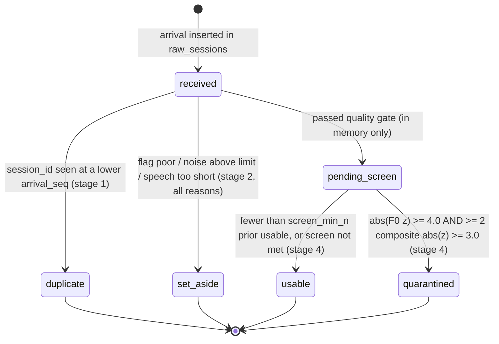
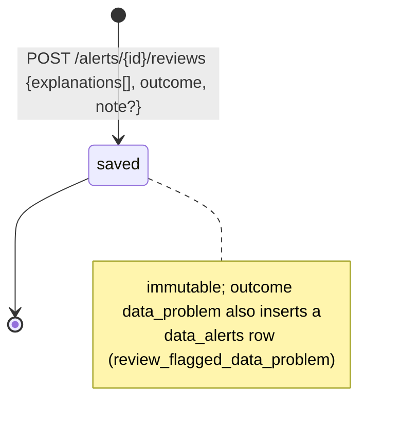
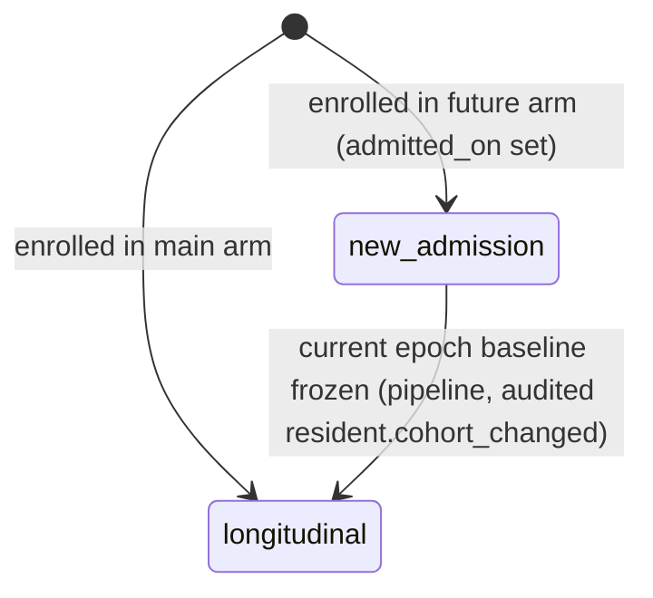
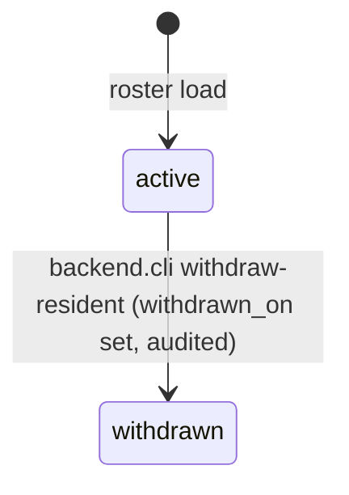
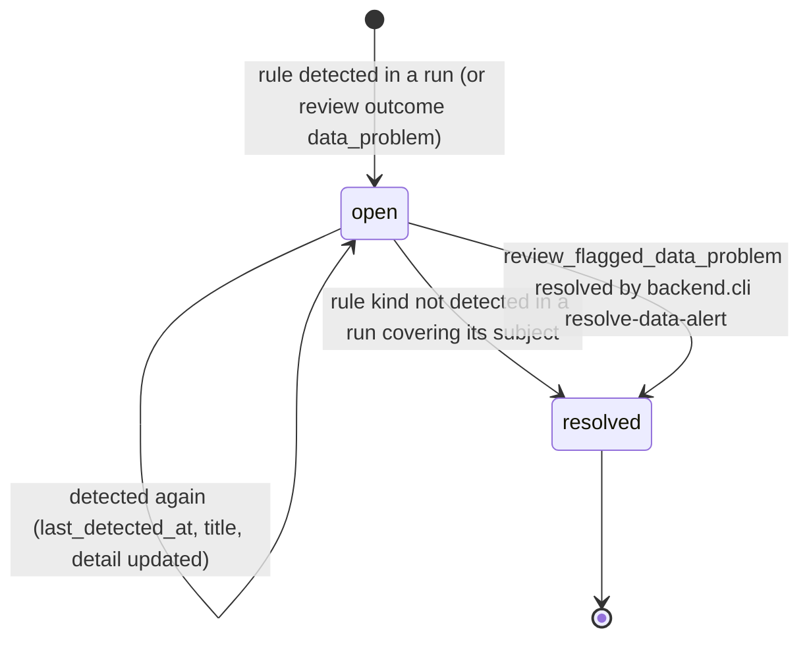

# 23 Data Model and Entity Definitions

Document ID: ECHOWELL-TRD-23 · Version 0.3 (draft for review) · Date: 18 October 2026 · Owner: Team 2 · Status: Draft

## 1. Purpose

This document defines the logical data model of EchoWell: every entity, its attributes with type, meaning, allowed
values and source, which pipeline stage or service writes it, and which API endpoint or UI element reads it. It defines
the state machines of the stateful entities, the derived values the API computes on read (30-day counts, last
check-in, resident display status, device silent days), the mapping of each entity to its SQLAlchemy model file,
Pydantic schema module and endpoints, and the mapping from the ingest CSV and the SRC-03 workbook columns to database
columns. Physical DDL is TRD 20; design rationale is TRD 06. Attribute names and types in section 4.2 were generated
from the catalog of a database built from the TRD 20 DDL, so the three documents agree exactly.

## 2. Scope

In scope:
- 24 entities (one per table, contract sections 9, 19, 20), their attributes, allowed values and writers/readers.
- State machines: processed session status, alert, alert review, data alert, resident cohort, resident status, epoch,
  baseline, CUSUM alarm, resident display status.
- Derived (not stored) values used by the API and UI.
- Entity ↔ model file ↔ Pydantic schema ↔ endpoint mapping.
- Ingest CSV (SRC-05) and workbook (SRC-03) column ↔ database column mapping.

Out of scope:
- DDL, indexes, grants (TRD 20); rebuild/backup/migration policy (TRD 06).
- Algorithms in full (TRD 07, TRD 08, TRD 09); request/response field lists of DTOs (TRD 05, TRD 19).
- UI layout and wording (TRD 04, TRD 11).

## 3. References

| ID | Reference |
|---|---|
| SRC-02 | Daily Data Storage and Processing Flowcharts (6 processing stages; raw store) |
| SRC-03 | Pipeline test workbook v0.1: Parameters, Data_dictionary, Annotated_sessions, Exp_status_counts, Exp_resident_outcomes, Exp_baselines, Exp_morning_offset, Exp_scores |
| SRC-04 | Generator v0.1 (reference implementation of stage rules) |
| SRC-05 | Pipeline test input CSV v0.1 |
| SRC-06 | Legacy mock data (old schema; not ingestible) |
| SRC-09 / SRC-10 / SRC-11 | Wireframes: overview, resident detail, new admissions |
| SRC-18 / SRC-19 | Wireframes: Alert review (`/alerts`), Analytics (`/analytics`) |
| Contract §19–§21 | Alert reviews, snooze, data alerts, evaluation answer key, R5, R9, R10, R15, R20, R21 |
| TRD 05 / TRD 19 | Backend API, OpenAPI contracts |
| TRD 06 / TRD 20 | Database design, PostgreSQL schema |
| TRD 07 / 08 / 09 / 10 | Analytics engine, Baseline and scoring, CUSUM and alerting, Ingestion |
| TRD 12 | Security (roles, audit vocabulary) |
| Owner decisions D-OWNER-2/3 (18 Oct 2026) | baseline_n 30 in production; PHI-derived treatment of feature data |

## 4. Requirements

### 4.1 Requirement table

| ID | Requirement | Priority | Trace | Verification |
|---|---|---|---|---|
| DME-001 | Each of the 24 entities of section 4.2 shall be implemented as exactly one SQLAlchemy 2.0 declarative class in the model file named in section 4.6, with the attribute names, types and nullability of section 4.2. | Must | TRD 20 PGS-006 | Test (`alembic check` no diff; model introspection test) |
| DME-002 | The 19 feature keys shall be defined once, in order, in `analytics/config.py` as `FEATURE_KEYS`, with `COMPOSITE_KEYS` (first 7) and `COMPOSITE_SIGNS` `{loudness_dbfs: -1, total_phrase_duration_s: +1, speech_rate_syl_per_s: -1, articulation_rate_syl_per_s: -1, number_of_pauses: +1, pause_fraction: +1, voiced_fraction: -1}`; models, schemas and tests shall import them rather than repeat the list. | Must | SRC-03, SRC-04, BR-10 | Test (equality with SRC-05 header columns 12–30) |
| DME-003 | Python enums mirroring the 15 PostgreSQL enum types (`str`-valued `enum.Enum`, same labels) shall be defined in `backend/models/__init__.py` and reused by Pydantic schemas; `analytics/` shall use plain string constants with the same values. | Must | TRD 20 PGS-005 | Test (labels equal `pg_enum`) |
| DME-004 | The API shall identify residents and devices by `resident_code` and `device_code` in paths and payloads, and shall never expose `residents.id` or `devices.id`. | Must | BR-16, contract §10 | Test (OpenAPI schema scan) |
| DME-005 | No Pydantic response schema shall contain `password_hash`, `key_hash`, `raw_sessions.payload`, any `evaluation_ground_truth` column outside the Analytics `alarm_timing` block, or `ingest_rejections.raw_body`; `GET /api/v1/ingest/batches/{id}` returns for each rejection only the TRD 19 `IngestRejection` fields (`row_number`, `session_id`, `received_at`, `errors`), never `raw_body`. | Must | BR-16, TRD 12 | Test |
| DME-006 | `processed_sessions.status` shall take exactly the transitions of section 4.3.1; `pending_screen` shall exist only in memory inside `analytics/` and shall never be persisted. | Must | BR-03, BR-04, BR-05, SRC-04 | Test (status counts of test_v0_1 = 267/12/2/2) |
| DME-007 | `alerts.status` shall change only along section 4.3.2; the first `alert_reviews` row sets `open` → `acknowledged` with `acknowledged_by`/`acknowledged_at`; neither a review nor a snooze shall change `scores`, `cusum_state` or `alarm_state` in v0.1 (OQ-05). | Must | BR-11, OQ-05, contract §19, R5 | Test |
| DME-021 | `alert_reviews` rows shall be immutable and several may exist per alert; a review with outcome `data_problem` shall, in the same transaction, create or link one `data_alerts` row of kind `review_flagged_data_problem` by `alert_review_id` (TRD 02 FR-273); `explanations` codes shall be validated against config `review_explanations`. | Must | Contract §19, OQ-25 | Test |
| DME-022 | A snooze shall set `alerts.snoozed_until = now() + alert_snooze_hours` and `snoozed_by`, leaving `status` unchanged; the UI shows "Not reviewed" emphasis again once `snoozed_until` has passed. | Must | Contract §19 | Test |
| DME-023 | `data_alerts` shall follow the lifecycle of section 4.3.7 and the natural keys of TRD 06 DB-036; for test_v0_1 as of 2026-10-30 exactly 4 rows are open: R08 baseline_stalled, R05 possible_other_speaker, R03 high_set_aside, D02 device_silent. | Must | Contract §19, OQ-24 | Test |
| DME-024 | `evaluation_ground_truth` shall hold rows only in databases running the test_v0_1 profile, shall never be read by `analytics/` or the pipeline service, and shall feed only the Analytics "Alarm timing check" (R09 Sudden step Oct 21 → alarm Oct 21, delay 0 days; R10 Slow drift Oct 17 → Oct 24, 7 days; other 8 None, no alarm, Correct). | Must | SRC-02, contract §19, R20 | Test |
| DME-025 | Entities carrying human state (`alerts`, `alert_reviews`, `staff_notes`, `data_alerts`) shall keep their primary keys across rebuilds by natural-key upsert (contract R15). | Must | R15 | Test (TRD 06 AC-DB-02a) |
| DME-008 | `residents.cohort` shall change only from `new_admission` to `longitudinal`, set by the pipeline when the resident's current epoch has a frozen baseline (section 4.3.3). | Should | BR-14, SRC-12 | Test |
| DME-009 | `residents.status` shall change only from `active` to `withdrawn` via `python -m backend.cli withdraw-resident <resident_code> --on <YYYY-MM-DD>` (section 4.3.4). | Must | OQ-11 | Test |
| DME-010 | The baseline state of a resident-epoch shall be derived as: `not_started` (0 usable), `forming` (1 … baseline_n − 1 usable), `frozen` (20 `baselines` rows exist); it shall never return from `frozen` to `forming` within an epoch. | Must | BR-09, ASM-07 | Test (R08 forming 13 of 16; R07 epoch 2 frozen) |
| DME-011 | The resident display status shall be derived on read by the rules of section 4.4.3 and shall not be stored. | Must | BR-12, contract §8 | Test (as of 2026-10-30: alarm_on R09, R10; baseline_forming R08; no_alarm 7 others) |
| DME-012 | The 30-day counts, last check-in, baseline progress, watching-since, alarm-since, baseline-restarted date and device silent days shall be derived on read by the definitions of section 4.4. | Must | BR-12, BR-13 | Test (wireframe SRC-09 values for test data) |
| DME-013 | JSON columns shall follow the shapes of section 4.5 and shall be validated by a Pydantic model before insert. | Must | BR-02 | Test |
| DME-014 | Values in `double precision` columns and JSON numbers shall be Python `float` (IEEE 754 float64) without rounding; JSON responses shall serialise them with full precision (no fixed decimal formatting in the API layer). | Must | BR-15, contract §7 tolerance 1e-6 | Test (round-trip of Exp_scores values) |
| DME-015 | Every ingest field of SRC-05 shall map to the `raw_sessions` column of section 4.7.1; the ingest layer shall resolve `resident_id` → `residents.id` and `device_id` → `devices.id` and keep the received strings in `resident_code` and `device_code`. | Must | BR-01, BR-02, SRC-05 | Test |
| DME-016 | The validation test suite shall compare database output with SRC-03 using the column mappings of section 4.7.2–4.7.7, with exact match for strings/booleans/integers and absolute tolerance 1e-6 for floats. | Must | BR-15 | Test (`tests/validation/`) |
| DME-017 | The workbook value `expected_status` shall be compared with `processed_sessions.status` for rows that have an arrival and with `day_ledger.status` for rows with `arrival_order = "no record"`. | Must | BR-06, BR-15 | Test |
| DME-018 | SRC-06 legacy mock data (entry_id, integer resident_id, datetime, health_*, speech_feature_1..3) shall not be mapped to any table; submitting it shall produce 422 rejections only. | Must | SRC-06, TRD 10 | Test |
| DME-019 | All instants shall be stored in UTC and converted to facility local time only for `local_date`, `local_time`, `is_morning` and API presentation, using `facilities.timezone`. | Must | ASM-01, BR-07 | Test (R06 morning sessions 09:xx local = 14:xx UTC → is_morning true) |
| DME-020 | No entity shall hold resident names, contact details or audio; `resident_code` is the only resident identifier. | Must | BR-16, contract §2 | Inspection |

### 4.2 Entity definitions

Type column = PostgreSQL type; "Null" = nullable. "Source / set by" names the device field, service, CLI command or
pipeline stage (stage numbers of TRD 07: 1 duplicate detection, 2 quality gate, 3 epoch detection, 4 speaker screen,
5 context adjustment, 6 personal baseline, 7 daily deviation score, 8 CUSUM, 9 alert generation, 10 day ledger).

#### 4.2.1 Facility (`facilities`)
Reference entity. Written by seed / admin CLI. Read by: header subline (`meta.facility_name` = `facilities.name`; env FACILITY_NAME only seeds the row), pipeline (timezone).

| Attribute | Type | Null | Meaning and allowed values | Source / set by |
|---|---|---|---|---|
| `id` | uuid | no | Surrogate key | gen_random_uuid() |
| `name` | text | no | Facility name. Test seed and study site: `Edgewood` (never Edge4Care); test data is marked by DATA_SOURCE_LABEL. Returned as `meta.facility_name`; created from env FACILITY_NAME by bootstrap/seed | Admin CLI / seed |
| `timezone` | text | no | IANA time zone for local dates and morning rule; default `America/Chicago` (ASM-01) | Admin CLI / seed |
| `created_at` | timestamptz | no | Instant the row was inserted (UTC) | Database default now() |
| `updated_at` | timestamptz | no | Instant of the last UPDATE (UTC) | Trigger set_updated_at() |

#### 4.2.2 User (`users`)
Dashboard user. Written by `/api/v1/users` (admin) and seed CLI. Read by `/api/v1/auth/login`, `/api/v1/auth/me`, `/api/v1/users`, author names on notes.

| Attribute | Type | Null | Meaning and allowed values | Source / set by |
|---|---|---|---|---|
| `id` | uuid | no | Surrogate key | gen_random_uuid() |
| `email` | text | no | Login identifier, lower-case, unique | Admin via /api/v1/users or seed CLI |
| `display_name` | text | no | Name shown in header and on notes (staff, not residents) | Admin |
| `password_hash` | text | no | argon2id hash (`$argon2id$…`); never returned by any API | Auth service (TRD 12) |
| `role` | user_role | no | `admin`, `clinician`, `researcher` | Admin |
| `active` | boolean | no | false blocks login; users are never deleted | Admin |
| `last_login_at` | timestamptz | yes | Instant of last successful login | Auth service |
| `created_at` | timestamptz | no | Instant the row was inserted (UTC) | Database default now() |
| `updated_at` | timestamptz | no | Instant of the last UPDATE (UTC) | Trigger set_updated_at() |

#### 4.2.3 Resident (`residents`)
Enrolled resident identified by study ID only. Written by roster load / seed CLI, withdraw CLI, pipeline (cohort). Read by every resident endpoint and the overview, detail and admissions pages.

| Attribute | Type | Null | Meaning and allowed values | Source / set by |
|---|---|---|---|---|
| `id` | uuid | no | Surrogate key | gen_random_uuid() |
| `facility_id` | uuid | no | Facility of enrolment | Roster load / seed |
| `resident_code` | text | no | Study ID (e.g. `R01`); upper-case letters, digits, hyphen, 1–32 chars; the only resident identifier in EchoWell (no names) | Roster load / seed; equals ingest field `resident_id` |
| `sex` | text | yes | `F`, `M` or NULL (unknown, OQ-20); used for F0 ranges and facility norms | Roster load / seed (SRC-04 for test) |
| `cohort` | resident_cohort | no | `longitudinal` or `new_admission` (future arm, BR-14); one-way transition to longitudinal (section 4.3.3) | Roster load; Pipeline (transition) |
| `enrolled_on` | date | no | First local day of the day ledger | Roster load / seed (2026-10-01 for test) |
| `admitted_on` | date | yes | Facility admission date for new admissions; NULL otherwise; not after enrolled_on | Roster load |
| `withdrawn_on` | date | yes | Local date of withdrawal; NULL while active | Admin CLI withdraw-resident |
| `status` | resident_status | no | `active` or `withdrawn` (withdrawn ⇔ withdrawn_on set) | Admin CLI withdraw-resident |
| `created_at` | timestamptz | no | Instant the row was inserted (UTC) | Database default now() |
| `updated_at` | timestamptz | no | Instant of the last UPDATE (UTC) | Trigger set_updated_at() |

#### 4.2.4 Device (`devices`)
Recording device. Written by roster load / seed; `firmware_version_last` by ingestion. Read by `/api/v1/devices` (Devices panel), overview Device column.

| Attribute | Type | Null | Meaning and allowed values | Source / set by |
|---|---|---|---|---|
| `id` | uuid | no | Surrogate key | gen_random_uuid() |
| `facility_id` | uuid | no | Facility where the device is installed | Roster load / seed |
| `device_code` | text | no | Device ID as sent by Team 1 (e.g. `D01`, `D07B`); equals ingest field `device_id` | Roster load / seed |
| `room_label` | text | yes | Optional location label (no resident names) | Roster load |
| `firmware_version_last` | text | yes | Firmware seen on the most recent record from this device | Ingestion (updated on insert of a newer record) |
| `active` | boolean | no | false when the device is retired or replaced (test seed: D07 false) | Roster load / admin CLI |
| `created_at` | timestamptz | no | Instant the row was inserted (UTC) | Database default now() |
| `updated_at` | timestamptz | no | Instant of the last UPDATE (UTC) | Trigger set_updated_at() |

#### 4.2.5 Device assignment (`device_assignments`)
Resident ↔ device over time; expresses sharing (R02 + R03 on D02) and moves (R07 D07 → D07B on 2026-10-13). Read by stage 10 (device gap rule), `/api/v1/devices`, overview "(shared)" / "(was D07)".

| Attribute | Type | Null | Meaning and allowed values | Source / set by |
|---|---|---|---|---|
| `id` | uuid | no | Surrogate key | gen_random_uuid() |
| `resident_id` | uuid | no | Resident using the device | Roster load / seed |
| `device_id` | uuid | no | Device assigned | Roster load / seed |
| `valid_from` | date | no | First local day of the assignment (inclusive) | Roster load / seed |
| `valid_to` | date | yes | Last local day (inclusive); NULL = current. One resident cannot have overlapping rows; overlapping rows of different residents on one device = shared device | Roster load / seed |
| `created_at` | timestamptz | no | Instant the row was inserted (UTC) | Database default now() |
| `updated_at` | timestamptz | no | Instant of the last UPDATE (UTC) | Trigger set_updated_at() |

#### 4.2.6 API key (`api_keys`)
Credential for devices/ingest (`X-API-Key`). Written by admin CLI. Read by the auth dependency of `/api/v1/sessions` and `/api/v1/ingest`.

| Attribute | Type | Null | Meaning and allowed values | Source / set by |
|---|---|---|---|---|
| `id` | uuid | no | Surrogate key | gen_random_uuid() |
| `name` | text | no | Human label (e.g. `test-ingest`, `edgewood-gateway`) | Admin CLI |
| `key_hash` | text | no | SHA-256 hex of the secret key; secret shown once at creation | Admin CLI (TRD 12) |
| `scopes` | text[] | no | Subset of {`ingest:write`, `pipeline:run`} (pipeline:run for the scheduled nightly trigger, contract R18) | Admin CLI |
| `device_id` | uuid | yes | Optional binding: key may only submit records for this device (TRD 10) | Admin CLI |
| `active` | boolean | no | false revokes the key | Admin CLI |
| `created_at` | timestamptz | no | Instant the row was inserted (UTC) | Database default now() |
| `updated_at` | timestamptz | no | Instant of the last UPDATE (UTC) | Trigger set_updated_at() |
| `last_used_at` | timestamptz | yes | Instant of last authenticated request | Auth dependency |

#### 4.2.7 Ingest batch (`ingest_batches`)
One per batch request or CSV upload (`api_single` single POSTs have no batch row). Read by `/api/v1/ingest` response and `/api/v1/ingest/batches/{id}`.

| Attribute | Type | Null | Meaning and allowed values | Source / set by |
|---|---|---|---|---|
| `id` | uuid | no | Surrogate key; returned as `ingest_batch_id` | gen_random_uuid() |
| `source` | ingest_source | no | `api_single`, `api_batch`, `csv_upload`, `seed` | Ingestion |
| `filename` | text | yes | Uploaded CSV file name (required for csv_upload) | Ingestion |
| `record_count` | integer | no | Records parsed from the request/file | Ingestion |
| `accepted_count` | integer | no | Records inserted into raw_sessions (includes duplicates) | Ingestion |
| `rejected_count` | integer | no | Records written to ingest_rejections | Ingestion |
| `duplicate_count` | integer | no | Accepted records whose session_id had already been received | Ingestion |
| `uploaded_by` | uuid | yes | User who uploaded (admin) or NULL | Ingestion |
| `api_key_id` | uuid | yes | API key that submitted, or NULL | Ingestion |
| `received_at` | timestamptz | no | Instant the request arrived | Ingestion |
| `created_at` | timestamptz | no | Instant the row was inserted (UTC) | Database default now() |
| `updated_at` | timestamptz | no | Instant of the last UPDATE (UTC) | Trigger set_updated_at() |

#### 4.2.8 Ingest rejection (`ingest_rejections`)
Schema-invalid record; never enters the raw store. Read by `/api/v1/ingest/batches/{id}`.

| Attribute | Type | Null | Meaning and allowed values | Source / set by |
|---|---|---|---|---|
| `id` | uuid | no | Surrogate key | gen_random_uuid() |
| `ingest_batch_id` | uuid | yes | Batch, NULL for a rejected single POST /sessions | Ingestion |
| `api_key_id` | uuid | yes | Submitting key, if any | Ingestion |
| `row_number` | integer | yes | 1-based data row number in the CSV (header excluded); NULL for JSON | Ingestion |
| `received_at` | timestamptz | no | Instant received | Ingestion |
| `raw_body` | jsonb | no | The rejected record as received (JSON object; CSV row as strings) | Ingestion |
| `errors` | jsonb | no | Non-empty JSON array of validation errors, each with at least `field` and `message` (exact shape TRD 10) | Ingestion |

#### 4.2.9 Raw session (`raw_sessions`)
Immutable copy of every accepted arrival, including duplicates (SRC-02 raw store). Written only by ingestion. Read by the pipeline, `/api/v1/devices` (last upload), and never shown directly in the UI.

| Attribute | Type | Null | Meaning and allowed values | Source / set by |
|---|---|---|---|---|
| `id` | uuid | no | Surrogate key; returned as `raw_session_id` | gen_random_uuid() |
| `arrival_seq` | bigserial | no | Global arrival order (bigserial); duplicate detection keeps the lowest arrival_seq per session_id | Database sequence |
| `received_at` | timestamptz | no | Instant the record arrived at the API | Ingestion |
| `ingest_batch_id` | uuid | yes | Batch the record arrived in; NULL for single POST | Ingestion |
| `api_key_id` | uuid | yes | Key that submitted it; NULL for admin CSV/seed | Ingestion |
| `payload` | jsonb | no | Exact received record (JSON object); never modified | Ingestion |
| `ingest_warnings` | jsonb | no | Array of plausibility warnings `{field, code, message}` written at insert (TRD 10 §4.4); default `[]` | Ingestion |
| `resident_id` | uuid | no | FK to residents resolved from field `resident_id` (resident_code) | Ingestion |
| `device_id` | uuid | no | FK to devices resolved from field `device_id` (device_code) | Ingestion |
| `schema_version` | text | no | Ingest schema version, `0.1` in v0.1 | Device field |
| `session_id` | text | no | `<resident_id>-<YYYYMMDD local>-<NN>`, e.g. `R01-20261001-01`; dedupe key; not unique here | Device field |
| `resident_code` | text | no | Copy of ingest field `resident_id` as received | Device field |
| `device_code` | text | no | Copy of ingest field `device_id` as received | Device field |
| `timestamp_utc` | timestamptz | no | Recording instant; received as `YYYY-MM-DD HH:MM:SS` UTC | Device field |
| `mic_noise_level_dbfs` | double precision | no | Background noise, dBFS (normal about −56 to −46); quality gate limit −40.0 | Device field |
| `audio_quality_flag` | text | no | `ok` or `poor` (device usability flag) | Device field |
| `extraction_software_version` | text | no | Extractor and version, e.g. `openSMILE 3.0.2`; epoch key | Device field |
| `device_firmware_version` | text | no | Firmware, e.g. `fw-1.0.0`; epoch key | Device field |
| `speech_duration_s` | double precision | no | Detected speech length, s; quality gate minimum 1.0 | Device field |
| `phrase_id` | text | no | Phrase spoken, `P01` in v0.1; 1–16 characters, required by schema v0.1 (TRD 10); whether it is kept in a later schema is OQ-04 | Device field |
| `loudness_dbfs` | double precision | no | Acoustic feature (placeholder name, OQ-03); unit dBFS; composite, sign -1, morning offset -1.50 | Device field (Team 1 extractor) |
| `total_phrase_duration_s` | double precision | no | Acoustic feature (placeholder name, OQ-03); unit s; composite, sign +1, morning offset +0.10 | Device field (Team 1 extractor) |
| `speech_rate_syl_per_s` | double precision | no | Acoustic feature (placeholder name, OQ-03); unit syllables/s; composite, sign -1, morning offset -0.12 | Device field (Team 1 extractor) |
| `articulation_rate_syl_per_s` | double precision | no | Acoustic feature (placeholder name, OQ-03); unit syllables/s; composite, sign -1, morning offset -0.10 | Device field (Team 1 extractor) |
| `number_of_pauses` | integer | no | Acoustic feature (placeholder name, OQ-03); unit count, integer >= 0; composite, sign +1, morning offset 0 | Device field (Team 1 extractor) |
| `pause_fraction` | double precision | no | Acoustic feature (placeholder name, OQ-03); unit proportion 0..1; composite, sign +1, morning offset +0.010 | Device field (Team 1 extractor) |
| `voiced_fraction` | double precision | no | Acoustic feature (placeholder name, OQ-03); unit proportion 0..1; composite, sign -1, morning offset -0.020 | Device field (Team 1 extractor) |
| `mean_f0_hz` | double precision | no | Acoustic feature (placeholder name, OQ-03); unit Hz, > 0; stored, not scored; used by speaker screen | Device field (Team 1 extractor) |
| `f0_variability_st` | double precision | no | Acoustic feature (placeholder name, OQ-03); unit semitones; stored, not scored | Device field (Team 1 extractor) |
| `jitter_local_pct` | double precision | no | Acoustic feature (placeholder name, OQ-03); unit percent; stored, not scored | Device field (Team 1 extractor) |
| `shimmer_local_pct` | double precision | no | Acoustic feature (placeholder name, OQ-03); unit percent; stored, not scored | Device field (Team 1 extractor) |
| `hnr_db` | double precision | no | Acoustic feature (placeholder name, OQ-03); unit dB; stored, not scored | Device field (Team 1 extractor) |
| `cpps_db` | double precision | no | Acoustic feature (placeholder name, OQ-03); unit dB; stored, not scored | Device field (Team 1 extractor) |
| `alpha_ratio_db` | double precision | no | Acoustic feature (placeholder name, OQ-03); unit dB; stored, not scored | Device field (Team 1 extractor) |
| `hammarberg_index_db` | double precision | no | Acoustic feature (placeholder name, OQ-03); unit dB; stored, not scored | Device field (Team 1 extractor) |
| `mfcc1` | double precision | no | Acoustic feature (placeholder name, OQ-03); unit unitless; stored, not scored | Device field (Team 1 extractor) |
| `mfcc2` | double precision | no | Acoustic feature (placeholder name, OQ-03); unit unitless; stored, not scored | Device field (Team 1 extractor) |
| `mfcc3` | double precision | no | Acoustic feature (placeholder name, OQ-03); unit unitless; stored, not scored | Device field (Team 1 extractor) |
| `mfcc4` | double precision | no | Acoustic feature (placeholder name, OQ-03); unit unitless; stored, not scored | Device field (Team 1 extractor) |

#### 4.2.10 Pipeline run (`pipeline_runs`)
One execution of the pipeline. Read by `/api/v1/pipeline/runs/{id}`, `/api/v1/analytics` (run info), `/admin` page, header "as of" time (latest succeeded run's `as_of`).

| Attribute | Type | Null | Meaning and allowed values | Source / set by |
|---|---|---|---|---|
| `id` | uuid | no | Surrogate key; returned as `pipeline_run_id` | gen_random_uuid() |
| `trigger` | pipeline_trigger | no | `ingest` (after POST), `nightly` (02:00 local), `manual` (POST /pipeline/run), `test` | Pipeline service |
| `scope` | jsonb | no | `{"type": "all"}` or `{"type": "residents", "resident_codes": ["R01", …]}` | Pipeline service |
| `config_profile` | text | no | `production` or `test_v0_1`; must equal PIPELINE_PROFILE | Pipeline service |
| `config_snapshot` | jsonb | no | All 23 config_parameters keys and values of the profile used, plus `config_hash` (algorithm keys only, TRD 07 ANL-030) and `as_of`, as one JSON object | Pipeline service |
| `code_version` | text | no | Git SHA (GIT_SHA) or `unknown` when unset (TRD 21) | Pipeline service |
| `as_of` | timestamptz | no | Instant up to which the day ledger runs: explicit `as_of` of POST /pipeline/run → PIPELINE_AS_OF (not in production) → now() (contract R21); test 2026-10-30T20:00:00Z | Pipeline service |
| `started_at` | timestamptz | no | Start instant | Pipeline service |
| `finished_at` | timestamptz | yes | End instant; NULL while running | Pipeline service |
| `status` | pipeline_run_status | no | `running`, `succeeded`, `failed` | Pipeline service |
| `counts` | jsonb | no | JSON object with exactly the keys arrivals, usable, set_aside, quarantined, duplicate, missing_resident, missing_device_gap, late_arrival, scored, alerts_opened, excluded_after_as_of, residents (+ db_size_bytes on nightly runs); this list is the single definition (TRD 06 DB-020, TRD 07 `PipelineResult.counts`, TRD 17 LOG-065, TRD 19 `PipelineRun`) | Pipeline service |
| `warnings` | jsonb | no | JSON array of objects `{code, resident_code, session_id, detail}` with a lower-case `code` from TRD 07 ANL-052 (e.g. `late_arrival`); this shape is the single definition | Pipeline service |
| `error_message` | text | yes | Failure summary when status = failed (no record content) | Pipeline service |
| `created_at` | timestamptz | no | Instant the row was inserted (UTC) | Database default now() |
| `updated_at` | timestamptz | no | Instant of the last UPDATE (UTC) | Trigger set_updated_at() |

#### 4.2.11 Epoch (`epochs`)
Period with constant (device, firmware, extractor) for a resident. Read by resident detail (epoch, "baseline restarted"), `/api/v1/scores?epoch=`, analytics outcome table.

| Attribute | Type | Null | Meaning and allowed values | Source / set by |
|---|---|---|---|---|
| `id` | uuid | no | Surrogate key; stable across rebuilds (upsert by resident_id, epoch_number) | gen_random_uuid() |
| `resident_id` | uuid | no | Resident | Stage 3 epoch detection |
| `epoch_number` | integer | no | 1, 2, … in timestamp order per resident | Stage 3 |
| `device_id` | uuid | no | Device of the epoch | Stage 3 |
| `device_firmware_version` | text | no | Firmware of the epoch | Stage 3 |
| `extraction_software_version` | text | no | Extractor version of the epoch | Stage 3 |
| `started_at` | timestamptz | no | timestamp_utc of the first non-duplicate record of the epoch | Stage 3 |
| `ended_at` | timestamptz | yes | started_at of the next epoch (exclusive end); NULL for the current epoch | Stage 3 |
| `pipeline_run_id` | uuid | no | Run that last wrote the row | Pipeline service |
| `created_at` | timestamptz | no | Instant the row was inserted (UTC) | Database default now() |
| `updated_at` | timestamptz | no | Instant of the last UPDATE (UTC) | Trigger set_updated_at() |

#### 4.2.12 Processed session (`processed_sessions`)
Pipeline interpretation of one raw record. Read by overview 30-day counts and last check-in, check-in log, feature sparklines, analytics status counts.

| Attribute | Type | Null | Meaning and allowed values | Source / set by |
|---|---|---|---|---|
| `id` | uuid | no | Surrogate key; regenerated on every rebuild | gen_random_uuid() |
| `raw_session_id` | uuid | no | The raw record this row interprets (1:1) | Pipeline service |
| `session_id` | text | no | Copy of raw session_id | Stage 1 |
| `resident_id` | uuid | no | Resident | Stage 1 |
| `epoch_id` | uuid | yes | Epoch; NULL for duplicates and for a late arrival that precedes the resident's first epoch (TRD 08 BSC-040) | Stage 3 |
| `status` | session_status | no | `usable`, `set_aside`, `quarantined`, `duplicate` | Stages 1, 2, 4 |
| `reasons` | text[] | no | Ordered reason list: duplicate `session_id already received`; set_aside subset of `quality flag poor`, `noise above limit`, `speech too short` in that order; quarantined one `possible other speaker (F0 z=<2dp>; composite features with \|z\|>=3: <n>)`; usable empty; a late arrival (`late_arrival` true) that is usable has exactly `late arrival (not used for baseline or scores)`, and one that is quarantined has that text as its second reason | Stages 1, 2, 4 |
| `reason_text` | text | no | reasons joined with `; ` (`''` for usable); equals workbook expected_reason | Stages 1, 2, 4 |
| `timestamp_utc` | timestamptz | no | Copy of raw timestamp_utc | Stage 1 |
| `local_date` | date | no | Local calendar date in facilities.timezone | Stage 5 |
| `local_time` | time(0) | no | Local clock time (seconds precision) | Stage 5 |
| `is_morning` | boolean | no | local hour < morning_cutoff_hour (12) | Stage 5 |
| `screen_detail` | text | yes | `F0 z=<2dp>; composite features with \|z\|>=3: <n>` when the screen ran; NULL when fewer than screen_min_n prior usable sessions or not screened | Stage 4 |
| `baseline_ordinal` | integer | yes | 1-based position among usable, non-late sessions of the epoch (timestamp order); NULL unless usable and not late | Stage 6 |
| `in_baseline` | boolean | no | true for usable, non-late sessions with baseline_ordinal ≤ baseline_n | Stage 6 |
| `late_arrival` | boolean | no | true when TRD 07 ANL-024 classifies the record as a late arrival; such a row is never in a baseline, never scored and has no `baseline_ordinal` (TRD 08 BSC-040, TRD 20 CHECKs) | Late-arrival step (TRD 07) |
| `adjusted_features` | jsonb | yes | JSON object of 19 feature keys → morning-adjusted value (raw − offset if morning, else raw); NULL for duplicates | Stage 5 |
| `pipeline_run_id` | uuid | no | Run that wrote the row | Pipeline service |
| `created_at` | timestamptz | no | Instant the row was inserted (UTC) | Database default now() |

#### 4.2.13 Day ledger entry (`day_ledger`)
One row per resident per local day; the honest record of missing days (never backfilled). Read by overview "missed", check-in log ("missed", "device silent"), Devices panel silent days, analytics status counts.

| Attribute | Type | Null | Meaning and allowed values | Source / set by |
|---|---|---|---|---|
| `id` | uuid | no | Surrogate key | gen_random_uuid() |
| `resident_id` | uuid | no | Resident | Stage 10 day ledger |
| `local_date` | date | no | Local calendar day (enrolled_on … as-of date / withdrawn_on) | Stage 10 |
| `status` | day_status | no | `checked_in` (≥1 non-duplicate record that day), `missing_resident`, `missing_device_gap` | Stage 10 |
| `device_id` | uuid | yes | Device assigned to the resident that day (NULL if none) | Stage 10 |
| `reason` | text | no | `''` (checked_in), `no record received`, `all residents on shared device <device_code> have no record` | Stage 10 |
| `pipeline_run_id` | uuid | no | Run that wrote the row | Pipeline service |
| `created_at` | timestamptz | no | Instant the row was inserted (UTC) | Database default now() |

#### 4.2.14 Baseline (`baselines`)
Frozen per-feature statistics of a resident-epoch (19 features + composite = 20 rows). Read by resident detail baseline line, `/api/v1/analytics/baselines`, scoring.

| Attribute | Type | Null | Meaning and allowed values | Source / set by |
|---|---|---|---|---|
| `id` | uuid | no | Surrogate key | gen_random_uuid() |
| `resident_id` | uuid | no | Resident | Stage 6 |
| `epoch_id` | uuid | no | Epoch the baseline belongs to | Stage 6 |
| `feature_key` | text | no | One of the 19 feature keys or `composite` | Stage 6 |
| `n_sessions` | integer | no | Sessions in the baseline (= baseline_n of the profile) | Stage 6 |
| `first_session_id` | text | no | session_id of the first baseline session | Stage 6 |
| `frozen_after_session_id` | text | no | session_id of the baseline_n-th usable session | Stage 6 |
| `median` | double precision | no | Median of adjusted values (composite: of composite_raw) | Stage 6 |
| `mad` | double precision | no | Median absolute deviation from the median | Stage 6 |
| `robust_spread` | double precision | no | max(mad × 1.4826, floor); floor 0.5 for number_of_pauses, 0.1 for composite, 0 otherwise | Stage 6 |
| `floor_applied` | boolean | no | true when robust_spread > mad × 1.4826 | Stage 6 |
| `frozen_at` | timestamptz | no | timestamp_utc of the frozen_after session (deterministic) | Stage 6 |
| `pipeline_run_id` | uuid | no | Run that froze it | Pipeline service |
| `created_at` | timestamptz | no | Instant the row was inserted (UTC) | Database default now() |

#### 4.2.15 Score (`scores`)
Daily deviation score of one usable post-freeze session. Read by `/api/v1/scores` (Running change tally chart), `/api/v1/residents/{code}/features` (z sparklines).

| Attribute | Type | Null | Meaning and allowed values | Source / set by |
|---|---|---|---|---|
| `id` | uuid | no | Surrogate key | gen_random_uuid() |
| `processed_session_id` | uuid | no | Scored usable session (after freeze) | Stage 7 |
| `resident_id` | uuid | no | Resident | Stage 7 |
| `epoch_id` | uuid | no | Epoch | Stage 7 |
| `local_date` | date | no | Local date of the session | Stage 7 |
| `is_morning` | boolean | no | Copy of processed_sessions.is_morning | Stage 7 |
| `z` | jsonb | no | JSON object with 7 keys `z_<feature>` → (adjusted − median)/spread (unsigned) | Stage 7 |
| `composite_raw` | double precision | no | Mean over 7 of sign × z | Stage 7 |
| `composite_z` | double precision | no | (composite_raw − composite median)/composite spread | Stage 7 |
| `cusum_tally` | double precision | no | S = max(0, S_prev + composite_z − k), S0 = 0 | Stage 8 CUSUM |
| `alarm_state` | alarm_state | no | `off`, `rings` (first crossing of h), `on` (after first crossing) | Stage 8 |
| `pipeline_run_id` | uuid | no | Run that wrote the row | Pipeline service |
| `created_at` | timestamptz | no | Instant the row was inserted (UTC) | Database default now() |

#### 4.2.16 CUSUM state (`cusum_state`)
Latest tally per epoch. Read by overview and detail status, `/api/v1/residents/{code}`.

| Attribute | Type | Null | Meaning and allowed values | Source / set by |
|---|---|---|---|---|
| `epoch_id` | uuid | no | Epoch (primary key) | Stage 8 |
| `resident_id` | uuid | no | Resident | Stage 8 |
| `current_tally` | double precision | no | Tally after the last scored session; 0 before any | Stage 8 |
| `last_scored_session_id` | text | yes | session_id of the last scored session; NULL if none | Stage 8 |
| `alarm_on` | boolean | no | true once the tally has reached h in this epoch (no reset in v0.1, OQ-05) | Stage 8 |
| `pipeline_run_id` | uuid | no | Run that wrote the row | Pipeline service |
| `updated_at` | timestamptz | no | Instant of the last UPDATE (UTC) | Trigger set_updated_at() |

#### 4.2.17 Alert (`alerts`)
Alarm event at the first crossing of h; a flag for clinician review, not a diagnosis. Read by `/api/v1/alerts`, overview badge "▲ Alarm since <Mon D>", detail check-in log.

| Attribute | Type | Null | Meaning and allowed values | Source / set by |
|---|---|---|---|---|
| `id` | uuid | no | Surrogate key; stable across rebuilds | gen_random_uuid() |
| `resident_id` | uuid | no | Resident | Stage 9 alert generation |
| `epoch_id` | uuid | no | Epoch of the crossing | Stage 9 |
| `session_id` | text | no | session_id of the first crossing | Stage 9 |
| `triggered_at` | timestamptz | no | timestamp_utc of that session | Stage 9 |
| `local_date` | date | no | Local date of that session (UI "Alarm since") | Stage 9 |
| `cusum_value` | double precision | no | Tally at the crossing (≥ h) | Stage 9 |
| `status` | alert_status | no | `open`, `acknowledged` (set by the first alert review), `closed` (pipeline only, TRD 02 FR-110) | Stage 9; POST /alerts/{id}/reviews |
| `closed_reason` | text | yes | `epoch ended`, `superseded by rebuild` (pipeline); `admin` is reserved and not set in v0.1 (TRD 02 FR-110); NULL unless closed | Stage 9 |
| `closed_at` | timestamptz | yes | Instant closed | Stage 9 |
| `acknowledged_by` | uuid | yes | Reviewer of the first alert review | POST /alerts/{id}/reviews |
| `acknowledged_at` | timestamptz | yes | Instant of the first alert review | POST /alerts/{id}/reviews |
| `snoozed_until` | timestamptz | yes | "Remind me" time: now + alert_snooze_hours (24) when snoozed; hides "Not reviewed" emphasis until then; does not change alarm state | POST /alerts/{id}/snooze |
| `snoozed_by` | uuid | yes | User who snoozed (set together with snoozed_until) | POST /alerts/{id}/snooze |
| `pipeline_run_id` | uuid | no | Run that created or last reconciled it | Pipeline service |
| `created_at` | timestamptz | no | Instant the row was inserted (UTC) | Database default now() |
| `updated_at` | timestamptz | no | Instant of the last UPDATE (UTC) | Trigger set_updated_at() |

#### 4.2.18 Alert review (`alert_reviews`)
Nurse/clinical-lead review of an alarm (SRC-18 review panel). Written by `POST /api/v1/alerts/{id}/reviews` (clinician, admin). Read by `GET /api/v1/alerts/{id}/reviews`, the "Reviewed"/"Not reviewed" badge, Analytics review outcomes (production profile).

| Attribute | Type | Null | Meaning and allowed values | Source / set by |
|---|---|---|---|---|
| `id` | uuid | no | Surrogate key | gen_random_uuid() |
| `alert_id` | uuid | no | Alert reviewed (several reviews per alert allowed: history) | POST /alerts/{id}/reviews |
| `reviewer_user_id` | uuid | no | Clinician or admin who saved the review (OQ-26) | Same (from token) |
| `explanations` | text[] | no | Codes from config `review_explanations`: `cold_cough_sore_throat`, `dental_dentures`, `medication_change`, `poor_sleep_unusual_day`, `room_device_moved` (provisional, OQ-25); 0–5 selected | Same |
| `outcome` | review_outcome | no | `no_concern`, `known_cause`, `referred`, `data_problem` (required, single) | Same |
| `note` | text | yes | Optional text, 1–2000 characters, no resident names | Same |
| `created_at` | timestamptz | no | Instant the row was inserted (UTC) | Database default now() |

#### 4.2.19 Data alert (`data_alerts`)
Data-quality alert for the study team (not a health alarm), queue 2 of the Alert review page. Written by the pipeline's data-alert rules and by the review service. Read by `GET /api/v1/data-alerts`.

| Attribute | Type | Null | Meaning and allowed values | Source / set by |
|---|---|---|---|---|
| `id` | uuid | no | Surrogate key | gen_random_uuid() |
| `kind` | data_alert_kind | no | `baseline_stalled`, `possible_other_speaker`, `high_set_aside`, `device_silent`, `review_flagged_data_problem` | Data-alert rules (end of run) / review service |
| `resident_id` | uuid | yes | Subject resident (all kinds except device_silent) | Same |
| `device_id` | uuid | yes | Subject device (device_silent only) | Same |
| `alert_review_id` | uuid | yes | Review with outcome data_problem that raised it (review_flagged_data_problem only) | Review service |
| `title` | text | no | Queue card title, e.g. `R08 · baseline stuck at 13 of 16`, `D02 · device silent all day` (≤ 200 chars) | Same |
| `detail` | text | no | Queue card detail, e.g. `12 missed and 5 set aside in 30 days`, `Oct 12 · affects R02 and R03` (≤ 500 chars) | Same |
| `first_detected_at` | timestamptz | no | as_of of the run that first detected it (review time for review-flagged) | Same |
| `last_detected_at` | timestamptz | no | as_of of the latest run that detected it | Same |
| `status` | data_alert_status | no | `open` or `resolved` | Same |
| `resolved_at` | timestamptz | yes | as_of of the run that no longer detected it, or CLI resolution time | Pipeline / `backend.cli resolve-data-alert` |
| `pipeline_run_id` | uuid | yes | Run that last detected it; NULL for review_flagged_data_problem | Pipeline service |
| `created_at` | timestamptz | no | Instant the row was inserted (UTC) | Database default now() |
| `updated_at` | timestamptz | no | Instant of the last UPDATE (UTC) | Trigger set_updated_at() |

#### 4.2.20 Staff note (`staff_notes`)
Staff review note (append-only; corrections supersede). Read by `/api/v1/residents/{code}/notes`, detail "Staff review" section.

| Attribute | Type | Null | Meaning and allowed values | Source / set by |
|---|---|---|---|---|
| `id` | uuid | no | Surrogate key | gen_random_uuid() |
| `resident_id` | uuid | no | Resident the note is about | POST /residents/{code}/notes |
| `alert_id` | uuid | yes | Alert the note reviews (optional) | Same |
| `author_user_id` | uuid | no | Clinician or admin who wrote it | Same (from token) |
| `note_type` | note_type | no | `observation`, `action_taken`, `follow_up` | Same |
| `body` | text | no | 1–2000 characters; no resident names (UI hint) | Same |
| `marked_reviewed` | boolean | no | Retained from contract §9; always false in the MVP because reviews are recorded in `alert_reviews` (contract R5) | POST /residents/{code}/notes |
| `supersedes_id` | uuid | yes | Earlier note this row corrects (each note superseded at most once) | Same |
| `created_at` | timestamptz | no | Instant the row was inserted (UTC) | Database default now() |

#### 4.2.21 Facility reference range (`facility_reference_ranges`)
Future arm (experimental): per-feature facility range. Read by `/api/v1/facility/reference-ranges`, `/api/v1/admissions/{code}/comparison`, New admissions page.

| Attribute | Type | Null | Meaning and allowed values | Source / set by |
|---|---|---|---|---|
| `id` | uuid | no | Surrogate key | gen_random_uuid() |
| `facility_id` | uuid | no | Facility | Future-arm computation (TRD 08) |
| `feature_key` | text | no | One of 19 feature keys | Same |
| `sex` | text | yes | `F`, `M` or NULL (all residents) | Same |
| `low` | double precision | no | Lower bound of the range (statistic per OQ-08) | Same |
| `high` | double precision | no | Upper bound | Same |
| `method` | text | no | Text naming the statistic (e.g. `p10-p90 of resident medians`) | Same |
| `n_residents` | integer | no | Residents contributing | Same |
| `computed_at` | timestamptz | no | Instant computed | Same |
| `pipeline_run_id` | uuid | no | Run | Same |

#### 4.2.22 Config parameter (`config_parameters`)
Algorithm, data-alert and review parameters per profile (contract sections 7 and 19 plus 2 ingest keys of TRD 10; 23 keys). Read by `analytics.config.PipelineConfig.from_mapping()` (TRD 07 §4.2; the backend turns the rows into a key → value mapping first), snapshot into `pipeline_runs`. Primary key (profile, key).

| Attribute | Type | Null | Meaning and allowed values | Source / set by |
|---|---|---|---|---|
| `profile` | text | no | `production` or `test_v0_1` | Migration 0002 / admin |
| `key` | text | no | Parameter key (23 keys: 16 of contract section 7, 5 of section 19, 2 ingest keys `supported_schema_versions` and `feature_name_map`) | Migration 0002 |
| `value` | jsonb | no | JSON value (number, string, or object for morning_offsets) | Migration 0002 / `backend.cli set-config` (audited `config.changed`, TRD 15 §4.8) |
| `description` | text | no | Plain-language meaning | Migration 0002 |
| `updated_by` | uuid | yes | User who last changed it; NULL for migration | Admin |
| `updated_at` | timestamptz | no | Instant of the last UPDATE (UTC) | Trigger set_updated_at() |

#### 4.2.23 Audit log entry (`audit_logs`)
Append-only audit trail. Read by admins via SQL (`echowell_readonly`); no MVP endpoint lists it.

| Attribute | Type | Null | Meaning and allowed values | Source / set by |
|---|---|---|---|---|
| `id` | bigserial | no | Sequential id (bigserial) | Database sequence |
| `occurred_at` | timestamptz | no | Instant of the action | Database default now() |
| `actor_type` | actor_type | no | `user`, `api_key`, `system` | Every service |
| `actor_id` | text | yes | users.id or api_keys.id as text; NULL for system | Every service |
| `action` | text | no | one value of the TRD 12 §4.12 audit vocabulary (the only source), e.g. `auth.login.succeeded`, `auth.logout`, `ingest.batch.received`, `alert.reviewed`, `pipeline.run.finished`, `resident.cohort_changed`; CHECK `^[a-z_]+(\.[a-z_]+){1,2}$` (TRD 20) | Every service |
| `entity_type` | text | yes | Table name of the affected entity | Every service |
| `entity_id` | text | yes | Affected id as text | Every service |
| `details` | jsonb | no | JSON object of non-PII detail (never record content or passwords) | Every service |
| `ip` | inet | yes | Client IP | API layer |
| `request_id` | text | yes | X-Request-ID of the request | API layer |

#### 4.2.24 Evaluation ground truth (`evaluation_ground_truth`)
Answer-key facts for the Analytics "Alarm timing check" (SRC-19), loaded only in test_v0_1. `echowell_app` has no privilege; loaded by `database/seeds/load_evaluation_ground_truth.py`; read after the run only by `backend/services/analytics_summary.py` through `DATABASE_READONLY_URL` (role `echowell_readonly`, contract R27). Never read by the pipeline (SRC-02).

| Attribute | Type | Null | Meaning and allowed values | Source / set by |
|---|---|---|---|---|
| `id` | uuid | no | Surrogate key | gen_random_uuid() |
| `resident_code` | text | no | Test resident (R01–R10); deliberately no FK | `database/seeds/load_evaluation_ground_truth.py` (test_v0_1 only) |
| `planted_change` | text | no | `None`, `Sudden step` (R09), `Slow drift` (R10) | `database/seeds/load_evaluation_ground_truth.py` from the CSV fixture DS-10 (derived from SRC-03 Test_plan / SRC-04) |
| `true_onset_date` | date | yes | Planted change start: R09 2026-10-21, R10 2026-10-17; NULL when None | Same |
| `source_file` | text | no | `EchoWell_pipeline_test_v0_1.xlsx` | Same |
| `created_at` | timestamptz | no | Instant the row was inserted (UTC) | Database default now() |

### 4.3 State machines

#### 4.3.1 Processed session status

Status is a pure function of the raw records (re-derived on each rebuild), evaluated in this order:

| Status | Epoch | In baseline / scored | Updates CUSUM | Counted in overview |
|---|---|---|---|---|
| usable | yes | first baseline_n → baseline; later → scored | yes (when scored) | "used" |
| set_aside | yes | never | no | "set aside" |
| quarantined | yes | never | no | "quarantined" |
| duplicate | no (NULL) | never | no | never shown |

#### 4.3.2 Alert status

```mermaid
stateDiagram-v2
  [*] --> open: first crossing of h in epoch (stage 9)
  open --> open: snooze (snoozed_until set; status unchanged)
  open --> acknowledged: first POST /alerts/{id}/reviews (clinician, admin)
  acknowledged --> acknowledged: further reviews (history) or snooze
  open --> closed: new epoch starts (epoch ended) / superseded by rebuild
  acknowledged --> closed: new epoch starts (epoch ended) / superseded by rebuild
  closed --> [*]
```

The first review records `acknowledged_by`/`acknowledged_at` ("Reviewed" badge) and leaves the tally and alarm unchanged
(OQ-05). A closed alert is never reopened; a later crossing in a new epoch creates a new alert. The Resident detail "Mark as
reviewed" button opens the same review form (contract R5); there is no separate acknowledge endpoint.

#### 4.3.2a Alert review

A review has no further states; corrections are made by saving another review (history ordered by `created_at`).

#### 4.3.3 Resident cohort

While `new_admission`, the resident appears on the New admissions page (compared with facility ranges, experimental);
after the transition the resident appears in the main Residents overview.

#### 4.3.4 Resident status

Withdrawn residents: ingestion returns 422 "resident withdrawn"; ledger stops at `withdrawn_on`; hidden unless
`include_withdrawn=true`; data kept pending OQ-11.

#### 4.3.5 Epoch and baseline

```mermaid
stateDiagram-v2
  state "Epoch n open (ended_at NULL)" as open
  state "Epoch n closed (ended_at set)" as closed
  [*] --> open: first non-duplicate record, or (device, firmware, extractor) changed
  open --> closed: next record has a different epoch key
  state open {
    [*] --> not_started
    not_started --> forming: 1st usable session
    forming --> forming: usable count < baseline_n
    forming --> frozen: baseline_n-th usable session (20 baselines rows written)
    frozen --> frozen: later usable sessions are scored; baseline never changes
  }
```

On a new epoch: baseline count restarts from 0, CUSUM restarts at 0, non-closed alerts of earlier epochs are closed with
`epoch ended` (ASM-06). Test example: R07 epoch 1 (D07, 12 usable) closed at 2026-10-13 without a baseline; epoch 2
(D07B) frozen after R07-20261028-01.

#### 4.3.6 CUSUM alarm state (per scored session)

`off` → `rings` (the scored session at which the tally first reaches ≥ h = 5.0) → `on` (every later scored session of
the epoch, regardless of tally, v0.1). `cusum_state.alarm_on` is true from the `rings` session onward.

#### 4.3.7 Data alert

A resolved row is never reopened; if the condition recurs a new `open` row is inserted (at most one open row per natural
key). Rules (thresholds from config, provisional, OQ-24) — last 30 days ending `as_of`:

| Kind | Raised when | Example (test data, as of Oct 30) |
|---|---|---|
| baseline_stalled | `data_alert_baseline_stalled_enabled` and resident baseline forming and days in the current epoch, counted inclusively ((as-of − epoch start) + 1), ≥ baseline_n (TRD 09 §4.9) | "R08 · baseline stuck at 13 of 16" / "12 missed and 5 set aside in 30 days" |
| possible_other_speaker | ≥ 1 quarantined session | "R05 · possible other speaker" / "2 check-ins quarantined: Oct 8, Oct 22" |
| high_set_aside | received ≥ 10 and set_aside / received ≥ `data_alert_set_aside_fraction` (0.20); suppressed when the resident has baseline_stalled | "R03 · many check-ins set aside" / "7 of 29 received: noise, quality flag, too short" |
| device_silent | a shared device with no record from any assigned resident on a day, or ≥ `data_alert_device_silent_days` (2) consecutive silent days on a single-resident device | "D02 · device silent all day" / "Oct 12 · affects R02 and R03" |
| review_flagged_data_problem | an alert review with outcome `data_problem` (create or link, TRD 02 FR-273) | strings of TRD 11 §4.17.2: "<R> · review flagged a data problem" / "Reviewed <Mon D> by <display name>" |

### 4.4 Derived values (computed on read, not stored)

Let `as_of` be the latest succeeded run's `as_of`, `d` its local date in `facilities.timezone`, `N` = `baseline_n` of
the active profile, and "current epoch" the resident's epoch with `ended_at IS NULL`.

#### 4.4.1 Activity values

| Value | Definition | Test check (as of 2026-10-30 15:00 CT) |
|---|---|---|
| 30-day window | local dates `d − 29` … `d` inclusive, not before `enrolled_on` (R10) | Oct 1 – Oct 30 |
| used (30 d) | count `processed_sessions` status `usable` in window | R05 28 |
| set aside (30 d) | count status `set_aside` in window | R03 7 |
| quarantined (30 d) | count status `quarantined` in window | R05 2 |
| missed (30 d) | count `day_ledger` status `missing_resident` + `missing_device_gap` in window | R02 6, R03 1, R08 12; tile total 19 |
| last check-in | max `timestamp_utc` of non-duplicate `processed_sessions`, shown local "Oct 30, 2:28 PM" | R09 Oct 30, 2:28 PM |
| baseline progress | `min(count usable in current epoch, N)` "of N" | R08 13 of 16 |
| baseline dates | local dates of `first_session_id` and `frozen_after_session_id` (composite row) | R09 Oct 1–16 |
| watching since | local_date of the first `scores` row of the current epoch; before any scored session, the local date after the freeze session (R9) | R09 Oct 17 |
| alarm since | `local_date` of the non-closed alert of the current epoch | R09 Oct 21, R10 Oct 24 |
| alert open days | `d` − alarm since (days) | R09 9, R10 6 |
| alert tally | `cusum_state.current_tally` of the alert's epoch, 1 decimal | R09 26.8, R10 13.4 |
| reviewed badge | "Reviewed" when the alert has ≥ 1 `alert_reviews` row, else "Not reviewed" | both Not reviewed |
| baseline restarted | local date of current epoch `started_at` when `epoch_number > 1` | R07 Oct 13 |
| device label suffix | "(shared)" when ≥ `shared_device_min_residents` residents have an assignment to the device covering `d`; "(was <code>)" when the resident's previous assignment ended the day before the current one started | R02/R03 "D02 (shared)", R07 "D07B (was D07)" |

#### 4.4.2 Device values (Devices panel)

| Value | Definition |
|---|---|
| residents assigned | residents with an assignment to the device covering `d` |
| shared | residents assigned ≥ 2 |
| replaced-by / was | device of the assignment that follows / precedes on the same resident |
| last upload | max `raw_sessions.timestamp_utc` for the device (local display) |
| firmware | `devices.firmware_version_last` |
| silent day | local day in the 30-day window where ≥ 1 `day_ledger` row has the device and none of them is `checked_in` (TRD 02 §4.1, TRD 06 DB-044; API `silent_days_last_30`; D02: Oct 12; D08: R08's 12 missed days) |
| device-gap day | silent day of a device shared that day (ledger `missing_device_gap`; API `device_gap_days_last_30`; D02: Oct 12) |

#### 4.4.3 Resident display status

| Code | Rule (evaluated in this order) | UI label |
|---|---|---|
| alarm_on | a non-closed `alerts` row exists for the current epoch | "Alarm on" / "▲ Alarm since <Mon D>" |
| baseline_forming | the current epoch has no frozen baseline (fewer than N usable sessions, or no epoch yet) | "Baseline forming · n of N sessions" |
| no_alarm | otherwise | "No alarm" (+ " · baseline restarted <Mon D>" if current epoch_number > 1) |

#### 4.4.4 Check-in log events (`GET /api/v1/residents/{code}/checkins`)

| Event type | Source row | Date |
|---|---|---|
| alarm_on | `alerts` | `local_date` |
| watching_started | first `scores` row of an epoch | its `local_date` |
| baseline_complete | `baselines` composite row ("N of N") | local date of `frozen_after_session_id` |
| set_aside | `processed_sessions` status set_aside (reason_text) | `local_date` |
| quarantined | `processed_sessions` status quarantined | `local_date` |
| missed | `day_ledger` status missing_resident | `local_date` |
| device_silent | `day_ledger` status missing_device_gap | `local_date` |
| baseline_restarted | `epochs` with epoch_number > 1; `restart_cause`, `previous_device_code`, `from_value`, `to_value` derived from the previous epoch (TRD 06 DB-065) | local date of `started_at` |

### 4.5 JSON column shapes

| Column | Shape | Example |
|---|---|---|
| `raw_sessions.payload` | object, ingest field → value as received | `{"schema_version": "0.1", "session_id": "R01-20261001-01", …}` |
| `processed_sessions.adjusted_features` | object, 19 feature keys → float | `{"loudness_dbfs": -30.67, …, "mfcc4": -8.71}` |
| `scores.z` | object, 7 keys `z_<feature>` → float (unsigned z) | `{"z_loudness_dbfs": -0.082559, …}` |
| `pipeline_runs.scope` | `{"type": "all"}` or `{"type": "residents", "resident_codes": [...]}` | `{"type": "residents", "resident_codes": ["R04"]}` |
| `pipeline_runs.config_snapshot` | object, 23 keys → JSON value | `{"baseline_n": 16, "cusum_h": 5.0, …}` |
| `pipeline_runs.counts` | object of integers | `{"arrivals": 283, "usable": 267, "set_aside": 12, "quarantined": 2, "duplicate": 2, "missing_resident": 17, "missing_device_gap": 2, "late_arrival": 0, "scored": 98, "alerts_opened": 2, "excluded_after_as_of": 0, "residents": 10}` |
| `pipeline_runs.warnings` | array of objects `{code, resident_code, session_id, detail}` | `[{"code": "late_arrival", "resident_code": "R01", "session_id": "R01-20261005-02", "detail": "epoch 1"}]` |
| `ingest_rejections.errors` | non-empty array of objects `{field, code, message}`, identical to the 422 response `errors` (TRD 05 API-041, TRD 10 ING-004; no `value`) | `[{"field": "audio_quality_flag", "code": "invalid_enum", "message": "must be ok or poor"}]` |
| `config_parameters.value` | number, boolean, string, object or array | `-40.0`, `"America/Chicago"`, morning_offsets object, `review_explanations` array of `{code, label}` |
| `audit_logs.details` | object, no PII | `{"accepted": 283, "rejected": 0}` |

### 4.6 Entity ↔ model ↔ schema ↔ endpoint mapping

Model files are in `backend/models/` (existing files `alarm.py`, `baseline.py`, `resident.py`, `score.py`,
`session.py` are kept); `backend/models/__init__.py` holds the declarative `Base`, the Python enums (DME-003) and
imports every model. Pydantic modules are in `backend/schemas/`; DTO class names and field lists are exactly the TRD 19
component schema names (TRD 19 §8; the OAS contract test fails otherwise).

| Entity / table | Model file : class | Pydantic module : schemas | Endpoints (base `/api/v1`) |
|---|---|---|---|
| facilities | `facility.py` : `Facility` | `Meta.facility_name` (from `facilities.name`) | header subline |
| users | `user.py` : `User` | `user.py` : `User`, `UserCreate`, `UserUpdate`, `UserList`; `auth.py` : `LoginRequest`, `Token` (`/auth/me` returns `User`) | `/auth/login`, `/auth/me`, `/users` |
| residents | `resident.py` : `Resident` | `resident.py` : `ResidentOverviewRow`, `OverviewSummary`, `ResidentsOverviewResponse`, `ResidentDetail` | `/residents`, `/residents/{resident_code}` |
| devices | `device.py` : `Device` | `device.py` : `Device`, `DeviceList` | `/devices` |
| device_assignments | `device.py` : `DeviceAssignment` | `device.py` : `Device` (assigned residents) | `/devices`, `/residents` |
| api_keys | `api_key.py` : `ApiKey` | — (CLI only) | auth dependency of `/sessions`, `/ingest`, `/pipeline/run` (scope pipeline:run) |
| ingest_batches | `ingest_batch.py` : `IngestBatch` | `ingest.py` : `IngestBatchRequest`, `IngestBatchAccepted`, `IngestBatch` | `/ingest`, `/ingest/batches/{id}` |
| ingest_rejections | `ingest_batch.py` : `IngestRejection` | `ingest.py` : `IngestRejection` | `/ingest/batches/{id}` |
| raw_sessions | `session.py` : `RawSession` | `session.py` : `IngestRecord`, `IngestResult` | `/sessions`, `/ingest` |
| processed_sessions | `session.py` : `ProcessedSession` | `checkin.py` : `CheckinEvent`, `CheckinEventList`; `feature.py` : `FeaturesResponse`, `FeatureSeries` | `/residents/{code}/checkins`, `/residents/{code}/features`, `/residents` |
| pipeline_runs | `pipeline_run.py` : `PipelineRun` | `pipeline.py` : `PipelineRunRequest`, `PipelineRunAccepted`, `PipelineRun`, `PipelineRunList` | `/pipeline/run`, `/pipeline/runs`, `/pipeline/runs/{id}`, `/analytics` |
| epochs | `epoch.py` : `Epoch` | `resident.py` : `ResidentDetail` (epoch fields) | `/residents/{code}`, `/scores` |
| day_ledger | `day_ledger.py` : `DayLedgerEntry` | `checkin.py` : `CheckinEvent` | `/residents`, `/residents/{code}/checkins`, `/devices`, `/analytics` |
| baselines | `baseline.py` : `Baseline` | `analytics.py` : `BaselineRow`, `BaselineRowList` | `/analytics/baselines`, `/residents/{code}` |
| scores | `score.py` : `Score` | `score.py` : `ScoreRow`, `ScoresResponse`, `BaselinePeriod` | `/scores`, `/residents/{code}/features` |
| cusum_state | `score.py` : `CusumState` | `resident.py` : `ResidentDetail` | `/residents`, `/residents/{code}` |
| alerts | `alarm.py` : `Alert` | `alert.py` : `Alert`, `AlertList`, `SnoozeRequest` | `/alerts`, `/alerts/{id}/snooze` |
| alert_reviews | `alarm.py` : `AlertReview` | `alert.py` : `AlertReviewCreate`, `AlertReview`, `AlertReviewList` | `/alerts/{id}/reviews` (GET, POST) |
| data_alerts | `alarm.py` : `DataAlert` | `alert.py` : `DataAlert`, `DataAlertList` | `/data-alerts` |
| staff_notes | `staff_note.py` : `StaffNote` | `note.py` : `StaffNoteCreate`, `StaffNote`, `StaffNoteList` | `/residents/{code}/notes` |
| facility_reference_ranges | `reference_range.py` : `FacilityReferenceRange` | `reference_range.py` : `ReferenceRange`, `ReferenceRangeList`; `admission.py` : `AdmissionRow`, `AdmissionList`, `AdmissionComparison` | `/facility/reference-ranges`, `/admissions`, `/admissions/{code}/comparison` |
| config_parameters | `config_parameter.py` : `ConfigParameter` | `config.py` : `UiConfig`, `ReviewExplanation` (snapshot also in `PipelineRun`) | `/config/ui`, `/pipeline/runs/{id}` |
| audit_logs | `audit_log.py` : `AuditLog` | — | written by all mutating endpoints and `/auth/logout` |
| evaluation_ground_truth | `evaluation.py` : `EvaluationGroundTruth` | `analytics.py` : `AlarmTimingRow` | `/analytics` (test_v0_1 only) |

Cross-cutting schemas: `common.py` : `PageMeta` (`items`, `total`, `limit`, `offset`; generic helper `Page[T]` emits it), `Problem`, `ProblemFieldError` (RFC 7807 fields);
`health.py` : `Health`; `analytics.py` : `AnalyticsResponse`, `AnalyticsKpis`, `Funnel`, `ByResidentRow`, `ResidentOutcome`, `ReviewOutcomes`;
`common.py` : `Meta` (facility_name, facility_tz, data_source_label, as_of, baseline_n, cusum_h, pipeline_profile; R3).

`backend/models/evaluation.py` is an additional model file (not in the original list) holding `EvaluationGroundTruth`; it is read
only by `backend/services/analytics_summary.py` through a separate engine bound to `DATABASE_READONLY_URL` (TRD 20
PGS-040, contract R27); no repository on the `DATABASE_URL` engine maps it.

### 4.7 Source column ↔ database column mapping

Section 4.7.8 maps the Test_plan planted-change facts to `evaluation_ground_truth`.

#### 4.7.1 Ingest record (SRC-05 header, contract §5) → `raw_sessions`

| Ingest field | raw_sessions column | Conversion |
|---|---|---|
| schema_version | schema_version | text |
| session_id | session_id | text |
| resident_id | resident_code (+ resident_id FK resolved via residents.resident_code) | text; unknown → 422 |
| device_id | device_code (+ device_id FK resolved via devices.device_code) | text; unknown → 422 |
| timestamp_utc | timestamp_utc | `YYYY-MM-DD HH:MM:SS` parsed as UTC → timestamptz |
| mic_noise_level_dbfs | mic_noise_level_dbfs | float |
| audio_quality_flag | audio_quality_flag | `ok`/`poor` |
| extraction_software_version | extraction_software_version | text |
| device_firmware_version | device_firmware_version | text |
| speech_duration_s | speech_duration_s | float |
| phrase_id | phrase_id | text |
| 19 features (`loudness_dbfs` … `mfcc4`) | same-named columns | float; number_of_pauses integer |
| (whole record) | payload | JSON object as received |

#### 4.7.2 Annotated_sessions (SRC-03) → database

| Workbook column | Database source | Notes |
|---|---|---|
| resident_id | residents.resident_code | |
| test_case, error_mode_tested | not stored | answer-key description only (SRC-02) |
| day | local_date − residents.enrolled_on + 1 | |
| local_time | processed_sessions.local_date + local_time (to the minute); for missing rows day_ledger.local_date | |
| arrival_order | rank of raw_sessions.arrival_seq within the test ingest batch (equals arrival_seq on a fresh database) | `no record` ⇒ day_ledger row, no raw row |
| expected_status | processed_sessions.status (arrivals) or day_ledger.status (`no record`) | DME-017 |
| expected_reason | processed_sessions.reason_text or day_ledger.reason | workbook blank = `''` |
| expected_morning | processed_sessions.is_morning (`yes`/`no` ↔ true/false) | blank for missing rows |
| expected_epoch | epochs.epoch_number via processed_sessions.epoch_id | blank for duplicates (epoch_id NULL) and missing rows |
| in_baseline | processed_sessions.in_baseline (`yes`/`no`) | missing rows `no` ⇒ no processed row |
| schema_version … mfcc4 | raw_sessions same-named columns (resident/device as *_code) | |

#### 4.7.3 Exp_status_counts → aggregates

`usable`, `set_aside`, `quarantined`, `duplicate` = count of `processed_sessions` by status per resident;
`missing_resident`, `missing_device_gap` = count of `day_ledger` by status per resident (all days, enrolment to as-of).

#### 4.7.4 Exp_resident_outcomes → `/api/v1/analytics` outcome rows

| Workbook column | Database source |
|---|---|
| resident_id | residents.resident_code |
| epoch | epochs.epoch_number |
| device_id | devices.device_code of epochs.device_id |
| usable_in_epoch | count processed_sessions usable in the epoch |
| baseline_formed | `yes` if 20 baselines rows exist for the epoch, else `no` |
| baseline_frozen_after | baselines.frozen_after_session_id |
| scored_sessions | count scores in the epoch (blank when no baseline) |
| first_alarm_session | alerts.session_id of the epoch, else `none` |
| note | `Too few usable sessions: baseline pending, nothing scored` when baseline_formed = no |

Rows exist only for epochs with at least one usable session (11 rows in the test set: R07 has two).

#### 4.7.5 Exp_baselines → `baselines`

| Workbook column | Database column |
|---|---|
| resident_id | residents.resident_code |
| epoch | epochs.epoch_number |
| device_id | devices.device_code via epochs.device_id |
| feature | feature_key; workbook `COMPOSITE (raw signed mean of 7 z)` ↔ `composite` |
| n_sessions | n_sessions |
| first_session | first_session_id |
| baseline_frozen_after | frozen_after_session_id |
| median, mad, robust_spread | median, mad, robust_spread (tolerance 1e-6) |
| floor_applied | floor_applied (`yes`/`no` ↔ true/false) |

#### 4.7.6 Exp_scores → `scores`

| Workbook column | Database column |
|---|---|
| session_id | processed_sessions.session_id via scores.processed_session_id |
| resident_id | residents.resident_code |
| epoch | epochs.epoch_number |
| local_date | local_date |
| morning | is_morning |
| z_loudness_dbfs … z_voiced_fraction | z → key of the same name |
| composite_raw, composite_z, cusum_tally | same-named columns |
| alarm | alarm_state: `off` ↔ off, `RINGS (first crossing)` ↔ rings, `on` ↔ on |

#### 4.7.7 Parameters and Exp_morning_offset → `config_parameters` (profile `test_v0_1`)

| Workbook item | Key |
|---|---|
| facility_tz | facility_tz |
| noise limit / minimum speech duration | noise_limit_dbfs / min_speech_s |
| baseline length (test only) | baseline_n (16) |
| speaker screen reference / rule | screen_min_n, screen_f0_z, screen_other_z, screen_other_count |
| baseline spread / floors | mad_scale, pause_floor, composite_floor |
| CUSUM / alarm | cusum_k, cusum_h |
| morning rule | morning_cutoff_hour (12) |
| Exp_morning_offset.configured_morning_offset | morning_offsets.<feature> |
| missing_device_gap rule ("2 or more residents") | shared_device_min_residents (2) |

#### 4.7.8 Test_plan / generator planted changes → `evaluation_ground_truth`

| Source fact | Column |
|---|---|
| Test_plan.resident_id | resident_code |
| test case "Step change" (R09), "Gradual drift" (R10), others no inserted change | planted_change `Sudden step`, `Slow drift`, `None` (SRC-19 labels) |
| generator: R09 shift from day 21; R10 drift from day 17 | true_onset_date 2026-10-21, 2026-10-17 |
| workbook file name | source_file |

## 5. Assumptions

- ASM-01 Facility timezone America/Chicago.
- ASM-02 At most one session per resident per local day in v0.1.
- ASM-04 Test baseline_n = 16, production 30 (D-OWNER-2).
- ASM-06 A new epoch closes open alerts of the previous epoch and restarts CUSUM.
- ASM-07 Frozen baselines never change.
- ASM-08 Small team, < 100 residents.

## 6. Dependencies

- TRD 20 (physical schema), TRD 06 (rebuild and derivation rules, DB-041, DB-044, DB-045).
- TRD 07–10 for the stage rules that produce the attribute values.
- TRD 19 for DTO field lists of the Pydantic schemas named in section 4.6.
- TRD 12 for the audit action vocabulary and credential handling.

## 7. Acceptance Criteria

1. AC-DME-01: A model introspection test confirms each of the 24 SQLAlchemy classes (one per entity of section 4.2, 4.2.1–4.2.24) has exactly the columns, types and nullability of section 4.2.
2. AC-DME-02: `analytics.config.FEATURE_KEYS` equals SRC-05 header columns 12–30 in order; `COMPOSITE_KEYS` equals the first 7.
3. AC-DME-03: For test_v0_1 as of 2026-10-30 15:00 CT, all 302 Annotated_sessions rows match the database by the mapping of 4.7.2 (status, reason, morning, epoch, in_baseline).
4. AC-DME-04: All 180 Exp_baselines rows and 98 Exp_scores rows match within 1e-6 and exact strings/booleans.
5. AC-DME-05: `/api/v1/residents` returns display statuses alarm_on {R09, R10}, baseline_forming {R08}, no_alarm {R01–R07}; R07 label "No alarm · baseline restarted Oct 13"; tiles 2 / 7 / 1 / 19.
6. AC-DME-06: Saving a review of R09's alert (outcome `known_cause`, explanations `[poor_sleep_unusual_day]`) moves it to `acknowledged`, sets acknowledged_by/at, inserts one `alert_reviews` row, and leaves R09's `cusum_state` and `scores` unchanged; a second review adds a row and leaves acknowledged_by/at unchanged; a review with outcome `data_problem` adds one open `review_flagged_data_problem` data alert.
7. AC-DME-07: No OpenAPI response schema contains `password_hash`, `key_hash`, `payload`, a resident UUID or a device UUID.
8. AC-DME-08: Device panel for test data shows D02 shared by R02, R03 with one silent day (Oct 12), D07B "replaced D07" in use since Oct 13.
9. AC-DME-09: Analytics alarm timing for test_v0_1 reads R09 delay 0 days and R10 delay 7 days from `evaluation_ground_truth`, and the pipeline modules contain no reference to that table (static check).

## 8. Implementation Notes

- Declare models with SQLAlchemy 2.0 typed `Mapped[...]` annotations; use `sqlalchemy.Double` for `double precision`,
  `postgresql.JSONB`, `postgresql.ARRAY(Text)`, `postgresql.INET`, `Time(timezone=False)`, `Date`,
  `DateTime(timezone=True)`.
- Map `raw_sessions` feature columns by iterating `FEATURE_KEYS` is tempting but hides columns from type checkers; write
  them out explicitly and add a unit test that compares them with `FEATURE_KEYS`.
- `DayLedgerEntry` is the class name for table `day_ledger` (singular table name is fixed by the contract).
- Keep relationship loading explicit (`selectinload`) in repositories; the overview must not issue N+1 queries.
- Conversions between workbook strings and booleans (`yes`/`no`) and alarm labels live only in `tests/validation/`.
- Pitfall: workbook `expected_reason` is NaN for usable rows when read by pandas; normalise to `''` before comparing.
- Pitfall: workbook `epoch` and `expected_epoch` are floats after pandas reads blanks; cast to int where present.

## 9. Open Questions

- OQ-03 Final feature column names (rename of 19 attributes).
- OQ-04 Whether `phrase_id` stays.
- OQ-05 Whether review resets the tally (would add alert/CUSUM transitions).
- OQ-08 / OQ-20 Facility norm statistic and sex availability (facility_reference_ranges, admissions comparison).
- OQ-10 Late records before a frozen baseline.
- OQ-11 Data handling on withdrawal.
- OQ-14 Speaker verification output (would add a raw_sessions column, schema_version change).
- OQ-23 (closed by D-OWNER-4 / D-28): no live PHI-derived data on the interim stack.
- OQ-24 Data-alert thresholds.
- OQ-25 Explanation checklist codes (`alert_reviews.explanations`).
- OQ-26 Who may review alarms and how soon.

## Revision History

| Version | Date | Change | Author |
|---|---|---|---|
| 0.1 | 18 Oct 2026 | Initial generation from TRD_Generation_Prompt.md | — |
| 0.1 | 18 Oct 2026 | Cross-TRD consistency review | — |
| 0.2 | 19 Oct 2026 | Phase 1 validation fixes (F-01, F-02, F-06, F-08, F-09, F-10, F-11, F-35, F-37, F-41, F-44, F-54) | — |
| 0.3 | 19 Oct 2026 | Phase 1 round-2 fixes (R2-03, R2-07) | — |
