# 25 AI Agent Build Instructions

Document ID: ECHOWELL-TRD-25 · Version 0.10 (draft for review) · Date: 18 October 2026 · Owner: Team 2 · Status: Draft

## 1. Purpose

This document tells AI coding agents how to build EchoWell from TRDs 00–24: which TRDs to read for each task, the rules that must never be broken, the build sequence and its gates, and the pitfalls that most often break the pipeline test answer key. It is the operating manual for every prompt in specs/prompts/ (SRC-17).

## 2. Scope

In scope:
- TRD index and requirement-ID conventions.
- Golden rules for agents (AGT requirements).
- Build sequence from TRD validation to backlog, aligned with the existing prompt files, with inputs, outputs, definition of done, required tests, commands and pitfalls per phase.
- Review and commit workflow (one PR per batch, reviewed by the algorithm lead).

Out of scope:
- The requirements themselves (they live in TRDs 00–23).
- Team 1 device software (wake word, capture, extraction, transport).
- Offline research analysis (mixed-effects regression).

## 3. References

| ID | Document |
|---|---|
| SRC-01 | specs/architecture/Deployment_Architecture.md |
| SRC-03 | specs/business-requirements/EchoWell_pipeline_test_v0_1.xlsx (answer key) |
| SRC-04 | specs/algorithm/generate_pipeline_test_v0_1.py |
| SRC-05 | specs/data-samples/EchoWell_pipeline_test_input_v0_1.csv |
| SRC-07 | JMIR Preprint 113062, linked from specs/business-requirements/REFERENCES.md (not stored in the repository) |
| SRC-09 / 10 / 11 | specs/UI-wireframe/Main.dc.html, Resident.dc.html, Admission.dc.html |
| SRC-18 / 19 | specs/UI-wireframe/Alerts.dc.html (Alert review), Analytics.dc.html (Analytics) |
| SRC-12 | specs/prompts/TRD_Generation_Prompt.md |
| SRC-17 | specs/prompts/Implement_Feature_Batches.md, TRD_Implementation_Audit_Checklist.md (TRD audit, PR #1), Implementation_Audit_Checklist.md (build and implementation audit, PR #3), Generate_Backlog.md, Generate_Documentation_Audit_Prompt.md |

Related TRDs: all of 00–24. TRD 24 holds every OQ, ASM, RSK, DSC and D identifier cited here.

## 4. Requirements

### 4.1 TRD index

| TRD | File (specs/TRD/) | Purpose | Requirement prefix | Primary consumers |
|---|---|---|---|---|
| 00 | 00_Project_Vision_and_Scope.md | Vision, scope, fixed constraints, business requirements BR-01..BR-18 | VIS, BR | All agents; reviewers |
| 01 | 01_System_Architecture_TRD.md | Components, monorepo layout, version pins, data flow | ARC | Skeleton, deployment agents |
| 02 | 02_Functional_Requirements_Specification.md | End-to-end functional behaviour | FR | Backend, frontend, audit agents |
| 03 | 03_Non_Functional_Requirements.md | Performance, availability, accessibility, privacy targets | NFR | All implementation agents; audit |
| 04 | 04_Frontend_TRD.md | Next.js app: routes, components, state, API use | FE | Frontend agent |
| 05 | 05_Backend_API_TRD.md | FastAPI services, routers, auth, errors | API | Backend agent |
| 06 | 06_Database_Design_TRD.md | Logical data design, relationships, immutability | DB | Database agent |
| 07 | 07_Analytics_Engine_TRD.md | `analytics/` package, stage order, pipeline runs | ANL | Analytics agent |
| 08 | 08_Baseline_and_Scoring_Algorithm_Spec.md | Robust stats, morning adjustment, baseline freeze, z and composite | BSC | Analytics agent; validation agent |
| 09 | 09_CUSUM_and_Alerting_Spec.md | CUSUM, alarm states, alerts lifecycle | CUS | Analytics, backend, frontend agents |
| 10 | 10_Data_Ingestion_and_Validation_Spec.md | Record schema 0.1, validation, duplicates, quality gate | ING | Backend, analytics agents |
| 11 | 11_User_Interface_UX_Spec.md | Screens, wording, sort rules, accessibility | UX | Frontend agent |
| 12 | 12_Security_and_Authentication_Spec.md | JWT, API keys, roles, audit log, secrets, encryption | SEC | Backend, deployment agents |
| 13 | 13_Testing_Strategy_and_Acceptance_Criteria.md | Test levels, coverage, gates | TST | All agents; validation, audit |
| 14 | 14_Test_Data_and_Validation_Spec.md | R01–R10 answer-key comparison | TDV | Validation agent |
| 15 | 15_Deployment_and_DevOps_Spec.md | Local, staging, production procedures | DEP | Deployment agents |
| 16 | 16_CI_CD_Pipeline_Spec.md | GitHub Actions workflows and gates | CIC | Skeleton, deployment agents |
| 17 | 17_Logging_Monitoring_and_Error_Handling.md | Structured logs, request IDs, monitoring | LOG | Backend, deployment agents |
| 18 | 18_GitHub_Repository_Standards.md | Branching, commits, PRs, repo content rules | GIT | All agents |
| 19 | 19_API_Contracts_OpenAPI_Spec.md | Endpoint-level request/response contracts | OAS | Backend, frontend agents |
| 20 | 20_PostgreSQL_Schema_Definition.md | DDL, constraints, indexes, grants, triggers | PGS | Database agent |
| 21 | 21_Environment_Configuration_Spec.md | Env vars, config profiles | ENV | Skeleton, backend, deployment agents |
| 22 | 22_Third_Party_Services_and_Hosting.md | Netlify, Railway, Neon (interim), AWS (target) | TPS | Deployment agents |
| 23 | 23_Data_Model_and_Entity_Definitions.md | Entities, fields, enums, DTO mapping | DME | Database, backend agents |
| 24 | 24_Risk_Assumptions_and_Open_Questions.md | Master register of OQ, ASM, RSK, DSC, D | RAQ, OQ, ASM, RSK, DSC, D | All agents (before guessing anything) |
| 25 | 25_AI_Agent_Build_Instructions.md | This document | AGT | All agents |

### 4.2 Requirement-ID conventions

| Kind | Format | Defined in | Example |
|---|---|---|---|
| Business requirement | `BR-NN` | TRD 00 | BR-11 |
| TRD requirement | `<PREFIX>-NNN` (prefix from 4.1, three digits) | Owning TRD | ING-004, AGT-012 |
| Acceptance criterion | `AC-<PREFIX>-NN` | Owning TRD section 7 | AC-AGT-03 |
| Open question | `OQ-NN` | TRD 24 | OQ-05 |
| Assumption | `ASM-NN` | TRD 24 | ASM-07 |
| Risk | `RSK-NN` | TRD 24 | RSK-03 |
| Documentation discrepancy | `DSC-NN` | TRD 24 | DSC-09 |
| Design decision | `D-NN` | TRD 24 | D-03 |
| Source document | `SRC-NN` | TRD 00 / TRD 24 section 3 | SRC-03 |
| Pipeline test resident | `R01`..`R10` | SRC-03 | R09 |
| Backlog feature | `FEAT-NNN` | specs/backlog/BACKLOG.md | FEAT-001 |

Rules: IDs are never renumbered or reused. Code, tests and PR descriptions cite the requirement IDs they implement (test names or docstrings, e.g. `def test_ing_004_duplicate_keeps_first_arrival`). "Shall" = Must, "should" = Should, "may" = May.

### 4.3 Golden rules

| ID | Requirement | Priority | Trace | Verification |
|---|---|---|---|---|
| AGT-001 | Agents shall treat TRDs 00–24 as the source of truth; where a prompt in specs/prompts/ conflicts with a TRD, the TRD wins and the agent shall note the conflict in its report. | Must | SRC-12 | Inspection |
| AGT-002 | Agents shall not implement behaviour that contradicts any TRD requirement, source document SRC-01..SRC-19, or any decision D-xx of the TRD 24 §4.6 decision log. | Must | SRC-12 rule 2 | Inspection (audit phase) |
| AGT-003 | Agents shall not invent architecture: the stack is Next.js (App Router, TypeScript) on Netlify, FastAPI on Railway, PostgreSQL 16 on Neon or Railway as the interim stack, AWS as target (D-27), GitHub Actions, single monorepo. | Must | SRC-01; BR-17 | Inspection |
| AGT-004 | Agents shall not add any large language model feature, dependency, API call, summary or chat interface. | Must | BR-18 | Inspection (`grep -rniE "openai\|anthropic\|langchain\|llama\|gpt" frontend backend analytics` returns nothing) |
| AGT-005 | Agents shall not add any machine-learning model to the pipeline critical path; the pipeline is deterministic robust statistics plus CUSUM. | Must | BR-18; D-14 | Inspection |
| AGT-006 | Agents shall not create any endpoint, field, table or storage that receives, stores, transmits or replays audio. | Must | BR-01; BR-16 | Inspection; Test (no route accepts `audio/*` content types) |
| AGT-007 | No module under `analytics/` or `backend/` shall read, import or reference the answer-key workbook `EchoWell_pipeline_test_v0_1.xlsx`; only tests under `tests/validation/` and the `test_v0_1`-only seed loader `database/seeds/load_evaluation_ground_truth.py` (fills `evaluation_ground_truth`, D-38) may read it, and no pipeline stage shall read `evaluation_ground_truth`. | Must | SRC-03 README "keep it out of the pipeline's input folder"; SRC-02; D-38 | Inspection (`grep -rn "pipeline_test_v0_1.xlsx" analytics backend` returns nothing) |
| AGT-008 | Agents shall not change any expected result, tolerance or parameter of the `test_v0_1` profile to make a test pass. | Must | BR-15; D-26 | Inspection (diff review) |
| AGT-009 | When a TRD or source does not settle a question, the agent shall stop work on the unsettled part, add an OQ row to TRD 24 (next free number) with owner, status Open, raised date and proposed interim decision, and report it, instead of guessing. | Must | RAQ-014 | Inspection |
| AGT-010 | Agents shall keep existing skeleton file names and fill them in; the known skeleton gaps (DSC-13) are closed by D-53 (driver, Phase 3) and D-55 (legacy compose and CI stubs, Phase 9) (e.g. `backend/api/alarms.py` serves `/api/v1/alerts`; `backend/models/alarm.py` holds the Alert model); missing modules may be added but existing files shall not be renamed, moved or deleted. | Must | D-24 | Inspection |
| AGT-011 | Agents shall use `specs/TRD/` for the TRDs; any `specs/TRDS/` in an older copy of a prompt means `specs/TRD/`. | Must | D-22; OQ-22 | Inspection |
| AGT-012 | Agents shall not commit changes; after each batch the agent shall stop, report, and wait for human review. Commits and the PR are made only after review (consistent with "Action: Do not commit changes" in TRD_Implementation_Audit_Checklist.md). | Must | SRC-17; TRD 18 | Inspection |
| AGT-013 | Each build batch (phase in 4.5) shall be delivered as exactly one pull request reviewed and approved by the algorithm lead before the next batch starts. | Must | TRD 18; contract team workflow | Inspection (PR history) |
| AGT-014 | HARD RULE: Agents shall never load, upload, seed, migrate or connect real patient or resident data to the interim Netlify / Railway / Neon stack, in any environment; the interim stack holds synthetic and test data only. Agents shall not take any go-live step (real residents, real devices, real data) until AWS is approved. | Must | D-28 (owner decision D-OWNER-4); OQ-23 (answered); RSK-14 | Inspection (seed and upload scripts reference only specs/data-samples or tests/fixtures) |
| AGT-015 | Agents shall never configure or use the `test_v0_1` profile in production; the backend shall refuse to start when `APP_ENV=production` and `PIPELINE_PROFILE=test_v0_1`, and shall refuse `PIPELINE_AS_OF` when `APP_ENV=production`. | Must | D-01; D-50 | Test |
| AGT-016 | Agents shall not commit secrets, `.env` files, or third-party-licensed documents; SRC-07 is cited only by its link in specs/business-requirements/REFERENCES.md and the removed PDF path shall never be referenced. | Must | D-29; TRD 12; TRD 18 | Inspection |
| AGT-017 | Agents shall not put names or other PII in code, fixtures, logs or seed data; residents are study IDs only (e.g. R01). | Must | BR-16 | Inspection |
| AGT-018 | User-facing text shall say "detects a change" or "prompt to check in, not a diagnosis" and shall never say "diagnoses", "measures severity" or equivalent. | Must | BR-18; RSK-09 | Inspection (`grep -rniE "diagnos(e\|is)\|severity" frontend/app frontend/components`; each hit is the approved negative wording) |
| AGT-019 | The facility shall be named only through `FACILITY_NAME`; the string "Edge4Care" shall not appear in frontend, backend or analytics code. | Must | RSK-10 | Inspection (`grep -rni "edge4care" frontend backend analytics` returns nothing) |
| AGT-020 | Algorithm parameters shall be read from `analytics.config.PipelineConfig` loaded from `config_parameters`; no threshold, offset or floor shall be hard-coded in a stage function. | Must | TRD 07; RAQ-012 | Inspection; Test |
| AGT-021 | `analytics/` functions shall be pure (no database, HTTP, clock or random access); the same inputs and config shall yield identical outputs. | Must | D-20; D-07 | Test (run twice, compare) |
| AGT-022 | Every batch report shall list requirement IDs implemented, tests added, commands run with their results, new OQ/D IDs, and deviations. | Must | SRC-17 | Inspection |
| AGT-023 | Agents shall not proceed to the frontend phase until `pytest tests/validation -q` passes with zero failures. | Must | SRC-17 Phase 12 "Do not proceed until all validation tests pass" | Test |
| AGT-024 | Agents shall pin dependency versions as in section 4.7 and shall not upgrade a major version without a new D entry in TRD 24. | Must | ARC (TRD 01) | Inspection |
| AGT-025 | Agents shall not use the legacy mock file `specs/data-samples/echowell_mock_data_500.csv` as ingest input or validation data. | Must | D-25 | Inspection |

### 4.4 Reading order per task

Always read first: TRD 25 (this), TRD 00, TRD 24. Then:

| Task | Read in this order |
|---|---|
| TRD validation | 00, 02, 03, all 01–23 in numeric order, 24 |
| Design documents | 01, 02, 06, 20, 23, 05, 19, 07, 08, 09, 10, 04, 11, 13, 15, 16, 21, 22, then SRC-09, SRC-10, SRC-11, SRC-18, SRC-19 |
| Skeleton | 01, 18, 21, 16, 15, 13, 04, 05, 07 |
| Database layer | 06, 20, 23, 12 (grants, immutability), 21 |
| Backend API | 05, 19, 10, 12, 17, 23, 09 (alerts, reviews, data alerts), then SRC-18, SRC-19 (response shapes) |
| Analytics engine | 07, 08, 09, 10, then SRC-04 and SRC-03 Parameters sheet |
| R01–R10 validation | 13, 14, 08, 09, then SRC-03 Exp_ sheets |
| Frontend | 04, 11, 19, 03 (accessibility), then SRC-09, SRC-10, SRC-11, SRC-18, SRC-19 |
| Deployment configuration | 15, 16, 21, 22, 12, 17, SRC-01 |
| Deploy | 15, 22, 21, 17, 13 |
| Audits | 13, 02, all others, 24 |
| Backlog | 00, 02, all others, 24 |

### 4.5 Build sequence

```mermaid
flowchart LR
  P1[1 TRD validation] --> P2[2 Design docs] --> P3[3 Skeleton] --> P4[4 Database]
  P4 --> P5[5 Backend API] --> P6[6 Analytics] --> P7[7 R01-R10 validation]
  P7 -->|all pass| P8[8 Frontend] --> P9[9 Deployment config] --> P10[10 Deploy]
  P10 --> P11[11 Audits] --> P12[12 Backlog]
```

Each phase = one batch = one PR. Workflow per batch: agent works on branch `feat/<phase-name>` (or `docs/<phase-name>` for document-only phases) → runs the phase commands → writes the phase report → stops without committing → human reviews the working tree → changes committed (Conventional Commits) and PR opened → algorithm lead reviews and approves → CI green → merge to `staging` (TRD 18 GIT-012; `main` receives only `release:` PRs from `staging`) → next phase.

| ID | Requirement | Priority | Trace | Verification |
|---|---|---|---|---|
| AGT-030 | Phases shall run in the order 1 to 12 of this section; a phase shall start only after the previous phase's PR is merged. | Must | SRC-17 | Inspection |
| AGT-031 | Where a prompt lists `specs/backlog/` as input and it does not yet exist, the agent shall proceed from the TRDs and state this in its report. Phase 12 may be run earlier (before Phase 2) without changing any other phase. | Must | DSC-14 | Inspection |
| AGT-032 | Reports named by the prompts shall be written to `docs/reports/`; backlog artefacts and the deployment and MVP readiness checklists to `specs/backlog/`. | Must | D-21 | Inspection |
| AGT-033 | Each phase's definition of done (4.6) shall be met in full before the PR is opened. | Must | SRC-17 | Inspection |

### 4.6 Phase details

#### Phase 1 — TRD validation (TRD_Implementation_Audit_Checklist.md Steps 1–3)

| Item | Content |
|---|---|
| Inputs | specs/TRD/00–25; SRC list in TRD 24 section 3 |
| Outputs | `docs/reports/TRD_VALIDATION_REPORT.md` containing: Requirements Traceability Matrix (BR → TRD requirement → AC), Missing Requirements Report, Contradictions Report, Cross-Reference Validation Report |
| Definition of done | Every BR-01..BR-18 maps to at least one TRD requirement; every OQ/ASM/RSK/D ID used in TRDs exists in TRD 24; checks listed in the prompt (DB supports APIs, APIs support frontend, analytics supports BRs, tests cover critical functions, deployment supports architecture) each have a pass/fail line; no TRD file is modified |
| Required tests | None (documents only) |
| Commands | `grep -rhoE "(OQ\|ASM\|RSK\|DSC\|D)-[0-9]{2}" specs/TRD \| sort -u`; `grep -rnE "T[B]D\|T[O]DO\|l[o]rem" specs/TRD` (must return nothing) |
| Pitfalls | Do not "fix" TRDs in this phase; findings only. The prompts use `specs/TRD`. |

#### Phase 2 — Design documents (Implement_Feature_Batches.md Phase 7; Implementation_Audit_Checklist.md Phase 2)

| Item | Content |
|---|---|
| Inputs | TRDs per 4.4; specs/UI-wireframe/; specs/backlog/ if present |
| Outputs | `docs/design/` OpenAPI_Spec.md, Database_ERD.md, Backend_Architecture.md, Frontend_Architecture.md, Analytics_Architecture.md, Testing_Architecture.md, Deployment_Architecture.md, Repository_Structure.md, UI_Architecture.md (repository dependency diagram included in Repository_Structure.md) |
| Definition of done | Every endpoint in TRD 19 maps to a backend service and router file; every table in TRD 20 maps to an API or analytics module; every page in TRD 04 maps to endpoints; Mermaid diagrams for ERD, request flow, pipeline stages and page hierarchy; each document cross-references TRD IDs; no placeholders |
| Required tests | None |
| Commands | `grep -rnE "T[B]D\|T[O]DO" docs/design` (must return nothing) |
| Pitfalls | Pages are exactly `/residents`, `/residents/[residentCode]`, `/admissions`, `/alerts`, `/analytics`, `/login`, `/admin` (D-23). Do not add an EWMA chart (OQ-18). |

#### Phase 3 — Project skeleton (Implement_Feature_Batches.md Phase 8; Implementation_Audit_Checklist.md Phase 3)

| Item | Content |
|---|---|
| Inputs | TRD 01, 16, 18, 21; docs/design/ |
| Outputs | `frontend/` Next.js 14.2 App Router scaffold (TypeScript, ESLint, Prettier, Vitest, Playwright config); `backend/` FastAPI app wiring (`main.py`, `api/`, `models/`, `schemas/`, `services/`, `repositories/`, `core/`, `alembic/`); `analytics/` modules incl. new `speaker_screen.py`, `day_ledger.py`, `robust_stats.py`, `data_alerts.py`, `aggregates.py`, `pipeline.py`, `config.py` (module list of TRD 07 §4.2); `backend/jobs/nightly_run.py` and `backend/cli.py` entry points; `tests/unit/`, `tests/integration/`, `tests/validation/`, `tests/fixtures/`, `conftest.py`, `pyproject.toml` test config (`[tool.pytest.ini_options]` with the TRD 13 TST-006 markers; no `pytest.ini`); Dockerfiles; `docker-compose.yml` (postgres:16, backend :8000, frontend :3000); `.env.example` files; `.github/workflows/ci.yml` |
| Definition of done | App starts locally; `GET /api/v1/health` returns 200; existing skeleton files kept (AGT-010); `backend/requirements.txt` replaces `psycopg2-binary` with `psycopg[binary]` 3.x and pins all versions (4.7; D-53, closes the DSC-13 driver gap); startup guard refuses `PIPELINE_PROFILE=test_v0_1` with `APP_ENV=production`; no business logic |
| Required tests | Health endpoint smoke test; startup-guard test (AGT-015); frontend renders `/login` |
| Commands | `docker compose up -d`; `pytest -q`; `cd frontend && npm ci && npm run lint && npm run build && npm run test` |
| Pitfalls | Do not delete the empty skeleton files; `.env` files must be gitignored; no secrets in compose files beyond local-only defaults. |

#### Phase 4 — Database layer (Implement_Feature_Batches.md Phase 9; Implementation_Audit_Checklist.md Sprint 1)

| Item | Content |
|---|---|
| Inputs | TRD 06, 20, 23, 12, 21 |
| Outputs | SQLAlchemy 2.0 models (`backend/models/`), Alembic migrations, repositories (`backend/repositories/`), connection layer (`backend/core/`), seed framework (`database/seeds/test_v0_1/`: roster CSVs `facilities.csv`, `residents.csv`, `devices.csv`, `device_assignments.csv` loaded by `python -m backend.cli import-master-data`; `python -m backend.cli seed test_v0_1` loads that roster, ingests SRC-05 and runs the pipeline at as_of 2026-10-30 15:00 America/Chicago, `--master-only` loads the roster, test users and API key only, refused in production (TRD 06 DB-056/DB-058, D-68); test users and API key are upserted from SEED_ADMIN_PASSWORD, SEED_CLINICIAN_PASSWORD, SEED_RESEARCHER_PASSWORD and SEED_INGEST_API_KEY and never printed (DB-057, D-71); `seed test_v0_1 --reset` = `reset-test-db` (alembic downgrade base → upgrade head as `echowell_migrator`, DB-024) + seed; test users and the API key are upserted from the SEED_* variables, never generated (TRD 06 DB-057/DB-058); the first production admin only via `python -m backend.cli create-user --role admin`, TRD 12 SEC-017 — never from an environment variable) and master-data CLI `backend/cli.py` (`python -m backend.cli ...` for API keys, residents, devices, device assignments; D-34), `database/schema.sql` regenerated from migrations, `docs/reports/DATABASE_IMPLEMENTATION_REPORT.md` |
| Definition of done | All tables of TRD 20 exist with PKs, FKs, UNIQUE constraints, enums and indexes, including `data_alerts`, `alert_reviews`, `evaluation_ground_truth` and `alerts.snoozed_until`/`snoozed_by`; alerts unique on (epoch_id, session_id) (D-45); `raw_sessions` and `audit_logs` reject UPDATE/DELETE (trigger + grants); migrations upgrade and downgrade cleanly; `sslmode=require` honoured from `DATABASE_URL` in non-local environments |
| Required tests | Model and repository unit tests; migration round-trip; immutability test (UPDATE on `raw_sessions` raises); role-grant tests per D-49; uniqueness tests (`resident_code`, `(resident_id, local_date)` in day_ledger, `(epoch_id, feature_key)` in baselines) |
| Commands | `alembic upgrade head && alembic downgrade base && alembic upgrade head` from the repository root (`alembic.ini` is at the root, TRD 15 DEP-024; Alembic connects with `DATABASE_MIGRATION_URL` as `echowell_migrator`); `pytest tests/unit tests/integration -q -k "db or model or repository"` |
| Pitfalls | Create roles `echowell_migrator`, `echowell_app`, `echowell_readonly` with the grants of D-49: the app role has no UPDATE/DELETE on `raw_sessions`, `audit_logs`, `alert_reviews`, `staff_notes` and no SELECT on `evaluation_ground_truth`; the app never connects as the migrator. All timestamps `timestamptz` in UTC; local dates are derived, not stored as text. Seed data uses study IDs only. Do not implement APIs. |

#### Phase 5 — Backend API (Implement_Feature_Batches.md Phase 10; Implementation_Audit_Checklist.md Sprint 2)

| Item | Content |
|---|---|
| Inputs | TRD 05, 19, 10, 12, 17, 23 |
| Outputs | Routers under `backend/api/` as listed in TRD 05 §4.1 (existing `health.py`, `residents.py` (incl. checkins, features, notes), `sessions.py`, `alarms.py` (serves `/api/v1/alerts`, `/alerts/{id}/reviews`, `/alerts/{id}/snooze`, `/data-alerts`), `analytics.py`, plus `auth.py` (login, logout, me), `ingest.py`, `scores.py`, `devices.py`, `pipeline.py`, `admissions.py`, `users.py`, `deps.py`), Pydantic DTOs in `backend/schemas/`, services, `application/problem+json` error handler (`type` = `urn:echowell:error:<CODE>`, D-48), `X-Request-ID` middleware, JWT and API-key auth, rate limits, audit logging, `docs/reports/BACKEND_IMPLEMENTATION_REPORT.md` |
| Definition of done | Every endpoint in TRD 19 exists under `/api/v1` with the documented auth, status codes and schemas; OpenAPI at `/api/v1/openapi.json` matches the committed contract `docs/api_reference/openapi.json` (produced by `python -m backend.cli export-openapi`, D-51 drift check in CI); ingest stores accepted arrivals (including duplicates) in `raw_sessions` and rejects invalid ones (including the legacy SRC-06 file) with 422 into `ingest_rejections`; every list, detail and analytics response carries the `meta` block (D-32); `POST /api/v1/alerts/{id}/acknowledge` does not exist (D-35); backend line coverage ≥ 85% (D-39); pipeline invocation goes through one service interface (`backend/services/`) that Phase 6 fills; `docs/api_reference/openapi.json` regenerated and committed in the PR; `POST /api/v1/pipeline/run` accepts an admin JWT or an API key with scope `pipeline:run` (D-47) |
| Required tests | Integration tests per endpoint with httpx (auth required, role checks, 422 shapes, pagination limits, duplicate returns 200 with status duplicate, withdrawn resident returns 422 "resident withdrawn"; `/health` returns 503 "degraded" with the database down; `POST /sessions` returns `status_after_processing: "pending"` when the synchronous pipeline fails, D-52); audit-log entries for login, logout, ingest batch, note, review saved; review role checks (clinician, admin); analytics role checks (researcher, admin; clinician 403) |
| Commands | `pytest tests/integration -q`; `python -m backend.cli export-openapi` then `git diff --exit-code docs/api_reference/openapi.json`; `curl -fsS http://localhost:8000/api/v1/health` |
| Pitfalls | Residents are addressed by `resident_code`, not UUID (DSC-11). Saving a review or snoozing never resets the tally or closes the alarm (D-03, D-35, D-37). Never log request bodies containing feature values at INFO level with resident context beyond study IDs. |

#### Phase 6 — Analytics engine (Implement_Feature_Batches.md Phase 11; Implementation_Audit_Checklist.md Sprint 3)

| Item | Content |
|---|---|
| Inputs | TRD 07, 08, 09, 10, 06 (persistence, locks, transactions), 20, 23, 24 (decisions D-56, D-57); SRC-04; SRC-03 Parameters sheet; SRC-18 (data alerts); SRC-19 (analytics aggregates) |
| Outputs | Filled `analytics/` modules (duplicate_detection, quality_screening, epoch_detection, speaker_screen, morning_offset, baseline_builder, robust_stats, zscore_calculator, composite_score, cusum_engine, alert_generator, day_ledger, data_alerts, aggregates, pipeline, config; TRD 07 §4.2); backend services that persist pipeline output, `data_alerts` (D-36) and `pipeline_runs` with natural-key upserts (D-45); nightly job `backend/jobs/nightly_run.py` (`python -m backend.jobs.nightly_run`, runs only when facility-local time is 02:xx and that night has not run; no in-process scheduler, D-47); `docs/reports/ANALYTICS_IMPLEMENTATION_REPORT.md` |
| Definition of done | Stage order matches TRD 07; each stage is a pure function with unit tests; full rebuild from `raw_sessions` reproduces identical derived tables; profiles `production` and `test_v0_1` load from `config_parameters`; each run stores its config snapshot and git SHA; `analytics/` line coverage ≥ 95% (D-39); pipeline on the test input ≤ 5 s (D-40) |
| Required tests | Unit tests per stage including every pitfall in 4.8; determinism test (two runs, identical output); rebuild idempotency (no duplicate alerts on re-run); late-arrival test (frozen baseline unchanged, `late_arrival` warning); data-alert rules produce exactly R08 baseline stuck, R05 other speaker, R03 set aside, D02 silent Oct 12; reviews and snoozes survive a rebuild |
| Commands | `pytest tests/unit -q`; `pytest tests/integration -q -k pipeline`; `python -m backend.jobs.nightly_run` (exits without running outside 02:xx facility-local time or when that night already ran) |
| Pitfalls | See 4.8 — all of them apply here. |

#### Phase 7 — R01–R10 validation (Implement_Feature_Batches.md Phase 12; Implementation_Audit_Checklist.md Sprint 4)

| Item | Content |
|---|---|
| Inputs | TRD 13, 14; SRC-03, SRC-05, SRC-04 |
| Outputs | `tests/validation/` tests comparing pipeline output (profile `test_v0_1`, as-of 2026-10-30 15:00 America/Chicago, enrollment start 2026-10-01) with Exp_status_counts, Exp_resident_outcomes, Exp_baselines (180 rows), Exp_morning_offset, Exp_scores (98 rows); `docs/reports/ALGORITHM_VALIDATION_REPORT.md` with results, passed and failed cases, root cause analysis, fixes; `docs/reports/validation_results.json` |
| Definition of done | All R01–R10 tests pass; totals match (usable 267, set_aside 12, quarantined 2, duplicate 2, missing_resident 17, missing_device_gap 2); numeric comparisons within absolute 1e-6; status, alarm and reason strings exact; R04 output identical to a run without the two copies |
| Required tests | One test module per resident (`test_r01_clean_control.py` … `test_r10_gradual_drift.py`) plus totals test |
| Commands | `pytest tests/validation -q` |
| Pitfalls | The workbook is read only by tests and the `evaluation_ground_truth` loader (AGT-007, AGT-057); comparison happens after the run. Do not edit expected values (AGT-008). Read the CSV in file row order (arrival order). |

#### Phase 8 — Frontend (Implement_Feature_Batches.md Phase 13; Implementation_Audit_Checklist.md Sprint 5)

| Item | Content |
|---|---|
| Inputs | TRD 04, 11, 19, 03, 05, 12 (CSP, §4.9), 21 (frontend env vars); SRC-09, SRC-10, SRC-11, SRC-18 (Alert review), SRC-19 (Analytics) |
| Outputs | Pages `/login`, `/residents` (with Devices panel `#devices`), `/residents/[residentCode]`, `/admissions` (experimental banner), `/alerts` (Alert review), `/analytics` (Analytics, researcher and admin), `/admin`; `frontend/lib/wording.ts` (D-18); components, `frontend/services/api.ts` client; loading, error and empty states; `docs/reports/FRONTEND_IMPLEMENTATION_REPORT.md` |
| Definition of done | With test data as of Oct 30 the overview tiles read 2 / 7 / 1 / 19; R09 detail shows the alarm line labelled "alarm line 5.0", grey baseline bars and accent post-freeze bars; 7 measurement cards plus the "12 other measurements" card; Alert review shows R09 (since Oct 21, open 9 days, tally 26.8) and R10 (since Oct 24, open 6 days, tally 13.4) and the four data alerts; Analytics shows 281 of 300 received (94%), 267 of 300 used (89%), baselines 9 of 10, alarms 2, and the alarm timing table (R09 0 days, R10 7 days); CUSUM bars follow D-30; chrome follows D-31; OQ-05 note and OQ-12 marker present; frontend line coverage ≥ 80% (D-39); WCAG 2.1 AA (status never by colour alone, chart has a text table); no mock values in production builds |
| Required tests | Vitest + React Testing Library component and page tests (sort orders, badges, 30-day counts, empty states); Playwright E2E: login → overview → R09 detail → add note → "Mark as reviewed" opens the review form → save review → Alerts badge shows "Reviewed" and the tally is unchanged (tagged `@mutating`, the D-73 group E2E-18 → E2E-09/FE-187 → FE-193 snooze step, run after all read-only scenarios on a freshly re-seeded database, TRD 13 §4.10, TRD 24 D-73); researcher opens `/analytics`; clinician is refused `/analytics` |
| Commands | `cd frontend && npm run lint && npm run build && npm run test && npm run test:e2e:readonly -- --project=chromium && npm run test:e2e:mutating -- --project=chromium` (the `@isolated` scenarios run in CI via `npm run test:e2e:isolated`, TRD 16 `e2e.yml`, TRD 24 D-73) |
| Pitfalls | Natural sort of resident codes; never display duplicates; dates shown in facility local time; footer "No audio is stored or played here — only extracted voice measurements." |

#### Phase 9 — Deployment configuration (Implement_Feature_Batches.md Phase 14A)

| Item | Content |
|---|---|
| Inputs | TRD 15, 16, 21, 22, 12, 17; SRC-01 |
| Outputs | `netlify.toml`; Railway service configuration; backend and frontend Dockerfiles; `docker-compose.yml`; `.env.example`, `.env.development.example`, `.env.production.example`; GitHub Actions CI and deploy workflows; `specs/backlog/DEPLOYMENT_CHECKLIST.md` and `specs/backlog/MVP_READINESS_CHECKLIST.md` (from TRD 13 and TRD 15 acceptance criteria, if absent); `docs/reports/DEPLOYMENT_CONFIGURATION_GUIDE.md`; `docs/reports/CONFIGURATION_VALIDATION_REPORT.md`; legacy stubs (`docker-compose.yml` `version: "3"`, `.github/workflows/ci.yml` stub) replaced (D-55, closes the DSC-13 stub gap); Railway Cron Job service for the nightly run at `0 7,8 * * *` UTC (D-47) |
| Definition of done | Config validated against SRC-01 and TRD 22; every env var from TRD 21 documented; CI runs unit, integration, validation tests and frontend build on every PR; production templates set `PIPELINE_PROFILE=production` and no `PIPELINE_AS_OF`; `DATABASE_URL` (app role) and `DATABASE_MIGRATION_URL` (migrator role) both use `sslmode=require`; regions Neon aws-us-east-1 and Railway US East (D-54); CI fails when `docs/api_reference/openapi.json` differs from the generated schema (D-51); no deployment performed |
| Required tests | CI dry run on the PR; startup-guard test (AGT-015) |
| Commands | `docker compose config`; `docker compose up -d && pytest -q` |
| Pitfalls | Do not configure real data sources or real-device API keys (AGT-014 hard rule). Secrets only as platform or GitHub Actions secrets. |

#### Phase 10 — Deploy (Implement_Feature_Batches.md Phase 14B)

| Item | Content |
|---|---|
| Inputs | SRC-01; Phase 9 outputs; TRD 15, 22 |
| Outputs | Staging and production deployments on the interim stack; `docs/reports/DEPLOYMENT_REPORT.md` ending in "DEPLOYMENT SUCCESSFUL" or "DEPLOYMENT FAILED" with evidence |
| Definition of done | Health endpoint returns `status` ok with `database` ok; frontend loads over HTTPS; login works; R01–R10 suite passes in CI on the deployed commit; only synthetic/test data loaded (AGT-014 hard rule); report states the deployment is a synthetic-data interim deployment, not a go-live |
| Required tests | Post-deploy smoke tests from TRD 15; `pytest tests/validation -q` on the deployed SHA |
| Commands | migrations run only as the Railway pre-deploy command `alembic upgrade head` (from the repository root, TRD 15 DEP-040, D-58; on AWS the one-off migration task), never by hand against the target; `curl -fsS "$BACKEND_URL/api/v1/health"`; `curl -fsSI "$FRONTEND_URL/residents"` |
| Pitfalls | Do not change requirements or application logic during deployment except to fix a deployment-specific defect, and report any such change. Never set `PIPELINE_PROFILE=test_v0_1` on production (AGT-015); the seeded R01–R10 demo data uses staging. If cloud is not ready by 5 Nov 2026, the demo uses the local docker-compose server (RSK-12). |

#### Phase 11 — Audits (Implement_Feature_Batches.md Phase 15; Implementation_Audit_Checklist.md Sprint 6; Generate_Documentation_Audit_Prompt.md)

| Item | Content |
|---|---|
| Inputs | specs/TRD/, specs/backlog/, docs/design/, source code, test results, deployment configuration |
| Outputs | `docs/reports/FINAL_IMPLEMENTATION_AUDIT.md` (ends "READY FOR DEMO" or "NOT READY FOR DEMO" with justification), `docs/reports/TRD_Implementation_Audit.md` (pass/fail per requirement), `docs/reports/DOCUMENTATION_COMPLETENESS_AUDIT.md`, `docs/reports/UI_REQUIREMENTS_TRACEABILITY_MATRIX.md` |
| Definition of done | Every TRD requirement has pass/fail with evidence; every AC has a linked test; grep checks of AGT-004, AGT-007, AGT-018, AGT-019 recorded; open OQs listed with interim decisions |
| Required tests | Full suite: `pytest -q`; frontend tests and E2E |
| Commands | `pytest -q`; `cd frontend && npm run test && npm run test:e2e:readonly -- --project=chromium && npm run test:e2e:mutating -- --project=chromium`; grep commands from 4.3 |
| Pitfalls | An audit does not modify code; it records findings. |

#### Phase 12 — Backlog (Generate_Backlog.md Prompts 1–3; Implementation_Audit_Checklist.md Sprint 7)

| Item | Content |
|---|---|
| Inputs | specs/TRD/, specs/business-requirements/, specs/data-samples/, specs/algorithm/, specs/architecture/, audit reports |
| Outputs | `specs/backlog/BACKLOG.md` (satisfies the checklist's `Project_Backlog.md`), `specs/backlog/features/FEAT-NNN-<Name>.md`, `specs/backlog/IMPLEMENTATION_ROADMAP.md`; reconciled `DEPLOYMENT_CHECKLIST.md` and `MVP_READINESS_CHECKLIST.md` |
| Definition of done | Every FR in TRD 02 maps to at least one FEAT; post-MVP and future-research features include the open items of TRD 24 (EWMA OQ-18, facility norm OQ-08, offset estimation OQ-09, speaker verification OQ-14, AWS migration OQ-07); completion status reflects audit results |
| Required tests | None |
| Commands | `grep -rnE "T[B]D\|T[O]DO\|\[p[l]aceholder\]" specs/backlog` (must return nothing) |
| Pitfalls | Do not invent requirements that contradict the TRDs; new questions go to TRD 24. |

### 4.7 Version pins

Python 3.12, FastAPI 0.115.x, SQLAlchemy 2.0.x, Alembic 1.13.x, Pydantic 2.x, psycopg 3.x installed as `psycopg[binary]` (never `psycopg2-binary`, D-53), numpy 2.x, pandas 2.2.x, openpyxl 3.1.x (tests only), pytest 8.x, httpx (tests); Node.js 20 LTS, Next.js 14.2.x, React 18.3.x, TypeScript 5.x, Recharts 2.x, openapi-typescript (generates `frontend/lib/api-types.ts`, D-51); PostgreSQL 16.

### 4.8 Pitfalls that break the answer key

| ID | Pitfall | Correct behaviour | Test that catches it |
|---|---|---|---|
| AGT-040 | Timezone conversion | Convert `timestamp_utc` to `FACILITY_TZ` with `zoneinfo` (never a fixed −5 h offset: US daylight saving ends 1 Nov 2026, outside the test window but inside production). Morning = local hour < 12; local date drives the day ledger. | R06: 10 morning sessions (days 1, 4, …, 28); unit test across the 1 Nov 2026 DST change |
| AGT-041 | Even-count median | Median of an even count = mean of the two middle values (`numpy.median`); never `statistics.median_low/high`. baseline_n = 16 is even on purpose. | Exp_baselines medians at 1e-6 |
| AGT-042 | MAD zero and floors | spread = max(MAD × 1.4826, floor); floor 0.5 for `number_of_pauses`, 0.1 for composite, 0 otherwise; `floor_applied` = spread > MAD × 1.4826. In the speaker screen, if spread == 0 then z = 0. | Exp_baselines `floor_applied` column; division-by-zero unit test |
| AGT-043 | Duplicates in arrival order | Process arrivals in arrival order (`arrival_seq`, CSV row order); the first arrival of a session_id is kept; later copies are `duplicate` with reason "session_id already received", even when the late copy arrives out of time order. | R04: day 5 adjacent copy and day 18 late copy dropped; output identical to run without copies |
| AGT-044 | First-N, not last-N, in the speaker screen | Reference = the first up to baseline_n prior usable sessions of the epoch (time order), not a rolling last-N window; runs only when ≥ 5 exist; uses raw (not adjusted) values. | R05: day 8 (pre-freeze) and day 22 (post-freeze) quarantined |
| AGT-045 | Epoch keys include versions | A change in any of device_id, device_firmware_version, extraction_software_version starts a new epoch; set-aside records count for epoch detection; duplicates do not. | R07: epoch 2 from day 13 on D07B |
| AGT-046 | Missing ≠ skipped | Missing days exist only in `day_ledger` (`missing_resident` / `missing_device_gap`), never as processed sessions, never imputed, carried forward or backfilled; `missing_device_gap` only when all residents on a shared device have no record that day. | R02 days 4, 9, 10, 17, 23 and day 12 device gap; R03 day 12 |
| AGT-047 | CUSUM on non-usable days | Set-aside, quarantined, duplicate and missing days leave the tally unchanged; the tally before the first scored session is 0 and each scored session sets S = max(0, S + composite_z − 0.5). | Exp_scores `cusum_tally`; R09 first ring at R09-20261021-01 with tally 5.432 |
| AGT-048 | Alarm persistence | First crossing ≥ 5.0 = "rings"; later sessions "on" even if the tally falls below 5.0; no reset in v0.1. | Exp_scores `alarm_state`; R10 first ring R10-20261024-01 |
| AGT-049 | Set-aside reason order | All reasons, joined "; " in the fixed order quality flag, noise, speech duration. | R03 day 18 "quality flag poor; noise above limit" |
| AGT-050 | Adjusted vs raw values | Baselines and scores use morning-adjusted values; the speaker screen uses raw values; offsets come from config. | R06 baseline values; Exp_morning_offset |
| AGT-051 | Frozen baseline | After baseline_n usable sessions the baseline is frozen; drift and late arrivals never change it. | R10 "baseline unchanged by drift"; late-arrival unit test |
| AGT-052 | Natural sort of resident codes | Sort `R2` before `R10` (numeric part as integer). | Frontend sort test; `/api/v1/residents?sort=resident_id` test |
| AGT-053 | Never display duplicates | Duplicates are excluded from 30-day counts, check-in log and charts; they are visible only in admin ingest results. | Overview tiles 2 / 7 / 1 / 19; R04 row counts |
| AGT-054 | Internal rounding | Compute in float64 and never round intermediate values; round only for display and in the speaker-screen reason string (F0 z to 2 decimals). | Exp_scores at 1e-6 |
| AGT-055 | Composite signs | Signed z = sign × z with signs loudness −1, phrase duration +1, speech rate −1, articulation rate −1, pauses +1, pause fraction +1, voiced fraction −1. | Exp_scores composite_raw |
| AGT-056 | Rebuild idempotency | Re-running the pipeline does not create duplicate alerts, epochs or ledger rows; natural-key upserts keep `alert_reviews`, `staff_notes` and snoozes (D-45). | Run pipeline twice; row counts equal; reviews still linked |
| AGT-057 | Answer key leaking into the pipeline | The workbook and `evaluation_ground_truth` are never read by any `analytics/` stage or pipeline service; `evaluation_ground_truth` is loaded only in the `test_v0_1` profile and joined only by the Analytics "Alarm timing check" after the run (D-38). | `grep -rn "evaluation_ground_truth" analytics` returns nothing; pipeline run with the table emptied gives identical output |
| AGT-058 | Reviews resetting CUSUM | In v0.1 a saved review, the `data_problem` outcome, a staff note or a snooze never resets `cusum_tally`, never changes `alarm_state` and never closes the alert; only the pipeline closes it, when a new epoch starts ("epoch ended") or a rebuild supersedes it ("superseded by rebuild"); there is no manual closure in v0.1 (D-03, D-35, D-37; OQ-05). | Save review on R09, re-run pipeline: Exp_scores unchanged, alarm still on |
| AGT-059 | In-process scheduler for the nightly run | No APScheduler or `NIGHTLY_SCHEDULER_ENABLED`; the nightly run is the separate cron service command `python -m backend.jobs.nightly_run`, triggered at 07:00 and 08:00 UTC and proceeding only at 02:xx facility-local time once per night (D-47). | Unit test with a frozen clock on both sides of the 1 Nov 2026 DST change: exactly one run per night |
| AGT-060 | Wrong database role | The app connects with `DATABASE_URL` (`echowell_app`); migrations use `DATABASE_MIGRATION_URL` (`echowell_migrator`); researcher CSV exports use the API (`GET /api/v1/scores` and `GET /api/v1/analytics/baselines` with `Accept: text/csv`, app role, TRD 05 API-129) and offline researcher SQL uses `echowell_readonly`; only `analytics_summary.py` opens `DATABASE_READONLY_URL` (R27); the app role cannot UPDATE/DELETE `raw_sessions`, `audit_logs`, `alert_reviews`, `staff_notes` or SELECT `evaluation_ground_truth` (D-49). | Grant tests in `tests/integration/` |
| AGT-061 | Stale OpenAPI contract | Regenerate with `python -m backend.cli export-openapi` and regenerate `frontend/lib/api-types.ts` after any API change; never hand-edit either file (D-51). | CI schema diff |
| AGT-062 | Role names | User roles are exactly `admin`, `clinician`, `researcher`; API-key scopes are `ingest:write` and `pipeline:run`; reviews: clinician and admin; Analytics: researcher and admin. | Role-check integration tests |

## 5. Assumptions

ASM-01 (America/Chicago), ASM-04 (baseline profiles; production 30, test 16 for build/test only), ASM-05 (HTTPS POST or CSV ingest), ASM-08 (small team, < 100 residents). Agents assume the GitHub repository EchoWellApp/echowell with a protected `main` branch (TRD 18).

## 6. Dependencies

- TRDs 00–24 completed and validated (Phase 1).
- Algorithm lead available to review each batch PR.
- GitHub Actions, Netlify, Railway and Neon accounts for Phases 9–10 (interim stack, synthetic and test data only; go-live waits for AWS approval, D-28).
- Answers to OQs affect only the parts named in TRD 24; no phase is blocked by an open OQ because each has an interim decision.

## 7. Acceptance Criteria

| ID | Criterion |
|---|---|
| AC-AGT-01 | Each of Phases 1–12 has exactly one merged PR approved by the algorithm lead, in order. |
| AC-AGT-02 | `grep -rn "pipeline_test_v0_1.xlsx" analytics backend` returns no matches, and `grep -rn "evaluation_ground_truth" analytics` returns no matches. |
| AC-AGT-03 | `grep -rniE "openai\|anthropic\|langchain" frontend backend analytics` and `grep -rni "edge4care" frontend backend analytics` return no matches. |
| AC-AGT-04 | `pytest tests/validation -q` passes with zero failures on `staging` (where phase PRs merge, GIT-012) before Phase 8 starts and after Phase 10. |
| AC-AGT-05 | Backend started with `APP_ENV=production` and `PIPELINE_PROFILE=test_v0_1`, or with `APP_ENV=production` and `PIPELINE_AS_OF` set, exits with a non-zero status and a logged error. |
| AC-AGT-06 | All existing skeleton files listed in TRD 01 still exist at their original paths after Phase 6. |
| AC-AGT-07 | Every report named in section 4.6 exists at its stated path. |
| AC-AGT-08 | Every new OQ or D introduced during the build appears in TRD 24 with all required cells. |
| AC-AGT-09 | No file in the repository references the removed preprint PDF path. |
| AC-AGT-10 | Seed scripts, upload jobs and deploy workflows for staging and production reference only synthetic or test data (specs/data-samples/EchoWell_pipeline_test_input_v0_1.csv, tests/fixtures/), and DEPLOYMENT_REPORT.md states no real resident data was loaded. |
| AC-AGT-11 | `grep -n "psycopg2" backend/requirements.txt` returns no matches and `python -m backend.cli export-openapi` leaves `docs/api_reference/openapi.json` unchanged on `staging`. |

## 8. Implementation Notes

- Start every session by reading TRD 25, TRD 00 and TRD 24, then the TRDs listed for the task in 4.4.
- Run the reference generator only to understand rules; never import it from `analytics/` or `backend/`. Expected values come from the workbook.
- Keep the validation fixture data in `tests/fixtures/` as copies or paths to SRC-05; the pipeline itself receives records only through ingest or the `raw_sessions` table.
- Cite requirement IDs in test names and PR descriptions so audits can trace them.
- When a phase cannot meet its definition of done, write the report with the failing items, stop, and do not start the next phase.

## 9. Open Questions

OQ-05, OQ-07, OQ-08, OQ-12, OQ-13, OQ-18 and OQ-22 directly affect build phases; interim decisions are in TRD 24. OQ-23 is answered (D-28) and enforced as hard rule AGT-014.

## Revision History

| Version | Date | Change | Author |
|---|---|---|---|
| 0.1 | 18 Oct 2026 | Initial generation from TRD_Generation_Prompt.md | — |
| 0.1 | 18 Oct 2026 | Cross-TRD consistency review | — |
| 0.2 | 19 Oct 2026 | Phase 1 validation fixes (F-06, F-28, F-53) | — |
| 0.3 | 19 Oct 2026 | Phase 1 round-2 fixes (R2-02, R2-05, R2-06) | — |
| 0.4 | 19 Oct 2026 | Phase 1 round-3 fixes (R3-01, R3-07) | — |
| 0.5 | 19 Oct 2026 | Phase 1 round-4 fixes (R4-03) | — |
| 0.6 | 19 Oct 2026 | Phase 1 round-5 fixes (R5-02, R5-09) | — |
| 0.7 | 19 Oct 2026 | Phase 1 round-6 fixes (R6-03) | — |
| 0.8 | 19 Oct 2026 | Phase 1 round-7 fixes (R7-02) | — |
| 0.9 | 19 Oct 2026 | Phase 1 round-8 minor fixes (observation: pytest configuration in pyproject.toml) | — |
| 0.10 | 19 Oct 2026 | Audit checklist split into TRD audit (PR #1) and Implementation_Audit_Checklist.md (PR #3); prompts corrected to specs/TRD (OQ-22) | — |
