# EchoWell Master Backlog

Document: specs/backlog/BACKLOG.md · Version 0.5 · Date: 23 October 2026 · Owner: Team 2 · Status: Draft for review

Generated by Prompt 1 of `specs/prompts/Generate_Backlog.md` (TRD 25 §4.6 Phase 12, run before Phase 2 as AGT-031 allows). Feature specification files (`specs/backlog/features/`) and `IMPLEMENTATION_ROADMAP.md` are produced by Prompts 2 and 3 and are not part of this document.

## 1. Purpose and inputs

This is the master implementation roadmap for EchoWell. It breaks the MVP defined in TRD 00 §4.8 (scope items S-01..S-13) into implementable features (FEAT-NNN, TRD 25 §4.2), groups them into the ten epics required by the prompt, orders them along the TRD 25 build sequence (Phases 2–11), and proves that every functional requirement of TRD 02 maps to at least one feature.

Inputs:

- `specs/TRD/` 00–25 (source of truth, AGT-001). TRD 02 holds the FR list; TRD 24 the OQ, ASM, RSK and DSC registers and the decision log (every D-xx row of TRD 24 §4.6); TRD 13 and TRD 14 the tests and the R01–R10 validation cases; TRD 25 the build phases and agent rules.
- `specs/business-requirements/` (SRC-02 storage and processing flowcharts, SRC-03 answer-key workbook, REFERENCES.md, PROSPERO registration), `specs/data-samples/` (SRC-05 pipeline test input, 283 arrivals; legacy SRC-06 mock file, never used as input, AGT-025), `specs/algorithm/` (SRC-04 reference generator), `specs/architecture/Deployment_Architecture.md` (SRC-01). The workbook values and the generator rules are used as the TRDs state them (TRD 08, 09, 14), not re-derived here.
- `specs/UI-wireframe/` (SRC-09 Main, SRC-10 Resident, SRC-11 Admission, SRC-18 Alerts, SRC-19 Analytics) and `docs/reports/TRD_VALIDATION_REPORT.md` (Phase 1 verdict PASS WITH FINDINGS; the round-8 Minor findings R8-01..R8-06 are recorded as fixed in the v0.9 revision rows of the affected TRDs).

Rules applied: every feature cites the TRD requirement IDs it implements; nothing here adds, changes or overrides a TRD requirement; questions the TRDs did not settle were raised for TRD 24 instead of being answered here (AGT-009) and are now resolved there (section 12).

## 2. Conventions

| Field | Values and meaning |
|---|---|
| Feature ID | `FEAT-NNN`, never renumbered or reused (TRD 25 §4.2). IDs follow the recommended implementation order. |
| Epic | One of: Infrastructure, Database, Backend API, Analytics Engine, Data Processing, Frontend, Authentication & Security, Testing & Validation, DevOps & Deployment, Monitoring & Logging. Each feature belongs to exactly one epic. |
| Build phase | The TRD 25 §4.5 phase that delivers the feature: one phase = one prompt = one Block 3 review checkpoint with its own PR to `main`, except Phase 10, which is the Block 4 PR (AGT-013, D-100, D-101; section 9). |
| Priority | P0 = on the critical path to the end-of-semester demo or the R01–R10 answer key; P1 = required for the MVP but not on the critical path; P2 = optional or post-MVP. |
| Complexity | Low (about 1 day for an AI agent plus review), Medium (about 2 days), High (about 3 days). |
| MVP status | Required = part of the MVP feature set of TRD 00 §4.8 (S-01..S-13, including the New admissions page delivered as an experimental page, VIS-009); Optional = useful, not needed for the MVP or the demo; Future = after the MVP, gated on an open question of TRD 24. |
| Dependencies | Features that must be complete before this one starts. |
| Referenced TRDs | TRD number and requirement IDs or ranges (`A..B` = inclusive range of IDs defined in that TRD), plus TRD 24 decisions (D-xx) and open questions (OQ-xx). |
| FRs covered | TRD 02 functional requirements implemented or verified by the feature (section 11 gives the full inverse table). |

## 3. Epics

| Epic | Scope | Features | Count |
|---|---|---|---|
| Infrastructure | Design documents, monorepo skeleton, backend application factory and settings | FEAT-001, FEAT-002, FEAT-003 | 3 |
| Database | Roles, migrations, tables, indexes, read-model queries, master-data and seed CLI | FEAT-008, FEAT-009, FEAT-010, FEAT-011, FEAT-012, FEAT-013, FEAT-014, FEAT-017 | 8 |
| Backend API | FastAPI routers and services for every TRD 19 endpoint, error model, OpenAPI contract | FEAT-019, FEAT-024, FEAT-027, FEAT-028, FEAT-029, FEAT-030, FEAT-031, FEAT-032, FEAT-033, FEAT-034, FEAT-035, FEAT-036, FEAT-037, FEAT-038 | 14 |
| Analytics Engine | Pure `analytics/` stages: contracts and config, epochs, morning adjustment, speaker screen, baseline, scoring, CUSUM, alerts, data alerts, aggregates, orchestrator | FEAT-040, FEAT-042, FEAT-043, FEAT-044, FEAT-045, FEAT-046, FEAT-047, FEAT-048, FEAT-050, FEAT-051, FEAT-052, FEAT-093, FEAT-094, FEAT-095, FEAT-096 | 15 |
| Data Processing | Ingest, validation and duplicates, quality gate, day ledger, pipeline runner, triggers, pipeline CLI | FEAT-023, FEAT-025, FEAT-026, FEAT-041, FEAT-049, FEAT-053, FEAT-054, FEAT-055, FEAT-097 | 9 |
| Frontend | Next.js dashboard: foundations, login, chrome, the five wireframe pages, `/admin`, accessibility | FEAT-004, FEAT-062, FEAT-063, FEAT-064, FEAT-065, FEAT-066, FEAT-067, FEAT-068, FEAT-069, FEAT-070, FEAT-071, FEAT-072, FEAT-073, FEAT-074, FEAT-075 | 15 |
| Authentication & Security | Audit log, credentials, JWT auth, role matrix, rate limits, security verification, secrets and transport | FEAT-015, FEAT-016, FEAT-020, FEAT-021, FEAT-022, FEAT-039, FEAT-083 | 7 |
| Testing & Validation | Test infrastructure, golden fixtures, R01–R10 validation, UI fixture checks, E2E, performance, demo acceptance, audits | FEAT-005, FEAT-057, FEAT-058, FEAT-059, FEAT-060, FEAT-061, FEAT-076, FEAT-079, FEAT-090, FEAT-091 | 10 |
| DevOps & Deployment | Compose stacks, images, CI/CD workflows, Railway, Neon, Netlify, deployment, backups, AWS migration | FEAT-006, FEAT-007, FEAT-077, FEAT-078, FEAT-080, FEAT-081, FEAT-082, FEAT-086, FEAT-087, FEAT-088, FEAT-089, FEAT-092 | 12 |
| Monitoring & Logging | Structured logging and request IDs, pipeline run logging, Sentry, uptime and usage monitoring | FEAT-018, FEAT-056, FEAT-084, FEAT-085 | 4 |
| **Total** | | | **97** |

## 4. Feature catalogue

| ID | Feature | Epic | Build phase | Priority | Complexity | MVP status | Dependencies |
|---|---|---|---|---|---|---|---|
| FEAT-001 | Technical design documents | Infrastructure | Phase 2 | P0 | Medium | Required | None |
| FEAT-002 | Monorepo skeleton, repository standards and pinned dependencies | Infrastructure | Phase 3 | P0 | Medium | Required | FEAT-001 |
| FEAT-003 | Backend application factory, settings, startup guards and health endpoint | Infrastructure | Phase 3 | P0 | Medium | Required | FEAT-002 |
| FEAT-004 | Frontend scaffold (Next.js 14.2 App Router, TypeScript, lint, test tooling) | Frontend | Phase 3 | P0 | Medium | Required | FEAT-002 |
| FEAT-005 | Test infrastructure and conventions (pytest, testcontainers, markers, coverage) | Testing & Validation | Phase 3 | P0 | Medium | Required | FEAT-002, FEAT-003 |
| FEAT-006 | Local Docker Compose development stack | DevOps & Deployment | Phase 3 | P0 | Medium | Required | FEAT-003, FEAT-004 |
| FEAT-007 | CI workflow core jobs (lint, unit/integration tests, frontend build) | DevOps & Deployment | Phase 3 | P0 | Low | Required | FEAT-005, FEAT-004 |
| FEAT-008 | Database roles, extensions and Alembic migration framework | Database | Phase 4 | P0 | Medium | Required | FEAT-006, FEAT-003 |
| FEAT-009 | Master data, identity and configuration tables (incl. config seed migration 0002) | Database | Phase 4 | P0 | Medium | Required | FEAT-008 |
| FEAT-010 | Immutable ingest store tables (ingest_batches, ingest_rejections, raw_sessions) | Database | Phase 4 | P0 | Medium | Required | FEAT-009 |
| FEAT-011 | Derived pipeline tables (pipeline_runs, epochs, processed_sessions, day_ledger, baselines, scores, cusum_state) | Database | Phase 4 | P0 | High | Required | FEAT-010 |
| FEAT-012 | Alert, review, note, data-alert, reference, audit and ground-truth tables | Database | Phase 4 | P0 | Medium | Required | FEAT-011 |
| FEAT-013 | Connection layer, advisory-lock helper and index set | Database | Phase 4 | P0 | Medium | Required | FEAT-012 |
| FEAT-014 | Read-model derivations (30-day window, last check-in, silent days, restart cause, in-use-until) | Database | Phase 4 | P0 | Medium | Required | FEAT-013 |
| FEAT-015 | Audit log writer and action vocabulary | Authentication & Security | Phase 4 | P0 | Medium | Required | FEAT-012, FEAT-013 |
| FEAT-016 | Credential primitives and credential CLI (argon2id, API keys, create-user, create-api-key, revoke-api-key) | Authentication & Security | Phase 4 | P0 | Medium | Required | FEAT-015 |
| FEAT-017 | Operator CLI: master data import, withdrawal, purge, seed (--master-only) and test-database reset | Database | Phase 4 | P0 | High | Required | FEAT-016, FEAT-014 |
| FEAT-018 | Structured JSON logging, redaction and request-ID propagation | Monitoring & Logging | Phase 5 | P0 | Medium | Required | FEAT-003 |
| FEAT-019 | API error model, HTTP middleware and response metadata | Backend API | Phase 5 | P0 | Medium | Required | FEAT-018, FEAT-014 |
| FEAT-020 | JWT authentication endpoints and authentication dependencies | Authentication & Security | Phase 5 | P0 | Medium | Required | FEAT-016, FEAT-019 |
| FEAT-021 | Role-based authorization matrix | Authentication & Security | Phase 5 | P0 | Medium | Required | FEAT-020 |
| FEAT-022 | Rate limiting and abuse controls | Authentication & Security | Phase 5 | P1 | Low | Required | FEAT-020 |
| FEAT-023 | Ingest record validation, schema-version registry and feature-name mapping | Data Processing | Phase 5 | P0 | High | Required | FEAT-010, FEAT-009, FEAT-019 |
| FEAT-024 | Pipeline run service interface, run endpoints and as-of resolution | Backend API | Phase 5 | P0 | Medium | Required | FEAT-021, FEAT-011 |
| FEAT-025 | Single-record ingest endpoint (POST /api/v1/sessions) | Data Processing | Phase 5 | P0 | High | Required | FEAT-023, FEAT-022, FEAT-024, FEAT-015 |
| FEAT-026 | Batch and CSV ingest endpoints (POST /api/v1/ingest, GET /api/v1/ingest/batches/{id}) | Data Processing | Phase 5 | P0 | Medium | Required | FEAT-025 |
| FEAT-027 | Residents overview API (GET /api/v1/residents) with display status and sorts | Backend API | Phase 5 | P0 | High | Required | FEAT-021, FEAT-014 |
| FEAT-028 | Resident detail, check-in log and features APIs | Backend API | Phase 5 | P0 | High | Required | FEAT-027 |
| FEAT-029 | Devices API (GET /api/v1/devices) | Backend API | Phase 5 | P0 | Medium | Required | FEAT-021, FEAT-014 |
| FEAT-030 | Alerts list and UI configuration APIs (GET /api/v1/alerts, GET /api/v1/config/ui) | Backend API | Phase 5 | P0 | Medium | Required | FEAT-021, FEAT-014 |
| FEAT-031 | Alarm review and snooze APIs (POST/GET /alerts/{id}/reviews, POST /alerts/{id}/snooze) | Backend API | Phase 5 | P0 | High | Required | FEAT-030, FEAT-015 |
| FEAT-032 | Data alerts API and resolve-data-alert CLI | Backend API | Phase 5 | P0 | Medium | Required | FEAT-021, FEAT-015 |
| FEAT-033 | Staff notes API (GET/POST /residents/{code}/notes) | Backend API | Phase 5 | P0 | Medium | Required | FEAT-021, FEAT-015 |
| FEAT-034 | Scores and baselines read-outs with CSV export (GET /scores, GET /analytics/baselines) | Backend API | Phase 5 | P0 | Medium | Required | FEAT-021, FEAT-014 |
| FEAT-035 | Analytics read-out endpoint (GET /api/v1/analytics): status counts, outcomes, run info, alarm timing and review outcomes | Backend API | Phase 5 | P0 | High | Required | FEAT-034, FEAT-008 |
| FEAT-036 | New-admissions experimental APIs (GET /admissions, /admissions/{code}/comparison, /facility/reference-ranges) | Backend API | Phase 5 | P1 | Medium | Required | FEAT-021, FEAT-014 |
| FEAT-037 | User management API (GET/POST/PATCH /api/v1/users) | Backend API | Phase 5 | P1 | Medium | Required | FEAT-021, FEAT-016 |
| FEAT-038 | OpenAPI contract export and drift check | Backend API | Phase 5 | P0 | Medium | Required | FEAT-024, FEAT-026, FEAT-028, FEAT-029, FEAT-031, FEAT-032, FEAT-033, FEAT-035, FEAT-036, FEAT-037 |
| FEAT-039 | Security and privacy verification suite (auth matrix, token attacks, no-audio, data minimisation) | Authentication & Security | Phase 5 | P0 | Medium | Required | FEAT-038 |
| FEAT-040 | Analytics contracts, PipelineConfig profiles and robust statistics | Analytics Engine | Phase 6 | P0 | Medium | Required | FEAT-002, FEAT-009 |
| FEAT-041 | Duplicate detection and quality gate stages | Data Processing | Phase 6 | P0 | Medium | Required | FEAT-040 |
| FEAT-042 | Epoch detection stage | Analytics Engine | Phase 6 | P0 | Medium | Required | FEAT-041 |
| FEAT-043 | Local time derivation and morning adjustment | Analytics Engine | Phase 6 | P0 | Medium | Required | FEAT-040 |
| FEAT-044 | Speaker screen stage | Analytics Engine | Phase 6 | P0 | High | Required | FEAT-042, FEAT-043 |
| FEAT-045 | Baseline builder, freeze and late arrivals | Analytics Engine | Phase 6 | P0 | High | Required | FEAT-044 |
| FEAT-046 | Z-score and composite scoring stage | Analytics Engine | Phase 6 | P0 | Medium | Required | FEAT-045 |
| FEAT-047 | CUSUM engine stage | Analytics Engine | Phase 6 | P0 | Medium | Required | FEAT-046 |
| FEAT-048 | Alert generation, alert lifecycle facts and Leaning most | Analytics Engine | Phase 6 | P0 | Medium | Required | FEAT-047, FEAT-030 |
| FEAT-049 | Device assignment resolution and day ledger stage | Data Processing | Phase 6 | P0 | Medium | Required | FEAT-041, FEAT-043 |
| FEAT-050 | Data alerts rules (stage 11) | Analytics Engine | Phase 6 | P0 | Medium | Required | FEAT-049, FEAT-048 |
| FEAT-051 | Analytics page aggregates (stage 12) wired into GET /api/v1/analytics | Analytics Engine | Phase 6 | P0 | Medium | Required | FEAT-050, FEAT-035 |
| FEAT-052 | Pipeline orchestrator run_pipeline, determinism and engine CLI | Analytics Engine | Phase 6 | P0 | High | Required | FEAT-041, FEAT-042, FEAT-044, FEAT-045, FEAT-046, FEAT-047, FEAT-048, FEAT-049, FEAT-050, FEAT-051 |
| FEAT-053 | Pipeline runner and persistence service | Data Processing | Phase 6 | P0 | High | Required | FEAT-052, FEAT-024, FEAT-013 |
| FEAT-054 | Ingest-triggered and nightly pipeline runs | Data Processing | Phase 6 | P0 | Medium | Required | FEAT-053, FEAT-025, FEAT-026 |
| FEAT-055 | Pipeline operator CLI (run-pipeline, rebuild, set-config) and full test_v0_1 seed | Data Processing | Phase 6 | P0 | Medium | Required | FEAT-053, FEAT-017, FEAT-026 |
| FEAT-056 | Pipeline run logging and operational alerts | Monitoring & Logging | Phase 6 | P1 | Low | Required | FEAT-053, FEAT-018 |
| FEAT-057 | Golden fixtures, answer-key integrity and evaluation ground-truth loader | Testing & Validation | Phase 7 | P0 | Medium | Required | FEAT-005, FEAT-012 |
| FEAT-058 | Validation harness (Tier A in-process, Tier B database) and comparator | Testing & Validation | Phase 7 | P0 | High | Required | FEAT-057, FEAT-052, FEAT-055 |
| FEAT-059 | R01–R10 validation cases, global checks and validation report | Testing & Validation | Phase 7 | P0 | High | Required | FEAT-058 |
| FEAT-060 | API-level UI fixture checks (DS-07: overview, devices, alerts, data alerts, analytics) | Testing & Validation | Phase 7 | P0 | Medium | Required | FEAT-059, FEAT-027, FEAT-029, FEAT-030, FEAT-032, FEAT-051, FEAT-054 |
| FEAT-061 | False-alarm robustness check (informational, not gating) | Testing & Validation | Phase 7 | P2 | Medium | Optional | FEAT-059 |
| FEAT-062 | Frontend foundations (API client, generated types, query cache, formatting, wording, tokens, section states) | Frontend | Phase 8 | P0 | High | Required | FEAT-004, FEAT-038, FEAT-060 |
| FEAT-063 | Login, session handling and route guard | Frontend | Phase 8 | P0 | Medium | Required | FEAT-062, FEAT-020 |
| FEAT-064 | App chrome, navigation and access-denied states | Frontend | Phase 8 | P0 | Medium | Required | FEAT-063 |
| FEAT-065 | Residents overview page with Devices panel | Frontend | Phase 8 | P0 | High | Required | FEAT-064, FEAT-027, FEAT-029 |
| FEAT-066 | Resident detail page: header, What this means and the 7 measurements | Frontend | Phase 8 | P0 | Medium | Required | FEAT-064, FEAT-028 |
| FEAT-067 | Running change tally chart and text table | Frontend | Phase 8 | P0 | High | Required | FEAT-066, FEAT-034 |
| FEAT-068 | Check-in log | Frontend | Phase 8 | P1 | Low | Required | FEAT-066 |
| FEAT-069 | Alert review page: change-alarm queue, data-alert queue and review panel | Frontend | Phase 8 | P0 | High | Required | FEAT-064, FEAT-030, FEAT-032, FEAT-067, FEAT-048 |
| FEAT-070 | Alarm review form, review history and snooze | Frontend | Phase 8 | P0 | Medium | Required | FEAT-069, FEAT-031 |
| FEAT-071 | Staff review section and notes on Resident detail | Frontend | Phase 8 | P0 | Medium | Required | FEAT-066, FEAT-033, FEAT-070 |
| FEAT-072 | Analytics page | Frontend | Phase 8 | P0 | High | Required | FEAT-064, FEAT-051 |
| FEAT-073 | New admissions page (experimental) | Frontend | Phase 8 | P1 | Medium | Required | FEAT-064, FEAT-036 |
| FEAT-074 | Admin page: users, pipeline runs and CSV upload | Frontend | Phase 8 | P1 | Medium | Required | FEAT-064, FEAT-037, FEAT-024, FEAT-026 |
| FEAT-075 | Accessibility and responsive conformance (WCAG 2.1 AA) | Frontend | Phase 8 | P1 | Medium | Required | FEAT-065, FEAT-067, FEAT-068, FEAT-070, FEAT-071, FEAT-072, FEAT-073, FEAT-074 |
| FEAT-076 | End-to-end test suite and database isolation harness | Testing & Validation | Phase 8 | P0 | High | Required | FEAT-075, FEAT-055, FEAT-057 |
| FEAT-077 | Production container images, Compose demo profile and environment templates | DevOps & Deployment | Phase 9 | P0 | Medium | Required | FEAT-006, FEAT-062 |
| FEAT-078 | Full CI quality, security and hygiene gates (ci.yml) and branch protection | DevOps & Deployment | Phase 9 | P0 | High | Required | FEAT-007, FEAT-038, FEAT-059, FEAT-077 |
| FEAT-079 | Performance and load tests (DS-08, latency budgets, Lighthouse) | Testing & Validation | Phase 9 | P1 | Medium | Required | FEAT-054, FEAT-077 |
| FEAT-080 | E2E, performance and nightly workflows (e2e.yml) | DevOps & Deployment | Phase 9 | P0 | Medium | Required | FEAT-078, FEAT-076, FEAT-079 |
| FEAT-081 | Railway backend and nightly cron services, Neon database configuration | DevOps & Deployment | Phase 9 | P0 | Medium | Required | FEAT-077, FEAT-054 |
| FEAT-082 | Netlify frontend configuration, security headers and CSP | DevOps & Deployment | Phase 9 | P0 | Medium | Required | FEAT-077 |
| FEAT-083 | Secrets management and transport security | Authentication & Security | Phase 9 | P0 | Medium | Required | FEAT-081, FEAT-082 |
| FEAT-084 | Error monitoring with Sentry (optional, interim stack only) | Monitoring & Logging | Phase 9 | P2 | Low | Optional | FEAT-081, FEAT-082, FEAT-018 |
| FEAT-085 | Uptime checks and platform usage monitoring | Monitoring & Logging | Phase 9 | P1 | Low | Required | FEAT-081, FEAT-082 |
| FEAT-086 | Deploy workflows and post-deploy smoke tests | DevOps & Deployment | Phase 9 | P0 | Medium | Required | FEAT-080, FEAT-081, FEAT-082, FEAT-083 |
| FEAT-087 | Deployment documentation and readiness checklists | DevOps & Deployment | Phase 9 | P1 | Low | Required | FEAT-086 |
| FEAT-088 | Interim staging and production deployment (synthetic and test data only) | DevOps & Deployment | Phase 10 | P0 | Medium | Required | FEAT-087 |
| FEAT-089 | Backups, restore drill and rollback procedure | DevOps & Deployment | Phase 10 | P1 | Medium | Required | FEAT-088 |
| FEAT-090 | Demo acceptance and local fallback rehearsal (SRC-15 steps 4–5) | Testing & Validation | Phase 10 | P0 | Medium | Required | FEAT-088, FEAT-076 |
| FEAT-091 | Final implementation, TRD traceability, documentation and UI traceability audits | Testing & Validation | Phase 11 | P0 | Medium | Required | FEAT-089, FEAT-090 |
| FEAT-092 | AWS target platform migration (go-live platform) | DevOps & Deployment | Post-MVP | P2 | High | Future | FEAT-091 |
| FEAT-093 | Alarm-limit calibration on Team 1's 50-resident, 120-day dataset (DS-04) | Analytics Engine | Future research | P2 | High | Future | FEAT-059 |
| FEAT-094 | Morning offset estimation from data | Analytics Engine | Future research | P2 | Medium | Future | FEAT-043, FEAT-059 |
| FEAT-095 | Facility norm method and reference-range computation for the new-admission arm | Analytics Engine | Future research | P2 | High | Future | FEAT-036, FEAT-052, FEAT-073 |
| FEAT-096 | EWMA trend display against a baseline band | Analytics Engine | Future research | P2 | Medium | Future | FEAT-046, FEAT-067 |
| FEAT-097 | Device speaker-verification input | Data Processing | Future research | P2 | Medium | Future | FEAT-023, FEAT-044 |

## 5. Feature details by epic

### 5.1 Epic: Infrastructure

#### FEAT-001 Technical design documents

| Field | Value |
|---|---|
| Feature ID | FEAT-001 |
| Feature Name | Technical design documents |
| Epic | Infrastructure |
| Build phase | Phase 2 Design documents |
| Description | Produce the nine design documents under `docs/design/` (OpenAPI_Spec, Database_ERD, Backend_Architecture, Frontend_Architecture, Analytics_Architecture, Testing_Architecture, Deployment_Architecture, Repository_Structure, UI_Architecture) with Mermaid diagrams for the ERD, request flow, pipeline stages and page hierarchy. Every TRD 19 endpoint maps to a router and service, every TRD 20 table to an API or analytics module, every TRD 04 page to its endpoints. Documents only; no code. |
| Priority | P0 |
| Complexity | Medium |
| MVP Status | Required |
| Dependencies | None |
| Referenced TRDs | TRD 25 §4.6 Phase 2, D-23; TRD 01 ARC-001..ARC-008, ARC-040..ARC-046; TRD 04 FE-020; TRD 19 §4.3 (E-01..E-32); TRD 20 §4.6; SRC-09, SRC-10, SRC-11, SRC-18, SRC-19 |
| FRs covered | None directly (enabling feature) |

#### FEAT-002 Monorepo skeleton, repository standards and pinned dependencies

| Field | Value |
|---|---|
| Feature ID | FEAT-002 |
| Feature Name | Monorepo skeleton, repository standards and pinned dependencies |
| Epic | Infrastructure |
| Build phase | Phase 3 Project skeleton |
| Description | Create the monorepo layout of TRD 01 §4.6 while keeping every existing skeleton file at its path (AGT-010): `backend/` package tree (`api/`, `models/`, `schemas/`, `services/`, `repositories/`, `core/`, `jobs/`, `cli.py`), the `analytics/` module files of TRD 07 §4.2 (empty, import boundaries enforced by import-linter), `database/`, `tests/`, `.gitignore`, PR and issue templates, CODEOWNERS, ruff/pyproject configuration and pinned `backend/requirements.txt` (`psycopg[binary]` 3.x replaces `psycopg2-binary`, D-53). No business logic. |
| Priority | P0 |
| Complexity | Medium |
| MVP Status | Required |
| Dependencies | FEAT-001 |
| Referenced TRDs | TRD 01 ARC-010..ARC-019, ARC-050..ARC-055; TRD 07 ANL-001..ANL-005; TRD 18 GIT-001..GIT-004, GIT-010..GIT-015, GIT-020..GIT-024, GIT-030..GIT-037, GIT-040..GIT-045, GIT-050..GIT-056, GIT-060..GIT-064, GIT-070..GIT-073, GIT-080..GIT-084, GIT-090..GIT-097, GIT-100; TRD 03 NFR-080..NFR-089; TRD 25 AGT-010, AGT-016, AGT-024, §4.7; D-24, D-53, D-61 |
| FRs covered | None directly (enabling feature) |

#### FEAT-003 Backend application factory, settings, startup guards and health endpoint

| Field | Value |
|---|---|
| Feature ID | FEAT-003 |
| Feature Name | Backend application factory, settings, startup guards and health endpoint |
| Epic | Infrastructure |
| Build phase | Phase 3 Project skeleton |
| Description | Implement `backend.main:create_app()`, the pydantic-settings `Settings` class with fail-fast validation (exit code 1 on invalid configuration), the startup guards that refuse `APP_ENV=production` with `PIPELINE_PROFILE=test_v0_1` or `PIPELINE_AS_OF`, and `sslmode=require` checks for staging and production, the per-request `get_db()` session dependency, pagination dependency, and `GET /api/v1/health` (`health.py` calling `health_service.get_health`; 200 ok / 503 degraded). Authentication dependencies are out of scope (FEAT for JWT authentication). |
| Priority | P0 |
| Complexity | Medium |
| MVP Status | Required |
| Dependencies | FEAT-002 |
| Referenced TRDs | TRD 05 API-001..API-008, API-010, API-011, API-016, API-017, API-058, API-059, API-110..API-112; TRD 21 ENV-001..ENV-006, ENV-010..ENV-018, ENV-053, ENV-054; TRD 01 ARC-056, ARC-057, ARC-083; TRD 17 LOG-071, LOG-072; TRD 25 AGT-015; D-01, D-50 |
| FRs covered | FR-230, FR-253 |

### 5.2 Epic: Database

#### FEAT-008 Database roles, extensions and Alembic migration framework

| Field | Value |
|---|---|
| Feature ID | FEAT-008 |
| Feature Name | Database roles, extensions and Alembic migration framework |
| Epic | Database |
| Build phase | Phase 4 Database layer |
| Description | Complete the Phase 3 `database/roles/provision_login_roles.sql` (roles `echowell_migrator`, `echowell_app`, `echowell_readonly`, extensions `pgcrypto` and `btree_gist`, run as superuser) and root `alembic.ini` (created by FEAT-006, D-90) with the grant tests, Alembic `env.py` connecting through `DATABASE_MIGRATION_URL`, the 15 enum types, the trigger functions `reject_mutation()` and `set_updated_at()`, naming conventions, the migration file naming rule and `scripts/dump_schema.sh` regenerating `database/schema.sql`. Tables themselves are delivered by the three table features. |
| Priority | P0 |
| Complexity | Medium |
| MVP Status | Required |
| Dependencies | FEAT-006, FEAT-003 |
| Referenced TRDs | TRD 20 PGS-001..PGS-005, PGS-007, PGS-008, PGS-010, PGS-016..PGS-023, PGS-040, §4.2, §4.3, §4.5, §4.9; TRD 06 DB-012, DB-026..DB-035; TRD 12 SEC-110, SEC-111, SEC-115, SEC-116; TRD 15 DEP-024, DEP-064; D-49, D-58, D-72 |
| FRs covered | None directly (enabling feature) |

#### FEAT-009 Master data, identity and configuration tables (incl. config seed migration 0002)

| Field | Value |
|---|---|
| Feature ID | FEAT-009 |
| Feature Name | Master data, identity and configuration tables (incl. config seed migration 0002) |
| Epic | Database |
| Build phase | Phase 4 Database layer |
| Description | Create tables `facilities`, `users`, `residents`, `devices`, `device_assignments` (no-overlap exclusion constraint), `api_keys` and `config_parameters` with their SQLAlchemy models, Python enums, repositories and grants, plus migration `0002_seed_config_parameters` inserting the 46 rows (23 keys × profiles `production` and `test_v0_1`; baseline_n 30 / 16). No PII columns (study IDs only). |
| Priority | P0 |
| Complexity | Medium |
| MVP Status | Required |
| Dependencies | FEAT-008 |
| Referenced TRDs | TRD 20 PGS-006, PGS-015, PGS-024, PGS-025, PGS-034, PGS-035, PGS-037, §4.6.1–§4.6.6, §4.6.22, §4.11; TRD 06 DB-055; TRD 23 DME-001, DME-003, DME-004, DME-008, DME-009, DME-020; TRD 12 SEC-120, SEC-122, SEC-123, SEC-125 |
| FRs covered | FR-227, FR-229 |

#### FEAT-010 Immutable ingest store tables (ingest_batches, ingest_rejections, raw_sessions)

| Field | Value |
|---|---|
| Feature ID | FEAT-010 |
| Feature Name | Immutable ingest store tables (ingest_batches, ingest_rejections, raw_sessions) |
| Epic | Database |
| Build phase | Phase 4 Database layer |
| Description | Create `ingest_batches`, `ingest_rejections` and `raw_sessions` (typed columns for all 30 schema-v0.1 fields, `payload` exactly as received, `arrival_seq`, `received_at`), their models and insert-only repositories, and the row-level and statement-level immutability triggers so UPDATE, DELETE and TRUNCATE by `echowell_app` raise. Includes the immutability and grant tests (TST-040, TST-041). |
| Priority | P0 |
| Complexity | Medium |
| MVP Status | Required |
| Dependencies | FEAT-009 |
| Referenced TRDs | TRD 20 PGS-009, PGS-011, PGS-018, PGS-019, §4.6.7–§4.6.9; TRD 06 DB-001..DB-005, DB-008, DB-009; TRD 10 ING-029, ING-030; TRD 23 DME-015, DME-019; TRD 01 ARC-030..ARC-033; D-07, D-08, D-09 |
| FRs covered | FR-005, FR-006, FR-010, FR-028 |

#### FEAT-011 Derived pipeline tables (pipeline_runs, epochs, processed_sessions, day_ledger, baselines, scores, cusum_state)

| Field | Value |
|---|---|
| Feature ID | FEAT-011 |
| Feature Name | Derived pipeline tables (pipeline_runs, epochs, processed_sessions, day_ledger, baselines, scores, cusum_state) |
| Epic | Database |
| Build phase | Phase 4 Database layer |
| Description | Create the derived tables with every CHECK constraint (status/reason consistency, late-arrival representation of D-57, ledger reason rules, one current epoch per resident, baseline feature keys and uniqueness on `(epoch_id, feature_key)`), JSON-shape validation models, SQLAlchemy models and repositories. Persistence logic (delete/insert per resident, upserts) is delivered by the pipeline runner feature. |
| Priority | P0 |
| Complexity | High |
| MVP Status | Required |
| Dependencies | FEAT-010 |
| Referenced TRDs | TRD 20 PGS-012..PGS-014, PGS-030..PGS-033, §4.6.10–§4.6.16; TRD 06 DB-006, DB-016, DB-019, DB-020; TRD 23 DME-006, DME-010, DME-013, DME-014; D-57 |
| FRs covered | FR-051, FR-086, FR-094, FR-105 |

#### FEAT-012 Alert, review, note, data-alert, reference, audit and ground-truth tables

| Field | Value |
|---|---|
| Feature ID | FEAT-012 |
| Feature Name | Alert, review, note, data-alert, reference, audit and ground-truth tables |
| Epic | Database |
| Build phase | Phase 4 Database layer |
| Description | Create `alerts` (natural key `(epoch_id, session_id)`, one non-closed alert per epoch, `snoozed_until`/`snoozed_by`), `alert_reviews` and `staff_notes` (append-only for the app role, `supersedes_id`), `data_alerts`, `facility_reference_ranges`, `audit_logs` (append-only, action regex) and `evaluation_ground_truth` (no privilege for `echowell_app`), with models, repositories and grant tests per D-49. |
| Priority | P0 |
| Complexity | Medium |
| MVP Status | Required |
| Dependencies | FEAT-011 |
| Referenced TRDs | TRD 20 PGS-029, PGS-036, PGS-041..PGS-044, §4.6.17–§4.6.24; TRD 06 DB-007, DB-010, DB-011; TRD 23 DME-007, DME-021..DME-025; TRD 12 SEC-102, SEC-112..SEC-114; D-36, D-37, D-38, D-45 |
| FRs covered | FR-192, FR-204, FR-252 |

#### FEAT-013 Connection layer, advisory-lock helper and index set

| Field | Value |
|---|---|
| Feature ID | FEAT-013 |
| Feature Name | Connection layer, advisory-lock helper and index set |
| Epic | Database |
| Build phase | Phase 4 Database layer |
| Description | Implement `backend/core/db.py`: the synchronous SQLAlchemy 2.0 engine on psycopg 3 with the pool settings of API-125, TLS enforcement for non-local URLs, the single `advisory_key(namespace, value)` helper for transaction-scoped advisory locks (per resident, per session_id, device data alerts, nightly date), and every index of TRD 20 §4.7 with its exact name, columns, INCLUDE list and predicate. |
| Priority | P0 |
| Complexity | Medium |
| MVP Status | Required |
| Dependencies | FEAT-012 |
| Referenced TRDs | TRD 06 DB-021, DB-040, DB-042, DB-046, DB-047, DB-053; TRD 20 PGS-027, PGS-038, §4.7; TRD 05 API-007, API-125; D-62 |
| FRs covered | None directly (enabling feature) |

#### FEAT-014 Read-model derivations (30-day window, last check-in, silent days, restart cause, in-use-until)

| Field | Value |
|---|---|
| Feature ID | FEAT-014 |
| Feature Name | Read-model derivations (30-day window, last check-in, silent days, restart cause, in-use-until) |
| Epic | Database |
| Build phase | Phase 4 Database layer |
| Description | Implement the repository-level queries that derive values on read and never store them: the 30-local-day window ending on as-of (not before enrolment), last check-in (latest non-duplicate record of any status), 30-day used / set aside / quarantined / missed counts, baseline progress, watching-since and alarm-since dates, device silent days and device-gap days, epoch restart cause and device `in_use_until`. Consumed by the read APIs; contains no HTTP code. |
| Priority | P0 |
| Complexity | Medium |
| MVP Status | Required |
| Dependencies | FEAT-013 |
| Referenced TRDs | TRD 06 DB-041, DB-043..DB-045, DB-065, DB-066; TRD 23 DME-011, DME-012, §4.4; TRD 02 §4.1 (definitions); D-41, D-42, D-64 |
| FRs covered | FR-135, FR-154 |

#### FEAT-017 Operator CLI: master data import, withdrawal, purge, seed (--master-only) and test-database reset

| Field | Value |
|---|---|
| Feature ID | FEAT-017 |
| Feature Name | Operator CLI: master data import, withdrawal, purge, seed (--master-only) and test-database reset |
| Epic | Database |
| Build phase | Phase 4 Database layer |
| Description | Implement `python -m backend.cli` commands `bootstrap`, `import-master-data --dir` (facilities, residents, devices, device_assignments CSVs; idempotent upsert), the synthetic roster under `database/seeds/test_v0_1/`, `withdraw-resident`, `purge-resident`, `reset-test-db`, and `seed test_v0_1 [--master-only] [--reset]` with test users and API key upserted from the SEED_* variables (never printed) and refusal (exit 2) in production. The SRC-05 ingest and pipeline-run step of the full seed is completed by the pipeline operator CLI feature (Phase 6). |
| Priority | P0 |
| Complexity | High |
| MVP Status | Required |
| Dependencies | FEAT-016, FEAT-014 |
| Referenced TRDs | TRD 15 §4.8, DEP-070..DEP-074; TRD 06 DB-024, DB-056, DB-057, DB-059..DB-064; TRD 20 PGS-026, §4.12; TRD 23 DME-009; TRD 21 ENV-053; D-34, D-68, D-71 |
| FRs covered | FR-227, FR-228 |

### 5.3 Epic: Backend API

#### FEAT-019 API error model, HTTP middleware and response metadata

| Field | Value |
|---|---|
| Feature ID | FEAT-019 |
| Feature Name | API error model, HTTP middleware and response metadata |
| Epic | Backend API |
| Build phase | Phase 5 Backend API |
| Description | Implement the `application/problem+json` error model (`type` = `urn:echowell:error:<CODE>`, `errors[]` items, 500 without internals, 503 `SERVICE_UNAVAILABLE` with `Retry-After`, SQLSTATE `EW001` mapping), CORS with exact origins (regex only in staging), security headers, the 64 KB / 5 MB body-size limits, list pagination envelopes, ISO date parameter validation, and the shared `meta` block whose `as_of` is the latest succeeded pipeline run. |
| Priority | P0 |
| Complexity | Medium |
| MVP Status | Required |
| Dependencies | FEAT-018, FEAT-014 |
| Referenced TRDs | TRD 05 API-057, API-069, API-093..API-098, API-100, API-101, API-104, API-106; TRD 17 LOG-040..LOG-044; TRD 12 SEC-080..SEC-086, SEC-094; TRD 20 PGS-028; D-32, D-48, D-66 |
| FRs covered | FR-027, FR-332, FR-333 |

#### FEAT-024 Pipeline run service interface, run endpoints and as-of resolution

| Field | Value |
|---|---|
| Feature ID | FEAT-024 |
| Feature Name | Pipeline run service interface, run endpoints and as-of resolution |
| Epic | Backend API |
| Build phase | Phase 5 Backend API |
| Description | Define the single entry point `services.pipeline_runner.run(scope, trigger, profile, as_of)` that every trigger uses (its persistence body is filled by the pipeline runner feature in Phase 6), the as-of precedence (explicit → `PIPELINE_AS_OF` outside production → now), `POST /api/v1/pipeline/run` (admin JWT or `pipeline:run` key, 202, 409 in progress, 422 `PROFILE_NOT_ALLOWED`), `GET /api/v1/pipeline/runs` and `GET /api/v1/pipeline/runs/{id}`, and the abandoned-run rule. |
| Priority | P0 |
| Complexity | Medium |
| MVP Status | Required |
| Dependencies | FEAT-021, FEAT-011 |
| Referenced TRDs | TRD 05 API-063..API-069, API-134, API-135; TRD 19 §4.3 (E-20, E-21, E-31); TRD 07 ANL-046; TRD 21 ENV-017; TRD 01 ARC-060, ARC-068; D-43, D-50, D-70 |
| FRs covered | FR-223..FR-225, FR-230 |

#### FEAT-027 Residents overview API (GET /api/v1/residents) with display status and sorts

| Field | Value |
|---|---|
| Feature ID | FEAT-027 |
| Feature Name | Residents overview API (GET /api/v1/residents) with display status and sorts |
| Epic | Backend API |
| Build phase | Phase 5 Backend API |
| Description | Implement `GET /api/v1/residents` with filters (`cohort`, `include_withdrawn`), the display-status service (`alarm_on`, `baseline_forming`, `no_alarm` with baseline-restarted date), the three sorts ("Alarms first" rule of TRD 11, natural Resident ID order, last check-in), the summary tiles independent of paging, per-row device / shared / previous-device fields and 30-day counts that never include duplicates. |
| Priority | P0 |
| Complexity | High |
| MVP Status | Required |
| Dependencies | FEAT-021, FEAT-014 |
| Referenced TRDs | TRD 05 API-070..API-074; TRD 19 §4.3 (E-08); TRD 11 UX-030..UX-033, UX-047, UX-048; TRD 23 DME-011; TRD 13 TST-033; TRD 25 AGT-052, AGT-053; D-17, D-42 |
| FRs covered | FR-130..FR-136 |

#### FEAT-028 Resident detail, check-in log and features APIs

| Field | Value |
|---|---|
| Feature ID | FEAT-028 |
| Feature Name | Resident detail, check-in log and features APIs |
| Epic | Backend API |
| Build phase | Phase 5 Backend API |
| Description | Implement `GET /api/v1/residents/{resident_code}` (status, device, current epoch, baseline period or progress, watching-since, structured `explanation` facts without clinical prose, `epoch_count` for earlier-epoch views (an earlier epoch is read with `GET /scores?epoch=`, TRD 19), 404 `RESIDENT_NOT_FOUND`), `/checkins` (event types of the check-in log newest first with `from`/`to` filters, restart cause fields, never duplicates or usable check-ins) and `/features` (adjusted values for the 7 composite features). |
| Priority | P0 |
| Complexity | High |
| MVP Status | Required |
| Dependencies | FEAT-027 |
| Referenced TRDs | TRD 05 API-075..API-078; TRD 19 §4.3 (E-09..E-11); TRD 23 §4.4.4; TRD 06 DB-065; D-41, D-64, D-67 |
| FRs covered | FR-161..FR-163, FR-172, FR-173, FR-180..FR-183 |

#### FEAT-029 Devices API (GET /api/v1/devices)

| Field | Value |
|---|---|
| Feature ID | FEAT-029 |
| Feature Name | Devices API (GET /api/v1/devices) |
| Epic | Backend API |
| Build phase | Phase 5 Backend API |
| Description | Implement `GET /api/v1/devices`: one item per device with residents assigned on the as-of date, `shared` flag, replacement facts (`replaces_device_code` / `replaced_by_device_code`, `in_use_since`, `in_use_until`; TRD 19 `Device`, D-82), last upload time, firmware version, `silent_days_last_30` and `device_gap_days_last_30` derived on read. |
| Priority | P0 |
| Complexity | Medium |
| MVP Status | Required |
| Dependencies | FEAT-021, FEAT-014 |
| Referenced TRDs | TRD 05 API-086; TRD 19 §4.3 (E-17); TRD 06 DB-044, DB-066; D-64 |
| FRs covered | FR-150..FR-155 |

#### FEAT-030 Alerts list and UI configuration APIs (GET /api/v1/alerts, GET /api/v1/config/ui)

| Field | Value |
|---|---|
| Feature ID | FEAT-030 |
| Feature Name | Alerts list and UI configuration APIs (GET /api/v1/alerts, GET /api/v1/config/ui) |
| Epic | Backend API |
| Build phase | Phase 5 Backend API |
| Description | Implement `GET /api/v1/alerts` (filters `status`, `resident_code`; each alert with device, current tally from `cusum_state`, open days, reviewed flag, review count, last reviewed time, snooze fields) and `GET /api/v1/config/ui` (`review_explanations`, `alert_snooze_hours`). The `leaning_most` field is populated by the alert generation feature (Phase 6), which owns `alert_generator.leaning_most`. Alerts are surfaced only in the dashboard; no outbound channel exists. |
| Priority | P0 |
| Complexity | Medium |
| MVP Status | Required |
| Dependencies | FEAT-021, FEAT-014 |
| Referenced TRDs | TRD 05 API-080, API-137; TRD 19 §4.3 (E-13, E-32); TRD 09 CUS-022..CUS-026, CUS-037; D-05, D-64 |
| FRs covered | FR-108, FR-109, FR-261, FR-262 |

#### FEAT-031 Alarm review and snooze APIs (POST/GET /alerts/{id}/reviews, POST /alerts/{id}/snooze)

| Field | Value |
|---|---|
| Feature ID | FEAT-031 |
| Feature Name | Alarm review and snooze APIs (POST/GET /alerts/{id}/reviews, POST /alerts/{id}/snooze) |
| Epic | Backend API |
| Build phase | Phase 5 Backend API |
| Description | Implement the single review model: `POST /api/v1/alerts/{id}/reviews` (clinician, admin; explanations from `review_explanations`, required outcome, optional note ≤ 2000 chars) creating an `alert_reviews` row and setting `acknowledged`, the `data_problem` create-or-link of a `review_flagged_data_problem` data alert in the same transaction, `GET /alerts/{id}/reviews`, `POST /alerts/{id}/snooze` (default 24 h), 409 `ALERT_CLOSED`, audit rows, and no `/acknowledge` route. Never changes tally or alarm state. |
| Priority | P0 |
| Complexity | High |
| MVP Status | Required |
| Dependencies | FEAT-030, FEAT-015 |
| Referenced TRDs | TRD 05 API-081, API-082, API-130..API-132; TRD 19 §4.3 (E-14, E-28, E-29); TRD 09 CUS-038..CUS-040, CUS-042; TRD 23 DME-007, DME-021, DME-022; TRD 13 TST-056..TST-059, TST-065..TST-067; D-03, D-35, D-37 |
| FRs covered | FR-106, FR-107, FR-270..FR-276, FR-279 |

#### FEAT-032 Data alerts API and resolve-data-alert CLI

| Field | Value |
|---|---|
| Feature ID | FEAT-032 |
| Feature Name | Data alerts API and resolve-data-alert CLI |
| Epic | Backend API |
| Build phase | Phase 5 Backend API |
| Description | Implement `GET /api/v1/data-alerts` (all user roles; filters `status`, `kind`) and the CLI command `resolve-data-alert --id <uuid> --reason "<text>"` that resolves an open `review_flagged_data_problem` alert (refusal exit 2 for other kinds or already resolved; audited `data_alert.resolved`). Rule-based data alerts are generated by the data alerts feature (Phase 6). |
| Priority | P0 |
| Complexity | Medium |
| MVP Status | Required |
| Dependencies | FEAT-021, FEAT-015 |
| Referenced TRDs | TRD 05 API-133; TRD 19 §4.3 (E-30); TRD 09 CUS-045; TRD 15 §4.8 (resolve-data-alert); TRD 23 DME-023; TRD 13 TST-189; TRD 17 LOG-113, LOG-115 |
| FRs covered | FR-297, FR-299 |

#### FEAT-033 Staff notes API (GET/POST /residents/{code}/notes)

| Field | Value |
|---|---|
| Feature ID | FEAT-033 |
| Feature Name | Staff notes API (GET/POST /residents/{code}/notes) |
| Epic | Backend API |
| Build phase | Phase 5 Backend API |
| Description | Implement note listing (newest first, superseded versions hidden) and note creation (clinician, admin; type `observation` / `action_taken` / `follow_up`; body 1–2000 chars; optional `alert_id` of the same resident; edits as new rows with `supersedes_id`), audited `note.created`. Notes never change alert status. |
| Priority | P0 |
| Complexity | Medium |
| MVP Status | Required |
| Dependencies | FEAT-021, FEAT-015 |
| Referenced TRDs | TRD 05 API-083..API-085; TRD 19 §4.3 (E-15, E-16); TRD 06 DB-010; TRD 12 SEC-113 |
| FRs covered | FR-190, FR-192, FR-193 |

#### FEAT-034 Scores and baselines read-outs with CSV export (GET /scores, GET /analytics/baselines)

| Field | Value |
|---|---|
| Feature ID | FEAT-034 |
| Feature Name | Scores and baselines read-outs with CSV export (GET /scores, GET /analytics/baselines) |
| Epic | Backend API |
| Build phase | Phase 5 Backend API |
| Description | Implement `GET /api/v1/scores` (all user roles for JSON; filters resident, epoch, date range; Exp_scores shape) and `GET /api/v1/analytics/baselines` (researcher, admin; Exp_baselines shape), both returning `text/csv` with the SRC-03 column names for `Accept: text/csv` (researcher, admin only), study IDs only and no note text. |
| Priority | P0 |
| Complexity | Medium |
| MVP Status | Required |
| Dependencies | FEAT-021, FEAT-014 |
| Referenced TRDs | TRD 05 API-079, API-088, API-129; TRD 19 §4.3 (E-12, E-19); TRD 13 TST-079; TRD 25 AGT-060; D-33 |
| FRs covered | FR-241, FR-242, FR-244, FR-245 |

#### FEAT-035 Analytics read-out endpoint (GET /api/v1/analytics): status counts, outcomes, run info, alarm timing and review outcomes

| Field | Value |
|---|---|
| Feature ID | FEAT-035 |
| Feature Name | Analytics read-out endpoint (GET /api/v1/analytics): status counts, outcomes, run info, alarm timing and review outcomes |
| Epic | Backend API |
| Build phase | Phase 5 Backend API |
| Description | Implement `backend/services/analytics_summary.py` and `GET /api/v1/analytics` (researcher, admin): `meta`, the 30-day `period`, per-resident status counts and outcomes (Exp_status_counts / Exp_resident_outcomes shapes), latest pipeline run, `alarm_timing` read only in `test_v0_1` through the separate `DATABASE_READONLY_URL` engine after the run, or `review_outcomes` in `production`. The `kpis`, `daily_series`, `funnel` and `by_resident` blocks are wired in by the analytics aggregates feature (Phase 6). |
| Priority | P0 |
| Complexity | High |
| MVP Status | Required |
| Dependencies | FEAT-034, FEAT-008 |
| Referenced TRDs | TRD 05 API-087, API-136; TRD 19 §4.3 (E-18); TRD 09 CUS-047..CUS-049; TRD 01 ARC-015, ARC-034; TRD 12 SEC-116; TRD 14 TDV-104; D-38, D-46 |
| FRs covered | FR-240, FR-243, FR-312, FR-318, FR-319, FR-322 |

#### FEAT-036 New-admissions experimental APIs (GET /admissions, /admissions/{code}/comparison, /facility/reference-ranges)

| Field | Value |
|---|---|
| Feature ID | FEAT-036 |
| Feature Name | New-admissions experimental APIs (GET /admissions, /admissions/{code}/comparison, /facility/reference-ranges) |
| Epic | Backend API |
| Build phase | Phase 5 Backend API |
| Description | Implement the three read-only experimental endpoints: list of `new_admission` residents without a formed own baseline (study ID, admitted date, check-ins, comparison status `outside_range` / `within_range` / `not_enough_checkins` / `range_not_available`, own-baseline progress), per-feature comparison against `facility_reference_ranges`, and the stored ranges with method, N and computation time. Never creates alerts or touches CUSUM. The range computation method is out of scope (OQ-08, future research feature). |
| Priority | P1 |
| Complexity | Medium |
| MVP Status | Required |
| Dependencies | FEAT-021, FEAT-014 |
| Referenced TRDs | TRD 05 API-089, API-090; TRD 19 §4.3 (E-22..E-24); TRD 00 VIS-009; D-06; OQ-29 |
| FRs covered | FR-201, FR-202, FR-204, FR-206 |

#### FEAT-037 User management API (GET/POST/PATCH /api/v1/users)

| Field | Value |
|---|---|
| Feature ID | FEAT-037 |
| Feature Name | User management API (GET/POST/PATCH /api/v1/users) |
| Epic | Backend API |
| Build phase | Phase 5 Backend API |
| Description | Implement admin-only user listing, creation (argon2id, password policy, 409 `EMAIL_ALREADY_EXISTS`) and update of role and active flag (no deletion, no self role change or self deactivation, 409 `LAST_ADMIN`), each audited (`user.created`, `user.updated`). |
| Priority | P1 |
| Complexity | Medium |
| MVP Status | Required |
| Dependencies | FEAT-021, FEAT-016 |
| Referenced TRDs | TRD 05 API-091, API-092; TRD 19 §4.3 (E-25..E-27); TRD 12 SEC-012, SEC-044 |
| FRs covered | FR-220, FR-221 |

#### FEAT-038 OpenAPI contract export and drift check

| Field | Value |
|---|---|
| Feature ID | FEAT-038 |
| Feature Name | OpenAPI contract export and drift check |
| Epic | Backend API |
| Build phase | Phase 5 Backend API |
| Description | Serve `/api/v1/openapi.json` with `bearerAuth` and `apiKeyAuth` schemes, implement `python -m backend.cli export-openapi`, commit `docs/api_reference/openapi.json`, and add the contract tests (generated schema equals the committed file, every response validates against it, every TRD 19 path exists, `meta` present on list, detail and analytics responses). |
| Priority | P0 |
| Complexity | Medium |
| MVP Status | Required |
| Dependencies | FEAT-024, FEAT-026, FEAT-028, FEAT-029, FEAT-031, FEAT-032, FEAT-033, FEAT-035, FEAT-036, FEAT-037 |
| Referenced TRDs | TRD 19 OAS-001..OAS-016; TRD 05 API-113, API-114; TRD 13 TST-060..TST-064; TRD 25 AGT-061; D-51 |
| FRs covered | FR-015 |

### 5.4 Epic: Analytics Engine

#### FEAT-040 Analytics contracts, PipelineConfig profiles and robust statistics

| Field | Value |
|---|---|
| Feature ID | FEAT-040 |
| Feature Name | Analytics contracts, PipelineConfig profiles and robust statistics |
| Epic | Analytics Engine |
| Build phase | Phase 6 Analytics engine |
| Description | Implement the frozen-dataclass stage contracts and helper types, `FEATURE_KEYS` and composite signs, `PipelineConfig` with the `PRODUCTION` and `TEST_V0_1` constants, `from_mapping` validation, `snapshot()` / `config_hash()`, loading of the active profile from `config_parameters`, `ContractError` / `ConfigError`, `RunWarning` codes, and `analytics/robust_stats.py` (median, MAD, robust spread with floors, `floor_applied`). |
| Priority | P0 |
| Complexity | Medium |
| MVP Status | Required |
| Dependencies | FEAT-002, FEAT-009 |
| Referenced TRDs | TRD 07 ANL-008..ANL-013, ANL-028..ANL-031, ANL-051, ANL-052; TRD 08 BSC-001..BSC-005; TRD 21 ENV-020..ENV-022; TRD 23 DME-002; TRD 01 ARC-053; TRD 25 AGT-020, AGT-041, AGT-042; D-14, D-56 |
| FRs covered | FR-073, FR-229 |

#### FEAT-042 Epoch detection stage

| Field | Value |
|---|---|
| Feature ID | FEAT-042 |
| Feature Name | Epoch detection stage |
| Epic | Analytics Engine |
| Build phase | Phase 6 Analytics engine |
| Description | Implement `analytics/epoch_detection.py`: per resident in `timestamp_utc` order, a new epoch whenever (device_id, device_firmware_version, extraction_software_version) changes, set-aside records included and duplicates excluded, epochs numbered 1, 2, … with device, firmware, software, start and end times. |
| Priority | P0 |
| Complexity | Medium |
| MVP Status | Required |
| Dependencies | FEAT-041 |
| Referenced TRDs | TRD 08 BSC-006..BSC-010; TRD 10 ING-047; TRD 01 ARC-074; TRD 25 AGT-045; D-11 |
| FRs covered | FR-050, FR-051 |

#### FEAT-043 Local time derivation and morning adjustment

| Field | Value |
|---|---|
| Feature ID | FEAT-043 |
| Feature Name | Local time derivation and morning adjustment |
| Epic | Analytics Engine |
| Build phase | Phase 6 Analytics engine |
| Description | Implement `analytics/morning_offset.py`: convert UTC to `FACILITY_TZ` with `zoneinfo` (DST-safe, never a fixed offset), derive `local_date`, `local_time` and `is_morning` (local hour < 12), and compute adjusted values as raw minus the configured offset for morning sessions; offsets come only from config. Includes the 1 Nov 2026 DST unit test. |
| Priority | P0 |
| Complexity | Medium |
| MVP Status | Required |
| Dependencies | FEAT-040 |
| Referenced TRDs | TRD 08 BSC-020..BSC-024; TRD 10 ING-027; TRD 03 NFR-130..NFR-134; TRD 25 AGT-040, AGT-050; D-02 |
| FRs covered | FR-070..FR-074 |

#### FEAT-044 Speaker screen stage

| Field | Value |
|---|---|
| Feature ID | FEAT-044 |
| Feature Name | Speaker screen stage |
| Epic | Analytics Engine |
| Build phase | Phase 6 Analytics engine |
| Description | Implement `analytics/speaker_screen.py`: reference = first up to baseline_n prior usable sessions of the resident-epoch (raw values), run only with ≥ 5 references, quarantine when the absolute robust z of `mean_f0_hz` is ≥ 4.0 and at least 2 of the 7 composite features have absolute z ≥ 3.0, reason string with F0 z to 2 dp, before and after the freeze; z = 0 when spread is 0. |
| Priority | P0 |
| Complexity | High |
| MVP Status | Required |
| Dependencies | FEAT-042, FEAT-043 |
| Referenced TRDs | TRD 08 BSC-011..BSC-019; TRD 25 AGT-044, AGT-054; D-13 |
| FRs covered | FR-060..FR-065 |

#### FEAT-045 Baseline builder, freeze and late arrivals

| Field | Value |
|---|---|
| Feature ID | FEAT-045 |
| Feature Name | Baseline builder, freeze and late arrivals |
| Epic | Analytics Engine |
| Build phase | Phase 6 Analytics engine |
| Description | Implement `analytics/baseline_builder.py`: membership from the first baseline_n usable sessions per epoch (count restarts per epoch), per-feature median / MAD / spread with floors and `floor_applied`, the composite entry with floor 0.1, freeze metadata, forming progress n of N, frozen baselines passed back unchanged, and late-arrival classification and isolation with the `late_arrival` warning; it also delivers `zscore_calculator.feature_z` and `composite_score.composite_raw` in their owning modules, because the composite baseline needs them (TRD 08 BSC-032, BSC-033). |
| Priority | P0 |
| Complexity | High |
| MVP Status | Required |
| Dependencies | FEAT-044 |
| Referenced TRDs | TRD 08 BSC-025..BSC-035, BSC-040..BSC-043; TRD 07 ANL-024..ANL-027; TRD 25 AGT-041, AGT-042, AGT-051; D-10, D-57; ASM-07 |
| FRs covered | FR-052, FR-080..FR-086 |

#### FEAT-046 Z-score and composite scoring stage

| Field | Value |
|---|---|
| Feature ID | FEAT-046 |
| Feature Name | Z-score and composite scoring stage |
| Epic | Analytics Engine |
| Build phase | Phase 6 Analytics engine |
| Description | Complete `analytics/zscore_calculator.py` and `analytics/composite_score.py` with `composite_z` and the scoring stage, using `feature_z` and `composite_raw` delivered by FEAT-045: score every usable post-freeze session, z per composite feature on adjusted values, composite_raw = mean of sign × z with the TRD 08 signs, composite_z against the composite baseline, float64 without intermediate rounding; the 12 stored-not-scored features never contribute. |
| Priority | P0 |
| Complexity | Medium |
| MVP Status | Required |
| Dependencies | FEAT-045 |
| Referenced TRDs | TRD 08 BSC-036..BSC-039; TRD 25 AGT-054, AGT-055 |
| FRs covered | FR-090..FR-095 |

#### FEAT-047 CUSUM engine stage

| Field | Value |
|---|---|
| Feature ID | FEAT-047 |
| Feature Name | CUSUM engine stage |
| Epic | Analytics Engine |
| Build phase | Phase 6 Analytics engine |
| Description | Implement `analytics/cusum_engine.py`: per resident-epoch S = max(0, S + composite_z − 0.5) starting at 0, non-usable and missing days leave S unchanged, first crossing ≥ 5.0 = `rings`, later sessions `on`, earlier `off`, no reset in v0.1, and the per-epoch `cusum_state` facts. |
| Priority | P0 |
| Complexity | Medium |
| MVP Status | Required |
| Dependencies | FEAT-046 |
| Referenced TRDs | TRD 09 CUS-001..CUS-010; TRD 25 AGT-047, AGT-048 |
| FRs covered | FR-044, FR-065, FR-100..FR-103, FR-105 |

#### FEAT-048 Alert generation, alert lifecycle facts and Leaning most

| Field | Value |
|---|---|
| Feature ID | FEAT-048 |
| Feature Name | Alert generation, alert lifecycle facts and Leaning most |
| Epic | Analytics Engine |
| Build phase | Phase 6 Analytics engine |
| Description | Implement `analytics/alert_generator.py`: exactly one alert event per first crossing, epoch-end closure facts ("epoch ended"), supersession facts for rebuilds, no manual closure, and `leaning_most` (up to 3 features with positive mean signed z from the alarm session to as-of, TRD 08 order tie-break); wire `leaning_most` into `GET /api/v1/alerts`. |
| Priority | P0 |
| Complexity | Medium |
| MVP Status | Required |
| Dependencies | FEAT-047, FEAT-030 |
| Referenced TRDs | TRD 09 CUS-011..CUS-021, CUS-041; TRD 07 §4.2 (alert_generator); TRD 25 AGT-058; D-03, D-11 |
| FRs covered | FR-053, FR-104, FR-109, FR-110, FR-206, FR-266 |

#### FEAT-050 Data alerts rules (stage 11)

| Field | Value |
|---|---|
| Feature ID | FEAT-050 |
| Feature Name | Data alerts rules (stage 11) |
| Epic | Analytics Engine |
| Build phase | Phase 6 Analytics engine |
| Description | Implement `analytics/data_alerts.py::generate_data_alerts`: `baseline_stalled`, `possible_other_speaker`, `high_set_aside` and `device_silent` over the last 30 days with config thresholds, exact title and detail strings, one per resident or device per kind, `baseline_stalled` suppressing `high_set_aside`, fixed ordering; never creates alarms or touches CUSUM. Reproduces exactly the four reference data alerts. |
| Priority | P0 |
| Complexity | Medium |
| MVP Status | Required |
| Dependencies | FEAT-049, FEAT-048 |
| Referenced TRDs | TRD 09 CUS-043, CUS-044, CUS-046; TRD 07 ANL-059; D-36; OQ-24 |
| FRs covered | FR-290..FR-296, FR-300, FR-301 |

#### FEAT-051 Analytics page aggregates (stage 12) wired into GET /api/v1/analytics

| Field | Value |
|---|---|
| Feature ID | FEAT-051 |
| Feature Name | Analytics page aggregates (stage 12) wired into GET /api/v1/analytics |
| Epic | Analytics Engine |
| Build phase | Phase 6 Analytics engine |
| Description | Implement `analytics/aggregates.py::build_analytics_summary` (KPIs with half-up integer percentages, daily stacked series with silent-device labels, loss funnel with reason counts, usable share by resident) from the same 30-day window helper, and map it in `analytics_summary.py` to the `kpis`, `daily_series`, `funnel` and `by_resident` blocks of E-18. |
| Priority | P0 |
| Complexity | Medium |
| MVP Status | Required |
| Dependencies | FEAT-050, FEAT-035 |
| Referenced TRDs | TRD 07 ANL-061..ANL-063, ANL-065, §4.13; TRD 19 §4.3 (E-18) |
| FRs covered | FR-312..FR-317, FR-322 |

#### FEAT-052 Pipeline orchestrator run_pipeline, determinism and engine CLI

| Field | Value |
|---|---|
| Feature ID | FEAT-052 |
| Feature Name | Pipeline orchestrator run_pipeline, determinism and engine CLI |
| Epic | Analytics Engine |
| Build phase | Phase 6 Analytics engine |
| Description | Implement `analytics/pipeline.py::run_pipeline` with the fixed 16-step stage order, exclusion of records after as-of (`after_as_of` warning), per-resident independence except the day ledger, stable fully keyed sorting, contract checks (`ContractError`), no exceptions for normal data conditions, identical output for identical inputs, ≤ 5 s on SRC-05, and `python scripts/run_engine.py` entry point. |
| Priority | P0 |
| Complexity | High |
| MVP Status | Required |
| Dependencies | FEAT-041, FEAT-042, FEAT-044, FEAT-045, FEAT-046, FEAT-047, FEAT-048, FEAT-049, FEAT-050, FEAT-051 |
| Referenced TRDs | TRD 07 ANL-006, ANL-007, ANL-014..ANL-023, ANL-047, ANL-050; TRD 01 ARC-040..ARC-046; TRD 03 NFR-030..NFR-037; TRD 25 AGT-021; D-07, D-20 |
| FRs covered | FR-031 |

#### FEAT-093 Alarm-limit calibration on Team 1's 50-resident, 120-day dataset (DS-04)

| Field | Value |
|---|---|
| Feature ID | FEAT-093 |
| Feature Name | Alarm-limit calibration on Team 1's 50-resident, 120-day dataset (DS-04) |
| Epic | Analytics Engine |
| Build phase | Future research (gated on TRD 24 open questions) |
| Description | Ingest DS-04 into an isolated database, evaluate the `baseline_n` × `cusum_k` × `cusum_h` grid for false-alarm proportion and detection delay, apply the PI selection rule, and change `production` values only through `set-config` plus `rebuild`; the `test_v0_1` answer key stays unchanged. |
| Priority | P2 |
| Complexity | High |
| MVP Status | Future |
| Dependencies | FEAT-059 |
| Referenced TRDs | TRD 09 CUS-029..CUS-035; TRD 14 TDV-090..TDV-092; OQ-13, OQ-27; D-75; RSK-03 |
| FRs covered | None directly (enabling feature) |
| Gate | OQ-13, OQ-27 and delivery of DS-04 by Team 1 |

#### FEAT-094 Morning offset estimation from data

| Field | Value |
|---|---|
| Feature ID | FEAT-094 |
| Feature Name | Morning offset estimation from data |
| Epic | Analytics Engine |
| Build phase | Future research (gated on TRD 24 open questions) |
| Description | Add a separate pure estimator that proposes per-feature morning offsets from a larger dataset (evaluated offline on DS-04), feeding `PipelineConfig.morning_offsets` only through `set-config`; the MVP keeps configured offsets (FR-073). |
| Priority | P2 |
| Complexity | Medium |
| MVP Status | Future |
| Dependencies | FEAT-043, FEAT-059 |
| Referenced TRDs | TRD 07 ANL-055; TRD 08 BSC-020..BSC-024; TRD 14 TDV-093; OQ-09; D-02 |
| FRs covered | FR-073 |
| Gate | OQ-09 (estimation method on DS-04) |

#### FEAT-095 Facility norm method and reference-range computation for the new-admission arm

| Field | Value |
|---|---|
| Feature ID | FEAT-095 |
| Feature Name | Facility norm method and reference-range computation for the new-admission arm |
| Epic | Analytics Engine |
| Build phase | Future research (gated on TRD 24 open questions) |
| Description | Implement a separate pure function outside the longitudinal pipeline that computes `facility_reference_ranges` (statistic, residents included, minimum N, own-baseline length and any sex-specific F0 ranges as decided), so the experimental page can show within / outside range instead of "Facility range not available yet". |
| Priority | P2 |
| Complexity | High |
| MVP Status | Future |
| Dependencies | FEAT-036, FEAT-052, FEAT-073 |
| Referenced TRDs | TRD 07 ANL-057; TRD 02 FR-202, FR-204; OQ-08, OQ-20; RSK-13; D-06 |
| FRs covered | FR-204 |
| Gate | OQ-08 (facility norm definition) and OQ-20 (sex values) |

#### FEAT-096 EWMA trend display against a baseline band

| Field | Value |
|---|---|
| Feature ID | FEAT-096 |
| Feature Name | EWMA trend display against a baseline band |
| Epic | Analytics Engine |
| Build phase | Future research (gated on TRD 24 open questions) |
| Description | Add an EWMA output field on `ScoreRow` computed after the scoring step and a trend-against-band display, without changing CUSUM, alarms or the answer key. Not built in the MVP (no EWMA chart, X-15). |
| Priority | P2 |
| Complexity | Medium |
| MVP Status | Future |
| Dependencies | FEAT-046, FEAT-067 |
| Referenced TRDs | TRD 09 CUS-036; TRD 07 ANL-056; OQ-18 |
| FRs covered | None directly (enabling feature) |
| Gate | OQ-18 (whether to display EWMA) |

### 5.5 Epic: Data Processing

#### FEAT-023 Ingest record validation, schema-version registry and feature-name mapping

| Field | Value |
|---|---|
| Feature ID | FEAT-023 |
| Feature Name | Ingest record validation, schema-version registry and feature-name mapping |
| Epic | Data Processing |
| Build phase | Phase 5 Backend API |
| Description | Implement the schema v0.1 validator selected through a `schema_version` registry: configurable feature-name mapping (validated on load), `extra="forbid"`, required fields, timestamp format, finite numbers, `number_of_pauses` integer ≥ 0, `audio_quality_flag` ok/poor, known resident and device, withdrawn resident (`RESIDENT_WITHDRAWN`), `session_id` pattern, device-bound key mismatch, collecting every violation with the exact field-level error codes. No storage or HTTP handler logic. |
| Priority | P0 |
| Complexity | High |
| MVP Status | Required |
| Dependencies | FEAT-010, FEAT-009, FEAT-019 |
| Referenced TRDs | TRD 10 ING-013..ING-028; TRD 05 API-033..API-040; TRD 23 DME-015; TRD 13 TST-030, TST-031; TRD 01 ARC-054; D-12 |
| FRs covered | FR-012, FR-013, FR-020..FR-027, FR-228 |

#### FEAT-025 Single-record ingest endpoint (POST /api/v1/sessions)

| Field | Value |
|---|---|
| Feature ID | FEAT-025 |
| Feature Name | Single-record ingest endpoint (POST /api/v1/sessions) |
| Epic | Data Processing |
| Build phase | Phase 5 Backend API |
| Description | Implement `POST /api/v1/sessions` (API key `ingest:write`): read the raw body, validate, write rejections to `ingest_rejections` (422), take the session advisory lock, insert every valid arrival into `raw_sessions` (repeat `session_id` → 200 `duplicate`), commit before the synchronous resident-scoped pipeline call, and return 201 with `status_after_processing` (`pending` when the pipeline fails, D-52). Never echoes feature values; refuses audio content types. |
| Priority | P0 |
| Complexity | High |
| MVP Status | Required |
| Dependencies | FEAT-023, FEAT-022, FEAT-024, FEAT-015 |
| Referenced TRDs | TRD 10 ING-001..ING-004, ING-010, ING-012, ING-029, ING-030, ING-033, ING-038, ING-057; TRD 05 API-030..API-032, API-041..API-047, API-056; TRD 17 LOG-050..LOG-052, LOG-054; TRD 06 DB-022; TRD 01 ARC-020..ARC-025; D-52 |
| FRs covered | FR-001, FR-005, FR-007, FR-008, FR-015, FR-028 |

#### FEAT-026 Batch and CSV ingest endpoints (POST /api/v1/ingest, GET /api/v1/ingest/batches/{id})

| Field | Value |
|---|---|
| Feature ID | FEAT-026 |
| Feature Name | Batch and CSV ingest endpoints (POST /api/v1/ingest, GET /api/v1/ingest/batches/{id}) |
| Epic | Data Processing |
| Build phase | Phase 5 Backend API |
| Description | Implement `POST /api/v1/ingest` for JSON `{records: [...]}` and multipart CSV (UTF-8, RFC 4180, header equal to the 30 schema-v0.1 fields after mapping, otherwise 422 `CSV_HEADER_MISMATCH` for the whole file; legacy SRC-06 and answer-key headers rejected), per-record validation in input order, one `ingest_batches` row, 202 with accepted / rejected / duplicates counts, the audited `ingest.batch.received` event, one background pipeline run scheduled after commit, and `GET /api/v1/ingest/batches/{id}`. |
| Priority | P0 |
| Complexity | Medium |
| MVP Status | Required |
| Dependencies | FEAT-025 |
| Referenced TRDs | TRD 10 ING-005..ING-009, ING-031, ING-032, ING-053..ING-056, ING-058; TRD 05 API-048..API-055; TRD 17 LOG-053; TRD 13 TST-046, TST-047; D-25 |
| FRs covered | FR-002..FR-004, FR-009..FR-011, FR-032 |

#### FEAT-041 Duplicate detection and quality gate stages

| Field | Value |
|---|---|
| Feature ID | FEAT-041 |
| Feature Name | Duplicate detection and quality gate stages |
| Epic | Data Processing |
| Build phase | Phase 6 Analytics engine |
| Description | Implement `analytics/duplicate_detection.py` (arrival order by `arrival_seq`, first arrival kept, later copies `duplicate` with reason "session_id already received") and `analytics/quality_screening.py` (quality flag, noise above −40.0 dBFS, speech shorter than 1.0 s, all reasons joined "; " in fixed order, passing records `pending_screen`), with the Table 4.3-A unit tests. |
| Priority | P0 |
| Complexity | Medium |
| MVP Status | Required |
| Dependencies | FEAT-040 |
| Referenced TRDs | TRD 10 ING-034..ING-037, ING-039..ING-043; TRD 07 ANL-021; TRD 13 TST-020; TRD 25 AGT-043, AGT-049; D-09 |
| FRs covered | FR-029..FR-031, FR-040..FR-044 |

#### FEAT-049 Device assignment resolution and day ledger stage

| Field | Value |
|---|---|
| Feature ID | FEAT-049 |
| Feature Name | Device assignment resolution and day ledger stage |
| Epic | Data Processing |
| Build phase | Phase 6 Analytics engine |
| Description | Implement device-assignment resolution (inclusive date ranges, shared when ≥ 2 residents) and `analytics/day_ledger.py`: one row per resident per local day from enrolment to as-of or `withdrawn_on` inclusive, `checked_in`, `missing_device_gap` (all residents on a shared device silent) or `missing_resident`, never backfilled, imputed or carried forward. |
| Priority | P0 |
| Complexity | Medium |
| MVP Status | Required |
| Dependencies | FEAT-041, FEAT-043 |
| Referenced TRDs | TRD 10 ING-044..ING-052; TRD 06 DB-023; TRD 25 AGT-046; D-16; OQ-15 |
| FRs covered | FR-120..FR-125 |

#### FEAT-053 Pipeline runner and persistence service

| Field | Value |
|---|---|
| Feature ID | FEAT-053 |
| Feature Name | Pipeline runner and persistence service |
| Epic | Data Processing |
| Build phase | Phase 6 Analytics engine |
| Description | Fill `services.pipeline_runner.run`: create the `pipeline_runs` row with config snapshot and git SHA, build `RawRecord`s from typed columns, take per-resident advisory locks, persist each resident in one transaction (delete/insert derived rows, insert-only baselines, epoch and alert natural-key upserts, data-alert reconciliation), move new admissions with a frozen baseline to the longitudinal cohort, keep reviews, notes and snoozes across rebuilds, and finish `succeeded` or `failed` with error summary. Never reads `evaluation_ground_truth`. |
| Priority | P0 |
| Complexity | High |
| MVP Status | Required |
| Dependencies | FEAT-052, FEAT-024, FEAT-013 |
| Referenced TRDs | TRD 07 ANL-033..ANL-042, ANL-060, ANL-064; TRD 06 DB-013..DB-020, DB-022, DB-025, DB-036; TRD 05 API-128; TRD 01 ARC-063..ARC-065, ARC-070..ARC-073; TRD 03 NFR-120..NFR-129; TRD 25 AGT-056, AGT-057; D-45, D-62, D-63 |
| FRs covered | FR-051, FR-094, FR-105, FR-110, FR-205, FR-296 |

#### FEAT-054 Ingest-triggered and nightly pipeline runs

| Field | Value |
|---|---|
| Feature ID | FEAT-054 |
| Feature Name | Ingest-triggered and nightly pipeline runs |
| Epic | Data Processing |
| Build phase | Phase 6 Analytics engine |
| Description | Connect the triggers to the runner: synchronous resident-scoped run (resident plus co-residents of shared devices) inside `POST /sessions`, one background run per batch, and `backend/jobs/nightly_run.py` that proceeds only in the facility-local hour `NIGHTLY_RUN_HOUR_LOCAL` (02:xx by default) and once per night (DST-safe, no in-process scheduler), extending the day ledger even without new records. |
| Priority | P0 |
| Complexity | Medium |
| MVP Status | Required |
| Dependencies | FEAT-053, FEAT-025, FEAT-026 |
| Referenced TRDs | TRD 07 ANL-043..ANL-045; TRD 05 API-060..API-062; TRD 01 ARC-061, ARC-062; TRD 15 DEP-047, DEP-048; TRD 13 TST-037, TST-049, TST-052; TRD 25 AGT-059; D-15, D-47, D-52, D-70 |
| FRs covered | FR-125, FR-184 |

#### FEAT-055 Pipeline operator CLI (run-pipeline, rebuild, set-config) and full test_v0_1 seed

| Field | Value |
|---|---|
| Feature ID | FEAT-055 |
| Feature Name | Pipeline operator CLI (run-pipeline, rebuild, set-config) and full test_v0_1 seed |
| Epic | Data Processing |
| Build phase | Phase 6 Analytics engine |
| Description | Implement `run-pipeline --scope all`, `rebuild --profile P --confirm REBUILD` (as migrator, recomputes frozen baselines after an algorithm-key change), `set-config` (schema validation, audited `config.changed` with old and new value and reason, rebuild hint for algorithm keys), and complete `seed test_v0_1` so it ingests SRC-05 through the normal ingest code path and runs the pipeline at as-of 2026-10-30 15:00 America/Chicago. |
| Priority | P0 |
| Complexity | Medium |
| MVP Status | Required |
| Dependencies | FEAT-053, FEAT-017, FEAT-026 |
| Referenced TRDs | TRD 15 §4.8; TRD 07 ANL-032; TRD 06 DB-058; TRD 10 ING-059; TRD 01 ARC-066; TRD 12 SEC-103; TRD 13 TST-192..TST-194; D-56, D-68, D-69, D-93 |
| FRs covered | FR-229 |

#### FEAT-097 Device speaker-verification input

| Field | Value |
|---|---|
| Feature ID | FEAT-097 |
| Feature Name | Device speaker-verification input |
| Epic | Data Processing |
| Build phase | Future research (gated on TRD 24 open questions) |
| Description | When Team 1 schedules speaker verification, register a new record `schema_version` carrying the verification output (binary decision or confidence) through the schema registry and define how it combines with the statistical speaker screen; schema v0.1 and the R05 answer key stay unchanged. |
| Priority | P2 |
| Complexity | Medium |
| MVP Status | Future |
| Dependencies | FEAT-023, FEAT-044 |
| Referenced TRDs | TRD 10 ING-013..ING-015; TRD 08 BSC-011..BSC-019; OQ-14; RSK-01; D-13 |
| FRs covered | None directly (enabling feature) |
| Gate | OQ-14 (speaker verification schedule and output type) |

### 5.6 Epic: Frontend

#### FEAT-004 Frontend scaffold (Next.js 14.2 App Router, TypeScript, lint, test tooling)

| Field | Value |
|---|---|
| Feature ID | FEAT-004 |
| Feature Name | Frontend scaffold (Next.js 14.2 App Router, TypeScript, lint, test tooling) |
| Epic | Frontend |
| Build phase | Phase 3 Project skeleton |
| Description | Scaffold `frontend/` as a Next.js 14.2 App Router TypeScript app with the pinned package versions, ESLint (zero warnings), Prettier, Vitest with `@vitest/coverage-v8`, Playwright configuration, `next.config.js` settings, the build-time check for `NEXT_PUBLIC_API_BASE_URL` (origin only, D-65), self-hosted IBM Plex fonts via `next/font`, and a minimal `/login` route so the smoke test renders. Feature pages are out of scope. |
| Priority | P0 |
| Complexity | Medium |
| MVP Status | Required |
| Dependencies | FEAT-002 |
| Referenced TRDs | TRD 04 FE-001..FE-008, FE-010..FE-012, FE-043, FE-044, FE-170..FE-173, FE-200..FE-204; TRD 21 ENV-030, ENV-031, ENV-033; TRD 22 TPS-050; D-65 |
| FRs covered | None directly (enabling feature) |

#### FEAT-062 Frontend foundations (API client, generated types, query cache, formatting, wording, tokens, section states)

| Field | Value |
|---|---|
| Feature ID | FEAT-062 |
| Feature Name | Frontend foundations (API client, generated types, query cache, formatting, wording, tokens, section states) |
| Epic | Frontend |
| Build phase | Phase 8 Frontend |
| Description | Implement `frontend/services/api.ts` (typed function per endpoint, problem+json parsing, 15 s timeout, `X-Request-ID`), `npm run gen:api` producing `lib/api-types.ts`, the TanStack Query client defaults, `lib/format.ts` (facility time zone formatting), `lib/wording.ts` (status labels, "What this means", OQ-12 marker controlled by `CLINICAL_WORDING_APPROVED`), design tokens, `SectionState` loading / empty / error states and error boundaries. Starts only after the R01–R10 suite passes (AGT-023). |
| Priority | P0 |
| Complexity | High |
| MVP Status | Required |
| Dependencies | FEAT-004, FEAT-038, FEAT-060 |
| Referenced TRDs | TRD 04 FE-013, FE-040..FE-042, FE-045, FE-062..FE-068, FE-070..FE-080, FE-140..FE-145, FE-150..FE-154, FE-160, FE-161; TRD 11 UX-001..UX-009, UX-160..UX-166, UX-200..UX-206, UX-250, UX-251; TRD 17 LOG-032, LOG-080..LOG-083; TRD 12 SEC-076; TRD 25 AGT-018, AGT-023; D-18, D-51, D-65 |
| FRs covered | None directly (enabling feature) |

#### FEAT-063 Login, session handling and route guard

| Field | Value |
|---|---|
| Feature ID | FEAT-063 |
| Feature Name | Login, session handling and route guard |
| Epic | Frontend |
| Build phase | Phase 8 Frontend |
| Description | Implement `/login` (e-mail and password, generic error, 429 message), `AuthProvider` with the token in memory and `sessionStorage` only, `GET /auth/me` on restore, `AuthGuard` redirect to `/login?next=…` on missing or expired tokens and on any 401, safe `next` handling, sign-out with best-effort `POST /auth/logout`, and `lib/roles.ts` helpers. |
| Priority | P0 |
| Complexity | Medium |
| MVP Status | Required |
| Dependencies | FEAT-062, FEAT-020 |
| Referenced TRDs | TRD 04 FE-050..FE-059; TRD 11 UX-170..UX-176; TRD 12 SEC-037, SEC-038 |
| FRs covered | FR-210, FR-211, FR-217 |

#### FEAT-064 App chrome, navigation and access-denied states

| Field | Value |
|---|---|
| Feature ID | FEAT-064 |
| Feature Name | App chrome, navigation and access-denied states |
| Epic | Frontend |
| Build phase | Phase 8 Frontend |
| Description | Implement the route tree (exactly `/residents`, `/residents/[residentCode]`, `/admissions`, `/alerts`, `/analytics`, `/login`, `/admin`; `/` redirects), `AppHeader` with the role-aware navigation ("Alerts (n)" counting open, unreviewed change alarms only; Analytics for researcher and admin; Admin for admin), `BackLink` pages without global navigation, page titles, skip link, the staging ribbon and the access-denied state for `/admin` and `/analytics`. |
| Priority | P0 |
| Complexity | Medium |
| MVP Status | Required |
| Dependencies | FEAT-063 |
| Referenced TRDs | TRD 04 FE-020..FE-037; TRD 11 UX-010..UX-018; TRD 12 SEC-043; TRD 21 ENV-032; D-23, D-31 |
| FRs covered | FR-218, FR-310, FR-330, FR-331 |

#### FEAT-065 Residents overview page with Devices panel

| Field | Value |
|---|---|
| Feature ID | FEAT-065 |
| Feature Name | Residents overview page with Devices panel |
| Epic | Frontend |
| Build phase | Phase 8 Frontend |
| Description | Implement `/residents`: header subline from `meta`, the four summary tiles, the sort control kept in the URL, `ResidentsTable` rendering rows in API order with `StatusBadge`, device text, last check-in, 30-day counts and "Open" links, the `#devices` `DevicePanel` (shared devices, device-gap days, replacements, last upload, firmware, grouped device ranges) and the no-audio footer. |
| Priority | P0 |
| Complexity | High |
| MVP Status | Required |
| Dependencies | FEAT-064, FEAT-027, FEAT-029 |
| Referenced TRDs | TRD 04 FE-081..FE-084, FE-088, FE-102, FE-103, FE-181, FE-182; TRD 11 UX-020..UX-058; TRD 13 TST-091, TST-092 |
| FRs covered | FR-130..FR-140, FR-150..FR-156 |

#### FEAT-066 Resident detail page: header, What this means and the 7 measurements

| Field | Value |
|---|---|
| Feature ID | FEAT-066 |
| Feature Name | Resident detail page: header, What this means and the 7 measurements |
| Epic | Frontend |
| Build phase | Phase 8 Frontend |
| Description | Implement `/residents/[residentCode]` (validated code): back link, header with device and status badge, frozen-baseline or forming-progress line, "What this means" from configuration strings with the PI-confirmation marker, the seven measurement cards with plain-language labels and signed sparklines, the "12 other measurements" card, captions, and the "Resident not found" state. |
| Priority | P0 |
| Complexity | Medium |
| MVP Status | Required |
| Dependencies | FEAT-064, FEAT-028 |
| Referenced TRDs | TRD 04 FE-087, FE-092, FE-098, FE-142; TRD 11 UX-060..UX-075, UX-100..UX-108; TRD 13 TST-096; OQ-12; D-18 |
| FRs covered | FR-160..FR-164, FR-169..FR-171, FR-173 |

#### FEAT-067 Running change tally chart and text table

| Field | Value |
|---|---|
| Feature ID | FEAT-067 |
| Feature Name | Running change tally chart and text table |
| Epic | Frontend |
| Build phase | Phase 8 Frontend |
| Description | Implement `CusumChart` (Recharts, one bar per scored session, outlined grey while off and accent when rings/on, grey baseline slot, dashed alarm line "alarm line 5.0", ▲ marker and alarm-date label, 0-height stubs, no animation) and the equivalent `CusumTable` with a visible toggle, plus selection of an earlier epoch for residents with more than one epoch. |
| Priority | P0 |
| Complexity | High |
| MVP Status | Required |
| Dependencies | FEAT-066, FEAT-034 |
| Referenced TRDs | TRD 04 FE-093..FE-097, FE-099, FE-183, FE-184; TRD 11 UX-080..UX-092; TRD 13 TST-093, TST-112; D-30; OQ-28 |
| FRs covered | FR-165..FR-168, FR-172 |

#### FEAT-068 Check-in log

| Field | Value |
|---|---|
| Feature ID | FEAT-068 |
| Feature Name | Check-in log |
| Epic | Frontend |
| Build phase | Phase 8 Frontend |
| Description | Implement `CheckinLog` on Resident detail: events newest first as "<Mon D> · <event> · <detail>" in the API order (alarm on, watching started, baseline complete, baseline restarted with cause, set aside with reasons, quarantined, missed, device silent), date-range filtering, never duplicates, and its empty state. |
| Priority | P1 |
| Complexity | Low |
| MVP Status | Required |
| Dependencies | FEAT-066 |
| Referenced TRDs | TRD 04 FE-101; TRD 11 UX-140..UX-150; D-67 |
| FRs covered | FR-180..FR-183 |

#### FEAT-069 Alert review page: change-alarm queue, data-alert queue and review panel

| Field | Value |
|---|---|
| Feature ID | FEAT-069 |
| Feature Name | Alert review page: change-alarm queue, data-alert queue and review panel |
| Epic | Frontend |
| Build phase | Phase 8 Frontend |
| Description | Implement `/alerts`: header and subline, two-column layout (stacked below 1024 px, UX-246), Queue 1 alarm cards in the FR-261 group order with badges and "Alarm since … · open n days · tally x.x", the selected alarm kept in the URL, the review panel title and link, mini tally chart reusing `CusumChart`, "Leaning most", Queue 2 data alerts without alarm styling or form, the empty states "No change alarms right now." and "No change alarms to review." (UX-305, UX-319) and the page footer. |
| Priority | P0 |
| Complexity | High |
| MVP Status | Required |
| Dependencies | FEAT-064, FEAT-030, FEAT-032, FEAT-067, FEAT-048 |
| Referenced TRDs | TRD 04 FE-139, FE-193; TRD 11 UX-300..UX-309, UX-323, UX-324, UX-330, UX-331; TRD 09 CUS-037; TRD 00 VIS-028, VIS-029 |
| FRs covered | FR-260..FR-266, FR-278, FR-280, FR-298 |

#### FEAT-070 Alarm review form, review history and snooze

| Field | Value |
|---|---|
| Feature ID | FEAT-070 |
| Feature Name | Alarm review form, review history and snooze |
| Epic | Frontend |
| Build phase | Phase 8 Frontend |
| Description | Implement `AlertReviewForm` (explanation checkboxes from `GET /config/ui`, required outcome radio group, optional note ≤ 2000 chars, 422 field errors), "Save review" and "Remind me in 24 h" with query invalidation, the review history list newest first, the open-questions note, and read-only rendering for researchers. Alarm state and tally are never changed in the UI after a save. |
| Priority | P0 |
| Complexity | Medium |
| MVP Status | Required |
| Dependencies | FEAT-069, FEAT-031 |
| Referenced TRDs | TRD 04 FE-086, FE-136..FE-138; TRD 11 UX-310..UX-322; OQ-25, OQ-26 |
| FRs covered | FR-267..FR-272, FR-274, FR-277 |

#### FEAT-071 Staff review section and notes on Resident detail

| Field | Value |
|---|---|
| Feature ID | FEAT-071 |
| Feature Name | Staff review section and notes on Resident detail |
| Epic | Frontend |
| Build phase | Phase 8 Frontend |
| Description | Implement the Staff review section: note form (type, body 1–2000 chars, identifying-details hint, draft preserved), notes list newest first with latest versions only, "Mark as reviewed" opening the same `AlertReviewForm` only when an open alarm exists, the OQ-05 note, and read-only mode without forms for researchers. |
| Priority | P0 |
| Complexity | Medium |
| MVP Status | Required |
| Dependencies | FEAT-066, FEAT-033, FEAT-070 |
| Referenced TRDs | TRD 04 FE-085, FE-089, FE-130..FE-135; TRD 11 UX-120..UX-138; TRD 12 SEC-124 |
| FRs covered | FR-190, FR-191, FR-193..FR-195 |

#### FEAT-072 Analytics page

| Field | Value |
|---|---|
| Feature ID | FEAT-072 |
| Feature Name | Analytics page |
| Epic | Frontend |
| Build phase | Phase 8 Frontend |
| Description | Implement `/analytics` (researcher, admin): header and subline (answer-key clause only in `test_v0_1`), four KPI tiles, "Check-ins per day" stacked bars, "Where check-ins are lost" funnel, "Usable check-ins by resident", the alarm timing table (`test_v0_1`) or review-outcome counts (`production`), a text table for every chart, the footer, and the "No pipeline run yet" empty state. |
| Priority | P0 |
| Complexity | High |
| MVP Status | Required |
| Dependencies | FEAT-064, FEAT-051 |
| Referenced TRDs | TRD 04 FE-037, FE-194, FE-195; TRD 11 UX-350..UX-384; TRD 00 VIS-028 |
| FRs covered | FR-310, FR-311, FR-313..FR-321, FR-323 |

#### FEAT-073 New admissions page (experimental)

| Field | Value |
|---|---|
| Feature ID | FEAT-073 |
| Feature Name | New admissions page (experimental) |
| Epic | Frontend |
| Build phase | Phase 8 Frontend |
| Description | Implement `/admissions` with the "Future / experimental study arm" banner and note, the new-admission list with comparison status and own-baseline progress, `FacilityRangeChart` (resident dot against the grey facility band `--color-range-band`), the "No new admissions" and "Facility range not available yet" states and the footer. |
| Priority | P1 |
| Complexity | Medium |
| MVP Status | Required |
| Dependencies | FEAT-064, FEAT-036 |
| Referenced TRDs | TRD 04 FE-100, FE-189; TRD 11 UX-180..UX-195, UX-260..UX-264; TRD 00 VIS-009; D-06, D-44 |
| FRs covered | FR-200..FR-203, FR-205, FR-207 |

#### FEAT-074 Admin page: users, pipeline runs and CSV upload

| Field | Value |
|---|---|
| Feature ID | FEAT-074 |
| Feature Name | Admin page: users, pipeline runs and CSV upload |
| Epic | Frontend |
| Build phase | Phase 8 Frontend |
| Description | Implement `/admin` (admin only) with ARIA tabs: Users (list, add user, change role and active flag), Pipeline runs (latest 50 with trigger, status, times, counts, warnings), Upload data (CSV upload with the synthetic-data warning, polling the batch result with accepted / rejected with row errors / duplicates), and the API status line. |
| Priority | P1 |
| Complexity | Medium |
| MVP Status | Required |
| Dependencies | FEAT-064, FEAT-037, FEAT-024, FEAT-026 |
| Referenced TRDs | TRD 11 UX-210..UX-216; TRD 04 FE-034, FE-079; TRD 17 LOG-112 |
| FRs covered | FR-220..FR-222, FR-225 |

#### FEAT-075 Accessibility and responsive conformance (WCAG 2.1 AA)

| Field | Value |
|---|---|
| Feature ID | FEAT-075 |
| Feature Name | Accessibility and responsive conformance (WCAG 2.1 AA) |
| Epic | Frontend |
| Build phase | Phase 8 Frontend |
| Description | Bring every page to WCAG 2.1 AA: status never by colour alone, text alternatives for every chart, keyboard operation of sort, links, forms and tabs, focus rings, 44 px touch targets, reduced motion, contrast ≥ 4.5:1, no horizontal page scroll from 320 px (tested at 320, 360, 375 and 390 px, D-78), verified by axe (`a11y.spec.ts`, single route list) and the responsive tests. |
| Priority | P1 |
| Complexity | Medium |
| MVP Status | Required |
| Dependencies | FEAT-065, FEAT-067, FEAT-068, FEAT-070, FEAT-071, FEAT-072, FEAT-073, FEAT-074 |
| Referenced TRDs | TRD 11 UX-220..UX-230, UX-240..UX-246; TRD 04 FE-162..FE-165, FE-190, FE-191; TRD 03 NFR-060..NFR-070, NFR-140..NFR-142; TRD 13 TST-110, TST-111, TST-113 |
| FRs covered | FR-168, FR-320 |

### 5.7 Epic: Authentication & Security

#### FEAT-015 Audit log writer and action vocabulary

| Field | Value |
|---|---|
| Feature ID | FEAT-015 |
| Feature Name | Audit log writer and action vocabulary |
| Epic | Authentication & Security |
| Build phase | Phase 4 Database layer |
| Description | Implement `audit_service` that writes exactly one `audit_logs` row per audited event in the same transaction as the change, with actor type and id, action from the fixed vocabulary, entity, details (never passwords, tokens, keys or feature values), IP and request ID, plus the paired INFO `audit_event` log line. Each endpoint or CLI feature calls it for its own events. |
| Priority | P0 |
| Complexity | Medium |
| MVP Status | Required |
| Dependencies | FEAT-012, FEAT-013 |
| Referenced TRDs | TRD 12 SEC-100..SEC-109; TRD 17 LOG-090..LOG-092; TRD 06 DB-011; TRD 20 PGS-044 |
| FRs covered | FR-250..FR-252 |

#### FEAT-016 Credential primitives and credential CLI (argon2id, API keys, create-user, create-api-key, revoke-api-key)

| Field | Value |
|---|---|
| Feature ID | FEAT-016 |
| Feature Name | Credential primitives and credential CLI (argon2id, API keys, create-user, create-api-key, revoke-api-key) |
| Epic | Authentication & Security |
| Build phase | Phase 4 Database layer |
| Description | Implement argon2id password hashing with the SEC-010 parameters and rehash-on-login support, the password policy, e-mail normalisation, API key generation (`ewk_` + 256-bit token, SHA-256 hash stored, plaintext printed once, scopes `ingest:write` / `pipeline:run`, optional device binding) and the CLI commands `create-user`, `create-api-key`, `revoke-api-key`, each audited. No HTTP endpoint for API keys exists. |
| Priority | P0 |
| Complexity | Medium |
| MVP Status | Required |
| Dependencies | FEAT-015 |
| Referenced TRDs | TRD 12 SEC-010..SEC-012, SEC-016, SEC-017, SEC-020..SEC-024, SEC-103; TRD 15 §4.8, DEP-075; TRD 13 TST-195; TRD 01 ARC-067; D-34, D-86 |
| FRs covered | FR-226 |

#### FEAT-020 JWT authentication endpoints and authentication dependencies

| Field | Value |
|---|---|
| Feature ID | FEAT-020 |
| Feature Name | JWT authentication endpoints and authentication dependencies |
| Epic | Authentication & Security |
| Build phase | Phase 5 Backend API |
| Description | Implement `POST /api/v1/auth/login` (HS256 JWT, 60 min, generic 401 with dummy hash verification, lockout after 10 failures in 15 min), `POST /api/v1/auth/logout` (204, audited), `GET /api/v1/auth/me`, and the dependencies `get_current_user`, `get_api_key(scope)` and `get_ingest_principal`, reading role and active flag from the database on every request. |
| Priority | P0 |
| Complexity | Medium |
| MVP Status | Required |
| Dependencies | FEAT-016, FEAT-019 |
| Referenced TRDs | TRD 05 API-012..API-015, API-020..API-025; TRD 12 SEC-013..SEC-015, SEC-025..SEC-027, SEC-030..SEC-036; TRD 19 §4.3 (E-02..E-04); D-04 |
| FRs covered | FR-210, FR-212, FR-214, FR-216, FR-217 |

#### FEAT-021 Role-based authorization matrix

| Field | Value |
|---|---|
| Feature ID | FEAT-021 |
| Feature Name | Role-based authorization matrix |
| Epic | Authentication & Security |
| Build phase | Phase 5 Backend API |
| Description | Implement `require_roles(*roles)` and the server-side enforcement of the TRD 02 §4.26 role matrix (roles `admin`, `clinician`, `researcher`; API-key scopes `ingest:write`, `pipeline:run`), writing `access.denied` audit rows for 403 responses. The exhaustive endpoint × credential test is delivered by the security verification feature once every endpoint exists. |
| Priority | P0 |
| Complexity | Medium |
| MVP Status | Required |
| Dependencies | FEAT-020 |
| Referenced TRDs | TRD 12 SEC-040, SEC-045, §4.6; TRD 05 API-013; TRD 19 OAS-020; TRD 02 §4.26; TRD 25 AGT-062 |
| FRs covered | FR-004, FR-213, FR-243, FR-275, FR-310 |

#### FEAT-022 Rate limiting and abuse controls

| Field | Value |
|---|---|
| Feature ID | FEAT-022 |
| Feature Name | Rate limiting and abuse controls |
| Epic | Authentication & Security |
| Build phase | Phase 5 Backend API |
| Description | Add slowapi in-memory rate limits: login 5/minute per client IP (left-most `X-Forwarded-For`), ingest 600/minute per API key, 300/minute per user on other authenticated endpoints, 429 `RATE_LIMITED` with `Retry-After`, health exempt. |
| Priority | P1 |
| Complexity | Low |
| MVP Status | Required |
| Dependencies | FEAT-020 |
| Referenced TRDs | TRD 12 SEC-090..SEC-093; TRD 05 API-098, API-102, API-103; TRD 10 ING-011; TRD 13 TST-131 |
| FRs covered | FR-014, FR-215 |

#### FEAT-039 Security and privacy verification suite (auth matrix, token attacks, no-audio, data minimisation)

| Field | Value |
|---|---|
| Feature ID | FEAT-039 |
| Feature Name | Security and privacy verification suite (auth matrix, token attacks, no-audio, data minimisation) |
| Epic | Authentication & Security |
| Build phase | Phase 5 Backend API |
| Description | Add `tests/security/test_auth_matrix.py` covering every endpoint × credential cell, the route-without-auth-dependency check, expired / tampered / `alg: none` / inactive-user token tests, the OpenAPI no-audio check, CORS preflight refusal, the response and log data-minimisation test on SRC-05 ingestion, and the static checks that no schema exposes password or key hashes, payloads or ground truth. |
| Priority | P0 |
| Complexity | Medium |
| MVP Status | Required |
| Dependencies | FEAT-038 |
| Referenced TRDs | TRD 12 SEC-041, SEC-042, SEC-120..SEC-129; TRD 13 TST-130, TST-132..TST-137; TRD 03 NFR-040..NFR-052; TRD 23 DME-005, DME-020; TRD 06 DB-035; TRD 22 TPS-080..TPS-086; TRD 25 AGT-004, AGT-006, AGT-017 |
| FRs covered | FR-015, FR-212, FR-213, FR-245 |

#### FEAT-083 Secrets management and transport security

| Field | Value |
|---|---|
| Feature ID | FEAT-083 |
| Feature Name | Secrets management and transport security |
| Epic | Authentication & Security |
| Build phase | Phase 9 Deployment configuration |
| Description | Define and verify secret handling for every environment: secrets only as Railway variables, Netlify variables or GitHub environment secrets, distinct JWT secrets, database role passwords and API keys per environment, rotation procedures with audit rows, no secrets in `NEXT_PUBLIC_*`, TLS 1.2+ everywhere, `sslmode=require` on all non-local database URLs, the TLS check, and the synthetic-data-only rule for the interim stack. |
| Priority | P0 |
| Complexity | Medium |
| MVP Status | Required |
| Dependencies | FEAT-081, FEAT-082 |
| Referenced TRDs | TRD 12 SEC-001..SEC-007, SEC-050..SEC-058, SEC-060..SEC-066; TRD 21 ENV-004, ENV-005; TRD 15 DEP-006, DEP-009; TRD 16 CIC-090..CIC-092; TRD 25 AGT-014, AGT-016; D-27, D-28 |
| FRs covered | None directly (enabling feature) |

### 5.8 Epic: Testing & Validation

#### FEAT-005 Test infrastructure and conventions (pytest, testcontainers, markers, coverage)

| Field | Value |
|---|---|
| Feature ID | FEAT-005 |
| Feature Name | Test infrastructure and conventions (pytest, testcontainers, markers, coverage) |
| Epic | Testing & Validation |
| Build phase | Phase 3 Project skeleton |
| Description | Set up `tests/unit`, `tests/integration`, `tests/validation`, `tests/contract`, `tests/security`, `tests/fixtures`, `conftest.py`, the `[tool.pytest.ini_options]` block in `pyproject.toml` with the single TST-006 marker list (no `pytest.ini`), testcontainers PostgreSQL 16 fixtures, time-machine clock freezing, coverage configuration for `analytics/` and `backend/`, and the health-endpoint and startup-guard smoke tests. |
| Priority | P0 |
| Complexity | Medium |
| MVP Status | Required |
| Dependencies | FEAT-002, FEAT-003 |
| Referenced TRDs | TRD 13 TST-001..TST-007, TST-010..TST-013, TST-140..TST-144, TST-160..TST-162; TRD 16 §6 (requirements-dev list); TRD 25 §4.6 Phase 3 |
| FRs covered | None directly (enabling feature) |

#### FEAT-057 Golden fixtures, answer-key integrity and evaluation ground-truth loader

| Field | Value |
|---|---|
| Feature ID | FEAT-057 |
| Feature Name | Golden fixtures, answer-key integrity and evaluation ground-truth loader |
| Epic | Testing & Validation |
| Build phase | Phase 7 R01–R10 validation |
| Description | Copy SRC-03, SRC-05 and the legacy SRC-06 file into `tests/fixtures/` with `SHA256SUMS` and byte-identity tests, add the answer-key regeneration check and `diff_answer_key` tool, create `tests/fixtures/answer_key/evaluation_ground_truth_v0_1.csv` (DS-10) and `database/seeds/load_evaluation_ground_truth.py` (test_v0_1 only). No pipeline module reads the workbook. |
| Priority | P0 |
| Complexity | Medium |
| MVP Status | Required |
| Dependencies | FEAT-005, FEAT-012 |
| Referenced TRDs | TRD 14 TDV-001..TDV-008, TDV-010..TDV-016, TDV-020..TDV-024, TDV-100, TDV-103; TRD 13 TST-070..TST-075; TRD 09 CUS-048; TRD 01 ARC-034; TRD 25 AGT-007, AGT-008, AGT-025; D-25, D-26, D-38 |
| FRs covered | FR-318 |

#### FEAT-058 Validation harness (Tier A in-process, Tier B database) and comparator

| Field | Value |
|---|---|
| Feature ID | FEAT-058 |
| Feature Name | Validation harness (Tier A in-process, Tier B database) and comparator |
| Epic | Testing & Validation |
| Build phase | Phase 7 R01–R10 validation |
| Description | Build `tests/validation/` infrastructure: Tier A runs `analytics.pipeline` on DS-01 with `test_v0_1`; Tier B starts from an empty migrated database, seeds the roster, ingests SRC-05 through the API path and runs the pipeline; the comparator matches by natural keys with 1e-6 numeric tolerance and exact strings using the declarative column mappings, and checks Tier A = Tier B. |
| Priority | P0 |
| Complexity | High |
| MVP Status | Required |
| Dependencies | FEAT-057, FEAT-052, FEAT-055 |
| Referenced TRDs | TRD 14 TDV-030..TDV-042, TDV-101, TDV-102; TRD 13 TST-080, TST-081, TST-083; TRD 23 DME-016, DME-017; D-26 |
| FRs covered | FR-031 |

#### FEAT-059 R01–R10 validation cases, global checks and validation report

| Field | Value |
|---|---|
| Feature ID | FEAT-059 |
| Feature Name | R01–R10 validation cases, global checks and validation report |
| Epic | Testing & Validation |
| Build phase | Phase 7 R01–R10 validation |
| Description | Implement `test_r01_clean_control.py` … `test_r10_gradual_drift.py` (including VC-R04-INV and VC-R10-FRZ), the totals test (usable 267, set_aside 12, quarantined 2, duplicate 2, missing_resident 17, missing_device_gap 2) and VC-G01..VC-G12, and write `docs/reports/ALGORITHM_VALIDATION_REPORT.md` and `docs/reports/validation_results.json`. This is the gate before the frontend phase (AGT-023). |
| Priority | P0 |
| Complexity | High |
| MVP Status | Required |
| Dependencies | FEAT-058 |
| Referenced TRDs | TRD 14 TDV-050..TDV-060, TDV-070..TDV-073; TRD 13 TST-048, TST-050, TST-082; TRD 09 CUS-027, CUS-028; TRD 16 CIC-100, CIC-102; TRD 25 AGT-023, AGT-040..AGT-058 |
| FRs covered | FR-031 |

#### FEAT-060 API-level UI fixture checks (DS-07: overview, devices, alerts, data alerts, analytics)

| Field | Value |
|---|---|
| Feature ID | FEAT-060 |
| Feature Name | API-level UI fixture checks (DS-07: overview, devices, alerts, data alerts, analytics) |
| Epic | Testing & Validation |
| Build phase | Phase 7 R01–R10 validation |
| Description | With DS-07 (SRC-05 ingested, test_v0_1, as-of without clock override) and DS-10 loaded, assert the API values the pages render: overview rows and order R09, R10, R08, R07, R03, R02, R05, R01, R04, R06 and tiles 2 / 7 / 1 / 19, devices panel values, alarm cards R09 (9 days, 26.8) and R10 (6 days, 13.4), exactly four data alerts, Leaning most strings, and every Analytics figure of TRD 14 Table 4.9-E. |
| Priority | P0 |
| Complexity | Medium |
| MVP Status | Required |
| Dependencies | FEAT-059, FEAT-027, FEAT-029, FEAT-030, FEAT-032, FEAT-051, FEAT-054 |
| Referenced TRDs | TRD 14 TDV-061..TDV-069, TDV-074..TDV-076; TRD 02 AC-FR-04, AC-FR-12, AC-FR-13 |
| FRs covered | FR-137, FR-263, FR-301, FR-323 |

#### FEAT-061 False-alarm robustness check (informational, not gating)

| Field | Value |
|---|---|
| Feature ID | FEAT-061 |
| Feature Name | False-alarm robustness check (informational, not gating) |
| Epic | Testing & Validation |
| Build phase | Phase 7 R01–R10 validation |
| Description | Implement `tests/validation/robustness.py`: for seeds 1..100 regenerate data with the reference generator into a temporary directory, run the pipeline and report false alarms over R01–R06 plus agreement with each seed's generated answer key. Runs nightly or on dispatch only and never gates CI. |
| Priority | P2 |
| Complexity | Medium |
| MVP Status | Optional |
| Dependencies | FEAT-059 |
| Referenced TRDs | TRD 14 TDV-080..TDV-083; TRD 13 TST-084; TRD 16 CIC-037 |
| FRs covered | None directly (enabling feature) |

#### FEAT-076 End-to-end test suite and database isolation harness

| Field | Value |
|---|---|
| Feature ID | FEAT-076 |
| Feature Name | End-to-end test suite and database isolation harness |
| Epic | Testing & Validation |
| Build phase | Phase 8 Frontend |
| Description | Implement the Playwright suite: `globalSetup` resetting and seeding the main E2E database (`seed test_v0_1 --reset` plus DS-10), per-role API logins stored as storage state, read-only scenarios, the `@mutating` group (save review, note and review from detail, snooze) run last on a fresh seed, and the `@isolated` scenarios on `echowell_demo` (new check-in appears, snooze), with `test:e2e:readonly`, `test:e2e:mutating` and `test:e2e:isolated` scripts. |
| Priority | P0 |
| Complexity | High |
| MVP Status | Required |
| Dependencies | FEAT-075, FEAT-055, FEAT-057 |
| Referenced TRDs | TRD 13 TST-100, TST-101, §4.10 (E2E-01..E2E-21); TRD 04 FE-185..FE-188, FE-192; TRD 16 CIC-030..CIC-034; D-73, D-74 |
| FRs covered | FR-184 |

#### FEAT-079 Performance and load tests (DS-08, latency budgets, Lighthouse)

| Field | Value |
|---|---|
| Feature ID | FEAT-079 |
| Feature Name | Performance and load tests (DS-08, latency budgets, Lighthouse) |
| Epic | Testing & Validation |
| Build phase | Phase 9 Deployment configuration |
| Description | Implement `tests/performance/make_load_dataset.py` (DS-08, seed 20261004) and the budget tests: pipeline on SRC-05 ≤ 5 s, `POST /sessions` p95 ≤ 1,000 ms, read endpoints p95 ≤ 500 ms at 100 residents, batch ingest 202 ≤ 2 s and processing ≤ 30 s, DS-08 full rebuild budget, and Lighthouse CI on `/residents` of the demo stack. |
| Priority | P1 |
| Complexity | Medium |
| MVP Status | Required |
| Dependencies | FEAT-054, FEAT-077 |
| Referenced TRDs | TRD 13 TST-120..TST-126, TST-190, TST-191; TRD 05 API-120..API-125; TRD 07 ANL-047..ANL-050; TRD 03 NFR-001..NFR-013, NFR-150..NFR-153; TRD 14 TDV-008; TRD 06 DB-048; D-40 |
| FRs covered | None directly (enabling feature) |

#### FEAT-090 Demo acceptance and local fallback rehearsal (SRC-15 steps 4–5)

| Field | Value |
|---|---|
| Feature ID | FEAT-090 |
| Feature Name | Demo acceptance and local fallback rehearsal (SRC-15 steps 4–5) |
| Epic | Testing & Validation |
| Build phase | Phase 10 Deploy |
| Description | Execute and record the demo acceptance: step 4 answer-key run on an isolated `test_v0_1` database, step 5 live check-in posted to interim production under a demo study ID (overview last check-in and used count update; tally chart gains a bar once the baseline is frozen), the latency test within 5 s, the seeded-login test, and the rehearsed local Docker Compose fallback if production is not passing smoke tests by 5 Nov 2026. |
| Priority | P0 |
| Complexity | Medium |
| MVP Status | Required |
| Dependencies | FEAT-088, FEAT-076 |
| Referenced TRDs | TRD 13 TST-170, TST-180..TST-188; TRD 15 DEP-090..DEP-093; TRD 00 §4.8, AC-VIS-03; RSK-12; D-59, D-67 |
| FRs covered | FR-184 |

#### FEAT-091 Final implementation, TRD traceability, documentation and UI traceability audits

| Field | Value |
|---|---|
| Feature ID | FEAT-091 |
| Feature Name | Final implementation, TRD traceability, documentation and UI traceability audits |
| Epic | Testing & Validation |
| Build phase | Phase 11 Audits |
| Description | Produce `docs/reports/FINAL_IMPLEMENTATION_AUDIT.md` (READY / NOT READY FOR DEMO), `docs/reports/TRD_Implementation_Audit.md` (pass/fail with evidence per requirement), `docs/reports/DOCUMENTATION_COMPLETENESS_AUDIT.md` and `docs/reports/UI_REQUIREMENTS_TRACEABILITY_MATRIX.md`, record the AGT-004/007/018/019 grep checks and list open OQs with interim decisions. Audits do not modify code; findings update this backlog's completion tracking. |
| Priority | P0 |
| Complexity | Medium |
| MVP Status | Required |
| Dependencies | FEAT-089, FEAT-090 |
| Referenced TRDs | TRD 25 §4.6 Phase 11, AGT-022, AC-AGT-02, AC-AGT-03; TRD 13 TST-013; TRD 03 NFR-110..NFR-115 |
| FRs covered | None directly (enabling feature) |

### 5.9 Epic: DevOps & Deployment

#### FEAT-006 Local Docker Compose development stack

| Field | Value |
|---|---|
| Feature ID | FEAT-006 |
| Feature Name | Local Docker Compose development stack |
| Epic | DevOps & Deployment |
| Build phase | Phase 3 Project skeleton |
| Description | Provide `docker-compose.yml` with `db` (postgres:16-alpine, volume `pgdata`, healthcheck, running `database/roles/provision_login_roles.sql` on first start), `backend` (:8000, bind mounts of `backend/`, `analytics/`, read-only `database/` and `tests/fixtures/`) and `frontend` (:3000), development Dockerfiles, `database/roles/provision_login_roles.sql` and the root `alembic.ini` with an empty Alembic environment (so the Phase 3 health check passes, D-90), and `.env.example` / `.env.development.example` with local-only placeholder secrets. The production images and the `demo` profile are out of scope (FEAT for production images). |
| Priority | P0 |
| Complexity | Medium |
| MVP Status | Required |
| Dependencies | FEAT-003, FEAT-004 |
| Referenced TRDs | TRD 15 DEP-010..DEP-016, DEP-018, DEP-119; TRD 21 ENV-040, ENV-041; TRD 01 ARC-080, ARC-081; TRD 12 SEC-065 |
| FRs covered | None directly (enabling feature) |

#### FEAT-007 CI workflow core jobs (lint, unit/integration tests, frontend build)

| Field | Value |
|---|---|
| Feature ID | FEAT-007 |
| Feature Name | CI workflow core jobs (lint, unit/integration tests, frontend build) |
| Epic | DevOps & Deployment |
| Build phase | Phase 3 Project skeleton |
| Description | Create the first working `.github/workflows/ci.yml` with the `backend-lint`, `backend-test` (postgres:16-alpine service) and `frontend` jobs so every later review checkpoint and PR is gated (D-94). The remaining required checks (security audit, repo hygiene, OpenAPI drift, docker build, coverage gates) are delivered by the full CI feature in Phase 9 (D-55). |
| Priority | P0 |
| Complexity | Low |
| MVP Status | Required |
| Dependencies | FEAT-005, FEAT-004 |
| Referenced TRDs | TRD 16 CIC-010..CIC-013, CIC-017, CIC-024..CIC-027; TRD 13 TST-150; TRD 25 §4.6 Phase 3 |
| FRs covered | None directly (enabling feature) |

#### FEAT-077 Production container images, Compose demo profile and environment templates

| Field | Value |
|---|---|
| Feature ID | FEAT-077 |
| Feature Name | Production container images, Compose demo profile and environment templates |
| Epic | DevOps & Deployment |
| Build phase | Phase 9 Deployment configuration |
| Description | Finalise `backend/Dockerfile` (python:3.12-slim, non-root UID 10001, uvicorn only) and the multi-stage `frontend/Dockerfile`, replace the legacy `docker-compose.yml` stub with the full file including the `demo` profile (`frontend-prod` on :3001), and provide `.env.example`, `.env.development.example` and `.env.production.example` matching the TRD 21 per-environment matrix (production: `PIPELINE_PROFILE=production`, no `PIPELINE_AS_OF`). |
| Priority | P0 |
| Complexity | Medium |
| MVP Status | Required |
| Dependencies | FEAT-006, FEAT-062 |
| Referenced TRDs | TRD 15 DEP-017, DEP-020..DEP-023; TRD 21 ENV-040, ENV-041, ENV-050..ENV-052; TRD 16 CIC-023; TRD 01 ARC-090, ARC-091; D-55 |
| FRs covered | None directly (enabling feature) |

#### FEAT-078 Full CI quality, security and hygiene gates (ci.yml) and branch protection

| Field | Value |
|---|---|
| Feature ID | FEAT-078 |
| Feature Name | Full CI quality, security and hygiene gates (ci.yml) and branch protection |
| Epic | DevOps & Deployment |
| Build phase | Phase 9 Deployment configuration |
| Description | Complete `ci.yml` with all required checks: repo hygiene (audio files, `.env` files, forbidden terms including "Edge4Care" and LLM packages, Conventional Commit titles), backend lint with import-linter, backend tests with validation suite and coverage gates (analytics ≥ 95 %, backend ≥ 85 %, frontend ≥ 80 %), OpenAPI drift, security audit (pip-audit, npm audit, Bandit, gitleaks), docker build, caching and timeouts; configure branch protection and Dependabot. |
| Priority | P0 |
| Complexity | High |
| MVP Status | Required |
| Dependencies | FEAT-007, FEAT-038, FEAT-059, FEAT-077 |
| Referenced TRDs | TRD 16 CIC-010..CIC-027, CIC-070..CIC-072, CIC-080..CIC-083, CIC-110, CIC-111, CIC-113..CIC-115; TRD 13 TST-140..TST-144, TST-150, TST-153; TRD 12 SEC-052, SEC-053, SEC-150..SEC-156; TRD 18 GIT-110..GIT-113; TRD 25 AGT-004, AGT-007, AGT-019; D-39, D-51 |
| FRs covered | None directly (enabling feature) |

#### FEAT-080 E2E, performance and nightly workflows (e2e.yml)

| Field | Value |
|---|---|
| Feature ID | FEAT-080 |
| Feature Name | E2E, performance and nightly workflows (e2e.yml) |
| Epic | DevOps & Deployment |
| Build phase | Phase 9 Deployment configuration |
| Description | Create `e2e.yml`: Playwright on the Compose `demo` stack on every PR (Chromium plus a11y; read-only, mutating and isolated groups), nightly three-browser run, `performance` and `nightly-validation` (robustness) jobs on schedule, `lighthouse` job, and issue creation on scheduled or `main` failures. |
| Priority | P0 |
| Complexity | Medium |
| MVP Status | Required |
| Dependencies | FEAT-078, FEAT-076, FEAT-079 |
| Referenced TRDs | TRD 16 CIC-030..CIC-037, CIC-112, CIC-116; TRD 13 TST-151 |
| FRs covered | None directly (enabling feature) |

#### FEAT-081 Railway backend and nightly cron services, Neon database configuration

| Field | Value |
|---|---|
| Feature ID | FEAT-081 |
| Feature Name | Railway backend and nightly cron services, Neon database configuration |
| Epic | DevOps & Deployment |
| Build phase | Phase 9 Deployment configuration |
| Description | Write `railway.toml` (pre-deploy `alembic upgrade head`, uvicorn start, healthcheck `/api/v1/health`, one replica, Wait for CI), the separate `nightly` Cron Job service at `0 7,8 * * *` UTC running `python -m backend.jobs.nightly_run`, and the Neon setup runbook (project in `aws-us-east-1`, database branches `main` and `staging`, pooled endpoint for the app role, extensions by the owner role). No deployment is performed. |
| Priority | P0 |
| Complexity | Medium |
| MVP Status | Required |
| Dependencies | FEAT-077, FEAT-054 |
| Referenced TRDs | TRD 15 DEP-030..DEP-035, DEP-040..DEP-048, DEP-060..DEP-065; TRD 22 TPS-020, TPS-021, TPS-030..TPS-032; TRD 17 LOG-110; D-47, D-54, D-58, D-72 |
| FRs covered | None directly (enabling feature) |

#### FEAT-082 Netlify frontend configuration, security headers and CSP

| Field | Value |
|---|---|
| Feature ID | FEAT-082 |
| Feature Name | Netlify frontend configuration, security headers and CSP |
| Epic | DevOps & Deployment |
| Build phase | Phase 9 Deployment configuration |
| Description | Write `netlify.toml` (base `frontend/`, build command, ignore rule) and the runbook of the two Netlify sites (staging site auto-deploying `main` with PR deploy previews; production site with builds stopped, published only by the release workflow; per-site `NEXT_PUBLIC_API_BASE_URL` origins, never the production backend in previews, D-99) with the exact TRD 12 §4.9 header set including CSP, HSTS and `Permissions-Policy` denying microphone and camera. |
| Priority | P0 |
| Complexity | Medium |
| MVP Status | Required |
| Dependencies | FEAT-077 |
| Referenced TRDs | TRD 15 DEP-050..DEP-054; TRD 12 SEC-070..SEC-075; TRD 04 FE-060, FE-061; TRD 22 TPS-010, TPS-011, TPS-051; D-65 |
| FRs covered | None directly (enabling feature) |

#### FEAT-086 Deploy workflows and post-deploy smoke tests

| Field | Value |
|---|---|
| Feature ID | FEAT-086 |
| Feature Name | Deploy workflows and post-deploy smoke tests |
| Epic | DevOps & Deployment |
| Build phase | Phase 9 Deployment configuration |
| Description | Create `deploy-staging.yml` (on every push to `main`: wait for the pushed SHA, re-seed the staging database with `seed test_v0_1 --reset` when needed, staging smoke tests) and the manual release workflow `deploy-production.yml` (`workflow_dispatch` for a chosen `main` commit, required reviewer of the `production` environment, checks of that commit and its staging run, `railway up` and Netlify CLI deploy with the two production deploy tokens only, unauthenticated read-only smoke tests, tag and GitHub Release only after green smoke tests); staging deploys through the Netlify and Railway GitHub integrations, and migrations run only as the Railway pre-deploy command, never from Actions (D-99). |
| Priority | P0 |
| Complexity | Medium |
| MVP Status | Required |
| Dependencies | FEAT-080, FEAT-081, FEAT-082, FEAT-083 |
| Referenced TRDs | TRD 16 CIC-001..CIC-003, CIC-040..CIC-052; TRD 15 DEP-080..DEP-083; TRD 13 TST-152 |
| FRs covered | None directly (enabling feature) |

#### FEAT-087 Deployment documentation and readiness checklists

| Field | Value |
|---|---|
| Feature ID | FEAT-087 |
| Feature Name | Deployment documentation and readiness checklists |
| Epic | DevOps & Deployment |
| Build phase | Phase 9 Deployment configuration |
| Description | Write `specs/backlog/DEPLOYMENT_CHECKLIST.md` and `specs/backlog/MVP_READINESS_CHECKLIST.md` (from the TRD 13 and TRD 15 acceptance criteria), `docs/reports/DEPLOYMENT_CONFIGURATION_GUIDE.md`, `docs/reports/CONFIGURATION_VALIDATION_REPORT.md`, and the incident-containment and research-data-governance procedures in `docs/deployment.md`. |
| Priority | P1 |
| Complexity | Low |
| MVP Status | Required |
| Dependencies | FEAT-086 |
| Referenced TRDs | TRD 25 §4.6 Phase 9, AGT-032; TRD 15 §4.9, §4.10; TRD 22 TPS-001..TPS-005; TRD 12 SEC-170..SEC-173, SEC-180..SEC-184; D-21 |
| FRs covered | None directly (enabling feature) |

#### FEAT-088 Interim staging and production deployment (synthetic and test data only)

| Field | Value |
|---|---|
| Feature ID | FEAT-088 |
| Feature Name | Interim staging and production deployment (synthetic and test data only) |
| Epic | DevOps & Deployment |
| Build phase | Phase 10 Deploy |
| Description | Deploy staging (fixed `PIPELINE_AS_OF` 2026-10-30, seeded answer-key data) and interim production (`production` profile, bootstrap, first admin via `create-user`, demo `T`-prefixed study ID roster, no `test_v0_1` seed data) on Netlify, Railway and Neon; verify health, HTTPS, login and the R01–R10 suite on the deployed SHA, and write `docs/reports/DEPLOYMENT_REPORT.md` stating it is a synthetic-data interim deployment, not a go-live. |
| Priority | P0 |
| Complexity | Medium |
| MVP Status | Required |
| Dependencies | FEAT-087 |
| Referenced TRDs | TRD 15 DEP-001..DEP-009, DEP-074, DEP-075, DEP-118; TRD 01 ARC-080..ARC-084; TRD 00 VIS-016, VIS-024; TRD 25 AGT-014, AGT-015; D-28, D-59 |
| FRs covered | None directly (enabling feature) |

#### FEAT-089 Backups, restore drill and rollback procedure

| Field | Value |
|---|---|
| Feature ID | FEAT-089 |
| Feature Name | Backups, restore drill and rollback procedure |
| Epic | DevOps & Deployment |
| Build phase | Phase 10 Deploy |
| Description | Set up the weekly `pg_dump` of interim production to approved storage, run the single restore drill of DEP-097 (D-77) into a Neon `restore-drill` branch before 15 Nov 2026, document rollback of frontend and backend versions without production `alembic downgrade`, and the full pipeline re-run after any restore. |
| Priority | P1 |
| Complexity | Medium |
| MVP Status | Required |
| Dependencies | FEAT-088 |
| Referenced TRDs | TRD 15 DEP-085..DEP-087, DEP-095..DEP-098; TRD 06 DB-050..DB-054; TRD 12 SEC-160..SEC-163; TRD 03 NFR-020..NFR-027; TRD 20 PGS-039; D-60 |
| FRs covered | None directly (enabling feature) |

#### FEAT-092 AWS target platform migration (go-live platform)

| Field | Value |
|---|---|
| Feature ID | FEAT-092 |
| Feature Name | AWS target platform migration (go-live platform) |
| Epic | DevOps & Deployment |
| Build phase | Post-MVP (after Phase 11) |
| Description | Migrate to Amplify, App Runner, RDS PostgreSQL 16 with KMS, Secrets Manager, CloudWatch Logs (90-day retention) and EventBridge Scheduler for the nightly run (API key `pipeline:run`), following the DEP-117 cut-over steps with only deployment-configuration changes, the AWS BAA, backups with PITR ≥ 7 days and a restore drill before go-live. Real resident data only after this migration is approved. |
| Priority | P2 |
| Complexity | High |
| MVP Status | Future |
| Dependencies | FEAT-091 |
| Referenced TRDs | TRD 15 DEP-110..DEP-117; TRD 22 TPS-070..TPS-072; TRD 01 ARC-090..ARC-094; TRD 03 NFR-090..NFR-094; TRD 12 SEC-002, SEC-005, SEC-161; TRD 17 LOG-121; OQ-07; D-27, D-60 |
| FRs covered | None directly (enabling feature) |
| Gate | OQ-07 (AWS budget approval and account ownership) |

### 5.10 Epic: Monitoring & Logging

#### FEAT-018 Structured JSON logging, redaction and request-ID propagation

| Field | Value |
|---|---|
| Feature ID | FEAT-018 |
| Feature Name | Structured JSON logging, redaction and request-ID propagation |
| Epic | Monitoring & Logging |
| Build phase | Phase 5 Backend API |
| Description | Configure logging once in `backend/core/logging.py` (JSON or console format, UTC timestamps, context fields), the redaction filters for secrets, e-mails and bodies, the request-ID middleware that accepts or generates `X-Request-ID` and returns it on every response, and one `request_completed` access-log line per request. Pipeline-run log events are delivered by the pipeline logging feature. |
| Priority | P0 |
| Complexity | Medium |
| MVP Status | Required |
| Dependencies | FEAT-003 |
| Referenced TRDs | TRD 17 LOG-001..LOG-006, LOG-010..LOG-012, LOG-020..LOG-025, LOG-030..LOG-035, LOG-070, LOG-120, LOG-122; TRD 05 API-105, API-107; TRD 12 SEC-107; TRD 01 ARC-095; TRD 03 NFR-100..NFR-105 |
| FRs covered | FR-254 |

#### FEAT-056 Pipeline run logging and operational alerts

| Field | Value |
|---|---|
| Feature ID | FEAT-056 |
| Feature Name | Pipeline run logging and operational alerts |
| Epic | Monitoring & Logging |
| Build phase | Phase 6 Analytics engine |
| Description | Emit the structured pipeline events (`pipeline_run_started`, per-stage outcomes with exact stage names, `pipeline_run_succeeded` / `pipeline_run_failed`, D-80), record non-fatal conditions in `pipeline_runs.warnings`, mark runs stuck in `running` > 30 min as failed, allow at most one automatic retry, log database size in nightly counts, and make missed nightly runs detectable for the operational alert path. |
| Priority | P1 |
| Complexity | Low |
| MVP Status | Required |
| Dependencies | FEAT-053, FEAT-018 |
| Referenced TRDs | TRD 17 LOG-060..LOG-067, LOG-110..LOG-112, LOG-114; TRD 07 ANL-053, ANL-054; TRD 06 DB-049 |
| FRs covered | None directly (enabling feature) |

#### FEAT-084 Error monitoring with Sentry (optional, interim stack only)

| Field | Value |
|---|---|
| Feature ID | FEAT-084 |
| Feature Name | Error monitoring with Sentry (optional, interim stack only) |
| Epic | Monitoring & Logging |
| Build phase | Phase 9 Deployment configuration |
| Description | When `SENTRY_DSN` is set, initialise `sentry-sdk` in the backend with `send_default_pii=False` and request bodies excluded, only on interim staging and production; no network calls when the DSN is empty; disabled in production before AWS go-live. |
| Priority | P2 |
| Complexity | Low |
| MVP Status | Optional |
| Dependencies | FEAT-081, FEAT-082, FEAT-018 |
| Referenced TRDs | TRD 17 LOG-100..LOG-102; TRD 22 TPS-060, TPS-061; TRD 12 SEC-127 |
| FRs covered | None directly (enabling feature) |

#### FEAT-085 Uptime checks and platform usage monitoring

| Field | Value |
|---|---|
| Feature ID | FEAT-085 |
| Feature Name | Uptime checks and platform usage monitoring |
| Epic | Monitoring & Logging |
| Build phase | Phase 9 Deployment configuration |
| Description | Create `uptime.yml` checking staging and production `/api/v1/health` and the production frontend at an interval no shorter than 30 minutes, and document the weekly usage check of Netlify build minutes, Railway spend (hard limit) and Neon compute hours with the interval fallback. |
| Priority | P1 |
| Complexity | Low |
| MVP Status | Required |
| Dependencies | FEAT-081, FEAT-082 |
| Referenced TRDs | TRD 16 CIC-060, CIC-061; TRD 17 LOG-103; TRD 15 DEP-100..DEP-102; TRD 22 TPS-006, TPS-007 |
| FRs covered | None directly (enabling feature) |

## 6. Recommended implementation order

Features are listed in the order to implement them. The order follows the TRD 25 phase numbering (Phase 2 → Phase 11) and is a valid topological order of the dependency graph: every feature appears after all of its dependencies. Within a phase, the order puts foundations first. A phase's review checkpoint is approved only when every feature of that phase meets the phase definition of done (AGT-033); Phase 8 starts only after `pytest tests/validation -q` passes (AGT-023). In the team plan (section 9, D-100, D-101) the Phase 11 audit (FEAT-091) is written as the last Block 3 checkpoint, before Phase 10 (Block 4), with its deployment-dependent items pending; FEAT-091 is completed after those items are re-checked at the end of Block 4, so this order still holds for completion.

Cross-phase wiring that this order makes explicit (TRD 24 D-90 to D-94; section 12):

- FEAT-024 defines the pipeline service interface in Phase 5 with the interim executor of D-91; FEAT-053 fills it in Phase 6 (TRD 25 Phase 5 definition of done).
- FEAT-030 delivers `GET /api/v1/alerts` in Phase 5; FEAT-048 adds `leaning_most` in Phase 6. FEAT-035 delivers `GET /api/v1/analytics` in Phase 5; FEAT-051 adds the `kpis`, `daily_series`, `funnel` and `by_resident` blocks in Phase 6.
- FEAT-017 delivers `seed test_v0_1 --master-only` and `--reset` in Phase 4; FEAT-055 completes the full seed (SRC-05 ingest and pipeline run, D-68) in Phase 6.

| Step | Feature | Name | Build phase | Depends on |
|---|---|---|---|---|
| 1 | FEAT-001 | Technical design documents | Phase 2 | — |
| 2 | FEAT-002 | Monorepo skeleton, repository standards and pinned dependencies | Phase 3 | FEAT-001 |
| 3 | FEAT-003 | Backend application factory, settings, startup guards and health endpoint | Phase 3 | FEAT-002 |
| 4 | FEAT-004 | Frontend scaffold (Next.js 14.2 App Router, TypeScript, lint, test tooling) | Phase 3 | FEAT-002 |
| 5 | FEAT-005 | Test infrastructure and conventions (pytest, testcontainers, markers, coverage) | Phase 3 | FEAT-002, FEAT-003 |
| 6 | FEAT-006 | Local Docker Compose development stack | Phase 3 | FEAT-003, FEAT-004 |
| 7 | FEAT-007 | CI workflow core jobs (lint, unit/integration tests, frontend build) | Phase 3 | FEAT-005, FEAT-004 |
| 8 | FEAT-008 | Database roles, extensions and Alembic migration framework | Phase 4 | FEAT-006, FEAT-003 |
| 9 | FEAT-009 | Master data, identity and configuration tables (incl. config seed migration 0002) | Phase 4 | FEAT-008 |
| 10 | FEAT-010 | Immutable ingest store tables (ingest_batches, ingest_rejections, raw_sessions) | Phase 4 | FEAT-009 |
| 11 | FEAT-011 | Derived pipeline tables (pipeline_runs, epochs, processed_sessions, day_ledger, baselines, scores, cusum_state) | Phase 4 | FEAT-010 |
| 12 | FEAT-012 | Alert, review, note, data-alert, reference, audit and ground-truth tables | Phase 4 | FEAT-011 |
| 13 | FEAT-013 | Connection layer, advisory-lock helper and index set | Phase 4 | FEAT-012 |
| 14 | FEAT-014 | Read-model derivations (30-day window, last check-in, silent days, restart cause, in-use-until) | Phase 4 | FEAT-013 |
| 15 | FEAT-015 | Audit log writer and action vocabulary | Phase 4 | FEAT-012, FEAT-013 |
| 16 | FEAT-016 | Credential primitives and credential CLI (argon2id, API keys, create-user, create-api-key, revoke-api-key) | Phase 4 | FEAT-015 |
| 17 | FEAT-017 | Operator CLI: master data import, withdrawal, purge, seed (--master-only) and test-database reset | Phase 4 | FEAT-016, FEAT-014 |
| 18 | FEAT-018 | Structured JSON logging, redaction and request-ID propagation | Phase 5 | FEAT-003 |
| 19 | FEAT-019 | API error model, HTTP middleware and response metadata | Phase 5 | FEAT-018, FEAT-014 |
| 20 | FEAT-020 | JWT authentication endpoints and authentication dependencies | Phase 5 | FEAT-016, FEAT-019 |
| 21 | FEAT-021 | Role-based authorization matrix | Phase 5 | FEAT-020 |
| 22 | FEAT-022 | Rate limiting and abuse controls | Phase 5 | FEAT-020 |
| 23 | FEAT-023 | Ingest record validation, schema-version registry and feature-name mapping | Phase 5 | FEAT-010, FEAT-009, FEAT-019 |
| 24 | FEAT-024 | Pipeline run service interface, run endpoints and as-of resolution | Phase 5 | FEAT-021, FEAT-011 |
| 25 | FEAT-025 | Single-record ingest endpoint (POST /api/v1/sessions) | Phase 5 | FEAT-023, FEAT-022, FEAT-024, FEAT-015 |
| 26 | FEAT-026 | Batch and CSV ingest endpoints (POST /api/v1/ingest, GET /api/v1/ingest/batches/{id}) | Phase 5 | FEAT-025 |
| 27 | FEAT-027 | Residents overview API (GET /api/v1/residents) with display status and sorts | Phase 5 | FEAT-021, FEAT-014 |
| 28 | FEAT-028 | Resident detail, check-in log and features APIs | Phase 5 | FEAT-027 |
| 29 | FEAT-029 | Devices API (GET /api/v1/devices) | Phase 5 | FEAT-021, FEAT-014 |
| 30 | FEAT-030 | Alerts list and UI configuration APIs (GET /api/v1/alerts, GET /api/v1/config/ui) | Phase 5 | FEAT-021, FEAT-014 |
| 31 | FEAT-031 | Alarm review and snooze APIs (POST/GET /alerts/{id}/reviews, POST /alerts/{id}/snooze) | Phase 5 | FEAT-030, FEAT-015 |
| 32 | FEAT-032 | Data alerts API and resolve-data-alert CLI | Phase 5 | FEAT-021, FEAT-015 |
| 33 | FEAT-033 | Staff notes API (GET/POST /residents/{code}/notes) | Phase 5 | FEAT-021, FEAT-015 |
| 34 | FEAT-034 | Scores and baselines read-outs with CSV export (GET /scores, GET /analytics/baselines) | Phase 5 | FEAT-021, FEAT-014 |
| 35 | FEAT-035 | Analytics read-out endpoint (GET /api/v1/analytics): status counts, outcomes, run info, alarm timing and review outcomes | Phase 5 | FEAT-034, FEAT-008 |
| 36 | FEAT-036 | New-admissions experimental APIs (GET /admissions, /admissions/{code}/comparison, /facility/reference-ranges) | Phase 5 | FEAT-021, FEAT-014 |
| 37 | FEAT-037 | User management API (GET/POST/PATCH /api/v1/users) | Phase 5 | FEAT-021, FEAT-016 |
| 38 | FEAT-038 | OpenAPI contract export and drift check | Phase 5 | FEAT-024, FEAT-026, FEAT-028, FEAT-029, FEAT-031, FEAT-032, FEAT-033, FEAT-035, FEAT-036, FEAT-037 |
| 39 | FEAT-039 | Security and privacy verification suite (auth matrix, token attacks, no-audio, data minimisation) | Phase 5 | FEAT-038 |
| 40 | FEAT-040 | Analytics contracts, PipelineConfig profiles and robust statistics | Phase 6 | FEAT-002, FEAT-009 |
| 41 | FEAT-041 | Duplicate detection and quality gate stages | Phase 6 | FEAT-040 |
| 42 | FEAT-042 | Epoch detection stage | Phase 6 | FEAT-041 |
| 43 | FEAT-043 | Local time derivation and morning adjustment | Phase 6 | FEAT-040 |
| 44 | FEAT-044 | Speaker screen stage | Phase 6 | FEAT-042, FEAT-043 |
| 45 | FEAT-045 | Baseline builder, freeze and late arrivals | Phase 6 | FEAT-044 |
| 46 | FEAT-046 | Z-score and composite scoring stage | Phase 6 | FEAT-045 |
| 47 | FEAT-047 | CUSUM engine stage | Phase 6 | FEAT-046 |
| 48 | FEAT-048 | Alert generation, alert lifecycle facts and Leaning most | Phase 6 | FEAT-047, FEAT-030 |
| 49 | FEAT-049 | Device assignment resolution and day ledger stage | Phase 6 | FEAT-041, FEAT-043 |
| 50 | FEAT-050 | Data alerts rules (stage 11) | Phase 6 | FEAT-049, FEAT-048 |
| 51 | FEAT-051 | Analytics page aggregates (stage 12) wired into GET /api/v1/analytics | Phase 6 | FEAT-050, FEAT-035 |
| 52 | FEAT-052 | Pipeline orchestrator run_pipeline, determinism and engine CLI | Phase 6 | FEAT-041, FEAT-042, FEAT-044, FEAT-045, FEAT-046, FEAT-047, FEAT-048, FEAT-049, FEAT-050, FEAT-051 |
| 53 | FEAT-053 | Pipeline runner and persistence service | Phase 6 | FEAT-052, FEAT-024, FEAT-013 |
| 54 | FEAT-054 | Ingest-triggered and nightly pipeline runs | Phase 6 | FEAT-053, FEAT-025, FEAT-026 |
| 55 | FEAT-055 | Pipeline operator CLI (run-pipeline, rebuild, set-config) and full test_v0_1 seed | Phase 6 | FEAT-053, FEAT-017, FEAT-026 |
| 56 | FEAT-056 | Pipeline run logging and operational alerts | Phase 6 | FEAT-053, FEAT-018 |
| 57 | FEAT-057 | Golden fixtures, answer-key integrity and evaluation ground-truth loader | Phase 7 | FEAT-005, FEAT-012 |
| 58 | FEAT-058 | Validation harness (Tier A in-process, Tier B database) and comparator | Phase 7 | FEAT-057, FEAT-052, FEAT-055 |
| 59 | FEAT-059 | R01–R10 validation cases, global checks and validation report | Phase 7 | FEAT-058 |
| 60 | FEAT-060 | API-level UI fixture checks (DS-07: overview, devices, alerts, data alerts, analytics) | Phase 7 | FEAT-059, FEAT-027, FEAT-029, FEAT-030, FEAT-032, FEAT-051, FEAT-054 |
| 61 | FEAT-061 | False-alarm robustness check (informational, not gating) | Phase 7 | FEAT-059 |
| 62 | FEAT-062 | Frontend foundations (API client, generated types, query cache, formatting, wording, tokens, section states) | Phase 8 | FEAT-004, FEAT-038, FEAT-060 |
| 63 | FEAT-063 | Login, session handling and route guard | Phase 8 | FEAT-062, FEAT-020 |
| 64 | FEAT-064 | App chrome, navigation and access-denied states | Phase 8 | FEAT-063 |
| 65 | FEAT-065 | Residents overview page with Devices panel | Phase 8 | FEAT-064, FEAT-027, FEAT-029 |
| 66 | FEAT-066 | Resident detail page: header, What this means and the 7 measurements | Phase 8 | FEAT-064, FEAT-028 |
| 67 | FEAT-067 | Running change tally chart and text table | Phase 8 | FEAT-066, FEAT-034 |
| 68 | FEAT-068 | Check-in log | Phase 8 | FEAT-066 |
| 69 | FEAT-069 | Alert review page: change-alarm queue, data-alert queue and review panel | Phase 8 | FEAT-064, FEAT-030, FEAT-032, FEAT-067, FEAT-048 |
| 70 | FEAT-070 | Alarm review form, review history and snooze | Phase 8 | FEAT-069, FEAT-031 |
| 71 | FEAT-071 | Staff review section and notes on Resident detail | Phase 8 | FEAT-066, FEAT-033, FEAT-070 |
| 72 | FEAT-072 | Analytics page | Phase 8 | FEAT-064, FEAT-051 |
| 73 | FEAT-073 | New admissions page (experimental) | Phase 8 | FEAT-064, FEAT-036 |
| 74 | FEAT-074 | Admin page: users, pipeline runs and CSV upload | Phase 8 | FEAT-064, FEAT-037, FEAT-024, FEAT-026 |
| 75 | FEAT-075 | Accessibility and responsive conformance (WCAG 2.1 AA) | Phase 8 | FEAT-065, FEAT-067, FEAT-068, FEAT-070, FEAT-071, FEAT-072, FEAT-073, FEAT-074 |
| 76 | FEAT-076 | End-to-end test suite and database isolation harness | Phase 8 | FEAT-075, FEAT-055, FEAT-057 |
| 77 | FEAT-077 | Production container images, Compose demo profile and environment templates | Phase 9 | FEAT-006, FEAT-062 |
| 78 | FEAT-078 | Full CI quality, security and hygiene gates (ci.yml) and branch protection | Phase 9 | FEAT-007, FEAT-038, FEAT-059, FEAT-077 |
| 79 | FEAT-079 | Performance and load tests (DS-08, latency budgets, Lighthouse) | Phase 9 | FEAT-054, FEAT-077 |
| 80 | FEAT-080 | E2E, performance and nightly workflows (e2e.yml) | Phase 9 | FEAT-078, FEAT-076, FEAT-079 |
| 81 | FEAT-081 | Railway backend and nightly cron services, Neon database configuration | Phase 9 | FEAT-077, FEAT-054 |
| 82 | FEAT-082 | Netlify frontend configuration, security headers and CSP | Phase 9 | FEAT-077 |
| 83 | FEAT-083 | Secrets management and transport security | Phase 9 | FEAT-081, FEAT-082 |
| 84 | FEAT-084 | Error monitoring with Sentry (optional, interim stack only) | Phase 9 | FEAT-081, FEAT-082, FEAT-018 |
| 85 | FEAT-085 | Uptime checks and platform usage monitoring | Phase 9 | FEAT-081, FEAT-082 |
| 86 | FEAT-086 | Deploy workflows and post-deploy smoke tests | Phase 9 | FEAT-080, FEAT-081, FEAT-082, FEAT-083 |
| 87 | FEAT-087 | Deployment documentation and readiness checklists | Phase 9 | FEAT-086 |
| 88 | FEAT-088 | Interim staging and production deployment (synthetic and test data only) | Phase 10 | FEAT-087 |
| 89 | FEAT-089 | Backups, restore drill and rollback procedure | Phase 10 | FEAT-088 |
| 90 | FEAT-090 | Demo acceptance and local fallback rehearsal (SRC-15 steps 4–5) | Phase 10 | FEAT-088, FEAT-076 |
| 91 | FEAT-091 | Final implementation, TRD traceability, documentation and UI traceability audits | Phase 11 | FEAT-089, FEAT-090 |
| 92 | FEAT-092 | AWS target platform migration (go-live platform) | Post-MVP | FEAT-091 |
| 93 | FEAT-093 | Alarm-limit calibration on Team 1's 50-resident, 120-day dataset (DS-04) | Future research | FEAT-059 |
| 94 | FEAT-094 | Morning offset estimation from data | Future research | FEAT-043, FEAT-059 |
| 95 | FEAT-095 | Facility norm method and reference-range computation for the new-admission arm | Future research | FEAT-036, FEAT-052, FEAT-073 |
| 96 | FEAT-096 | EWMA trend display against a baseline band | Future research | FEAT-046, FEAT-067 |
| 97 | FEAT-097 | Device speaker-verification input | Future research | FEAT-023, FEAT-044 |

## 7. Dependency graph

Arrows point from a dependency to the feature that needs it. Subgraphs are the build phases. Node labels are feature IDs; names are in section 4.

```mermaid
flowchart LR
  subgraph P2["Phase 2 Design documents"]
    FEAT001["FEAT-001"]
  end
  subgraph P3["Phase 3 Project skeleton"]
    FEAT002["FEAT-002"]
    FEAT003["FEAT-003"]
    FEAT004["FEAT-004"]
    FEAT005["FEAT-005"]
    FEAT006["FEAT-006"]
    FEAT007["FEAT-007"]
  end
  subgraph P4["Phase 4 Database layer"]
    FEAT008["FEAT-008"]
    FEAT009["FEAT-009"]
    FEAT010["FEAT-010"]
    FEAT011["FEAT-011"]
    FEAT012["FEAT-012"]
    FEAT013["FEAT-013"]
    FEAT014["FEAT-014"]
    FEAT015["FEAT-015"]
    FEAT016["FEAT-016"]
    FEAT017["FEAT-017"]
  end
  subgraph P5["Phase 5 Backend API"]
    FEAT018["FEAT-018"]
    FEAT019["FEAT-019"]
    FEAT020["FEAT-020"]
    FEAT021["FEAT-021"]
    FEAT022["FEAT-022"]
    FEAT023["FEAT-023"]
    FEAT024["FEAT-024"]
    FEAT025["FEAT-025"]
    FEAT026["FEAT-026"]
    FEAT027["FEAT-027"]
    FEAT028["FEAT-028"]
    FEAT029["FEAT-029"]
    FEAT030["FEAT-030"]
    FEAT031["FEAT-031"]
    FEAT032["FEAT-032"]
    FEAT033["FEAT-033"]
    FEAT034["FEAT-034"]
    FEAT035["FEAT-035"]
    FEAT036["FEAT-036"]
    FEAT037["FEAT-037"]
    FEAT038["FEAT-038"]
    FEAT039["FEAT-039"]
  end
  subgraph P6["Phase 6 Analytics engine"]
    FEAT040["FEAT-040"]
    FEAT041["FEAT-041"]
    FEAT042["FEAT-042"]
    FEAT043["FEAT-043"]
    FEAT044["FEAT-044"]
    FEAT045["FEAT-045"]
    FEAT046["FEAT-046"]
    FEAT047["FEAT-047"]
    FEAT048["FEAT-048"]
    FEAT049["FEAT-049"]
    FEAT050["FEAT-050"]
    FEAT051["FEAT-051"]
    FEAT052["FEAT-052"]
    FEAT053["FEAT-053"]
    FEAT054["FEAT-054"]
    FEAT055["FEAT-055"]
    FEAT056["FEAT-056"]
  end
  subgraph P7["Phase 7 R01–R10 validation"]
    FEAT057["FEAT-057"]
    FEAT058["FEAT-058"]
    FEAT059["FEAT-059"]
    FEAT060["FEAT-060"]
    FEAT061["FEAT-061"]
  end
  subgraph P8["Phase 8 Frontend"]
    FEAT062["FEAT-062"]
    FEAT063["FEAT-063"]
    FEAT064["FEAT-064"]
    FEAT065["FEAT-065"]
    FEAT066["FEAT-066"]
    FEAT067["FEAT-067"]
    FEAT068["FEAT-068"]
    FEAT069["FEAT-069"]
    FEAT070["FEAT-070"]
    FEAT071["FEAT-071"]
    FEAT072["FEAT-072"]
    FEAT073["FEAT-073"]
    FEAT074["FEAT-074"]
    FEAT075["FEAT-075"]
    FEAT076["FEAT-076"]
  end
  subgraph P9["Phase 9 Deployment configuration"]
    FEAT077["FEAT-077"]
    FEAT078["FEAT-078"]
    FEAT079["FEAT-079"]
    FEAT080["FEAT-080"]
    FEAT081["FEAT-081"]
    FEAT082["FEAT-082"]
    FEAT083["FEAT-083"]
    FEAT084["FEAT-084"]
    FEAT085["FEAT-085"]
    FEAT086["FEAT-086"]
    FEAT087["FEAT-087"]
  end
  subgraph P10["Phase 10 Deploy"]
    FEAT088["FEAT-088"]
    FEAT089["FEAT-089"]
    FEAT090["FEAT-090"]
  end
  subgraph P11["Phase 11 Audits"]
    FEAT091["FEAT-091"]
  end
  subgraph PPostMVP["Post-MVP (after Phase 11)"]
    FEAT092["FEAT-092"]
  end
  subgraph PFutureresearch["Future research (gated on TRD 24 open questions)"]
    FEAT093["FEAT-093"]
    FEAT094["FEAT-094"]
    FEAT095["FEAT-095"]
    FEAT096["FEAT-096"]
    FEAT097["FEAT-097"]
  end
  FEAT001 --> FEAT002
  FEAT002 --> FEAT003
  FEAT002 --> FEAT004
  FEAT002 --> FEAT005
  FEAT003 --> FEAT005
  FEAT003 --> FEAT006
  FEAT004 --> FEAT006
  FEAT005 --> FEAT007
  FEAT004 --> FEAT007
  FEAT006 --> FEAT008
  FEAT003 --> FEAT008
  FEAT008 --> FEAT009
  FEAT009 --> FEAT010
  FEAT010 --> FEAT011
  FEAT011 --> FEAT012
  FEAT012 --> FEAT013
  FEAT013 --> FEAT014
  FEAT012 --> FEAT015
  FEAT013 --> FEAT015
  FEAT015 --> FEAT016
  FEAT016 --> FEAT017
  FEAT014 --> FEAT017
  FEAT003 --> FEAT018
  FEAT018 --> FEAT019
  FEAT014 --> FEAT019
  FEAT016 --> FEAT020
  FEAT019 --> FEAT020
  FEAT020 --> FEAT021
  FEAT020 --> FEAT022
  FEAT010 --> FEAT023
  FEAT009 --> FEAT023
  FEAT019 --> FEAT023
  FEAT021 --> FEAT024
  FEAT011 --> FEAT024
  FEAT023 --> FEAT025
  FEAT022 --> FEAT025
  FEAT024 --> FEAT025
  FEAT015 --> FEAT025
  FEAT025 --> FEAT026
  FEAT021 --> FEAT027
  FEAT014 --> FEAT027
  FEAT027 --> FEAT028
  FEAT021 --> FEAT029
  FEAT014 --> FEAT029
  FEAT021 --> FEAT030
  FEAT014 --> FEAT030
  FEAT030 --> FEAT031
  FEAT015 --> FEAT031
  FEAT021 --> FEAT032
  FEAT015 --> FEAT032
  FEAT021 --> FEAT033
  FEAT015 --> FEAT033
  FEAT021 --> FEAT034
  FEAT014 --> FEAT034
  FEAT034 --> FEAT035
  FEAT008 --> FEAT035
  FEAT021 --> FEAT036
  FEAT014 --> FEAT036
  FEAT021 --> FEAT037
  FEAT016 --> FEAT037
  FEAT024 --> FEAT038
  FEAT026 --> FEAT038
  FEAT028 --> FEAT038
  FEAT029 --> FEAT038
  FEAT031 --> FEAT038
  FEAT032 --> FEAT038
  FEAT033 --> FEAT038
  FEAT035 --> FEAT038
  FEAT036 --> FEAT038
  FEAT037 --> FEAT038
  FEAT038 --> FEAT039
  FEAT002 --> FEAT040
  FEAT009 --> FEAT040
  FEAT040 --> FEAT041
  FEAT041 --> FEAT042
  FEAT040 --> FEAT043
  FEAT042 --> FEAT044
  FEAT043 --> FEAT044
  FEAT044 --> FEAT045
  FEAT045 --> FEAT046
  FEAT046 --> FEAT047
  FEAT047 --> FEAT048
  FEAT030 --> FEAT048
  FEAT041 --> FEAT049
  FEAT043 --> FEAT049
  FEAT049 --> FEAT050
  FEAT048 --> FEAT050
  FEAT050 --> FEAT051
  FEAT035 --> FEAT051
  FEAT041 --> FEAT052
  FEAT042 --> FEAT052
  FEAT044 --> FEAT052
  FEAT045 --> FEAT052
  FEAT046 --> FEAT052
  FEAT047 --> FEAT052
  FEAT048 --> FEAT052
  FEAT049 --> FEAT052
  FEAT050 --> FEAT052
  FEAT051 --> FEAT052
  FEAT052 --> FEAT053
  FEAT024 --> FEAT053
  FEAT013 --> FEAT053
  FEAT053 --> FEAT054
  FEAT025 --> FEAT054
  FEAT026 --> FEAT054
  FEAT053 --> FEAT055
  FEAT017 --> FEAT055
  FEAT026 --> FEAT055
  FEAT053 --> FEAT056
  FEAT018 --> FEAT056
  FEAT005 --> FEAT057
  FEAT012 --> FEAT057
  FEAT057 --> FEAT058
  FEAT052 --> FEAT058
  FEAT055 --> FEAT058
  FEAT058 --> FEAT059
  FEAT059 --> FEAT060
  FEAT027 --> FEAT060
  FEAT029 --> FEAT060
  FEAT030 --> FEAT060
  FEAT032 --> FEAT060
  FEAT051 --> FEAT060
  FEAT054 --> FEAT060
  FEAT059 --> FEAT061
  FEAT004 --> FEAT062
  FEAT038 --> FEAT062
  FEAT060 --> FEAT062
  FEAT062 --> FEAT063
  FEAT020 --> FEAT063
  FEAT063 --> FEAT064
  FEAT064 --> FEAT065
  FEAT027 --> FEAT065
  FEAT029 --> FEAT065
  FEAT064 --> FEAT066
  FEAT028 --> FEAT066
  FEAT066 --> FEAT067
  FEAT034 --> FEAT067
  FEAT066 --> FEAT068
  FEAT064 --> FEAT069
  FEAT030 --> FEAT069
  FEAT032 --> FEAT069
  FEAT067 --> FEAT069
  FEAT048 --> FEAT069
  FEAT069 --> FEAT070
  FEAT031 --> FEAT070
  FEAT066 --> FEAT071
  FEAT033 --> FEAT071
  FEAT070 --> FEAT071
  FEAT064 --> FEAT072
  FEAT051 --> FEAT072
  FEAT064 --> FEAT073
  FEAT036 --> FEAT073
  FEAT064 --> FEAT074
  FEAT037 --> FEAT074
  FEAT024 --> FEAT074
  FEAT026 --> FEAT074
  FEAT065 --> FEAT075
  FEAT067 --> FEAT075
  FEAT068 --> FEAT075
  FEAT070 --> FEAT075
  FEAT071 --> FEAT075
  FEAT072 --> FEAT075
  FEAT073 --> FEAT075
  FEAT074 --> FEAT075
  FEAT075 --> FEAT076
  FEAT055 --> FEAT076
  FEAT057 --> FEAT076
  FEAT006 --> FEAT077
  FEAT062 --> FEAT077
  FEAT007 --> FEAT078
  FEAT038 --> FEAT078
  FEAT059 --> FEAT078
  FEAT077 --> FEAT078
  FEAT054 --> FEAT079
  FEAT077 --> FEAT079
  FEAT078 --> FEAT080
  FEAT076 --> FEAT080
  FEAT079 --> FEAT080
  FEAT077 --> FEAT081
  FEAT054 --> FEAT081
  FEAT077 --> FEAT082
  FEAT081 --> FEAT083
  FEAT082 --> FEAT083
  FEAT081 --> FEAT084
  FEAT082 --> FEAT084
  FEAT018 --> FEAT084
  FEAT081 --> FEAT085
  FEAT082 --> FEAT085
  FEAT080 --> FEAT086
  FEAT081 --> FEAT086
  FEAT082 --> FEAT086
  FEAT083 --> FEAT086
  FEAT086 --> FEAT087
  FEAT087 --> FEAT088
  FEAT088 --> FEAT089
  FEAT088 --> FEAT090
  FEAT076 --> FEAT090
  FEAT089 --> FEAT091
  FEAT090 --> FEAT091
  FEAT091 --> FEAT092
  FEAT059 --> FEAT093
  FEAT043 --> FEAT094
  FEAT059 --> FEAT094
  FEAT036 --> FEAT095
  FEAT052 --> FEAT095
  FEAT073 --> FEAT095
  FEAT046 --> FEAT096
  FEAT067 --> FEAT096
  FEAT023 --> FEAT097
  FEAT044 --> FEAT097
```

## 8. MVP, post-MVP and future research features

Counts: Required 89, Optional 2, Future 6 (total 97).

### 8.1 MVP features (MVP status Required)

All Required features are needed for the MVP of TRD 00 §4.8: the end-of-semester demo of one check-in travelling device → cloud → pipeline → dashboard, with the pipeline passing the SRC-03 answer key first (AC-VIS-01..AC-VIS-10). The New admissions API and page are Required as an experimental page (S-10, VIS-009, D-06); the method that would fill them with facility ranges is future research.

| ID | Feature | Epic | Build phase |
|---|---|---|---|
| FEAT-001 | Technical design documents | Infrastructure | Phase 2 Design documents |
| FEAT-002 | Monorepo skeleton, repository standards and pinned dependencies | Infrastructure | Phase 3 Project skeleton |
| FEAT-003 | Backend application factory, settings, startup guards and health endpoint | Infrastructure | Phase 3 Project skeleton |
| FEAT-004 | Frontend scaffold (Next.js 14.2 App Router, TypeScript, lint, test tooling) | Frontend | Phase 3 Project skeleton |
| FEAT-005 | Test infrastructure and conventions (pytest, testcontainers, markers, coverage) | Testing & Validation | Phase 3 Project skeleton |
| FEAT-006 | Local Docker Compose development stack | DevOps & Deployment | Phase 3 Project skeleton |
| FEAT-007 | CI workflow core jobs (lint, unit/integration tests, frontend build) | DevOps & Deployment | Phase 3 Project skeleton |
| FEAT-008 | Database roles, extensions and Alembic migration framework | Database | Phase 4 Database layer |
| FEAT-009 | Master data, identity and configuration tables (incl. config seed migration 0002) | Database | Phase 4 Database layer |
| FEAT-010 | Immutable ingest store tables (ingest_batches, ingest_rejections, raw_sessions) | Database | Phase 4 Database layer |
| FEAT-011 | Derived pipeline tables (pipeline_runs, epochs, processed_sessions, day_ledger, baselines, scores, cusum_state) | Database | Phase 4 Database layer |
| FEAT-012 | Alert, review, note, data-alert, reference, audit and ground-truth tables | Database | Phase 4 Database layer |
| FEAT-013 | Connection layer, advisory-lock helper and index set | Database | Phase 4 Database layer |
| FEAT-014 | Read-model derivations (30-day window, last check-in, silent days, restart cause, in-use-until) | Database | Phase 4 Database layer |
| FEAT-015 | Audit log writer and action vocabulary | Authentication & Security | Phase 4 Database layer |
| FEAT-016 | Credential primitives and credential CLI (argon2id, API keys, create-user, create-api-key, revoke-api-key) | Authentication & Security | Phase 4 Database layer |
| FEAT-017 | Operator CLI: master data import, withdrawal, purge, seed (--master-only) and test-database reset | Database | Phase 4 Database layer |
| FEAT-018 | Structured JSON logging, redaction and request-ID propagation | Monitoring & Logging | Phase 5 Backend API |
| FEAT-019 | API error model, HTTP middleware and response metadata | Backend API | Phase 5 Backend API |
| FEAT-020 | JWT authentication endpoints and authentication dependencies | Authentication & Security | Phase 5 Backend API |
| FEAT-021 | Role-based authorization matrix | Authentication & Security | Phase 5 Backend API |
| FEAT-022 | Rate limiting and abuse controls | Authentication & Security | Phase 5 Backend API |
| FEAT-023 | Ingest record validation, schema-version registry and feature-name mapping | Data Processing | Phase 5 Backend API |
| FEAT-024 | Pipeline run service interface, run endpoints and as-of resolution | Backend API | Phase 5 Backend API |
| FEAT-025 | Single-record ingest endpoint (POST /api/v1/sessions) | Data Processing | Phase 5 Backend API |
| FEAT-026 | Batch and CSV ingest endpoints (POST /api/v1/ingest, GET /api/v1/ingest/batches/{id}) | Data Processing | Phase 5 Backend API |
| FEAT-027 | Residents overview API (GET /api/v1/residents) with display status and sorts | Backend API | Phase 5 Backend API |
| FEAT-028 | Resident detail, check-in log and features APIs | Backend API | Phase 5 Backend API |
| FEAT-029 | Devices API (GET /api/v1/devices) | Backend API | Phase 5 Backend API |
| FEAT-030 | Alerts list and UI configuration APIs (GET /api/v1/alerts, GET /api/v1/config/ui) | Backend API | Phase 5 Backend API |
| FEAT-031 | Alarm review and snooze APIs (POST/GET /alerts/{id}/reviews, POST /alerts/{id}/snooze) | Backend API | Phase 5 Backend API |
| FEAT-032 | Data alerts API and resolve-data-alert CLI | Backend API | Phase 5 Backend API |
| FEAT-033 | Staff notes API (GET/POST /residents/{code}/notes) | Backend API | Phase 5 Backend API |
| FEAT-034 | Scores and baselines read-outs with CSV export (GET /scores, GET /analytics/baselines) | Backend API | Phase 5 Backend API |
| FEAT-035 | Analytics read-out endpoint (GET /api/v1/analytics): status counts, outcomes, run info, alarm timing and review outcomes | Backend API | Phase 5 Backend API |
| FEAT-036 | New-admissions experimental APIs (GET /admissions, /admissions/{code}/comparison, /facility/reference-ranges) | Backend API | Phase 5 Backend API |
| FEAT-037 | User management API (GET/POST/PATCH /api/v1/users) | Backend API | Phase 5 Backend API |
| FEAT-038 | OpenAPI contract export and drift check | Backend API | Phase 5 Backend API |
| FEAT-039 | Security and privacy verification suite (auth matrix, token attacks, no-audio, data minimisation) | Authentication & Security | Phase 5 Backend API |
| FEAT-040 | Analytics contracts, PipelineConfig profiles and robust statistics | Analytics Engine | Phase 6 Analytics engine |
| FEAT-041 | Duplicate detection and quality gate stages | Data Processing | Phase 6 Analytics engine |
| FEAT-042 | Epoch detection stage | Analytics Engine | Phase 6 Analytics engine |
| FEAT-043 | Local time derivation and morning adjustment | Analytics Engine | Phase 6 Analytics engine |
| FEAT-044 | Speaker screen stage | Analytics Engine | Phase 6 Analytics engine |
| FEAT-045 | Baseline builder, freeze and late arrivals | Analytics Engine | Phase 6 Analytics engine |
| FEAT-046 | Z-score and composite scoring stage | Analytics Engine | Phase 6 Analytics engine |
| FEAT-047 | CUSUM engine stage | Analytics Engine | Phase 6 Analytics engine |
| FEAT-048 | Alert generation, alert lifecycle facts and Leaning most | Analytics Engine | Phase 6 Analytics engine |
| FEAT-049 | Device assignment resolution and day ledger stage | Data Processing | Phase 6 Analytics engine |
| FEAT-050 | Data alerts rules (stage 11) | Analytics Engine | Phase 6 Analytics engine |
| FEAT-051 | Analytics page aggregates (stage 12) wired into GET /api/v1/analytics | Analytics Engine | Phase 6 Analytics engine |
| FEAT-052 | Pipeline orchestrator run_pipeline, determinism and engine CLI | Analytics Engine | Phase 6 Analytics engine |
| FEAT-053 | Pipeline runner and persistence service | Data Processing | Phase 6 Analytics engine |
| FEAT-054 | Ingest-triggered and nightly pipeline runs | Data Processing | Phase 6 Analytics engine |
| FEAT-055 | Pipeline operator CLI (run-pipeline, rebuild, set-config) and full test_v0_1 seed | Data Processing | Phase 6 Analytics engine |
| FEAT-056 | Pipeline run logging and operational alerts | Monitoring & Logging | Phase 6 Analytics engine |
| FEAT-057 | Golden fixtures, answer-key integrity and evaluation ground-truth loader | Testing & Validation | Phase 7 R01–R10 validation |
| FEAT-058 | Validation harness (Tier A in-process, Tier B database) and comparator | Testing & Validation | Phase 7 R01–R10 validation |
| FEAT-059 | R01–R10 validation cases, global checks and validation report | Testing & Validation | Phase 7 R01–R10 validation |
| FEAT-060 | API-level UI fixture checks (DS-07: overview, devices, alerts, data alerts, analytics) | Testing & Validation | Phase 7 R01–R10 validation |
| FEAT-062 | Frontend foundations (API client, generated types, query cache, formatting, wording, tokens, section states) | Frontend | Phase 8 Frontend |
| FEAT-063 | Login, session handling and route guard | Frontend | Phase 8 Frontend |
| FEAT-064 | App chrome, navigation and access-denied states | Frontend | Phase 8 Frontend |
| FEAT-065 | Residents overview page with Devices panel | Frontend | Phase 8 Frontend |
| FEAT-066 | Resident detail page: header, What this means and the 7 measurements | Frontend | Phase 8 Frontend |
| FEAT-067 | Running change tally chart and text table | Frontend | Phase 8 Frontend |
| FEAT-068 | Check-in log | Frontend | Phase 8 Frontend |
| FEAT-069 | Alert review page: change-alarm queue, data-alert queue and review panel | Frontend | Phase 8 Frontend |
| FEAT-070 | Alarm review form, review history and snooze | Frontend | Phase 8 Frontend |
| FEAT-071 | Staff review section and notes on Resident detail | Frontend | Phase 8 Frontend |
| FEAT-072 | Analytics page | Frontend | Phase 8 Frontend |
| FEAT-073 | New admissions page (experimental) | Frontend | Phase 8 Frontend |
| FEAT-074 | Admin page: users, pipeline runs and CSV upload | Frontend | Phase 8 Frontend |
| FEAT-075 | Accessibility and responsive conformance (WCAG 2.1 AA) | Frontend | Phase 8 Frontend |
| FEAT-076 | End-to-end test suite and database isolation harness | Testing & Validation | Phase 8 Frontend |
| FEAT-077 | Production container images, Compose demo profile and environment templates | DevOps & Deployment | Phase 9 Deployment configuration |
| FEAT-078 | Full CI quality, security and hygiene gates (ci.yml) and branch protection | DevOps & Deployment | Phase 9 Deployment configuration |
| FEAT-079 | Performance and load tests (DS-08, latency budgets, Lighthouse) | Testing & Validation | Phase 9 Deployment configuration |
| FEAT-080 | E2E, performance and nightly workflows (e2e.yml) | DevOps & Deployment | Phase 9 Deployment configuration |
| FEAT-081 | Railway backend and nightly cron services, Neon database configuration | DevOps & Deployment | Phase 9 Deployment configuration |
| FEAT-082 | Netlify frontend configuration, security headers and CSP | DevOps & Deployment | Phase 9 Deployment configuration |
| FEAT-083 | Secrets management and transport security | Authentication & Security | Phase 9 Deployment configuration |
| FEAT-085 | Uptime checks and platform usage monitoring | Monitoring & Logging | Phase 9 Deployment configuration |
| FEAT-086 | Deploy workflows and post-deploy smoke tests | DevOps & Deployment | Phase 9 Deployment configuration |
| FEAT-087 | Deployment documentation and readiness checklists | DevOps & Deployment | Phase 9 Deployment configuration |
| FEAT-088 | Interim staging and production deployment (synthetic and test data only) | DevOps & Deployment | Phase 10 Deploy |
| FEAT-089 | Backups, restore drill and rollback procedure | DevOps & Deployment | Phase 10 Deploy |
| FEAT-090 | Demo acceptance and local fallback rehearsal (SRC-15 steps 4–5) | Testing & Validation | Phase 10 Deploy |
| FEAT-091 | Final implementation, TRD traceability, documentation and UI traceability audits | Testing & Validation | Phase 11 Audits |

### 8.2 Post-MVP features

Optional features may be built inside their phase when capacity allows; they never block a phase definition of done. Post-MVP engineering features start after Phase 11.

| ID | Feature | MVP status | When | Gate or reason |
|---|---|---|---|---|
| FEAT-061 | False-alarm robustness check (informational, not gating) | Optional | Phase 7 R01–R10 validation | Informational only, never gates CI (TDV-083) |
| FEAT-084 | Error monitoring with Sentry (optional, interim stack only) | Optional | Phase 9 Deployment configuration | Optional service (TPS-060); disabled in production before AWS go-live (TPS-061) |
| FEAT-092 | AWS target platform migration (go-live platform) | Future | Post-MVP (after Phase 11) | OQ-07 (AWS budget approval and account ownership) |

### 8.3 Future research features

Each is gated on an open question of TRD 24 and must not change the `test_v0_1` answer key (AGT-008).

| ID | Feature | Open question | Gate |
|---|---|---|---|
| FEAT-093 | Alarm-limit calibration on Team 1's 50-resident, 120-day dataset (DS-04) | OQ-13, OQ-27 | OQ-13, OQ-27 and delivery of DS-04 by Team 1 |
| FEAT-094 | Morning offset estimation from data | OQ-09 | OQ-09 (estimation method on DS-04) |
| FEAT-095 | Facility norm method and reference-range computation for the new-admission arm | OQ-08, OQ-20 | OQ-08 (facility norm definition) and OQ-20 (sex values) |
| FEAT-096 | EWMA trend display against a baseline band | OQ-18 | OQ-18 (whether to display EWMA) |
| FEAT-097 | Device speaker-verification input | OQ-14 | OQ-14 (speaker verification schedule and output type) |

TRD 25 Phase 12 open items: EWMA (OQ-18) → FEAT-096; facility norm (OQ-08) → FEAT-095; offset estimation (OQ-09) → FEAT-094; speaker verification (OQ-14) → FEAT-097; AWS migration (OQ-07) → FEAT-092. Alarm-limit calibration (OQ-13) → FEAT-093.

## 9. Sprint roadmap

Sprints follow the team plan (TRD 24 D-100 as amended by D-101; SRC-20, the Instructions document in the shared Teams folder, which names its units Block 1 to Block 5). **Nothing is automated: each prompt is run manually, one at a time, and reviewed before the next. No prompts are run beyond those in `specs/prompts/` and the Instructions document.**

- Block 1 TRD Generation (merged as GitHub PR #1) and Block 2 Feature Backlog (this backlog, merged as GitHub PR #2) come first.
- Sprints 1–9 are the nine checkpoints of Block 3 "Implement Features". Each sprint is exactly one prompt of `specs/prompts/Implement_Feature_Batches.md` and its own pull request to `main`, on its own feature branch created from the latest `main` (sprint 1: `feat/implement-features`, GitHub PR #3; the other branch names are in `IMPLEMENTATION_ROADMAP.md` §2.1). At the end of a sprint the agent stops without committing; a human reviews and commits the work, pushes it and opens the checkpoint PR; the algorithm lead reviews that checkpoint's commits and report, approves the PR, and it is merged to `main` before the next prompt runs (AGT-012, AGT-013, AGT-030, D-101).
- Sprint 10 is Block 4 "Deployment", one PR: the Phase 14B prompt plus the manual Netlify, Railway and Neon setup of `DEPLOYMENT_CHECKLIST.md`; it starts after the sprint 9 PR is merged.
- Block 5 "Test Cases", one PR after Block 4 is merged, runs `specs/prompts/Test_Case_Generation_Prompt.md` once; it adds no feature.
- The steps of `specs/prompts/Implementation_Audit_Checklist.md` duplicate these prompts (its own mapping table) and are not run separately.

The final implementation audit (Phase 15, sprint 9) runs in the last Block 3 checkpoint PR, before deployment (Block 4). It records the deployment-dependent checks (for example "Deployment is operational") as pending Block 4, and they are re-checked at the end of Block 4 (D-100, D-101). MVP sprints 1–10 fall inside the P1 MVP build block (19 Oct – 15 Nov 2026, TRD 00 §4.11); production must pass its smoke tests by 5 Nov 2026 or the demo uses the local Docker Compose fallback (DEP-090, RSK-12).

| Sprint | Block, checkpoint and PR | Prompt (`Implement_Feature_Batches.md`) | TRD 25 phase | Features | Exit gate (checkpoint approval) |
|---|---|---|---|---|---|
| 1 | Block 3, checkpoint 1, its own PR | Phase 7 Generate Design Docs | Phase 2 | FEAT-001 (1) | Every TRD 19 endpoint, TRD 20 table and TRD 04 page mapped; no placeholders |
| 2 | Block 3, checkpoint 2, its own PR | Phase 8 Generate Project Skeleton | Phase 3 | FEAT-002, FEAT-003, FEAT-004, FEAT-005, FEAT-006, FEAT-007 (6) | App starts; `GET /api/v1/health` 200; startup guard test; `/login` renders; CI core jobs green |
| 3 | Block 3, checkpoint 3, its own PR | Phase 9 Implement Database Layer | Phase 4 | FEAT-008, FEAT-009, FEAT-010, FEAT-011, FEAT-012, FEAT-013, FEAT-014, FEAT-015, FEAT-016, FEAT-017 (10) | All TRD 20 tables, grants and triggers; migration round-trip; immutability and grant tests |
| 4 | Block 3, checkpoint 4, its own PR | Phase 10 Implement Backend Layer | Phase 5 | FEAT-018, FEAT-019, FEAT-020, FEAT-021, FEAT-022, FEAT-023, FEAT-024, FEAT-025, FEAT-026, FEAT-027, FEAT-028, FEAT-029, FEAT-030, FEAT-031, FEAT-032, FEAT-033, FEAT-034, FEAT-035, FEAT-036, FEAT-037, FEAT-038, FEAT-039 (22) | Every TRD 19 endpoint under `/api/v1`; OpenAPI drift check; backend coverage ≥ 85 % |
| 5 | Block 3, checkpoint 5, its own PR | Phase 11 Implement Analytics Engine | Phase 6 | FEAT-040, FEAT-041, FEAT-042, FEAT-043, FEAT-044, FEAT-045, FEAT-046, FEAT-047, FEAT-048, FEAT-049, FEAT-050, FEAT-051, FEAT-052, FEAT-053, FEAT-054, FEAT-055, FEAT-056 (17) | Stage order of TRD 07; determinism and rebuild idempotency; analytics coverage ≥ 95 %; ≤ 5 s on SRC-05 |
| 6 | Block 3, checkpoint 6, its own PR | Phase 12 Pass R01-R10 Validation Tests | Phase 7 | FEAT-057, FEAT-058, FEAT-059, FEAT-060, FEAT-061 (5) | `pytest tests/validation -q` passes with zero failures (gate for sprint 7, AGT-023) |
| 7 | Block 3, checkpoint 7, its own PR | Phase 13 Implement Frontend | Phase 8 | FEAT-062, FEAT-063, FEAT-064, FEAT-065, FEAT-066, FEAT-067, FEAT-068, FEAT-069, FEAT-070, FEAT-071, FEAT-072, FEAT-073, FEAT-074, FEAT-075, FEAT-076 (15) | Tiles 2 / 7 / 1 / 19; R09 chart; Alert review and Analytics values; WCAG 2.1 AA; frontend coverage ≥ 80 % |
| 8 | Block 3, checkpoint 8, its own PR | Phase 14A Generate Deployment Configuration & Infrastructure Files | Phase 9 | FEAT-077, FEAT-078, FEAT-079, FEAT-080, FEAT-081, FEAT-082, FEAT-083, FEAT-084, FEAT-085, FEAT-086, FEAT-087 (11) | Config validated against SRC-01 and TRD 22; CI runs all gates; no deployment performed |
| 9 | Block 3, checkpoint 9 (last), its own PR | Phase 15 Run Final Audit | Phase 11 | FEAT-091 (1) | Every TRD requirement pass/fail with evidence; deployment-dependent checks recorded as pending Block 4; READY or NOT READY FOR DEMO, confirmed at the end of Block 4 |
| 10 | Block 4 Deployment (one PR) | Phase 14B Deploy Application, plus the manual setup of `DEPLOYMENT_CHECKLIST.md` | Phase 10 | FEAT-088, FEAT-089, FEAT-090 (3) | Health ok; HTTPS; login; R01–R10 on the deployed SHA; synthetic data only; demo acceptance recorded; the pending Phase 15 checks re-checked and the audit verdict updated |
| — | Block 5 Test Cases (one PR) | `Test_Case_Generation_Prompt.md` (not part of `Implement_Feature_Batches.md`) | — | none (one test-case file per feature) | A test-case file exists for each of the 97 features |
| 11 | After MVP | — | Post-MVP | FEAT-092 (1) | OQ-07 answered; DEP-117 cut-over complete; go-live checklist signed (SEC-005) |
| Research track | After MVP | — | Future research | FEAT-093, FEAT-094, FEAT-095, FEAT-096, FEAT-097 (5) | Each item starts only when its OQ is answered and recorded in TRD 24 |

FEAT-091 (sprint 9) depends on FEAT-089 and FEAT-090 (sprint 10): its audit is written in sprint 9 with the deployment-dependent items pending, and FEAT-091 is marked Complete only after those items are re-checked at the end of Block 4.

Suggested grouping inside each sprint (features that are built and reviewed together; still one prompt per sprint):

- Sprint 2 (Phase 3): [FEAT-002, FEAT-003, FEAT-005] → [FEAT-004] → [FEAT-006, FEAT-007]
- Sprint 3 (Phase 4): [FEAT-008, FEAT-009, FEAT-010, FEAT-011, FEAT-012] → [FEAT-013, FEAT-014] → [FEAT-015, FEAT-016, FEAT-017]
- Sprint 4 (Phase 5): [FEAT-018, FEAT-019] → [FEAT-020, FEAT-021, FEAT-022] → [FEAT-023, FEAT-024, FEAT-025, FEAT-026] → [FEAT-027, FEAT-028, FEAT-029] → [FEAT-030, FEAT-031, FEAT-032, FEAT-033] → [FEAT-034, FEAT-035, FEAT-036, FEAT-037] → [FEAT-038, FEAT-039]
- Sprint 5 (Phase 6): [FEAT-040, FEAT-041, FEAT-042, FEAT-043] → [FEAT-044, FEAT-045, FEAT-046, FEAT-047] → [FEAT-048, FEAT-049, FEAT-050, FEAT-051, FEAT-052] → [FEAT-053, FEAT-054, FEAT-055, FEAT-056]
- Sprint 6 (Phase 7): [FEAT-057, FEAT-058, FEAT-059] → [FEAT-060, FEAT-061]
- Sprint 7 (Phase 8): [FEAT-062, FEAT-063, FEAT-064] → [FEAT-065] → [FEAT-066, FEAT-067, FEAT-068] → [FEAT-069, FEAT-070, FEAT-071] → [FEAT-072, FEAT-073, FEAT-074] → [FEAT-075, FEAT-076]
- Sprint 8 (Phase 9): [FEAT-077, FEAT-078, FEAT-079, FEAT-080] → [FEAT-081, FEAT-082, FEAT-083] → [FEAT-084, FEAT-085] → [FEAT-086, FEAT-087]
- Sprint 10 (Phase 10, Block 4): [FEAT-088, FEAT-089, FEAT-090]

## 10. Completion tracking

Status as of 23 October 2026. Phase 1 (TRD validation) is complete: TRDs 00–25 are validated and merged (Block 1, GitHub PR #1, verdict PASS WITH FINDINGS, no Critical or Major finding). Block 3 checkpoint 1 (sprint 1, Phase 2) has delivered FEAT-001: the nine `docs/design/` documents and `docs/reports/CHECKPOINT_1_DESIGN_DOCS.md`, revised after review round 1, are in GitHub PR #3, awaiting approval and merge; FEAT-001 is In Progress and becomes Complete when PR #3 is merged to `main`. No application code exists yet, so every other feature is Not Started. Statuses are refreshed at the end of each PR, inside that PR: at the end of each Block 3 checkpoint PR (sprints 1–9), reconciled with the Phase 15 audit results in the checkpoint 9 PR, and refreshed again at the end of Block 4 (sprint 10, including the re-checked deployment items) and Block 5 (TRD 24 D-95 as amended by D-100 and D-101; TRD 25 Phase 12 definition of done).

| Status | Count | Features |
|---|---|---|
| Not Started | 96 | FEAT-002..FEAT-097 |
| In Progress | 1 | FEAT-001 (checkpoint 1 delivered in GitHub PR #3; pending approval and merge) |
| Complete | 0 | None |
| Blocked | 0 | None. The Future features of sections 8.2 and 8.3 stay Not Started until their open question is answered; no work on them has started, so none is counted as Blocked. |

| Build phase | Features | Not Started | In Progress | Complete | Blocked |
|---|---|---|---|---|---|
| Phase 1 TRD validation (no FEAT) | — | — | — | Complete (Block 1, GitHub PR #1 merged) | — |
| Phase 2 Design documents | 1 | 0 | 1 | 0 | 0 |
| Phase 3 Project skeleton | 6 | 6 | 0 | 0 | 0 |
| Phase 4 Database layer | 10 | 10 | 0 | 0 | 0 |
| Phase 5 Backend API | 22 | 22 | 0 | 0 | 0 |
| Phase 6 Analytics engine | 17 | 17 | 0 | 0 | 0 |
| Phase 7 R01–R10 validation | 5 | 5 | 0 | 0 | 0 |
| Phase 8 Frontend | 15 | 15 | 0 | 0 | 0 |
| Phase 9 Deployment configuration | 11 | 11 | 0 | 0 | 0 |
| Phase 10 Deploy | 3 | 3 | 0 | 0 | 0 |
| Phase 11 Audits | 1 | 1 | 0 | 0 | 0 |
| Post-MVP (after Phase 11) | 1 | 1 | 0 | 0 | 0 |
| Future research (gated on TRD 24 open questions) | 5 | 5 | 0 | 0 | 0 |

| ID | Feature | Status | Notes |
|---|---|---|---|
| FEAT-001 | Technical design documents | In Progress | Checkpoint 1 (Phase 2) delivered in GitHub PR #3 (`feat/implement-features`): nine `docs/design/` documents, review round 1 resolved (Q-1..Q-10, D-101, D-102); Complete when PR #3 is merged to `main` |
| FEAT-002 | Monorepo skeleton, repository standards and pinned dependencies | Not Started |  |
| FEAT-003 | Backend application factory, settings, startup guards and health endpoint | Not Started |  |
| FEAT-004 | Frontend scaffold (Next.js 14.2 App Router, TypeScript, lint, test tooling) | Not Started |  |
| FEAT-005 | Test infrastructure and conventions (pytest, testcontainers, markers, coverage) | Not Started |  |
| FEAT-006 | Local Docker Compose development stack | Not Started |  |
| FEAT-007 | CI workflow core jobs (lint, unit/integration tests, frontend build) | Not Started |  |
| FEAT-008 | Database roles, extensions and Alembic migration framework | Not Started |  |
| FEAT-009 | Master data, identity and configuration tables (incl. config seed migration 0002) | Not Started |  |
| FEAT-010 | Immutable ingest store tables (ingest_batches, ingest_rejections, raw_sessions) | Not Started |  |
| FEAT-011 | Derived pipeline tables (pipeline_runs, epochs, processed_sessions, day_ledger, baselines, scores, cusum_state) | Not Started |  |
| FEAT-012 | Alert, review, note, data-alert, reference, audit and ground-truth tables | Not Started |  |
| FEAT-013 | Connection layer, advisory-lock helper and index set | Not Started |  |
| FEAT-014 | Read-model derivations (30-day window, last check-in, silent days, restart cause, in-use-until) | Not Started |  |
| FEAT-015 | Audit log writer and action vocabulary | Not Started |  |
| FEAT-016 | Credential primitives and credential CLI (argon2id, API keys, create-user, create-api-key, revoke-api-key) | Not Started |  |
| FEAT-017 | Operator CLI: master data import, withdrawal, purge, seed (--master-only) and test-database reset | Not Started |  |
| FEAT-018 | Structured JSON logging, redaction and request-ID propagation | Not Started |  |
| FEAT-019 | API error model, HTTP middleware and response metadata | Not Started |  |
| FEAT-020 | JWT authentication endpoints and authentication dependencies | Not Started |  |
| FEAT-021 | Role-based authorization matrix | Not Started |  |
| FEAT-022 | Rate limiting and abuse controls | Not Started |  |
| FEAT-023 | Ingest record validation, schema-version registry and feature-name mapping | Not Started |  |
| FEAT-024 | Pipeline run service interface, run endpoints and as-of resolution | Not Started |  |
| FEAT-025 | Single-record ingest endpoint (POST /api/v1/sessions) | Not Started |  |
| FEAT-026 | Batch and CSV ingest endpoints (POST /api/v1/ingest, GET /api/v1/ingest/batches/{id}) | Not Started |  |
| FEAT-027 | Residents overview API (GET /api/v1/residents) with display status and sorts | Not Started |  |
| FEAT-028 | Resident detail, check-in log and features APIs | Not Started |  |
| FEAT-029 | Devices API (GET /api/v1/devices) | Not Started |  |
| FEAT-030 | Alerts list and UI configuration APIs (GET /api/v1/alerts, GET /api/v1/config/ui) | Not Started |  |
| FEAT-031 | Alarm review and snooze APIs (POST/GET /alerts/{id}/reviews, POST /alerts/{id}/snooze) | Not Started |  |
| FEAT-032 | Data alerts API and resolve-data-alert CLI | Not Started |  |
| FEAT-033 | Staff notes API (GET/POST /residents/{code}/notes) | Not Started |  |
| FEAT-034 | Scores and baselines read-outs with CSV export (GET /scores, GET /analytics/baselines) | Not Started |  |
| FEAT-035 | Analytics read-out endpoint (GET /api/v1/analytics): status counts, outcomes, run info, alarm timing and review outcomes | Not Started |  |
| FEAT-036 | New-admissions experimental APIs (GET /admissions, /admissions/{code}/comparison, /facility/reference-ranges) | Not Started |  |
| FEAT-037 | User management API (GET/POST/PATCH /api/v1/users) | Not Started |  |
| FEAT-038 | OpenAPI contract export and drift check | Not Started |  |
| FEAT-039 | Security and privacy verification suite (auth matrix, token attacks, no-audio, data minimisation) | Not Started |  |
| FEAT-040 | Analytics contracts, PipelineConfig profiles and robust statistics | Not Started |  |
| FEAT-041 | Duplicate detection and quality gate stages | Not Started |  |
| FEAT-042 | Epoch detection stage | Not Started |  |
| FEAT-043 | Local time derivation and morning adjustment | Not Started |  |
| FEAT-044 | Speaker screen stage | Not Started |  |
| FEAT-045 | Baseline builder, freeze and late arrivals | Not Started |  |
| FEAT-046 | Z-score and composite scoring stage | Not Started |  |
| FEAT-047 | CUSUM engine stage | Not Started |  |
| FEAT-048 | Alert generation, alert lifecycle facts and Leaning most | Not Started |  |
| FEAT-049 | Device assignment resolution and day ledger stage | Not Started |  |
| FEAT-050 | Data alerts rules (stage 11) | Not Started |  |
| FEAT-051 | Analytics page aggregates (stage 12) wired into GET /api/v1/analytics | Not Started |  |
| FEAT-052 | Pipeline orchestrator run_pipeline, determinism and engine CLI | Not Started |  |
| FEAT-053 | Pipeline runner and persistence service | Not Started |  |
| FEAT-054 | Ingest-triggered and nightly pipeline runs | Not Started |  |
| FEAT-055 | Pipeline operator CLI (run-pipeline, rebuild, set-config) and full test_v0_1 seed | Not Started |  |
| FEAT-056 | Pipeline run logging and operational alerts | Not Started |  |
| FEAT-057 | Golden fixtures, answer-key integrity and evaluation ground-truth loader | Not Started |  |
| FEAT-058 | Validation harness (Tier A in-process, Tier B database) and comparator | Not Started |  |
| FEAT-059 | R01–R10 validation cases, global checks and validation report | Not Started |  |
| FEAT-060 | API-level UI fixture checks (DS-07: overview, devices, alerts, data alerts, analytics) | Not Started |  |
| FEAT-061 | False-alarm robustness check (informational, not gating) | Not Started |  |
| FEAT-062 | Frontend foundations (API client, generated types, query cache, formatting, wording, tokens, section states) | Not Started |  |
| FEAT-063 | Login, session handling and route guard | Not Started |  |
| FEAT-064 | App chrome, navigation and access-denied states | Not Started |  |
| FEAT-065 | Residents overview page with Devices panel | Not Started |  |
| FEAT-066 | Resident detail page: header, What this means and the 7 measurements | Not Started |  |
| FEAT-067 | Running change tally chart and text table | Not Started |  |
| FEAT-068 | Check-in log | Not Started |  |
| FEAT-069 | Alert review page: change-alarm queue, data-alert queue and review panel | Not Started |  |
| FEAT-070 | Alarm review form, review history and snooze | Not Started |  |
| FEAT-071 | Staff review section and notes on Resident detail | Not Started |  |
| FEAT-072 | Analytics page | Not Started |  |
| FEAT-073 | New admissions page (experimental) | Not Started |  |
| FEAT-074 | Admin page: users, pipeline runs and CSV upload | Not Started |  |
| FEAT-075 | Accessibility and responsive conformance (WCAG 2.1 AA) | Not Started |  |
| FEAT-076 | End-to-end test suite and database isolation harness | Not Started |  |
| FEAT-077 | Production container images, Compose demo profile and environment templates | Not Started |  |
| FEAT-078 | Full CI quality, security and hygiene gates (ci.yml) and branch protection | Not Started |  |
| FEAT-079 | Performance and load tests (DS-08, latency budgets, Lighthouse) | Not Started |  |
| FEAT-080 | E2E, performance and nightly workflows (e2e.yml) | Not Started |  |
| FEAT-081 | Railway backend and nightly cron services, Neon database configuration | Not Started |  |
| FEAT-082 | Netlify frontend configuration, security headers and CSP | Not Started |  |
| FEAT-083 | Secrets management and transport security | Not Started |  |
| FEAT-084 | Error monitoring with Sentry (optional, interim stack only) | Not Started |  |
| FEAT-085 | Uptime checks and platform usage monitoring | Not Started |  |
| FEAT-086 | Deploy workflows and post-deploy smoke tests | Not Started |  |
| FEAT-087 | Deployment documentation and readiness checklists | Not Started |  |
| FEAT-088 | Interim staging and production deployment (synthetic and test data only) | Not Started |  |
| FEAT-089 | Backups, restore drill and rollback procedure | Not Started |  |
| FEAT-090 | Demo acceptance and local fallback rehearsal (SRC-15 steps 4–5) | Not Started |  |
| FEAT-091 | Final implementation, TRD traceability, documentation and UI traceability audits | Not Started |  |
| FEAT-092 | AWS target platform migration (go-live platform) | Not Started | Gate: OQ-07 (AWS budget approval and account ownership) |
| FEAT-093 | Alarm-limit calibration on Team 1's 50-resident, 120-day dataset (DS-04) | Not Started | Gate: OQ-13, OQ-27 and delivery of DS-04 by Team 1 |
| FEAT-094 | Morning offset estimation from data | Not Started | Gate: OQ-09 (estimation method on DS-04) |
| FEAT-095 | Facility norm method and reference-range computation for the new-admission arm | Not Started | Gate: OQ-08 (facility norm definition) and OQ-20 (sex values) |
| FEAT-096 | EWMA trend display against a baseline band | Not Started | Gate: OQ-18 (whether to display EWMA) |
| FEAT-097 | Device speaker-verification input | Not Started | Gate: OQ-14 (speaker verification schedule and output type) |

## 11. FR → FEAT coverage

TRD 02 defines 211 functional requirements (FR-001..FR-333, numbered with gaps by section). TRD 02 contains no retired FR rows; the only retired item in TRD 02 is the glossary term "No-upload day" (§4.1), replaced by "Silent day (device)" and covered through FR-153, FR-154 and FR-294. Every FR maps to at least one feature.

| FR | TRD 02 section | Features |
|---|---|---|
| FR-001 | 4.2 Ingestion (BR-01, BR-02) | FEAT-025 |
| FR-002 | 4.2 Ingestion (BR-01, BR-02) | FEAT-026 |
| FR-003 | 4.2 Ingestion (BR-01, BR-02) | FEAT-026 |
| FR-004 | 4.2 Ingestion (BR-01, BR-02) | FEAT-021, FEAT-026 |
| FR-005 | 4.2 Ingestion (BR-01, BR-02) | FEAT-010, FEAT-025 |
| FR-006 | 4.2 Ingestion (BR-01, BR-02) | FEAT-010 |
| FR-007 | 4.2 Ingestion (BR-01, BR-02) | FEAT-025 |
| FR-008 | 4.2 Ingestion (BR-01, BR-02) | FEAT-025 |
| FR-009 | 4.2 Ingestion (BR-01, BR-02) | FEAT-026 |
| FR-010 | 4.2 Ingestion (BR-01, BR-02) | FEAT-010, FEAT-026 |
| FR-011 | 4.2 Ingestion (BR-01, BR-02) | FEAT-026 |
| FR-012 | 4.2 Ingestion (BR-01, BR-02) | FEAT-023 |
| FR-013 | 4.2 Ingestion (BR-01, BR-02) | FEAT-023 |
| FR-014 | 4.2 Ingestion (BR-01, BR-02) | FEAT-022 |
| FR-015 | 4.2 Ingestion (BR-01, BR-02) | FEAT-025, FEAT-038, FEAT-039 |
| FR-020 | 4.3 Validation and duplicate detection (BR-01, BR-03) | FEAT-023 |
| FR-021 | 4.3 Validation and duplicate detection (BR-01, BR-03) | FEAT-023 |
| FR-022 | 4.3 Validation and duplicate detection (BR-01, BR-03) | FEAT-023 |
| FR-023 | 4.3 Validation and duplicate detection (BR-01, BR-03) | FEAT-023 |
| FR-024 | 4.3 Validation and duplicate detection (BR-01, BR-03) | FEAT-023 |
| FR-025 | 4.3 Validation and duplicate detection (BR-01, BR-03) | FEAT-023 |
| FR-026 | 4.3 Validation and duplicate detection (BR-01, BR-03) | FEAT-023 |
| FR-027 | 4.3 Validation and duplicate detection (BR-01, BR-03) | FEAT-019, FEAT-023 |
| FR-028 | 4.3 Validation and duplicate detection (BR-01, BR-03) | FEAT-010, FEAT-025 |
| FR-029 | 4.3 Validation and duplicate detection (BR-01, BR-03) | FEAT-041 |
| FR-030 | 4.3 Validation and duplicate detection (BR-01, BR-03) | FEAT-041 |
| FR-031 | 4.3 Validation and duplicate detection (BR-01, BR-03) | FEAT-041, FEAT-052, FEAT-058, FEAT-059 |
| FR-032 | 4.3 Validation and duplicate detection (BR-01, BR-03) | FEAT-026 |
| FR-040 | 4.4 Quality gate (BR-04) | FEAT-041 |
| FR-041 | 4.4 Quality gate (BR-04) | FEAT-041 |
| FR-042 | 4.4 Quality gate (BR-04) | FEAT-041 |
| FR-043 | 4.4 Quality gate (BR-04) | FEAT-041 |
| FR-044 | 4.4 Quality gate (BR-04) | FEAT-041, FEAT-047 |
| FR-050 | 4.5 Epochs (BR-08) | FEAT-042 |
| FR-051 | 4.5 Epochs (BR-08) | FEAT-011, FEAT-042, FEAT-053 |
| FR-052 | 4.5 Epochs (BR-08) | FEAT-045 |
| FR-053 | 4.5 Epochs (BR-08) | FEAT-048 |
| FR-060 | 4.6 Speaker screen (BR-05) | FEAT-044 |
| FR-061 | 4.6 Speaker screen (BR-05) | FEAT-044 |
| FR-062 | 4.6 Speaker screen (BR-05) | FEAT-044 |
| FR-063 | 4.6 Speaker screen (BR-05) | FEAT-044 |
| FR-064 | 4.6 Speaker screen (BR-05) | FEAT-044 |
| FR-065 | 4.6 Speaker screen (BR-05) | FEAT-044, FEAT-047 |
| FR-070 | 4.7 Morning adjustment (BR-07) | FEAT-043 |
| FR-071 | 4.7 Morning adjustment (BR-07) | FEAT-043 |
| FR-072 | 4.7 Morning adjustment (BR-07) | FEAT-043 |
| FR-073 | 4.7 Morning adjustment (BR-07) | FEAT-040, FEAT-043, FEAT-094 |
| FR-074 | 4.7 Morning adjustment (BR-07) | FEAT-043 |
| FR-080 | 4.8 Personal baseline (BR-09) | FEAT-045 |
| FR-081 | 4.8 Personal baseline (BR-09) | FEAT-045 |
| FR-082 | 4.8 Personal baseline (BR-09) | FEAT-045 |
| FR-083 | 4.8 Personal baseline (BR-09) | FEAT-045 |
| FR-084 | 4.8 Personal baseline (BR-09) | FEAT-045 |
| FR-085 | 4.8 Personal baseline (BR-09) | FEAT-045 |
| FR-086 | 4.8 Personal baseline (BR-09) | FEAT-011, FEAT-045 |
| FR-090 | 4.9 Scoring (BR-10) | FEAT-046 |
| FR-091 | 4.9 Scoring (BR-10) | FEAT-046 |
| FR-092 | 4.9 Scoring (BR-10) | FEAT-046 |
| FR-093 | 4.9 Scoring (BR-10) | FEAT-046 |
| FR-094 | 4.9 Scoring (BR-10) | FEAT-011, FEAT-046, FEAT-053 |
| FR-095 | 4.9 Scoring (BR-10) | FEAT-046 |
| FR-100 | 4.10 CUSUM and alerts (BR-11) | FEAT-047 |
| FR-101 | 4.10 CUSUM and alerts (BR-11) | FEAT-047 |
| FR-102 | 4.10 CUSUM and alerts (BR-11) | FEAT-047 |
| FR-103 | 4.10 CUSUM and alerts (BR-11) | FEAT-047 |
| FR-104 | 4.10 CUSUM and alerts (BR-11) | FEAT-048 |
| FR-105 | 4.10 CUSUM and alerts (BR-11) | FEAT-011, FEAT-047, FEAT-053 |
| FR-106 | 4.10 CUSUM and alerts (BR-11) | FEAT-031 |
| FR-107 | 4.10 CUSUM and alerts (BR-11) | FEAT-031 |
| FR-108 | 4.10 CUSUM and alerts (BR-11) | FEAT-030 |
| FR-109 | 4.10 CUSUM and alerts (BR-11) | FEAT-030, FEAT-048 |
| FR-110 | 4.10 CUSUM and alerts (BR-11) | FEAT-048, FEAT-053 |
| FR-120 | 4.11 Day ledger and missing days (BR-06) | FEAT-049 |
| FR-121 | 4.11 Day ledger and missing days (BR-06) | FEAT-049 |
| FR-122 | 4.11 Day ledger and missing days (BR-06) | FEAT-049 |
| FR-123 | 4.11 Day ledger and missing days (BR-06) | FEAT-049 |
| FR-124 | 4.11 Day ledger and missing days (BR-06) | FEAT-049 |
| FR-125 | 4.11 Day ledger and missing days (BR-06) | FEAT-049, FEAT-054 |
| FR-130 | 4.12 Residents overview (BR-12) | FEAT-027, FEAT-065 |
| FR-131 | 4.12 Residents overview (BR-12) | FEAT-027, FEAT-065 |
| FR-132 | 4.12 Residents overview (BR-12) | FEAT-027, FEAT-065 |
| FR-133 | 4.12 Residents overview (BR-12) | FEAT-027, FEAT-065 |
| FR-134 | 4.12 Residents overview (BR-12) | FEAT-027, FEAT-065 |
| FR-135 | 4.12 Residents overview (BR-12) | FEAT-014, FEAT-027, FEAT-065 |
| FR-136 | 4.12 Residents overview (BR-12) | FEAT-027, FEAT-065 |
| FR-137 | 4.12 Residents overview (BR-12) | FEAT-060, FEAT-065 |
| FR-138 | 4.12 Residents overview (BR-12) | FEAT-065 |
| FR-139 | 4.12 Residents overview (BR-12) | FEAT-065 |
| FR-140 | 4.12 Residents overview (BR-12) | FEAT-065 |
| FR-150 | 4.13 Devices panel (BR-12, BR-06) | FEAT-029, FEAT-065 |
| FR-151 | 4.13 Devices panel (BR-12, BR-06) | FEAT-029, FEAT-065 |
| FR-152 | 4.13 Devices panel (BR-12, BR-06) | FEAT-029, FEAT-065 |
| FR-153 | 4.13 Devices panel (BR-12, BR-06) | FEAT-029, FEAT-065 |
| FR-154 | 4.13 Devices panel (BR-12, BR-06) | FEAT-014, FEAT-029, FEAT-065 |
| FR-155 | 4.13 Devices panel (BR-12, BR-06) | FEAT-029, FEAT-065 |
| FR-156 | 4.13 Devices panel (BR-12, BR-06) | FEAT-065 |
| FR-160 | 4.14 Resident detail (BR-13) | FEAT-066 |
| FR-161 | 4.14 Resident detail (BR-13) | FEAT-028, FEAT-066 |
| FR-162 | 4.14 Resident detail (BR-13) | FEAT-028, FEAT-066 |
| FR-163 | 4.14 Resident detail (BR-13) | FEAT-028, FEAT-066 |
| FR-164 | 4.14 Resident detail (BR-13) | FEAT-066 |
| FR-165 | 4.14 Resident detail (BR-13) | FEAT-067 |
| FR-166 | 4.14 Resident detail (BR-13) | FEAT-067 |
| FR-167 | 4.14 Resident detail (BR-13) | FEAT-067 |
| FR-168 | 4.14 Resident detail (BR-13) | FEAT-067, FEAT-075 |
| FR-169 | 4.14 Resident detail (BR-13) | FEAT-066 |
| FR-170 | 4.14 Resident detail (BR-13) | FEAT-066 |
| FR-171 | 4.14 Resident detail (BR-13) | FEAT-066 |
| FR-172 | 4.14 Resident detail (BR-13) | FEAT-028, FEAT-067 |
| FR-173 | 4.14 Resident detail (BR-13) | FEAT-028, FEAT-066 |
| FR-180 | 4.15 Check-in log (BR-13, BR-06) | FEAT-028, FEAT-068 |
| FR-181 | 4.15 Check-in log (BR-13, BR-06) | FEAT-028, FEAT-068 |
| FR-182 | 4.15 Check-in log (BR-13, BR-06) | FEAT-028, FEAT-068 |
| FR-183 | 4.15 Check-in log (BR-13, BR-06) | FEAT-028, FEAT-068 |
| FR-184 | 4.15 Check-in log (BR-13, BR-06) | FEAT-054, FEAT-076, FEAT-090 |
| FR-190 | 4.16 Staff review (BR-13) | FEAT-033, FEAT-071 |
| FR-191 | 4.16 Staff review (BR-13) | FEAT-071 |
| FR-192 | 4.16 Staff review (BR-13) | FEAT-012, FEAT-033 |
| FR-193 | 4.16 Staff review (BR-13) | FEAT-033, FEAT-071 |
| FR-194 | 4.16 Staff review (BR-13) | FEAT-071 |
| FR-195 | 4.16 Staff review (BR-13) | FEAT-071 |
| FR-200 | 4.17 New admissions — future / experimental (BR-14) | FEAT-073 |
| FR-201 | 4.17 New admissions — future / experimental (BR-14) | FEAT-036, FEAT-073 |
| FR-202 | 4.17 New admissions — future / experimental (BR-14) | FEAT-036, FEAT-073 |
| FR-203 | 4.17 New admissions — future / experimental (BR-14) | FEAT-073 |
| FR-204 | 4.17 New admissions — future / experimental (BR-14) | FEAT-012, FEAT-036, FEAT-095 |
| FR-205 | 4.17 New admissions — future / experimental (BR-14) | FEAT-053, FEAT-073 |
| FR-206 | 4.17 New admissions — future / experimental (BR-14) | FEAT-036, FEAT-048 |
| FR-207 | 4.17 New admissions — future / experimental (BR-14) | FEAT-073 |
| FR-210 | 4.18 Authentication and roles (BR-16) | FEAT-020, FEAT-063 |
| FR-211 | 4.18 Authentication and roles (BR-16) | FEAT-063 |
| FR-212 | 4.18 Authentication and roles (BR-16) | FEAT-020, FEAT-039 |
| FR-213 | 4.18 Authentication and roles (BR-16) | FEAT-021, FEAT-039 |
| FR-214 | 4.18 Authentication and roles (BR-16) | FEAT-020 |
| FR-215 | 4.18 Authentication and roles (BR-16) | FEAT-022 |
| FR-216 | 4.18 Authentication and roles (BR-16) | FEAT-020 |
| FR-217 | 4.18 Authentication and roles (BR-16) | FEAT-020, FEAT-063 |
| FR-218 | 4.18 Authentication and roles (BR-16) | FEAT-064 |
| FR-220 | 4.19 Administration (BR-15, BR-16, BR-02) | FEAT-037, FEAT-074 |
| FR-221 | 4.19 Administration (BR-15, BR-16, BR-02) | FEAT-037, FEAT-074 |
| FR-222 | 4.19 Administration (BR-15, BR-16, BR-02) | FEAT-074 |
| FR-223 | 4.19 Administration (BR-15, BR-16, BR-02) | FEAT-024 |
| FR-224 | 4.19 Administration (BR-15, BR-16, BR-02) | FEAT-024 |
| FR-225 | 4.19 Administration (BR-15, BR-16, BR-02) | FEAT-024, FEAT-074 |
| FR-226 | 4.19 Administration (BR-15, BR-16, BR-02) | FEAT-016 |
| FR-227 | 4.19 Administration (BR-15, BR-16, BR-02) | FEAT-009, FEAT-017 |
| FR-228 | 4.19 Administration (BR-15, BR-16, BR-02) | FEAT-017, FEAT-023 |
| FR-229 | 4.19 Administration (BR-15, BR-16, BR-02) | FEAT-009, FEAT-040, FEAT-055 |
| FR-230 | 4.19 Administration (BR-15, BR-16, BR-02) | FEAT-003, FEAT-024 |
| FR-240 | 4.20 Researcher analytics and export (BR-15) | FEAT-035 |
| FR-241 | 4.20 Researcher analytics and export (BR-15) | FEAT-034 |
| FR-242 | 4.20 Researcher analytics and export (BR-15) | FEAT-034 |
| FR-243 | 4.20 Researcher analytics and export (BR-15) | FEAT-021, FEAT-035 |
| FR-244 | 4.20 Researcher analytics and export (BR-15) | FEAT-034 |
| FR-245 | 4.20 Researcher analytics and export (BR-15) | FEAT-034, FEAT-039 |
| FR-250 | 4.21 Audit and health (BR-16, BR-17) | FEAT-015 |
| FR-251 | 4.21 Audit and health (BR-16, BR-17) | FEAT-015 |
| FR-252 | 4.21 Audit and health (BR-16, BR-17) | FEAT-012, FEAT-015 |
| FR-253 | 4.21 Audit and health (BR-16, BR-17) | FEAT-003 |
| FR-254 | 4.21 Audit and health (BR-16, BR-17) | FEAT-018 |
| FR-260 | 4.22 Alert review page (BR-11, BR-13) — SRC-18 | FEAT-069 |
| FR-261 | 4.22 Alert review page (BR-11, BR-13) — SRC-18 | FEAT-030, FEAT-069 |
| FR-262 | 4.22 Alert review page (BR-11, BR-13) — SRC-18 | FEAT-030, FEAT-069 |
| FR-263 | 4.22 Alert review page (BR-11, BR-13) — SRC-18 | FEAT-060, FEAT-069 |
| FR-264 | 4.22 Alert review page (BR-11, BR-13) — SRC-18 | FEAT-069 |
| FR-265 | 4.22 Alert review page (BR-11, BR-13) — SRC-18 | FEAT-069 |
| FR-266 | 4.22 Alert review page (BR-11, BR-13) — SRC-18 | FEAT-048, FEAT-069 |
| FR-267 | 4.22 Alert review page (BR-11, BR-13) — SRC-18 | FEAT-070 |
| FR-268 | 4.22 Alert review page (BR-11, BR-13) — SRC-18 | FEAT-070 |
| FR-269 | 4.22 Alert review page (BR-11, BR-13) — SRC-18 | FEAT-070 |
| FR-270 | 4.22 Alert review page (BR-11, BR-13) — SRC-18 | FEAT-031, FEAT-070 |
| FR-271 | 4.22 Alert review page (BR-11, BR-13) — SRC-18 | FEAT-031, FEAT-070 |
| FR-272 | 4.22 Alert review page (BR-11, BR-13) — SRC-18 | FEAT-031, FEAT-070 |
| FR-273 | 4.22 Alert review page (BR-11, BR-13) — SRC-18 | FEAT-031 |
| FR-274 | 4.22 Alert review page (BR-11, BR-13) — SRC-18 | FEAT-031, FEAT-070 |
| FR-275 | 4.22 Alert review page (BR-11, BR-13) — SRC-18 | FEAT-021, FEAT-031 |
| FR-276 | 4.22 Alert review page (BR-11, BR-13) — SRC-18 | FEAT-031 |
| FR-277 | 4.22 Alert review page (BR-11, BR-13) — SRC-18 | FEAT-070 |
| FR-278 | 4.22 Alert review page (BR-11, BR-13) — SRC-18 | FEAT-069 |
| FR-279 | 4.22 Alert review page (BR-11, BR-13) — SRC-18 | FEAT-031 |
| FR-280 | 4.22 Alert review page (BR-11, BR-13) — SRC-18 | FEAT-069 |
| FR-290 | 4.23 Data alerts for the study team (BR-04, BR-05, BR-06) — SRC-18 | FEAT-050 |
| FR-291 | 4.23 Data alerts for the study team (BR-04, BR-05, BR-06) — SRC-18 | FEAT-050 |
| FR-292 | 4.23 Data alerts for the study team (BR-04, BR-05, BR-06) — SRC-18 | FEAT-050 |
| FR-293 | 4.23 Data alerts for the study team (BR-04, BR-05, BR-06) — SRC-18 | FEAT-050 |
| FR-294 | 4.23 Data alerts for the study team (BR-04, BR-05, BR-06) — SRC-18 | FEAT-050 |
| FR-295 | 4.23 Data alerts for the study team (BR-04, BR-05, BR-06) — SRC-18 | FEAT-050 |
| FR-296 | 4.23 Data alerts for the study team (BR-04, BR-05, BR-06) — SRC-18 | FEAT-050, FEAT-053 |
| FR-297 | 4.23 Data alerts for the study team (BR-04, BR-05, BR-06) — SRC-18 | FEAT-032 |
| FR-298 | 4.23 Data alerts for the study team (BR-04, BR-05, BR-06) — SRC-18 | FEAT-069 |
| FR-299 | 4.23 Data alerts for the study team (BR-04, BR-05, BR-06) — SRC-18 | FEAT-032 |
| FR-300 | 4.23 Data alerts for the study team (BR-04, BR-05, BR-06) — SRC-18 | FEAT-050 |
| FR-301 | 4.23 Data alerts for the study team (BR-04, BR-05, BR-06) — SRC-18 | FEAT-050, FEAT-060 |
| FR-310 | 4.24 Analytics page (BR-12, BR-15) — SRC-19 | FEAT-021, FEAT-064, FEAT-072 |
| FR-311 | 4.24 Analytics page (BR-12, BR-15) — SRC-19 | FEAT-072 |
| FR-312 | 4.24 Analytics page (BR-12, BR-15) — SRC-19 | FEAT-035, FEAT-051 |
| FR-313 | 4.24 Analytics page (BR-12, BR-15) — SRC-19 | FEAT-051, FEAT-072 |
| FR-314 | 4.24 Analytics page (BR-12, BR-15) — SRC-19 | FEAT-051, FEAT-072 |
| FR-315 | 4.24 Analytics page (BR-12, BR-15) — SRC-19 | FEAT-051, FEAT-072 |
| FR-316 | 4.24 Analytics page (BR-12, BR-15) — SRC-19 | FEAT-051, FEAT-072 |
| FR-317 | 4.24 Analytics page (BR-12, BR-15) — SRC-19 | FEAT-051, FEAT-072 |
| FR-318 | 4.24 Analytics page (BR-12, BR-15) — SRC-19 | FEAT-035, FEAT-057, FEAT-072 |
| FR-319 | 4.24 Analytics page (BR-12, BR-15) — SRC-19 | FEAT-035, FEAT-072 |
| FR-320 | 4.24 Analytics page (BR-12, BR-15) — SRC-19 | FEAT-072, FEAT-075 |
| FR-321 | 4.24 Analytics page (BR-12, BR-15) — SRC-19 | FEAT-072 |
| FR-322 | 4.24 Analytics page (BR-12, BR-15) — SRC-19 | FEAT-035, FEAT-051 |
| FR-323 | 4.24 Analytics page (BR-12, BR-15) — SRC-19 | FEAT-060, FEAT-072 |
| FR-330 | 4.25 Page chrome, navigation and response metadata | FEAT-064 |
| FR-331 | 4.25 Page chrome, navigation and response metadata | FEAT-064 |
| FR-332 | 4.25 Page chrome, navigation and response metadata | FEAT-019 |
| FR-333 | 4.25 Page chrome, navigation and response metadata | FEAT-019 |

### 11.1 Requirements not implemented as features

These TRD rows state vision, governance or process rules. No feature implements them directly; they are satisfied as listed and checked by the Phase 1 TRD validation and the Phase 11 audits (FEAT-091).

| Requirement IDs | Kind | Where they are satisfied |
|---|---|---|
| VIS-001..VIS-008, VIS-010..VIS-013, VIS-018..VIS-020, VIS-023, VIS-026, VIS-027, VIS-030 | Vision and scope constraints (TRD 00 §4) | Restated by lower-level TRD requirements that features implement (for example VIS-019 by FR-121..FR-125, UX-047 and UX-150; VIS-026 by ENV-010 and AGT-015; VIS-004 by ARC-104 and AGT-004); checked as scope rows in the Phase 1 TRD validation and the Phase 11 audits |
| VIS-015, VIS-017, VIS-021, VIS-022, VIS-025 | Project process (interfaces with Team 1, validation data policy, persona review, OQ citation, licensed documents) | Team process and the TRD review in each PR (TRD 18), TRD 24 open questions (AGT-009), REFERENCES.md (D-29) |
| RAQ-001..RAQ-018 | TRD 24 register governance | Applied whenever TRD 24 is edited (new OQ or D rows, AGT-009, RAQ-014); reviewed by the algorithm lead before each PR, including each Block 3 checkpoint PR, is approved and merged (RAQ-015); checked through AC-RAQ-01..AC-RAQ-05 in the audits (section 11.2) |
| AGT-002, AGT-003, AGT-011 | Agent rules (TRD 25 §4.3) | Applied by every agent in every prompt; checked in each checkpoint and PR review and in the Phase 11 audit |

### 11.2 TRD acceptance criteria realised by features

TRD acceptance criteria that no feature file cites directly, mapped to the feature that realises them (the feature's acceptance criteria and tests verify them).

| TRD acceptance criterion | TRD | Realised by |
|---|---|---|
| AC-ARC-02 | TRD 01 | FEAT-010 |
| AC-ARC-04 | TRD 01 | FEAT-059 |
| AC-ARC-05 | TRD 01 | FEAT-053 |
| AC-ARC-07 | TRD 01 | FEAT-077 |
| AC-ARC-10 | TRD 01 | FEAT-057 |
| AC-ARC-11 | TRD 01 | FEAT-053 |
| AC-FR-01 | TRD 02 | FEAT-059 |
| AC-FR-02 | TRD 02 | FEAT-059 |
| AC-FR-03 | TRD 02 | FEAT-059 |
| AC-FR-05 | TRD 02 | FEAT-025 |
| AC-FR-06 | TRD 02 | FEAT-025 |
| AC-FR-07 | TRD 02 | FEAT-031, FEAT-070 |
| AC-FR-08 | TRD 02 | FEAT-039 |
| AC-FR-09 | TRD 02 | FEAT-067, FEAT-068 |
| AC-FR-11 | TRD 02 | FEAT-091 |
| AC-FR-14 | TRD 02 | FEAT-026 |
| AC-NFR-01 | TRD 03 | FEAT-079 |
| AC-NFR-02 | TRD 03 | FEAT-079 |
| AC-NFR-03 | TRD 03 | FEAT-078 |
| AC-NFR-04 | TRD 03 | FEAT-075 |
| AC-NFR-05 | TRD 03 | FEAT-083 |
| AC-NFR-06 | TRD 03 | FEAT-088, FEAT-092 |
| AC-NFR-07 | TRD 03 | FEAT-088 |
| AC-NFR-08 | TRD 03 | FEAT-039 |
| AC-NFR-09 | TRD 03 | FEAT-043 |
| AC-NFR-10 | TRD 03 | FEAT-080 |
| AC-NFR-11 | TRD 03 | FEAT-010, FEAT-059 |
| AC-NFR-12 | TRD 03 | FEAT-078 |
| AC-FE-07 | TRD 04 | FEAT-082 |
| AC-FE-09 | TRD 04 | FEAT-076 |
| AC-FE-11 | TRD 04 | FEAT-069, FEAT-072 |
| AC-API-08 | TRD 05 | FEAT-019 |
| AC-API-10 | TRD 05 | FEAT-024 |
| AC-API-11 | TRD 05 | FEAT-054 |
| AC-API-12 | TRD 05 | FEAT-003 |
| AC-API-13 | TRD 05 | FEAT-079 |
| AC-API-18 | TRD 05 | FEAT-019 |
| AC-DB-01 | TRD 06 | FEAT-055 |
| AC-DB-02 | TRD 06 | FEAT-059 |
| AC-DB-03 | TRD 06 | FEAT-053 |
| AC-DB-04 | TRD 06 | FEAT-010, FEAT-012 |
| AC-DB-06 | TRD 06 | FEAT-045 |
| AC-DB-09 | TRD 06 | FEAT-079 |
| AC-ANL-12 | TRD 07 | FEAT-003 |
| AC-CUS-11 | TRD 09 | FEAT-035 |
| AC-ING-02 | TRD 10 | FEAT-059 |
| AC-ING-07 | TRD 10 | FEAT-010 |
| AC-UX-08 | TRD 11 | FEAT-062 |
| AC-TDV-08 | TRD 14 | FEAT-026 |
| AC-LOG-03 | TRD 17 | FEAT-018 |
| AC-LOG-09 | TRD 17 | FEAT-084 |
| AC-LOG-10 | TRD 17 | FEAT-003 |
| AC-GIT-03 | TRD 18 | FEAT-002 |
| AC-GIT-04 | TRD 18 | FEAT-078 |
| AC-GIT-07 | TRD 18 | FEAT-091 |
| AC-GIT-08 | TRD 18 | FEAT-078 |
| AC-DME-01 | TRD 23 | FEAT-009, FEAT-010, FEAT-011, FEAT-012 |
| AC-DME-02 | TRD 23 | FEAT-040 |
| AC-DME-03 | TRD 23 | FEAT-059 |
| AC-DME-04 | TRD 23 | FEAT-059 |
| AC-DME-05 | TRD 23 | FEAT-027 |
| AC-DME-06 | TRD 23 | FEAT-031 |
| AC-DME-07 | TRD 23 | FEAT-038 |
| AC-DME-08 | TRD 23 | FEAT-029 |
| AC-DME-09 | TRD 23 | FEAT-035 |
| AC-RAQ-01 | TRD 24 | FEAT-091 |
| AC-RAQ-02 | TRD 24 | FEAT-091 |
| AC-RAQ-03 | TRD 24 | FEAT-091 |
| AC-RAQ-04 | TRD 24 | FEAT-091 |
| AC-RAQ-05 | TRD 24 | FEAT-091 |
| AC-RAQ-06 | TRD 24 | FEAT-059 |
| AC-RAQ-07 | TRD 24 | FEAT-066, FEAT-070 |

## 12. Resolved questions

The questions this backlog raised for TRD 24 (AGT-009) were resolved on 20 Oct 2026 in the PR #2 backlog consistency review. The TRDs, this backlog and the feature files now agree with the decisions below.

| # | Question (short) | Resolution | TRD 24 ID |
|---|---|---|---|
| Q-01 | Phase of the `kpis`, `daily_series`, `funnel` and `by_resident` blocks of `GET /api/v1/analytics` | FEAT-035 (Phase 5) delivers the endpoint, auth, `meta`, period, FR-240 content, alarm timing and review outcomes; FEAT-051 (Phase 6) adds the four aggregate blocks; TRD 25 Phases 5 and 6 state this. | D-92 |
| Q-02 | Phase of `leaning_most` in `GET /api/v1/alerts` | FEAT-030 (Phase 5) delivers the list endpoint; FEAT-048 (Phase 6) populates `leaning_most`. | D-92 |
| Q-03 | Phase 4 definition of done for `seed test_v0_1` | FEAT-017 (Phase 4) delivers `--master-only` and `--reset`; FEAT-055 (Phase 6) completes the SRC-05 ingest and pipeline-run step. | D-93 |
| Q-04 | Jobs in `ci.yml` after Phase 3 | FEAT-007 (Phase 3) adds `backend-lint`, `backend-test` and `frontend`; FEAT-078 (Phase 9) completes all required checks. | D-94 |
| Q-05 | Name of the checklist's Sprint 7 section | The heading of `specs/prompts/Implementation_Audit_Checklist.md` now reads "Sprint 7: Backlog" (TRD 24 DSC-12). | DSC-12 |
| Q-06 | When completion tracking (section 10) is refreshed | At the end of each PR, inside it: each Block 3 checkpoint PR (Phases 2–9 and 11), reconciled with the Phase 11 audit in the checkpoint 9 PR, then the Block 4 and Block 5 PRs (TRD 25 Phase 12; no separate re-run PR). | D-95, D-100, D-101 |
| Q-07 | Round 9 confirmation of the R8 fixes | Not required: `docs/reports/TRD_VALIDATION_FIXES.md` records the R8-01..R8-06 fixes, and `docs/reports/TRD_VALIDATION_REPORT.md` now states that they were fixed after the report (commits 1d7124f, 321eea0) and that no round 9 was run. | — |

Open questions of TRD 24 that shape features in this backlog: OQ-03 (feature names, FEAT-023), OQ-04 (`phrase_id`, FEAT-023), OQ-05 (review does not reset the tally, FEAT-031, FEAT-071), OQ-06 (dashboard-only alerts, FEAT-030), OQ-07 (FEAT-092), OQ-08 and OQ-20 (FEAT-095), OQ-09 (FEAT-094), OQ-10 (late arrivals, FEAT-045), OQ-11 (withdrawal, FEAT-017), OQ-12 (clinical wording, FEAT-066), OQ-13 (FEAT-093), OQ-14 (FEAT-097), OQ-15 (missing days, FEAT-049), OQ-18 (FEAT-096), OQ-24 (data-alert thresholds, FEAT-050), OQ-25 and OQ-26 (review checklist and roles, FEAT-070), OQ-27 (false-alarm target, FEAT-093), OQ-28 (earlier-epoch view, FEAT-067), OQ-29 (admission comparison details, FEAT-036). Each has an interim decision in TRD 24, so no MVP feature is blocked (TRD 25 §6).

## Revision History

| Version | Date | Change | Author |
|---|---|---|---|
| 0.1 | 20 Oct 2026 | Initial backlog from Generate_Backlog.md Prompt 1 (TRD 25 Phase 12, run before Phase 2) | — |
| 0.2 | 20 Oct 2026 | PR #2 backlog consistency fixes (section 12 resolved: D-75..D-98, OQ-27..OQ-29; FEAT-006, FEAT-007, FEAT-008, FEAT-021, FEAT-028, FEAT-029, FEAT-036, FEAT-045, FEAT-046, FEAT-054, FEAT-056, FEAT-067, FEAT-069, FEAT-075, FEAT-085, FEAT-089, FEAT-093 aligned with the TRDs) | — |
| 0.3 | 20 Oct 2026 | Documentation audit fixes DA-01..DA-12 (section 1 decision-log wording; sections 11.1 and 11.2 added; FEAT-080 no longer depends on Optional FEAT-061; feature files: requirement citations, Verified-by notes on acceptance criteria, Definition of Done and dependents lines) | — |
| 0.4 | 21 Oct 2026 | PR #2 review: branching (D-99) and PR structure (D-100) | — |
| 0.5 | 23 Oct 2026 | PR #3 review: SRC-20 units named Block 1–Block 5 and one PR per Block 3 checkpoint (D-101) in sections 2, 6, 9, 10, 11.1 and 12; FEAT-001 In Progress (checkpoint 1 in GitHub PR #3, pending merge); FEAT-003 health service function (checkpoint 1 Q-1) | — |
