# EchoWell Implementation Roadmap

Document: specs/backlog/IMPLEMENTATION_ROADMAP.md · Version 0.7 · Date: 26 October 2026 · Owner: Team 2 · Status: Draft for review

Generated by Prompt 3 of `specs/prompts/Generate_Backlog.md` (TRD 25 §4.6 Phase 12, Block 2, merged as GitHub PR #2), restructured after the PR #2 review to follow the team plan (TRD 24 D-100) and after the PR #3 review to make each Block 3 checkpoint its own pull request (D-101). Companion files: [`BACKLOG.md`](BACKLOG.md) (features, dependencies, sprints), [`features/`](features/) (one specification per feature), [`DEPLOYMENT_CHECKLIST.md`](DEPLOYMENT_CHECKLIST.md) and [`MVP_READINESS_CHECKLIST.md`](MVP_READINESS_CHECKLIST.md) (written to `specs/backlog/` per AGT-032 and D-21).

> **Nothing is automated: each prompt is run manually, one at a time, and reviewed before the next. No prompts beyond those in the prompt files and Shaba's Instructions document.** The prompts are the files in `specs/prompts/`; the Instructions document is the team plan (Block 1 to Block 5) in the shared Teams folder (SRC-20). This roadmap contains no prompt of its own: for each prompt it gives the reference context the agent reads while running that prompt.

## 1. Purpose and inputs

This roadmap takes the team from the merged TRDs (Block 1) and this backlog (Block 2) to a deployed EchoWell MVP and its manual test cases, along the five blocks of the team plan. It places the 97 features of `BACKLOG.md` on the prompts that build them and states, for each prompt (one review checkpoint, one PR), which feature files and TRDs it covers, the deliverables, the required tests and commands, the exit criteria for approving the checkpoint, and the pitfalls. It adds no requirement: every checkpoint restates TRD 25 §4.6 (definitions of done, commands, pitfalls) and the sprint roadmap of `BACKLOG.md` §9, and the TRDs win wherever a prompt file says otherwise (AGT-001).

Inputs: `specs/backlog/BACKLOG.md` (v0.4) and the 97 files in `specs/backlog/features/`; `specs/TRD/` 00–25, in particular TRD 25 (phases, AGT rules, version pins §4.7, pitfalls §4.8), TRD 24 (every decision D-xx of the §4.6 decision log, D-OWNER-1..D-OWNER-4, and every open question OQ-xx of §4.2), TRD 13 and TRD 14 (tests, MVP-01..MVP-15, VC-R01..VC-R10, VC-G01..VC-G12), TRD 15, 16, 18, 21 and 22 (branching and deployment, D-99); the prompts `specs/prompts/Implement_Feature_Batches.md` (Block 3, Block 4), `specs/prompts/Implementation_Audit_Checklist.md` (duplicate steps, not run separately) and `specs/prompts/Test_Case_Generation_Prompt.md` (Block 5).

Prompt 3 asks for nine phases (Repository Setup to Final Audit) and "AI-agent implementation prompts for each phase". Section 3.1 maps the nine Prompt 3 phases to the checkpoints; the implementation prompts for them are the prompts of `Implement_Feature_Batches.md`, which the team runs as they are (D-100).

## 2. How the work is run

### 2.1 The team plan: Blocks 1–5

The Instructions document (SRC-20) names its five units "Block 1" to "Block 5" (they were called "PR #1" to "PR #5" until the repository owner renamed them on 23 Oct 2026 to avoid confusion with GitHub pull request numbers; TRD 24 D-101). Each Block 3 checkpoint is its own pull request; Blocks 4 and 5 are one PR each.

| Block | Name | Pull requests and branches (all to `main`) | Prompts, run manually one at a time in this order | Review | Status |
|---|---|---|---|---|---|
| Block 1 | TRD Generation | GitHub PR #1, `trd-generation` | `TRD_Generation_Prompt.md`; the prompts of `TRD_Implementation_Audit_Checklist.md` one by one | All TRDs and the audit report reviewed | Merged |
| Block 2 | Feature Backlog | GitHub PR #2, `backlog-generation` | `Generate_Backlog.md` Prompts 1–3 one by one; then `Generate_Documentation_Audit_Prompt.md` | `BACKLOG.md`, the feature files, this roadmap, both checklists; audit pass/fail | Merged |
| Block 3 | Implement Features | nine PRs, one per checkpoint, each on its own branch created from the latest `main` (branch table below) | `Implement_Feature_Batches.md` Phases 7, 8, 9, 10, 11, 12, 13, 14A and 15: one prompt per checkpoint (section 5) | Each checkpoint PR reviewed, approved and merged before the next prompt runs (section 2.2) | Checkpoints 1 and 2 merged (GitHub PRs #3 and #4); checkpoint 3 in review (`feat/cp3-database`) |
| Block 4 | Deployment | one PR, a `feat/` branch created from `main` after the checkpoint 9 PR is merged (e.g. `feat/deployment`) | `Implement_Feature_Batches.md` Phase 14B, plus the manual Netlify, Railway and Neon setup of `DEPLOYMENT_CHECKLIST.md` (section 6) | Deployment report, checklist evidence, re-checked audit items | Not started |
| Block 5 | Test Cases | one PR, a `docs/` branch created from `main` after the Block 4 PR is merged (e.g. `docs/test-cases`) | `Test_Case_Generation_Prompt.md` (section 7) | One test-case file per feature | Not started |

Block 3 checkpoint branches (GIT-011: `feat/` plus a kebab-case name of at most 40 characters). Checkpoint 1 keeps `feat/implement-features`, because renaming the branch of GitHub PR #3 would close the PR; the others are the suggested names. The GitHub PR number of each later checkpoint is whatever GitHub assigns when the PR is opened.

| Checkpoint | Prompt | Branch | Pull request |
|---|---|---|---|
| 1 | Phase 7 Generate Design Docs | `feat/implement-features` | GitHub PR #3 |
| 2 | Phase 8 Generate Project Skeleton | `feat/cp2-project-skeleton` | GitHub PR #4 |
| 3 | Phase 9 Implement Database Layer | `feat/cp3-database` | the checkpoint 3 PR (number assigned by GitHub when opened) |
| 4 | Phase 10 Implement Backend Layer | `feat/cp4-backend-api` | opened when checkpoint 4 is ready |
| 5 | Phase 11 Implement Analytics Engine | `feat/cp5-analytics-engine` | opened when checkpoint 5 is ready |
| 6 | Phase 12 Pass R01-R10 Validation Tests | `feat/cp6-validation` | opened when checkpoint 6 is ready |
| 7 | Phase 13 Implement Frontend | `feat/cp7-frontend` | opened when checkpoint 7 is ready |
| 8 | Phase 14A Generate Deployment Configuration | `feat/cp8-deployment-config` | opened when checkpoint 8 is ready |
| 9 | Phase 15 Run Final Audit | `feat/cp9-final-audit` | opened when checkpoint 9 is ready |

Branching (TRD 18 §4.2, D-99): the repository has only `main` and feature branches, and every PR above targets `main` directly; there is no `staging` branch. Every merge to `main` deploys the staging environment automatically (once Block 4 has set it up); production is deployed only by a deliberate, approved manual run of `deploy-production.yml` for a chosen `main` commit (TRD 15 §4.10).

### 2.2 One pull request per Block 3 checkpoint

1. A human creates the checkpoint branch (table in section 2.1) from the latest `main`, which already contains every earlier checkpoint.
2. The human starts the checkpoint's prompt of `Implement_Feature_Batches.md`, in the order of section 3.1, in an agent session on that branch. The agent reads TRD 25, TRD 00 and TRD 24, then the TRDs and feature files that this roadmap lists for the checkpoint (the prompts already name `specs/TRD/` and `specs/backlog/` as inputs).
3. The agent builds only that checkpoint's features, runs the listed commands, writes the batch report (AGT-022) and stops without committing (AGT-012).
4. A human reviews the working tree, commits it with Conventional Commit messages that cite the implemented IDs (GIT-020, GIT-024), refreshes `BACKLOG.md` §10 (D-95), pushes the branch and opens (or updates) the checkpoint PR against `main` (GIT-033 template, "Prompt batch" = Block 3 checkpoint N).
5. The algorithm lead reviews the checkpoint PR (commits and report); CI must be green on the PR head. Requested changes are made on the same branch and PR, within the same checkpoint (AGT-033).
6. The algorithm lead approves the PR, and it is merged to `main` with a merge commit (GIT-014).
7. Only after that merge does a human start the next checkpoint (step 1). The next checkpoint prompt is never run while the previous checkpoint PR is open (GIT-031, D-101).

After the checkpoint 9 PR is merged, Block 3 is complete and Block 4 starts.

### 2.3 Rules for every checkpoint and PR

| Rule | Content | Source |
|---|---|---|
| Manual, one prompt at a time | Each prompt is started by a human, runs once, and its PR is reviewed, approved and merged to `main` before the next prompt runs; no prompt outside `specs/prompts/` and the Instructions document is run. | AGT-012, AGT-013, D-100, D-101 |
| Human review before commit | The agent never commits. After a prompt it stops, reports and waits; commits are made only after review and pushed to that checkpoint's PR. | AGT-012 |
| Batch report | Requirement IDs implemented, tests added, commands run with results, new OQ/D IDs, deviations. | AGT-022 |
| Definition of done | The TRD 25 §4.6 definition of done of the phase is met in full before the checkpoint is approved; a phase that cannot meet it writes its report with the failing items and stops. | AGT-033; TRD 25 §8 |
| Branches | `main` plus feature branches only; one branch and PR per Block 3 checkpoint, created from the latest `main`; PRs target `main`; no `staging` branch and no promotion merge; staging deploys from `main`; production only by the manual release workflow. | GIT-012, GIT-013, D-99, D-101 |
| Duplicate prompts | The steps of `Implementation_Audit_Checklist.md` duplicate `Implement_Feature_Batches.md` phases (its own mapping table) and are not run separately. | D-100 |
| Validation gate | The frontend checkpoint (Phase 13) starts only after `pytest tests/validation -q` passes with zero failures on the checkpoint 6 PR head and on `main` after that PR is merged. | AGT-023, AC-AGT-04 |
| No LLM, no ML on the alarm path | No large language model feature, dependency, API call, summary or chat; deterministic robust statistics plus CUSUM only. | AGT-004, AGT-005, TPS-080, BR-18 |
| No audio | No endpoint, field, table or storage that receives, stores, transmits or replays audio. | AGT-006, VIS-001, TPS-082 |
| Synthetic data only on the interim stack | Netlify / Railway / Neon hold synthetic and test data only; go-live with real resident data happens only on AWS. | AGT-014, D-28, DEP-008, D-OWNER-4 |
| `test_v0_1` never in production | The backend refuses `APP_ENV=production` with `PIPELINE_PROFILE=test_v0_1` or with `PIPELINE_AS_OF` set. | AGT-015, ENV-010, ENV-012 |
| Answer key out of the pipeline | Only `tests/validation/` and `database/seeds/load_evaluation_ground_truth.py` read the workbook; no pipeline stage reads `evaluation_ground_truth`. | AGT-007, AGT-057, D-38 |
| Expected values are fixed | No expected result, tolerance or `test_v0_1` parameter is changed to make a test pass. | AGT-008, TST-162 |
| Data and wording | Study IDs only, no names or other PII; no secrets, `.env` files or third-party-licensed documents committed; the facility is named only through FACILITY_NAME and never "Edge4Care"; user-facing text says "detects a change" / "prompt to check in, not a diagnosis". | AGT-016..AGT-019 |
| Skeleton, pins, legacy data | Keep existing skeleton file names; pin versions as TRD 25 §4.7; never use `specs/data-samples/echowell_mock_data_500.csv` as input. | AGT-010, AGT-024, AGT-025 |
| Unsettled questions | Add an OQ row to TRD 24, stop that part, report it. | AGT-009 |
| Completion tracking | `BACKLOG.md` §10 (the primary tracker) is refreshed, together with the "Status" field of the feature files the PR touches and the section 2.1 status cell and PR column (D-104), at the end of each Block 3 checkpoint PR, reconciled with the Phase 15 audit in the checkpoint 9 PR, and refreshed again at the end of the Block 4 and Block 5 PRs, inside those PRs; a PR's own features are set to Complete in that PR, before it is merged, once implemented and verified. | D-95, D-100, D-101, D-104 |

## 3. Map

### 3.1 Checkpoints, TRD 25 phases, Prompt 3 phases and sprints

| Order | Block and checkpoint (one PR each) | Prompt | TRD 25 phase | Prompt 3 phase | Sprint (`BACKLOG.md` §9) | Features | Section | Duplicate step in `Implementation_Audit_Checklist.md` (not run) |
|---|---|---|---|---|---|---|---|---|
| 1 | Block 3, checkpoint 1 | `Implement_Feature_Batches.md` Phase 7 | Phase 2 | 1 Repository Setup | 1 | 1 | 5.1 | Phase 2: Generate Technical Design Artifacts |
| 2 | Block 3, checkpoint 2 | `Implement_Feature_Batches.md` Phase 8 | Phase 3 | 1 Repository Setup | 2 | 6 | 5.2 | Phase 3: Generate the Project Skeleton |
| 3 | Block 3, checkpoint 3 | `Implement_Feature_Batches.md` Phase 9 | Phase 4 | 2 Database Layer | 3 | 10 | 5.3 | Sprint 1: Database Layer |
| 4 | Block 3, checkpoint 4 | `Implement_Feature_Batches.md` Phase 10 | Phase 5 | 3 Backend API (and 7 Authentication, built here; section 3.2) | 4 | 22 | 5.4 | Sprint 2: Backend API |
| 5 | Block 3, checkpoint 5 | `Implement_Feature_Batches.md` Phase 11 | Phase 6 | 4 Analytics Engine | 5 | 17 | 5.5 | Sprint 3: Analytics Engine |
| 6 | Block 3, checkpoint 6 | `Implement_Feature_Batches.md` Phase 12 | Phase 7 | 5 Algorithm Validation | 6 | 5 | 5.6 | Sprint 4: Algorithm Validation |
| 7 | Block 3, checkpoint 7 | `Implement_Feature_Batches.md` Phase 13 | Phase 8 | 6 Frontend | 7 | 15 | 5.7 | Sprint 5: Frontend |
| 8 | Block 3, checkpoint 8 | `Implement_Feature_Batches.md` Phase 14A | Phase 9 | 8 Deployment (configuration) | 8 | 11 | 5.8 | Phases 14A and 14B: Audit Checklist (review only, D-107) |
| 9 | Block 3, checkpoint 9 (last) | `Implement_Feature_Batches.md` Phase 15 | Phase 11 | 9 Final Audit (and 7 Authentication, verified here) | 9 | 1 | 5.9 | Sprint 6: Full Repository Audit |
| 10 | Block 4 | `Implement_Feature_Batches.md` Phase 14B and the manual setup of `DEPLOYMENT_CHECKLIST.md` | Phase 10 | 8 Deployment (deploy) | 10 | 3 | 6 | Phases 14A and 14B: Audit Checklist (review only, D-107) |
| 11 | Block 5 | `Test_Case_Generation_Prompt.md` | — | — | — | 0 | 7 | — |
| — | After MVP | none defined | Post-MVP, Future research | — | 11, research track | 6 | 8 | — |
| | **Total** | | | | | **97** | | |

TRD 25 Phase 1 (TRD validation) is Block 1 (GitHub PR #1) and is complete; TRD 25 Phase 12 (this backlog, the roadmap and the two checklists) is Block 2 (GitHub PR #2, AGT-031). There is no separate backlog re-run PR: the completion tracking is refreshed in every Block 3 checkpoint PR and in the Block 4 and Block 5 PRs (D-95 as amended by D-100 and D-101). `Implementation_Audit_Checklist.md` has no section for Phases 14A and 14B, and its "Sprint 7: Backlog" step is `Generate_Backlog.md` (DSC-12), already run in Block 2.

### 3.2 Authentication: built with the backend, verified in the final audit

Prompt 3 lists Authentication as Phase 7, after Frontend. TRD 25 builds authentication earlier, and the roadmap keeps the TRD 25 order (AGT-001, AGT-030): TRD 25 Phase 5 (Backend API) has the definition of done "every endpoint in TRD 19 exists under `/api/v1` with the documented auth" and every endpoint except health and login returns 401 without credentials (FR-212); the credential primitives and the audit log are database-layer work (D-71); the frontend login page (FEAT-063) depends on the JWT endpoints (FEAT-020). Authentication therefore has no block, no prompt and no checkpoint PR of its own. It is built where `BACKLOG.md` puts it and verified by the Phase 15 audit (checkpoint 9, table in section 5.9) and by the checklists:

| Authentication & Security feature | Built in |
|---|---|
| FEAT-015 Audit log writer and action vocabulary | Checkpoint 3 (Phase 9) |
| FEAT-016 Credential primitives and credential CLI (argon2id, API keys, create-user, create-api-key, revoke-api-key) | Checkpoint 3 (Phase 9) |
| FEAT-020 JWT authentication endpoints and authentication dependencies | Checkpoint 4 (Phase 10) |
| FEAT-021 Role-based authorization matrix | Checkpoint 4 (Phase 10) |
| FEAT-022 Rate limiting and abuse controls | Checkpoint 4 (Phase 10) |
| FEAT-039 Security and privacy verification suite (auth matrix, token attacks, no-audio, data minimisation) | Checkpoint 4 (Phase 10) |
| FEAT-083 Secrets management and transport security | Checkpoint 8 (Phase 14A) |
| FEAT-063 Login, session handling and route guard (Frontend epic) | Checkpoint 7 (Phase 13) |
| FEAT-064 App chrome, navigation and access-denied states (Frontend epic) | Checkpoint 7 (Phase 13) |

Transport security (HTTPS, HSTS, TLS 1.2, CSP on the hosted origins) needs the deployment; the Phase 15 audit records it as pending Block 4, and it is checked in Block 4 by the smoke tests (DEP-080, DEP-081, SEC-066, AC-SEC-07).

### 3.3 Ordering note: final audit before deployment

The Instructions document runs the final implementation audit (Phase 15) as the last Block 3 checkpoint (its own PR), before deployment (Block 4). The Phase 15 prompt asks, among others, that "Deployment is operational". The audit therefore records every deployment-dependent check (for example "Deployment is operational", the staging and production smoke tests DEP-080 and DEP-081, HTTPS, HSTS and TLS on the hosted origins, MVP-08, `MVP_READINESS_CHECKLIST.md` sections D and E, demo acceptance TST-180..TST-184) as "pending Block 4", not as a failure, and its READY / NOT READY FOR DEMO verdict states that it is provisional on those items. At the end of Block 4 the pending items are re-checked and `FINAL_IMPLEMENTATION_AUDIT.md` and `BACKLOG.md` §10 are updated in the Block 4 PR (D-100, D-101; `DEPLOYMENT_CHECKLIST.md` M.04). FEAT-091 depends on FEAT-089 and FEAT-090 for exactly this reason and is marked Complete only after that re-check.

### 3.4 Timeline anchors

| Date | Anchor | Source |
|---|---|---|
| 19 Oct – 15 Nov 2026 | P1 MVP build block: Block 3 checkpoint PRs 1–9 and Block 4 | TRD 00 §4.11 |
| 5 Nov 2026 | Production must pass its smoke tests (DEP-081), otherwise the demo runs on the local Docker Compose fallback | DEP-090, RSK-12 |
| before 15 Nov 2026 | Rollback rehearsal, restore drill, demo fallback rehearsal; nightly `e2e.yml` green on 3 consecutive nights | DEP-085, DEP-097, DEP-092, AC-CIC-09 |
| 16 Nov – 8 Dec 2026 | Demo video and presentations (1 Dec, 8 Dec) | TRD 00 §4.11 |
| after OQ-07 is answered | AWS migration and go-live (After MVP) | DEP-117, DEP-118, D-OWNER-4 |

### 3.5 Critical path

```mermaid
flowchart LR
  subgraph PR3["Block 3 Implement Features (one PR per checkpoint, each merged to main before the next)"]
    C1[1 Phase 7<br/>design docs] --> C2[2 Phase 8<br/>skeleton] --> C3[3 Phase 9<br/>database] --> C4[4 Phase 10<br/>backend API + auth]
    C4 --> C5[5 Phase 11<br/>analytics] --> C6[6 Phase 12<br/>R01-R10 validation]
    C6 -->|pytest tests/validation -q passes| C7[7 Phase 13<br/>frontend] --> C8[8 Phase 14A<br/>deployment config] --> C9[9 Phase 15<br/>final audit]
  end
  PR2["Block 2 backlog (PR #2)"] --> C1
  C9 -->|checkpoint 9 PR merged to main| PR4["Block 4 Phase 14B<br/>deploy, re-check pending audit items"]
  PR4 --> PR5["Block 5 test cases"]
  PR5 --> AM[After MVP<br/>AWS go-live, research]
```

## 4. Before Block 3

| Item | Content | Source |
|---|---|---|
| Merged prerequisites | Block 1 (GitHub PR #1: TRD 25 Phase 1, TRD validation, verdict PASS WITH FINDINGS) and Block 2 (GitHub PR #2: TRD 25 Phase 12, this backlog). | TRD 25 §4.5, AGT-031 |
| Repository | GitHub `EchoWellApp/echowell`; protected `main` is the only long-lived branch; each Block 3 checkpoint works on its own branch created from the latest `main` (section 2.1) and opens its own PR against `main` (a draft PR until the checkpoint is ready for review, GIT-035); checkpoint 1 is GitHub PR #3 on `feat/implement-features`. | TRD 18 §4.2, GIT-012, D-99, D-101 |
| Local tools | Docker Desktop 4.x or Docker Engine 24+ with Compose v2, Git; Node.js 20 LTS and Python 3.12 for tools outside containers. | TRD 15 §4.2 step 1 |
| Version pins | Python 3.12, FastAPI 0.115.x, SQLAlchemy 2.0.x, Alembic 1.13.x, Pydantic 2.x, psycopg 3.x as `psycopg[binary]` (never `psycopg2-binary`), numpy 2.x, pandas 2.2.x, openpyxl 3.1.x (tests only), pytest 8.x, httpx; Node.js 20 LTS, Next.js 14.2.x, React 18.3.x, TypeScript 5.x, Recharts 2.x, openapi-typescript; PostgreSQL 16. A major upgrade needs a new D entry in TRD 24. | TRD 25 §4.7; AGT-024; D-53 |
| Reading order | Every session starts with TRD 25, TRD 00 and TRD 24, then the TRDs listed for the checkpoint below. | TRD 25 §4.4, §8 |
| Hosting accounts | Team-owned GitHub organisation, Netlify, Railway and Neon accounts with two administrators using MFA; needed from Block 4 only. | TRD 25 §6; TPS-005, TPS-040 |
| Open questions | No checkpoint is blocked by an open OQ: each has an interim decision in TRD 24. OQ-05, OQ-07, OQ-08, OQ-12, OQ-13 and OQ-18 directly affect build phases. | TRD 25 §6, §9 |

## 5. Block 3 — Implement Features

Nine review checkpoints, one prompt and one pull request each, run in the order below (section 2.2): each checkpoint has its own branch created from the latest `main` (section 2.1), and its PR is approved and merged to `main` before the next checkpoint's prompt runs (D-101). Each subsection is reference context for its prompt, not a prompt.

### 5.1 Checkpoint 1 — Phase 7 Generate Design Docs

Prompt: `Implement_Feature_Batches.md` "Phase 7: Generate Design Docs". TRD 25 Phase 2; sprint 1; Prompt 3 Phase 1 (Repository Setup). The duplicate step "Phase 2: Generate Technical Design Artifacts" of `Implementation_Audit_Checklist.md` is not run.

Feature files and TRDs covered:

| ID | Feature | Epic | TRD 25 phase | Priority | MVP status | Depends on | Feature file |
|---|---|---|---|---|---|---|---|
| FEAT-001 | Technical design documents | Infrastructure | Phase 2 | P0 | Required | — | [FEAT-001-Technical-Design-Documents.md](features/FEAT-001-Technical-Design-Documents.md) |

- TRDs, in this order: 01, 02, 06, 20, 23, 05, 19, 07, 08, 09, 10, 04, 11, 13, 15, 16, 21, 22; then SRC-09, SRC-10, SRC-11, SRC-18, SRC-19 (`specs/UI-wireframe/`); `BACKLOG.md` §4, §6, §9.
- Dependencies: Block 1 (PR #1) and Block 2 (PR #2) merged. FEAT-001 has no feature dependency. Branch `feat/implement-features`, GitHub PR #3.

Deliverables: `docs/design/` OpenAPI_Spec.md, Database_ERD.md, Backend_Architecture.md, Frontend_Architecture.md, Analytics_Architecture.md, Testing_Architecture.md, Deployment_Architecture.md, Repository_Structure.md (with the repository dependency diagram) and UI_Architecture.md.

Required tests and commands: none (documents only); `grep -rnE "T[B]D|T[O]DO" docs/design` must return nothing.

Exit criteria for approving the checkpoint:

- Every TRD 19 endpoint maps to a backend service and router file; every TRD 20 table maps to an API or analytics module; every TRD 04 page maps to endpoints; Mermaid diagrams for ERD, request flow, pipeline stages and page hierarchy; TRD and FEAT IDs cross-referenced; no placeholders (TRD 25 Phase 2 definition of done).
- FEAT-001 meets the Definition of Done of its feature file; the algorithm lead approves GitHub PR #3 and it is merged to `main` before checkpoint 2 starts (D-101).

Pitfalls:

- Pages are exactly `/residents`, `/residents/[residentCode]`, `/admissions`, `/alerts`, `/analytics`, `/login`, `/admin` (D-23); no EWMA chart (OQ-18).
- The prompt outputs documents only; no file outside `docs/design/` changes and no TRD is modified. Corrections that the review of the checkpoint asks for (for example the round-1 answers to Q-1..Q-10 in `docs/reports/CHECKPOINT_1_DESIGN_DOCS.md`) may update TRDs, backlog files and TRD 24 in the same checkpoint PR.
- `docs/design/Deployment_Architecture.md` describes the D-99 model: staging deployed from `main` on every merge, production only through the manual release workflow; no `staging` branch.

### 5.2 Checkpoint 2 — Phase 8 Generate Project Skeleton

Prompt: `Implement_Feature_Batches.md` "Phase 8: Generate Project Skeleton". TRD 25 Phase 3; sprint 2; Prompt 3 Phase 1 (Repository Setup). The duplicate step "Phase 3: Generate the Project Skeleton" is not run.

Feature files and TRDs covered:

| ID | Feature | Epic | TRD 25 phase | Priority | MVP status | Depends on | Feature file |
|---|---|---|---|---|---|---|---|
| FEAT-002 | Monorepo skeleton, repository standards and pinned dependencies | Infrastructure | Phase 3 | P0 | Required | FEAT-001 | [FEAT-002-Monorepo-Skeleton-Repository-Standards-And-Pinned.md](features/FEAT-002-Monorepo-Skeleton-Repository-Standards-And-Pinned.md) |
| FEAT-003 | Backend application factory, settings, startup guards and health endpoint | Infrastructure | Phase 3 | P0 | Required | FEAT-002 | [FEAT-003-Backend-Application-Factory-Settings-Startup-Guards.md](features/FEAT-003-Backend-Application-Factory-Settings-Startup-Guards.md) |
| FEAT-004 | Frontend scaffold (Next.js 14.2 App Router, TypeScript, lint, test tooling) | Frontend | Phase 3 | P0 | Required | FEAT-002 | [FEAT-004-Frontend-Scaffold.md](features/FEAT-004-Frontend-Scaffold.md) |
| FEAT-005 | Test infrastructure and conventions (pytest, testcontainers, markers, coverage) | Testing & Validation | Phase 3 | P0 | Required | FEAT-002, FEAT-003 | [FEAT-005-Test-Infrastructure-And-Conventions.md](features/FEAT-005-Test-Infrastructure-And-Conventions.md) |
| FEAT-006 | Local Docker Compose development stack | DevOps & Deployment | Phase 3 | P0 | Required | FEAT-003, FEAT-004 | [FEAT-006-Local-Docker-Compose-Development-Stack.md](features/FEAT-006-Local-Docker-Compose-Development-Stack.md) |
| FEAT-007 | CI workflow core jobs (lint, unit/integration tests, frontend build) | DevOps & Deployment | Phase 3 | P0 | Required | FEAT-005, FEAT-004 | [FEAT-007-CI-Workflow-Core-Jobs.md](features/FEAT-007-CI-Workflow-Core-Jobs.md) |

- Build groups (`BACKLOG.md` §9): [FEAT-002, FEAT-003, FEAT-005] → [FEAT-004] → [FEAT-006, FEAT-007].
- TRDs, in this order: 01, 18, 21, 16, 15, 13, 04, 05, 07; `docs/design/`.
- Dependencies: checkpoint 1 PR merged to `main` (FEAT-001); every other feature of this checkpoint depends only on features of this checkpoint.

Deliverables:

- `frontend/` Next.js 14.2 App Router scaffold (TypeScript, ESLint, Prettier, Vitest, Playwright config); `backend/` wiring (`main.py`, `api/`, `models/`, `schemas/`, `services/`, `repositories/`, `core/`, `alembic/`), `backend/jobs/nightly_run.py` and `backend/cli.py` entry points; `analytics/` modules of TRD 07 §4.2 (incl. `speaker_screen.py`, `day_ledger.py`, `robust_stats.py`, `data_alerts.py`, `aggregates.py`, `pipeline.py`, `config.py`) as empty modules.
- `tests/unit/`, `tests/integration/`, `tests/validation/`, `tests/fixtures/`, `conftest.py`, `pyproject.toml` with `[tool.pytest.ini_options]` and the TST-006 markers (no `pytest.ini`).
- Dockerfiles; `docker-compose.yml` (postgres:16-alpine, backend :8000, frontend :3000); `database/roles/provision_login_roles.sql` (extensions, `timezone` = `UTC`, group and login roles, D-72) and the root `alembic.ini` with an empty `backend/alembic/` environment (D-90); `.env.example` files.
- `backend/requirements.txt` with `psycopg[binary]` 3.x replacing `psycopg2-binary` and all versions pinned (TRD 25 §4.7; D-53).
- `.github/workflows/ci.yml` with the jobs `backend-lint`, `backend-test` and `frontend`, replacing the stub (D-94).

Required tests and commands:

- Health endpoint smoke test; startup-guard test (AGT-015, CFG-06, AC-AGT-05); frontend renders `/login`.
- Test IDs cited by the feature files: CFG-06, TST-001, TST-002, TST-003, TST-004, TST-005, TST-006, TST-007, TST-010, TST-011, TST-013, TST-021, TST-038, TST-054, TST-140, TST-142, TST-144, TST-150, TST-160, TST-162. E2E scenarios (TRD 13 §4.10) run from checkpoint 7 and VC cases (TRD 14) from checkpoint 6; earlier checkpoints cite them as the acceptance their API or stage must later satisfy.
- `docker compose up -d`; `pytest -q`; `cd frontend && npm ci && npm run lint && npm run build && npm run test`; `curl -fsS http://localhost:8000/api/v1/health`.

Exit criteria for approving the checkpoint:

- The app starts locally; `GET /api/v1/health` returns 200 with `database` "ok" against the provisioned Compose `db` (D-90); existing skeleton files kept (AGT-010, AC-AGT-06); the startup guard refuses `PIPELINE_PROFILE=test_v0_1` with `APP_ENV=production`; no business logic; CI core jobs green on the PR head; `.env` files gitignored.
- Every feature of this checkpoint meets the Definition of Done of its feature file; the algorithm lead approves the checkpoint PR and it is merged to `main` (D-101).

Pitfalls:

- Do not delete the empty skeleton files; no secrets in Compose files beyond local-only defaults.
- `ci.yml` triggers are `pull_request`, `push` to `main` and `workflow_dispatch`, and no others (TRD 16 CIC-010, FEAT-007-FR-01, D-99; checkpoint 2 review Q-2).
- Keep the checkpoint under about 1,500 changed lines excluding generated files and lockfiles (GIT-034).

### 5.3 Checkpoint 3 — Phase 9 Implement Database Layer

Prompt: `Implement_Feature_Batches.md` "Phase 9: Implement Database Layer". TRD 25 Phase 4; sprint 3; Prompt 3 Phase 2 (Database Layer). The duplicate step "Sprint 1: Database Layer" is not run.

Feature files and TRDs covered:

| ID | Feature | Epic | TRD 25 phase | Priority | MVP status | Depends on | Feature file |
|---|---|---|---|---|---|---|---|
| FEAT-008 | Database roles, extensions and Alembic migration framework | Database | Phase 4 | P0 | Required | FEAT-006, FEAT-003 | [FEAT-008-Database-Roles-Extensions-And-Alembic-Migration.md](features/FEAT-008-Database-Roles-Extensions-And-Alembic-Migration.md) |
| FEAT-009 | Master data, identity and configuration tables (incl. config seed migration 0002) | Database | Phase 4 | P0 | Required | FEAT-008 | [FEAT-009-Master-Data-Identity-And-Configuration-Tables.md](features/FEAT-009-Master-Data-Identity-And-Configuration-Tables.md) |
| FEAT-010 | Immutable ingest store tables (ingest_batches, ingest_rejections, raw_sessions) | Database | Phase 4 | P0 | Required | FEAT-009 | [FEAT-010-Immutable-Ingest-Store-Tables.md](features/FEAT-010-Immutable-Ingest-Store-Tables.md) |
| FEAT-011 | Derived pipeline tables (pipeline_runs, epochs, processed_sessions, day_ledger, baselines, scores, cusum_state) | Database | Phase 4 | P0 | Required | FEAT-010 | [FEAT-011-Derived-Pipeline-Tables.md](features/FEAT-011-Derived-Pipeline-Tables.md) |
| FEAT-012 | Alert, review, note, data-alert, reference, audit and ground-truth tables | Database | Phase 4 | P0 | Required | FEAT-011 | [FEAT-012-Alert-Review-Note-Data-Alert-Reference.md](features/FEAT-012-Alert-Review-Note-Data-Alert-Reference.md) |
| FEAT-013 | Connection layer, advisory-lock helper and index set | Database | Phase 4 | P0 | Required | FEAT-012 | [FEAT-013-Connection-Layer-Advisory-Lock-Helper-And.md](features/FEAT-013-Connection-Layer-Advisory-Lock-Helper-And.md) |
| FEAT-014 | Read-model derivations (30-day window, last check-in, silent days, restart cause, in-use-until) | Database | Phase 4 | P0 | Required | FEAT-013 | [FEAT-014-Read-Model-Derivations.md](features/FEAT-014-Read-Model-Derivations.md) |
| FEAT-015 | Audit log writer and action vocabulary | Authentication & Security | Phase 4 | P0 | Required | FEAT-012, FEAT-013 | [FEAT-015-Audit-Log-Writer-And-Action-Vocabulary.md](features/FEAT-015-Audit-Log-Writer-And-Action-Vocabulary.md) |
| FEAT-016 | Credential primitives and credential CLI (argon2id, API keys, create-user, create-api-key, revoke-api-key) | Authentication & Security | Phase 4 | P0 | Required | FEAT-015 | [FEAT-016-Credential-Primitives-And-Credential-CLI.md](features/FEAT-016-Credential-Primitives-And-Credential-CLI.md) |
| FEAT-017 | Operator CLI: master data import, withdrawal, purge, seed (--master-only) and test-database reset | Database | Phase 4 | P0 | Required | FEAT-016, FEAT-014 | [FEAT-017-Operator-CLI-Master-Data-Import-Withdrawal.md](features/FEAT-017-Operator-CLI-Master-Data-Import-Withdrawal.md) |

- Build groups: [FEAT-008, FEAT-009, FEAT-010, FEAT-011, FEAT-012] → [FEAT-013, FEAT-014] → [FEAT-015, FEAT-016, FEAT-017].
- TRDs, in this order: 06, 20, 23, 12 (grants, immutability), 21; `docs/design/`.
- Dependencies: checkpoint 2 PR merged to `main`; from checkpoint 2: FEAT-003, FEAT-006.

Deliverables:

- SQLAlchemy 2.0 models (`backend/models/`), Alembic migrations (`backend/alembic/versions/0001_initial_schema.py`, `0002_seed_config_parameters.py` and later), repositories (`backend/repositories/`), connection layer and advisory-lock helper (`backend/core/db.py`).
- `backend/services/audit_service.py` (audit writer, FEAT-015) and `backend/core/security.py` (argon2id, API-key hashing, FEAT-016).
- `backend/cli.py`: `import-master-data`, `withdraw-resident`, `purge-resident`, `create-user`, `create-api-key`, `revoke-api-key`, `reset-test-db`, `seed test_v0_1 --master-only` and `--reset` (D-34, D-68, D-71, D-86, D-93); roster CSVs in `database/seeds/test_v0_1/` (`facilities.csv`, `residents.csv`, `devices.csv`, `device_assignments.csv`).
- `database/schema.sql` regenerated from the migrations; `docs/reports/DATABASE_IMPLEMENTATION_REPORT.md`.

Required tests and commands:

- Model and repository unit tests; migration round-trip; immutability test (UPDATE on `raw_sessions` raises); role-grant tests per D-49 (`tests/integration/db/test_grants.py`, SEC-114); uniqueness tests (`resident_code`, `(resident_id, local_date)` in `day_ledger`, `(epoch_id, feature_key)` in `baselines`).
- Seed and credential tests: `seed` refused in production (DEP-070, AC-DEP-02); credentials upserted from SEED_* and never printed (DB-057).
- Test IDs cited by the feature files: CFG-01, CFG-02, CFG-05, TST-032, TST-040, TST-041, TST-042.
- `alembic upgrade head && alembic downgrade base && alembic upgrade head` (from the repository root as `echowell_migrator` via `DATABASE_MIGRATION_URL`, DEP-024); `pytest tests/unit tests/integration -q -k "db or model or repository"`.

Exit criteria for approving the checkpoint:

- All TRD 20 tables exist with PKs, FKs, UNIQUE constraints, enums and indexes, including `data_alerts`, `alert_reviews`, `evaluation_ground_truth` and `alerts.snoozed_until` / `snoozed_by`; alerts unique on (epoch_id, session_id) (D-45).
- `raw_sessions` and `audit_logs` reject UPDATE and DELETE (trigger and grants); the app role has no UPDATE/DELETE on `raw_sessions`, `audit_logs`, `alert_reviews`, `staff_notes` and no SELECT on `evaluation_ground_truth` (D-49).
- Migrations upgrade and downgrade cleanly; `sslmode=require` honoured in non-local environments (D-88); extensions are created only by provisioning, never by Alembic (D-72).
- `seed test_v0_1 --master-only` and `--reset` complete; the SRC-05 ingest and pipeline-run step follows in checkpoint 5 (D-93).
- Every feature of this checkpoint meets the Definition of Done of its feature file; the algorithm lead approves the checkpoint PR and it is merged to `main` (D-101).

Pitfalls:

- The roles `echowell_migrator`, `echowell_app`, `echowell_readonly` exist from the checkpoint 2 provisioning script (D-72, D-90); the app never connects as the migrator.
- All timestamps `timestamptz` in UTC; local dates are derived, not stored as text. Seed data uses study IDs only.
- Do not implement APIs.

### 5.4 Checkpoint 4 — Phase 10 Implement Backend Layer

Prompt: `Implement_Feature_Batches.md` "Phase 10: Implement Backend Layer". TRD 25 Phase 5; sprint 4; Prompt 3 Phase 3 (Backend API) and the build part of Prompt 3 Phase 7 (Authentication, section 3.2). The duplicate step "Sprint 2: Backend API" is not run.

Feature files and TRDs covered:

| ID | Feature | Epic | TRD 25 phase | Priority | MVP status | Depends on | Feature file |
|---|---|---|---|---|---|---|---|
| FEAT-018 | Structured JSON logging, redaction and request-ID propagation | Monitoring & Logging | Phase 5 | P0 | Required | FEAT-003 | [FEAT-018-Structured-JSON-Logging-Redaction-And-Request.md](features/FEAT-018-Structured-JSON-Logging-Redaction-And-Request.md) |
| FEAT-019 | API error model, HTTP middleware and response metadata | Backend API | Phase 5 | P0 | Required | FEAT-018, FEAT-014 | [FEAT-019-API-Error-Model-HTTP-Middleware-And.md](features/FEAT-019-API-Error-Model-HTTP-Middleware-And.md) |
| FEAT-020 | JWT authentication endpoints and authentication dependencies | Authentication & Security | Phase 5 | P0 | Required | FEAT-016, FEAT-019 | [FEAT-020-JWT-Authentication-Endpoints-And-Authentication-Dependencies.md](features/FEAT-020-JWT-Authentication-Endpoints-And-Authentication-Dependencies.md) |
| FEAT-021 | Role-based authorization matrix | Authentication & Security | Phase 5 | P0 | Required | FEAT-020 | [FEAT-021-Role-Based-Authorization-Matrix.md](features/FEAT-021-Role-Based-Authorization-Matrix.md) |
| FEAT-022 | Rate limiting and abuse controls | Authentication & Security | Phase 5 | P1 | Required | FEAT-020 | [FEAT-022-Rate-Limiting-And-Abuse-Controls.md](features/FEAT-022-Rate-Limiting-And-Abuse-Controls.md) |
| FEAT-023 | Ingest record validation, schema-version registry and feature-name mapping | Data Processing | Phase 5 | P0 | Required | FEAT-010, FEAT-009, FEAT-019 | [FEAT-023-Ingest-Record-Validation-Schema-Version-Registry.md](features/FEAT-023-Ingest-Record-Validation-Schema-Version-Registry.md) |
| FEAT-024 | Pipeline run service interface, run endpoints and as-of resolution | Backend API | Phase 5 | P0 | Required | FEAT-021, FEAT-011 | [FEAT-024-Pipeline-Run-Service-Interface-Run-Endpoints.md](features/FEAT-024-Pipeline-Run-Service-Interface-Run-Endpoints.md) |
| FEAT-025 | Single-record ingest endpoint (POST /api/v1/sessions) | Data Processing | Phase 5 | P0 | Required | FEAT-023, FEAT-022, FEAT-024, FEAT-015 | [FEAT-025-Single-Record-Ingest-Endpoint.md](features/FEAT-025-Single-Record-Ingest-Endpoint.md) |
| FEAT-026 | Batch and CSV ingest endpoints (POST /api/v1/ingest, GET /api/v1/ingest/batches/{id}) | Data Processing | Phase 5 | P0 | Required | FEAT-025 | [FEAT-026-Batch-And-CSV-Ingest-Endpoints.md](features/FEAT-026-Batch-And-CSV-Ingest-Endpoints.md) |
| FEAT-027 | Residents overview API (GET /api/v1/residents) with display status and sorts | Backend API | Phase 5 | P0 | Required | FEAT-021, FEAT-014 | [FEAT-027-Residents-Overview-API-With-Display-Status.md](features/FEAT-027-Residents-Overview-API-With-Display-Status.md) |
| FEAT-028 | Resident detail, check-in log and features APIs | Backend API | Phase 5 | P0 | Required | FEAT-027 | [FEAT-028-Resident-Detail-Check-In-Log-And.md](features/FEAT-028-Resident-Detail-Check-In-Log-And.md) |
| FEAT-029 | Devices API (GET /api/v1/devices) | Backend API | Phase 5 | P0 | Required | FEAT-021, FEAT-014 | [FEAT-029-Devices-API.md](features/FEAT-029-Devices-API.md) |
| FEAT-030 | Alerts list and UI configuration APIs (GET /api/v1/alerts, GET /api/v1/config/ui) | Backend API | Phase 5 | P0 | Required | FEAT-021, FEAT-014 | [FEAT-030-Alerts-List-And-UI-Configuration-APIs.md](features/FEAT-030-Alerts-List-And-UI-Configuration-APIs.md) |
| FEAT-031 | Alarm review and snooze APIs (POST/GET /alerts/{id}/reviews, POST /alerts/{id}/snooze) | Backend API | Phase 5 | P0 | Required | FEAT-030, FEAT-015 | [FEAT-031-Alarm-Review-And-Snooze-APIs.md](features/FEAT-031-Alarm-Review-And-Snooze-APIs.md) |
| FEAT-032 | Data alerts API and resolve-data-alert CLI | Backend API | Phase 5 | P0 | Required | FEAT-021, FEAT-015 | [FEAT-032-Data-Alerts-API-And-Resolve-Data.md](features/FEAT-032-Data-Alerts-API-And-Resolve-Data.md) |
| FEAT-033 | Staff notes API (GET/POST /residents/{code}/notes) | Backend API | Phase 5 | P0 | Required | FEAT-021, FEAT-015 | [FEAT-033-Staff-Notes-API.md](features/FEAT-033-Staff-Notes-API.md) |
| FEAT-034 | Scores and baselines read-outs with CSV export (GET /scores, GET /analytics/baselines) | Backend API | Phase 5 | P0 | Required | FEAT-021, FEAT-014 | [FEAT-034-Scores-And-Baselines-Read-Outs-With.md](features/FEAT-034-Scores-And-Baselines-Read-Outs-With.md) |
| FEAT-035 | Analytics read-out endpoint (GET /api/v1/analytics): status counts, outcomes, run info, alarm timing and review outcomes | Backend API | Phase 5 | P0 | Required | FEAT-034, FEAT-008 | [FEAT-035-Analytics-Read-Out-Endpoint-Status-Counts.md](features/FEAT-035-Analytics-Read-Out-Endpoint-Status-Counts.md) |
| FEAT-036 | New-admissions experimental APIs (GET /admissions, /admissions/{code}/comparison, /facility/reference-ranges) | Backend API | Phase 5 | P1 | Required | FEAT-021, FEAT-014 | [FEAT-036-New-Admissions-Experimental-APIs.md](features/FEAT-036-New-Admissions-Experimental-APIs.md) |
| FEAT-037 | User management API (GET/POST/PATCH /api/v1/users) | Backend API | Phase 5 | P1 | Required | FEAT-021, FEAT-016 | [FEAT-037-User-Management-API.md](features/FEAT-037-User-Management-API.md) |
| FEAT-038 | OpenAPI contract export and drift check | Backend API | Phase 5 | P0 | Required | FEAT-024, FEAT-026, FEAT-028, FEAT-029, FEAT-031, FEAT-032, FEAT-033, FEAT-035, FEAT-036, FEAT-037 | [FEAT-038-OpenAPI-Contract-Export-And-Drift-Check.md](features/FEAT-038-OpenAPI-Contract-Export-And-Drift-Check.md) |
| FEAT-039 | Security and privacy verification suite (auth matrix, token attacks, no-audio, data minimisation) | Authentication & Security | Phase 5 | P0 | Required | FEAT-038 | [FEAT-039-Security-And-Privacy-Verification-Suite.md](features/FEAT-039-Security-And-Privacy-Verification-Suite.md) |

- Build groups: [FEAT-018, FEAT-019] → [FEAT-020, FEAT-021, FEAT-022] → [FEAT-023, FEAT-024, FEAT-025, FEAT-026] → [FEAT-027, FEAT-028, FEAT-029] → [FEAT-030, FEAT-031, FEAT-032, FEAT-033] → [FEAT-034, FEAT-035, FEAT-036, FEAT-037] → [FEAT-038, FEAT-039].
- TRDs, in this order: 05, 19, 10, 12, 17, 23, 09 (alerts, reviews, data alerts), then SRC-18, SRC-19 (response shapes); `docs/design/`.
- Dependencies: checkpoint 3 PR merged to `main`; from checkpoint 2: FEAT-003; from checkpoint 3: FEAT-008, FEAT-009, FEAT-010, FEAT-011, FEAT-014, FEAT-015, FEAT-016.

Deliverables:

- Routers under `backend/api/` per TRD 05 §4.1: existing `health.py`, `residents.py` (incl. check-ins, features, notes), `sessions.py`, `alarms.py` (serves `/api/v1/alerts`, `/alerts/{id}/reviews`, `/alerts/{id}/snooze`, `/data-alerts`), `analytics.py`, plus `auth.py`, `ingest.py`, `scores.py`, `devices.py`, `pipeline.py`, `admissions.py`, `users.py`, `config.py`, `deps.py`.
- Pydantic DTOs in `backend/schemas/`; services in `backend/services/` (incl. `validation.py`, `ingestion.py`, `pipeline_runner.py` interface, `analytics_summary.py`); `backend/core/errors.py` (`application/problem+json`, `type` = `urn:echowell:error:<CODE>`, D-48), `backend/core/logging.py` (JSON logs, redaction, `X-Request-ID`), `backend/core/rate_limit.py`.
- `docs/api_reference/openapi.json` regenerated with `python -m backend.cli export-openapi > docs/api_reference/openapi.json` (D-51, D-89); `tests/contract/`; `tests/security/` (auth matrix, tokens, API keys, no-audio).
- `docs/reports/BACKEND_IMPLEMENTATION_REPORT.md`.

Required tests and commands:

- Integration tests per endpoint with httpx: auth required, role checks, 422 shapes, pagination limits; duplicate returns 200 with status duplicate; withdrawn resident returns 422 "resident withdrawn"; `/health` returns 503 "degraded" with the database down; `POST /sessions` returns `status_after_processing: "pending"` while the interim executor fails runs (D-52, D-91).
- Audit-log entries for login, logout, ingest batch, note and review saved; review role checks (clinician, admin); analytics role checks (researcher, admin; clinician 403).
- Security suite TST-130..TST-137 (FEAT-039); contract tests and OpenAPI drift (TST-060..TST-064, CIC-018); backend line coverage ≥ 85 % (TST-141, D-39).
- Test and validation IDs cited by the feature files: E2E-03, E2E-05, E2E-06, E2E-07, E2E-08, E2E-10, E2E-11, E2E-12, TDV-005, TDV-031, TDV-062, TDV-063, TDV-064, TDV-065, TDV-066, TDV-067, TDV-068, TDV-101, TDV-102, TDV-104, TST-030, TST-031, TST-032, TST-033, TST-034, TST-037, TST-038, TST-041, TST-043, TST-044, TST-045, TST-046, TST-047, TST-053, TST-055, TST-056, TST-057, TST-058, TST-059, TST-060, TST-061, TST-062, TST-064, TST-065, TST-066, TST-067, TST-068, TST-069, TST-079, TST-122, TST-124, TST-130, TST-131, TST-132, TST-133, TST-134, TST-135, TST-136, TST-137, TST-185, TST-186, TST-189, VC-G11.
- `pytest tests/integration -q`; `pytest -m security tests/security`; `pytest -m contract`; `python -m backend.cli export-openapi > /tmp/openapi.json && diff -u docs/api_reference/openapi.json /tmp/openapi.json`; `curl -fsS http://localhost:8000/api/v1/health`.

Exit criteria for approving the checkpoint:

- Every TRD 19 endpoint exists under `/api/v1` with the documented auth, status codes and schemas; `/api/v1/openapi.json` equals `docs/api_reference/openapi.json`.
- Ingest stores accepted arrivals (including duplicates) in `raw_sessions` and rejects invalid ones (including the legacy SRC-06 file) with 422 into `ingest_rejections`; every list, detail and analytics response carries `meta` (D-32); `POST /api/v1/alerts/{id}/acknowledge` does not exist (D-35).
- `GET /api/v1/analytics` (without the four aggregate blocks) and `GET /api/v1/alerts` (without `leaning_most`) are delivered; checkpoint 5 fills them (D-92).
- `POST /api/v1/pipeline/run` accepts an admin JWT or an API key with scope `pipeline:run` (D-47); pipeline invocation goes through one service interface (D-91).
- Backend line coverage ≥ 85 % (D-39); every feature of this checkpoint meets the Definition of Done of its feature file; the algorithm lead approves the checkpoint PR and it is merged to `main` (D-101).

Pitfalls:

- Residents are addressed by `resident_code`, not UUID (DSC-11): where the prompt says `GET /residents/{id}`, the TRD wins (AGT-001).
- Saving a review or snoozing never resets the tally or closes the alarm (D-03, D-35, D-37).
- Never log request bodies containing feature values at INFO level with resident context beyond study IDs.
- `docs/api_reference/openapi.json` is regenerated, never hand-edited (AGT-061).

### 5.5 Checkpoint 5 — Phase 11 Implement Analytics Engine

Prompt: `Implement_Feature_Batches.md` "Phase 11: Implement Analytics Engine". TRD 25 Phase 6; sprint 5; Prompt 3 Phase 4 (Analytics Engine). The duplicate step "Sprint 3: Analytics Engine" is not run.

Feature files and TRDs covered:

| ID | Feature | Epic | TRD 25 phase | Priority | MVP status | Depends on | Feature file |
|---|---|---|---|---|---|---|---|
| FEAT-040 | Analytics contracts, PipelineConfig profiles and robust statistics | Analytics Engine | Phase 6 | P0 | Required | FEAT-002, FEAT-009 | [FEAT-040-Analytics-Contracts-PipelineConfig-Profiles-And-Robust.md](features/FEAT-040-Analytics-Contracts-PipelineConfig-Profiles-And-Robust.md) |
| FEAT-041 | Duplicate detection and quality gate stages | Data Processing | Phase 6 | P0 | Required | FEAT-040 | [FEAT-041-Duplicate-Detection-And-Quality-Gate-Stages.md](features/FEAT-041-Duplicate-Detection-And-Quality-Gate-Stages.md) |
| FEAT-042 | Epoch detection stage | Analytics Engine | Phase 6 | P0 | Required | FEAT-041 | [FEAT-042-Epoch-Detection-Stage.md](features/FEAT-042-Epoch-Detection-Stage.md) |
| FEAT-043 | Local time derivation and morning adjustment | Analytics Engine | Phase 6 | P0 | Required | FEAT-040 | [FEAT-043-Local-Time-Derivation-And-Morning-Adjustment.md](features/FEAT-043-Local-Time-Derivation-And-Morning-Adjustment.md) |
| FEAT-044 | Speaker screen stage | Analytics Engine | Phase 6 | P0 | Required | FEAT-042, FEAT-043 | [FEAT-044-Speaker-Screen-Stage.md](features/FEAT-044-Speaker-Screen-Stage.md) |
| FEAT-045 | Baseline builder, freeze and late arrivals | Analytics Engine | Phase 6 | P0 | Required | FEAT-044 | [FEAT-045-Baseline-Builder-Freeze-And-Late-Arrivals.md](features/FEAT-045-Baseline-Builder-Freeze-And-Late-Arrivals.md) |
| FEAT-046 | Z-score and composite scoring stage | Analytics Engine | Phase 6 | P0 | Required | FEAT-045 | [FEAT-046-Z-Score-And-Composite-Scoring-Stage.md](features/FEAT-046-Z-Score-And-Composite-Scoring-Stage.md) |
| FEAT-047 | CUSUM engine stage | Analytics Engine | Phase 6 | P0 | Required | FEAT-046 | [FEAT-047-CUSUM-Engine-Stage.md](features/FEAT-047-CUSUM-Engine-Stage.md) |
| FEAT-048 | Alert generation, alert lifecycle facts and Leaning most | Analytics Engine | Phase 6 | P0 | Required | FEAT-047, FEAT-030 | [FEAT-048-Alert-Generation-Alert-Lifecycle-Facts-And.md](features/FEAT-048-Alert-Generation-Alert-Lifecycle-Facts-And.md) |
| FEAT-049 | Device assignment resolution and day ledger stage | Data Processing | Phase 6 | P0 | Required | FEAT-041, FEAT-043 | [FEAT-049-Device-Assignment-Resolution-And-Day-Ledger.md](features/FEAT-049-Device-Assignment-Resolution-And-Day-Ledger.md) |
| FEAT-050 | Data alerts rules (stage 11) | Analytics Engine | Phase 6 | P0 | Required | FEAT-049, FEAT-048 | [FEAT-050-Data-Alerts-Rules.md](features/FEAT-050-Data-Alerts-Rules.md) |
| FEAT-051 | Analytics page aggregates (stage 12) wired into GET /api/v1/analytics | Analytics Engine | Phase 6 | P0 | Required | FEAT-050, FEAT-035 | [FEAT-051-Analytics-Page-Aggregates-Wired-Into-GET.md](features/FEAT-051-Analytics-Page-Aggregates-Wired-Into-GET.md) |
| FEAT-052 | Pipeline orchestrator run_pipeline, determinism and engine CLI | Analytics Engine | Phase 6 | P0 | Required | FEAT-041, FEAT-042, FEAT-044, FEAT-045, FEAT-046, FEAT-047, FEAT-048, FEAT-049, FEAT-050, FEAT-051 | [FEAT-052-Pipeline-Orchestrator-Run-Pipeline-Determinism-And.md](features/FEAT-052-Pipeline-Orchestrator-Run-Pipeline-Determinism-And.md) |
| FEAT-053 | Pipeline runner and persistence service | Data Processing | Phase 6 | P0 | Required | FEAT-052, FEAT-024, FEAT-013 | [FEAT-053-Pipeline-Runner-And-Persistence-Service.md](features/FEAT-053-Pipeline-Runner-And-Persistence-Service.md) |
| FEAT-054 | Ingest-triggered and nightly pipeline runs | Data Processing | Phase 6 | P0 | Required | FEAT-053, FEAT-025, FEAT-026 | [FEAT-054-Ingest-Triggered-And-Nightly-Pipeline-Runs.md](features/FEAT-054-Ingest-Triggered-And-Nightly-Pipeline-Runs.md) |
| FEAT-055 | Pipeline operator CLI (run-pipeline, rebuild, set-config) and full test_v0_1 seed | Data Processing | Phase 6 | P0 | Required | FEAT-053, FEAT-017, FEAT-026 | [FEAT-055-Pipeline-Operator-CLI-And-Full-Test.md](features/FEAT-055-Pipeline-Operator-CLI-And-Full-Test.md) |
| FEAT-056 | Pipeline run logging and operational alerts | Monitoring & Logging | Phase 6 | P1 | Required | FEAT-053, FEAT-018 | [FEAT-056-Pipeline-Run-Logging-And-Operational-Alerts.md](features/FEAT-056-Pipeline-Run-Logging-And-Operational-Alerts.md) |

- Build groups: [FEAT-040, FEAT-041, FEAT-042, FEAT-043] → [FEAT-044, FEAT-045, FEAT-046, FEAT-047] → [FEAT-048, FEAT-049, FEAT-050, FEAT-051, FEAT-052] → [FEAT-053, FEAT-054, FEAT-055, FEAT-056].
- TRDs, in this order: 07, 08, 09, 10, 06 (persistence, locks, transactions), 20, 23, 24 (D-56, D-57); then SRC-04 and the SRC-03 Parameters sheet, to understand the rules only.
- Dependencies: checkpoint 4 PR merged to `main`; from checkpoint 2: FEAT-002; from checkpoint 3: FEAT-009, FEAT-013, FEAT-017; from checkpoint 4: FEAT-018, FEAT-024, FEAT-025, FEAT-026, FEAT-030, FEAT-035.

Deliverables:

- Filled `analytics/` modules (TRD 07 §4.2): `duplicate_detection`, `quality_screening`, `epoch_detection`, `speaker_screen`, `morning_offset`, `baseline_builder`, `robust_stats`, `zscore_calculator`, `composite_score`, `cusum_engine`, `alert_generator`, `day_ledger`, `data_alerts`, `aggregates`, `pipeline`, `config`.
- Backend services that persist pipeline output, `data_alerts` (D-36) and `pipeline_runs` with natural-key upserts (D-45); `backend/jobs/nightly_run.py` (`python -m backend.jobs.nightly_run`, no in-process scheduler, D-47).
- `analytics.aggregates.build_analytics_summary` wired into `GET /api/v1/analytics` (D-79) and `leaning_most` in `GET /api/v1/alerts` (D-92); the SRC-05 ingest and pipeline-run step of `seed test_v0_1` (D-93); `run-pipeline`, `rebuild`, `set-config` CLI commands.
- `docs/reports/ANALYTICS_IMPLEMENTATION_REPORT.md`.

Required tests and commands:

- Unit tests per stage covering every pitfall AGT-040..AGT-062 (TRD 25 §4.8), e.g. DST conversion, even-count median, MAD floors, arrival-order duplicates, first-N speaker screen, epoch keys, missing days, CUSUM on non-usable days, alarm persistence, reason order.
- Determinism test (two runs, identical output, AGT-021); rebuild idempotency (no duplicate alerts, reviews and snoozes survive, AGT-056); late-arrival test (frozen baseline unchanged, `late_arrival` warning); data-alert rules produce exactly R08 baseline stuck, R05 other speaker, R03 set aside, D02 silent Oct 12; nightly job frozen-clock test across the 1 Nov 2026 DST change (AGT-059).
- `analytics/` line coverage ≥ 95 % (TST-140); pipeline on SRC-05 ≤ 5 s (TST-120, D-40).
- Test and validation IDs cited by the feature files: CFG-01, CFG-02, CFG-03, CFG-04, CFG-05, TDV-011, TDV-031, TDV-061, TDV-068, TDV-069, TDV-074, TDV-075, TDV-076, TDV-101, TDV-102, TST-002, TST-011, TST-013, TST-020, TST-021, TST-022, TST-037, TST-041, TST-049, TST-050, TST-051, TST-052, TST-053, TST-061, TST-067, TST-068, TST-120, TST-121, TST-124, TST-140, TST-141, TST-185, TST-188, TST-192, TST-193, TST-194, VC-G01, VC-G05, VC-G06, VC-G07, VC-G09, VC-G10, VC-G12, VC-R02, VC-R03, VC-R04, VC-R05, VC-R06, VC-R07, VC-R08, VC-R09, VC-R10.
- `pytest tests/unit -q`; `pytest tests/integration -q -k pipeline`; `python -m backend.jobs.nightly_run` (exits without running outside `NIGHTLY_RUN_HOUR_LOCAL` or when that night already ran).

Exit criteria for approving the checkpoint:

- Stage order matches TRD 07; each stage is a pure function with unit tests; a full rebuild from `raw_sessions` reproduces identical derived tables.
- Profiles `production` and `test_v0_1` load from `config_parameters`; each run stores its config snapshot and git SHA (AGT-020).
- `analytics/` line coverage ≥ 95 % (D-39); pipeline on the test input ≤ 5 s (D-40); `grep -rn "evaluation_ground_truth" analytics` returns nothing (AGT-057).
- Every feature of this checkpoint meets the Definition of Done of its feature file; the algorithm lead approves the checkpoint PR and it is merged to `main` (D-101).

Pitfalls:

- Every pitfall AGT-040..AGT-062 of TRD 25 §4.8 applies here.
- The prompt lists the workbook and the generator as reading material, but no module under `analytics/` or `backend/` may read or import either (AGT-007; TRD 25 §8).
- No in-process scheduler: the nightly run is the separate `nightly` cron service command (D-47, AGT-059).

### 5.6 Checkpoint 6 — Phase 12 Pass R01-R10 Validation Tests

Prompt: `Implement_Feature_Batches.md` "Phase 12: Pass R01-R10 Validation Tests". TRD 25 Phase 7; sprint 6; Prompt 3 Phase 5 (Algorithm Validation). The duplicate step "Sprint 4: Algorithm Validation" is not run.

Feature files and TRDs covered:

| ID | Feature | Epic | TRD 25 phase | Priority | MVP status | Depends on | Feature file |
|---|---|---|---|---|---|---|---|
| FEAT-057 | Golden fixtures, answer-key integrity and evaluation ground-truth loader | Testing & Validation | Phase 7 | P0 | Required | FEAT-005, FEAT-012 | [FEAT-057-Golden-Fixtures-Answer-Key-Integrity-And.md](features/FEAT-057-Golden-Fixtures-Answer-Key-Integrity-And.md) |
| FEAT-058 | Validation harness (Tier A in-process, Tier B database) and comparator | Testing & Validation | Phase 7 | P0 | Required | FEAT-057, FEAT-052, FEAT-055 | [FEAT-058-Validation-Harness-And-Comparator.md](features/FEAT-058-Validation-Harness-And-Comparator.md) |
| FEAT-059 | R01–R10 validation cases, global checks and validation report | Testing & Validation | Phase 7 | P0 | Required | FEAT-058 | [FEAT-059-R01-R10-Validation-Cases-Global-Checks.md](features/FEAT-059-R01-R10-Validation-Cases-Global-Checks.md) |
| FEAT-060 | API-level UI fixture checks (DS-07: overview, devices, alerts, data alerts, analytics) | Testing & Validation | Phase 7 | P0 | Required | FEAT-059, FEAT-027, FEAT-029, FEAT-030, FEAT-032, FEAT-051, FEAT-054 | [FEAT-060-API-Level-UI-Fixture-Checks.md](features/FEAT-060-API-Level-UI-Fixture-Checks.md) |
| FEAT-061 | False-alarm robustness check (informational, not gating) | Testing & Validation | Phase 7 | P2 | Optional | FEAT-059 | [FEAT-061-False-Alarm-Robustness-Check.md](features/FEAT-061-False-Alarm-Robustness-Check.md) |

- Build groups: [FEAT-057, FEAT-058, FEAT-059] → [FEAT-060, FEAT-061]. FEAT-061 is Optional and never blocks the checkpoint (`BACKLOG.md` §8.2); FEAT-080 (checkpoint 8) runs its robustness check in the nightly job when `tests/validation/robustness.py` exists, without depending on it.
- TRDs, in this order: 13, 14, 08, 09, then the SRC-03 Exp_ sheets.
- Dependencies: checkpoint 5 PR merged to `main`; from checkpoint 2: FEAT-005; from checkpoint 3: FEAT-012; from checkpoint 4: FEAT-027, FEAT-029, FEAT-030, FEAT-032; from checkpoint 5: FEAT-051, FEAT-052, FEAT-054, FEAT-055.

Deliverables:

- `tests/fixtures/answer_key/` (workbook copy, `SHA256SUMS`, `evaluation_ground_truth_v0_1.csv`) and `tests/fixtures/pipeline_input/` (SRC-05 copy); `database/seeds/load_evaluation_ground_truth.py` (test_v0_1 only, D-38).
- `tests/validation/`: harness and comparator, one module per resident (`test_r01_clean_control.py` … `test_r10_gradual_drift.py`), `test_global_checks.py`, totals test, `test_answer_key_integrity.py`, report writer; `tests/integration/api/test_ui_fixture_ds07.py`; optional `tests/validation/robustness.py` (FEAT-061).
- `docs/reports/ALGORITHM_VALIDATION_REPORT.md` (results, passed and failed cases, root cause analysis, fixes) and `docs/reports/validation_results.json` (CIC-100).

Required tests and commands:

- VC-R01..VC-R10 and VC-G01..VC-G12 in Tier A and Tier B (TDV-050, TDV-060; profile `test_v0_1`, as-of 2026-10-30 15:00 America/Chicago, enrollment start 2026-10-01).
- Totals: usable 267, set_aside 12, quarantined 2, duplicate 2, missing_resident 17, missing_device_gap 2; numeric comparisons within absolute 1e-6; status, alarm and reason strings exact; R04 identical to a run without the two copies.
- Answer-key integrity and isolation (TDV-013, TDV-014, TST-068: identical outputs with and without `evaluation_ground_truth`); DS-07 UI fixture checks (TDV-061..TDV-076); the FEAT-061 robustness check is informational and never gates (TDV-083).
- Test and validation IDs cited by the feature files: TDV-001, TDV-005, TDV-008, TDV-010, TDV-011, TDV-012, TDV-013, TDV-014, TDV-016, TDV-020, TDV-023, TDV-024, TDV-030, TDV-031, TDV-032, TDV-037, TDV-038, TDV-040, TDV-042, TDV-050, TDV-051, TDV-060, TDV-061, TDV-062, TDV-066, TDV-067, TDV-068, TDV-069, TDV-070, TDV-071, TDV-073, TDV-074, TDV-075, TDV-076, TDV-080, TDV-081, TDV-082, TDV-083, TDV-100, TDV-101, TDV-102, TDV-103, TST-012, TST-048, TST-050, TST-056, TST-061, TST-068, TST-070, TST-071, TST-075, TST-080, TST-081, TST-082, TST-083, TST-084, TST-151, VC-G01, VC-G10, VC-G12, VC-R01, VC-R04, VC-R10.
- `pytest tests/validation -q`; `pytest tests/validation -q -k integrity`; `pytest tests/integration -q -k ui_fixture`.

Exit criteria for approving the checkpoint:

- All R01–R10 tests pass with zero failures and zero skips; ALGORITHM_VALIDATION_REPORT.md reads "Overall: PASS" (AC-TST-03).
- `pytest tests/validation -q` passes on the checkpoint 6 PR head and on `main` after that PR is merged (AC-AGT-04); only then may checkpoint 7 start (AGT-023).
- Every feature of this checkpoint meets the Definition of Done of its feature file; the algorithm lead approves the checkpoint PR and it is merged to `main` (D-101).

Pitfalls:

- The workbook is read only by tests and the ground-truth loader (AGT-007); comparison happens after the run.
- If a case fails, fix the code and record the root cause; never edit an expected value (AGT-008, TST-162).
- Read the CSV in file row order (arrival order).

### 5.7 Checkpoint 7 — Phase 13 Implement Frontend

Prompt: `Implement_Feature_Batches.md` "Phase 13: Implement Frontend". TRD 25 Phase 8; sprint 7; Prompt 3 Phase 6 (Frontend). The duplicate step "Sprint 5: Frontend" is not run.

Feature files and TRDs covered:

| ID | Feature | Epic | TRD 25 phase | Priority | MVP status | Depends on | Feature file |
|---|---|---|---|---|---|---|---|
| FEAT-062 | Frontend foundations (API client, generated types, query cache, formatting, wording, tokens, section states) | Frontend | Phase 8 | P0 | Required | FEAT-004, FEAT-038, FEAT-060 | [FEAT-062-Frontend-Foundations.md](features/FEAT-062-Frontend-Foundations.md) |
| FEAT-063 | Login, session handling and route guard | Frontend | Phase 8 | P0 | Required | FEAT-062, FEAT-020 | [FEAT-063-Login-Session-Handling-And-Route-Guard.md](features/FEAT-063-Login-Session-Handling-And-Route-Guard.md) |
| FEAT-064 | App chrome, navigation and access-denied states | Frontend | Phase 8 | P0 | Required | FEAT-063 | [FEAT-064-App-Chrome-Navigation-And-Access-Denied.md](features/FEAT-064-App-Chrome-Navigation-And-Access-Denied.md) |
| FEAT-065 | Residents overview page with Devices panel | Frontend | Phase 8 | P0 | Required | FEAT-064, FEAT-027, FEAT-029 | [FEAT-065-Residents-Overview-Page-With-Devices-Panel.md](features/FEAT-065-Residents-Overview-Page-With-Devices-Panel.md) |
| FEAT-066 | Resident detail page: header, What this means and the 7 measurements | Frontend | Phase 8 | P0 | Required | FEAT-064, FEAT-028 | [FEAT-066-Resident-Detail-Page-Header-What-This.md](features/FEAT-066-Resident-Detail-Page-Header-What-This.md) |
| FEAT-067 | Running change tally chart and text table | Frontend | Phase 8 | P0 | Required | FEAT-066, FEAT-034 | [FEAT-067-Running-Change-Tally-Chart-And-Text.md](features/FEAT-067-Running-Change-Tally-Chart-And-Text.md) |
| FEAT-068 | Check-in log | Frontend | Phase 8 | P1 | Required | FEAT-066 | [FEAT-068-Check-In-Log.md](features/FEAT-068-Check-In-Log.md) |
| FEAT-069 | Alert review page: change-alarm queue, data-alert queue and review panel | Frontend | Phase 8 | P0 | Required | FEAT-064, FEAT-030, FEAT-032, FEAT-067, FEAT-048 | [FEAT-069-Alert-Review-Page-Change-Alarm-Queue.md](features/FEAT-069-Alert-Review-Page-Change-Alarm-Queue.md) |
| FEAT-070 | Alarm review form, review history and snooze | Frontend | Phase 8 | P0 | Required | FEAT-069, FEAT-031 | [FEAT-070-Alarm-Review-Form-Review-History-And.md](features/FEAT-070-Alarm-Review-Form-Review-History-And.md) |
| FEAT-071 | Staff review section and notes on Resident detail | Frontend | Phase 8 | P0 | Required | FEAT-066, FEAT-033, FEAT-070 | [FEAT-071-Staff-Review-Section-And-Notes-On.md](features/FEAT-071-Staff-Review-Section-And-Notes-On.md) |
| FEAT-072 | Analytics page | Frontend | Phase 8 | P0 | Required | FEAT-064, FEAT-051 | [FEAT-072-Analytics-Page.md](features/FEAT-072-Analytics-Page.md) |
| FEAT-073 | New admissions page (experimental) | Frontend | Phase 8 | P1 | Required | FEAT-064, FEAT-036 | [FEAT-073-New-Admissions-Page.md](features/FEAT-073-New-Admissions-Page.md) |
| FEAT-074 | Admin page: users, pipeline runs and CSV upload | Frontend | Phase 8 | P1 | Required | FEAT-064, FEAT-037, FEAT-024, FEAT-026 | [FEAT-074-Admin-Page-Users-Pipeline-Runs-And.md](features/FEAT-074-Admin-Page-Users-Pipeline-Runs-And.md) |
| FEAT-075 | Accessibility and responsive conformance (WCAG 2.1 AA) | Frontend | Phase 8 | P1 | Required | FEAT-065, FEAT-067, FEAT-068, FEAT-070, FEAT-071, FEAT-072, FEAT-073, FEAT-074 | [FEAT-075-Accessibility-And-Responsive-Conformance.md](features/FEAT-075-Accessibility-And-Responsive-Conformance.md) |
| FEAT-076 | End-to-end test suite and database isolation harness | Testing & Validation | Phase 8 | P0 | Required | FEAT-075, FEAT-055, FEAT-057 | [FEAT-076-End-To-End-Test-Suite-And.md](features/FEAT-076-End-To-End-Test-Suite-And.md) |

- Build groups: [FEAT-062, FEAT-063, FEAT-064] → [FEAT-065] → [FEAT-066, FEAT-067, FEAT-068] → [FEAT-069, FEAT-070, FEAT-071] → [FEAT-072, FEAT-073, FEAT-074] → [FEAT-075, FEAT-076].
- TRDs, in this order: 04, 11, 19, 03 (accessibility), 05, 12 (CSP, §4.9), 21 (frontend variables); then SRC-09, SRC-10, SRC-11, SRC-18, SRC-19.
- Dependencies: checkpoint 6 PR merged to `main` and its validation gate passed (AGT-023, AC-AGT-04); from checkpoint 2: FEAT-004; from checkpoint 4: FEAT-020, FEAT-024, FEAT-026, FEAT-027, FEAT-028, FEAT-029, FEAT-030, FEAT-031, FEAT-032, FEAT-033, FEAT-034, FEAT-036, FEAT-037, FEAT-038; from checkpoint 5: FEAT-048, FEAT-051, FEAT-055; from checkpoint 6: FEAT-057, FEAT-060.

Deliverables:

- Pages `/login`, `/residents` (Devices panel `#devices`), `/residents/[residentCode]`, `/admissions` (experimental banner), `/alerts`, `/analytics` (researcher and admin), `/admin` (D-23).
- `frontend/lib/wording.ts` (D-18), `frontend/lib/api-types.ts` generated by openapi-typescript (D-51), `frontend/services/api.ts`, components, loading, error and empty states.
- Vitest + React Testing Library tests; Playwright suites `frontend/tests/e2e/` (read-only, `@mutating` group of D-73, `@isolated` of D-74), `a11y.spec.ts`, `responsive.spec.ts`; `global-setup.ts`.
- `docs/reports/FRONTEND_IMPLEMENTATION_REPORT.md`.

Required tests and commands:

- Component and page tests (sort orders, badges, 30-day counts, empty states, wording TST-097); frontend line coverage ≥ 80 % (TST-142, FE-180).
- Playwright E2E-01..E2E-21 in Chromium, incl. the D-73 `@mutating` group (E2E-18 → E2E-09/FE-187 → FE-193 snooze) on a freshly re-seeded database; accessibility TST-110..TST-113 (axe, keyboard, chart text table, contrast); phone widths E2E-16 (D-78).
- Test and validation IDs cited by the feature files: E2E-01, E2E-02, E2E-03, E2E-04, E2E-05, E2E-06, E2E-07, E2E-08, E2E-09, E2E-10, E2E-11, E2E-12, E2E-13, E2E-14, E2E-15, E2E-16, E2E-17, E2E-18, E2E-19, E2E-20, E2E-21, TDV-016, TDV-061, TDV-067, TDV-068, TDV-069, TDV-076, TST-004, TST-005, TST-010, TST-046, TST-047, TST-063, TST-090, TST-091, TST-092, TST-093, TST-094, TST-095, TST-096, TST-097, TST-100, TST-101, TST-110, TST-111, TST-112, TST-113, TST-142, TST-151, TST-186, TST-187.
- `cd frontend && npm run lint && npm run build && npm run test && npm run test:e2e:readonly -- --project=chromium && npm run test:e2e:mutating -- --project=chromium`; `npm run test:e2e:isolated` (run in CI by `e2e.yml`, D-73).

Exit criteria for approving the checkpoint:

- With test data as of Oct 30 the overview tiles read 2 / 7 / 1 / 19; R09 detail shows the alarm line labelled "alarm line 5.0", grey baseline bars and accent post-freeze bars; 7 measurement cards plus the "12 other measurements" card.
- Alert review shows R09 (since Oct 21, open 9 days, tally 26.8) and R10 (since Oct 24, open 6 days, tally 13.4) and the four data alerts; Analytics shows 281 of 300 received (94 %), 267 of 300 used (89 %), baselines 9 of 10, alarms 2, alarm timing R09 0 days and R10 7 days.
- CUSUM bars follow D-30; chrome follows D-31; OQ-05 note and OQ-12 marker present; WCAG 2.1 AA (status never by colour alone, chart has a text table); frontend coverage ≥ 80 %; no mock values in production builds; footer "No audio is stored or played here — only extracted voice measurements."
- Every feature of this checkpoint meets the Definition of Done of its feature file; the algorithm lead approves the checkpoint PR and it is merged to `main` (D-101).

Pitfalls:

- Where the prompt differs from TRD 04 or TRD 11 (for example the staff review content), the TRDs win (AGT-001).
- Natural sort of resident codes; never display duplicates; dates shown in facility local time.
- Real API data only; `frontend/lib/api-types.ts` is regenerated, never hand-edited (AGT-061).

### 5.8 Checkpoint 8 — Phase 14A Generate Deployment Configuration & Infrastructure Files

Prompt: `Implement_Feature_Batches.md` "Phase 14A: Generate Deployment Configuration & Infrastructure Files". TRD 25 Phase 9; sprint 8; Prompt 3 Phase 8 (Deployment, configuration part). `Implementation_Audit_Checklist.md` has an audit-checklist section for Phases 14A and 14B, used to review the PR, not run as a prompt (D-107).

Feature files and TRDs covered:

| ID | Feature | Epic | TRD 25 phase | Priority | MVP status | Depends on | Feature file |
|---|---|---|---|---|---|---|---|
| FEAT-077 | Production container images, Compose demo profile and environment templates | DevOps & Deployment | Phase 9 | P0 | Required | FEAT-006, FEAT-062 | [FEAT-077-Production-Container-Images-Compose-Demo-Profile.md](features/FEAT-077-Production-Container-Images-Compose-Demo-Profile.md) |
| FEAT-078 | Full CI quality, security and hygiene gates (ci.yml) and branch protection | DevOps & Deployment | Phase 9 | P0 | Required | FEAT-007, FEAT-038, FEAT-059, FEAT-077 | [FEAT-078-Full-CI-Quality-Security-And-Hygiene.md](features/FEAT-078-Full-CI-Quality-Security-And-Hygiene.md) |
| FEAT-079 | Performance and load tests (DS-08, latency budgets, Lighthouse) | Testing & Validation | Phase 9 | P1 | Required | FEAT-054, FEAT-077 | [FEAT-079-Performance-And-Load-Tests.md](features/FEAT-079-Performance-And-Load-Tests.md) |
| FEAT-080 | E2E, performance and nightly workflows (e2e.yml) | DevOps & Deployment | Phase 9 | P0 | Required | FEAT-078, FEAT-076, FEAT-079 | [FEAT-080-E2E-Performance-And-Nightly-Workflows.md](features/FEAT-080-E2E-Performance-And-Nightly-Workflows.md) |
| FEAT-081 | Railway backend and nightly cron services, Neon database configuration | DevOps & Deployment | Phase 9 | P0 | Required | FEAT-077, FEAT-054 | [FEAT-081-Railway-Backend-And-Nightly-Cron-Services.md](features/FEAT-081-Railway-Backend-And-Nightly-Cron-Services.md) |
| FEAT-082 | Netlify frontend configuration, security headers and CSP | DevOps & Deployment | Phase 9 | P0 | Required | FEAT-077 | [FEAT-082-Netlify-Frontend-Configuration-Security-Headers-And.md](features/FEAT-082-Netlify-Frontend-Configuration-Security-Headers-And.md) |
| FEAT-083 | Secrets management and transport security | Authentication & Security | Phase 9 | P0 | Required | FEAT-081, FEAT-082 | [FEAT-083-Secrets-Management-And-Transport-Security.md](features/FEAT-083-Secrets-Management-And-Transport-Security.md) |
| FEAT-084 | Error monitoring with Sentry (optional, interim stack only) | Monitoring & Logging | Phase 9 | P2 | Optional | FEAT-081, FEAT-082, FEAT-018 | [FEAT-084-Error-Monitoring-With-Sentry.md](features/FEAT-084-Error-Monitoring-With-Sentry.md) |
| FEAT-085 | Uptime checks and platform usage monitoring | Monitoring & Logging | Phase 9 | P1 | Required | FEAT-081, FEAT-082 | [FEAT-085-Uptime-Checks-And-Platform-Usage-Monitoring.md](features/FEAT-085-Uptime-Checks-And-Platform-Usage-Monitoring.md) |
| FEAT-086 | Deploy workflows and post-deploy smoke tests | DevOps & Deployment | Phase 9 | P0 | Required | FEAT-080, FEAT-081, FEAT-082, FEAT-083 | [FEAT-086-Deploy-Workflows-And-Post-Deploy-Smoke.md](features/FEAT-086-Deploy-Workflows-And-Post-Deploy-Smoke.md) |
| FEAT-087 | Deployment documentation and readiness checklists | DevOps & Deployment | Phase 9 | P1 | Required | FEAT-086 | [FEAT-087-Deployment-Documentation-And-Readiness-Checklists.md](features/FEAT-087-Deployment-Documentation-And-Readiness-Checklists.md) |

- Build groups: [FEAT-077, FEAT-078, FEAT-079, FEAT-080] → [FEAT-081, FEAT-082, FEAT-083] → [FEAT-084, FEAT-085] → [FEAT-086, FEAT-087]. FEAT-084 is Optional and never blocks the checkpoint; it stays disabled in production before AWS go-live unless approved (TPS-061).
- TRDs, in this order: 15, 16, 21, 22, 12, 17; SRC-01 (`specs/architecture/Deployment_Architecture.md`).
- Dependencies: checkpoint 7 PR merged to `main`; from checkpoint 2: FEAT-006, FEAT-007; from checkpoint 4: FEAT-018, FEAT-038; from checkpoint 5: FEAT-054; from checkpoint 6: FEAT-059 (FEAT-061 is used by FEAT-080 when present; it is not a dependency); from checkpoint 7: FEAT-062, FEAT-076.

Deliverables:

- `netlify.toml`, `railway.toml`, `railway.nightly.toml` (Cron Job `0 7,8 * * *` UTC, D-47); backend and frontend Dockerfiles, `.dockerignore`, `docker-compose.yml` with the `demo` profile (stub replaced, D-55); `.env.example`, `.env.development.example`, `.env.production.example`.
- `.github/workflows/ci.yml` completed with every required check of CIC-070, `e2e.yml`, `deploy-staging.yml` (push to `main`), `deploy-production.yml` (manual release), `uptime.yml`; `.github/dependabot.yml` targeting `main`; `tests/smoke/`, `tests/performance/`; `frontend/scripts/check-csp.mjs`.
- `docs/deployment.md`, `docs/reports/DEPLOYMENT_CONFIGURATION_GUIDE.md`, `docs/reports/CONFIGURATION_VALIDATION_REPORT.md`; `specs/backlog/DEPLOYMENT_CHECKLIST.md` and `specs/backlog/MVP_READINESS_CHECKLIST.md` reconciled with the generated configuration (they exist from Block 2, so this checkpoint updates rather than creates them).

Required tests and commands:

- CI dry run on the checkpoint 8 PR head; startup-guard test (AGT-015); performance budgets TST-120..TST-126, TST-190, TST-191; required checks CIC-070; secrets and transport tests (TST-135, AC-ENV-02, AC-ENV-03, AC-ENV-09).
- Test and validation IDs cited by the feature files (with Block 4): CFG-06, E2E-01, E2E-21, TDV-007, TDV-008, TDV-011, TDV-080, TDV-081, TDV-082, TDV-083, TST-004, TST-005, TST-006, TST-050, TST-052, TST-083, TST-084, TST-100, TST-110, TST-120, TST-121, TST-122, TST-123, TST-124, TST-125, TST-126, TST-134, TST-135, TST-140, TST-141, TST-142, TST-143, TST-144, TST-150, TST-151, TST-152, TST-153, TST-170, TST-180, TST-181, TST-182, TST-183, TST-184, TST-185, TST-186, TST-187, TST-188, VC-G01, VC-G12, VC-R01, VC-R10.
- `docker compose config`; `docker compose up -d && pytest -q`; `docker compose --profile demo up -d --wait db backend frontend-prod`.

Exit criteria for approving the checkpoint:

- Configuration validated against SRC-01 and TRD 22; every TRD 21 variable documented; CI runs unit, integration and validation tests and the frontend build on every PR; production templates set `PIPELINE_PROFILE=production` and no `PIPELINE_AS_OF`; `DATABASE_URL` and `DATABASE_MIGRATION_URL` use `sslmode=require`; regions Neon aws-us-east-1 and Railway US East (D-54); CI fails on OpenAPI drift (D-51); no deployment performed (TRD 25 Phase 9 definition of done).
- Every feature of this checkpoint meets the Definition of Done of its feature file; the algorithm lead approves the checkpoint PR and it is merged to `main` (D-101).

Pitfalls:

- Do not deploy anything; generate configuration and documentation only (prompt requirement 1).
- Branching follows D-99: `ci.yml` and `e2e.yml` run on pull requests to `main` and pushes to `main`; `deploy-staging.yml` runs on every push to `main`; `deploy-production.yml` runs only on manual dispatch in the GitHub environment `production` with a required reviewer; no workflow, rule or document refers to a `staging` Git branch or a `release:` promotion PR. The guide's "Staging setup" section describes the staging environment deployed from `main`.
- `netlify.toml` has no deploy-context environment blocks: both Netlify sites build `main`, so `NEXT_PUBLIC_APP_ENV` and `NEXT_PUBLIC_API_BASE_URL` are per-site variables (TRD 15 §4.6). The runbook records that the production site's builds are stopped and the Railway production services have automatic deploys disabled.
- Secrets only in the platform stores and the GitHub environments of CIC-090; do not configure real data sources or real-device API keys (AGT-014).

### 5.9 Checkpoint 9 — Phase 15 Run Final Audit

Prompt: `Implement_Feature_Batches.md` "Phase 15: Run Final Audit". TRD 25 Phase 11; sprint 9; Prompt 3 Phase 9 (Final Audit) and the verification part of Prompt 3 Phase 7 (Authentication). The duplicate step "Sprint 6: Full Repository Audit" is not run; the documentation-audit checks of `Generate_Documentation_Audit_Prompt.md` (run in Block 2) are refreshed within this checkpoint through FEAT-091, not as a separate prompt.

Feature files and TRDs covered:

| ID | Feature | Epic | TRD 25 phase | Priority | MVP status | Depends on | Feature file |
|---|---|---|---|---|---|---|---|
| FEAT-091 | Final implementation, TRD traceability, documentation and UI traceability audits | Testing & Validation | Phase 11 | P0 | Required | FEAT-089, FEAT-090 | [FEAT-091-Final-Implementation-TRD-Traceability-Documentation-And.md](features/FEAT-091-Final-Implementation-TRD-Traceability-Documentation-And.md) |

- TRDs, in this order: 13, 02, all others, 24; `specs/backlog/` (BACKLOG.md, features/, this roadmap, both checklists); `docs/design/`; `docs/reports/`.
- Dependencies: checkpoint PRs 1–8 merged to `main`. FEAT-091 also depends on FEAT-089 and FEAT-090 (Block 4); see section 3.3.

Deliverables:

- `docs/reports/FINAL_IMPLEMENTATION_AUDIT.md` (ends "READY FOR DEMO" or "NOT READY FOR DEMO" with justification, provisional on the items pending Block 4), `docs/reports/TRD_Implementation_Audit.md` (pass/fail per requirement), `docs/reports/DOCUMENTATION_COMPLETENESS_AUDIT.md`, `docs/reports/UI_REQUIREMENTS_TRACEABILITY_MATRIX.md`.
- Status column of [`MVP_READINESS_CHECKLIST.md`](MVP_READINESS_CHECKLIST.md) audited; `BACKLOG.md` §10 reconciled with the audit (D-95).

Required tests and commands:

- Full suite: `pytest -q`; frontend tests and E2E; grep checks of AGT-004, AGT-007, AGT-018, AGT-019 recorded; every acceptance criterion has a linked test.
- Test IDs cited by the feature file: TST-013, TST-170.
- `pytest -q`; `cd frontend && npm run test && npm run test:e2e:readonly -- --project=chromium && npm run test:e2e:mutating -- --project=chromium`; `grep -rniE "openai|anthropic|langchain|llama|gpt" frontend backend analytics`; `grep -rn "pipeline_test_v0_1.xlsx" analytics backend`; `grep -rn "evaluation_ground_truth" analytics`; `grep -rniE "diagnos(e|is)|severity" frontend/app frontend/components`; `grep -rni "edge4care" frontend backend analytics`.

Authentication and security checks the audit records (section 3.2):

| Check | Test or requirement IDs | Command or method |
|---|---|---|
| Authorization matrix: every endpoint × anon, key, admin, clinician, researcher | TST-130, AC-TST-05, AC-SEC-01, AC-SEC-02 | `pytest -m security tests/security` |
| Login and ingest rate limits | TST-131 | `pytest -m security tests/security` |
| Token and key attacks: expired, altered, `alg: none`, revoked key, missing scope | TST-132, AC-SEC-04 | `pytest -m security tests/security` |
| No audio route or field; `audio/*` refused | TST-133, AC-TPS-06, AGT-006 | `pytest -m security tests/security` |
| CORS allow-list | TST-134 | `pytest -m security tests/security` |
| Dependency and secret scans | TST-136 | `pip-audit -r backend/requirements.txt`; `cd frontend && npm audit --audit-level=high`; `gitleaks detect` (a required CI check from checkpoint 8, CIC-115) |
| No PII in responses and logs | TST-137, AGT-017 | `pytest -m security tests/security` |
| Audit trail for login, logout, ingest, note, review, snooze, export, pipeline run | TST-053, AC-SEC-09 | `pytest tests/integration -q -k audit` |
| Password policy and argon2id hash format | TST-032, AC-SEC-05 | `pytest tests/integration -q -k "auth or user"` |
| Seeded test users log in with their roles | TST-188 | `pytest tests/integration/test_seed_logins.py -q` |
| Credential CLI refusals; key revocation takes effect | TST-195, AC-SEC-06 | `pytest tests/integration -q -k cli` |
| Database role grants and immutability | SEC-114, AC-SEC-03, TST-041 | `pytest tests/integration -q -k grants` |
| Startup guards: production refuses `test_v0_1`, `PIPELINE_AS_OF`, short `JWT_SECRET`, missing `sslmode=require`, `RATE_LIMIT_LOGIN` other than `5/minute` | AC-AGT-05, AC-SEC-08, AC-ENV-01..AC-ENV-04, AC-ENV-06, ENV-054, CFG-06 | `pytest tests/unit/backend/core/test_config.py -q` |
| Secrets masked in settings `repr` | AC-ENV-09, ENV-004 | `pytest tests/unit/backend/core/test_config.py -q` |
| Login, bad login, role restriction, Analytics and review roles in the browser | E2E-01, E2E-02, E2E-14, E2E-21, FE-188 | `cd frontend && npm run test:e2e:readonly -- --project=chromium && npm run test:e2e:mutating -- --project=chromium` |
| Frontend renders API text as text; no `dangerouslySetInnerHTML` | SEC-074, SEC-076 | `cd frontend && npm run lint` |
| Repository text checks | AC-AGT-02, AC-AGT-03, AC-VIS-04, AC-VIS-07 | the grep commands above |
| HTTPS, HSTS, TLS 1.2 and CSP on the hosted origins | DEP-080, DEP-081, SEC-066, AC-SEC-07 | pending Block 4 (smoke tests) |

Exit criteria for approving the checkpoint:

- Every TRD requirement has pass/fail with evidence, or "pending Block 4" for a deployment-dependent check (section 3.3); every AC has a linked test; the grep checks are recorded; open OQs are listed with their interim decisions (TRD 25 Phase 11).
- FINAL_IMPLEMENTATION_AUDIT.md gives the verdict and lists the pending items; READY FOR DEMO requires every MVP-01..MVP-15 item passing on the release candidate (TST-170, AC-TST-10), which is confirmed at the end of Block 4.
- No S1 or S2 defect is open (TST-160); an authentication bypass is S1.
- FEAT-091 meets its Definition of Done except the items pending Block 4; the algorithm lead approves the checkpoint 9 PR and it is merged into `main`, which completes Block 3.

Pitfalls:

- An audit records findings; it does not modify code.
- A deployment-dependent check is "pending Block 4", never a FAIL, in this checkpoint (D-100).

## 6. Block 4 — Deployment (one PR)

Prompt: `Implement_Feature_Batches.md` "Phase 14B: Deploy Application", run once, plus the manual platform setup that `DEPLOYMENT_CHECKLIST.md` lists. TRD 25 Phase 10; sprint 10; Prompt 3 Phase 8 (Deployment, deploy part). The Instructions document notes that some steps are done by hand in each service's console (Netlify, Railway, Neon) and that a person may use an AI chat to walk through those console steps; that is help with the checklist rows, not an additional build prompt. Branch: a `feat/` branch created from `main` after the checkpoint 9 PR is merged (for example `feat/deployment`), one PR to `main`.

Feature files and TRDs covered:

| ID | Feature | Epic | TRD 25 phase | Priority | MVP status | Depends on | Feature file |
|---|---|---|---|---|---|---|---|
| FEAT-088 | Interim staging and production deployment (synthetic and test data only) | DevOps & Deployment | Phase 10 | P0 | Required | FEAT-087 | [FEAT-088-Interim-Staging-And-Production-Deployment.md](features/FEAT-088-Interim-Staging-And-Production-Deployment.md) |
| FEAT-089 | Backups, restore drill and rollback procedure | DevOps & Deployment | Phase 10 | P1 | Required | FEAT-088 | [FEAT-089-Backups-Restore-Drill-And-Rollback-Procedure.md](features/FEAT-089-Backups-Restore-Drill-And-Rollback-Procedure.md) |
| FEAT-090 | Demo acceptance and local fallback rehearsal (SRC-15 steps 4–5) | Testing & Validation | Phase 10 | P0 | Required | FEAT-088, FEAT-076 | [FEAT-090-Demo-Acceptance-And-Local-Fallback-Rehearsal.md](features/FEAT-090-Demo-Acceptance-And-Local-Fallback-Rehearsal.md) |

- TRDs, in this order: 15, 22, 21, 17, 13; SRC-01; `docs/reports/DEPLOYMENT_CONFIGURATION_GUIDE.md`; `specs/backlog/DEPLOYMENT_CHECKLIST.md`; `specs/backlog/MVP_READINESS_CHECKLIST.md`.
- Dependencies: all nine Block 3 checkpoint PRs merged (from checkpoint 7: FEAT-076; from checkpoint 8: FEAT-087); team-owned GitHub, Netlify, Railway and Neon accounts (TRD 25 §6; TPS-005).

Order of work:

1. Manual setup in the provider consoles, `DEPLOYMENT_CHECKLIST.md` sections A–E: Neon database branches `main` and `staging`, Railway environments (`staging` auto-deploying `main`; `production` with automatic deploys disabled), the two Netlify sites, the GitHub environments `staging` and `production` (required reviewer, deploy tokens).
2. Staging (section F): the first deploy of `main` to staging, `deploy-staging.yml` with `reseed: true`, staging smoke tests, review by the algorithm lead.
3. Run the Phase 14B prompt: the agent verifies the deployment against the Phase 14B list and writes `docs/reports/DEPLOYMENT_REPORT.md`.
4. First production release (section G): an approved manual `deploy-production.yml` run for the reviewed `main` commit, tag `v0.1.0` (GIT-062); bootstrap, first admin, demo roster.
5. Rehearsals (sections I–L): rollback, failing healthcheck, restore drill, demo fallback; demo acceptance TST-180, TST-181.
6. Re-check the items that the Phase 15 audit recorded as pending Block 4 and update `FINAL_IMPLEMENTATION_AUDIT.md` and `BACKLOG.md` §10 (section 3.3; checklist M.04).

Deliverables: running staging and interim production environments; `docs/reports/DEPLOYMENT_REPORT.md` ending "DEPLOYMENT SUCCESSFUL" or "DEPLOYMENT FAILED"; rehearsal records in `docs/deployment.md`; evidence columns of both checklists filled; the updated `FINAL_IMPLEMENTATION_AUDIT.md`.

Required tests and commands:

- Post-deploy smoke tests DEP-080 (staging) and DEP-081 (production) (TST-152); `pytest tests/validation -q` on the deployed SHA; rollback rehearsal (AC-DEP-07), failing-healthcheck rehearsal (AC-DEP-06), restore drill (AC-DEP-08), demo fallback rehearsal (AC-DEP-09); demo acceptance TST-180..TST-184, TST-187.
- `pytest tests/smoke -m smoke` (run by the deploy workflows); `curl -fsS "$BACKEND_URL/api/v1/health"`; `curl -fsSI "$FRONTEND_URL/residents"`; `pytest tests/validation -q`.

Exit criteria for approving the Block 4 PR:

- Health returns `status` ok with `database` ok; the frontend loads over HTTPS; login works; the R01–R10 suite passes in CI on the deployed commit; only synthetic/test data loaded (AGT-014, AC-AGT-10); DEPLOYMENT_REPORT.md states that this is a synthetic-data interim deployment, not a go-live (TRD 25 Phase 10 definition of done).
- Every item of [`DEPLOYMENT_CHECKLIST.md`](DEPLOYMENT_CHECKLIST.md) sections A–M has a status and evidence; section N (AWS) stays not applicable.
- The pending Phase 15 items are re-checked and the audit verdict is final.
- Every feature of this PR meets the Definition of Done of its feature file; the algorithm lead approves the Block 4 PR.

Pitfalls:

- Migrations run only as the Railway pre-deploy command `alembic upgrade head`, never by hand or from a workflow (DEP-040, DEP-060, CIC-003); never run `alembic downgrade` against production (DEP-086).
- Staging carries the `test_v0_1` seed and the fixed PIPELINE_AS_OF (D-59); production carries PIPELINE_PROFILE=`production`, no seed (DEP-070, DEP-073) and only `T`-prefixed demo study IDs (DEP-008); never set `test_v0_1` or PIPELINE_AS_OF on production (AGT-015).
- Production changes only through an approved `deploy-production.yml` run; never enable automatic production deploys and never store a production database URL or application credential in GitHub (D-99, CIC-090).
- If production does not pass its smoke tests by 5 Nov 2026, the demo uses the local Docker Compose fallback (DEP-090).
- Change application logic only to fix a deployment-specific defect, and report it.

## 7. Block 5 — Test Cases (one PR)

Prompt: `specs/prompts/Test_Case_Generation_Prompt.md`, run once after the Block 4 PR is merged. No TRD 25 phase and no feature: it writes manual QA test cases for the features already built. Branch: a `docs/` branch from `main` (for example `docs/test-cases`), PR to `main`.

- Inputs named by the prompt: the TRDs (the prompt writes `specs/TRDS/`, which means `specs/TRD/`, AGT-011), `specs/backlog/BACKLOG.md`, `specs/backlog/features/`, `docs/design/`, `specs/UI-wireframe/`.
- Deliverables: one test-case file `TC-NNN-<Feature-Name>.md` per feature file (97), with positive, negative, UI, API, database and analytics cases and the TRD → FEAT → TC traceability table the prompt defines; written to `specs/testing/test-cases/`, the location the prompt names (D-106).
- Exit criteria for approving the Block 5 PR: a test-case file exists for each of FEAT-001..FEAT-097; every acceptance criterion of a feature file has at least one test case; test data are synthetic and use study IDs only; `BACKLOG.md` §10 refreshed (D-95); the algorithm lead approves the Block 5 PR.
- Pitfalls: documents only, no code or TRD change; the test cases restate the TRD and feature acceptance criteria and add no requirement.

## 8. After MVP

These features are not part of the team plan. FEAT-092 starts after Block 5 when OQ-07 is answered; each research feature starts only when its open question is answered and recorded in TRD 24, and none may change the `test_v0_1` answer key (AGT-008; `BACKLOG.md` §8.2–§8.3). No prompt is defined for them here; when one is scheduled, it is a separate feature branch PR to `main`, with the feature file as its reference context.

| ID | Feature | Epic | TRD 25 phase | Priority | MVP status | Depends on | Gate | Required tests | Feature file |
|---|---|---|---|---|---|---|---|---|---|
| FEAT-092 | AWS target platform migration (go-live platform) | DevOps & Deployment | Post-MVP | P2 | Future | FEAT-091 | OQ-07 answered (AWS budget, UND-owned account); BAA accepted; DEP-112..DEP-114, DEP-117; go-live sign-off SEC-005; `DEPLOYMENT_CHECKLIST.md` section N in order | DEP-081 smoke tests against the AWS URLs; DEP-097 restore drill; `pytest tests/validation -q` unchanged | [FEAT-092-AWS-Target-Platform-Migration.md](features/FEAT-092-AWS-Target-Platform-Migration.md) |
| FEAT-093 | Alarm-limit calibration on Team 1's 50-resident, 120-day dataset (DS-04) | Analytics Engine | Future research | P2 | Future | FEAT-059 | OQ-13 and OQ-27 answered; DS-04 delivered by Team 1; calibration database only (D-75) | TDV-004, TDV-007, TDV-010, TDV-090, TDV-091, TDV-092; `pytest tests/validation -q` unchanged | [FEAT-093-Alarm-Limit-Calibration-On-Team-1.md](features/FEAT-093-Alarm-Limit-Calibration-On-Team-1.md) |
| FEAT-094 | Morning offset estimation from data | Analytics Engine | Future research | P2 | Future | FEAT-043, FEAT-059 | OQ-09 answered | TDV-003, TDV-093, VC-R06; `pytest tests/validation -q` unchanged | [FEAT-094-Morning-Offset-Estimation-From-Data.md](features/FEAT-094-Morning-Offset-Estimation-From-Data.md) |
| FEAT-095 | Facility norm method and reference-range computation for the new-admission arm | Analytics Engine | Future research | P2 | Future | FEAT-036, FEAT-052, FEAT-073 | OQ-08 and OQ-20 answered; D-76 | TST-185, TST-186; `pytest tests/validation -q` unchanged | [FEAT-095-Facility-Norm-Method-And-Reference-Range.md](features/FEAT-095-Facility-Norm-Method-And-Reference-Range.md) |
| FEAT-096 | EWMA trend display against a baseline band | Analytics Engine | Future research | P2 | Future | FEAT-046, FEAT-067 | OQ-18 answered | TST-022, TST-110; `pytest tests/validation -q` unchanged | [FEAT-096-EWMA-Trend-Display-Against-A-Baseline.md](features/FEAT-096-EWMA-Trend-Display-Against-A-Baseline.md) |
| FEAT-097 | Device speaker-verification input | Data Processing | Future research | P2 | Future | FEAT-023, FEAT-044 | OQ-14 answered | TDV-050, TDV-060, TST-030, TST-031, TST-045, VC-R05; `pytest tests/validation -q` unchanged | [FEAT-097-Device-Speaker-Verification-Input.md](features/FEAT-097-Device-Speaker-Verification-Input.md) |

## 9. Final checklists

- [`DEPLOYMENT_CHECKLIST.md`](DEPLOYMENT_CHECKLIST.md): ordered, checkbox-style steps for the interim Netlify + Railway + Neon deployment (synthetic data only) and a separate AWS go-live section. Reconciled in checkpoint 8 (FEAT-087) and executed in Block 4 (FEAT-088, FEAT-089).
- [`MVP_READINESS_CHECKLIST.md`](MVP_READINESS_CHECKLIST.md): the MVP acceptance criteria (TRD 00, TRD 13 MVP-01..MVP-15, TRD 14 VC-R01..VC-R10 and VC-G01..VC-G12, demo acceptance, security, accessibility and performance gates) with the method of verification. Audited in checkpoint 9 (FEAT-091), with deployment rows pending, and completed in Block 4 (FEAT-090).

## 10. Consistency checks of this roadmap

| Check | Result |
|---|---|
| Every one of the 97 features appears in exactly one feature table of sections 5–8 | 91 in Block 3 checkpoints and Block 4 + 6 After MVP = 97 |
| No feature is placed before a dependency (checkpoint order, then table order) | Holds for every dependency of `BACKLOG.md` §4, except FEAT-091 (checkpoint 9) on FEAT-089 and FEAT-090 (Block 4), handled by the pending rule of section 3.3 (D-100) |
| Checkpoint contents equal the `BACKLOG.md` §9 sprints and the TRD 25 §4.5 phases | Holds |
| Only prompts from `specs/prompts/` are named; the roadmap contains no prompt text of its own | Holds (D-100, D-101) |
| Every cited requirement and test ID exists in `specs/TRD/` | Checked by script |

## 11. Questions

New questions raised by this roadmap (not answered here; to be decided by the algorithm lead and recorded in TRD 24 if accepted, AGT-009):

| # | Question | Interim handling in this roadmap |
|---|---|---|
| 1 | `Implementation_Audit_Checklist.md` has no section for Phases 14A and 14B. Is one wanted, or are `Implement_Feature_Batches.md` Phases 14A and 14B the only prompts for them? | Answered 26 Oct 2026: yes, because 14A and 14B define verifiable deliverables; the checklist now has a review-only section for them (D-107). |
| 2 | Should the final audit's "pending Block 4" items be re-checked by re-running the Phase 15 prompt in Block 4, or by updating the report by hand? | Updated by hand in the Block 4 PR from the deployment evidence (no extra prompt run), checklist M.04. |
| 3 | `Test_Case_Generation_Prompt.md` writes to `specs/testing/test-cases/`, while the Instructions document says `specs/tests/test-cases`. Which path is wanted? | Answered 26 Oct 2026: `specs/testing/test-cases/` (D-106). |

## Revision History

| Version | Date | Change | Author |
|---|---|---|---|
| 0.1 | 20 Oct 2026 | Initial roadmap from Generate_Backlog.md Prompt 3 | — |
| 0.2 | 20 Oct 2026 | Documentation audit fixes (DA-06 FEAT-080 dependency, DA-07 decision-log wording, DA-09 Phase 12 re-run branch and PR) | — |
| 0.3 | 21 Oct 2026 | PR #2 review: branching (D-99) and PR structure (D-100) | — |
| 0.4 | 23 Oct 2026 | PR #3 review: SRC-20 units named Block 1–Block 5; each Block 3 checkpoint is its own PR on its own branch from the latest `main`, merged before the next prompt (D-101): section 2.1 block and checkpoint branch tables, section 2.2 per-checkpoint PR flow, rules, sections 3–9 reworded; `audit_service.py` in section 5.3 (checkpoint 1 Q-3) | — |
| 0.5 | 26 Oct 2026 | Checkpoint 2 review (GitHub PR #4): `ci.yml` triggers include `workflow_dispatch` (Q-2); section 2.1 status cell and checkpoint 2 PR number; completion-tracking rule covers feature-file Status fields and section 2.1 (D-104); section 11 questions 1 and 3 answered (D-107, D-106) | — |
| 0.6 | 26 Oct 2026 | Checkpoint 2 review round 2: completion-tracking rule sets a PR's own features to Complete before merge (D-104) | — |
| 0.7 | 26 Oct 2026 | Block 3 checkpoint 3: §2.1 status cell (checkpoints 1 and 2 merged; checkpoint 3 in review) and checkpoint 3 PR row (D-104) | — |
