# EchoWell Implementation Roadmap

Document: specs/backlog/IMPLEMENTATION_ROADMAP.md · Version 0.1 · Date: 20 October 2026 · Owner: Team 2 · Status: Draft for review

Generated by Prompt 3 of `specs/prompts/Generate_Backlog.md` (TRD 25 §4.6 Phase 12, run before Phase 2 as AGT-031 allows). Companion files: [`BACKLOG.md`](BACKLOG.md) (features, dependencies, sprints), [`features/`](features/) (one specification per feature), [`DEPLOYMENT_CHECKLIST.md`](DEPLOYMENT_CHECKLIST.md) and [`MVP_READINESS_CHECKLIST.md`](MVP_READINESS_CHECKLIST.md) (written to `specs/backlog/` per AGT-032 and D-21).

## 1. Purpose and inputs

This roadmap takes an AI coding agent from an empty repository to a deployable EchoWell MVP. It orders the 97 features of `BACKLOG.md` into the nine phases that Prompt 3 asks for, states for each phase the features, dependencies, deliverables, required tests and exit criteria, and gives a ready-to-paste agent prompt per pull request. It adds no requirement: every phase restates TRD 25 §4.6 (build sequence, definitions of done, commands, pitfalls) and the sprint roadmap of `BACKLOG.md` §9, and the TRDs win wherever a prompt file says otherwise (AGT-001).

Inputs: `specs/backlog/BACKLOG.md` (v0.2) and the 97 files in `specs/backlog/features/`; `specs/TRD/` 00–25, in particular TRD 25 (phases 2–11, AGT rules, version pins §4.7, pitfalls §4.8), TRD 24 (every decision D-xx of the §4.6 decision log, D-OWNER-1..D-OWNER-4, and every open question OQ-xx of §4.2), TRD 13 and TRD 14 (tests, MVP-01..MVP-15, VC-R01..VC-R10, VC-G01..VC-G12), TRD 15, 16, 21 and 22 (deployment); the later build prompts `specs/prompts/Implement_Feature_Batches.md` and `specs/prompts/Implementation_Audit_Checklist.md` (PR #3) and `specs/prompts/Generate_Documentation_Audit_Prompt.md`.

## 2. Rules for every phase

| Rule | Content | Source |
|---|---|---|
| One batch, one PR | Each TRD 25 build phase is one batch delivered as exactly one PR, reviewed and approved by the algorithm lead before the next batch starts. Roadmap phases 1 and 8 each contain two TRD 25 phases and therefore two PRs. | AGT-013, AGT-030 |
| Human review before commit | The agent never commits. After a batch it stops, reports and waits; commits and the PR are made only after review. | AGT-012 |
| Batch report | Requirement IDs implemented, tests added, commands run with results, new OQ/D IDs, deviations. | AGT-022 |
| Definition of done | The TRD 25 §4.6 definition of done of the phase is met in full before the PR is opened; a phase that cannot meet it writes its report with the failing items and stops. | AGT-033; TRD 25 §8 |
| Branches | `feat/<phase-name>` or `docs/<phase-name>` for document-only phases; PRs target `staging`; `main` receives only `release:` PRs from `staging`. | TRD 25 §4.5; GIT-012 |
| Validation gate | The frontend phase starts only after `pytest tests/validation -q` passes with zero failures on `staging`. | AGT-023, AC-AGT-04 |
| No LLM, no ML on the alarm path | No large language model feature or dependency; deterministic robust statistics plus CUSUM only. | AGT-004, AGT-005, BR-18 |
| No audio | No endpoint, field, table or storage for audio. | AGT-006, VIS-001 |
| Synthetic data only on the interim stack | Netlify / Railway / Neon hold synthetic and test data only; go-live with real resident data happens only on AWS. | AGT-014, D-28, D-OWNER-4 |
| `test_v0_1` never in production | The backend refuses `APP_ENV=production` with `PIPELINE_PROFILE=test_v0_1` or with `PIPELINE_AS_OF` set. | AGT-015, ENV-010, ENV-012 |
| Answer key out of the pipeline | Only `tests/validation/` and `database/seeds/load_evaluation_ground_truth.py` read the workbook; no pipeline stage reads `evaluation_ground_truth`. | AGT-007, AGT-057, D-38 |
| Expected values are fixed | No expected result, tolerance or `test_v0_1` parameter is changed to make a test pass. | AGT-008, TST-162 |
| Unsettled questions | Add an OQ row to TRD 24, stop that part, report it. | AGT-009 |
| Completion tracking | `BACKLOG.md` §10 is refreshed at the end of each implementation PR (TRD 25 Phases 2–11) and reconciled after the TRD 25 Phase 11 audit. | D-95 |

## 3. Phase map

### 3.1 Roadmap phases, TRD 25 phases and prompt files

Naming: "Roadmap Phase N" is a phase of this document (the Prompt 3 headings); "TRD 25 Phase N" is a build phase of TRD 25 §4.5. Run the prompt named in the last two columns for each PR. Where `Implement_Feature_Batches.md` and `Implementation_Audit_Checklist.md` cover the same work, it is run once (as that checklist states); the agent prompts in sections 5–13 combine both with the TRD 25 definition of done.

| Roadmap phase (Prompt 3) | TRD 25 phase | Sprint (`BACKLOG.md` §9) | Branch | Features | Implement_Feature_Batches.md | Implementation_Audit_Checklist.md |
|---|---|---|---|---|---|---|
| 1 Repository Setup | Phase 2 | 1 | `docs/design` | 1 | Phase 7 | Phase 2: Generate Technical Design Artifacts |
| 1 Repository Setup | Phase 3 | 2 | `feat/skeleton` | 6 | Phase 8 | Phase 3: Generate the Project Skeleton |
| 2 Database Layer | Phase 4 | 3 | `feat/database` | 10 | Phase 9 | Sprint 1: Database Layer |
| 3 Backend API | Phase 5 | 4 | `feat/backend-api` | 22 | Phase 10 | Sprint 2: Backend API |
| 4 Analytics Engine | Phase 6 | 5 | `feat/analytics` | 17 | Phase 11 | Sprint 3: Analytics Engine |
| 5 Algorithm Validation | Phase 7 | 6 | `feat/validation` | 5 | Phase 12 | Sprint 4: Algorithm Validation |
| 6 Frontend | Phase 8 | 7 | `feat/frontend` | 15 | Phase 13 | Sprint 5: Frontend |
| 7 Authentication | — (verification gate between TRD 25 Phase 8 and Phase 9; see 3.2) | — | none (no PR) | 0 | — | — |
| 8 Deployment | Phase 9 | 8 | `feat/deployment-config` | 11 | Phase 14A | — (no section) |
| 8 Deployment | Phase 10 | 9 | `feat/deploy` | 3 | Phase 14B | — (no section) |
| 9 Final Audit | Phase 11 | 10 | `docs/audits` | 1 | Phase 15 and Generate_Documentation_Audit_Prompt.md | Sprint 6: Full Repository Audit |
| After MVP | Post-MVP and Future research | 11 and research track | `feat/aws-migration`; one branch per research item | 6 | — | — |
| **Total** | | | | **97** | | |

TRD 25 Phase 1 (TRD validation, PR #1) is complete, and Phase 12 (this backlog: `BACKLOG.md`, `features/`, this roadmap and the two checklists, PR #2) is run before Phase 2 (AGT-031). Phase 12 is re-run after Phase 11 to reconcile completion status with the audit reports (TRD 25 Phase 12; D-95). `Implementation_Audit_Checklist.md` has no section for TRD 25 Phases 9 and 10, so those PRs use `Implement_Feature_Batches.md` Phases 14A and 14B only (`BACKLOG.md` §9; Q-05); its "Sprint 7: Backlog" step is `Generate_Backlog.md` (DSC-12).

### 3.2 Why authentication is built in Phase 3 and verified in Phase 7

Prompt 3 lists Authentication as Phase 7, after Frontend. TRD 25 builds authentication earlier, and the roadmap keeps the TRD 25 order (AGT-001, AGT-030):

- TRD 25 Phase 5 (Backend API) has the definition of done "every endpoint in TRD 19 exists under `/api/v1` with the documented auth" and requires role-check and audit-log tests; every endpoint except health and login returns 401 without credentials (FR-212). The API cannot be delivered or tested without authentication.
- The credential primitives and the audit log are database-layer work (TRD 25 Phase 4 outputs: the credential CLI, seeded test users and the API key, D-71), and the frontend login page (FEAT-063) depends on the JWT endpoints (FEAT-020).
- Moving these features after the frontend would place features before their dependencies and break the Phase 4 and 5 definitions of done.

Therefore the seven features of the Authentication & Security epic are implemented where `BACKLOG.md` puts them, and Roadmap Phase 7 is an **authentication and security verification gate** that adds no feature and opens no PR:

| Authentication & Security feature | Implemented in |
|---|---|
| FEAT-015 Audit log writer and action vocabulary | Roadmap Phase 2 (Phase 4) |
| FEAT-016 Credential primitives and credential CLI (argon2id, API keys, create-user, create-api-key, revoke-api-key) | Roadmap Phase 2 (Phase 4) |
| FEAT-020 JWT authentication endpoints and authentication dependencies | Roadmap Phase 3 (Phase 5) |
| FEAT-021 Role-based authorization matrix | Roadmap Phase 3 (Phase 5) |
| FEAT-022 Rate limiting and abuse controls | Roadmap Phase 3 (Phase 5) |
| FEAT-039 Security and privacy verification suite (auth matrix, token attacks, no-audio, data minimisation) | Roadmap Phase 3 (Phase 5) |
| FEAT-083 Secrets management and transport security | Roadmap Phase 8 (Phase 9) |
| FEAT-063 Login, session handling and route guard (Frontend epic) | Roadmap Phase 6 (Phase 8) |
| FEAT-064 App chrome, navigation and access-denied states (Frontend epic) | Roadmap Phase 6 (Phase 8) |

Phase 7 runs after the TRD 25 Phase 8 PR is merged to `staging` and before the TRD 25 Phase 9 branch is created: it is the first point at which backend authentication, role checks, the frontend login and route guard, and the startup guards can be verified together on one commit. It does not change code; a failed check becomes a defect issue (TST-160; an authentication bypass is S1) fixed by a `fix/` PR to `staging` (GIT-012) before Roadmap Phase 8 (TRD 25 Phase 9) starts. Transport security (HTTPS, HSTS, TLS 1.2, CSP) depends on the hosting configuration and is verified in Roadmap Phase 8 by FEAT-082, FEAT-083 and the smoke tests (DEP-080, DEP-081).

### 3.3 Timeline anchors

| Date | Anchor | Source |
|---|---|---|
| 19 Oct – 15 Nov 2026 | P1 MVP build block: Roadmap Phases 1–9 | TRD 00 §4.11 |
| 5 Nov 2026 | Production must pass its smoke tests (DEP-081), otherwise the demo runs on the local Docker Compose fallback | DEP-090, RSK-12 |
| before 15 Nov 2026 | Rollback rehearsal, restore drill, demo fallback rehearsal; nightly `e2e.yml` green on 3 consecutive nights | DEP-085, DEP-097, DEP-092, AC-CIC-09 |
| 16 Nov – 8 Dec 2026 | Demo video and presentations (1 Dec, 8 Dec) | TRD 00 §4.11 |
| after OQ-07 is answered | AWS migration and go-live (After MVP) | DEP-117, DEP-118, D-OWNER-4 |

### 3.4 Critical path

```mermaid
flowchart LR
  P1[1 Repository setup<br/>TRD 25 Ph 2-3] --> P2[2 Database layer<br/>Ph 4] --> P3[3 Backend API + auth<br/>Ph 5] --> P4[4 Analytics engine<br/>Ph 6]
  P4 --> P5[5 Algorithm validation<br/>Ph 7] -->|pytest tests/validation -q passes| P6[6 Frontend<br/>Ph 8]
  P6 --> P7[7 Auth and security<br/>verification gate] --> P8[8 Deployment<br/>Ph 9-10] --> P9[9 Final audit<br/>Ph 11]
  P9 --> AM[After MVP<br/>AWS go-live, research]
```



## 4. Before Phase 1

| Item | Content | Source |
|---|---|---|
| Merged prerequisites | TRD 25 Phase 1 (TRD validation, PR #1, verdict PASS WITH FINDINGS) and Phase 12 (this backlog, PR #2). | TRD 25 §4.5, AGT-031 |
| Repository | GitHub `EchoWellApp/echowell`, protected `main`, working branch `staging` for phase PRs. | TRD 25 §5; GIT-012 |
| Local tools | Docker Desktop 4.x or Docker Engine 24+ with Compose v2, Git; Node.js 20 LTS and Python 3.12 for tools outside containers. | TRD 15 §4.2 step 1 |
| Version pins | Python 3.12, FastAPI 0.115.x, SQLAlchemy 2.0.x, Alembic 1.13.x, Pydantic 2.x, psycopg 3.x as `psycopg[binary]` (never `psycopg2-binary`), numpy 2.x, pandas 2.2.x, openpyxl 3.1.x (tests only), pytest 8.x, httpx; Node.js 20 LTS, Next.js 14.2.x, React 18.3.x, TypeScript 5.x, Recharts 2.x, openapi-typescript; PostgreSQL 16. A major upgrade needs a new D entry in TRD 24. | TRD 25 §4.7; AGT-024; D-53 |
| Reading order | Every session starts with TRD 25, TRD 00 and TRD 24, then the TRDs listed for the task; each phase prompt below names them. | TRD 25 §4.4, §8 |
| Hosting accounts | Team-owned GitHub organisation, Netlify, Railway and Neon accounts with two administrators using MFA; needed from Phase 8 only. | TRD 25 §6; TPS-005, TPS-040 |
| Open questions | No phase is blocked by an open OQ: each has an interim decision in TRD 24. OQ-05, OQ-07, OQ-08, OQ-12, OQ-13 and OQ-18 directly affect build phases. | TRD 25 §6, §9 |

## 5. Phase 1 — Repository Setup

TRD 25 mapping: Phase 2, Phase 3 (2 PRs). Prompt files: `Implement_Feature_Batches.md` Phase 7 and `Implementation_Audit_Checklist.md` Phase 2: Generate Technical Design Artifacts; `Implement_Feature_Batches.md` Phase 8 and `Implementation_Audit_Checklist.md` Phase 3: Generate the Project Skeleton.

Creates the design documents and the project skeleton: an application that starts, a health endpoint, a frontend that renders `/login`, the test harness, the Compose stack and the core CI jobs. No business logic.

### 5.1 Features implemented

| ID | Feature | Epic | TRD 25 phase | Priority | MVP status | Depends on | Feature file |
|---|---|---|---|---|---|---|---|
| FEAT-001 | Technical design documents | Infrastructure | Phase 2 | P0 | Required | — | [FEAT-001-Technical-Design-Documents.md](features/FEAT-001-Technical-Design-Documents.md) |
| FEAT-002 | Monorepo skeleton, repository standards and pinned dependencies | Infrastructure | Phase 3 | P0 | Required | FEAT-001 | [FEAT-002-Monorepo-Skeleton-Repository-Standards-And-Pinned.md](features/FEAT-002-Monorepo-Skeleton-Repository-Standards-And-Pinned.md) |
| FEAT-003 | Backend application factory, settings, startup guards and health endpoint | Infrastructure | Phase 3 | P0 | Required | FEAT-002 | [FEAT-003-Backend-Application-Factory-Settings-Startup-Guards.md](features/FEAT-003-Backend-Application-Factory-Settings-Startup-Guards.md) |
| FEAT-004 | Frontend scaffold (Next.js 14.2 App Router, TypeScript, lint, test tooling) | Frontend | Phase 3 | P0 | Required | FEAT-002 | [FEAT-004-Frontend-Scaffold.md](features/FEAT-004-Frontend-Scaffold.md) |
| FEAT-005 | Test infrastructure and conventions (pytest, testcontainers, markers, coverage) | Testing & Validation | Phase 3 | P0 | Required | FEAT-002, FEAT-003 | [FEAT-005-Test-Infrastructure-And-Conventions.md](features/FEAT-005-Test-Infrastructure-And-Conventions.md) |
| FEAT-006 | Local Docker Compose development stack | DevOps & Deployment | Phase 3 | P0 | Required | FEAT-003, FEAT-004 | [FEAT-006-Local-Docker-Compose-Development-Stack.md](features/FEAT-006-Local-Docker-Compose-Development-Stack.md) |
| FEAT-007 | CI workflow core jobs (lint, unit/integration tests, frontend build) | DevOps & Deployment | Phase 3 | P0 | Required | FEAT-005, FEAT-004 | [FEAT-007-CI-Workflow-Core-Jobs.md](features/FEAT-007-CI-Workflow-Core-Jobs.md) |

Build groups for Phase 3 (`BACKLOG.md` §9): [FEAT-002, FEAT-003, FEAT-005] → [FEAT-004] → [FEAT-006, FEAT-007].

### 5.2 Dependencies

- TRD 25 Phase 1 (TRD validation, PR #1) and Phase 12 (backlog, PR #2) merged. FEAT-001 has no feature dependency; every other feature of this phase depends only on features of this phase.

### 5.3 Deliverables

- TRD 25 Phase 2 (`docs/design`): `docs/design/` OpenAPI_Spec.md, Database_ERD.md, Backend_Architecture.md, Frontend_Architecture.md, Analytics_Architecture.md, Testing_Architecture.md, Deployment_Architecture.md, Repository_Structure.md (with the repository dependency diagram) and UI_Architecture.md.
- TRD 25 Phase 3 (`feat/skeleton`): `frontend/` Next.js 14.2 App Router scaffold (TypeScript, ESLint, Prettier, Vitest, Playwright config); `backend/` wiring (`main.py`, `api/`, `models/`, `schemas/`, `services/`, `repositories/`, `core/`, `alembic/`), `backend/jobs/nightly_run.py` and `backend/cli.py` entry points; `analytics/` modules of TRD 07 §4.2 (incl. `speaker_screen.py`, `day_ledger.py`, `robust_stats.py`, `data_alerts.py`, `aggregates.py`, `pipeline.py`, `config.py`) as empty modules.
- `tests/unit/`, `tests/integration/`, `tests/validation/`, `tests/fixtures/`, `conftest.py`, `pyproject.toml` with `[tool.pytest.ini_options]` and the TST-006 markers (no `pytest.ini`).
- Dockerfiles; `docker-compose.yml` (postgres:16-alpine, backend :8000, frontend :3000); `database/roles/provision_login_roles.sql` (extensions, `timezone` = `UTC`, group and login roles, D-72) and the root `alembic.ini` with an empty `backend/alembic/` environment (D-90); `.env.example` files.
- `backend/requirements.txt` with `psycopg[binary]` 3.x replacing `psycopg2-binary` and all versions pinned (TRD 25 §4.7; D-53).
- `.github/workflows/ci.yml` with the jobs `backend-lint`, `backend-test` and `frontend`, replacing the stub (D-94).

### 5.4 Required tests

- TRD 25 Phase 2: none (documents only).
- TRD 25 Phase 3: health endpoint smoke test; startup-guard test (AGT-015, CFG-06, AC-AGT-05); frontend renders `/login`.
- Test and validation IDs cited by the feature files of this phase: CFG-06, TST-001, TST-002, TST-003, TST-004, TST-005, TST-006, TST-007, TST-010, TST-011, TST-013, TST-021, TST-038, TST-054, TST-140, TST-142, TST-144, TST-150, TST-160, TST-162. E2E scenarios (TRD 13 §4.10) run from Roadmap Phase 6 and VC cases (TRD 14) from Roadmap Phase 5; an earlier phase cites them as the acceptance its API or stage must later satisfy.

Commands (TRD 25 §4.6):

- `grep -rnE "T[B]D|T[O]DO" docs/design` (must return nothing)
- `docker compose up -d`
- `pytest -q`
- `cd frontend && npm ci && npm run lint && npm run build && npm run test`
- `curl -fsS http://localhost:8000/api/v1/health`

### 5.5 Exit criteria

- TRD 25 Phase 2 PR: every TRD 19 endpoint maps to a backend service and router file; every TRD 20 table maps to an API or analytics module; every TRD 04 page maps to endpoints; Mermaid diagrams for ERD, request flow, pipeline stages and page hierarchy; TRD IDs cross-referenced; no placeholders. Pages are exactly `/residents`, `/residents/[residentCode]`, `/admissions`, `/alerts`, `/analytics`, `/login`, `/admin` (D-23); no EWMA chart (OQ-18).
- TRD 25 Phase 3 PR: app starts locally; `GET /api/v1/health` returns 200 with `database` "ok" against the provisioned Compose `db` (D-90); existing skeleton files kept (AGT-010, AC-AGT-06); startup guard refuses `PIPELINE_PROFILE=test_v0_1` with `APP_ENV=production`; no business logic; CI core jobs green; `.env` files gitignored.
- Every feature of this phase meets the Definition of Done of its feature file; the PR is approved by the algorithm lead and merged to `staging` (AGT-013, AGT-033).

### 5.6 AI-agent prompts

PR 1 of 2 — TRD 25 Phase 2, branch `docs/design`:

```text
EchoWell build - Roadmap Phase 1 Repository Setup (PR 1 of 2): TRD 25 section 4.6 Phase 2 (Implement_Feature_Batches.md Phase 7; Implementation_Audit_Checklist.md Phase 2: Generate Technical Design Artifacts).

Read first: specs/TRD/25_AI_Agent_Build_Instructions.md, specs/TRD/00_Project_Vision_and_Scope.md, specs/TRD/24_Risk_Assumptions_and_Open_Questions.md.
Then read TRDs (specs/TRD/) in this order: 01, 02, 06, 20, 23, 05, 19, 07, 08, 09, 10, 04, 11, 13, 15, 16, 21, 22, then SRC-09, SRC-10, SRC-11, SRC-18, SRC-19 (specs/UI-wireframe/).
Then read specs/backlog/BACKLOG.md (sections 4, 6, 9) and specs/backlog/IMPLEMENTATION_ROADMAP.md (this phase), and these feature files:
- specs/backlog/features/FEAT-001-Technical-Design-Documents.md

Task: Produce the nine design documents of docs/design/ (OpenAPI_Spec.md, Database_ERD.md, Backend_Architecture.md, Frontend_Architecture.md, Analytics_Architecture.md, Testing_Architecture.md, Deployment_Architecture.md, Repository_Structure.md with the repository dependency diagram, UI_Architecture.md). Map every TRD 19 endpoint to a backend service and router file, every TRD 20 table to an API or analytics module, and every TRD 04 page to its endpoints; use Mermaid for the ERD, request flow, pipeline stages and page hierarchy; cross-reference TRD IDs and FEAT IDs. Pages are exactly /residents, /residents/[residentCode], /admissions, /alerts, /analytics, /login, /admin (D-23); no EWMA chart (OQ-18). Output documents only.

Build order (BACKLOG.md section 9 grouping): FEAT-001. Each feature is done when its Definition of Done section is met.
Report: the batch report; the design documents are the outputs.
Definition of done: TRD 25 section 4.6 Phase 2 definition of done; grep -rnE "T[B]D|T[O]DO" docs/design returns nothing.
Run every command listed for this phase in IMPLEMENTATION_ROADMAP.md and report each result.

Hard rules (never break them; if a step would break one, stop and report):
- No large language model feature, dependency, API call, summary or chat (AGT-004, TPS-080); no machine-learning model on the pipeline path (AGT-005).
- No audio anywhere: no endpoint, field, table or storage that receives, stores, transmits or replays audio (AGT-006, VIS-001, TPS-082).
- Synthetic and test data only on the interim Netlify / Railway / Neon stack; never load, seed, migrate or connect real resident data; no go-live step before AWS is approved (AGT-014, D-28, DEP-008).
- The test_v0_1 profile is never configured or used in production; the backend refuses to start with APP_ENV=production and PIPELINE_PROFILE=test_v0_1 or with PIPELINE_AS_OF set (AGT-015, ENV-010, ENV-012).
- The answer key (EchoWell_pipeline_test_v0_1.xlsx) and the table evaluation_ground_truth are never read by analytics/, backend/ pipeline code or any pipeline stage; only tests/validation/ and database/seeds/load_evaluation_ground_truth.py read the workbook (AGT-007, AGT-057, D-38). Never change an expected value, tolerance or test_v0_1 parameter to make a test pass (AGT-008).
- Study IDs only, no names or other PII (AGT-017); no secrets, .env files or third-party-licensed documents committed (AGT-016); the facility is named only through FACILITY_NAME and never "Edge4Care" (AGT-019); user-facing text says "detects a change" / "prompt to check in, not a diagnosis" (AGT-018).
- Keep existing skeleton file names (AGT-010); pin versions as TRD 25 section 4.7 (AGT-024); never use the legacy mock file specs/data-samples/echowell_mock_data_500.csv as input (AGT-025).
- The TRDs win over this prompt and over specs/prompts/ (AGT-001; note any conflict in the report). When a TRD does not settle a question, add an OQ row to TRD 24, stop work on that part and report it (AGT-009).

Workflow (AGT-012, AGT-013, AGT-022, AGT-033):
- Work on branch docs/design; this batch is delivered as exactly one pull request to staging (TRD 18 GIT-012).
- Do not commit. When the batch is done, stop and write the batch report: requirement IDs implemented, tests added, every command run with its result, new OQ/D IDs, deviations. Then wait for human review.
- The PR is opened only after review and only when the definition of done is met in full; the algorithm lead reviews and approves it; CI must be green before the merge. The next phase starts only after this PR is merged (AGT-030).
- Refresh the completion tracking of specs/backlog/BACKLOG.md section 10 in this PR (D-95).
```

PR 2 of 2 — TRD 25 Phase 3, branch `feat/skeleton`:

```text
EchoWell build - Roadmap Phase 1 Repository Setup (PR 2 of 2): TRD 25 section 4.6 Phase 3 (Implement_Feature_Batches.md Phase 8; Implementation_Audit_Checklist.md Phase 3: Generate the Project Skeleton).

Read first: specs/TRD/25_AI_Agent_Build_Instructions.md, specs/TRD/00_Project_Vision_and_Scope.md, specs/TRD/24_Risk_Assumptions_and_Open_Questions.md.
Then read TRDs (specs/TRD/) in this order: 01, 18, 21, 16, 15, 13, 04, 05, 07; docs/design/.
Then read specs/backlog/BACKLOG.md (sections 4, 6, 9) and specs/backlog/IMPLEMENTATION_ROADMAP.md (this phase), and these feature files:
- specs/backlog/features/FEAT-002-Monorepo-Skeleton-Repository-Standards-And-Pinned.md
- specs/backlog/features/FEAT-003-Backend-Application-Factory-Settings-Startup-Guards.md
- specs/backlog/features/FEAT-004-Frontend-Scaffold.md
- specs/backlog/features/FEAT-005-Test-Infrastructure-And-Conventions.md
- specs/backlog/features/FEAT-006-Local-Docker-Compose-Development-Stack.md
- specs/backlog/features/FEAT-007-CI-Workflow-Core-Jobs.md

Task: Create the project skeleton with no business logic: the Next.js 14.2 App Router scaffold, FastAPI wiring with the health endpoint and the settings class with its startup guards, empty analytics/ modules of TRD 07 section 4.2, backend/jobs/nightly_run.py and backend/cli.py entry points, the pytest layout and pyproject.toml markers, Dockerfiles, docker-compose.yml, database/roles/provision_login_roles.sql (D-72) and the root alembic.ini with an empty backend/alembic/ environment (D-90), .env.example files, and .github/workflows/ci.yml with backend-lint, backend-test and frontend (D-94). Replace psycopg2-binary with psycopg[binary] 3.x and pin every version (D-53, TRD 25 section 4.7). Keep every existing skeleton file (AGT-010).

Build order (BACKLOG.md section 9 grouping): [FEAT-002, FEAT-003, FEAT-005] → [FEAT-004] → [FEAT-006, FEAT-007]. Each feature is done when its Definition of Done section is met.
Report: the batch report (TRD 25 names no report file for this phase).
Definition of done: TRD 25 section 4.6 Phase 3 definition of done; health returns 200 with database "ok"; startup guard refuses test_v0_1 in production; /login renders.
Run every command listed for this phase in IMPLEMENTATION_ROADMAP.md and report each result.

Hard rules (never break them; if a step would break one, stop and report):
- No large language model feature, dependency, API call, summary or chat (AGT-004, TPS-080); no machine-learning model on the pipeline path (AGT-005).
- No audio anywhere: no endpoint, field, table or storage that receives, stores, transmits or replays audio (AGT-006, VIS-001, TPS-082).
- Synthetic and test data only on the interim Netlify / Railway / Neon stack; never load, seed, migrate or connect real resident data; no go-live step before AWS is approved (AGT-014, D-28, DEP-008).
- The test_v0_1 profile is never configured or used in production; the backend refuses to start with APP_ENV=production and PIPELINE_PROFILE=test_v0_1 or with PIPELINE_AS_OF set (AGT-015, ENV-010, ENV-012).
- The answer key (EchoWell_pipeline_test_v0_1.xlsx) and the table evaluation_ground_truth are never read by analytics/, backend/ pipeline code or any pipeline stage; only tests/validation/ and database/seeds/load_evaluation_ground_truth.py read the workbook (AGT-007, AGT-057, D-38). Never change an expected value, tolerance or test_v0_1 parameter to make a test pass (AGT-008).
- Study IDs only, no names or other PII (AGT-017); no secrets, .env files or third-party-licensed documents committed (AGT-016); the facility is named only through FACILITY_NAME and never "Edge4Care" (AGT-019); user-facing text says "detects a change" / "prompt to check in, not a diagnosis" (AGT-018).
- Keep existing skeleton file names (AGT-010); pin versions as TRD 25 section 4.7 (AGT-024); never use the legacy mock file specs/data-samples/echowell_mock_data_500.csv as input (AGT-025).
- The TRDs win over this prompt and over specs/prompts/ (AGT-001; note any conflict in the report). When a TRD does not settle a question, add an OQ row to TRD 24, stop work on that part and report it (AGT-009).

Workflow (AGT-012, AGT-013, AGT-022, AGT-033):
- Work on branch feat/skeleton; this batch is delivered as exactly one pull request to staging (TRD 18 GIT-012).
- Do not commit. When the batch is done, stop and write the batch report: requirement IDs implemented, tests added, every command run with its result, new OQ/D IDs, deviations. Then wait for human review.
- The PR is opened only after review and only when the definition of done is met in full; the algorithm lead reviews and approves it; CI must be green before the merge. The next phase starts only after this PR is merged (AGT-030).
- Refresh the completion tracking of specs/backlog/BACKLOG.md section 10 in this PR (D-95).
```

## 6. Phase 2 — Database Layer

TRD 25 mapping: Phase 4 (1 PR). Prompt files: `Implement_Feature_Batches.md` Phase 9 and `Implementation_Audit_Checklist.md` Sprint 1: Database Layer.

Builds the schema of TRD 20 with Alembic, the connection layer, repositories and read-model queries, the audit-log writer, the credential primitives and the operator CLI including `seed test_v0_1 --master-only` and `--reset`. No APIs.

### 6.1 Features implemented

| ID | Feature | Epic | TRD 25 phase | Priority | MVP status | Depends on | Feature file |
|---|---|---|---|---|---|---|---|
| FEAT-008 | Database roles, extensions and Alembic migration framework | Database | Phase 4 | P0 | Required | FEAT-006, FEAT-003 | [FEAT-008-Database-Roles-Extensions-And-Alembic-Migration.md](features/FEAT-008-Database-Roles-Extensions-And-Alembic-Migration.md) |
| FEAT-009 | Master data, identity and configuration tables (incl. config seed migration 0002) | Database | Phase 4 | P0 | Required | FEAT-008 | [FEAT-009-Master-Data-Identity-And-Configuration-Tables.md](features/FEAT-009-Master-Data-Identity-And-Configuration-Tables.md) |
| FEAT-010 | Immutable ingest store tables (ingest_batches, ingest_rejections, raw_sessions) | Database | Phase 4 | P0 | Required | FEAT-009 | [FEAT-010-Immutable-Ingest-Store-Tables.md](features/FEAT-010-Immutable-Ingest-Store-Tables.md) |
| FEAT-011 | Derived pipeline tables (pipeline_runs, epochs, processed_sessions, day_ledger, baselines, scores, cusum_state) | Database | Phase 4 | P0 | Required | FEAT-010 | [FEAT-011-Derived-Pipeline-Tables.md](features/FEAT-011-Derived-Pipeline-Tables.md) |
| FEAT-012 | Alert, review, note, data-alert, reference, audit and ground-truth tables | Database | Phase 4 | P0 | Required | FEAT-011 | [FEAT-012-Alert-Review-Note-Data-Alert-Reference.md](features/FEAT-012-Alert-Review-Note-Data-Alert-Reference.md) |
| FEAT-013 | Connection layer, advisory-lock helper and index set | Database | Phase 4 | P0 | Required | FEAT-012 | [FEAT-013-Connection-Layer-Advisory-Lock-Helper-And.md](features/FEAT-013-Connection-Layer-Advisory-Lock-Helper-And.md) |
| FEAT-014 | Read-model derivations (30-day window, last check-in, silent days, restart cause, in-use-until) | Database | Phase 4 | P0 | Required | FEAT-013 | [FEAT-014-Read-Model-Derivations.md](features/FEAT-014-Read-Model-Derivations.md) |
| FEAT-015 | Audit log writer and action vocabulary | Authentication & Security | Phase 4 | P0 | Required | FEAT-012, FEAT-013 | [FEAT-015-Audit-Log-Writer-And-Action-Vocabulary.md](features/FEAT-015-Audit-Log-Writer-And-Action-Vocabulary.md) |
| FEAT-016 | Credential primitives and credential CLI (argon2id, API keys, create-user, create-api-key, revoke-api-key) | Authentication & Security | Phase 4 | P0 | Required | FEAT-015 | [FEAT-016-Credential-Primitives-And-Credential-CLI.md](features/FEAT-016-Credential-Primitives-And-Credential-CLI.md) |
| FEAT-017 | Operator CLI: master data import, withdrawal, purge, seed (--master-only) and test-database reset | Database | Phase 4 | P0 | Required | FEAT-016, FEAT-014 | [FEAT-017-Operator-CLI-Master-Data-Import-Withdrawal.md](features/FEAT-017-Operator-CLI-Master-Data-Import-Withdrawal.md) |

Build groups for Phase 4 (`BACKLOG.md` §9): [FEAT-008, FEAT-009, FEAT-010, FEAT-011, FEAT-012] → [FEAT-013, FEAT-014] → [FEAT-015, FEAT-016, FEAT-017].

### 6.2 Dependencies

- Roadmap Phase 1 complete (AGT-030).
- From Roadmap Phase 1: FEAT-003, FEAT-006.

### 6.3 Deliverables

- SQLAlchemy 2.0 models (`backend/models/`), Alembic migrations (`backend/alembic/versions/0001_initial_schema.py`, `0002_seed_config_parameters.py` and later), repositories (`backend/repositories/`), connection layer and advisory-lock helper (`backend/core/db.py`).
- `backend/services/audit.py` (audit writer, FEAT-015) and `backend/core/security.py` (argon2id, API-key hashing, FEAT-016).
- `backend/cli.py`: `import-master-data`, `withdraw-resident`, `purge-resident`, `create-user`, `create-api-key`, `revoke-api-key`, `reset-test-db`, `seed test_v0_1 --master-only` and `--reset` (D-34, D-68, D-71, D-86, D-93); roster CSVs in `database/seeds/test_v0_1/` (`facilities.csv`, `residents.csv`, `devices.csv`, `device_assignments.csv`).
- `database/schema.sql` regenerated from the migrations; `docs/reports/DATABASE_IMPLEMENTATION_REPORT.md`.

### 6.4 Required tests

- Model and repository unit tests; migration round-trip; immutability test (UPDATE on `raw_sessions` raises); role-grant tests per D-49 (`tests/integration/db/test_grants.py`, SEC-114); uniqueness tests (`resident_code`, `(resident_id, local_date)` in `day_ledger`, `(epoch_id, feature_key)` in `baselines`).
- Seed and credential tests: `seed` refused in production (DEP-070, AC-DEP-02); credentials upserted from SEED_* and never printed (DB-057).
- Test and validation IDs cited by the feature files of this phase: CFG-01, CFG-02, CFG-05, TST-032, TST-040, TST-041, TST-042. E2E scenarios (TRD 13 §4.10) run from Roadmap Phase 6 and VC cases (TRD 14) from Roadmap Phase 5; an earlier phase cites them as the acceptance its API or stage must later satisfy.

Commands (TRD 25 §4.6):

- `alembic upgrade head && alembic downgrade base && alembic upgrade head` (from the repository root as `echowell_migrator` via `DATABASE_MIGRATION_URL`, DEP-024)
- `pytest tests/unit tests/integration -q -k "db or model or repository"`

### 6.5 Exit criteria

- All TRD 20 tables exist with PKs, FKs, UNIQUE constraints, enums and indexes, including `data_alerts`, `alert_reviews`, `evaluation_ground_truth` and `alerts.snoozed_until` / `snoozed_by`; alerts unique on (epoch_id, session_id) (D-45).
- `raw_sessions` and `audit_logs` reject UPDATE and DELETE (trigger and grants); the app role has no UPDATE/DELETE on `raw_sessions`, `audit_logs`, `alert_reviews`, `staff_notes` and no SELECT on `evaluation_ground_truth` (D-49).
- Migrations upgrade and downgrade cleanly; `sslmode=require` honoured in non-local environments (D-88); extensions are created only by provisioning, never by Alembic (D-72).
- `seed test_v0_1 --master-only` and `--reset` complete; the SRC-05 ingest and pipeline-run step follows in Roadmap Phase 4 (TRD 25 Phase 6) (D-93).
- Every feature of this phase meets the Definition of Done of its feature file; the PR is approved by the algorithm lead and merged to `staging` (AGT-013, AGT-033).

### 6.6 AI-agent prompt

```text
EchoWell build - Roadmap Phase 2 Database Layer: TRD 25 section 4.6 Phase 4 (Implement_Feature_Batches.md Phase 9; Implementation_Audit_Checklist.md Sprint 1: Database Layer).

Read first: specs/TRD/25_AI_Agent_Build_Instructions.md, specs/TRD/00_Project_Vision_and_Scope.md, specs/TRD/24_Risk_Assumptions_and_Open_Questions.md.
Then read TRDs (specs/TRD/) in this order: 06, 20, 23, 12 (grants, immutability), 21; docs/design/.
Then read specs/backlog/BACKLOG.md (sections 4, 6, 9) and specs/backlog/IMPLEMENTATION_ROADMAP.md (this phase), and these feature files:
- specs/backlog/features/FEAT-008-Database-Roles-Extensions-And-Alembic-Migration.md
- specs/backlog/features/FEAT-009-Master-Data-Identity-And-Configuration-Tables.md
- specs/backlog/features/FEAT-010-Immutable-Ingest-Store-Tables.md
- specs/backlog/features/FEAT-011-Derived-Pipeline-Tables.md
- specs/backlog/features/FEAT-012-Alert-Review-Note-Data-Alert-Reference.md
- specs/backlog/features/FEAT-013-Connection-Layer-Advisory-Lock-Helper-And.md
- specs/backlog/features/FEAT-014-Read-Model-Derivations.md
- specs/backlog/features/FEAT-015-Audit-Log-Writer-And-Action-Vocabulary.md
- specs/backlog/features/FEAT-016-Credential-Primitives-And-Credential-CLI.md
- specs/backlog/features/FEAT-017-Operator-CLI-Master-Data-Import-Withdrawal.md

Task: Implement the database layer: models, Alembic migrations 0001 and 0002 (config seed), grants of D-49, immutability triggers, the connection layer and advisory-lock helper, repositories and read-model derivations, the audit-log writer, the credential primitives and credential CLI, and the operator CLI (import-master-data, withdraw-resident, purge-resident, reset-test-db, seed test_v0_1 --master-only and --reset). The full seed (SRC-05 ingest and pipeline run) is completed in TRD 25 Phase 6 (D-93). Regenerate database/schema.sql. Do not implement APIs.

Build order (BACKLOG.md section 9 grouping): [FEAT-008, FEAT-009, FEAT-010, FEAT-011, FEAT-012] → [FEAT-013, FEAT-014] → [FEAT-015, FEAT-016, FEAT-017]. Each feature is done when its Definition of Done section is met.
Report: docs/reports/DATABASE_IMPLEMENTATION_REPORT.md.
Definition of done: TRD 25 section 4.6 Phase 4 definition of done (all TRD 20 tables, grants, triggers, clean migration round-trip).
Run every command listed for this phase in IMPLEMENTATION_ROADMAP.md and report each result.

Hard rules (never break them; if a step would break one, stop and report):
- No large language model feature, dependency, API call, summary or chat (AGT-004, TPS-080); no machine-learning model on the pipeline path (AGT-005).
- No audio anywhere: no endpoint, field, table or storage that receives, stores, transmits or replays audio (AGT-006, VIS-001, TPS-082).
- Synthetic and test data only on the interim Netlify / Railway / Neon stack; never load, seed, migrate or connect real resident data; no go-live step before AWS is approved (AGT-014, D-28, DEP-008).
- The test_v0_1 profile is never configured or used in production; the backend refuses to start with APP_ENV=production and PIPELINE_PROFILE=test_v0_1 or with PIPELINE_AS_OF set (AGT-015, ENV-010, ENV-012).
- The answer key (EchoWell_pipeline_test_v0_1.xlsx) and the table evaluation_ground_truth are never read by analytics/, backend/ pipeline code or any pipeline stage; only tests/validation/ and database/seeds/load_evaluation_ground_truth.py read the workbook (AGT-007, AGT-057, D-38). Never change an expected value, tolerance or test_v0_1 parameter to make a test pass (AGT-008).
- Study IDs only, no names or other PII (AGT-017); no secrets, .env files or third-party-licensed documents committed (AGT-016); the facility is named only through FACILITY_NAME and never "Edge4Care" (AGT-019); user-facing text says "detects a change" / "prompt to check in, not a diagnosis" (AGT-018).
- Keep existing skeleton file names (AGT-010); pin versions as TRD 25 section 4.7 (AGT-024); never use the legacy mock file specs/data-samples/echowell_mock_data_500.csv as input (AGT-025).
- The TRDs win over this prompt and over specs/prompts/ (AGT-001; note any conflict in the report). When a TRD does not settle a question, add an OQ row to TRD 24, stop work on that part and report it (AGT-009).

Workflow (AGT-012, AGT-013, AGT-022, AGT-033):
- Work on branch feat/database; this batch is delivered as exactly one pull request to staging (TRD 18 GIT-012).
- Do not commit. When the batch is done, stop and write the batch report: requirement IDs implemented, tests added, every command run with its result, new OQ/D IDs, deviations. Then wait for human review.
- The PR is opened only after review and only when the definition of done is met in full; the algorithm lead reviews and approves it; CI must be green before the merge. The next phase starts only after this PR is merged (AGT-030).
- Refresh the completion tracking of specs/backlog/BACKLOG.md section 10 in this PR (D-95).
```

## 7. Phase 3 — Backend API

TRD 25 mapping: Phase 5 (1 PR). Prompt files: `Implement_Feature_Batches.md` Phase 10 and `Implementation_Audit_Checklist.md` Sprint 2: Backend API.

Delivers every TRD 19 endpoint under `/api/v1` with authentication, role checks, rate limits, audit logging, the problem+json error model, request IDs, ingest validation and the OpenAPI contract. The pipeline service interface exists but its interim executor records each run `failed` until Roadmap Phase 4 (TRD 25 Phase 6) fills it (D-91). Authentication is implemented here (section 3.2).

### 7.1 Features implemented

| ID | Feature | Epic | TRD 25 phase | Priority | MVP status | Depends on | Feature file |
|---|---|---|---|---|---|---|---|
| FEAT-018 | Structured JSON logging, redaction and request-ID propagation | Monitoring & Logging | Phase 5 | P0 | Required | FEAT-003 | [FEAT-018-Structured-JSON-Logging-Redaction-And-Request.md](features/FEAT-018-Structured-JSON-Logging-Redaction-And-Request.md) |
| FEAT-019 | API error model, HTTP middleware and response metadata | Backend API | Phase 5 | P0 | Required | FEAT-018, FEAT-014 | [FEAT-019-API-Error-Model-HTTP-Middleware-And.md](features/FEAT-019-API-Error-Model-HTTP-Middleware-And.md) |
| FEAT-020 | JWT authentication endpoints and authentication dependencies | Authentication & Security | Phase 5 | P0 | Required | FEAT-016, FEAT-019 | [FEAT-020-JWT-Authentication-Endpoints-And-Authentication-Dependencies.md](features/FEAT-020-JWT-Authentication-Endpoints-And-Authentication-Dependencies.md) |
| FEAT-021 | Role-based authorization matrix | Authentication & Security | Phase 5 | P0 | Required | FEAT-020 | [FEAT-021-Role-Based-Authorization-Matrix.md](features/FEAT-021-Role-Based-Authorization-Matrix.md) |
| FEAT-022 | Rate limiting and abuse controls | Authentication & Security | Phase 5 | P1 | Required | FEAT-020 | [FEAT-022-Rate-Limiting-And-Abuse-Controls.md](features/FEAT-022-Rate-Limiting-And-Abuse-Controls.md) |
| FEAT-023 | Ingest record validation, schema-version registry and feature-name mapping | Data Processing | Phase 5 | P0 | Required | FEAT-010, FEAT-009, FEAT-019 | [FEAT-023-Ingest-Record-Validation-Schema-Version-Registry.md](features/FEAT-023-Ingest-Record-Validation-Schema-Version-Registry.md) |
| FEAT-024 | Pipeline run service interface, run endpoints and as-of resolution | Backend API | Phase 5 | P0 | Required | FEAT-021, FEAT-011 | [FEAT-024-Pipeline-Run-Service-Interface-Run-Endpoints.md](features/FEAT-024-Pipeline-Run-Service-Interface-Run-Endpoints.md) |
| FEAT-025 | Single-record ingest endpoint (POST /api/v1/sessions) | Data Processing | Phase 5 | P0 | Required | FEAT-023, FEAT-022, FEAT-024, FEAT-015 | [FEAT-025-Single-Record-Ingest-Endpoint.md](features/FEAT-025-Single-Record-Ingest-Endpoint.md) |
| FEAT-026 | Batch and CSV ingest endpoints (POST /api/v1/ingest, GET /api/v1/ingest/batches/{id}) | Data Processing | Phase 5 | P0 | Required | FEAT-025 | [FEAT-026-Batch-And-CSV-Ingest-Endpoints.md](features/FEAT-026-Batch-And-CSV-Ingest-Endpoints.md) |
| FEAT-027 | Residents overview API (GET /api/v1/residents) with display status and sorts | Backend API | Phase 5 | P0 | Required | FEAT-021, FEAT-014 | [FEAT-027-Residents-Overview-API-With-Display-Status.md](features/FEAT-027-Residents-Overview-API-With-Display-Status.md) |
| FEAT-028 | Resident detail, check-in log and features APIs | Backend API | Phase 5 | P0 | Required | FEAT-027 | [FEAT-028-Resident-Detail-Check-In-Log-And.md](features/FEAT-028-Resident-Detail-Check-In-Log-And.md) |
| FEAT-029 | Devices API (GET /api/v1/devices) | Backend API | Phase 5 | P0 | Required | FEAT-021, FEAT-014 | [FEAT-029-Devices-API.md](features/FEAT-029-Devices-API.md) |
| FEAT-030 | Alerts list and UI configuration APIs (GET /api/v1/alerts, GET /api/v1/config/ui) | Backend API | Phase 5 | P0 | Required | FEAT-021, FEAT-014 | [FEAT-030-Alerts-List-And-UI-Configuration-APIs.md](features/FEAT-030-Alerts-List-And-UI-Configuration-APIs.md) |
| FEAT-031 | Alarm review and snooze APIs (POST/GET /alerts/{id}/reviews, POST /alerts/{id}/snooze) | Backend API | Phase 5 | P0 | Required | FEAT-030, FEAT-015 | [FEAT-031-Alarm-Review-And-Snooze-APIs.md](features/FEAT-031-Alarm-Review-And-Snooze-APIs.md) |
| FEAT-032 | Data alerts API and resolve-data-alert CLI | Backend API | Phase 5 | P0 | Required | FEAT-021, FEAT-015 | [FEAT-032-Data-Alerts-API-And-Resolve-Data.md](features/FEAT-032-Data-Alerts-API-And-Resolve-Data.md) |
| FEAT-033 | Staff notes API (GET/POST /residents/{code}/notes) | Backend API | Phase 5 | P0 | Required | FEAT-021, FEAT-015 | [FEAT-033-Staff-Notes-API.md](features/FEAT-033-Staff-Notes-API.md) |
| FEAT-034 | Scores and baselines read-outs with CSV export (GET /scores, GET /analytics/baselines) | Backend API | Phase 5 | P0 | Required | FEAT-021, FEAT-014 | [FEAT-034-Scores-And-Baselines-Read-Outs-With.md](features/FEAT-034-Scores-And-Baselines-Read-Outs-With.md) |
| FEAT-035 | Analytics read-out endpoint (GET /api/v1/analytics): status counts, outcomes, run info, alarm timing and review outcomes | Backend API | Phase 5 | P0 | Required | FEAT-034, FEAT-008 | [FEAT-035-Analytics-Read-Out-Endpoint-Status-Counts.md](features/FEAT-035-Analytics-Read-Out-Endpoint-Status-Counts.md) |
| FEAT-036 | New-admissions experimental APIs (GET /admissions, /admissions/{code}/comparison, /facility/reference-ranges) | Backend API | Phase 5 | P1 | Required | FEAT-021, FEAT-014 | [FEAT-036-New-Admissions-Experimental-APIs.md](features/FEAT-036-New-Admissions-Experimental-APIs.md) |
| FEAT-037 | User management API (GET/POST/PATCH /api/v1/users) | Backend API | Phase 5 | P1 | Required | FEAT-021, FEAT-016 | [FEAT-037-User-Management-API.md](features/FEAT-037-User-Management-API.md) |
| FEAT-038 | OpenAPI contract export and drift check | Backend API | Phase 5 | P0 | Required | FEAT-024, FEAT-026, FEAT-028, FEAT-029, FEAT-031, FEAT-032, FEAT-033, FEAT-035, FEAT-036, FEAT-037 | [FEAT-038-OpenAPI-Contract-Export-And-Drift-Check.md](features/FEAT-038-OpenAPI-Contract-Export-And-Drift-Check.md) |
| FEAT-039 | Security and privacy verification suite (auth matrix, token attacks, no-audio, data minimisation) | Authentication & Security | Phase 5 | P0 | Required | FEAT-038 | [FEAT-039-Security-And-Privacy-Verification-Suite.md](features/FEAT-039-Security-And-Privacy-Verification-Suite.md) |

Build groups for Phase 5 (`BACKLOG.md` §9): [FEAT-018, FEAT-019] → [FEAT-020, FEAT-021, FEAT-022] → [FEAT-023, FEAT-024, FEAT-025, FEAT-026] → [FEAT-027, FEAT-028, FEAT-029] → [FEAT-030, FEAT-031, FEAT-032, FEAT-033] → [FEAT-034, FEAT-035, FEAT-036, FEAT-037] → [FEAT-038, FEAT-039].

### 7.2 Dependencies

- Roadmap Phase 2 complete (AGT-030).
- From Roadmap Phase 1: FEAT-003.
- From Roadmap Phase 2: FEAT-008, FEAT-009, FEAT-010, FEAT-011, FEAT-014, FEAT-015, FEAT-016.

### 7.3 Deliverables

- Routers under `backend/api/` per TRD 05 §4.1: existing `health.py`, `residents.py` (incl. check-ins, features, notes), `sessions.py`, `alarms.py` (serves `/api/v1/alerts`, `/alerts/{id}/reviews`, `/alerts/{id}/snooze`, `/data-alerts`), `analytics.py`, plus `auth.py`, `ingest.py`, `scores.py`, `devices.py`, `pipeline.py`, `admissions.py`, `users.py`, `config.py`, `deps.py`.
- Pydantic DTOs in `backend/schemas/`; services in `backend/services/` (incl. `validation.py`, `ingestion.py`, `pipeline_runner.py` interface, `analytics_summary.py`); `backend/core/errors.py` (`application/problem+json`, `type` = `urn:echowell:error:<CODE>`, D-48), `backend/core/logging.py` (JSON logs, redaction, `X-Request-ID`), `backend/core/rate_limit.py`.
- `docs/api_reference/openapi.json` regenerated with `python -m backend.cli export-openapi > docs/api_reference/openapi.json` (D-51, D-89); `tests/contract/`; `tests/security/` (auth matrix, tokens, API keys, no-audio).
- `docs/reports/BACKEND_IMPLEMENTATION_REPORT.md`.

### 7.4 Required tests

- Integration tests per endpoint with httpx: auth required, role checks, 422 shapes, pagination limits; duplicate returns 200 with status duplicate; withdrawn resident returns 422 "resident withdrawn"; `/health` returns 503 "degraded" with the database down; `POST /sessions` returns `status_after_processing: "pending"` while the interim executor fails runs (D-52, D-91).
- Audit-log entries for login, logout, ingest batch, note and review saved; review role checks (clinician, admin); analytics role checks (researcher, admin; clinician 403).
- Security suite TST-130..TST-137 (FEAT-039); contract tests and OpenAPI drift (TST-060..TST-064, CIC-018); backend line coverage ≥ 85 % (TST-141, D-39).
- Test and validation IDs cited by the feature files of this phase: E2E-03, E2E-05, E2E-06, E2E-07, E2E-08, E2E-10, E2E-11, E2E-12, TDV-005, TDV-031, TDV-062, TDV-063, TDV-064, TDV-065, TDV-066, TDV-067, TDV-068, TDV-101, TDV-102, TDV-104, TST-030, TST-031, TST-032, TST-033, TST-034, TST-037, TST-038, TST-041, TST-043, TST-044, TST-045, TST-046, TST-047, TST-053, TST-055, TST-056, TST-057, TST-058, TST-059, TST-060, TST-061, TST-062, TST-064, TST-065, TST-066, TST-067, TST-068, TST-069, TST-079, TST-122, TST-124, TST-130, TST-131, TST-132, TST-133, TST-134, TST-135, TST-136, TST-137, TST-185, TST-186, TST-189, VC-G11. E2E scenarios (TRD 13 §4.10) run from Roadmap Phase 6 and VC cases (TRD 14) from Roadmap Phase 5; an earlier phase cites them as the acceptance its API or stage must later satisfy.

Commands (TRD 25 §4.6):

- `pytest tests/integration -q`
- `pytest -m security tests/security`
- `pytest -m contract`
- `python -m backend.cli export-openapi > /tmp/openapi.json && diff -u docs/api_reference/openapi.json /tmp/openapi.json`
- `curl -fsS http://localhost:8000/api/v1/health`

### 7.5 Exit criteria

- Every TRD 19 endpoint exists under `/api/v1` with the documented auth, status codes and schemas; `/api/v1/openapi.json` equals `docs/api_reference/openapi.json`.
- Ingest stores accepted arrivals (including duplicates) in `raw_sessions` and rejects invalid ones (including the legacy SRC-06 file) with 422 into `ingest_rejections`; every list, detail and analytics response carries `meta` (D-32); `POST /api/v1/alerts/{id}/acknowledge` does not exist (D-35).
- `GET /api/v1/analytics` (without the four aggregate blocks) and `GET /api/v1/alerts` (without `leaning_most`) are delivered; Roadmap Phase 4 (TRD 25 Phase 6) fills them (D-92).
- `POST /api/v1/pipeline/run` accepts an admin JWT or an API key with scope `pipeline:run` (D-47); pipeline invocation goes through one service interface (D-91).
- Backend line coverage ≥ 85 % (D-39); residents addressed by `resident_code` (DSC-11); a review or snooze never resets the tally or closes the alarm (D-03, D-35, D-37).
- Every feature of this phase meets the Definition of Done of its feature file; the PR is approved by the algorithm lead and merged to `staging` (AGT-013, AGT-033).

### 7.6 AI-agent prompt

```text
EchoWell build - Roadmap Phase 3 Backend API: TRD 25 section 4.6 Phase 5 (Implement_Feature_Batches.md Phase 10; Implementation_Audit_Checklist.md Sprint 2: Backend API).

Read first: specs/TRD/25_AI_Agent_Build_Instructions.md, specs/TRD/00_Project_Vision_and_Scope.md, specs/TRD/24_Risk_Assumptions_and_Open_Questions.md.
Then read TRDs (specs/TRD/) in this order: 05, 19, 10, 12, 17, 23, 09 (alerts, reviews, data alerts), then SRC-18, SRC-19 (response shapes); docs/design/.
Then read specs/backlog/BACKLOG.md (sections 4, 6, 9) and specs/backlog/IMPLEMENTATION_ROADMAP.md (this phase), and these feature files:
- specs/backlog/features/FEAT-018-Structured-JSON-Logging-Redaction-And-Request.md
- specs/backlog/features/FEAT-019-API-Error-Model-HTTP-Middleware-And.md
- specs/backlog/features/FEAT-020-JWT-Authentication-Endpoints-And-Authentication-Dependencies.md
- specs/backlog/features/FEAT-021-Role-Based-Authorization-Matrix.md
- specs/backlog/features/FEAT-022-Rate-Limiting-And-Abuse-Controls.md
- specs/backlog/features/FEAT-023-Ingest-Record-Validation-Schema-Version-Registry.md
- specs/backlog/features/FEAT-024-Pipeline-Run-Service-Interface-Run-Endpoints.md
- specs/backlog/features/FEAT-025-Single-Record-Ingest-Endpoint.md
- specs/backlog/features/FEAT-026-Batch-And-CSV-Ingest-Endpoints.md
- specs/backlog/features/FEAT-027-Residents-Overview-API-With-Display-Status.md
- specs/backlog/features/FEAT-028-Resident-Detail-Check-In-Log-And.md
- specs/backlog/features/FEAT-029-Devices-API.md
- specs/backlog/features/FEAT-030-Alerts-List-And-UI-Configuration-APIs.md
- specs/backlog/features/FEAT-031-Alarm-Review-And-Snooze-APIs.md
- specs/backlog/features/FEAT-032-Data-Alerts-API-And-Resolve-Data.md
- specs/backlog/features/FEAT-033-Staff-Notes-API.md
- specs/backlog/features/FEAT-034-Scores-And-Baselines-Read-Outs-With.md
- specs/backlog/features/FEAT-035-Analytics-Read-Out-Endpoint-Status-Counts.md
- specs/backlog/features/FEAT-036-New-Admissions-Experimental-APIs.md
- specs/backlog/features/FEAT-037-User-Management-API.md
- specs/backlog/features/FEAT-038-OpenAPI-Contract-Export-And-Drift-Check.md
- specs/backlog/features/FEAT-039-Security-And-Privacy-Verification-Suite.md

Task: Implement every TRD 19 endpoint under /api/v1 with JWT and API-key authentication, the role matrix, rate limits, audit logging, the problem+json error model (D-48), X-Request-ID and structured JSON logging, ingest validation, the pipeline service interface with the interim executor of D-91, the read-out endpoints, user management, the OpenAPI export and drift check (D-89, D-51) and the security verification suite. GET /api/v1/analytics is delivered without the kpis, daily_series, funnel and by_resident blocks and GET /api/v1/alerts without leaning_most; TRD 25 Phase 6 fills them (D-92). Residents are addressed by resident_code (DSC-11): where Implement_Feature_Batches.md Phase 10 says GET /residents/{id}, the TRD wins (AGT-001). There is no POST /api/v1/alerts/{id}/acknowledge (D-35).

Build order (BACKLOG.md section 9 grouping): [FEAT-018, FEAT-019] → [FEAT-020, FEAT-021, FEAT-022] → [FEAT-023, FEAT-024, FEAT-025, FEAT-026] → [FEAT-027, FEAT-028, FEAT-029] → [FEAT-030, FEAT-031, FEAT-032, FEAT-033] → [FEAT-034, FEAT-035, FEAT-036, FEAT-037] → [FEAT-038, FEAT-039]. Each feature is done when its Definition of Done section is met.
Report: docs/reports/BACKEND_IMPLEMENTATION_REPORT.md; commit docs/api_reference/openapi.json regenerated, never hand-edited (AGT-061).
Definition of done: TRD 25 section 4.6 Phase 5 definition of done; backend line coverage at least 85 percent (D-39).
Run every command listed for this phase in IMPLEMENTATION_ROADMAP.md and report each result.

Hard rules (never break them; if a step would break one, stop and report):
- No large language model feature, dependency, API call, summary or chat (AGT-004, TPS-080); no machine-learning model on the pipeline path (AGT-005).
- No audio anywhere: no endpoint, field, table or storage that receives, stores, transmits or replays audio (AGT-006, VIS-001, TPS-082).
- Synthetic and test data only on the interim Netlify / Railway / Neon stack; never load, seed, migrate or connect real resident data; no go-live step before AWS is approved (AGT-014, D-28, DEP-008).
- The test_v0_1 profile is never configured or used in production; the backend refuses to start with APP_ENV=production and PIPELINE_PROFILE=test_v0_1 or with PIPELINE_AS_OF set (AGT-015, ENV-010, ENV-012).
- The answer key (EchoWell_pipeline_test_v0_1.xlsx) and the table evaluation_ground_truth are never read by analytics/, backend/ pipeline code or any pipeline stage; only tests/validation/ and database/seeds/load_evaluation_ground_truth.py read the workbook (AGT-007, AGT-057, D-38). Never change an expected value, tolerance or test_v0_1 parameter to make a test pass (AGT-008).
- Study IDs only, no names or other PII (AGT-017); no secrets, .env files or third-party-licensed documents committed (AGT-016); the facility is named only through FACILITY_NAME and never "Edge4Care" (AGT-019); user-facing text says "detects a change" / "prompt to check in, not a diagnosis" (AGT-018).
- Keep existing skeleton file names (AGT-010); pin versions as TRD 25 section 4.7 (AGT-024); never use the legacy mock file specs/data-samples/echowell_mock_data_500.csv as input (AGT-025).
- The TRDs win over this prompt and over specs/prompts/ (AGT-001; note any conflict in the report). When a TRD does not settle a question, add an OQ row to TRD 24, stop work on that part and report it (AGT-009).

Workflow (AGT-012, AGT-013, AGT-022, AGT-033):
- Work on branch feat/backend-api; this batch is delivered as exactly one pull request to staging (TRD 18 GIT-012).
- Do not commit. When the batch is done, stop and write the batch report: requirement IDs implemented, tests added, every command run with its result, new OQ/D IDs, deviations. Then wait for human review.
- The PR is opened only after review and only when the definition of done is met in full; the algorithm lead reviews and approves it; CI must be green before the merge. The next phase starts only after this PR is merged (AGT-030).
- Refresh the completion tracking of specs/backlog/BACKLOG.md section 10 in this PR (D-95).
```

## 8. Phase 4 — Analytics Engine

TRD 25 mapping: Phase 6 (1 PR). Prompt files: `Implement_Feature_Batches.md` Phase 11 and `Implementation_Audit_Checklist.md` Sprint 3: Analytics Engine.

Implements the pure `analytics/` stages in the TRD 07 order, the orchestrator `run_pipeline`, the persistence service, ingest-triggered and nightly runs, the pipeline CLI and the full `seed test_v0_1`, and completes the Roadmap Phase 3 read-outs (aggregate blocks of `GET /api/v1/analytics`, `leaning_most` of `GET /api/v1/alerts`).

### 8.1 Features implemented

| ID | Feature | Epic | TRD 25 phase | Priority | MVP status | Depends on | Feature file |
|---|---|---|---|---|---|---|---|
| FEAT-040 | Analytics contracts, PipelineConfig profiles and robust statistics | Analytics Engine | Phase 6 | P0 | Required | FEAT-002, FEAT-009 | [FEAT-040-Analytics-Contracts-PipelineConfig-Profiles-And-Robust.md](features/FEAT-040-Analytics-Contracts-PipelineConfig-Profiles-And-Robust.md) |
| FEAT-041 | Duplicate detection and quality gate stages | Data Processing | Phase 6 | P0 | Required | FEAT-040 | [FEAT-041-Duplicate-Detection-And-Quality-Gate-Stages.md](features/FEAT-041-Duplicate-Detection-And-Quality-Gate-Stages.md) |
| FEAT-042 | Epoch detection stage | Analytics Engine | Phase 6 | P0 | Required | FEAT-041 | [FEAT-042-Epoch-Detection-Stage.md](features/FEAT-042-Epoch-Detection-Stage.md) |
| FEAT-043 | Local time derivation and morning adjustment | Analytics Engine | Phase 6 | P0 | Required | FEAT-040 | [FEAT-043-Local-Time-Derivation-And-Morning-Adjustment.md](features/FEAT-043-Local-Time-Derivation-And-Morning-Adjustment.md) |
| FEAT-044 | Speaker screen stage | Analytics Engine | Phase 6 | P0 | Required | FEAT-042, FEAT-043 | [FEAT-044-Speaker-Screen-Stage.md](features/FEAT-044-Speaker-Screen-Stage.md) |
| FEAT-045 | Baseline builder, freeze and late arrivals | Analytics Engine | Phase 6 | P0 | Required | FEAT-044 | [FEAT-045-Baseline-Builder-Freeze-And-Late-Arrivals.md](features/FEAT-045-Baseline-Builder-Freeze-And-Late-Arrivals.md) |
| FEAT-046 | Z-score and composite scoring stage | Analytics Engine | Phase 6 | P0 | Required | FEAT-045 | [FEAT-046-Z-Score-And-Composite-Scoring-Stage.md](features/FEAT-046-Z-Score-And-Composite-Scoring-Stage.md) |
| FEAT-047 | CUSUM engine stage | Analytics Engine | Phase 6 | P0 | Required | FEAT-046 | [FEAT-047-CUSUM-Engine-Stage.md](features/FEAT-047-CUSUM-Engine-Stage.md) |
| FEAT-048 | Alert generation, alert lifecycle facts and Leaning most | Analytics Engine | Phase 6 | P0 | Required | FEAT-047, FEAT-030 | [FEAT-048-Alert-Generation-Alert-Lifecycle-Facts-And.md](features/FEAT-048-Alert-Generation-Alert-Lifecycle-Facts-And.md) |
| FEAT-049 | Device assignment resolution and day ledger stage | Data Processing | Phase 6 | P0 | Required | FEAT-041, FEAT-043 | [FEAT-049-Device-Assignment-Resolution-And-Day-Ledger.md](features/FEAT-049-Device-Assignment-Resolution-And-Day-Ledger.md) |
| FEAT-050 | Data alerts rules (stage 11) | Analytics Engine | Phase 6 | P0 | Required | FEAT-049, FEAT-048 | [FEAT-050-Data-Alerts-Rules.md](features/FEAT-050-Data-Alerts-Rules.md) |
| FEAT-051 | Analytics page aggregates (stage 12) wired into GET /api/v1/analytics | Analytics Engine | Phase 6 | P0 | Required | FEAT-050, FEAT-035 | [FEAT-051-Analytics-Page-Aggregates-Wired-Into-GET.md](features/FEAT-051-Analytics-Page-Aggregates-Wired-Into-GET.md) |
| FEAT-052 | Pipeline orchestrator run_pipeline, determinism and engine CLI | Analytics Engine | Phase 6 | P0 | Required | FEAT-041, FEAT-042, FEAT-044, FEAT-045, FEAT-046, FEAT-047, FEAT-048, FEAT-049, FEAT-050, FEAT-051 | [FEAT-052-Pipeline-Orchestrator-Run-Pipeline-Determinism-And.md](features/FEAT-052-Pipeline-Orchestrator-Run-Pipeline-Determinism-And.md) |
| FEAT-053 | Pipeline runner and persistence service | Data Processing | Phase 6 | P0 | Required | FEAT-052, FEAT-024, FEAT-013 | [FEAT-053-Pipeline-Runner-And-Persistence-Service.md](features/FEAT-053-Pipeline-Runner-And-Persistence-Service.md) |
| FEAT-054 | Ingest-triggered and nightly pipeline runs | Data Processing | Phase 6 | P0 | Required | FEAT-053, FEAT-025, FEAT-026 | [FEAT-054-Ingest-Triggered-And-Nightly-Pipeline-Runs.md](features/FEAT-054-Ingest-Triggered-And-Nightly-Pipeline-Runs.md) |
| FEAT-055 | Pipeline operator CLI (run-pipeline, rebuild, set-config) and full test_v0_1 seed | Data Processing | Phase 6 | P0 | Required | FEAT-053, FEAT-017, FEAT-026 | [FEAT-055-Pipeline-Operator-CLI-And-Full-Test.md](features/FEAT-055-Pipeline-Operator-CLI-And-Full-Test.md) |
| FEAT-056 | Pipeline run logging and operational alerts | Monitoring & Logging | Phase 6 | P1 | Required | FEAT-053, FEAT-018 | [FEAT-056-Pipeline-Run-Logging-And-Operational-Alerts.md](features/FEAT-056-Pipeline-Run-Logging-And-Operational-Alerts.md) |

Build groups for Phase 6 (`BACKLOG.md` §9): [FEAT-040, FEAT-041, FEAT-042, FEAT-043] → [FEAT-044, FEAT-045, FEAT-046, FEAT-047] → [FEAT-048, FEAT-049, FEAT-050, FEAT-051, FEAT-052] → [FEAT-053, FEAT-054, FEAT-055, FEAT-056].

### 8.2 Dependencies

- Roadmap Phase 3 complete (AGT-030).
- From Roadmap Phase 1: FEAT-002.
- From Roadmap Phase 2: FEAT-009, FEAT-013, FEAT-017.
- From Roadmap Phase 3: FEAT-018, FEAT-024, FEAT-025, FEAT-026, FEAT-030, FEAT-035.

### 8.3 Deliverables

- Filled `analytics/` modules (TRD 07 §4.2): `duplicate_detection`, `quality_screening`, `epoch_detection`, `speaker_screen`, `morning_offset`, `baseline_builder`, `robust_stats`, `zscore_calculator`, `composite_score`, `cusum_engine`, `alert_generator`, `day_ledger`, `data_alerts`, `aggregates`, `pipeline`, `config`.
- Backend services that persist pipeline output, `data_alerts` (D-36) and `pipeline_runs` with natural-key upserts (D-45); `backend/jobs/nightly_run.py` (`python -m backend.jobs.nightly_run`, no in-process scheduler, D-47).
- `analytics.aggregates.build_analytics_summary` wired into `GET /api/v1/analytics` (D-79) and `leaning_most` in `GET /api/v1/alerts` (D-92); the SRC-05 ingest and pipeline-run step of `seed test_v0_1` (D-93); `run-pipeline`, `rebuild`, `set-config` CLI commands.
- `docs/reports/ANALYTICS_IMPLEMENTATION_REPORT.md`.

### 8.4 Required tests

- Unit tests per stage covering every pitfall AGT-040..AGT-062 (TRD 25 §4.8), e.g. DST conversion, even-count median, MAD floors, arrival-order duplicates, first-N speaker screen, epoch keys, missing days, CUSUM on non-usable days, alarm persistence, reason order.
- Determinism test (two runs, identical output, AGT-021); rebuild idempotency (no duplicate alerts, reviews and snoozes survive, AGT-056); late-arrival test (frozen baseline unchanged, `late_arrival` warning); data-alert rules produce exactly R08 baseline stuck, R05 other speaker, R03 set aside, D02 silent Oct 12; nightly job frozen-clock test across the 1 Nov 2026 DST change (AGT-059).
- `analytics/` line coverage ≥ 95 % (TST-140); pipeline on SRC-05 ≤ 5 s (TST-120, D-40).
- Test and validation IDs cited by the feature files of this phase: CFG-01, CFG-02, CFG-03, CFG-04, CFG-05, TDV-011, TDV-031, TDV-061, TDV-068, TDV-069, TDV-074, TDV-075, TDV-076, TDV-101, TDV-102, TST-002, TST-011, TST-013, TST-020, TST-021, TST-022, TST-037, TST-041, TST-049, TST-050, TST-051, TST-052, TST-053, TST-061, TST-067, TST-068, TST-120, TST-121, TST-124, TST-140, TST-141, TST-185, TST-188, TST-192, TST-193, TST-194, VC-G01, VC-G05, VC-G06, VC-G07, VC-G09, VC-G10, VC-G12, VC-R02, VC-R03, VC-R04, VC-R05, VC-R06, VC-R07, VC-R08, VC-R09, VC-R10. E2E scenarios (TRD 13 §4.10) run from Roadmap Phase 6 and VC cases (TRD 14) from Roadmap Phase 5; an earlier phase cites them as the acceptance its API or stage must later satisfy.

Commands (TRD 25 §4.6):

- `pytest tests/unit -q`
- `pytest tests/integration -q -k pipeline`
- `python -m backend.jobs.nightly_run` (exits without running outside `NIGHTLY_RUN_HOUR_LOCAL` or when that night already ran)

### 8.5 Exit criteria

- Stage order matches TRD 07; each stage is a pure function with unit tests; a full rebuild from `raw_sessions` reproduces identical derived tables.
- Profiles `production` and `test_v0_1` load from `config_parameters`; each run stores its config snapshot and git SHA (AGT-020).
- `analytics/` line coverage ≥ 95 % (D-39); pipeline on the test input ≤ 5 s (D-40); `grep -rn "evaluation_ground_truth" analytics` returns nothing (AGT-057).
- Every feature of this phase meets the Definition of Done of its feature file; the PR is approved by the algorithm lead and merged to `staging` (AGT-013, AGT-033).

### 8.6 AI-agent prompt

```text
EchoWell build - Roadmap Phase 4 Analytics Engine: TRD 25 section 4.6 Phase 6 (Implement_Feature_Batches.md Phase 11; Implementation_Audit_Checklist.md Sprint 3: Analytics Engine).

Read first: specs/TRD/25_AI_Agent_Build_Instructions.md, specs/TRD/00_Project_Vision_and_Scope.md, specs/TRD/24_Risk_Assumptions_and_Open_Questions.md.
Then read TRDs (specs/TRD/) in this order: 07, 08, 09, 10, 06 (persistence, locks, transactions), 20, 23, 24 (D-56, D-57); then SRC-04 and the SRC-03 Parameters sheet (to understand the rules only; no module reads the workbook, AGT-007).
Then read specs/backlog/BACKLOG.md (sections 4, 6, 9) and specs/backlog/IMPLEMENTATION_ROADMAP.md (this phase), and these feature files:
- specs/backlog/features/FEAT-040-Analytics-Contracts-PipelineConfig-Profiles-And-Robust.md
- specs/backlog/features/FEAT-041-Duplicate-Detection-And-Quality-Gate-Stages.md
- specs/backlog/features/FEAT-042-Epoch-Detection-Stage.md
- specs/backlog/features/FEAT-043-Local-Time-Derivation-And-Morning-Adjustment.md
- specs/backlog/features/FEAT-044-Speaker-Screen-Stage.md
- specs/backlog/features/FEAT-045-Baseline-Builder-Freeze-And-Late-Arrivals.md
- specs/backlog/features/FEAT-046-Z-Score-And-Composite-Scoring-Stage.md
- specs/backlog/features/FEAT-047-CUSUM-Engine-Stage.md
- specs/backlog/features/FEAT-048-Alert-Generation-Alert-Lifecycle-Facts-And.md
- specs/backlog/features/FEAT-049-Device-Assignment-Resolution-And-Day-Ledger.md
- specs/backlog/features/FEAT-050-Data-Alerts-Rules.md
- specs/backlog/features/FEAT-051-Analytics-Page-Aggregates-Wired-Into-GET.md
- specs/backlog/features/FEAT-052-Pipeline-Orchestrator-Run-Pipeline-Determinism-And.md
- specs/backlog/features/FEAT-053-Pipeline-Runner-And-Persistence-Service.md
- specs/backlog/features/FEAT-054-Ingest-Triggered-And-Nightly-Pipeline-Runs.md
- specs/backlog/features/FEAT-055-Pipeline-Operator-CLI-And-Full-Test.md
- specs/backlog/features/FEAT-056-Pipeline-Run-Logging-And-Operational-Alerts.md

Task: Implement the pure analytics/ stages in the TRD 07 stage order, run_pipeline, the persistence service with natural-key upserts (D-45), ingest-triggered and nightly runs (python -m backend.jobs.nightly_run, no in-process scheduler, D-47), the pipeline CLI (run-pipeline, rebuild, set-config) and the full seed test_v0_1 (D-68, D-93), the aggregate blocks of GET /api/v1/analytics (D-79) and leaning_most of GET /api/v1/alerts (D-92), and pipeline run logging. Every pitfall AGT-040..AGT-062 applies. Implement the rules as the TRDs state them; Implement_Feature_Batches.md Phase 11 lists the workbook and the generator as reading material, but no module under analytics/ or backend/ may read or import either (AGT-007; TRD 25 section 8).

Build order (BACKLOG.md section 9 grouping): [FEAT-040, FEAT-041, FEAT-042, FEAT-043] → [FEAT-044, FEAT-045, FEAT-046, FEAT-047] → [FEAT-048, FEAT-049, FEAT-050, FEAT-051, FEAT-052] → [FEAT-053, FEAT-054, FEAT-055, FEAT-056]. Each feature is done when its Definition of Done section is met.
Report: docs/reports/ANALYTICS_IMPLEMENTATION_REPORT.md.
Definition of done: TRD 25 section 4.6 Phase 6 definition of done; analytics/ line coverage at least 95 percent; pipeline on SRC-05 within 5 s.
Run every command listed for this phase in IMPLEMENTATION_ROADMAP.md and report each result.

Hard rules (never break them; if a step would break one, stop and report):
- No large language model feature, dependency, API call, summary or chat (AGT-004, TPS-080); no machine-learning model on the pipeline path (AGT-005).
- No audio anywhere: no endpoint, field, table or storage that receives, stores, transmits or replays audio (AGT-006, VIS-001, TPS-082).
- Synthetic and test data only on the interim Netlify / Railway / Neon stack; never load, seed, migrate or connect real resident data; no go-live step before AWS is approved (AGT-014, D-28, DEP-008).
- The test_v0_1 profile is never configured or used in production; the backend refuses to start with APP_ENV=production and PIPELINE_PROFILE=test_v0_1 or with PIPELINE_AS_OF set (AGT-015, ENV-010, ENV-012).
- The answer key (EchoWell_pipeline_test_v0_1.xlsx) and the table evaluation_ground_truth are never read by analytics/, backend/ pipeline code or any pipeline stage; only tests/validation/ and database/seeds/load_evaluation_ground_truth.py read the workbook (AGT-007, AGT-057, D-38). Never change an expected value, tolerance or test_v0_1 parameter to make a test pass (AGT-008).
- Study IDs only, no names or other PII (AGT-017); no secrets, .env files or third-party-licensed documents committed (AGT-016); the facility is named only through FACILITY_NAME and never "Edge4Care" (AGT-019); user-facing text says "detects a change" / "prompt to check in, not a diagnosis" (AGT-018).
- Keep existing skeleton file names (AGT-010); pin versions as TRD 25 section 4.7 (AGT-024); never use the legacy mock file specs/data-samples/echowell_mock_data_500.csv as input (AGT-025).
- The TRDs win over this prompt and over specs/prompts/ (AGT-001; note any conflict in the report). When a TRD does not settle a question, add an OQ row to TRD 24, stop work on that part and report it (AGT-009).

Workflow (AGT-012, AGT-013, AGT-022, AGT-033):
- Work on branch feat/analytics; this batch is delivered as exactly one pull request to staging (TRD 18 GIT-012).
- Do not commit. When the batch is done, stop and write the batch report: requirement IDs implemented, tests added, every command run with its result, new OQ/D IDs, deviations. Then wait for human review.
- The PR is opened only after review and only when the definition of done is met in full; the algorithm lead reviews and approves it; CI must be green before the merge. The next phase starts only after this PR is merged (AGT-030).
- Refresh the completion tracking of specs/backlog/BACKLOG.md section 10 in this PR (D-95).
```

## 9. Phase 5 — Algorithm Validation

TRD 25 mapping: Phase 7 (1 PR). Prompt files: `Implement_Feature_Batches.md` Phase 12 and `Implementation_Audit_Checklist.md` Sprint 4: Algorithm Validation.

Proves that the pipeline reproduces the SRC-03 answer key for R01–R10 and the global checks in Tier A (in-process) and Tier B (database), and checks the API-level UI fixture values. Its exit is the gate for the frontend (AGT-023).

### 9.1 Features implemented

| ID | Feature | Epic | TRD 25 phase | Priority | MVP status | Depends on | Feature file |
|---|---|---|---|---|---|---|---|
| FEAT-057 | Golden fixtures, answer-key integrity and evaluation ground-truth loader | Testing & Validation | Phase 7 | P0 | Required | FEAT-005, FEAT-012 | [FEAT-057-Golden-Fixtures-Answer-Key-Integrity-And.md](features/FEAT-057-Golden-Fixtures-Answer-Key-Integrity-And.md) |
| FEAT-058 | Validation harness (Tier A in-process, Tier B database) and comparator | Testing & Validation | Phase 7 | P0 | Required | FEAT-057, FEAT-052, FEAT-055 | [FEAT-058-Validation-Harness-And-Comparator.md](features/FEAT-058-Validation-Harness-And-Comparator.md) |
| FEAT-059 | R01–R10 validation cases, global checks and validation report | Testing & Validation | Phase 7 | P0 | Required | FEAT-058 | [FEAT-059-R01-R10-Validation-Cases-Global-Checks.md](features/FEAT-059-R01-R10-Validation-Cases-Global-Checks.md) |
| FEAT-060 | API-level UI fixture checks (DS-07: overview, devices, alerts, data alerts, analytics) | Testing & Validation | Phase 7 | P0 | Required | FEAT-059, FEAT-027, FEAT-029, FEAT-030, FEAT-032, FEAT-051, FEAT-054 | [FEAT-060-API-Level-UI-Fixture-Checks.md](features/FEAT-060-API-Level-UI-Fixture-Checks.md) |
| FEAT-061 | False-alarm robustness check (informational, not gating) | Testing & Validation | Phase 7 | P2 | Optional | FEAT-059 | [FEAT-061-False-Alarm-Robustness-Check.md](features/FEAT-061-False-Alarm-Robustness-Check.md) |

Build groups for Phase 7 (`BACKLOG.md` §9): [FEAT-057, FEAT-058, FEAT-059] → [FEAT-060, FEAT-061].

Optional features in this phase: FEAT-061 (False-alarm robustness check (informational, not gating)). They never block the phase definition of done (`BACKLOG.md` §8.2). FEAT-080 (Roadmap Phase 8) depends on FEAT-061, so FEAT-061 is built at the latest in this phase.

### 9.2 Dependencies

- Roadmap Phase 4 complete (AGT-030).
- From Roadmap Phase 1: FEAT-005.
- From Roadmap Phase 2: FEAT-012.
- From Roadmap Phase 3: FEAT-027, FEAT-029, FEAT-030, FEAT-032.
- From Roadmap Phase 4: FEAT-051, FEAT-052, FEAT-054, FEAT-055.

### 9.3 Deliverables

- `tests/fixtures/answer_key/` (workbook copy, `SHA256SUMS`, `evaluation_ground_truth_v0_1.csv`) and `tests/fixtures/pipeline_input/` (SRC-05 copy); `database/seeds/load_evaluation_ground_truth.py` (test_v0_1 only, D-38).
- `tests/validation/`: harness and comparator, one module per resident (`test_r01_clean_control.py` … `test_r10_gradual_drift.py`), `test_global_checks.py`, totals test, `test_answer_key_integrity.py`, report writer; `tests/integration/api/test_ui_fixture_ds07.py`; optional `tests/validation/robustness.py` (FEAT-061).
- `docs/reports/ALGORITHM_VALIDATION_REPORT.md` (results, passed and failed cases, root cause analysis, fixes) and `docs/reports/validation_results.json` (CIC-100).

### 9.4 Required tests

- VC-R01..VC-R10 and VC-G01..VC-G12 in Tier A and Tier B (TDV-050, TDV-060; profile `test_v0_1`, as-of 2026-10-30 15:00 America/Chicago, enrollment start 2026-10-01).
- Totals: usable 267, set_aside 12, quarantined 2, duplicate 2, missing_resident 17, missing_device_gap 2; numeric comparisons within absolute 1e-6; status, alarm and reason strings exact; R04 identical to a run without the two copies.
- Answer-key integrity and isolation (TDV-013, TDV-014, TST-068: identical outputs with and without `evaluation_ground_truth`); DS-07 UI fixture checks (TDV-061..TDV-076); FEAT-061 robustness check is informational and never gates (TDV-083).
- Test and validation IDs cited by the feature files of this phase: TDV-001, TDV-005, TDV-008, TDV-010, TDV-011, TDV-012, TDV-013, TDV-014, TDV-016, TDV-020, TDV-023, TDV-024, TDV-030, TDV-031, TDV-032, TDV-037, TDV-038, TDV-040, TDV-042, TDV-050, TDV-051, TDV-060, TDV-061, TDV-062, TDV-066, TDV-067, TDV-068, TDV-069, TDV-070, TDV-071, TDV-073, TDV-074, TDV-075, TDV-076, TDV-080, TDV-081, TDV-082, TDV-083, TDV-100, TDV-101, TDV-102, TDV-103, TST-012, TST-048, TST-050, TST-056, TST-061, TST-068, TST-070, TST-071, TST-075, TST-080, TST-081, TST-082, TST-083, TST-084, TST-151, VC-G01, VC-G10, VC-G12, VC-R01, VC-R04, VC-R10. E2E scenarios (TRD 13 §4.10) run from Roadmap Phase 6 and VC cases (TRD 14) from Roadmap Phase 5; an earlier phase cites them as the acceptance its API or stage must later satisfy.

Commands (TRD 25 §4.6):

- `pytest tests/validation -q`
- `pytest tests/validation -q -k integrity`
- `pytest tests/integration -q -k ui_fixture`

### 9.5 Exit criteria

- All R01–R10 tests pass with zero failures and zero skips; ALGORITHM_VALIDATION_REPORT.md reads "Overall: PASS" (AC-TST-03).
- The workbook is read only by tests and the ground-truth loader (AGT-007); no expected value edited (AGT-008); the CSV is read in file row order.
- `pytest tests/validation -q` passes on `staging` after the merge (AC-AGT-04); only then may Roadmap Phase 6 (TRD 25 Phase 8) start (AGT-023).
- Every feature of this phase meets the Definition of Done of its feature file; the PR is approved by the algorithm lead and merged to `staging` (AGT-013, AGT-033).

### 9.6 AI-agent prompt

```text
EchoWell build - Roadmap Phase 5 Algorithm Validation: TRD 25 section 4.6 Phase 7 (Implement_Feature_Batches.md Phase 12; Implementation_Audit_Checklist.md Sprint 4: Algorithm Validation).

Read first: specs/TRD/25_AI_Agent_Build_Instructions.md, specs/TRD/00_Project_Vision_and_Scope.md, specs/TRD/24_Risk_Assumptions_and_Open_Questions.md.
Then read TRDs (specs/TRD/) in this order: 13, 14, 08, 09, then the SRC-03 Exp_ sheets.
Then read specs/backlog/BACKLOG.md (sections 4, 6, 9) and specs/backlog/IMPLEMENTATION_ROADMAP.md (this phase), and these feature files:
- specs/backlog/features/FEAT-057-Golden-Fixtures-Answer-Key-Integrity-And.md
- specs/backlog/features/FEAT-058-Validation-Harness-And-Comparator.md
- specs/backlog/features/FEAT-059-R01-R10-Validation-Cases-Global-Checks.md
- specs/backlog/features/FEAT-060-API-Level-UI-Fixture-Checks.md
- specs/backlog/features/FEAT-061-False-Alarm-Robustness-Check.md

Task: Implement the golden fixtures and answer-key integrity checks, the evaluation ground-truth loader (test_v0_1 only), the Tier A / Tier B validation harness and comparator, the R01-R10 case modules, the global checks VC-G01..VC-G12, the validation report and JSON, the DS-07 API-level UI fixture checks, and, if capacity allows, the informational false-alarm robustness check (FEAT-061, never gating; FEAT-080 in TRD 25 Phase 9 depends on it). Run the pipeline with profile test_v0_1, as-of 2026-10-30 15:00 America/Chicago, enrollment start 2026-10-01, reading the CSV in file row order. If a case fails, fix the code and record the root cause; never edit an expected value (AGT-008, TST-162). Do not proceed to the frontend until all validation tests pass (AGT-023).

Build order (BACKLOG.md section 9 grouping): [FEAT-057, FEAT-058, FEAT-059] → [FEAT-060, FEAT-061]. Each feature is done when its Definition of Done section is met.
Report: docs/reports/ALGORITHM_VALIDATION_REPORT.md and docs/reports/validation_results.json (CIC-100).
Definition of done: TRD 25 section 4.6 Phase 7 definition of done; pytest tests/validation -q passes with zero failures.
Run every command listed for this phase in IMPLEMENTATION_ROADMAP.md and report each result.

Hard rules (never break them; if a step would break one, stop and report):
- No large language model feature, dependency, API call, summary or chat (AGT-004, TPS-080); no machine-learning model on the pipeline path (AGT-005).
- No audio anywhere: no endpoint, field, table or storage that receives, stores, transmits or replays audio (AGT-006, VIS-001, TPS-082).
- Synthetic and test data only on the interim Netlify / Railway / Neon stack; never load, seed, migrate or connect real resident data; no go-live step before AWS is approved (AGT-014, D-28, DEP-008).
- The test_v0_1 profile is never configured or used in production; the backend refuses to start with APP_ENV=production and PIPELINE_PROFILE=test_v0_1 or with PIPELINE_AS_OF set (AGT-015, ENV-010, ENV-012).
- The answer key (EchoWell_pipeline_test_v0_1.xlsx) and the table evaluation_ground_truth are never read by analytics/, backend/ pipeline code or any pipeline stage; only tests/validation/ and database/seeds/load_evaluation_ground_truth.py read the workbook (AGT-007, AGT-057, D-38). Never change an expected value, tolerance or test_v0_1 parameter to make a test pass (AGT-008).
- Study IDs only, no names or other PII (AGT-017); no secrets, .env files or third-party-licensed documents committed (AGT-016); the facility is named only through FACILITY_NAME and never "Edge4Care" (AGT-019); user-facing text says "detects a change" / "prompt to check in, not a diagnosis" (AGT-018).
- Keep existing skeleton file names (AGT-010); pin versions as TRD 25 section 4.7 (AGT-024); never use the legacy mock file specs/data-samples/echowell_mock_data_500.csv as input (AGT-025).
- The TRDs win over this prompt and over specs/prompts/ (AGT-001; note any conflict in the report). When a TRD does not settle a question, add an OQ row to TRD 24, stop work on that part and report it (AGT-009).

Workflow (AGT-012, AGT-013, AGT-022, AGT-033):
- Work on branch feat/validation; this batch is delivered as exactly one pull request to staging (TRD 18 GIT-012).
- Do not commit. When the batch is done, stop and write the batch report: requirement IDs implemented, tests added, every command run with its result, new OQ/D IDs, deviations. Then wait for human review.
- The PR is opened only after review and only when the definition of done is met in full; the algorithm lead reviews and approves it; CI must be green before the merge. The next phase starts only after this PR is merged (AGT-030).
- Refresh the completion tracking of specs/backlog/BACKLOG.md section 10 in this PR (D-95).
- After the merge, confirm pytest tests/validation -q passes on staging (AC-AGT-04) before Phase 8 starts.
```

## 10. Phase 6 — Frontend

TRD 25 mapping: Phase 8 (1 PR). Prompt files: `Implement_Feature_Batches.md` Phase 13 and `Implementation_Audit_Checklist.md` Sprint 5: Frontend.

Builds the Next.js dashboard against the real API: login and route guard, chrome, Residents overview with the Devices panel, Resident detail with the running change tally chart and check-in log, Alert review, Analytics, New admissions (experimental), Admin, accessibility and the E2E suite.

### 10.1 Features implemented

| ID | Feature | Epic | TRD 25 phase | Priority | MVP status | Depends on | Feature file |
|---|---|---|---|---|---|---|---|
| FEAT-062 | Frontend foundations (API client, generated types, query cache, formatting, wording, tokens, section states) | Frontend | Phase 8 | P0 | Required | FEAT-004, FEAT-038, FEAT-060 | [FEAT-062-Frontend-Foundations.md](features/FEAT-062-Frontend-Foundations.md) |
| FEAT-063 | Login, session handling and route guard | Frontend | Phase 8 | P0 | Required | FEAT-062, FEAT-020 | [FEAT-063-Login-Session-Handling-And-Route-Guard.md](features/FEAT-063-Login-Session-Handling-And-Route-Guard.md) |
| FEAT-064 | App chrome, navigation and access-denied states | Frontend | Phase 8 | P0 | Required | FEAT-063 | [FEAT-064-App-Chrome-Navigation-And-Access-Denied.md](features/FEAT-064-App-Chrome-Navigation-And-Access-Denied.md) |
| FEAT-065 | Residents overview page with Devices panel | Frontend | Phase 8 | P0 | Required | FEAT-064, FEAT-027, FEAT-029 | [FEAT-065-Residents-Overview-Page-With-Devices-Panel.md](features/FEAT-065-Residents-Overview-Page-With-Devices-Panel.md) |
| FEAT-066 | Resident detail page: header, What this means and the 7 measurements | Frontend | Phase 8 | P0 | Required | FEAT-064, FEAT-028 | [FEAT-066-Resident-Detail-Page-Header-What-This.md](features/FEAT-066-Resident-Detail-Page-Header-What-This.md) |
| FEAT-067 | Running change tally chart and text table | Frontend | Phase 8 | P0 | Required | FEAT-066, FEAT-034 | [FEAT-067-Running-Change-Tally-Chart-And-Text.md](features/FEAT-067-Running-Change-Tally-Chart-And-Text.md) |
| FEAT-068 | Check-in log | Frontend | Phase 8 | P1 | Required | FEAT-066 | [FEAT-068-Check-In-Log.md](features/FEAT-068-Check-In-Log.md) |
| FEAT-069 | Alert review page: change-alarm queue, data-alert queue and review panel | Frontend | Phase 8 | P0 | Required | FEAT-064, FEAT-030, FEAT-032, FEAT-067, FEAT-048 | [FEAT-069-Alert-Review-Page-Change-Alarm-Queue.md](features/FEAT-069-Alert-Review-Page-Change-Alarm-Queue.md) |
| FEAT-070 | Alarm review form, review history and snooze | Frontend | Phase 8 | P0 | Required | FEAT-069, FEAT-031 | [FEAT-070-Alarm-Review-Form-Review-History-And.md](features/FEAT-070-Alarm-Review-Form-Review-History-And.md) |
| FEAT-071 | Staff review section and notes on Resident detail | Frontend | Phase 8 | P0 | Required | FEAT-066, FEAT-033, FEAT-070 | [FEAT-071-Staff-Review-Section-And-Notes-On.md](features/FEAT-071-Staff-Review-Section-And-Notes-On.md) |
| FEAT-072 | Analytics page | Frontend | Phase 8 | P0 | Required | FEAT-064, FEAT-051 | [FEAT-072-Analytics-Page.md](features/FEAT-072-Analytics-Page.md) |
| FEAT-073 | New admissions page (experimental) | Frontend | Phase 8 | P1 | Required | FEAT-064, FEAT-036 | [FEAT-073-New-Admissions-Page.md](features/FEAT-073-New-Admissions-Page.md) |
| FEAT-074 | Admin page: users, pipeline runs and CSV upload | Frontend | Phase 8 | P1 | Required | FEAT-064, FEAT-037, FEAT-024, FEAT-026 | [FEAT-074-Admin-Page-Users-Pipeline-Runs-And.md](features/FEAT-074-Admin-Page-Users-Pipeline-Runs-And.md) |
| FEAT-075 | Accessibility and responsive conformance (WCAG 2.1 AA) | Frontend | Phase 8 | P1 | Required | FEAT-065, FEAT-067, FEAT-068, FEAT-070, FEAT-071, FEAT-072, FEAT-073, FEAT-074 | [FEAT-075-Accessibility-And-Responsive-Conformance.md](features/FEAT-075-Accessibility-And-Responsive-Conformance.md) |
| FEAT-076 | End-to-end test suite and database isolation harness | Testing & Validation | Phase 8 | P0 | Required | FEAT-075, FEAT-055, FEAT-057 | [FEAT-076-End-To-End-Test-Suite-And.md](features/FEAT-076-End-To-End-Test-Suite-And.md) |

Build groups for Phase 8 (`BACKLOG.md` §9): [FEAT-062, FEAT-063, FEAT-064] → [FEAT-065] → [FEAT-066, FEAT-067, FEAT-068] → [FEAT-069, FEAT-070, FEAT-071] → [FEAT-072, FEAT-073, FEAT-074] → [FEAT-075, FEAT-076].

### 10.2 Dependencies

- Roadmap Phase 5 complete (AGT-030).
- From Roadmap Phase 1: FEAT-004.
- From Roadmap Phase 3: FEAT-020, FEAT-024, FEAT-026, FEAT-027, FEAT-028, FEAT-029, FEAT-030, FEAT-031, FEAT-032, FEAT-033, FEAT-034, FEAT-036, FEAT-037, FEAT-038.
- From Roadmap Phase 4: FEAT-048, FEAT-051, FEAT-055.
- From Roadmap Phase 5: FEAT-057, FEAT-060.
- Gate: `pytest tests/validation -q` passes with zero failures on `staging` (AGT-023, AC-AGT-04).

### 10.3 Deliverables

- Pages `/login`, `/residents` (Devices panel `#devices`), `/residents/[residentCode]`, `/admissions` (experimental banner), `/alerts`, `/analytics` (researcher and admin), `/admin` (D-23).
- `frontend/lib/wording.ts` (D-18), `frontend/lib/api-types.ts` generated by openapi-typescript (D-51), `frontend/services/api.ts`, components, loading, error and empty states.
- Vitest + React Testing Library tests; Playwright suites `frontend/tests/e2e/` (read-only, `@mutating` group of D-73, `@isolated` of D-74), `a11y.spec.ts`, `responsive.spec.ts`; `global-setup.ts`.
- `docs/reports/FRONTEND_IMPLEMENTATION_REPORT.md`.

### 10.4 Required tests

- Component and page tests (sort orders, badges, 30-day counts, empty states, wording TST-097); frontend line coverage ≥ 80 % (TST-142, FE-180).
- Playwright E2E-01..E2E-21 in Chromium, incl. the D-73 `@mutating` group (E2E-18 → E2E-09/FE-187 → FE-193 snooze) on a freshly re-seeded database; accessibility TST-110..TST-113 (axe, keyboard, chart text table, contrast); phone widths E2E-16 (D-78).
- Test and validation IDs cited by the feature files of this phase: E2E-01, E2E-02, E2E-03, E2E-04, E2E-05, E2E-06, E2E-07, E2E-08, E2E-09, E2E-10, E2E-11, E2E-12, E2E-13, E2E-14, E2E-15, E2E-16, E2E-17, E2E-18, E2E-19, E2E-20, E2E-21, TDV-016, TDV-061, TDV-067, TDV-068, TDV-069, TDV-076, TST-004, TST-005, TST-010, TST-046, TST-047, TST-063, TST-090, TST-091, TST-092, TST-093, TST-094, TST-095, TST-096, TST-097, TST-100, TST-101, TST-110, TST-111, TST-112, TST-113, TST-142, TST-151, TST-186, TST-187.

Commands (TRD 25 §4.6):

- `cd frontend && npm run lint && npm run build && npm run test && npm run test:e2e:readonly -- --project=chromium && npm run test:e2e:mutating -- --project=chromium`
- `npm run test:e2e:isolated` (run in CI by `e2e.yml`, D-73)

### 10.5 Exit criteria

- With test data as of Oct 30 the overview tiles read 2 / 7 / 1 / 19; R09 detail shows the alarm line labelled "alarm line 5.0", grey baseline bars and accent post-freeze bars; 7 measurement cards plus the "12 other measurements" card.
- Alert review shows R09 (since Oct 21, open 9 days, tally 26.8) and R10 (since Oct 24, open 6 days, tally 13.4) and the four data alerts; Analytics shows 281 of 300 received (94 %), 267 of 300 used (89 %), baselines 9 of 10, alarms 2, alarm timing R09 0 days and R10 7 days.
- CUSUM bars follow D-30; chrome follows D-31; OQ-05 note and OQ-12 marker present; WCAG 2.1 AA (status never by colour alone, chart has a text table); frontend coverage ≥ 80 %; no mock values in production builds; footer "No audio is stored or played here — only extracted voice measurements."
- Every feature of this phase meets the Definition of Done of its feature file; the PR is approved by the algorithm lead and merged to `staging` (AGT-013, AGT-033).

### 10.6 AI-agent prompt

```text
EchoWell build - Roadmap Phase 6 Frontend: TRD 25 section 4.6 Phase 8 (Implement_Feature_Batches.md Phase 13; Implementation_Audit_Checklist.md Sprint 5: Frontend).

Read first: specs/TRD/25_AI_Agent_Build_Instructions.md, specs/TRD/00_Project_Vision_and_Scope.md, specs/TRD/24_Risk_Assumptions_and_Open_Questions.md.
Then read TRDs (specs/TRD/) in this order: 04, 11, 19, 03 (accessibility), 05, 12 (CSP, section 4.9), 21 (frontend variables); then SRC-09, SRC-10, SRC-11, SRC-18, SRC-19.
Then read specs/backlog/BACKLOG.md (sections 4, 6, 9) and specs/backlog/IMPLEMENTATION_ROADMAP.md (this phase), and these feature files:
- specs/backlog/features/FEAT-062-Frontend-Foundations.md
- specs/backlog/features/FEAT-063-Login-Session-Handling-And-Route-Guard.md
- specs/backlog/features/FEAT-064-App-Chrome-Navigation-And-Access-Denied.md
- specs/backlog/features/FEAT-065-Residents-Overview-Page-With-Devices-Panel.md
- specs/backlog/features/FEAT-066-Resident-Detail-Page-Header-What-This.md
- specs/backlog/features/FEAT-067-Running-Change-Tally-Chart-And-Text.md
- specs/backlog/features/FEAT-068-Check-In-Log.md
- specs/backlog/features/FEAT-069-Alert-Review-Page-Change-Alarm-Queue.md
- specs/backlog/features/FEAT-070-Alarm-Review-Form-Review-History-And.md
- specs/backlog/features/FEAT-071-Staff-Review-Section-And-Notes-On.md
- specs/backlog/features/FEAT-072-Analytics-Page.md
- specs/backlog/features/FEAT-073-New-Admissions-Page.md
- specs/backlog/features/FEAT-074-Admin-Page-Users-Pipeline-Runs-And.md
- specs/backlog/features/FEAT-075-Accessibility-And-Responsive-Conformance.md
- specs/backlog/features/FEAT-076-End-To-End-Test-Suite-And.md

Task: Implement the frontend: foundations (generated API types, API client, query cache, formatting, wording.ts, tokens, section states), login and route guard, chrome and access-denied states, the Residents overview with the Devices panel, the Resident detail page with the running change tally chart and text table and the check-in log, the Alert review page with review form, history and snooze, staff notes, Analytics, New admissions (experimental banner), Admin, WCAG 2.1 AA and responsive conformance, and the E2E suite with its database isolation (D-73, D-74). Real API data only; no mock values in production builds. Where Implement_Feature_Batches.md Phase 13 differs from TRD 04 or TRD 11 (for example the staff review content), the TRDs win (AGT-001).

Build order (BACKLOG.md section 9 grouping): [FEAT-062, FEAT-063, FEAT-064] → [FEAT-065] → [FEAT-066, FEAT-067, FEAT-068] → [FEAT-069, FEAT-070, FEAT-071] → [FEAT-072, FEAT-073, FEAT-074] → [FEAT-075, FEAT-076]. Each feature is done when its Definition of Done section is met.
Report: docs/reports/FRONTEND_IMPLEMENTATION_REPORT.md; regenerate frontend/lib/api-types.ts, never hand-edit it (AGT-061).
Definition of done: TRD 25 section 4.6 Phase 8 definition of done (tiles 2 / 7 / 1 / 19, R09 chart, Alert review and Analytics values, WCAG 2.1 AA, frontend coverage at least 80 percent).
Run every command listed for this phase in IMPLEMENTATION_ROADMAP.md and report each result.

Hard rules (never break them; if a step would break one, stop and report):
- No large language model feature, dependency, API call, summary or chat (AGT-004, TPS-080); no machine-learning model on the pipeline path (AGT-005).
- No audio anywhere: no endpoint, field, table or storage that receives, stores, transmits or replays audio (AGT-006, VIS-001, TPS-082).
- Synthetic and test data only on the interim Netlify / Railway / Neon stack; never load, seed, migrate or connect real resident data; no go-live step before AWS is approved (AGT-014, D-28, DEP-008).
- The test_v0_1 profile is never configured or used in production; the backend refuses to start with APP_ENV=production and PIPELINE_PROFILE=test_v0_1 or with PIPELINE_AS_OF set (AGT-015, ENV-010, ENV-012).
- The answer key (EchoWell_pipeline_test_v0_1.xlsx) and the table evaluation_ground_truth are never read by analytics/, backend/ pipeline code or any pipeline stage; only tests/validation/ and database/seeds/load_evaluation_ground_truth.py read the workbook (AGT-007, AGT-057, D-38). Never change an expected value, tolerance or test_v0_1 parameter to make a test pass (AGT-008).
- Study IDs only, no names or other PII (AGT-017); no secrets, .env files or third-party-licensed documents committed (AGT-016); the facility is named only through FACILITY_NAME and never "Edge4Care" (AGT-019); user-facing text says "detects a change" / "prompt to check in, not a diagnosis" (AGT-018).
- Keep existing skeleton file names (AGT-010); pin versions as TRD 25 section 4.7 (AGT-024); never use the legacy mock file specs/data-samples/echowell_mock_data_500.csv as input (AGT-025).
- The TRDs win over this prompt and over specs/prompts/ (AGT-001; note any conflict in the report). When a TRD does not settle a question, add an OQ row to TRD 24, stop work on that part and report it (AGT-009).

Workflow (AGT-012, AGT-013, AGT-022, AGT-033):
- Work on branch feat/frontend; this batch is delivered as exactly one pull request to staging (TRD 18 GIT-012).
- Do not commit. When the batch is done, stop and write the batch report: requirement IDs implemented, tests added, every command run with its result, new OQ/D IDs, deviations. Then wait for human review.
- The PR is opened only after review and only when the definition of done is met in full; the algorithm lead reviews and approves it; CI must be green before the merge. The next phase starts only after this PR is merged (AGT-030).
- Refresh the completion tracking of specs/backlog/BACKLOG.md section 10 in this PR (D-95).
```

## 11. Phase 7 — Authentication

TRD 25 mapping: no TRD 25 phase of its own; a verification gate between the merge of the TRD 25 Phase 8 PR and the start of TRD 25 Phase 9 (section 3.2). Prompt files: none of its own; the checks below come from TRD 12, TRD 13, TRD 21 and TRD 25.

### 11.1 Features implemented

None. The authentication and security features are implemented in Roadmap Phases 2, 3, 6 and 8 (table in section 3.2). Roadmap Phase 7 verifies them together.

### 11.2 Dependencies

- Roadmap Phase 6 merged to `staging` (TRD 25 Phase 8 PR), which brings FEAT-063 and FEAT-064 on top of FEAT-015, FEAT-016 (Roadmap Phase 2) and FEAT-020, FEAT-021, FEAT-022, FEAT-039 (Roadmap Phase 3).
- `pytest tests/validation -q` still passes on `staging` (AC-AGT-04).

### 11.3 Deliverables

- A verification record in the agent's batch report (AGT-022): each check below with command, result and the commit SHA of `staging` it ran on. The reviewer attaches it to the description of the TRD 25 Phase 9 PR. No repository file changes.
- For each failed check: a GitHub issue labelled `defect` and `sev:S1`…`sev:S4` naming the test ID and requirement ID (TST-160), fixed by a `fix/` PR to `staging` before Roadmap Phase 8 starts.

### 11.4 Required tests

| Check | Test or requirement IDs | Command or method |
|---|---|---|
| Authorization matrix: every endpoint × anon, key, admin, clinician, researcher | TST-130, AC-TST-05, AC-SEC-01, AC-SEC-02 | `pytest -m security tests/security` |
| Login and ingest rate limits | TST-131 | `pytest -m security tests/security` |
| Token and key attacks: expired, altered, `alg: none`, revoked key, missing scope | TST-132, AC-SEC-04 | `pytest -m security tests/security` |
| No audio route or field; `audio/*` refused | TST-133, AC-TPS-06, AGT-006 | `pytest -m security tests/security` |
| CORS allow-list | TST-134 | `pytest -m security tests/security` |
| Dependency and secret scans | TST-136 | `pip-audit -r backend/requirements.txt`; `cd frontend && npm audit --audit-level=high`; `gitleaks detect` (a required CI check from Roadmap Phase 8, CIC-115) |
| No PII in responses and logs | TST-137, AGT-017 | `pytest -m security tests/security` |
| Audit trail for login, logout, ingest, note, review, snooze, export, pipeline run | TST-053, AC-SEC-09 | `pytest tests/integration -q -k audit` |
| Password policy and argon2id hash format | TST-032, AC-SEC-05 | `pytest tests/integration -q -k "auth or user"` |
| Seeded test users log in with their roles | TST-188 | `pytest tests/integration/test_seed_logins.py -q` |
| Credential CLI refusals; key revocation takes effect | TST-195, AC-SEC-06 | `pytest tests/integration -q -k cli` |
| Database role grants and immutability | SEC-114, AC-SEC-03, TST-041 | `pytest tests/integration -q -k grants` |
| Startup guards: production refuses `test_v0_1`, `PIPELINE_AS_OF`, short `JWT_SECRET`, missing `sslmode=require`, `RATE_LIMIT_LOGIN` other than `5/minute` | AC-AGT-05, AC-SEC-08, AC-ENV-01..AC-ENV-04, AC-ENV-06, ENV-054, CFG-06 | `pytest tests/unit/backend/core/test_config.py -q` |
| Secrets masked in settings `repr` | AC-ENV-09, ENV-004 | `pytest tests/unit/backend/core/test_config.py -q` |
| Login, bad login, role restriction, Analytics and review roles in the browser | E2E-01, E2E-02, E2E-14, E2E-21, FE-188 | `cd frontend && npm run test:e2e:readonly -- --project=chromium && npm run test:e2e:mutating -- --project=chromium` |
| Frontend renders API text as text; no `dangerouslySetInnerHTML` | SEC-074, SEC-076 | `cd frontend && npm run lint` |
| Repository text checks | AC-AGT-02, AC-AGT-03, AC-VIS-04, AC-VIS-07 | `grep -rn "pipeline_test_v0_1.xlsx" analytics backend`; `grep -rn "evaluation_ground_truth" analytics`; `grep -rniE "openai\|anthropic\|langchain\|llama\|gpt" frontend backend analytics`; `grep -rni "edge4care" frontend backend analytics`; `grep -rniE "diagnos(e\|is)\|severity" frontend/app frontend/components` |

### 11.5 Exit criteria

- Every check above passes on one `staging` commit, or each failure has a merged `fix/` PR and the check passes on the new commit.
- No S1 or S2 defect is open (TST-160 severity table).
- HTTPS, HSTS, TLS 1.2 and CSP are not checked here; they are exit criteria of Roadmap Phase 8 (DEP-080, DEP-081, SEC-066, AC-SEC-07).

### 11.6 AI-agent prompt

```text
EchoWell build - Roadmap Phase 7 Authentication: authentication and security verification gate between TRD 25 Phase 8 (merged) and TRD 25 Phase 9 (not started). This phase adds no feature and changes no file.

Read first: specs/TRD/25_AI_Agent_Build_Instructions.md, specs/TRD/00_Project_Vision_and_Scope.md, specs/TRD/24_Risk_Assumptions_and_Open_Questions.md. Then specs/TRD/12_Security_and_Authentication_Spec.md, 13 (sections 4.10, 4.13), 21 (sections 4.1-4.3), 05 (auth dependencies), 04 (route guard).
Then read section 11 (Phase 7) of specs/backlog/IMPLEMENTATION_ROADMAP.md and these feature files:
- specs/backlog/features/FEAT-015-Audit-Log-Writer-And-Action-Vocabulary.md
- specs/backlog/features/FEAT-016-Credential-Primitives-And-Credential-CLI.md
- specs/backlog/features/FEAT-020-JWT-Authentication-Endpoints-And-Authentication-Dependencies.md
- specs/backlog/features/FEAT-021-Role-Based-Authorization-Matrix.md
- specs/backlog/features/FEAT-022-Rate-Limiting-And-Abuse-Controls.md
- specs/backlog/features/FEAT-039-Security-And-Privacy-Verification-Suite.md
- specs/backlog/features/FEAT-063-Login-Session-Handling-And-Route-Guard.md
- specs/backlog/features/FEAT-064-App-Chrome-Navigation-And-Access-Denied.md

Task: check out the head of staging, start the stack (docker compose up -d; then docker compose exec backend python -m backend.cli seed test_v0_1), and run every check of the Required tests table of Roadmap Phase 7. Record for each check: IDs, command, result, staging commit SHA. Do not change any file. For each failure, draft a defect issue (labels defect and sev:S1..S4, failing test ID, requirement ID; an authentication bypass is S1, TST-160) and stop.

Hard rules (never break them; if a step would break one, stop and report):
- No large language model feature, dependency, API call, summary or chat (AGT-004, TPS-080); no machine-learning model on the pipeline path (AGT-005).
- No audio anywhere: no endpoint, field, table or storage that receives, stores, transmits or replays audio (AGT-006, VIS-001, TPS-082).
- Synthetic and test data only on the interim Netlify / Railway / Neon stack; never load, seed, migrate or connect real resident data; no go-live step before AWS is approved (AGT-014, D-28, DEP-008).
- The test_v0_1 profile is never configured or used in production; the backend refuses to start with APP_ENV=production and PIPELINE_PROFILE=test_v0_1 or with PIPELINE_AS_OF set (AGT-015, ENV-010, ENV-012).
- The answer key (EchoWell_pipeline_test_v0_1.xlsx) and the table evaluation_ground_truth are never read by analytics/, backend/ pipeline code or any pipeline stage; only tests/validation/ and database/seeds/load_evaluation_ground_truth.py read the workbook (AGT-007, AGT-057, D-38). Never change an expected value, tolerance or test_v0_1 parameter to make a test pass (AGT-008).
- Study IDs only, no names or other PII (AGT-017); no secrets, .env files or third-party-licensed documents committed (AGT-016); the facility is named only through FACILITY_NAME and never "Edge4Care" (AGT-019); user-facing text says "detects a change" / "prompt to check in, not a diagnosis" (AGT-018).
- Keep existing skeleton file names (AGT-010); pin versions as TRD 25 section 4.7 (AGT-024); never use the legacy mock file specs/data-samples/echowell_mock_data_500.csv as input (AGT-025).
- The TRDs win over this prompt and over specs/prompts/ (AGT-001; note any conflict in the report). When a TRD does not settle a question, add an OQ row to TRD 24, stop work on that part and report it (AGT-009).

Workflow (AGT-012, AGT-022):
- Do not commit and do not open a PR. Write the verification record as your report and wait for human review.
- A failure is fixed in a separate fix/ branch PR to staging, reviewed by the algorithm lead (GIT-012); then rerun this phase. Roadmap Phase 8 (TRD 25 Phase 9) starts only when every check passes.
```

## 12. Phase 8 — Deployment

TRD 25 mapping: Phase 9, Phase 10 (2 PRs). Prompt files: `Implement_Feature_Batches.md` Phase 14A; `Implement_Feature_Batches.md` Phase 14B.

Generates and validates the deployment configuration (TRD 25 Phase 9, no deployment), then deploys staging and interim production on Netlify, Railway and Neon with synthetic and test data only, rehearses rollback, restore and the demo fallback, and records demo acceptance (TRD 25 Phase 10). It is not a go-live (D-OWNER-4).

### 12.1 Features implemented

| ID | Feature | Epic | TRD 25 phase | Priority | MVP status | Depends on | Feature file |
|---|---|---|---|---|---|---|---|
| FEAT-077 | Production container images, Compose demo profile and environment templates | DevOps & Deployment | Phase 9 | P0 | Required | FEAT-006, FEAT-062 | [FEAT-077-Production-Container-Images-Compose-Demo-Profile.md](features/FEAT-077-Production-Container-Images-Compose-Demo-Profile.md) |
| FEAT-078 | Full CI quality, security and hygiene gates (ci.yml) and branch protection | DevOps & Deployment | Phase 9 | P0 | Required | FEAT-007, FEAT-038, FEAT-059, FEAT-077 | [FEAT-078-Full-CI-Quality-Security-And-Hygiene.md](features/FEAT-078-Full-CI-Quality-Security-And-Hygiene.md) |
| FEAT-079 | Performance and load tests (DS-08, latency budgets, Lighthouse) | Testing & Validation | Phase 9 | P1 | Required | FEAT-054, FEAT-077 | [FEAT-079-Performance-And-Load-Tests.md](features/FEAT-079-Performance-And-Load-Tests.md) |
| FEAT-080 | E2E, performance and nightly workflows (e2e.yml) | DevOps & Deployment | Phase 9 | P0 | Required | FEAT-078, FEAT-076, FEAT-079, FEAT-061 | [FEAT-080-E2E-Performance-And-Nightly-Workflows.md](features/FEAT-080-E2E-Performance-And-Nightly-Workflows.md) |
| FEAT-081 | Railway backend and nightly cron services, Neon database configuration | DevOps & Deployment | Phase 9 | P0 | Required | FEAT-077, FEAT-054 | [FEAT-081-Railway-Backend-And-Nightly-Cron-Services.md](features/FEAT-081-Railway-Backend-And-Nightly-Cron-Services.md) |
| FEAT-082 | Netlify frontend configuration, security headers and CSP | DevOps & Deployment | Phase 9 | P0 | Required | FEAT-077 | [FEAT-082-Netlify-Frontend-Configuration-Security-Headers-And.md](features/FEAT-082-Netlify-Frontend-Configuration-Security-Headers-And.md) |
| FEAT-083 | Secrets management and transport security | Authentication & Security | Phase 9 | P0 | Required | FEAT-081, FEAT-082 | [FEAT-083-Secrets-Management-And-Transport-Security.md](features/FEAT-083-Secrets-Management-And-Transport-Security.md) |
| FEAT-084 | Error monitoring with Sentry (optional, interim stack only) | Monitoring & Logging | Phase 9 | P2 | Optional | FEAT-081, FEAT-082, FEAT-018 | [FEAT-084-Error-Monitoring-With-Sentry.md](features/FEAT-084-Error-Monitoring-With-Sentry.md) |
| FEAT-085 | Uptime checks and platform usage monitoring | Monitoring & Logging | Phase 9 | P1 | Required | FEAT-081, FEAT-082 | [FEAT-085-Uptime-Checks-And-Platform-Usage-Monitoring.md](features/FEAT-085-Uptime-Checks-And-Platform-Usage-Monitoring.md) |
| FEAT-086 | Deploy workflows and post-deploy smoke tests | DevOps & Deployment | Phase 9 | P0 | Required | FEAT-080, FEAT-081, FEAT-082, FEAT-083 | [FEAT-086-Deploy-Workflows-And-Post-Deploy-Smoke.md](features/FEAT-086-Deploy-Workflows-And-Post-Deploy-Smoke.md) |
| FEAT-087 | Deployment documentation and readiness checklists | DevOps & Deployment | Phase 9 | P1 | Required | FEAT-086 | [FEAT-087-Deployment-Documentation-And-Readiness-Checklists.md](features/FEAT-087-Deployment-Documentation-And-Readiness-Checklists.md) |
| FEAT-088 | Interim staging and production deployment (synthetic and test data only) | DevOps & Deployment | Phase 10 | P0 | Required | FEAT-087 | [FEAT-088-Interim-Staging-And-Production-Deployment.md](features/FEAT-088-Interim-Staging-And-Production-Deployment.md) |
| FEAT-089 | Backups, restore drill and rollback procedure | DevOps & Deployment | Phase 10 | P1 | Required | FEAT-088 | [FEAT-089-Backups-Restore-Drill-And-Rollback-Procedure.md](features/FEAT-089-Backups-Restore-Drill-And-Rollback-Procedure.md) |
| FEAT-090 | Demo acceptance and local fallback rehearsal (SRC-15 steps 4–5) | Testing & Validation | Phase 10 | P0 | Required | FEAT-088, FEAT-076 | [FEAT-090-Demo-Acceptance-And-Local-Fallback-Rehearsal.md](features/FEAT-090-Demo-Acceptance-And-Local-Fallback-Rehearsal.md) |

Build groups for Phase 9 (`BACKLOG.md` §9): [FEAT-077, FEAT-078, FEAT-079, FEAT-080] → [FEAT-081, FEAT-082, FEAT-083] → [FEAT-084, FEAT-085] → [FEAT-086, FEAT-087].

Build groups for Phase 10 (`BACKLOG.md` §9): [FEAT-088, FEAT-089, FEAT-090].

Optional features in this phase: FEAT-084 (Error monitoring with Sentry (optional, interim stack only)). They never block the phase definition of done (`BACKLOG.md` §8.2). FEAT-084 stays disabled in production before AWS go-live unless approved (TPS-061).

### 12.2 Dependencies

- Roadmap Phase 6 merged and the Roadmap Phase 7 verification gate passed (AGT-030).
- From Roadmap Phase 1: FEAT-006, FEAT-007.
- From Roadmap Phase 3: FEAT-018, FEAT-038.
- From Roadmap Phase 4: FEAT-054.
- From Roadmap Phase 5: FEAT-059, FEAT-061.
- From Roadmap Phase 6: FEAT-062, FEAT-076.
- Team-owned GitHub, Netlify, Railway and Neon accounts (TRD 25 §6; TPS-005).

### 12.3 Deliverables

- TRD 25 Phase 9 (`feat/deployment-config`): `netlify.toml`, `railway.toml`, `railway.nightly.toml` (Cron Job `0 7,8 * * *` UTC, D-47); backend and frontend Dockerfiles, `.dockerignore`, `docker-compose.yml` with the `demo` profile (stub replaced, D-55); `.env.example`, `.env.development.example`, `.env.production.example`.
- `.github/workflows/ci.yml` completed with every required check of CIC-070, `e2e.yml`, `deploy-staging.yml`, `deploy-production.yml`, `uptime.yml`; `tests/smoke/`, `tests/performance/`; `frontend/scripts/check-csp.mjs`.
- `docs/deployment.md`, `docs/reports/DEPLOYMENT_CONFIGURATION_GUIDE.md`, `docs/reports/CONFIGURATION_VALIDATION_REPORT.md`; `specs/backlog/DEPLOYMENT_CHECKLIST.md` and `specs/backlog/MVP_READINESS_CHECKLIST.md` reconciled with the generated configuration (they exist from PR #2, so TRD 25 Phase 9 updates rather than creates them).
- TRD 25 Phase 10 (`feat/deploy`): staging and interim production deployments; `docs/reports/DEPLOYMENT_REPORT.md` ending "DEPLOYMENT SUCCESSFUL" or "DEPLOYMENT FAILED"; rehearsal records in `docs/deployment.md`; evidence columns of both checklists filled.

### 12.4 Required tests

- TRD 25 Phase 9: CI dry run on the PR; startup-guard test (AGT-015); performance budgets TST-120..TST-126, TST-190, TST-191; required checks CIC-070; secrets and transport tests (TST-135, AC-ENV-02, AC-ENV-03, AC-ENV-09).
- TRD 25 Phase 10: post-deploy smoke tests DEP-080 (staging) and DEP-081 (production) (TST-152); `pytest tests/validation -q` on the deployed SHA; rollback rehearsal (AC-DEP-07), failing-healthcheck rehearsal (AC-DEP-06), restore drill (AC-DEP-08), demo fallback rehearsal (AC-DEP-09); demo acceptance TST-180..TST-184, TST-187.
- Test and validation IDs cited by the feature files of this phase: CFG-06, E2E-01, E2E-21, TDV-007, TDV-008, TDV-011, TDV-080, TDV-081, TDV-082, TDV-083, TST-004, TST-005, TST-006, TST-050, TST-052, TST-083, TST-084, TST-100, TST-110, TST-120, TST-121, TST-122, TST-123, TST-124, TST-125, TST-126, TST-134, TST-135, TST-140, TST-141, TST-142, TST-143, TST-144, TST-150, TST-151, TST-152, TST-153, TST-170, TST-180, TST-181, TST-182, TST-183, TST-184, TST-185, TST-186, TST-187, TST-188, VC-G01, VC-G12, VC-R01, VC-R10.

Commands (TRD 25 §4.6):

- `docker compose config`
- `docker compose up -d && pytest -q`
- `docker compose --profile demo up -d --wait db backend frontend-prod`
- `pytest tests/smoke -m smoke` (deploy workflows)
- `curl -fsS "$BACKEND_URL/api/v1/health"`
- `curl -fsSI "$FRONTEND_URL/residents"`
- `pytest tests/validation -q`

### 12.5 Exit criteria

- TRD 25 Phase 9 PR: configuration validated against SRC-01 and TRD 22; every TRD 21 variable documented; CI runs unit, integration and validation tests and the frontend build on every PR; production templates set `PIPELINE_PROFILE=production` and no `PIPELINE_AS_OF`; `DATABASE_URL` and `DATABASE_MIGRATION_URL` use `sslmode=require`; regions Neon aws-us-east-1 and Railway US East (D-54); CI fails on OpenAPI drift (D-51); no deployment performed.
- TRD 25 Phase 10 PR: health returns `status` ok with `database` ok; frontend loads over HTTPS; login works; R01–R10 suite passes in CI on the deployed commit; only synthetic/test data loaded (AGT-014, AC-AGT-10); DEPLOYMENT_REPORT.md states that this is a synthetic-data interim deployment, not a go-live.
- Every item of [`DEPLOYMENT_CHECKLIST.md`](DEPLOYMENT_CHECKLIST.md) sections A–M has a status and evidence; section N (AWS) stays not applicable.
- Every feature of this phase meets the Definition of Done of its feature file; the PR is approved by the algorithm lead and merged to `staging` (AGT-013, AGT-033).

### 12.6 AI-agent prompts

PR 1 of 2 — TRD 25 Phase 9, branch `feat/deployment-config`:

```text
EchoWell build - Roadmap Phase 8 Deployment (PR 1 of 2): TRD 25 section 4.6 Phase 9 (Implement_Feature_Batches.md Phase 14A; Implementation_Audit_Checklist.md has no section for this phase).

Read first: specs/TRD/25_AI_Agent_Build_Instructions.md, specs/TRD/00_Project_Vision_and_Scope.md, specs/TRD/24_Risk_Assumptions_and_Open_Questions.md.
Then read TRDs (specs/TRD/) in this order: 15, 16, 21, 22, 12, 17; SRC-01 (specs/architecture/Deployment_Architecture.md).
Then read specs/backlog/BACKLOG.md (sections 4, 6, 9) and specs/backlog/IMPLEMENTATION_ROADMAP.md (this phase), and these feature files:
- specs/backlog/features/FEAT-077-Production-Container-Images-Compose-Demo-Profile.md
- specs/backlog/features/FEAT-078-Full-CI-Quality-Security-And-Hygiene.md
- specs/backlog/features/FEAT-079-Performance-And-Load-Tests.md
- specs/backlog/features/FEAT-080-E2E-Performance-And-Nightly-Workflows.md
- specs/backlog/features/FEAT-081-Railway-Backend-And-Nightly-Cron-Services.md
- specs/backlog/features/FEAT-082-Netlify-Frontend-Configuration-Security-Headers-And.md
- specs/backlog/features/FEAT-083-Secrets-Management-And-Transport-Security.md
- specs/backlog/features/FEAT-084-Error-Monitoring-With-Sentry.md
- specs/backlog/features/FEAT-085-Uptime-Checks-And-Platform-Usage-Monitoring.md
- specs/backlog/features/FEAT-086-Deploy-Workflows-And-Post-Deploy-Smoke.md
- specs/backlog/features/FEAT-087-Deployment-Documentation-And-Readiness-Checklists.md

Task: Generate the deployment configuration without deploying: netlify.toml (headers of TRD 12 section 4.9, check-csp build), railway.toml and railway.nightly.toml, Dockerfiles and .dockerignore, docker-compose.yml with the demo profile (replace the legacy stub, D-55), the three .env templates, ci.yml completed with every CIC-070 check, e2e.yml, deploy-staging.yml, deploy-production.yml, uptime.yml, the smoke and performance tests, optional backend-only Sentry (FEAT-084), docs/deployment.md, DEPLOYMENT_CONFIGURATION_GUIDE.md and CONFIGURATION_VALIDATION_REPORT.md, and reconcile specs/backlog/DEPLOYMENT_CHECKLIST.md and specs/backlog/MVP_READINESS_CHECKLIST.md with the generated files. Do not configure real data sources or real-device API keys (AGT-014). Secrets only as platform or GitHub Actions secrets (CIC-090).

Build order (BACKLOG.md section 9 grouping): [FEAT-077, FEAT-078, FEAT-079, FEAT-080] → [FEAT-081, FEAT-082, FEAT-083] → [FEAT-084, FEAT-085] → [FEAT-086, FEAT-087]. Each feature is done when its Definition of Done section is met.
Reports: docs/reports/DEPLOYMENT_CONFIGURATION_GUIDE.md and docs/reports/CONFIGURATION_VALIDATION_REPORT.md.
Definition of done: TRD 25 section 4.6 Phase 9 definition of done; no deployment performed.
Run every command listed for this phase in IMPLEMENTATION_ROADMAP.md and report each result.

Hard rules (never break them; if a step would break one, stop and report):
- No large language model feature, dependency, API call, summary or chat (AGT-004, TPS-080); no machine-learning model on the pipeline path (AGT-005).
- No audio anywhere: no endpoint, field, table or storage that receives, stores, transmits or replays audio (AGT-006, VIS-001, TPS-082).
- Synthetic and test data only on the interim Netlify / Railway / Neon stack; never load, seed, migrate or connect real resident data; no go-live step before AWS is approved (AGT-014, D-28, DEP-008).
- The test_v0_1 profile is never configured or used in production; the backend refuses to start with APP_ENV=production and PIPELINE_PROFILE=test_v0_1 or with PIPELINE_AS_OF set (AGT-015, ENV-010, ENV-012).
- The answer key (EchoWell_pipeline_test_v0_1.xlsx) and the table evaluation_ground_truth are never read by analytics/, backend/ pipeline code or any pipeline stage; only tests/validation/ and database/seeds/load_evaluation_ground_truth.py read the workbook (AGT-007, AGT-057, D-38). Never change an expected value, tolerance or test_v0_1 parameter to make a test pass (AGT-008).
- Study IDs only, no names or other PII (AGT-017); no secrets, .env files or third-party-licensed documents committed (AGT-016); the facility is named only through FACILITY_NAME and never "Edge4Care" (AGT-019); user-facing text says "detects a change" / "prompt to check in, not a diagnosis" (AGT-018).
- Keep existing skeleton file names (AGT-010); pin versions as TRD 25 section 4.7 (AGT-024); never use the legacy mock file specs/data-samples/echowell_mock_data_500.csv as input (AGT-025).
- The TRDs win over this prompt and over specs/prompts/ (AGT-001; note any conflict in the report). When a TRD does not settle a question, add an OQ row to TRD 24, stop work on that part and report it (AGT-009).

Workflow (AGT-012, AGT-013, AGT-022, AGT-033):
- Work on branch feat/deployment-config; this batch is delivered as exactly one pull request to staging (TRD 18 GIT-012).
- Do not commit. When the batch is done, stop and write the batch report: requirement IDs implemented, tests added, every command run with its result, new OQ/D IDs, deviations. Then wait for human review.
- The PR is opened only after review and only when the definition of done is met in full; the algorithm lead reviews and approves it; CI must be green before the merge. The next phase starts only after this PR is merged (AGT-030).
- Refresh the completion tracking of specs/backlog/BACKLOG.md section 10 in this PR (D-95).
```

PR 2 of 2 — TRD 25 Phase 10, branch `feat/deploy`:

```text
EchoWell build - Roadmap Phase 8 Deployment (PR 2 of 2): TRD 25 section 4.6 Phase 10 (Implement_Feature_Batches.md Phase 14B; Implementation_Audit_Checklist.md has no section for this phase).

Read first: specs/TRD/25_AI_Agent_Build_Instructions.md, specs/TRD/00_Project_Vision_and_Scope.md, specs/TRD/24_Risk_Assumptions_and_Open_Questions.md.
Then read TRDs (specs/TRD/) in this order: 15, 22, 21, 17, 13; SRC-01; docs/reports/DEPLOYMENT_CONFIGURATION_GUIDE.md; specs/backlog/DEPLOYMENT_CHECKLIST.md; specs/backlog/MVP_READINESS_CHECKLIST.md.
Then read specs/backlog/BACKLOG.md (sections 4, 6, 9) and specs/backlog/IMPLEMENTATION_ROADMAP.md (this phase), and these feature files:
- specs/backlog/features/FEAT-088-Interim-Staging-And-Production-Deployment.md
- specs/backlog/features/FEAT-089-Backups-Restore-Drill-And-Rollback-Procedure.md
- specs/backlog/features/FEAT-090-Demo-Acceptance-And-Local-Fallback-Rehearsal.md

Task: Deploy staging and interim production by following specs/backlog/DEPLOYMENT_CHECKLIST.md sections A-M in order, then run the rollback rehearsal, the restore drill and the demo fallback rehearsal, and record demo acceptance (TST-180, TST-181) against specs/backlog/MVP_READINESS_CHECKLIST.md. Migrations run only as the Railway pre-deploy command alembic upgrade head, never by hand (DEP-040, DEP-060, CIC-003). Staging carries the test_v0_1 seed and fixed PIPELINE_AS_OF (D-59); production carries PIPELINE_PROFILE=production, no seed (DEP-070, DEP-073) and only T-prefixed demo study IDs (DEP-008). If production does not pass its smoke tests by 5 Nov 2026, the demo uses the local docker-compose fallback (DEP-090). Change application logic only to fix a deployment-specific defect, and report it. Write docs/reports/DEPLOYMENT_REPORT.md ending in DEPLOYMENT SUCCESSFUL or DEPLOYMENT FAILED, stating that this is a synthetic-data interim deployment, not a go-live.

Build order (BACKLOG.md section 9 grouping): [FEAT-088, FEAT-089, FEAT-090]. Each feature is done when its Definition of Done section is met.
Report: docs/reports/DEPLOYMENT_REPORT.md; evidence filled into both checklists.
Definition of done: TRD 25 section 4.6 Phase 10 definition of done; AC-AGT-10.
Run every command listed for this phase in IMPLEMENTATION_ROADMAP.md and report each result.

Hard rules (never break them; if a step would break one, stop and report):
- No large language model feature, dependency, API call, summary or chat (AGT-004, TPS-080); no machine-learning model on the pipeline path (AGT-005).
- No audio anywhere: no endpoint, field, table or storage that receives, stores, transmits or replays audio (AGT-006, VIS-001, TPS-082).
- Synthetic and test data only on the interim Netlify / Railway / Neon stack; never load, seed, migrate or connect real resident data; no go-live step before AWS is approved (AGT-014, D-28, DEP-008).
- The test_v0_1 profile is never configured or used in production; the backend refuses to start with APP_ENV=production and PIPELINE_PROFILE=test_v0_1 or with PIPELINE_AS_OF set (AGT-015, ENV-010, ENV-012).
- The answer key (EchoWell_pipeline_test_v0_1.xlsx) and the table evaluation_ground_truth are never read by analytics/, backend/ pipeline code or any pipeline stage; only tests/validation/ and database/seeds/load_evaluation_ground_truth.py read the workbook (AGT-007, AGT-057, D-38). Never change an expected value, tolerance or test_v0_1 parameter to make a test pass (AGT-008).
- Study IDs only, no names or other PII (AGT-017); no secrets, .env files or third-party-licensed documents committed (AGT-016); the facility is named only through FACILITY_NAME and never "Edge4Care" (AGT-019); user-facing text says "detects a change" / "prompt to check in, not a diagnosis" (AGT-018).
- Keep existing skeleton file names (AGT-010); pin versions as TRD 25 section 4.7 (AGT-024); never use the legacy mock file specs/data-samples/echowell_mock_data_500.csv as input (AGT-025).
- The TRDs win over this prompt and over specs/prompts/ (AGT-001; note any conflict in the report). When a TRD does not settle a question, add an OQ row to TRD 24, stop work on that part and report it (AGT-009).

Workflow (AGT-012, AGT-013, AGT-022, AGT-033):
- Work on branch feat/deploy; this batch is delivered as exactly one pull request to staging (TRD 18 GIT-012).
- Do not commit. When the batch is done, stop and write the batch report: requirement IDs implemented, tests added, every command run with its result, new OQ/D IDs, deviations. Then wait for human review.
- The PR is opened only after review and only when the definition of done is met in full; the algorithm lead reviews and approves it; CI must be green before the merge. The next phase starts only after this PR is merged (AGT-030).
- Refresh the completion tracking of specs/backlog/BACKLOG.md section 10 in this PR (D-95).
- Never set PIPELINE_PROFILE=test_v0_1 or PIPELINE_AS_OF on production (AGT-015); never run alembic downgrade against production (DEP-086); never store a production credential in GitHub (CIC-090).
```

## 13. Phase 9 — Final Audit

TRD 25 mapping: Phase 11 (1 PR). Prompt files: `Implement_Feature_Batches.md` Phase 15 and Generate_Documentation_Audit_Prompt.md and `Implementation_Audit_Checklist.md` Sprint 6: Full Repository Audit.

Audits the implementation against every TRD requirement, the feature specifications, the documentation set and the wireframes, and issues the READY / NOT READY FOR DEMO verdict. It does not modify code.

### 13.1 Features implemented

| ID | Feature | Epic | TRD 25 phase | Priority | MVP status | Depends on | Feature file |
|---|---|---|---|---|---|---|---|
| FEAT-091 | Final implementation, TRD traceability, documentation and UI traceability audits | Testing & Validation | Phase 11 | P0 | Required | FEAT-089, FEAT-090 | [FEAT-091-Final-Implementation-TRD-Traceability-Documentation-And.md](features/FEAT-091-Final-Implementation-TRD-Traceability-Documentation-And.md) |

### 13.2 Dependencies

- Roadmap Phase 8 complete (AGT-030).
- From Roadmap Phase 8: FEAT-089, FEAT-090.
- Roadmap Phase 8 complete: `docs/reports/DEPLOYMENT_REPORT.md` exists and both checklists carry evidence.

### 13.3 Deliverables

- `docs/reports/FINAL_IMPLEMENTATION_AUDIT.md` (ends "READY FOR DEMO" or "NOT READY FOR DEMO" with justification), `docs/reports/TRD_Implementation_Audit.md` (pass/fail per requirement), `docs/reports/DOCUMENTATION_COMPLETENESS_AUDIT.md`, `docs/reports/UI_REQUIREMENTS_TRACEABILITY_MATRIX.md`.
- Status column of [`MVP_READINESS_CHECKLIST.md`](MVP_READINESS_CHECKLIST.md) audited; afterwards TRD 25 Phase 12 is re-run to reconcile `BACKLOG.md` §10 with the audit (D-95).

### 13.4 Required tests

- Full suite: `pytest -q`; frontend tests and E2E; grep checks of AGT-004, AGT-007, AGT-018, AGT-019 recorded; every acceptance criterion has a linked test.
- Test and validation IDs cited by the feature files of this phase: TST-013, TST-170.

Commands (TRD 25 §4.6):

- `pytest -q`
- `cd frontend && npm run test && npm run test:e2e:readonly -- --project=chromium && npm run test:e2e:mutating -- --project=chromium`
- `grep -rniE "openai|anthropic|langchain|llama|gpt" frontend backend analytics`
- `grep -rn "pipeline_test_v0_1.xlsx" analytics backend`
- `grep -rn "evaluation_ground_truth" analytics`
- `grep -rniE "diagnos(e|is)|severity" frontend/app frontend/components`
- `grep -rni "edge4care" frontend backend analytics`

### 13.5 Exit criteria

- Every TRD requirement has pass/fail with evidence; every AC has a linked test; the grep checks are recorded; open OQs are listed with their interim decisions (TRD 25 Phase 11).
- FINAL_IMPLEMENTATION_AUDIT.md gives the verdict; READY FOR DEMO requires every MVP-01..MVP-15 item passing on the release candidate (TST-170, AC-TST-10).
- Every feature of this phase meets the Definition of Done of its feature file; the PR is approved by the algorithm lead and merged to `staging` (AGT-013, AGT-033).

### 13.6 AI-agent prompt

```text
EchoWell build - Roadmap Phase 9 Final Audit: TRD 25 section 4.6 Phase 11 (Implement_Feature_Batches.md Phase 15 and Generate_Documentation_Audit_Prompt.md; Implementation_Audit_Checklist.md Sprint 6: Full Repository Audit).

Read first: specs/TRD/25_AI_Agent_Build_Instructions.md, specs/TRD/00_Project_Vision_and_Scope.md, specs/TRD/24_Risk_Assumptions_and_Open_Questions.md.
Then read TRDs (specs/TRD/) in this order: 13, 02, all others, 24; specs/backlog/ (BACKLOG.md, features/, IMPLEMENTATION_ROADMAP.md, both checklists); docs/design/; docs/reports/.
Then read specs/backlog/BACKLOG.md (sections 4, 6, 9) and specs/backlog/IMPLEMENTATION_ROADMAP.md (this phase), and these feature files:
- specs/backlog/features/FEAT-091-Final-Implementation-TRD-Traceability-Documentation-And.md

Task: Audit the repository against every TRD requirement, every feature specification, the documentation set (Generate_Documentation_Audit_Prompt.md) and the wireframes, and write FINAL_IMPLEMENTATION_AUDIT.md (READY FOR DEMO or NOT READY FOR DEMO with justification), TRD_Implementation_Audit.md (pass/fail per requirement with evidence), DOCUMENTATION_COMPLETENESS_AUDIT.md and UI_REQUIREMENTS_TRACEABILITY_MATRIX.md. Use specs/backlog/MVP_READINESS_CHECKLIST.md as the readiness criteria. An audit records findings; it does not modify code.

Build order (BACKLOG.md section 9 grouping): FEAT-091. Each feature is done when its Definition of Done section is met.
Reports: the four audit reports in docs/reports/.
Definition of done: TRD 25 section 4.6 Phase 11 definition of done.
Run every command listed for this phase in IMPLEMENTATION_ROADMAP.md and report each result.

Hard rules (never break them; if a step would break one, stop and report):
- No large language model feature, dependency, API call, summary or chat (AGT-004, TPS-080); no machine-learning model on the pipeline path (AGT-005).
- No audio anywhere: no endpoint, field, table or storage that receives, stores, transmits or replays audio (AGT-006, VIS-001, TPS-082).
- Synthetic and test data only on the interim Netlify / Railway / Neon stack; never load, seed, migrate or connect real resident data; no go-live step before AWS is approved (AGT-014, D-28, DEP-008).
- The test_v0_1 profile is never configured or used in production; the backend refuses to start with APP_ENV=production and PIPELINE_PROFILE=test_v0_1 or with PIPELINE_AS_OF set (AGT-015, ENV-010, ENV-012).
- The answer key (EchoWell_pipeline_test_v0_1.xlsx) and the table evaluation_ground_truth are never read by analytics/, backend/ pipeline code or any pipeline stage; only tests/validation/ and database/seeds/load_evaluation_ground_truth.py read the workbook (AGT-007, AGT-057, D-38). Never change an expected value, tolerance or test_v0_1 parameter to make a test pass (AGT-008).
- Study IDs only, no names or other PII (AGT-017); no secrets, .env files or third-party-licensed documents committed (AGT-016); the facility is named only through FACILITY_NAME and never "Edge4Care" (AGT-019); user-facing text says "detects a change" / "prompt to check in, not a diagnosis" (AGT-018).
- Keep existing skeleton file names (AGT-010); pin versions as TRD 25 section 4.7 (AGT-024); never use the legacy mock file specs/data-samples/echowell_mock_data_500.csv as input (AGT-025).
- The TRDs win over this prompt and over specs/prompts/ (AGT-001; note any conflict in the report). When a TRD does not settle a question, add an OQ row to TRD 24, stop work on that part and report it (AGT-009).

Workflow (AGT-012, AGT-013, AGT-022, AGT-033):
- Work on branch docs/audits; this batch is delivered as exactly one pull request to staging (TRD 18 GIT-012).
- Do not commit. When the batch is done, stop and write the batch report: requirement IDs implemented, tests added, every command run with its result, new OQ/D IDs, deviations. Then wait for human review.
- The PR is opened only after review and only when the definition of done is met in full; the algorithm lead reviews and approves it; CI must be green before the merge. The next phase starts only after this PR is merged (AGT-030).
- Refresh the completion tracking of specs/backlog/BACKLOG.md section 10 in this PR (D-95).
```

## 14. After MVP

These features are not part of any MVP phase. FEAT-092 starts after Roadmap Phase 9 when OQ-07 is answered; each research feature starts only when its open question is answered and recorded in TRD 24, and none may change the `test_v0_1` answer key (AGT-008; `BACKLOG.md` §8.2–§8.3).

| ID | Feature | Epic | TRD 25 phase | Priority | MVP status | Depends on | Feature file |
|---|---|---|---|---|---|---|---|
| FEAT-092 | AWS target platform migration (go-live platform) | DevOps & Deployment | Post-MVP | P2 | Future | FEAT-091 | [FEAT-092-AWS-Target-Platform-Migration.md](features/FEAT-092-AWS-Target-Platform-Migration.md) |
| FEAT-093 | Alarm-limit calibration on Team 1's 50-resident, 120-day dataset (DS-04) | Analytics Engine | Future research | P2 | Future | FEAT-059 | [FEAT-093-Alarm-Limit-Calibration-On-Team-1.md](features/FEAT-093-Alarm-Limit-Calibration-On-Team-1.md) |
| FEAT-094 | Morning offset estimation from data | Analytics Engine | Future research | P2 | Future | FEAT-043, FEAT-059 | [FEAT-094-Morning-Offset-Estimation-From-Data.md](features/FEAT-094-Morning-Offset-Estimation-From-Data.md) |
| FEAT-095 | Facility norm method and reference-range computation for the new-admission arm | Analytics Engine | Future research | P2 | Future | FEAT-036, FEAT-052, FEAT-073 | [FEAT-095-Facility-Norm-Method-And-Reference-Range.md](features/FEAT-095-Facility-Norm-Method-And-Reference-Range.md) |
| FEAT-096 | EWMA trend display against a baseline band | Analytics Engine | Future research | P2 | Future | FEAT-046, FEAT-067 | [FEAT-096-EWMA-Trend-Display-Against-A-Baseline.md](features/FEAT-096-EWMA-Trend-Display-Against-A-Baseline.md) |
| FEAT-097 | Device speaker-verification input | Data Processing | Future research | P2 | Future | FEAT-023, FEAT-044 | [FEAT-097-Device-Speaker-Verification-Input.md](features/FEAT-097-Device-Speaker-Verification-Input.md) |

| Feature | Gate | Required tests | Branch |
|---|---|---|---|
| FEAT-092 | OQ-07 answered (AWS budget, UND-owned account); BAA accepted; DEP-112..DEP-114, DEP-117; go-live sign-off SEC-005 | DEP-081 smoke tests against the AWS URLs; DEP-097 restore drill; `pytest tests/validation -q` unchanged | `feat/aws-migration` |
| FEAT-093 | OQ-13 and OQ-27 answered; DS-04 delivered by Team 1; calibration database only (D-75) | TDV-004, TDV-007, TDV-010, TDV-090, TDV-091, TDV-092; `pytest tests/validation -q` unchanged | one `feat/` branch per item |
| FEAT-094 | OQ-09 answered | TDV-003, TDV-093, VC-R06; `pytest tests/validation -q` unchanged | one `feat/` branch per item |
| FEAT-095 | OQ-08 and OQ-20 answered; D-76 | TST-185, TST-186; `pytest tests/validation -q` unchanged | one `feat/` branch per item |
| FEAT-096 | OQ-18 answered | TST-022, TST-110; `pytest tests/validation -q` unchanged | one `feat/` branch per item |
| FEAT-097 | OQ-14 answered | TDV-050, TDV-060, TST-030, TST-031, TST-045, VC-R05; `pytest tests/validation -q` unchanged | one `feat/` branch per item |

Agent prompt for an After MVP item (fill in the feature ID; run only after its gate is recorded as met in TRD 24):

```text
EchoWell After MVP item: <FEAT-ID> from specs/backlog/BACKLOG.md section 8. Confirm first that its gate (IMPLEMENTATION_ROADMAP.md section "After MVP") is recorded as answered in specs/TRD/24_Risk_Assumptions_and_Open_Questions.md; if not, stop and report.
Read specs/TRD/25, 00 and 24, then the TRDs and the feature file named by the item: specs/backlog/features/<FEAT file>.
Implement the item on its own branch. The R01-R10 answer key, its tolerances and the test_v0_1 parameters must stay unchanged: pytest tests/validation -q passes before and after (AGT-008).
For FEAT-092 follow specs/backlog/DEPLOYMENT_CHECKLIST.md section N in order; real resident data is accepted only after the SEC-005 sign-off and only on AWS (DEP-118).

Hard rules (never break them; if a step would break one, stop and report):
- No large language model feature, dependency, API call, summary or chat (AGT-004, TPS-080); no machine-learning model on the pipeline path (AGT-005).
- No audio anywhere: no endpoint, field, table or storage that receives, stores, transmits or replays audio (AGT-006, VIS-001, TPS-082).
- Synthetic and test data only on the interim Netlify / Railway / Neon stack; never load, seed, migrate or connect real resident data; no go-live step before AWS is approved (AGT-014, D-28, DEP-008).
- The test_v0_1 profile is never configured or used in production; the backend refuses to start with APP_ENV=production and PIPELINE_PROFILE=test_v0_1 or with PIPELINE_AS_OF set (AGT-015, ENV-010, ENV-012).
- The answer key (EchoWell_pipeline_test_v0_1.xlsx) and the table evaluation_ground_truth are never read by analytics/, backend/ pipeline code or any pipeline stage; only tests/validation/ and database/seeds/load_evaluation_ground_truth.py read the workbook (AGT-007, AGT-057, D-38). Never change an expected value, tolerance or test_v0_1 parameter to make a test pass (AGT-008).
- Study IDs only, no names or other PII (AGT-017); no secrets, .env files or third-party-licensed documents committed (AGT-016); the facility is named only through FACILITY_NAME and never "Edge4Care" (AGT-019); user-facing text says "detects a change" / "prompt to check in, not a diagnosis" (AGT-018).
- Keep existing skeleton file names (AGT-010); pin versions as TRD 25 section 4.7 (AGT-024); never use the legacy mock file specs/data-samples/echowell_mock_data_500.csv as input (AGT-025).
- The TRDs win over this prompt and over specs/prompts/ (AGT-001; note any conflict in the report). When a TRD does not settle a question, add an OQ row to TRD 24, stop work on that part and report it (AGT-009).

Workflow (AGT-012, AGT-013, AGT-022, AGT-033):
- Work on branch feat/<item-name>; this batch is delivered as exactly one pull request to staging (TRD 18 GIT-012).
- Do not commit. When the batch is done, stop and write the batch report: requirement IDs implemented, tests added, every command run with its result, new OQ/D IDs, deviations. Then wait for human review.
- The PR is opened only after review and only when the definition of done is met in full; the algorithm lead reviews and approves it; CI must be green before the merge. The next phase starts only after this PR is merged (AGT-030).
- Refresh the completion tracking of specs/backlog/BACKLOG.md section 10 in this PR (D-95).
```

## 15. Final checklists

- [`DEPLOYMENT_CHECKLIST.md`](DEPLOYMENT_CHECKLIST.md): ordered, checkbox-style steps for the interim Netlify + Railway + Neon deployment (synthetic data only) and a separate AWS go-live section. Executed in Roadmap Phase 8 (TRD 25 Phase 10, FEAT-088, FEAT-089), reconciled in TRD 25 Phase 9 (FEAT-087).
- [`MVP_READINESS_CHECKLIST.md`](MVP_READINESS_CHECKLIST.md): the MVP acceptance criteria (TRD 00, TRD 13 MVP-01..MVP-15, TRD 14 VC-R01..VC-R10 and VC-G01..VC-G12, demo acceptance, security, accessibility and performance gates) with the method of verification. Filled in Roadmap Phase 8 (FEAT-090) and audited in Phase 9 (FEAT-091).

## 16. Consistency checks of this roadmap

| Check | Result |
|---|---|
| Every one of the 97 features appears in exactly one phase table of sections 5–14 | 91 in Phases 1–9 + 6 After MVP = 97 |
| No feature is placed before a dependency (phase order, then table order) | Holds for every dependency of `BACKLOG.md` §4 |
| Phase contents equal the `BACKLOG.md` §9 sprints and TRD 25 §4.5 phases | Holds; Phase 7 adds no feature (section 3.2) |
| Every cited requirement and test ID exists in `specs/TRD/` | Checked by script |

## 17. Questions

New questions raised by this roadmap (not answered here; to be decided by the algorithm lead and recorded in TRD 24 if accepted, AGT-009):

| # | Question | Interim handling in this roadmap |
|---|---|---|
| 1 | Should the Phase 7 authentication and security verification record be kept as a committed report under `docs/reports/`? TRD 25 names no report for it. | The record is the agent's batch report, attached by the reviewer to the TRD 25 Phase 9 PR description; no file is committed. |
| 2 | `Implementation_Audit_Checklist.md` has no section for TRD 25 Phases 9 and 10. Is one wanted, or are `Implement_Feature_Batches.md` Phases 14A and 14B the only prompts for them? | Phases 14A and 14B only (as `BACKLOG.md` §9 already records). |

## Revision History

| Version | Date | Change | Author |
|---|---|---|---|
| 0.1 | 20 Oct 2026 | Initial roadmap from Generate_Backlog.md Prompt 3 | — |
